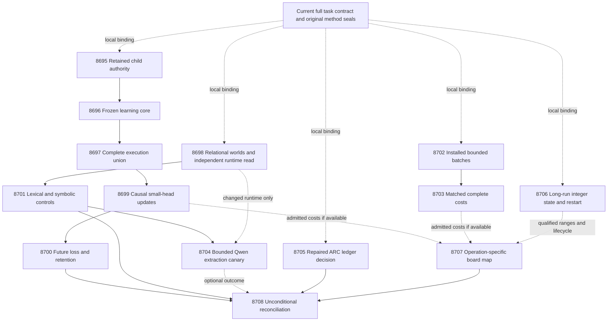

# Research Roadmap v746: Qualified causal learning, faithful symbolic evidence, and durable sparse arithmetic

**Created:** 2026-11-01. **Milestone:** `2026.11.746`.

**Status:** Planned; not activated. Execution YAML: `research-roadmap-next.yaml`.

**Supersedes:** V745 for future scheduling. Its complete design is preserved in
[research-roadmap-v745-preserved-20261101.md](research-roadmap-v745-preserved-20261101.md).
Historical protocols and result bytes remain authoritative for their original claims.

**Execution contract:** Exactly **14 tasks, Exp8695 through Exp8708**, in the order
in the final table, across four phases. That table, the complete JSON task objects
and the YAML must agree. Planning executes no experiments and changes no active roadmap.

## What V745 proved

All fourteen scheduling slots ended, but only five experiment producers ran.
Nine studies were skipped. At planning time, `research-complete.yaml` ends at V744;
V745's active roadmap, conductor log and terminal artifacts supply its current record.
The archive's `OK` disposition is not by itself evidence of scientific success.

| Evidence | Supported finding | Consequence |
|---|---|---|
| Exp8681 contract/methods | Disqualified and flagged. The final retention receipt has zero references even though the saved per-child receipts retain real SQLite. All 77 original nodes were collected; the final combined data did not establish original rejection line 113. | Qualify immutable per-child custody and original producer coverage before admitting learning authority. The later source state cannot clear old flags. |
| Exp8682–8690 | Original learning execution, relational controls, causal learning, benefit audit, installed batches, cost and Qwen studies did not execute. | These hypotheses remain unmeasured, not negative. Use changed prerequisites and fresh IDs. |
| Exp8691 ARC decision | Authentic ledger inputs, but failed owned CLI/coverage checks disqualify its conclusion as a qualified artifact. A later source repair adds early output containment and real adapter coverage. | Qualify the repaired reducer once; preserve the closed panel and historical flag. |
| Exp8692 precision | Qualified `circular_positive`: short constructed CPU checks passed for the primary signed 32/24 format. | Study accumulated decay, renormalization and restart. This is neither useful learning nor device speed. Its loose full-format bound exceeds signed64 and is not a global overflow proof. |
| Exp8693 hardware | Operation mapping qualified; complete new cost and compatible physical execution remained absent. | Admit new lifecycle and complete costs independently; retain each unsupported operation. |
| Exp8694 capstone | Qualified terminal accounting, with blocked scientific branches. | Preserve blocked versus null versus disqualified. External absence never becomes retryable partial. |

V733 source-information, V735 cold-cost, V737 supervisor and V743 batch-one nulls
remain closed. V743 compatibility and complete-source evidence remain available.
The PHASE D external-text scorer and energy-as-generator families stay retired.

## The three biggest gaps to the PRD vision

1. **FR-11: useful, causal continuous learning remains unproved.** The small head
   has registered objectives and inputs, but its original execution qualification
   has repeatedly failed. Finish that study with prediction-before-feedback,
   durable updates, future proper loss and joint retention. Preserve exposed-data
   limits and the mandated generator's frozen weights.
2. **FR-12: source coverage does not ensure faithful constraint extraction.**
   Complete lexical input can still erase roles, negation or temporal order.
   Separate missing/wrong extracted facts from query and decision errors. Test
   answer-independent queries and unknown outcomes before any hallucination claim.
3. **FR-05/FR-08 and NFR-01: deployable complete speed and hardware compatibility
   remain unproved.** Batch-one did not meet 10×. Measure a real bounded batching
   change at matched work, then test sparse arithmetic across its lifecycle.
   Host nonlinear operations, dense copies, transfer and persistence remain costs.

ARC supplies a required cross-game supervision check alongside these priorities.
The existing all-censored panel cannot justify a policy change or a solve claim.
The long-term energy-as-truth vision is an aspiration; learned low energy alone
is not an independently verified correctness certificate.

## Literature incorporated before design

The dated V746 scan in [research-references.md](../../research-references.md) was
written first. It covers all eight requested primary topics and six secondary
channels, including unsuccessful retrievals.

| Primary source | Planned use | Boundary |
|---|---|---|
| [VeriFin, 2608.10213v3](https://arxiv.org/abs/2608.10213), revised October 23, 2026 | Exp8698/8701/8704: establish queries independently of the proposed answer and retain unknown evidence | Adaptation of a grounding principle; no financial dataset, precision or guarantee is imported. |
| [TeQHallu, 2609.05025v2](https://arxiv.org/html/2609.05025v2), October 19 revision | Exp8701/8704: source spans and explicit record-completeness/error audit | Successful query execution cannot certify text-to-record fidelity. |
| [SymDiag, 2608.08786](https://arxiv.org/abs/2608.08786), August 2026 | Separate translation and reasoning errors in Exp8701/8704 | Abstract-level inspiration; a shared translator is not an independent judge. |
| [On-chip KAN locality, 2602.02056v4](https://arxiv.org/html/2602.02056v4), June revision | Exp8706: numerical formats, long-run state and explicit dense/host operations | CPU emulation is not FPGA performance; the paper does not establish Carnot's learning utility. |
| [Delayed capacity-constrained learning, 2503.19856](https://arxiv.org/abs/2503.19856), 2025 | Exp8699/8700 preserve bounded pending feedback and causal evaluation | No theoretical regret bound is transferred to the nonlinear head. |
| [Continuous-state FPGA sampling, 2610.31339](https://arxiv.org/abs/2610.31339); [Extropic Z1T](https://extropic.ai/writing/z1t/) | Exp8707: operation support and complete cost accounting | Core-solving evidence and vendor projections do not establish a compatible local spline service. |

EBT, ARM–EBM, neural feasibility and guided-decoding work remain architectural
context. No new generator or retired scorer is proposed. OpenReview's EBT forum
returned a browser challenge. Both Semantic Scholar citation endpoints failed;
there is no exhaustive citing-paper claim. Hugging Face supplied VeriFin/SymDiag
discovery, followed by primary-source checks. GitHub Trending snapshots were stale;
the TeQHallu author repository is a code lead, not a newly ranked dependency.
Kona's page supplied no reproducible architecture delta to adopt.

## Architecture



The contract is checked locally against sealed bytes by each independent branch.
There is no global `methods_ready_score` gate on extraction, deployment, ARC or
numerical work. This changes dependency ownership, not the acceptance standard.
Learning still requires the full original producer authority and execution union.
No downstream readiness is borrowed from disqualified historical artifacts.

## Phase 1 — Retain original authority and qualify causal execution

**Exp8695–Exp8697; 190 estimated minutes.** Exp8695 replaces the failing final
scratch rescan with aggregation of immutable per-child coverage references.
Separate producer and consumer combine roots. Exercise real child execution,
combine, scratch replacement, missing shards and tampering. Require the original
77 nodes and actual original rejection statement, plus all new owned statements.
If retained children missed the original rejection line, run the unchanged control
under fresh producer coverage. Never reinterpret an arbitrary current line as proof.

Exp8696 runs the original 39-node learning core on final sealed transitive sources.
Exp8697 runs the 25-node remainder at the same identity, then joins the exact
64-node union, 27 causal-runner nodes and 83 executable runner statements. Preserve
all original assertions, deadlines, exit/resume behavior and scientific operands.
Post-measurement edits invalidate the affected invocation, not merely its digest.

**Prototype / validation / adversarial check:** retained-custody integration,
original bounded cohorts, and actual rejection of missing/changed/duplicated
producer evidence. All gates remain zero until the relevant work qualifies.

## Phase 2 — Causal learning and faithful symbolic evidence

**Exp8698–Exp8701; 170 estimated minutes.** Exp8698 independently authenticates the
original relational method and current task contract. Keep 120 constructed worlds:
40 directed-role, 40 negation-scope and 40 temporal-order cases, four answer views
per world, with half the decisive facts after sentence 65. An independent world
evaluator qualifies all 480 view rows. Fixed queries derive from the question
before candidate answers are read. Missing premises remain unknown. Optional
changed-CUDA evidence is a separate read-only field; its absence does not fail the
corpus. No unchanged device probe occurs.

Exp8699 is the **continuous self-learning and calibrated typed-decision task**.
Keep the registered nine-input, 109-coefficient head, frozen/log-loss/Brier/shuffled
arms, seeds 17/29/43/71/101, five blocks of 20 question groups and three siblings.
There are 6,000 predictions over 100 groups. Capacity remains eight, learning rate
0.01 and L2 coefficient 0.001. Seal each prediction before delayed feedback, commit
state and acknowledgements atomically, preserve real crash/resume and tail drain,
and measure complete durable updates. Retention labels cannot enter training.

Exp8700 independently tests the original future-loss and simultaneous-retention
criteria. Average siblings and seeds within the 80 later groups; use 10,000 paired
cluster draws and 97.5% intervals for Brier versus frozen and versus log-loss.
Both improvement lower bounds must exceed zero with no increased typed-decision
loss. Jointly resample 50 retention questions across five windows; upper95 of the
maximum Brier increase must be at most 0.01. Keep exposed-development limits.

Exp8701 compares unchanged lexical vectors at chunks 1/32/128 against the 480
views, with equal-feature/opposite-truth witnesses and equivalent-wording checks.
Static parameterized SQLite queries over world-supplied records are a separate
capacity control. Delete required records and reverse relations. Separate missing
facts, wrong relations, wrong queries and wrong decisions. Oracle records can
establish constructed capacity only, never natural extraction fidelity.

**Prototype / validation / adversarial check:** independent worlds, real online
updates and loss reduction; reject label leakage, answer-conditioned queries,
constant/no-op learning, duplicated independent counts and unknown-as-false handling.

## Phase 3 — Complete installed costs and bounded Qwen grounding

**Exp8702–Exp8704; 155 estimated minutes.** Exp8702 authenticates original deployment
operands itself and qualifies opt-in `resident_energy.batch` batches of 1–16.
Keep the 65,536-byte frame limit, deadlines, identity checks and whole-envelope
rejection. Test the actual installed wheel/native extension outside the checkout,
with original public-import compatibility and full Python/native decision parity.

Exp8703 runs 60 cells: two backends, batch sizes 1/4/16 and ten paired process
repeats. Each cell processes 16 panels of 64 items, totaling 61,440 evaluations.
Recompute every feature; include launch through shutdown and all request/response
work. The native B16/B1 throughput lower95 bound must exceed 1.05, with exact
decisions and steady p95 at most 50 ms, to demonstrate batching benefit. Separately,
native/Python lower95 must reach 10 at the same batch size to meet NFR-01.
Use 10,000 paired process-level bootstrap draws; repeated items are not independent
workloads. Valid null measurements still release `batch_cost_ready_score`.

Exp8704 loads only `unsloth/Qwen3.8-27B-GGUF`, after qualified symbolic controls
and authenticated causal CUDA change. This is **model_bounded_generation**, with
a 10-second duration floor: 12 cases, four per family, three calls each (direct
decision, record extraction, record-grounded decision), temperature zero, at most
128 output tokens each and 4,608 total. Record actual offload, model/quantization
hashes, prompts, tokens and truncations. Parse records as data, execute only fixed
queries, and abstain on absent or contradictory facts. Compare paired errors and
cost without claiming population hallucination reduction. No generator training.

**Prototype / validation / adversarial check:** real installed envelopes and matched
costs, then real bounded model calls if available. Reject mismatched work, cached
answers, hidden startup costs, output truncation masquerading as completeness,
model-generated executable SQL and unproved device offload.

## Phase 4 — Close ARC validation and test numerical lifecycle

**Exp8705–Exp8708; 150 estimated minutes.** Exp8705 qualifies the repaired ARC
reducer/runner, preserving original tests and actual output-containment branches.
It independently reads the same four-game, eight-pair, sixteen-episode ledger.
The 120-action panel stays closed. Zero complete horizons support
`no_supported_policy_change`; censoring is not failed efficacy. Keep the supervisor
unchanged and require a distinct intervention plus uncensored support for future
work. Registry precheck prevents duplicate solve credit. This is a supervisor
refinement decision under the ARC generalization floor, not a new solve.

Exp8706 advances the passing short numerical study. Keep the primary signed32/24
format and original update equation. Run five heads × four fixed sequences ×
4,096 updates = 81,920 paired float/integer steps. Match uninterrupted and actual
process-restarted integer paths at committed update 2,048; count replay work
separately. Add five explicitly constructed near-renormalization states × 64
steps = 320 boundary controls. These controls are not learned trajectories.

Require exact restarted state/acknowledgements, finite values, zero overflow or
saturation, probability error at most 0.001 and decision parity outside that margin;
count float fallback within it. Check effective-coefficient continuity at the decay
trigger. Retain all 109 dense renormalization writes, at most 37 local data writes,
one decay scalar, 109 host snapshot copies, nonlinear CPU work and durable storage.
Bound accumulator claims to an explicit supported input/state domain. The previous
loose full-format bound exceeded signed64 despite safe observed short paths.
A numerical gate failure is a useful null, not a reason to retune during the run.

Exp8707 admits each available new cost/lifecycle operand independently and maps
operations to all three boards. Exp8708 runs unconditionally and reconciles all
fourteen dispositions, original retirement conditions and stable publication gates.
External absence is terminal blocked. The capstone reports retirement candidates;
it does not mutate the exclusion manifest or rehabilitate historical artifacts.

**Prototype / validation / adversarial check:** repaired private ARC execution,
long-run integer state with real restart, and operation maps. Reject censoring-as-
efficacy, silent wraparound, hidden dense/host work and device claims from emulation.

## Hardware requirements

| Resource | Use | Requirement and acquisition implication |
|---|---|---|
| Existing CPU, RAM and disk | All qualification, learning, symbolic, timing and numerical branches | Bounded workers and disk-backed private scratch; verify free resources. No purchase required. |
| Rust/PyO3 wheel tooling | Installed batch prototype and costs | Actual installed extension identity and original import compatibility; no new dependency planned. |
| Cached Qwen3.8-27B GGUF and CUDA | Exp8704 only | Verified quantization/context fit, lease and actual offload. Listed dual RTX3090 inventory is not runtime readiness; no download or unrelated-job eviction. |
| KV260 | Exp8707 support map | Existing quadratic energy scope, k_max<=5. Spline/update kernel remains unimplemented. Future delivery uses SSH/scp/xmutil. |
| PolarFire | Exp8707 support map | Linux CPU dispatch evidence only; no inferred fabric arithmetic. |
| GateMate | Exp8707 physical-change ledger | Preserve 0xffffffff until dated physical change, IDCODE0x20000001 and ordered n16 smoke; no identical probe. |
| XDNA NPU / Extropic TSU | Deferred | No qualified local backend; access/toolchain and compatible workload precede timing. |

The program's 100× learning target remains a target. Only measured compatible
fractions support conditional acceleration ceilings. Unknown costs stay unknown.
New ranges or dense-update costs may change acquisition prerequisites; board
purchases and speculative hardware expansion are not part of this plan.

## Execution and stopping rules

The fourteen task estimates total **665 minutes** if every branch executes. Every
task retains its own 4,800-second cap, measurement stop by 3,600 seconds and at
least 900 seconds for validation. Each prompt has numbered flushed progress,
inner-loop counts, parent heartbeats within 60 seconds and chunked file-write
instructions. No silence gap may reach 600 seconds. Files over about 200 lines
must be written through several calls, with progress between calls.

Only Exp8704 loads an LLM. Full generation would use the 60-second class; embedding
or load-only work would use the 2-second class. Neither describes this bounded
canary. Other tasks declare `no_model_load`, empty MODEL_SPECS, zero LLM calls and
separately authenticated small numerical heads. Legacy models are smoke tests only.

Per the current user routing directive, coordination/qualification and hardware
mapping use Claude Opus at 100 turns. Formulaic corpus, batch, ARC-repair and numeric
code use Codex `gpt-6.1-sol`; routine research uses Sonnet, with reduced budgets for
audits. No Luna or Gemini task is proposed. This overrides older local defaults.

All comparative tasks retain per-unit rows, intended/failed/censored counts and
principle-annotated fields. Every repeated failed scope names its prior outcome,
changed cause and `retire_if_same_verdict: true`. For skips without an artifact,
lineage cites the literal conductor disposition rather than inventing a verdict.
No retired task appears as a queued dependency. Original tests, source custody,
terminal publication checks and scientific thresholds remain binding.

## Exact task contract

Exactly **14 tasks, Exp8695 through Exp8708**, in conductor execution order.

| Order | ID | Title | Phase | Deliverable |
|---|---|---|---|---|
| 1 | `exp8695-retained-contract-authority` | Qualify retained child evidence and bind fourteen branch contracts | 1 | `results/experiment_8695_v746_retained_contract_authority.json` |
| 2 | `exp8696-frozen-learning-core` | Execute the frozen original learning core with retained producer authority | 1 | `results/experiment_8696_v746_frozen_learning_core.json` |
| 3 | `exp8697-learning-union-qualification` | Qualify original deadline controls and the complete causal learning union | 1 | `results/experiment_8697_v746_learning_union_qualification.json` |
| 4 | `exp8698-relational-evidence-controls` | Qualify answer-independent relational worlds without a global report dependency | 2 | `results/experiment_8698_v746_relational_evidence_controls.json` |
| 5 | `exp8699-causal-brier-stream` | Measure continuous Brier learning after prediction sealing and delayed feedback | 2 | `results/experiment_8699_v746_causal_brier_stream.json` |
| 6 | `exp8700-learning-benefit-audit` | Audit future proper-loss benefit and simultaneous retention on sealed causal rows | 2 | `results/experiment_8700_v746_learning_benefit_audit.json` |
| 7 | `exp8701-relational-feature-audit` | Separate lexical collisions from symbolic grounding and missing-record errors | 2 | `results/experiment_8701_v746_relational_feature_audit.json` |
| 8 | `exp8702-installed-batch-prototype` | Qualify installed bounded batches from independently authenticated deployment inputs | 3 | `results/experiment_8702_v746_installed_batch_prototype.json` |
| 9 | `exp8703-installed-batch-cost` | Measure matched complete batch throughput and same-batch native speed | 3 | `results/experiment_8703_v746_installed_batch_cost.json` |
| 10 | `exp8704-qwen-symbolic-canary` | Compare bounded Qwen decisions with source-grounded relation extraction | 3 | `results/experiment_8704_v746_qwen_symbolic_canary.json` |
| 11 | `exp8705-arc-decision-qualification` | Qualify the repaired cross-game censoring decision without replaying the closed panel | 4 | `results/experiment_8705_v746_arc_decision_qualification.json` |
| 12 | `exp8706-spline-lifecycle-stress` | Test long-run decay renormalization and restart of the qualified fixed-point head | 4 | `results/experiment_8706_v746_spline_lifecycle_stress.json` |
| 13 | `exp8707-hardware-operation-boundary` | Map lifecycle and complete service operations to actual board capabilities | 4 | `results/experiment_8707_v746_hardware_operation_boundary.json` |
| 14 | `exp8708-capstone` | Reconcile fourteen outcomes and close exact unchanged scopes | 4 | `results/experiment_8708_v746_capstone.json` |

Canonical full-task SHA-256: `5c635232bc3e986e64593a6f42606d90e73491aa82c813541bbb84c5e88067ab`

Canonical task SHA256: `43132b7a0dad4165413d7bcce82bdc9aa5602d17fc1a5144a960edb9d01c3c97`

<!-- V746_TASK_CONTRACT_START -->
```json
{
  "milestone": "2026.11.746",
  "tasks": [
    {
      "id": "exp8695-retained-contract-authority",
      "title": "Qualify retained child evidence and bind fourteen branch contracts",
      "phase": 1,
      "track": "infrastructure",
      "priority": "high",
      "requires_gpu": false,
      "max_turns": 100,
      "estimated_wall_time_min": 60,
      "per_unit_rows": true,
      "milestone": "2026.11.746",
      "deliverable": "results/experiment_8695_v746_retained_contract_authority.json",
      "inference_substrate_class": "no_model_load",
      "MODEL_SPECS": [],
      "gated_on": [],
      "prior_failures": [
        {
          "experiment_id": "exp7532-v659-contract-methods",
          "verdict": "complete_blocked_incomplete_v659_authorities",
          "addressed_by": "Exp8681 retained valid per-child SQLite but its final mutable-scratch rescan returned no shards and final combined data lost the original rejection line. Build authority from independently sealed per-child receipts before unrelated suites; validate final report against that preserved union. Independent research branches qualify their own operands. Prior diagnostic: Historical authority was absent or disagreed with the queued full tasks. V744 provides its own fourteen-row table, complete objects, versioned markers and digest; test every field mutation and preserve V743 authority separately. Optional CUDA absence affects only the canary.",
          "retire_if_same_verdict": true
        },
        {
          "experiment_id": "exp7713-v672-contract-methods",
          "verdict": "complete_blocked_v672_independent_contract",
          "addressed_by": "Exp8681 retained valid per-child SQLite but its final mutable-scratch rescan returned no shards and final combined data lost the original rejection line. Build authority from independently sealed per-child receipts before unrelated suites; validate final report against that preserved union. Independent research branches qualify their own operands. Prior diagnostic: Historical authority was absent or disagreed with the queued full tasks. V744 provides its own fourteen-row table, complete objects, versioned markers and digest; test every field mutation and preserve V743 authority separately. Optional CUDA absence affects only the canary.",
          "retire_if_same_verdict": true
        },
        {
          "experiment_id": "exp7940-v689-contract-methods",
          "verdict": "complete_blocked_authority",
          "addressed_by": "Exp8681 retained valid per-child SQLite but its final mutable-scratch rescan returned no shards and final combined data lost the original rejection line. Build authority from independently sealed per-child receipts before unrelated suites; validate final report against that preserved union. Independent research branches qualify their own operands. Prior diagnostic: Historical authority was absent or disagreed with the queued full tasks. V744 provides its own fourteen-row table, complete objects, versioned markers and digest; test every field mutation and preserve V743 authority separately. Optional CUDA absence affects only the canary.",
          "retire_if_same_verdict": true
        },
        {
          "experiment_id": "exp7992-v693-contract-methods",
          "verdict": "complete_blocked_authority",
          "addressed_by": "Exp8681 retained valid per-child SQLite but its final mutable-scratch rescan returned no shards and final combined data lost the original rejection line. Build authority from independently sealed per-child receipts before unrelated suites; validate final report against that preserved union. Independent research branches qualify their own operands. Prior diagnostic: Historical authority was absent or disagreed with the queued full tasks. V744 provides its own fourteen-row table, complete objects, versioned markers and digest; test every field mutation and preserve V743 authority separately. Optional CUDA absence affects only the canary.",
          "retire_if_same_verdict": true
        },
        {
          "experiment_id": "exp8018-v695-contract-methods",
          "verdict": "complete_blocked_authority",
          "addressed_by": "Exp8681 retained valid per-child SQLite but its final mutable-scratch rescan returned no shards and final combined data lost the original rejection line. Build authority from independently sealed per-child receipts before unrelated suites; validate final report against that preserved union. Independent research branches qualify their own operands. Prior diagnostic: Historical authority was absent or disagreed with the queued full tasks. V744 provides its own fourteen-row table, complete objects, versioned markers and digest; test every field mutation and preserve V743 authority separately. Optional CUDA absence affects only the canary.",
          "retire_if_same_verdict": true
        },
        {
          "experiment_id": "exp8374-v722-contract-methods",
          "verdict": "complete_blocked_direct_contract_methods",
          "addressed_by": "Exp8681 retained valid per-child SQLite but its final mutable-scratch rescan returned no shards and final combined data lost the original rejection line. Build authority from independently sealed per-child receipts before unrelated suites; validate final report against that preserved union. Independent research branches qualify their own operands. Prior diagnostic: Historical authority was absent or disagreed with the queued full tasks. V744 provides its own fourteen-row table, complete objects, versioned markers and digest; test every field mutation and preserve V743 authority separately. Optional CUDA absence affects only the canary.",
          "retire_if_same_verdict": true
        },
        {
          "experiment_id": "exp8388-v723-contract-methods",
          "verdict": "complete_blocked_v723_contract_methods",
          "addressed_by": "Exp8681 retained valid per-child SQLite but its final mutable-scratch rescan returned no shards and final combined data lost the original rejection line. Build authority from independently sealed per-child receipts before unrelated suites; validate final report against that preserved union. Independent research branches qualify their own operands. Prior diagnostic: Historical authority was absent or disagreed with the queued full tasks. V744 provides its own fourteen-row table, complete objects, versioned markers and digest; test every field mutation and preserve V743 authority separately. Optional CUDA absence affects only the canary.",
          "retire_if_same_verdict": true
        },
        {
          "experiment_id": "exp8416-v725-contract-methods",
          "verdict": "complete_blocked_v725_contract_methods",
          "addressed_by": "Exp8681 retained valid per-child SQLite but its final mutable-scratch rescan returned no shards and final combined data lost the original rejection line. Build authority from independently sealed per-child receipts before unrelated suites; validate final report against that preserved union. Independent research branches qualify their own operands. Prior diagnostic: Historical authority was absent or disagreed with the queued full tasks. V744 provides its own fourteen-row table, complete objects, versioned markers and digest; test every field mutation and preserve V743 authority separately. Optional CUDA absence affects only the canary.",
          "retire_if_same_verdict": true
        },
        {
          "experiment_id": "exp8443-v727-contract-methods",
          "verdict": "complete_blocked_v727_contract_methods",
          "addressed_by": "Exp8681 retained valid per-child SQLite but its final mutable-scratch rescan returned no shards and final combined data lost the original rejection line. Build authority from independently sealed per-child receipts before unrelated suites; validate final report against that preserved union. Independent research branches qualify their own operands. Prior diagnostic: Historical authority was absent or disagreed with the queued full tasks. V744 provides its own fourteen-row table, complete objects, versioned markers and digest; test every field mutation and preserve V743 authority separately. Optional CUDA absence affects only the canary.",
          "retire_if_same_verdict": true
        },
        {
          "experiment_id": "exp8471-v729-contract-methods",
          "verdict": "complete_blocked_v729_contract_methods",
          "addressed_by": "Exp8681 retained valid per-child SQLite but its final mutable-scratch rescan returned no shards and final combined data lost the original rejection line. Build authority from independently sealed per-child receipts before unrelated suites; validate final report against that preserved union. Independent research branches qualify their own operands. Prior diagnostic: Historical authority was absent or disagreed with the queued full tasks. V744 provides its own fourteen-row table, complete objects, versioned markers and digest; test every field mutation and preserve V743 authority separately. Optional CUDA absence affects only the canary.",
          "retire_if_same_verdict": true
        },
        {
          "experiment_id": "exp8499-v731-contract-methods",
          "verdict": "complete_blocked_v731_contract_methods",
          "addressed_by": "Exp8681 retained valid per-child SQLite but its final mutable-scratch rescan returned no shards and final combined data lost the original rejection line. Build authority from independently sealed per-child receipts before unrelated suites; validate final report against that preserved union. Independent research branches qualify their own operands. Prior diagnostic: Historical authority was absent or disagreed with the queued full tasks. V744 provides its own fourteen-row table, complete objects, versioned markers and digest; test every field mutation and preserve V743 authority separately. Optional CUDA absence affects only the canary.",
          "retire_if_same_verdict": true
        },
        {
          "experiment_id": "exp8565-v736-contract-methods",
          "verdict": "complete_blocked_v736_contract_methods",
          "addressed_by": "Exp8681 retained valid per-child SQLite but its final mutable-scratch rescan returned no shards and final combined data lost the original rejection line. Build authority from independently sealed per-child receipts before unrelated suites; validate final report against that preserved union. Independent research branches qualify their own operands. Prior diagnostic: Historical authority was absent or disagreed with the queued full tasks. V744 provides its own fourteen-row table, complete objects, versioned markers and digest; test every field mutation and preserve V743 authority separately. Optional CUDA absence affects only the canary.",
          "retire_if_same_verdict": true
        },
        {
          "experiment_id": "exp8602-v739-contract-methods",
          "verdict": "complete_blocked_v739_contract_methods",
          "addressed_by": "Exp8681 retained valid per-child SQLite but its final mutable-scratch rescan returned no shards and final combined data lost the original rejection line. Build authority from independently sealed per-child receipts before unrelated suites; validate final report against that preserved union. Independent research branches qualify their own operands. Prior diagnostic: Historical authority was absent or disagreed with the queued full tasks. V744 provides its own fourteen-row table, complete objects, versioned markers and digest; test every field mutation and preserve V743 authority separately. Optional CUDA absence affects only the canary.",
          "retire_if_same_verdict": true
        },
        {
          "experiment_id": "exp8667-contract-methods",
          "verdict": "complete_disqualified_v744_contract_methods",
          "addressed_by": "Exp8681 retained valid per-child SQLite but its final mutable-scratch rescan returned no shards and final combined data lost the original rejection line. Build authority from independently sealed per-child receipts before unrelated suites; validate final report against that preserved union. Independent research branches qualify their own operands. Prior diagnostic: The original failure_summary identifies report normalization mutating nested measurement input. Use a pure copied diagnostic view, regress original retained-shard replay and missing-shard rejection, freeze final sources, then execute all original owned nodes and coverage. Old flags remain.",
          "retire_if_same_verdict": true
        },
        {
          "experiment_id": "exp8681-contract-methods",
          "verdict": "complete_disqualified_v745_contract_methods",
          "addressed_by": "Exp8681 retained valid per-child SQLite but its final mutable-scratch rescan returned no shards and final combined data lost the original rejection line. Build authority from independently sealed per-child receipts before unrelated suites; validate final report against that preserved union. Independent research branches qualify their own operands.",
          "retire_if_same_verdict": true
        }
      ],
      "agent_type": "claude",
      "model": "opus",
      "prompt": "CONTEXT:\nWork in {project_root} on {date}. V745 ended fourteen scheduling slots, with five producers and nine skipped studies. Exp8681 is disqualified: final coverage retention was empty despite retained per-child SQLite, and the final combined file lacked original rejection line113. Exp8691 failed owned validation; its later source fix does not clear its historical flag. Exp8692 passed constructed CPU32/24 arithmetic, not useful learning or hardware acceleration. Exp8693/8694 remain blocked for missing scientific/device evidence. V746 has exactly fourteen tasks, Exp8695 through Exp8708. Preserve historical quarantines and the V733 source-information, V735 cold-cost, V737 supervisor and V743 batch-one nulls.\n\nEXISTING CODE TO READ FIRST:\nCLAUDE.md; CODEX.md; ops/e2e-test-plan.md; ops/exclusion_manifest.yaml; openspec/capabilities/research-reporting/spec.md; openspec/capabilities/verification/spec.md; scripts/experiment_template.py; python/carnot/reporting/primary_publication.py; openspec/change-proposals/research-roadmap-vNEXT.md; openspec/change-proposals/research-roadmap-v745-preserved-20261101.md; openspec/change-proposals/v744-methods-protocol.json; research-references.md; python/carnot/reporting/v744_contract_methods.py; python/carnot/reporting/v744_contract_report.py; python/carnot/reporting/v741_contract_report.py; python/carnot/reporting/roadmap_contract.py; tests/python/test_v744_contract_methods_8667.py; tests/python/test_v744_contract_runner_8667.py; results/experiment_8667_v744_contract_methods.json; results/raw/experiment_8667_v744_contract_methods/invocations/1793500792730659524/failure_summary.json; python/carnot/verify/cuda_reader_8410.py; python/carnot/reporting/v745_contract_runner.py; python/carnot/reporting/v745_contract_report.py; python/carnot/reporting/v743_contract_runner.py; tests/python/test_v745_contract_8681.py; results/experiment_8681_v745_contract_methods.json\n\nTASK:\nQualify retained child evidence and bind fourteen branch contracts. Deliver results/experiment_8695_v746_retained_contract_authority.json. Use thin runner scripts/experiments/experiment_8695_v746_retained_contract_authority.py, raw evidence results/raw/experiment_8695_v746_retained_contract_authority/ and notes docs/research-notes/v746-retained-contract-authority.md.\n\nCONCRETE STEPS:\n1. PRECONDITIONS: Emit a flushed start line. Check exact input paths/hashes, tools, free memory and writable disk-backed scratch. Authenticate each gate with its producer and terminal validation. Missing file, missing field, observed zero and changed bytes are different failures. A flagged producer cannot grant readiness. External absence produces complete_blocked_<reason>, verdict_class=blocked and gate_check_summary. Optional devices cannot veto CPU work.\n\n2. Print a flushed progress line at each phase boundary and before and after every model load, generation, benchmark or subprocess that can take minutes. Use unbuffered output. Print completed/pending counts inside long loops and a flushed parent heartbeat at least every60 seconds while a child runs. Keep every silence gap under600 seconds. Write any file over about200 lines in several tool calls of at most150 lines, with a progress message between calls. Poll within60 seconds. Stop measurements by3600 seconds and reserve at least900 seconds for validation within the4800-second cap. Never pad duration.\n\n3. Spec first: confirm relevant REQ-* and SCENARIO-* before implementation. Write focused failing tests, then implement the smallest change. Freeze transitive source, tests, inputs and configuration before measurement. Post-seal changes invalidate affected receipts. Use scripts/experiments/ for runners, tests/python/ for tests and /var/tmp for private scratch. Accept --date {date}. Do not alter historical results, active research-roadmap.yaml, shared validators or generator weights. Preserve cleanup and private-input guards.\n\n4. Bind this task to the V746 full-object contract, visible table and canonical digest using the existing roadmap reader. Preserve V745 authority in research-roadmap-v745-preserved-20261101.md. Independently authenticate this branch's original inputs and registered method values; do not use Exp8681 readiness, rebuild a stack of historical report wrappers, or count future same-roadmap outputs as existing files. Historical failures remain failures. Branch-local qualification has the same original assertions and authority requirements, not weaker gates.\n\n5. Declare inference_substrate_class=no_model_load, MODEL_SPECS=[] and zero language-model calls. Use aggregation_from_upstream_artifacts for readers, deterministic_verifier for constructed checks, or verifier_ensemble_against_cached_candidates for numerical-head evaluation. Authenticate numerical checkpoints separately. CPU fixed-point arithmetic is not physical FPGA execution.\n\n6. Reproduce Exp8681's exact failure from validation.json and per-child custody files:77 original nodes were collected; child retention receipts had SQLite references; the final original_coverage_retention had none and original_rejection_line_executed was false. Write an integration regression with two real coverage children, intervening combine and later scratch replacement. Do not infer original execution from a consumer test.\n\n7. Retain each completed child's raw SQLite, JUnit, exact node inventory, source hashes and exit before any combine. Aggregate these immutable receipts rather than scanning mutable scratch at the end. Combine copies in separate producer and consumer roots. Resolve the historical rejection statement against its frozen original source; require actual execution of original line113. If retained children do not cover it, execute the unchanged original rejection control in the fresh producer cohort. Never replace it with an arbitrary current line.\n\n8. Run all 77 original contract nodes and new retention/mutation regressions on sealed source. Preserve pure nested-input report construction and all original assertions. Test missing/tampered shards, duplicate nodes, source drift, failed children, scratch cleanup and self-consistently rehashed replacements. Qualify original producer coverage independently from new owned100 percent coverage.\n\n9. Bind all fourteen complete V746 objects, table, markers and digest. Exercise count/order/ID/title/phase/path/model/substrate/prompt/gate/prior mutations. Emit contract_ready_score and learning_authority_ready_score only after exact owned qualification. Keep the V744 objective_updates, objective_audit, cohort partition and original head/data bytes unchanged. Do not introduce a global gate on extraction, installed batching, numerical lifecycle or ARC closure; each must independently validate the same current contract and its own original input authority.\n\n10. Run focused unit tests and actual private CLI success/rejection paths, Ruff check and format, strict mypy on owned modules, and scripts/check_spec_coverage.py --files <owned-test-files>. Run applicable ops/e2e-test-plan.md checks, including private E2E-018/021 for authority/publication changes. Require100 percent newly owned statement coverage, including actual child and rejection paths. Collect once; use bounded disjoint children with -n 0 -o addopts= --no-cov. Retain raw SQLite, source hashes, JUnit, commands, actual exits and durations per child before combining copies. A killed child fails qualification. Preserve original test nodes and assertions; consumer coverage cannot qualify a producer. Do not run recursive historical controllers or the entire repository suite.\n\n11. Cold-replay immutable primitives in a fresh bounded process. Reject missing operands and consistently rehashed tampering. Run unchanged primary_publication, scripts/adversarial_verify.py --json <private-candidate> and scripts/verdict_row_consistency_lint.py --strict <private-candidate>. Preserve actual severities and historical flags. Validate final bytes before atomic publication. Owned failed checks disqualify; unchanged external incompleteness is blocked, never partial. Reconcile openspec/, _bmad/traceability.md, ops/status.md and ops/changelog.md with measured outcomes.\n\nREQUIRED ARTIFACT FIELDS:\nexperiment_id, task_id, milestone, run_date, invocation_id: principle: Bind each claim to its actual task and invocation.\nhonest_verdict, verdict_class: principle: Use complete_ terminal prefixes. verdict_class is positive | circular_positive | null | blocked | disqualified | partial. Only retryable incomplete owned work is partial; unchanged external failure is blocked.\ngate_check_summary: principle: Every blocked_* or complete_blocked_* identifies upstream, check, path/hash, exact field, operator, expected and observed; distinguish absence from zero.\ninference_substrate, inference_substrate_class, MODEL_SPECS, model_invocation_counts, target_model, historical_model_provenance: principle: Separate current LLM calls, authenticated numerical heads and historical provenance.\nrows, intended_count, completed_count, failed_count, censored_count, excluded_count, independent_count, sample_size_budget: principle: Retain a status/metric per intended unit and arm. Seeds, siblings, views and repeats do not multiply independent questions.\nverifier_is_oracle, exposure_scope, independent_generalization_score, generalized_learning_benefit_score: principle: Oracle-dependent wins are circular_positive. Constructed or exposed data cannot establish independent generalization.\nrequired_checks_passed, flagged_adversarial, acceptance_gates, validation_receipts, terminal_validation_sidecar_path, adversarial_findings: principle: Failed acceptance gates forbid positive claims; readiness is separate from benefit.\npreconditions_checked, duration_s, started_at_utc, ended_at_utc, phase_spans, random_seed, reproducibility_checksum: principle: Use actual clocks, measured phase spans and reproducible seeds, never mtime estimates.\nsource_artifact_hashes, code_config_hashes, raw_shard_hashes, cited_upstream_artifacts, field_principles, branch_gate_values: principle: Bind exact evidence and explain every field. Downstream gates consume identically named top-level numeric0/1 scores.\ncontract_ready_score, learning_authority_ready_score, retained_child_rows, producer_coverage_union, original_node_rows, authority_mutation_rows, methods_manifest: principle: Fresh exact producer evidence qualifies authority; later scratch cleanup and unrelated branch outcomes cannot rewrite it.\n\nRun command: cd {project_root} && JAX_PLATFORMS=cpu PYTHONPATH=python:. PYTHONUNBUFFERED=1 .venv/bin/python -u scripts/experiments/experiment_8695_v746_retained_contract_authority.py --date {date}\n\nDo NOT push. Do NOT modify scripts/research_conductor.py.\n"
    },
    {
      "id": "exp8696-frozen-learning-core",
      "title": "Execute the frozen original learning core with retained producer authority",
      "phase": 1,
      "track": "infrastructure",
      "priority": "high",
      "requires_gpu": false,
      "max_turns": 100,
      "estimated_wall_time_min": 65,
      "per_unit_rows": true,
      "milestone": "2026.11.746",
      "deliverable": "results/experiment_8696_v746_frozen_learning_core.json",
      "inference_substrate_class": "no_model_load",
      "MODEL_SPECS": [],
      "gated_on": [
        {
          "upstream": "exp8695-retained-contract-authority",
          "artifact_field": "learning_authority_ready_score",
          "op": "==",
          "value": 1
        }
      ],
      "prior_failures": [
        {
          "experiment_id": "exp8654-learning-core-execution",
          "verdict": "complete_disqualified_v743_learning_core_execution",
          "addressed_by": "Exp8682 was skipped because Exp8681 methods_ready_score was0. Exp8695 fixes final-scratch evidence loss; execute the fixed39-node cohort on sealed transitive source, with no post-measurement edits or reused recovery receipts. Prior diagnostic: All 39 nodes passed but later driver/report/test edits invalidated custody. Finish implementation first, seal a private transitive checkout, then run fresh core execution and replay without edits; reject all historical recovery reuse.",
          "retire_if_same_verdict": true
        },
        {
          "experiment_id": "exp8641-learning-execution-custody",
          "verdict": "complete_disqualified_v742_learning_execution_custody",
          "addressed_by": "Exp8682 was skipped because Exp8681 methods_ready_score was0. Exp8695 fixes final-scratch evidence loss; execute the fixed39-node cohort on sealed transitive source, with no post-measurement edits or reused recovery receipts. Prior diagnostic: The single run spent its3600-second measurement budget before original25, killed it with about62 seconds left, and left11 nodes pending. Separate core and deadline cohorts with module-fixture reuse and exact source-bound receipts; no timeout or assertion is relaxed.",
          "retire_if_same_verdict": true
        },
        {
          "experiment_id": "exp8668-frozen-learning-core",
          "verdict": "blocked_gate_check_failed",
          "addressed_by": "Exp8682 was skipped because Exp8681 methods_ready_score was0. Exp8695 fixes final-scratch evidence loss; execute the fixed39-node cohort on sealed transitive source, with no post-measurement edits or reused recovery receipts. Prior diagnostic: V744 never executed this cohort because Exp8667 report mutation failed methods qualification. Exp8681 now qualifies immutable report construction; execute fresh frozen cohorts, retaining original assertions and exact union.",
          "retire_if_same_verdict": true
        },
        {
          "experiment_id": "exp8682-frozen-learning-core",
          "verdict": "blocked_gate_check_failed",
          "addressed_by": "Exp8682 was skipped because Exp8681 methods_ready_score was0. Exp8695 fixes final-scratch evidence loss; execute the fixed39-node cohort on sealed transitive source, with no post-measurement edits or reused recovery receipts.",
          "retire_if_same_verdict": true
        }
      ],
      "agent_type": "claude",
      "model": "opus",
      "prompt": "CONTEXT:\nWork in {project_root} on {date}. V745 ended fourteen scheduling slots, with five producers and nine skipped studies. Exp8681 is disqualified: final coverage retention was empty despite retained per-child SQLite, and the final combined file lacked original rejection line113. Exp8691 failed owned validation; its later source fix does not clear its historical flag. Exp8692 passed constructed CPU32/24 arithmetic, not useful learning or hardware acceleration. Exp8693/8694 remain blocked for missing scientific/device evidence. V746 has exactly fourteen tasks, Exp8695 through Exp8708. Preserve historical quarantines and the V733 source-information, V735 cold-cost, V737 supervisor and V743 batch-one nulls.\n\nEXISTING CODE TO READ FIRST:\nCLAUDE.md; CODEX.md; ops/e2e-test-plan.md; ops/exclusion_manifest.yaml; openspec/capabilities/research-reporting/spec.md; openspec/capabilities/verification/spec.md; scripts/experiment_template.py; python/carnot/reporting/primary_publication.py; openspec/change-proposals/research-roadmap-vNEXT.md; openspec/change-proposals/research-roadmap-v745-preserved-20261101.md; openspec/change-proposals/v744-methods-protocol.json; research-references.md; python/carnot/reporting/learning_core_runner_8654.py; python/carnot/reporting/learning_core_report_8654.py; python/carnot/reporting/learning_clock_8592.py; tests/python/test_learning_core_8654.py; tests/python/test_learning_core_runner_8654.py; results/experiment_8654_v743_learning_core_execution.json; python/carnot/reporting/v745_contract_runner.py; results/experiment_8682_frozen_learning_core.json\n\nTASK:\nExecute the frozen original learning core with retained producer authority. Deliver results/experiment_8696_v746_frozen_learning_core.json. Use thin runner scripts/experiments/experiment_8696_v746_frozen_learning_core.py, raw evidence results/raw/experiment_8696_v746_frozen_learning_core/ and notes docs/research-notes/v746-frozen-learning-core.md.\n\nCONCRETE STEPS:\n1. PRECONDITIONS: Emit a flushed start line. Check exact input paths/hashes, tools, free memory and writable disk-backed scratch. Authenticate each gate with its producer and terminal validation. Missing file, missing field, observed zero and changed bytes are different failures. A flagged producer cannot grant readiness. External absence produces complete_blocked_<reason>, verdict_class=blocked and gate_check_summary. Optional devices cannot veto CPU work.\n\n2. Print a flushed progress line at each phase boundary and before and after every model load, generation, benchmark or subprocess that can take minutes. Use unbuffered output. Print completed/pending counts inside long loops and a flushed parent heartbeat at least every60 seconds while a child runs. Keep every silence gap under600 seconds. Write any file over about200 lines in several tool calls of at most150 lines, with a progress message between calls. Poll within60 seconds. Stop measurements by3600 seconds and reserve at least900 seconds for validation within the4800-second cap. Never pad duration.\n\n3. Spec first: confirm relevant REQ-* and SCENARIO-* before implementation. Write focused failing tests, then implement the smallest change. Freeze transitive source, tests, inputs and configuration before measurement. Post-seal changes invalidate affected receipts. Use scripts/experiments/ for runners, tests/python/ for tests and /var/tmp for private scratch. Accept --date {date}. Do not alter historical results, active research-roadmap.yaml, shared validators or generator weights. Preserve cleanup and private-input guards.\n\n4. Bind this task to the V746 full-object contract, visible table and canonical digest using the existing roadmap reader. Preserve V745 authority in research-roadmap-v745-preserved-20261101.md. Independently authenticate this branch's original inputs and registered method values; do not use Exp8681 readiness, rebuild a stack of historical report wrappers, or count future same-roadmap outputs as existing files. Historical failures remain failures. Branch-local qualification has the same original assertions and authority requirements, not weaker gates.\n\n5. Declare inference_substrate_class=no_model_load, MODEL_SPECS=[] and zero language-model calls. Use aggregation_from_upstream_artifacts for readers, deterministic_verifier for constructed checks, or verifier_ensemble_against_cached_candidates for numerical-head evaluation. Authenticate numerical checkpoints separately. CPU fixed-point arithmetic is not physical FPGA execution.\n\n6. Preserve the original 39-node core cohort and exact scientific operands from v744-methods-protocol.json. Finish adapters/tests/formatting first, seal a private transitive checkout and independently authenticate original family authority. Preserve the known Exp8654 source-drift rejection; its old passing nodes do not qualify changed code.\n\n7. Collect once, group by module/fixture identity and run all 39 nodes with measured per-child admission, deadlines and retained coverage. Reuse setup only at identical source/fixture identity. Do not alias private cleanup into shared results. Keep the original learning-clock, causal-runner and objective-checkpoint assertions.\n\n8. Publish learning_core_ready_score=1 only for all 39 original nodes, original runner subset, true owned coverage, cold replay and matching before/after transitive hashes. Supply the frozen exact 25-node remainder to Exp8697. Cohort A alone does not authorize training. Any edit requires a new invocation, never a mixed evidence union.\n\n9. Run focused unit tests and actual private CLI success/rejection paths, Ruff check and format, strict mypy on owned modules, and scripts/check_spec_coverage.py --files <owned-test-files>. Run applicable ops/e2e-test-plan.md checks, including private E2E-018/021 for authority/publication changes. Require100 percent newly owned statement coverage, including actual child and rejection paths. Collect once; use bounded disjoint children with -n 0 -o addopts= --no-cov. Retain raw SQLite, source hashes, JUnit, commands, actual exits and durations per child before combining copies. A killed child fails qualification. Preserve original test nodes and assertions; consumer coverage cannot qualify a producer. Do not run recursive historical controllers or the entire repository suite.\n\n10. Cold-replay immutable primitives in a fresh bounded process. Reject missing operands and consistently rehashed tampering. Run unchanged primary_publication, scripts/adversarial_verify.py --json <private-candidate> and scripts/verdict_row_consistency_lint.py --strict <private-candidate>. Preserve actual severities and historical flags. Validate final bytes before atomic publication. Owned failed checks disqualify; unchanged external incompleteness is blocked, never partial. Reconcile openspec/, _bmad/traceability.md, ops/status.md and ops/changelog.md with measured outcomes.\n\nREQUIRED ARTIFACT FIELDS:\nexperiment_id, task_id, milestone, run_date, invocation_id: principle: Bind each claim to its actual task and invocation.\nhonest_verdict, verdict_class: principle: Use complete_ terminal prefixes. verdict_class is positive | circular_positive | null | blocked | disqualified | partial. Only retryable incomplete owned work is partial; unchanged external failure is blocked.\ngate_check_summary: principle: Every blocked_* or complete_blocked_* identifies upstream, check, path/hash, exact field, operator, expected and observed; distinguish absence from zero.\ninference_substrate, inference_substrate_class, MODEL_SPECS, model_invocation_counts, target_model, historical_model_provenance: principle: Separate current LLM calls, authenticated numerical heads and historical provenance.\nrows, intended_count, completed_count, failed_count, censored_count, excluded_count, independent_count, sample_size_budget: principle: Retain a status/metric per intended unit and arm. Seeds, siblings, views and repeats do not multiply independent questions.\nverifier_is_oracle, exposure_scope, independent_generalization_score, generalized_learning_benefit_score: principle: Oracle-dependent wins are circular_positive. Constructed or exposed data cannot establish independent generalization.\nrequired_checks_passed, flagged_adversarial, acceptance_gates, validation_receipts, terminal_validation_sidecar_path, adversarial_findings: principle: Failed acceptance gates forbid positive claims; readiness is separate from benefit.\npreconditions_checked, duration_s, started_at_utc, ended_at_utc, phase_spans, random_seed, reproducibility_checksum: principle: Use actual clocks, measured phase spans and reproducible seeds, never mtime estimates.\nsource_artifact_hashes, code_config_hashes, raw_shard_hashes, cited_upstream_artifacts, field_principles, branch_gate_values: principle: Bind exact evidence and explain every field. Downstream gates consume identically named top-level numeric0/1 scores.\nlearning_core_ready_score, original_core_node_rows, frozen_source_bundle, remainder_node_ids, cohort_partition_reference: principle: Complete sealed core coverage qualifies only cohort A.\n\nRun command: cd {project_root} && JAX_PLATFORMS=cpu PYTHONPATH=python:. PYTHONUNBUFFERED=1 .venv/bin/python -u scripts/experiments/experiment_8696_v746_frozen_learning_core.py --date {date}\n\nDo NOT push. Do NOT modify scripts/research_conductor.py.\n"
    },
    {
      "id": "exp8697-learning-union-qualification",
      "title": "Qualify original deadline controls and the complete causal learning union",
      "phase": 1,
      "track": "infrastructure",
      "priority": "high",
      "requires_gpu": false,
      "max_turns": 100,
      "estimated_wall_time_min": 65,
      "per_unit_rows": true,
      "milestone": "2026.11.746",
      "deliverable": "results/experiment_8697_v746_learning_union_qualification.json",
      "inference_substrate_class": "no_model_load",
      "MODEL_SPECS": [],
      "gated_on": [
        {
          "upstream": "exp8696-frozen-learning-core",
          "artifact_field": "learning_core_ready_score",
          "op": "==",
          "value": 1
        }
      ],
      "prior_failures": [
        {
          "experiment_id": "exp8655-learning-execution-qualification",
          "verdict": "blocked_gate_check_failed",
          "addressed_by": "Exp8683 never executed after its core predecessor was skipped. Fresh retained authority and a separately budgeted frozen39-node cohort supply real prerequisites; preserve the25-node remainder and exact union instead of repeating one oversized run. Prior diagnostic: The previous core gate was zero after source drift. Exp8668 now executes fresh sealed source; this task runs the untouched deadline remainder under a separate budget and checks the complete original union.",
          "retire_if_same_verdict": true
        },
        {
          "experiment_id": "exp8641-learning-execution-custody",
          "verdict": "complete_disqualified_v742_learning_execution_custody",
          "addressed_by": "Exp8683 never executed after its core predecessor was skipped. Fresh retained authority and a separately budgeted frozen39-node cohort supply real prerequisites; preserve the25-node remainder and exact union instead of repeating one oversized run. Prior diagnostic: The deadline and mutation tail was starved by earlier children. It now has a separate task budget, combining authenticated core receipts with freshly executed original tail nodes and identical semantic gates.",
          "retire_if_same_verdict": true
        },
        {
          "experiment_id": "exp8669-learning-union-qualification",
          "verdict": "GATE_BLOCK",
          "addressed_by": "Exp8683 never executed after its core predecessor was skipped. Fresh retained authority and a separately budgeted frozen39-node cohort supply real prerequisites; preserve the25-node remainder and exact union instead of repeating one oversized run. Prior diagnostic: No honest_verdict artifact exists; ops/conductor-log.md records GATE_BLOCK: upstream retired (exp8668-frozen-learning-core). V744 never executed this cohort because Exp8667 report mutation failed methods qualification. Exp8681 now qualifies immutable report construction; execute fresh frozen cohorts, retaining original assertions and exact union.",
          "retire_if_same_verdict": true
        },
        {
          "experiment_id": "exp8683-learning-union-qualification",
          "verdict": "GATE_BLOCK: Pre-emptive skip: upstream retired (exp8682-frozen-learning-core)",
          "addressed_by": "Exp8683 never executed after its core predecessor was skipped. Fresh retained authority and a separately budgeted frozen39-node cohort supply real prerequisites; preserve the25-node remainder and exact union instead of repeating one oversized run.",
          "retire_if_same_verdict": true
        }
      ],
      "agent_type": "claude",
      "model": "opus",
      "prompt": "CONTEXT:\nWork in {project_root} on {date}. V745 ended fourteen scheduling slots, with five producers and nine skipped studies. Exp8681 is disqualified: final coverage retention was empty despite retained per-child SQLite, and the final combined file lacked original rejection line113. Exp8691 failed owned validation; its later source fix does not clear its historical flag. Exp8692 passed constructed CPU32/24 arithmetic, not useful learning or hardware acceleration. Exp8693/8694 remain blocked for missing scientific/device evidence. V746 has exactly fourteen tasks, Exp8695 through Exp8708. Preserve historical quarantines and the V733 source-information, V735 cold-cost, V737 supervisor and V743 batch-one nulls.\n\nEXISTING CODE TO READ FIRST:\nCLAUDE.md; CODEX.md; ops/e2e-test-plan.md; ops/exclusion_manifest.yaml; openspec/capabilities/research-reporting/spec.md; openspec/capabilities/verification/spec.md; scripts/experiment_template.py; python/carnot/reporting/primary_publication.py; openspec/change-proposals/research-roadmap-vNEXT.md; openspec/change-proposals/research-roadmap-v745-preserved-20261101.md; openspec/change-proposals/v744-methods-protocol.json; research-references.md; python/carnot/reporting/deadline_statement_8616.py; python/carnot/reporting/deadline_statement_validation_8616.py; tests/python/test_deadline_edge_8603.py; tests/python/test_deadline_statement_8616.py; tests/python/test_causal_brier_stream_8582.py; results/experiment_8655_learning_execution_qualification.json; results/experiment_8681_v745_contract_methods.json\n\nTASK:\nQualify original deadline controls and the complete causal learning union. Deliver results/experiment_8697_v746_learning_union_qualification.json. Use thin runner scripts/experiments/experiment_8697_v746_learning_union_qualification.py, raw evidence results/raw/experiment_8697_v746_learning_union_qualification/ and notes docs/research-notes/v746-learning-union-qualification.md.\n\nCONCRETE STEPS:\n1. PRECONDITIONS: Emit a flushed start line. Check exact input paths/hashes, tools, free memory and writable disk-backed scratch. Authenticate each gate with its producer and terminal validation. Missing file, missing field, observed zero and changed bytes are different failures. A flagged producer cannot grant readiness. External absence produces complete_blocked_<reason>, verdict_class=blocked and gate_check_summary. Optional devices cannot veto CPU work.\n\n2. Print a flushed progress line at each phase boundary and before and after every model load, generation, benchmark or subprocess that can take minutes. Use unbuffered output. Print completed/pending counts inside long loops and a flushed parent heartbeat at least every60 seconds while a child runs. Keep every silence gap under600 seconds. Write any file over about200 lines in several tool calls of at most150 lines, with a progress message between calls. Poll within60 seconds. Stop measurements by3600 seconds and reserve at least900 seconds for validation within the4800-second cap. Never pad duration.\n\n3. Spec first: confirm relevant REQ-* and SCENARIO-* before implementation. Write focused failing tests, then implement the smallest change. Freeze transitive source, tests, inputs and configuration before measurement. Post-seal changes invalidate affected receipts. Use scripts/experiments/ for runners, tests/python/ for tests and /var/tmp for private scratch. Accept --date {date}. Do not alter historical results, active research-roadmap.yaml, shared validators or generator weights. Preserve cleanup and private-input guards.\n\n4. Bind this task to the V746 full-object contract, visible table and canonical digest using the existing roadmap reader. Preserve V745 authority in research-roadmap-v745-preserved-20261101.md. Independently authenticate this branch's original inputs and registered method values; do not use Exp8681 readiness, rebuild a stack of historical report wrappers, or count future same-roadmap outputs as existing files. Historical failures remain failures. Branch-local qualification has the same original assertions and authority requirements, not weaker gates.\n\n5. Declare inference_substrate_class=no_model_load, MODEL_SPECS=[] and zero language-model calls. Use aggregation_from_upstream_artifacts for readers, deterministic_verifier for constructed checks, or verifier_ensemble_against_cached_candidates for numerical-head evaluation. Authenticate numerical checkpoints separately. CPU fixed-point arithmetic is not physical FPGA execution.\n\n6. Authenticate the fresh Exp8696 frozen bundle and registered25-node remainder. Run it against the identical transitive source identity and original private inputs. Keep deadlines, crash/exit behavior and assertions unchanged. Changed source means rerun affected cohorts under a new shared seal.\n\n7. Join disjoint39+25 original nodes into the exact 64-node union, plus 27 causal-runner nodes and 83 executable runner statements required by the original protocol. Require actual producer SQLite line evidence, no killed child, original hard-exit/resume and objective semantics, and private E2E-020. Never infer line coverage from node count.\n\n8. Publish learning_execution_ready_score=1 only after the entire union passes. Include original authenticated checkpoint/data/protocol references so Exp8699 needs no readiness bit from disqualified Exp8681. Missing external authority is blocked; failed owned execution is disqualified.\n\n9. Run focused unit tests and actual private CLI success/rejection paths, Ruff check and format, strict mypy on owned modules, and scripts/check_spec_coverage.py --files <owned-test-files>. Run applicable ops/e2e-test-plan.md checks, including private E2E-018/021 for authority/publication changes. Require100 percent newly owned statement coverage, including actual child and rejection paths. Collect once; use bounded disjoint children with -n 0 -o addopts= --no-cov. Retain raw SQLite, source hashes, JUnit, commands, actual exits and durations per child before combining copies. A killed child fails qualification. Preserve original test nodes and assertions; consumer coverage cannot qualify a producer. Do not run recursive historical controllers or the entire repository suite.\n\n10. Cold-replay immutable primitives in a fresh bounded process. Reject missing operands and consistently rehashed tampering. Run unchanged primary_publication, scripts/adversarial_verify.py --json <private-candidate> and scripts/verdict_row_consistency_lint.py --strict <private-candidate>. Preserve actual severities and historical flags. Validate final bytes before atomic publication. Owned failed checks disqualify; unchanged external incompleteness is blocked, never partial. Reconcile openspec/, _bmad/traceability.md, ops/status.md and ops/changelog.md with measured outcomes.\n\nREQUIRED ARTIFACT FIELDS:\nexperiment_id, task_id, milestone, run_date, invocation_id: principle: Bind each claim to its actual task and invocation.\nhonest_verdict, verdict_class: principle: Use complete_ terminal prefixes. verdict_class is positive | circular_positive | null | blocked | disqualified | partial. Only retryable incomplete owned work is partial; unchanged external failure is blocked.\ngate_check_summary: principle: Every blocked_* or complete_blocked_* identifies upstream, check, path/hash, exact field, operator, expected and observed; distinguish absence from zero.\ninference_substrate, inference_substrate_class, MODEL_SPECS, model_invocation_counts, target_model, historical_model_provenance: principle: Separate current LLM calls, authenticated numerical heads and historical provenance.\nrows, intended_count, completed_count, failed_count, censored_count, excluded_count, independent_count, sample_size_budget: principle: Retain a status/metric per intended unit and arm. Seeds, siblings, views and repeats do not multiply independent questions.\nverifier_is_oracle, exposure_scope, independent_generalization_score, generalized_learning_benefit_score: principle: Oracle-dependent wins are circular_positive. Constructed or exposed data cannot establish independent generalization.\nrequired_checks_passed, flagged_adversarial, acceptance_gates, validation_receipts, terminal_validation_sidecar_path, adversarial_findings: principle: Failed acceptance gates forbid positive claims; readiness is separate from benefit.\npreconditions_checked, duration_s, started_at_utc, ended_at_utc, phase_spans, random_seed, reproducibility_checksum: principle: Use actual clocks, measured phase spans and reproducible seeds, never mtime estimates.\nsource_artifact_hashes, code_config_hashes, raw_shard_hashes, cited_upstream_artifacts, field_principles, branch_gate_values: principle: Bind exact evidence and explain every field. Downstream gates consume identically named top-level numeric0/1 scores.\nlearning_execution_ready_score, exact_union_receipt, original_node_rows, statement_rows, learning_operand_references: principle: Complete original execution and source identity qualify causal measurements, not learning benefit.\n\nRun command: cd {project_root} && JAX_PLATFORMS=cpu PYTHONPATH=python:. PYTHONUNBUFFERED=1 .venv/bin/python -u scripts/experiments/experiment_8697_v746_learning_union_qualification.py --date {date}\n\nDo NOT push. Do NOT modify scripts/research_conductor.py.\n"
    },
    {
      "id": "exp8698-relational-evidence-controls",
      "title": "Qualify answer-independent relational worlds without a global report dependency",
      "phase": 2,
      "track": "verification",
      "priority": "high",
      "requires_gpu": false,
      "max_turns": 50,
      "estimated_wall_time_min": 45,
      "per_unit_rows": true,
      "milestone": "2026.11.746",
      "deliverable": "results/experiment_8698_v746_relational_evidence_controls.json",
      "inference_substrate_class": "no_model_load",
      "MODEL_SPECS": [],
      "gated_on": [],
      "prior_failures": [
        {
          "experiment_id": "exp8670-relational-evidence-controls",
          "verdict": "blocked_gate_check_failed",
          "addressed_by": "Exp8684 never executed because unrelated contract coverage failed. This producer independently binds the current full contract and original relational operands, retains original world methods, and tests answer-independent queries and explicit unknowns; it cannot borrow readiness from Exp8681. Prior diagnostic: V744 did not run this study after the immutable-report failure. Exp8681 repairs and qualifies that cause; fresh same-roadmap producers replace the retired scheduling chain. Preserve the original scientific protocol.",
          "retire_if_same_verdict": true
        },
        {
          "experiment_id": "exp8684-relational-evidence-controls",
          "verdict": "blocked_gate_check_failed",
          "addressed_by": "Exp8684 never executed because unrelated contract coverage failed. This producer independently binds the current full contract and original relational operands, retains original world methods, and tests answer-independent queries and explicit unknowns; it cannot borrow readiness from Exp8681.",
          "retire_if_same_verdict": true
        }
      ],
      "agent_type": "codex",
      "model": "gpt-6.1-sol",
      "prompt": "CONTEXT:\nWork in {project_root} on {date}. V745 ended fourteen scheduling slots, with five producers and nine skipped studies. Exp8681 is disqualified: final coverage retention was empty despite retained per-child SQLite, and the final combined file lacked original rejection line113. Exp8691 failed owned validation; its later source fix does not clear its historical flag. Exp8692 passed constructed CPU32/24 arithmetic, not useful learning or hardware acceleration. Exp8693/8694 remain blocked for missing scientific/device evidence. V746 has exactly fourteen tasks, Exp8695 through Exp8708. Preserve historical quarantines and the V733 source-information, V735 cold-cost, V737 supervisor and V743 batch-one nulls.\n\nEXISTING CODE TO READ FIRST:\nCLAUDE.md; CODEX.md; ops/e2e-test-plan.md; ops/exclusion_manifest.yaml; openspec/capabilities/research-reporting/spec.md; openspec/capabilities/verification/spec.md; scripts/experiment_template.py; python/carnot/reporting/primary_publication.py; openspec/change-proposals/research-roadmap-vNEXT.md; openspec/change-proposals/research-roadmap-v745-preserved-20261101.md; openspec/change-proposals/v744-methods-protocol.json; research-references.md; python/carnot/verify/source_alignment.py; python/carnot/reporting/streaming_source_8629.py; python/carnot/reporting/complete_source_8659.py; tests/python/test_streaming_evidence_8629.py; results/experiment_8656_v743_streaming_execution_custody.json; results/experiment_8659_v743_complete_source_comparison.json; python/carnot/reporting/v745_contract_methods.py; results/experiment_8684_relational_evidence_controls.json; python/carnot/verify/cuda_reader_8410.py\n\nTASK:\nQualify answer-independent relational worlds without a global report dependency. Deliver results/experiment_8698_v746_relational_evidence_controls.json. Use thin runner scripts/experiments/experiment_8698_v746_relational_evidence_controls.py, raw evidence results/raw/experiment_8698_v746_relational_evidence_controls/ and notes docs/research-notes/v746-relational-evidence-controls.md.\n\nCONCRETE STEPS:\n1. PRECONDITIONS: Emit a flushed start line. Check exact input paths/hashes, tools, free memory and writable disk-backed scratch. Authenticate each gate with its producer and terminal validation. Missing file, missing field, observed zero and changed bytes are different failures. A flagged producer cannot grant readiness. External absence produces complete_blocked_<reason>, verdict_class=blocked and gate_check_summary. Optional devices cannot veto CPU work.\n\n2. Print a flushed progress line at each phase boundary and before and after every model load, generation, benchmark or subprocess that can take minutes. Use unbuffered output. Print completed/pending counts inside long loops and a flushed parent heartbeat at least every60 seconds while a child runs. Keep every silence gap under600 seconds. Write any file over about200 lines in several tool calls of at most150 lines, with a progress message between calls. Poll within60 seconds. Stop measurements by3600 seconds and reserve at least900 seconds for validation within the4800-second cap. Never pad duration.\n\n3. Spec first: confirm relevant REQ-* and SCENARIO-* before implementation. Write focused failing tests, then implement the smallest change. Freeze transitive source, tests, inputs and configuration before measurement. Post-seal changes invalidate affected receipts. Use scripts/experiments/ for runners, tests/python/ for tests and /var/tmp for private scratch. Accept --date {date}. Do not alter historical results, active research-roadmap.yaml, shared validators or generator weights. Preserve cleanup and private-input guards.\n\n4. Bind this task to the V746 full-object contract, visible table and canonical digest using the existing roadmap reader. Preserve V745 authority in research-roadmap-v745-preserved-20261101.md. Independently authenticate this branch's original inputs and registered method values; do not use Exp8681 readiness, rebuild a stack of historical report wrappers, or count future same-roadmap outputs as existing files. Historical failures remain failures. Branch-local qualification has the same original assertions and authority requirements, not weaker gates.\n\n5. Declare inference_substrate_class=no_model_load, MODEL_SPECS=[] and zero language-model calls. Use aggregation_from_upstream_artifacts for readers, deterministic_verifier for constructed checks, or verifier_ensemble_against_cached_candidates for numerical-head evaluation. Authenticate numerical checkpoints separately. CPU fixed-point arithmetic is not physical FPGA execution.\n\n6. Independently authenticate the preserved V744 relational protocol, source extractor, original admissible corpus inputs and current fourteen-task contract. Preserve the fixed 120 worlds:40 directed-role,40 negation-scope and 40 temporal-order cases, each with true/equivalent/contradicted/uncertain views. Half put decisive evidence after sentence65. Publish480 view rows with 120 independent world IDs.\n\n7. Build structured worlds and natural-language renderings separately from a deterministic world evaluator. Derive fixed parameterized relation queries from the question before reading the candidate answer, following the VeriFin grounding principle. Preserve original truth/view labels and source-byte spans. Unknown or missing premises must stay unknown, never false or accepted by default.\n\n8. Test reversed roles, scope changes, order changes, missing records, equivalent wording, query/answer contamination and label permutation. Require all 480 truth/view checks plus source-span alignment before corpus_ready_score=1. This is constructed verifier capacity, not natural extraction or independent generalization.\n\n9. Read changed causal CUDA evidence with the existing cuda_reader_8410 and its required current validator custody, without launching a model or repeating an unchanged device probe. Publish runtime_repair_ready_score as a separate exact 0/1 field and retain raw hash-bound diagnostics. An absent runtime does not lower corpus_ready_score. Only Exp8704 consumes the runtime gate.\n\n10. Run focused unit tests and actual private CLI success/rejection paths, Ruff check and format, strict mypy on owned modules, and scripts/check_spec_coverage.py --files <owned-test-files>. Run applicable ops/e2e-test-plan.md checks, including private E2E-018/021 for authority/publication changes. Require100 percent newly owned statement coverage, including actual child and rejection paths. Collect once; use bounded disjoint children with -n 0 -o addopts= --no-cov. Retain raw SQLite, source hashes, JUnit, commands, actual exits and durations per child before combining copies. A killed child fails qualification. Preserve original test nodes and assertions; consumer coverage cannot qualify a producer. Do not run recursive historical controllers or the entire repository suite.\n\n11. Cold-replay immutable primitives in a fresh bounded process. Reject missing operands and consistently rehashed tampering. Run unchanged primary_publication, scripts/adversarial_verify.py --json <private-candidate> and scripts/verdict_row_consistency_lint.py --strict <private-candidate>. Preserve actual severities and historical flags. Validate final bytes before atomic publication. Owned failed checks disqualify; unchanged external incompleteness is blocked, never partial. Reconcile openspec/, _bmad/traceability.md, ops/status.md and ops/changelog.md with measured outcomes.\n\nREQUIRED ARTIFACT FIELDS:\nexperiment_id, task_id, milestone, run_date, invocation_id: principle: Bind each claim to its actual task and invocation.\nhonest_verdict, verdict_class: principle: Use complete_ terminal prefixes. verdict_class is positive | circular_positive | null | blocked | disqualified | partial. Only retryable incomplete owned work is partial; unchanged external failure is blocked.\ngate_check_summary: principle: Every blocked_* or complete_blocked_* identifies upstream, check, path/hash, exact field, operator, expected and observed; distinguish absence from zero.\ninference_substrate, inference_substrate_class, MODEL_SPECS, model_invocation_counts, target_model, historical_model_provenance: principle: Separate current LLM calls, authenticated numerical heads and historical provenance.\nrows, intended_count, completed_count, failed_count, censored_count, excluded_count, independent_count, sample_size_budget: principle: Retain a status/metric per intended unit and arm. Seeds, siblings, views and repeats do not multiply independent questions.\nverifier_is_oracle, exposure_scope, independent_generalization_score, generalized_learning_benefit_score: principle: Oracle-dependent wins are circular_positive. Constructed or exposed data cannot establish independent generalization.\nrequired_checks_passed, flagged_adversarial, acceptance_gates, validation_receipts, terminal_validation_sidecar_path, adversarial_findings: principle: Failed acceptance gates forbid positive claims; readiness is separate from benefit.\npreconditions_checked, duration_s, started_at_utc, ended_at_utc, phase_spans, random_seed, reproducibility_checksum: principle: Use actual clocks, measured phase spans and reproducible seeds, never mtime estimates.\nsource_artifact_hashes, code_config_hashes, raw_shard_hashes, cited_upstream_artifacts, field_principles, branch_gate_values: principle: Bind exact evidence and explain every field. Downstream gates consume identically named top-level numeric0/1 scores.\ncorpus_ready_score, runtime_repair_ready_score, world_rows, source_span_rows, query_independence_rows, optional_runtime_gate_check_summary, original_protocol_reference: principle: Independent world truth qualifies symbolic controls; optional runtime evidence is separate and grants no scientific result.\n\nRun command: cd {project_root} && JAX_PLATFORMS=cpu PYTHONPATH=python:. PYTHONUNBUFFERED=1 .venv/bin/python -u scripts/experiments/experiment_8698_v746_relational_evidence_controls.py --date {date}\n\nDo NOT push. Do NOT modify scripts/research_conductor.py.\n"
    },
    {
      "id": "exp8699-causal-brier-stream",
      "title": "Measure continuous Brier learning after prediction sealing and delayed feedback",
      "phase": 2,
      "track": "self-learning",
      "priority": "high",
      "requires_gpu": false,
      "max_turns": 50,
      "estimated_wall_time_min": 50,
      "per_unit_rows": true,
      "milestone": "2026.11.746",
      "deliverable": "results/experiment_8699_v746_causal_brier_stream.json",
      "inference_substrate_class": "no_model_load",
      "MODEL_SPECS": [],
      "gated_on": [
        {
          "upstream": "exp8697-learning-union-qualification",
          "artifact_field": "learning_execution_ready_score",
          "op": "==",
          "value": 1
        }
      ],
      "prior_failures": [
        {
          "experiment_id": "exp8657-causal-brier-stream",
          "verdict": "no producer honest_verdict; conductor cascade-skip: upstream retired exp8655-learning-execution-qualification",
          "addressed_by": "Exp8685 never trained because the original execution union was unavailable. Exp8695–8697 repair retained authority and finish the fixed disjoint cohorts. The scientific objective remains unchanged, so fresh causal measurements can answer the original question. Prior diagnostic: The scientific run never started. New immutable core and complete original deadline-union receipts replace the failed execution prerequisite without changing the registered learning hypothesis.",
          "retire_if_same_verdict": true
        },
        {
          "experiment_id": "exp8643-causal-brier-stream",
          "verdict": "blocked_gate_check_failed",
          "addressed_by": "Exp8685 never trained because the original execution union was unavailable. Exp8695–8697 repair retained authority and finish the fixed disjoint cohorts. The scientific objective remains unchanged, so fresh causal measurements can answer the original question. Prior diagnostic: Training never ran because execution readiness was zero. Exp8654/8655 split and qualify the complete original union before this fixed scientific protocol may run.",
          "retire_if_same_verdict": true
        },
        {
          "experiment_id": "exp8671-causal-brier-stream",
          "verdict": "GATE_BLOCK",
          "addressed_by": "Exp8685 never trained because the original execution union was unavailable. Exp8695–8697 repair retained authority and finish the fixed disjoint cohorts. The scientific objective remains unchanged, so fresh causal measurements can answer the original question. Prior diagnostic: No honest_verdict artifact exists; ops/conductor-log.md records GATE_BLOCK: upstream retired (exp8669-learning-union-qualification). V744 did not run this study after the immutable-report failure. Exp8681 repairs and qualifies that cause; fresh same-roadmap producers replace the retired scheduling chain. Preserve the original scientific protocol.",
          "retire_if_same_verdict": true
        },
        {
          "experiment_id": "exp8685-causal-brier-stream",
          "verdict": "GATE_BLOCK: Pre-emptive skip: upstream retired (exp8683-learning-union-qualification)",
          "addressed_by": "Exp8685 never trained because the original execution union was unavailable. Exp8695–8697 repair retained authority and finish the fixed disjoint cohorts. The scientific objective remains unchanged, so fresh causal measurements can answer the original question.",
          "retire_if_same_verdict": true
        }
      ],
      "prompt": "CONTEXT:\nWork in {project_root} on {date}. V745 ended fourteen scheduling slots, with five producers and nine skipped studies. Exp8681 is disqualified: final coverage retention was empty despite retained per-child SQLite, and the final combined file lacked original rejection line113. Exp8691 failed owned validation; its later source fix does not clear its historical flag. Exp8692 passed constructed CPU32/24 arithmetic, not useful learning or hardware acceleration. Exp8693/8694 remain blocked for missing scientific/device evidence. V746 has exactly fourteen tasks, Exp8695 through Exp8708. Preserve historical quarantines and the V733 source-information, V735 cold-cost, V737 supervisor and V743 batch-one nulls.\n\nEXISTING CODE TO READ FIRST:\nCLAUDE.md; CODEX.md; ops/e2e-test-plan.md; ops/exclusion_manifest.yaml; openspec/capabilities/research-reporting/spec.md; openspec/capabilities/verification/spec.md; scripts/experiment_template.py; python/carnot/reporting/primary_publication.py; openspec/change-proposals/research-roadmap-vNEXT.md; openspec/change-proposals/research-roadmap-v745-preserved-20261101.md; openspec/change-proposals/v744-methods-protocol.json; research-references.md; python/carnot/reporting/causal_brier_stream_8582.py; python/carnot/reporting/learning_clock_8592.py; python/carnot/verify/objective_checkpoint_8461.py; python/carnot/verify/sparse_energy_7996.py; tests/python/test_causal_brier_stream_8582.py; tests/python/test_objective_checkpoint_8461.py; python/carnot/reporting/causal_brier_stream_8582.py; python/carnot/reporting/causal_brier_evidence_8582.py; python/carnot/reporting/causal_brier_runner_8582.py\n\nTASK:\nMeasure continuous Brier learning after prediction sealing and delayed feedback. Deliver results/experiment_8699_v746_causal_brier_stream.json. Use thin runner scripts/experiments/experiment_8699_v746_causal_brier_stream.py, raw evidence results/raw/experiment_8699_v746_causal_brier_stream/ and notes docs/research-notes/v746-causal-brier-stream.md.\n\nCONCRETE STEPS:\n1. PRECONDITIONS: Emit a flushed start line. Check exact input paths/hashes, tools, free memory and writable disk-backed scratch. Authenticate each gate with its producer and terminal validation. Missing file, missing field, observed zero and changed bytes are different failures. A flagged producer cannot grant readiness. External absence produces complete_blocked_<reason>, verdict_class=blocked and gate_check_summary. Optional devices cannot veto CPU work.\n\n2. Print a flushed progress line at each phase boundary and before and after every model load, generation, benchmark or subprocess that can take minutes. Use unbuffered output. Print completed/pending counts inside long loops and a flushed parent heartbeat at least every60 seconds while a child runs. Keep every silence gap under600 seconds. Write any file over about200 lines in several tool calls of at most150 lines, with a progress message between calls. Poll within60 seconds. Stop measurements by3600 seconds and reserve at least900 seconds for validation within the4800-second cap. Never pad duration.\n\n3. Spec first: confirm relevant REQ-* and SCENARIO-* before implementation. Write focused failing tests, then implement the smallest change. Freeze transitive source, tests, inputs and configuration before measurement. Post-seal changes invalidate affected receipts. Use scripts/experiments/ for runners, tests/python/ for tests and /var/tmp for private scratch. Accept --date {date}. Do not alter historical results, active research-roadmap.yaml, shared validators or generator weights. Preserve cleanup and private-input guards.\n\n4. Bind this task to the V746 full-object contract, visible table and canonical digest using the existing roadmap reader. Preserve V745 authority in research-roadmap-v745-preserved-20261101.md. Independently authenticate this branch's original inputs and registered method values; do not use Exp8681 readiness, rebuild a stack of historical report wrappers, or count future same-roadmap outputs as existing files. Historical failures remain failures. Branch-local qualification has the same original assertions and authority requirements, not weaker gates.\n\n5. Declare inference_substrate_class=no_model_load, MODEL_SPECS=[] and zero language-model calls. Use aggregation_from_upstream_artifacts for readers, deterministic_verifier for constructed checks, or verifier_ensemble_against_cached_candidates for numerical-head evaluation. Authenticate numerical checkpoints separately. CPU fixed-point arithmetic is not physical FPGA execution.\n\n6. Authenticate original nine-input109-coefficient head, exposed question groups and exact objective_updates from v744-methods-protocol.json. Preserve frozen/log-loss/Brier/shuffled arms, seeds17/29/43/71/101, five blocks of 20 groups and three siblings. There are 6000 predictions across100 question groups, not6000 independent examples. Capacity is8, rate 0.01 and L2 coefficient 0.001; do not tune after inspecting results.\n\n7. For every cycle, seal prediction, typed accept/reject/escalate decision and state before releasing permitted delayed feedback. Apply real sparse parameter updates and atomic acknowledgement/state commits. Keep retention labels inaccessible to training. Shuffled controls preserve arrival times and capacity. Record pending, rejected, duplicate and applied feedback separately.\n\n8. Execute real crash/resume and terminal-tail drain at original registered boundaries under qualified source. Record complete request/update latency including features, serialization, file/directory fsync and acknowledgement. Keep sparse coefficient writes, global decay and dense copies separate. Compare exact durable resumed states with uninterrupted states; require nonconstant updates and no future-label access.\n\n9. Publish learning_rows_ready_score and learning_cost_ready_score only after complete intended rows, causal invariants and exact replay qualify. This is the continuous self-learning and calibrated typed-decision floor. Training a small CPU head leaves Qwen weights and ARC unchanged. Hardware path: bounded local arithmetic and memory writes may map to FPGA; complete100x remains an unproved target.\n\n10. Run focused unit tests and actual private CLI success/rejection paths, Ruff check and format, strict mypy on owned modules, and scripts/check_spec_coverage.py --files <owned-test-files>. Run applicable ops/e2e-test-plan.md checks, including private E2E-018/021 for authority/publication changes. Require100 percent newly owned statement coverage, including actual child and rejection paths. Collect once; use bounded disjoint children with -n 0 -o addopts= --no-cov. Retain raw SQLite, source hashes, JUnit, commands, actual exits and durations per child before combining copies. A killed child fails qualification. Preserve original test nodes and assertions; consumer coverage cannot qualify a producer. Do not run recursive historical controllers or the entire repository suite.\n\n11. Cold-replay immutable primitives in a fresh bounded process. Reject missing operands and consistently rehashed tampering. Run unchanged primary_publication, scripts/adversarial_verify.py --json <private-candidate> and scripts/verdict_row_consistency_lint.py --strict <private-candidate>. Preserve actual severities and historical flags. Validate final bytes before atomic publication. Owned failed checks disqualify; unchanged external incompleteness is blocked, never partial. Reconcile openspec/, _bmad/traceability.md, ops/status.md and ops/changelog.md with measured outcomes.\n\nREQUIRED ARTIFACT FIELDS:\nexperiment_id, task_id, milestone, run_date, invocation_id: principle: Bind each claim to its actual task and invocation.\nhonest_verdict, verdict_class: principle: Use complete_ terminal prefixes. verdict_class is positive | circular_positive | null | blocked | disqualified | partial. Only retryable incomplete owned work is partial; unchanged external failure is blocked.\ngate_check_summary: principle: Every blocked_* or complete_blocked_* identifies upstream, check, path/hash, exact field, operator, expected and observed; distinguish absence from zero.\ninference_substrate, inference_substrate_class, MODEL_SPECS, model_invocation_counts, target_model, historical_model_provenance: principle: Separate current LLM calls, authenticated numerical heads and historical provenance.\nrows, intended_count, completed_count, failed_count, censored_count, excluded_count, independent_count, sample_size_budget: principle: Retain a status/metric per intended unit and arm. Seeds, siblings, views and repeats do not multiply independent questions.\nverifier_is_oracle, exposure_scope, independent_generalization_score, generalized_learning_benefit_score: principle: Oracle-dependent wins are circular_positive. Constructed or exposed data cannot establish independent generalization.\nrequired_checks_passed, flagged_adversarial, acceptance_gates, validation_receipts, terminal_validation_sidecar_path, adversarial_findings: principle: Failed acceptance gates forbid positive claims; readiness is separate from benefit.\npreconditions_checked, duration_s, started_at_utc, ended_at_utc, phase_spans, random_seed, reproducibility_checksum: principle: Use actual clocks, measured phase spans and reproducible seeds, never mtime estimates.\nsource_artifact_hashes, code_config_hashes, raw_shard_hashes, cited_upstream_artifacts, field_principles, branch_gate_values: principle: Bind exact evidence and explain every field. Downstream gates consume identically named top-level numeric0/1 scores.\nlearning_rows_ready_score, learning_cost_ready_score, prediction_rows, feedback_rows, state_hashes, proper_loss_rows, retention_rows, complete_update_cost_rows, causal_violation_count, sparse_write_counts: principle: Prediction-before-feedback and durable state qualify causal learning evidence; benefit is tested separately.\n\nRun command: cd {project_root} && JAX_PLATFORMS=cpu PYTHONPATH=python:. PYTHONUNBUFFERED=1 .venv/bin/python -u scripts/experiments/experiment_8699_v746_causal_brier_stream.py --date {date}\n\nDo NOT push. Do NOT modify scripts/research_conductor.py.\n",
      "agent_type": "claude",
      "model": "sonnet"
    },
    {
      "id": "exp8700-learning-benefit-audit",
      "title": "Audit future proper-loss benefit and simultaneous retention on sealed causal rows",
      "phase": 2,
      "track": "self-learning",
      "priority": "high",
      "requires_gpu": false,
      "max_turns": 30,
      "estimated_wall_time_min": 30,
      "per_unit_rows": true,
      "milestone": "2026.11.746",
      "deliverable": "results/experiment_8700_v746_learning_benefit_audit.json",
      "inference_substrate_class": "no_model_load",
      "MODEL_SPECS": [],
      "gated_on": [
        {
          "upstream": "exp8699-causal-brier-stream",
          "artifact_field": "learning_rows_ready_score",
          "op": "==",
          "value": 1
        }
      ],
      "prior_failures": [
        {
          "experiment_id": "exp8658-learning-benefit-audit",
          "verdict": "no producer honest_verdict; conductor cascade-skip: upstream retired exp8657-causal-brier-stream",
          "addressed_by": "Exp8686 had no admissible causal rows. The fixed original methods now run only after the newly qualified exact execution union and sealed Exp8699 predictions; no retrospective tuning or changed acceptance threshold. Prior diagnostic: New Exp8671 causal histories are required; this audit cannot reuse absent or disqualified histories. The original proper-loss and joint-retention thresholds stay fixed.",
          "retire_if_same_verdict": true
        },
        {
          "experiment_id": "exp8644-learning-benefit-audit",
          "verdict": "no producer honest_verdict; conductor cascade-skip: upstream retired exp8643-causal-brier-stream",
          "addressed_by": "Exp8686 had no admissible causal rows. The fixed original methods now run only after the newly qualified exact execution union and sealed Exp8699 predictions; no retrospective tuning or changed acceptance threshold. Prior diagnostic: The unchanged question is eligible only after new source-bound execution and qualified Exp8657 rows. No missing audit is relabeled a measured null.",
          "retire_if_same_verdict": true
        },
        {
          "experiment_id": "exp8672-learning-benefit-audit",
          "verdict": "GATE_BLOCK",
          "addressed_by": "Exp8686 had no admissible causal rows. The fixed original methods now run only after the newly qualified exact execution union and sealed Exp8699 predictions; no retrospective tuning or changed acceptance threshold. Prior diagnostic: No honest_verdict artifact exists; ops/conductor-log.md records GATE_BLOCK: upstream retired (exp8671-causal-brier-stream). V744 did not run this study after the immutable-report failure. Exp8681 repairs and qualifies that cause; fresh same-roadmap producers replace the retired scheduling chain. Preserve the original scientific protocol.",
          "retire_if_same_verdict": true
        },
        {
          "experiment_id": "exp8686-learning-benefit-audit",
          "verdict": "GATE_BLOCK: Pre-emptive skip: upstream retired (exp8685-causal-brier-stream)",
          "addressed_by": "Exp8686 had no admissible causal rows. The fixed original methods now run only after the newly qualified exact execution union and sealed Exp8699 predictions; no retrospective tuning or changed acceptance threshold.",
          "retire_if_same_verdict": true
        }
      ],
      "prompt": "CONTEXT:\nWork in {project_root} on {date}. V745 ended fourteen scheduling slots, with five producers and nine skipped studies. Exp8681 is disqualified: final coverage retention was empty despite retained per-child SQLite, and the final combined file lacked original rejection line113. Exp8691 failed owned validation; its later source fix does not clear its historical flag. Exp8692 passed constructed CPU32/24 arithmetic, not useful learning or hardware acceleration. Exp8693/8694 remain blocked for missing scientific/device evidence. V746 has exactly fourteen tasks, Exp8695 through Exp8708. Preserve historical quarantines and the V733 source-information, V735 cold-cost, V737 supervisor and V743 batch-one nulls.\n\nEXISTING CODE TO READ FIRST:\nCLAUDE.md; CODEX.md; ops/e2e-test-plan.md; ops/exclusion_manifest.yaml; openspec/capabilities/research-reporting/spec.md; openspec/capabilities/verification/spec.md; scripts/experiment_template.py; python/carnot/reporting/primary_publication.py; openspec/change-proposals/research-roadmap-vNEXT.md; openspec/change-proposals/research-roadmap-v745-preserved-20261101.md; openspec/change-proposals/v744-methods-protocol.json; research-references.md; python/carnot/reporting/learning_retention_audit_8351.py; results/experiment_8666_v743_capstone.json; python/carnot/reporting/causal_brier_evidence_8582.py\n\nTASK:\nAudit future proper-loss benefit and simultaneous retention on sealed causal rows. Deliver results/experiment_8700_v746_learning_benefit_audit.json. Use thin runner scripts/experiments/experiment_8700_v746_learning_benefit_audit.py, raw evidence results/raw/experiment_8700_v746_learning_benefit_audit/ and notes docs/research-notes/v746-learning-benefit-audit.md.\n\nCONCRETE STEPS:\n1. PRECONDITIONS: Emit a flushed start line. Check exact input paths/hashes, tools, free memory and writable disk-backed scratch. Authenticate each gate with its producer and terminal validation. Missing file, missing field, observed zero and changed bytes are different failures. A flagged producer cannot grant readiness. External absence produces complete_blocked_<reason>, verdict_class=blocked and gate_check_summary. Optional devices cannot veto CPU work.\n\n2. Print a flushed progress line at each phase boundary and before and after every model load, generation, benchmark or subprocess that can take minutes. Use unbuffered output. Print completed/pending counts inside long loops and a flushed parent heartbeat at least every60 seconds while a child runs. Keep every silence gap under600 seconds. Write any file over about200 lines in several tool calls of at most150 lines, with a progress message between calls. Poll within60 seconds. Stop measurements by3600 seconds and reserve at least900 seconds for validation within the4800-second cap. Never pad duration.\n\n3. Spec first: confirm relevant REQ-* and SCENARIO-* before implementation. Write focused failing tests, then implement the smallest change. Freeze transitive source, tests, inputs and configuration before measurement. Post-seal changes invalidate affected receipts. Use scripts/experiments/ for runners, tests/python/ for tests and /var/tmp for private scratch. Accept --date {date}. Do not alter historical results, active research-roadmap.yaml, shared validators or generator weights. Preserve cleanup and private-input guards.\n\n4. Bind this task to the V746 full-object contract, visible table and canonical digest using the existing roadmap reader. Preserve V745 authority in research-roadmap-v745-preserved-20261101.md. Independently authenticate this branch's original inputs and registered method values; do not use Exp8681 readiness, rebuild a stack of historical report wrappers, or count future same-roadmap outputs as existing files. Historical failures remain failures. Branch-local qualification has the same original assertions and authority requirements, not weaker gates.\n\n5. Declare inference_substrate_class=no_model_load, MODEL_SPECS=[] and zero language-model calls. Use aggregation_from_upstream_artifacts for readers, deterministic_verifier for constructed checks, or verifier_ensemble_against_cached_candidates for numerical-head evaluation. Authenticate numerical checkpoints separately. CPU fixed-point arithmetic is not physical FPGA execution.\n\n6. Independently reduce the original objective_audit from sealed Exp8699 rows, not upstream headline fields. Preserve 100 question groups,80 later groups and 50 retention questions. Average siblings/seeds within question before inference; training exposure remains explicit.\n\n7. Use10000 paired cluster draws and 97.5 percent intervals for Brier improvement versus frozen and versus log-loss. Both lower bounds must exceed0, with no increased typed-decision loss. Jointly resample50 retention questions over five windows; the upper95 bound on maximum Brier increase must be<=0.01. Retain row-level loss, decisions, confidence, false acceptance and escalation costs.\n\n8. Validate reductions with helpful/no-op/harmful, shuffled-label, future-label and duplicate-group controls. A valid study with no benefit is null; absent upstream is blocked, not partial. Publish promotion_ready_score only if all registered benefit/retention criteria pass. Exposed-development benefit cannot set independent_generalization_score or authorize production deployment.\n\n9. Run focused unit tests and actual private CLI success/rejection paths, Ruff check and format, strict mypy on owned modules, and scripts/check_spec_coverage.py --files <owned-test-files>. Run applicable ops/e2e-test-plan.md checks, including private E2E-018/021 for authority/publication changes. Require100 percent newly owned statement coverage, including actual child and rejection paths. Collect once; use bounded disjoint children with -n 0 -o addopts= --no-cov. Retain raw SQLite, source hashes, JUnit, commands, actual exits and durations per child before combining copies. A killed child fails qualification. Preserve original test nodes and assertions; consumer coverage cannot qualify a producer. Do not run recursive historical controllers or the entire repository suite.\n\n10. Cold-replay immutable primitives in a fresh bounded process. Reject missing operands and consistently rehashed tampering. Run unchanged primary_publication, scripts/adversarial_verify.py --json <private-candidate> and scripts/verdict_row_consistency_lint.py --strict <private-candidate>. Preserve actual severities and historical flags. Validate final bytes before atomic publication. Owned failed checks disqualify; unchanged external incompleteness is blocked, never partial. Reconcile openspec/, _bmad/traceability.md, ops/status.md and ops/changelog.md with measured outcomes.\n\nREQUIRED ARTIFACT FIELDS:\nexperiment_id, task_id, milestone, run_date, invocation_id: principle: Bind each claim to its actual task and invocation.\nhonest_verdict, verdict_class: principle: Use complete_ terminal prefixes. verdict_class is positive | circular_positive | null | blocked | disqualified | partial. Only retryable incomplete owned work is partial; unchanged external failure is blocked.\ngate_check_summary: principle: Every blocked_* or complete_blocked_* identifies upstream, check, path/hash, exact field, operator, expected and observed; distinguish absence from zero.\ninference_substrate, inference_substrate_class, MODEL_SPECS, model_invocation_counts, target_model, historical_model_provenance: principle: Separate current LLM calls, authenticated numerical heads and historical provenance.\nrows, intended_count, completed_count, failed_count, censored_count, excluded_count, independent_count, sample_size_budget: principle: Retain a status/metric per intended unit and arm. Seeds, siblings, views and repeats do not multiply independent questions.\nverifier_is_oracle, exposure_scope, independent_generalization_score, generalized_learning_benefit_score: principle: Oracle-dependent wins are circular_positive. Constructed or exposed data cannot establish independent generalization.\nrequired_checks_passed, flagged_adversarial, acceptance_gates, validation_receipts, terminal_validation_sidecar_path, adversarial_findings: principle: Failed acceptance gates forbid positive claims; readiness is separate from benefit.\npreconditions_checked, duration_s, started_at_utc, ended_at_utc, phase_spans, random_seed, reproducibility_checksum: principle: Use actual clocks, measured phase spans and reproducible seeds, never mtime estimates.\nsource_artifact_hashes, code_config_hashes, raw_shard_hashes, cited_upstream_artifacts, field_principles, branch_gate_values: principle: Bind exact evidence and explain every field. Downstream gates consume identically named top-level numeric0/1 scores.\npromotion_ready_score, future_loss_rows, comparison_intervals, joint_retention_interval, independent_question_count, decision_loss_rows: principle: Original paired question-level tests establish only exposed-study benefit and retention.\n\nRun command: cd {project_root} && JAX_PLATFORMS=cpu PYTHONPATH=python:. PYTHONUNBUFFERED=1 .venv/bin/python -u scripts/experiments/experiment_8700_v746_learning_benefit_audit.py --date {date}\n\nDo NOT push. Do NOT modify scripts/research_conductor.py.\n",
      "agent_type": "claude",
      "model": "sonnet"
    },
    {
      "id": "exp8701-relational-feature-audit",
      "title": "Separate lexical collisions from symbolic grounding and missing-record errors",
      "phase": 2,
      "track": "verification",
      "priority": "high",
      "requires_gpu": false,
      "max_turns": 50,
      "estimated_wall_time_min": 45,
      "per_unit_rows": true,
      "milestone": "2026.11.746",
      "deliverable": "results/experiment_8701_v746_relational_feature_audit.json",
      "inference_substrate_class": "no_model_load",
      "MODEL_SPECS": [],
      "gated_on": [
        {
          "upstream": "exp8698-relational-evidence-controls",
          "artifact_field": "corpus_ready_score",
          "op": "==",
          "value": 1
        }
      ],
      "prior_failures": [
        {
          "experiment_id": "exp8673-relational-feature-audit",
          "verdict": "GATE_BLOCK",
          "addressed_by": "Exp8687 never compared features because its corpus was skipped. Independently qualified worlds remove that administrative dependency; answer-independent query checks distinguish extraction and reasoning failures, without changing the original lexical collision estimand. Prior diagnostic: No honest_verdict artifact exists; ops/conductor-log.md records GATE_BLOCK: upstream retired (exp8670-relational-evidence-controls). V744 did not run this study after the immutable-report failure. Exp8681 repairs and qualifies that cause; fresh same-roadmap producers replace the retired scheduling chain. Preserve the original scientific protocol.",
          "retire_if_same_verdict": true
        },
        {
          "experiment_id": "exp8687-relational-feature-audit",
          "verdict": "GATE_BLOCK: Pre-emptive skip: upstream retired (exp8684-relational-evidence-controls)",
          "addressed_by": "Exp8687 never compared features because its corpus was skipped. Independently qualified worlds remove that administrative dependency; answer-independent query checks distinguish extraction and reasoning failures, without changing the original lexical collision estimand.",
          "retire_if_same_verdict": true
        }
      ],
      "prompt": "CONTEXT:\nWork in {project_root} on {date}. V745 ended fourteen scheduling slots, with five producers and nine skipped studies. Exp8681 is disqualified: final coverage retention was empty despite retained per-child SQLite, and the final combined file lacked original rejection line113. Exp8691 failed owned validation; its later source fix does not clear its historical flag. Exp8692 passed constructed CPU32/24 arithmetic, not useful learning or hardware acceleration. Exp8693/8694 remain blocked for missing scientific/device evidence. V746 has exactly fourteen tasks, Exp8695 through Exp8708. Preserve historical quarantines and the V733 source-information, V735 cold-cost, V737 supervisor and V743 batch-one nulls.\n\nEXISTING CODE TO READ FIRST:\nCLAUDE.md; CODEX.md; ops/e2e-test-plan.md; ops/exclusion_manifest.yaml; openspec/capabilities/research-reporting/spec.md; openspec/capabilities/verification/spec.md; scripts/experiment_template.py; python/carnot/reporting/primary_publication.py; openspec/change-proposals/research-roadmap-vNEXT.md; openspec/change-proposals/research-roadmap-v745-preserved-20261101.md; openspec/change-proposals/v744-methods-protocol.json; research-references.md; python/carnot/reporting/complete_source_8659.py; results/experiment_8659_v743_complete_source_comparison.json; python/carnot/verify/source_alignment.py; research-references.md; results/experiment_8659_v743_complete_source_comparison.json\n\nTASK:\nSeparate lexical collisions from symbolic grounding and missing-record errors. Deliver results/experiment_8701_v746_relational_feature_audit.json. Use thin runner scripts/experiments/experiment_8701_v746_relational_feature_audit.py, raw evidence results/raw/experiment_8701_v746_relational_feature_audit/ and notes docs/research-notes/v746-relational-feature-audit.md.\n\nCONCRETE STEPS:\n1. PRECONDITIONS: Emit a flushed start line. Check exact input paths/hashes, tools, free memory and writable disk-backed scratch. Authenticate each gate with its producer and terminal validation. Missing file, missing field, observed zero and changed bytes are different failures. A flagged producer cannot grant readiness. External absence produces complete_blocked_<reason>, verdict_class=blocked and gate_check_summary. Optional devices cannot veto CPU work.\n\n2. Print a flushed progress line at each phase boundary and before and after every model load, generation, benchmark or subprocess that can take minutes. Use unbuffered output. Print completed/pending counts inside long loops and a flushed parent heartbeat at least every60 seconds while a child runs. Keep every silence gap under600 seconds. Write any file over about200 lines in several tool calls of at most150 lines, with a progress message between calls. Poll within60 seconds. Stop measurements by3600 seconds and reserve at least900 seconds for validation within the4800-second cap. Never pad duration.\n\n3. Spec first: confirm relevant REQ-* and SCENARIO-* before implementation. Write focused failing tests, then implement the smallest change. Freeze transitive source, tests, inputs and configuration before measurement. Post-seal changes invalidate affected receipts. Use scripts/experiments/ for runners, tests/python/ for tests and /var/tmp for private scratch. Accept --date {date}. Do not alter historical results, active research-roadmap.yaml, shared validators or generator weights. Preserve cleanup and private-input guards.\n\n4. Bind this task to the V746 full-object contract, visible table and canonical digest using the existing roadmap reader. Preserve V745 authority in research-roadmap-v745-preserved-20261101.md. Independently authenticate this branch's original inputs and registered method values; do not use Exp8681 readiness, rebuild a stack of historical report wrappers, or count future same-roadmap outputs as existing files. Historical failures remain failures. Branch-local qualification has the same original assertions and authority requirements, not weaker gates.\n\n5. Declare inference_substrate_class=no_model_load, MODEL_SPECS=[] and zero language-model calls. Use aggregation_from_upstream_artifacts for readers, deterministic_verifier for constructed checks, or verifier_ensemble_against_cached_candidates for numerical-head evaluation. Authenticate numerical checkpoints separately. CPU fixed-point arithmetic is not physical FPGA execution.\n\n6. Freeze the full480-row Exp8698 corpus. Evaluate the unchanged complete-source lexical vector at chunk sizes1/32/128 and frozen numerical head. Do not train or change lexical features. Retain opposite-truth/equal-feature witnesses and equivalent-wording controls per world.\n\n7. Evaluate static parameterized SQLite queries over independently supplied structured worlds as an oracle-supplied capacity control. Never execute generated SQL or Python. Compare complete records, deleted required records and reversed relations. Fix query construction before seeing the answer. Unknowns must escalate.\n\n8. Emit distinct extraction omission, wrong relation, wrong query and wrong decision categories, informed by TeQHallu and SymDiag. Report exact feature collisions, latency, coverage and decisions for each view/arm. Require complete480-row coverage, intended equivalence checks,100 percent complete-record truth-control agreement and correct unknown handling before symbolic_control_ready_score=1.\n\n9. A collision is a representational counterexample, not population hallucination accuracy. A complete-record symbolic positive is circular_positive and cannot establish natural-language extraction or an oracle-distinct verifier moat. Preserve the V733 source-information null; this relational diagnostic has a distinct question.\n\n10. Run focused unit tests and actual private CLI success/rejection paths, Ruff check and format, strict mypy on owned modules, and scripts/check_spec_coverage.py --files <owned-test-files>. Run applicable ops/e2e-test-plan.md checks, including private E2E-018/021 for authority/publication changes. Require100 percent newly owned statement coverage, including actual child and rejection paths. Collect once; use bounded disjoint children with -n 0 -o addopts= --no-cov. Retain raw SQLite, source hashes, JUnit, commands, actual exits and durations per child before combining copies. A killed child fails qualification. Preserve original test nodes and assertions; consumer coverage cannot qualify a producer. Do not run recursive historical controllers or the entire repository suite.\n\n11. Cold-replay immutable primitives in a fresh bounded process. Reject missing operands and consistently rehashed tampering. Run unchanged primary_publication, scripts/adversarial_verify.py --json <private-candidate> and scripts/verdict_row_consistency_lint.py --strict <private-candidate>. Preserve actual severities and historical flags. Validate final bytes before atomic publication. Owned failed checks disqualify; unchanged external incompleteness is blocked, never partial. Reconcile openspec/, _bmad/traceability.md, ops/status.md and ops/changelog.md with measured outcomes.\n\nREQUIRED ARTIFACT FIELDS:\nexperiment_id, task_id, milestone, run_date, invocation_id: principle: Bind each claim to its actual task and invocation.\nhonest_verdict, verdict_class: principle: Use complete_ terminal prefixes. verdict_class is positive | circular_positive | null | blocked | disqualified | partial. Only retryable incomplete owned work is partial; unchanged external failure is blocked.\ngate_check_summary: principle: Every blocked_* or complete_blocked_* identifies upstream, check, path/hash, exact field, operator, expected and observed; distinguish absence from zero.\ninference_substrate, inference_substrate_class, MODEL_SPECS, model_invocation_counts, target_model, historical_model_provenance: principle: Separate current LLM calls, authenticated numerical heads and historical provenance.\nrows, intended_count, completed_count, failed_count, censored_count, excluded_count, independent_count, sample_size_budget: principle: Retain a status/metric per intended unit and arm. Seeds, siblings, views and repeats do not multiply independent questions.\nverifier_is_oracle, exposure_scope, independent_generalization_score, generalized_learning_benefit_score: principle: Oracle-dependent wins are circular_positive. Constructed or exposed data cannot establish independent generalization.\nrequired_checks_passed, flagged_adversarial, acceptance_gates, validation_receipts, terminal_validation_sidecar_path, adversarial_findings: principle: Failed acceptance gates forbid positive claims; readiness is separate from benefit.\npreconditions_checked, duration_s, started_at_utc, ended_at_utc, phase_spans, random_seed, reproducibility_checksum: principle: Use actual clocks, measured phase spans and reproducible seeds, never mtime estimates.\nsource_artifact_hashes, code_config_hashes, raw_shard_hashes, cited_upstream_artifacts, field_principles, branch_gate_values: principle: Bind exact evidence and explain every field. Downstream gates consume identically named top-level numeric0/1 scores.\nsymbolic_control_ready_score, collision_rows, symbolic_control_rows, extraction_error_rows, query_error_rows, view_alignment_rows: principle: Separate representational capacity from fidelity of extracted facts and natural correctness.\n\nRun command: cd {project_root} && JAX_PLATFORMS=cpu PYTHONPATH=python:. PYTHONUNBUFFERED=1 .venv/bin/python -u scripts/experiments/experiment_8701_v746_relational_feature_audit.py --date {date}\n\nDo NOT push. Do NOT modify scripts/research_conductor.py.\n",
      "agent_type": "claude",
      "model": "sonnet"
    },
    {
      "id": "exp8702-installed-batch-prototype",
      "title": "Qualify installed bounded batches from independently authenticated deployment inputs",
      "phase": 3,
      "track": "deployment",
      "priority": "high",
      "requires_gpu": false,
      "max_turns": 50,
      "estimated_wall_time_min": 55,
      "per_unit_rows": true,
      "milestone": "2026.11.746",
      "deliverable": "results/experiment_8702_v746_installed_batch_prototype.json",
      "inference_substrate_class": "no_model_load",
      "MODEL_SPECS": [],
      "gated_on": [],
      "prior_failures": [
        {
          "experiment_id": "exp8674-installed-batch-prototype",
          "verdict": "blocked_gate_check_failed",
          "addressed_by": "Exp8688 was skipped by global methods_ready_score=0 although original deployment operands were available. This branch directly qualifies the original installed wheel, compatibility and batch protocol under the current task contract; it cannot borrow Exp8681 readiness or weaken package guards. Prior diagnostic: V744 never reached the batch mechanism because the administrative producer mutated its input. Exp8681 qualifies a pure report boundary; this branch keeps the registered batching work and equal-work matrix.",
          "retire_if_same_verdict": true
        },
        {
          "experiment_id": "exp8688-installed-batch-prototype",
          "verdict": "blocked_gate_check_failed",
          "addressed_by": "Exp8688 was skipped by global methods_ready_score=0 although original deployment operands were available. This branch directly qualifies the original installed wheel, compatibility and batch protocol under the current task contract; it cannot borrow Exp8681 readiness or weaken package guards.",
          "retire_if_same_verdict": true
        }
      ],
      "agent_type": "codex",
      "model": "gpt-6.1-sol",
      "prompt": "CONTEXT:\nWork in {project_root} on {date}. V745 ended fourteen scheduling slots, with five producers and nine skipped studies. Exp8681 is disqualified: final coverage retention was empty despite retained per-child SQLite, and the final combined file lacked original rejection line113. Exp8691 failed owned validation; its later source fix does not clear its historical flag. Exp8692 passed constructed CPU32/24 arithmetic, not useful learning or hardware acceleration. Exp8693/8694 remain blocked for missing scientific/device evidence. V746 has exactly fourteen tasks, Exp8695 through Exp8708. Preserve historical quarantines and the V733 source-information, V735 cold-cost, V737 supervisor and V743 batch-one nulls.\n\nEXISTING CODE TO READ FIRST:\nCLAUDE.md; CODEX.md; ops/e2e-test-plan.md; ops/exclusion_manifest.yaml; openspec/capabilities/research-reporting/spec.md; openspec/capabilities/verification/spec.md; scripts/experiment_template.py; python/carnot/reporting/primary_publication.py; openspec/change-proposals/research-roadmap-vNEXT.md; openspec/change-proposals/research-roadmap-v745-preserved-20261101.md; openspec/change-proposals/v744-methods-protocol.json; research-references.md; python/carnot/inference/resident_energy.py; python/carnot/reporting/installed_cost_session_8661.py; python/carnot/reporting/installed_checkout_8660.py; tests/python/test_installed_lean_8633.py; tests/python/test_lean_resident_8608.py; results/experiment_8660_v743_installed_compatibility.json; results/experiment_8661_v743_installed_complete_cost.json; pyproject.toml; python/carnot/reporting/installed_report_8660.py; python/carnot/reporting/installed_cost_8661.py; results/experiment_8688_installed_batch_prototype.json\n\nTASK:\nQualify installed bounded batches from independently authenticated deployment inputs. Deliver results/experiment_8702_v746_installed_batch_prototype.json. Use thin runner scripts/experiments/experiment_8702_v746_installed_batch_prototype.py, raw evidence results/raw/experiment_8702_v746_installed_batch_prototype/ and notes docs/research-notes/v746-installed-batch-prototype.md.\n\nCONCRETE STEPS:\n1. PRECONDITIONS: Emit a flushed start line. Check exact input paths/hashes, tools, free memory and writable disk-backed scratch. Authenticate each gate with its producer and terminal validation. Missing file, missing field, observed zero and changed bytes are different failures. A flagged producer cannot grant readiness. External absence produces complete_blocked_<reason>, verdict_class=blocked and gate_check_summary. Optional devices cannot veto CPU work.\n\n2. Print a flushed progress line at each phase boundary and before and after every model load, generation, benchmark or subprocess that can take minutes. Use unbuffered output. Print completed/pending counts inside long loops and a flushed parent heartbeat at least every60 seconds while a child runs. Keep every silence gap under600 seconds. Write any file over about200 lines in several tool calls of at most150 lines, with a progress message between calls. Poll within60 seconds. Stop measurements by3600 seconds and reserve at least900 seconds for validation within the4800-second cap. Never pad duration.\n\n3. Spec first: confirm relevant REQ-* and SCENARIO-* before implementation. Write focused failing tests, then implement the smallest change. Freeze transitive source, tests, inputs and configuration before measurement. Post-seal changes invalidate affected receipts. Use scripts/experiments/ for runners, tests/python/ for tests and /var/tmp for private scratch. Accept --date {date}. Do not alter historical results, active research-roadmap.yaml, shared validators or generator weights. Preserve cleanup and private-input guards.\n\n4. Bind this task to the V746 full-object contract, visible table and canonical digest using the existing roadmap reader. Preserve V745 authority in research-roadmap-v745-preserved-20261101.md. Independently authenticate this branch's original inputs and registered method values; do not use Exp8681 readiness, rebuild a stack of historical report wrappers, or count future same-roadmap outputs as existing files. Historical failures remain failures. Branch-local qualification has the same original assertions and authority requirements, not weaker gates.\n\n5. Declare inference_substrate_class=no_model_load, MODEL_SPECS=[] and zero language-model calls. Use aggregation_from_upstream_artifacts for readers, deterministic_verifier for constructed checks, or verifier_ensemble_against_cached_candidates for numerical-head evaluation. Authenticate numerical checkpoints separately. CPU fixed-point arithmetic is not physical FPGA execution.\n\n6. Authenticate original Exp8660 compatibility, Exp8661 cost inputs and the installed_batching_protocol in v744-methods-protocol.json independently. Bind the current fourteen-task contract locally and freeze branch sources; no contract-producer readiness is borrowed. Keep all original installed/public-import and private-output checks.\n\n7. Extend the existing installed resident_energy.batch protocol with opt-in batches1–16, preserving single-item behavior,65536-byte frames, item-count budgets, identity checks, deadlines and whole-envelope rejection. Recompute every item's features and numerical work; no answer memoization.\n\n8. Qualify the actual built wheel and loaded PyO3 extension from outside the checkout with matching Python/native features, probabilities and typed decisions. Test empty/oversized/malformed batches, wrong IDs, truncated frames, resets and state isolation. Preserve all original numerical tolerances and public imports.\n\n9. Freeze wheel/extension/config hashes and publish batch_service_ready_score=1 only after actual installed CLI and original compatibility coverage pass. Emit the original complete-cost roster for Exp8703. This prototype proves deployability/parity, not throughput benefit.\n\n10. Run focused unit tests and actual private CLI success/rejection paths, Ruff check and format, strict mypy on owned modules, and scripts/check_spec_coverage.py --files <owned-test-files>. Run applicable ops/e2e-test-plan.md checks, including private E2E-018/021 for authority/publication changes. Require100 percent newly owned statement coverage, including actual child and rejection paths. Collect once; use bounded disjoint children with -n 0 -o addopts= --no-cov. Retain raw SQLite, source hashes, JUnit, commands, actual exits and durations per child before combining copies. A killed child fails qualification. Preserve original test nodes and assertions; consumer coverage cannot qualify a producer. Do not run recursive historical controllers or the entire repository suite.\n\n11. Cold-replay immutable primitives in a fresh bounded process. Reject missing operands and consistently rehashed tampering. Run unchanged primary_publication, scripts/adversarial_verify.py --json <private-candidate> and scripts/verdict_row_consistency_lint.py --strict <private-candidate>. Preserve actual severities and historical flags. Validate final bytes before atomic publication. Owned failed checks disqualify; unchanged external incompleteness is blocked, never partial. Reconcile openspec/, _bmad/traceability.md, ops/status.md and ops/changelog.md with measured outcomes.\n\nREQUIRED ARTIFACT FIELDS:\nexperiment_id, task_id, milestone, run_date, invocation_id: principle: Bind each claim to its actual task and invocation.\nhonest_verdict, verdict_class: principle: Use complete_ terminal prefixes. verdict_class is positive | circular_positive | null | blocked | disqualified | partial. Only retryable incomplete owned work is partial; unchanged external failure is blocked.\ngate_check_summary: principle: Every blocked_* or complete_blocked_* identifies upstream, check, path/hash, exact field, operator, expected and observed; distinguish absence from zero.\ninference_substrate, inference_substrate_class, MODEL_SPECS, model_invocation_counts, target_model, historical_model_provenance: principle: Separate current LLM calls, authenticated numerical heads and historical provenance.\nrows, intended_count, completed_count, failed_count, censored_count, excluded_count, independent_count, sample_size_budget: principle: Retain a status/metric per intended unit and arm. Seeds, siblings, views and repeats do not multiply independent questions.\nverifier_is_oracle, exposure_scope, independent_generalization_score, generalized_learning_benefit_score: principle: Oracle-dependent wins are circular_positive. Constructed or exposed data cannot establish independent generalization.\nrequired_checks_passed, flagged_adversarial, acceptance_gates, validation_receipts, terminal_validation_sidecar_path, adversarial_findings: principle: Failed acceptance gates forbid positive claims; readiness is separate from benefit.\npreconditions_checked, duration_s, started_at_utc, ended_at_utc, phase_spans, random_seed, reproducibility_checksum: principle: Use actual clocks, measured phase spans and reproducible seeds, never mtime estimates.\nsource_artifact_hashes, code_config_hashes, raw_shard_hashes, cited_upstream_artifacts, field_principles, branch_gate_values: principle: Bind exact evidence and explain every field. Downstream gates consume identically named top-level numeric0/1 scores.\nbatch_service_ready_score, installed_wheel_reference, loaded_extension_reference, batch_parity_rows, envelope_rejection_rows, deployment_operand_references: principle: Actual installed execution and complete item work qualify a batching comparison.\n\nRun command: cd {project_root} && JAX_PLATFORMS=cpu PYTHONPATH=python:. PYTHONUNBUFFERED=1 .venv/bin/python -u scripts/experiments/experiment_8702_v746_installed_batch_prototype.py --date {date}\n\nDo NOT push. Do NOT modify scripts/research_conductor.py.\n"
    },
    {
      "id": "exp8703-installed-batch-cost",
      "title": "Measure matched complete batch throughput and same-batch native speed",
      "phase": 3,
      "track": "deployment",
      "priority": "high",
      "requires_gpu": false,
      "max_turns": 50,
      "estimated_wall_time_min": 50,
      "per_unit_rows": true,
      "milestone": "2026.11.746",
      "deliverable": "results/experiment_8703_v746_installed_batch_cost.json",
      "inference_substrate_class": "no_model_load",
      "MODEL_SPECS": [],
      "gated_on": [
        {
          "upstream": "exp8702-installed-batch-prototype",
          "artifact_field": "batch_service_ready_score",
          "op": "==",
          "value": 1
        }
      ],
      "prior_failures": [
        {
          "experiment_id": "exp8661-installed-complete-cost",
          "verdict": "complete_null_v743_installed_complete_cost",
          "addressed_by": "Exp8689 never ran after batching qualification was skipped. Exp8702 independently supplies installed parity and immutable wheel authority; measure the already registered bounded batching change, not another batch-one timing rerun. Prior diagnostic: Batch-one packaging qualified but native arithmetic reached only about 1.2x at L16. Test the new bounded vectorized transport batch mechanism with contemporaneous B1 controls; retain the old null and keep same-batch NFR-01 separate.",
          "retire_if_same_verdict": true
        },
        {
          "experiment_id": "exp8675-installed-batch-cost",
          "verdict": "GATE_BLOCK",
          "addressed_by": "Exp8689 never ran after batching qualification was skipped. Exp8702 independently supplies installed parity and immutable wheel authority; measure the already registered bounded batching change, not another batch-one timing rerun. Prior diagnostic: No honest_verdict artifact exists; ops/conductor-log.md records GATE_BLOCK: upstream retired (exp8674-installed-batch-prototype). V744 never reached the batch mechanism because the administrative producer mutated its input. Exp8681 qualifies a pure report boundary; this branch keeps the registered batching work and equal-work matrix.",
          "retire_if_same_verdict": true
        },
        {
          "experiment_id": "exp8689-installed-batch-cost",
          "verdict": "GATE_BLOCK: Pre-emptive skip: upstream retired (exp8688-installed-batch-prototype)",
          "addressed_by": "Exp8689 never ran after batching qualification was skipped. Exp8702 independently supplies installed parity and immutable wheel authority; measure the already registered bounded batching change, not another batch-one timing rerun.",
          "retire_if_same_verdict": true
        }
      ],
      "prompt": "CONTEXT:\nWork in {project_root} on {date}. V745 ended fourteen scheduling slots, with five producers and nine skipped studies. Exp8681 is disqualified: final coverage retention was empty despite retained per-child SQLite, and the final combined file lacked original rejection line113. Exp8691 failed owned validation; its later source fix does not clear its historical flag. Exp8692 passed constructed CPU32/24 arithmetic, not useful learning or hardware acceleration. Exp8693/8694 remain blocked for missing scientific/device evidence. V746 has exactly fourteen tasks, Exp8695 through Exp8708. Preserve historical quarantines and the V733 source-information, V735 cold-cost, V737 supervisor and V743 batch-one nulls.\n\nEXISTING CODE TO READ FIRST:\nCLAUDE.md; CODEX.md; ops/e2e-test-plan.md; ops/exclusion_manifest.yaml; openspec/capabilities/research-reporting/spec.md; openspec/capabilities/verification/spec.md; scripts/experiment_template.py; python/carnot/reporting/primary_publication.py; openspec/change-proposals/research-roadmap-vNEXT.md; openspec/change-proposals/research-roadmap-v745-preserved-20261101.md; openspec/change-proposals/v744-methods-protocol.json; research-references.md; python/carnot/reporting/installed_cost_session_8661.py; python/carnot/reporting/installed_cost_runner_8661.py; python/carnot/inference/resident_energy.py; python/carnot/inference/resident_protocol.py; results/experiment_8661_v743_installed_complete_cost.json; python/carnot/reporting/installed_cost_runner_8661.py; python/carnot/reporting/installed_cost_session_8661.py\n\nTASK:\nMeasure matched complete batch throughput and same-batch native speed. Deliver results/experiment_8703_v746_installed_batch_cost.json. Use thin runner scripts/experiments/experiment_8703_v746_installed_batch_cost.py, raw evidence results/raw/experiment_8703_v746_installed_batch_cost/ and notes docs/research-notes/v746-installed-batch-cost.md.\n\nCONCRETE STEPS:\n1. PRECONDITIONS: Emit a flushed start line. Check exact input paths/hashes, tools, free memory and writable disk-backed scratch. Authenticate each gate with its producer and terminal validation. Missing file, missing field, observed zero and changed bytes are different failures. A flagged producer cannot grant readiness. External absence produces complete_blocked_<reason>, verdict_class=blocked and gate_check_summary. Optional devices cannot veto CPU work.\n\n2. Print a flushed progress line at each phase boundary and before and after every model load, generation, benchmark or subprocess that can take minutes. Use unbuffered output. Print completed/pending counts inside long loops and a flushed parent heartbeat at least every60 seconds while a child runs. Keep every silence gap under600 seconds. Write any file over about200 lines in several tool calls of at most150 lines, with a progress message between calls. Poll within60 seconds. Stop measurements by3600 seconds and reserve at least900 seconds for validation within the4800-second cap. Never pad duration.\n\n3. Spec first: confirm relevant REQ-* and SCENARIO-* before implementation. Write focused failing tests, then implement the smallest change. Freeze transitive source, tests, inputs and configuration before measurement. Post-seal changes invalidate affected receipts. Use scripts/experiments/ for runners, tests/python/ for tests and /var/tmp for private scratch. Accept --date {date}. Do not alter historical results, active research-roadmap.yaml, shared validators or generator weights. Preserve cleanup and private-input guards.\n\n4. Bind this task to the V746 full-object contract, visible table and canonical digest using the existing roadmap reader. Preserve V745 authority in research-roadmap-v745-preserved-20261101.md. Independently authenticate this branch's original inputs and registered method values; do not use Exp8681 readiness, rebuild a stack of historical report wrappers, or count future same-roadmap outputs as existing files. Historical failures remain failures. Branch-local qualification has the same original assertions and authority requirements, not weaker gates.\n\n5. Declare inference_substrate_class=no_model_load, MODEL_SPECS=[] and zero language-model calls. Use aggregation_from_upstream_artifacts for readers, deterministic_verifier for constructed checks, or verifier_ensemble_against_cached_candidates for numerical-head evaluation. Authenticate numerical checkpoints separately. CPU fixed-point arithmetic is not physical FPGA execution.\n\n6. Authenticate the frozen wheel and full batch method. Run 60 cells:two arithmetic backends, batch sizes1/4/16 and 10 paired process repeats. Each cell processes16 panels of 64 items, totaling61440 evaluations. Recompute features for every item and verify response parity. Pair and randomize condition order as in the original protocol.\n\n7. Measure launch through shutdown, extraction, packing/transport, resident scoring and responses, with raw per-request and per-process rows. Report cold startup separately and include it in complete totals. Pending feedback/durable-update work is outside this inference-only boundary and cannot be hidden in a hardware100x claim.\n\n8. Primary batching gate: native B16/B1 throughput lower95 bound>1.05, exact typed decisions and steady p95<=50ms. Independently test NFR-01 with native/Python lower95 bound>=10 at the SAME batch size. Do not label a batching advantage a Rust advantage. Use10000 paired bootstrap draws over 10 process pairs; item repetitions are not independent workloads.\n\n9. Publish batch_cost_ready_score for a valid complete measurement even when benefit is null; batching_benefit_score and same_batch_10x_score encode the separate outcomes. Archive all intended cells and failures. A failed parity/control check disqualifies, while a complete under-threshold result is null.\n\n10. Run focused unit tests and actual private CLI success/rejection paths, Ruff check and format, strict mypy on owned modules, and scripts/check_spec_coverage.py --files <owned-test-files>. Run applicable ops/e2e-test-plan.md checks, including private E2E-018/021 for authority/publication changes. Require100 percent newly owned statement coverage, including actual child and rejection paths. Collect once; use bounded disjoint children with -n 0 -o addopts= --no-cov. Retain raw SQLite, source hashes, JUnit, commands, actual exits and durations per child before combining copies. A killed child fails qualification. Preserve original test nodes and assertions; consumer coverage cannot qualify a producer. Do not run recursive historical controllers or the entire repository suite.\n\n11. Cold-replay immutable primitives in a fresh bounded process. Reject missing operands and consistently rehashed tampering. Run unchanged primary_publication, scripts/adversarial_verify.py --json <private-candidate> and scripts/verdict_row_consistency_lint.py --strict <private-candidate>. Preserve actual severities and historical flags. Validate final bytes before atomic publication. Owned failed checks disqualify; unchanged external incompleteness is blocked, never partial. Reconcile openspec/, _bmad/traceability.md, ops/status.md and ops/changelog.md with measured outcomes.\n\nREQUIRED ARTIFACT FIELDS:\nexperiment_id, task_id, milestone, run_date, invocation_id: principle: Bind each claim to its actual task and invocation.\nhonest_verdict, verdict_class: principle: Use complete_ terminal prefixes. verdict_class is positive | circular_positive | null | blocked | disqualified | partial. Only retryable incomplete owned work is partial; unchanged external failure is blocked.\ngate_check_summary: principle: Every blocked_* or complete_blocked_* identifies upstream, check, path/hash, exact field, operator, expected and observed; distinguish absence from zero.\ninference_substrate, inference_substrate_class, MODEL_SPECS, model_invocation_counts, target_model, historical_model_provenance: principle: Separate current LLM calls, authenticated numerical heads and historical provenance.\nrows, intended_count, completed_count, failed_count, censored_count, excluded_count, independent_count, sample_size_budget: principle: Retain a status/metric per intended unit and arm. Seeds, siblings, views and repeats do not multiply independent questions.\nverifier_is_oracle, exposure_scope, independent_generalization_score, generalized_learning_benefit_score: principle: Oracle-dependent wins are circular_positive. Constructed or exposed data cannot establish independent generalization.\nrequired_checks_passed, flagged_adversarial, acceptance_gates, validation_receipts, terminal_validation_sidecar_path, adversarial_findings: principle: Failed acceptance gates forbid positive claims; readiness is separate from benefit.\npreconditions_checked, duration_s, started_at_utc, ended_at_utc, phase_spans, random_seed, reproducibility_checksum: principle: Use actual clocks, measured phase spans and reproducible seeds, never mtime estimates.\nsource_artifact_hashes, code_config_hashes, raw_shard_hashes, cited_upstream_artifacts, field_principles, branch_gate_values: principle: Bind exact evidence and explain every field. Downstream gates consume identically named top-level numeric0/1 scores.\nbatch_cost_ready_score, batching_benefit_score, same_batch_10x_score, process_pair_rows, request_rows, complete_cost_rows, timing_intervals: principle: Equal work and matched process pairs separate batching benefit from language implementation speed.\n\nRun command: cd {project_root} && JAX_PLATFORMS=cpu PYTHONPATH=python:. PYTHONUNBUFFERED=1 .venv/bin/python -u scripts/experiments/experiment_8703_v746_installed_batch_cost.py --date {date}\n\nDo NOT push. Do NOT modify scripts/research_conductor.py.\n",
      "agent_type": "claude",
      "model": "sonnet"
    },
    {
      "id": "exp8704-qwen-symbolic-canary",
      "title": "Compare bounded Qwen decisions with source-grounded relation extraction",
      "phase": 3,
      "track": "verification",
      "priority": "high",
      "requires_gpu": true,
      "max_turns": 50,
      "estimated_wall_time_min": 50,
      "per_unit_rows": true,
      "milestone": "2026.11.746",
      "deliverable": "results/experiment_8704_v746_qwen_symbolic_canary.json",
      "inference_substrate_class": "model_bounded_generation",
      "MODEL_SPECS": [
        "unsloth/Qwen3.8-27B-GGUF"
      ],
      "gated_on": [
        {
          "upstream": "exp8698-relational-evidence-controls",
          "artifact_field": "runtime_repair_ready_score",
          "op": "==",
          "value": 1
        },
        {
          "upstream": "exp8701-relational-feature-audit",
          "artifact_field": "symbolic_control_ready_score",
          "op": "==",
          "value": 1
        }
      ],
      "prior_failures": [
        {
          "experiment_id": "exp8662-qwen-evidence-canary",
          "verdict": "blocked_gate_check_failed",
          "addressed_by": "Exp8690 never made model calls. Independently qualified symbolic controls and changed causal CUDA evidence are now separate exact gates. Add answer-independent query construction and explicit translation-error/unknown accounting; no repeated unchanged GPU probe or model substitution. Prior diagnostic: No causal CUDA repair was available. The new structured gate requires changed authenticated runtime evidence before any model call, and the changed scientific scope separates uncertainty and finite equivalent-prompt recovery.",
          "retire_if_same_verdict": true
        },
        {
          "experiment_id": "exp8648-qwen-evidence-canary",
          "verdict": "blocked_gate_check_failed",
          "addressed_by": "Exp8690 never made model calls. Independently qualified symbolic controls and changed causal CUDA evidence are now separate exact gates. Add answer-independent query construction and explicit translation-error/unknown accounting; no repeated unchanged GPU probe or model substitution. Prior diagnostic: No generation is rerun on unchanged CUDA. The structured gate requires a newly supplied causal runtime repair and actual context/copy receipt; otherwise the conductor pre-skips this conditional slot.",
          "retire_if_same_verdict": true
        },
        {
          "experiment_id": "exp8676-qwen-claim-canary",
          "verdict": "GATE_BLOCK",
          "addressed_by": "Exp8690 never made model calls. Independently qualified symbolic controls and changed causal CUDA evidence are now separate exact gates. Add answer-independent query construction and explicit translation-error/unknown accounting; no repeated unchanged GPU probe or model substitution. Prior diagnostic: No honest_verdict artifact exists; ops/conductor-log.md records GATE_BLOCK: upstream retired (exp8670-relational-evidence-controls). The prior direct-wording canary never executed. This attempt changes the question to paired source-to-record fidelity and static query checks, after new corpus/control qualification and only authenticated causal runtime recovery.",
          "retire_if_same_verdict": true
        },
        {
          "experiment_id": "exp8690-qwen-symbolic-canary",
          "verdict": "GATE_BLOCK: Pre-emptive skip: upstream retired (exp8687-relational-feature-audit)",
          "addressed_by": "Exp8690 never made model calls. Independently qualified symbolic controls and changed causal CUDA evidence are now separate exact gates. Add answer-independent query construction and explicit translation-error/unknown accounting; no repeated unchanged GPU probe or model substitution.",
          "retire_if_same_verdict": true
        }
      ],
      "prompt": "CONTEXT:\nWork in {project_root} on {date}. V745 ended fourteen scheduling slots, with five producers and nine skipped studies. Exp8681 is disqualified: final coverage retention was empty despite retained per-child SQLite, and the final combined file lacked original rejection line113. Exp8691 failed owned validation; its later source fix does not clear its historical flag. Exp8692 passed constructed CPU32/24 arithmetic, not useful learning or hardware acceleration. Exp8693/8694 remain blocked for missing scientific/device evidence. V746 has exactly fourteen tasks, Exp8695 through Exp8708. Preserve historical quarantines and the V733 source-information, V735 cold-cost, V737 supervisor and V743 batch-one nulls.\n\nEXISTING CODE TO READ FIRST:\nCLAUDE.md; CODEX.md; ops/e2e-test-plan.md; ops/exclusion_manifest.yaml; openspec/capabilities/research-reporting/spec.md; openspec/capabilities/verification/spec.md; scripts/experiment_template.py; python/carnot/reporting/primary_publication.py; openspec/change-proposals/research-roadmap-vNEXT.md; openspec/change-proposals/research-roadmap-v745-preserved-20261101.md; openspec/change-proposals/v744-methods-protocol.json; research-references.md; results/experiment_8662_qwen_evidence_canary.json; python/carnot/reporting/current_work_receipt.py; python/carnot/verify/streaming_evidence.py; python/carnot/verify/cuda_reader_8410.py; research-references.md\n\nTASK:\nCompare bounded Qwen decisions with source-grounded relation extraction. Deliver results/experiment_8704_v746_qwen_symbolic_canary.json. Use thin runner scripts/experiments/experiment_8704_v746_qwen_symbolic_canary.py, raw evidence results/raw/experiment_8704_v746_qwen_symbolic_canary/ and notes docs/research-notes/v746-qwen-symbolic-canary.md.\n\nCONCRETE STEPS:\n1. PRECONDITIONS: Emit a flushed start line. Check exact input paths/hashes, tools, free memory and writable disk-backed scratch. Authenticate each gate with its producer and terminal validation. Missing file, missing field, observed zero and changed bytes are different failures. A flagged producer cannot grant readiness. External absence produces complete_blocked_<reason>, verdict_class=blocked and gate_check_summary. Optional devices cannot veto CPU work.\n\n2. Print a flushed progress line at each phase boundary and before and after every model load, generation, benchmark or subprocess that can take minutes. Use unbuffered output. Print completed/pending counts inside long loops and a flushed parent heartbeat at least every60 seconds while a child runs. Keep every silence gap under600 seconds. Write any file over about200 lines in several tool calls of at most150 lines, with a progress message between calls. Poll within60 seconds. Stop measurements by3600 seconds and reserve at least900 seconds for validation within the4800-second cap. Never pad duration.\n\n3. Spec first: confirm relevant REQ-* and SCENARIO-* before implementation. Write focused failing tests, then implement the smallest change. Freeze transitive source, tests, inputs and configuration before measurement. Post-seal changes invalidate affected receipts. Use scripts/experiments/ for runners, tests/python/ for tests and /var/tmp for private scratch. Accept --date {date}. Do not alter historical results, active research-roadmap.yaml, shared validators or generator weights. Preserve cleanup and private-input guards.\n\n4. Bind this task to the V746 full-object contract, visible table and canonical digest using the existing roadmap reader. Preserve V745 authority in research-roadmap-v745-preserved-20261101.md. Independently authenticate this branch's original inputs and registered method values; do not use Exp8681 readiness, rebuild a stack of historical report wrappers, or count future same-roadmap outputs as existing files. Historical failures remain failures. Branch-local qualification has the same original assertions and authority requirements, not weaker gates.\n\n5. Declare MODEL_SPECS=[unsloth/Qwen3.8-27B-GGUF], inference_substrate_class=model_bounded_generation (10s floor) and inference_substrate=live_gpu only after actual successful offload. This fixed-token canary is not model_full_generation (60s). Model-load/embedding-only work would use model_load_no_generation (2s). Keep weights frozen. Legacy Qwen3.5-0.8B and gemma-4-E4B-it are CPU smoke tests only via cached_sota_pair(); no headline substitution.\n\n6. Before load, verify the changed causal runtime receipt, mandated cached GGUF identity/hash/quantization, context fit, exclusive GPU lease and actual offload evidence. Do not download or replace the model, evict unrelated jobs or treat visibility as CUDA readiness. If evidence is absent or changes, block before inference; do not pad a duration floor.\n\n7. Freeze12 worlds, four per relation family, before looking at outputs. Keep the original paired36 calls:direct decision, source-to-record extraction, decision from extracted records. Use temperature0 and at most 128 output tokens per call,4608 output tokens total. Include input budgets, wall limits, seed, truncation status and tokens in each row.\n\n8. Extract only typed data records with source spans; parse with a fixed schema and never execute model-generated code/SQL. Apply the independently derived static query from Exp8698. Compare missing or wrong records, query result and final typed decision against independent world truth. Abstain on missing facts, contradictory records and truncated output; report them in the denominator.\n\n9. Report paired direct-versus-grounded errors and latency per world with uncertainty, plus translation-versus-reasoning error categories. No generator weights change and no broad hallucination claim follows from 12 constructed cases. If records are oracle-supplied in a control, label that arm circular_positive. Publish canary_rows_ready_score only for real fully evidenced calls and valid reduction; a canary does not authorize a population benchmark.\n\n10. Run focused unit tests and actual private CLI success/rejection paths, Ruff check and format, strict mypy on owned modules, and scripts/check_spec_coverage.py --files <owned-test-files>. Run applicable ops/e2e-test-plan.md checks, including private E2E-018/021 for authority/publication changes. Require100 percent newly owned statement coverage, including actual child and rejection paths. Collect once; use bounded disjoint children with -n 0 -o addopts= --no-cov. Retain raw SQLite, source hashes, JUnit, commands, actual exits and durations per child before combining copies. A killed child fails qualification. Preserve original test nodes and assertions; consumer coverage cannot qualify a producer. Do not run recursive historical controllers or the entire repository suite.\n\n11. Cold-replay immutable primitives in a fresh bounded process. Reject missing operands and consistently rehashed tampering. Run unchanged primary_publication, scripts/adversarial_verify.py --json <private-candidate> and scripts/verdict_row_consistency_lint.py --strict <private-candidate>. Preserve actual severities and historical flags. Validate final bytes before atomic publication. Owned failed checks disqualify; unchanged external incompleteness is blocked, never partial. Reconcile openspec/, _bmad/traceability.md, ops/status.md and ops/changelog.md with measured outcomes.\n\nREQUIRED ARTIFACT FIELDS:\nexperiment_id, task_id, milestone, run_date, invocation_id: principle: Bind each claim to its actual task and invocation.\nhonest_verdict, verdict_class: principle: Use complete_ terminal prefixes. verdict_class is positive | circular_positive | null | blocked | disqualified | partial. Only retryable incomplete owned work is partial; unchanged external failure is blocked.\ngate_check_summary: principle: Every blocked_* or complete_blocked_* identifies upstream, check, path/hash, exact field, operator, expected and observed; distinguish absence from zero.\ninference_substrate, inference_substrate_class, MODEL_SPECS, model_invocation_counts, target_model, historical_model_provenance: principle: Separate current LLM calls, authenticated numerical heads and historical provenance.\nrows, intended_count, completed_count, failed_count, censored_count, excluded_count, independent_count, sample_size_budget: principle: Retain a status/metric per intended unit and arm. Seeds, siblings, views and repeats do not multiply independent questions.\nverifier_is_oracle, exposure_scope, independent_generalization_score, generalized_learning_benefit_score: principle: Oracle-dependent wins are circular_positive. Constructed or exposed data cannot establish independent generalization.\nrequired_checks_passed, flagged_adversarial, acceptance_gates, validation_receipts, terminal_validation_sidecar_path, adversarial_findings: principle: Failed acceptance gates forbid positive claims; readiness is separate from benefit.\npreconditions_checked, duration_s, started_at_utc, ended_at_utc, phase_spans, random_seed, reproducibility_checksum: principle: Use actual clocks, measured phase spans and reproducible seeds, never mtime estimates.\nsource_artifact_hashes, code_config_hashes, raw_shard_hashes, cited_upstream_artifacts, field_principles, branch_gate_values: principle: Bind exact evidence and explain every field. Downstream gates consume identically named top-level numeric0/1 scores.\ncanary_rows_ready_score, gguf_reference, device_offload_receipts, prompt_hashes, token_budget, generation_rows, grounding_error_rows, decision_rows, uncertainty_rows: principle: Bounded real generation and independent truth distinguish extraction failure from decision failure.\n\nRun command: cd {project_root} && CARNOT_FORCE_LIVE=1 PYTHONPATH=python:. PYTHONUNBUFFERED=1 .venv/bin/python -u scripts/experiments/experiment_8704_v746_qwen_symbolic_canary.py --date {date}\n\nDo NOT push. Do NOT modify scripts/research_conductor.py.\n",
      "agent_type": "claude",
      "model": "sonnet"
    },
    {
      "id": "exp8705-arc-decision-qualification",
      "title": "Qualify the repaired cross-game censoring decision without replaying the closed panel",
      "phase": 4,
      "track": "arc",
      "priority": "high",
      "requires_gpu": false,
      "max_turns": 30,
      "estimated_wall_time_min": 35,
      "per_unit_rows": true,
      "milestone": "2026.11.746",
      "deliverable": "results/experiment_8705_v746_arc_decision_qualification.json",
      "inference_substrate_class": "no_model_load",
      "MODEL_SPECS": [],
      "gated_on": [],
      "prior_failures": [
        {
          "experiment_id": "exp8678-arc-observer-transfer",
          "verdict": "complete_null_arc_observer_transfer",
          "addressed_by": "Exp8691 failed its owned CLI/output-guard and coverage tests. Its subsequent source repair enforces output containment in the runner and exercises the real delegated adapter. Qualify those repaired statements under a fresh ID and original assertions; no new horizon panel or efficacy inference. Prior diagnostic: The qualified fresh panel has all horizons censored. Analyze its reset/censoring causes once and stop; no repeated panel or changed policy is authorized. This is a new terminal decision over the newly qualified ledger, not a rerun of efficacy.",
          "retire_if_same_verdict": true
        },
        {
          "experiment_id": "exp8691-arc-censoring-decision",
          "verdict": "complete_disqualified_arc_censoring_decision",
          "addressed_by": "Exp8691 failed its owned CLI/output-guard and coverage tests. Its subsequent source repair enforces output containment in the runner and exercises the real delegated adapter. Qualify those repaired statements under a fresh ID and original assertions; no new horizon panel or efficacy inference.",
          "retire_if_same_verdict": true
        }
      ],
      "prompt": "CONTEXT:\nWork in {project_root} on {date}. V745 ended fourteen scheduling slots, with five producers and nine skipped studies. Exp8681 is disqualified: final coverage retention was empty despite retained per-child SQLite, and the final combined file lacked original rejection line113. Exp8691 failed owned validation; its later source fix does not clear its historical flag. Exp8692 passed constructed CPU32/24 arithmetic, not useful learning or hardware acceleration. Exp8693/8694 remain blocked for missing scientific/device evidence. V746 has exactly fourteen tasks, Exp8695 through Exp8708. Preserve historical quarantines and the V733 source-information, V735 cold-cost, V737 supervisor and V743 batch-one nulls.\n\nEXISTING CODE TO READ FIRST:\nCLAUDE.md; CODEX.md; ops/e2e-test-plan.md; ops/exclusion_manifest.yaml; openspec/capabilities/research-reporting/spec.md; openspec/capabilities/verification/spec.md; scripts/experiment_template.py; python/carnot/reporting/primary_publication.py; openspec/change-proposals/research-roadmap-vNEXT.md; openspec/change-proposals/research-roadmap-v745-preserved-20261101.md; openspec/change-proposals/v744-methods-protocol.json; research-references.md; python/carnot/agentic/arc_competition_agent.py; python/carnot/agentic/arc_solver_kit.py; ops/arc_solve_registry.yaml; results/experiment_8677_v744_arc_observation_ownership.json; results/experiment_8678_v744_arc_observer_transfer.json; python/carnot/reporting/v744_capstone.py; docs/research-notes/v745-arc-censoring-decision.md; results/experiment_8691_v745_arc_censoring_decision.json; tests/python/test_arc_censoring_decision_8691.py\n\nTASK:\nQualify the repaired cross-game censoring decision without replaying the closed panel. Deliver results/experiment_8705_v746_arc_decision_qualification.json. Use thin runner scripts/experiments/experiment_8705_v746_arc_decision_qualification.py, raw evidence results/raw/experiment_8705_v746_arc_decision_qualification/ and notes docs/research-notes/v746-arc-decision-qualification.md.\n\nCONCRETE STEPS:\n1. PRECONDITIONS: Emit a flushed start line. Check exact input paths/hashes, tools, free memory and writable disk-backed scratch. Authenticate each gate with its producer and terminal validation. Missing file, missing field, observed zero and changed bytes are different failures. A flagged producer cannot grant readiness. External absence produces complete_blocked_<reason>, verdict_class=blocked and gate_check_summary. Optional devices cannot veto CPU work.\n\n2. Print a flushed progress line at each phase boundary and before and after every model load, generation, benchmark or subprocess that can take minutes. Use unbuffered output. Print completed/pending counts inside long loops and a flushed parent heartbeat at least every60 seconds while a child runs. Keep every silence gap under600 seconds. Write any file over about200 lines in several tool calls of at most150 lines, with a progress message between calls. Poll within60 seconds. Stop measurements by3600 seconds and reserve at least900 seconds for validation within the4800-second cap. Never pad duration.\n\n3. Spec first: confirm relevant REQ-* and SCENARIO-* before implementation. Write focused failing tests, then implement the smallest change. Freeze transitive source, tests, inputs and configuration before measurement. Post-seal changes invalidate affected receipts. Use scripts/experiments/ for runners, tests/python/ for tests and /var/tmp for private scratch. Accept --date {date}. Do not alter historical results, active research-roadmap.yaml, shared validators or generator weights. Preserve cleanup and private-input guards.\n\n4. Bind this task to the V746 full-object contract, visible table and canonical digest using the existing roadmap reader. Preserve V745 authority in research-roadmap-v745-preserved-20261101.md. Independently authenticate this branch's original inputs and registered method values; do not use Exp8681 readiness, rebuild a stack of historical report wrappers, or count future same-roadmap outputs as existing files. Historical failures remain failures. Branch-local qualification has the same original assertions and authority requirements, not weaker gates.\n\n5. Declare inference_substrate_class=no_model_load, MODEL_SPECS=[] and zero language-model calls. Use aggregation_from_upstream_artifacts for readers, deterministic_verifier for constructed checks, or verifier_ensemble_against_cached_candidates for numerical-head evaluation. Authenticate numerical checkpoints separately. CPU fixed-point arithmetic is not physical FPGA execution.\n\n6. Read the Exp8691 failed-child logs and subsequent repair. Preserve the original 25-node reducer family and runner controls. Exercise actual private CLI success, owned child exit failure, missing/corrupt operands and output rejection before writes, including symlink/checkout aliases. Keep the real adapter unmocked while patching only the delegated dependency. Do not rewrite original assertions.\n\n7. Freeze the repaired reducer and runner before fresh execution. Authenticate original Exp8677/8678 ledger bytes and policy source independently; do not borrow Exp8691 readiness. Registry-precheck confirms this is a supervisor-refinement decision on existing cross-game evidence, not a new level solve.\n\n8. Reduce the fixed four-game/eight-pair/sixteen-episode120-action horizon ledger once. Distinguish censored, missing, completed-no-progress and positive outcomes. All historical horizons were censored: retain no_supported_policy_change and an unchanged curated supervisor. Do not rank arms by action counts to censoring, extend the closed panel, use game source, offline BFS or per-game adapters.\n\n9. Publish arc_decision_ready_score only when original owned nodes, actual runner branches,100 percent new statements and fresh cold replay qualify. Keep diagnostic_closed=true and new_mechanism_prerequisites; any future policy study needs a distinct intervention and uncensored cross-game support. This satisfies the ARC generalization floor through qualified evidence-based supervisor non-change. No new solve or leaderboard benefit is claimed; incidental historical level provenance remains live_agent_self_discovery with zero new credit.\n\n10. Run focused unit tests and actual private CLI success/rejection paths, Ruff check and format, strict mypy on owned modules, and scripts/check_spec_coverage.py --files <owned-test-files>. Run applicable ops/e2e-test-plan.md checks, including private E2E-018/021 for authority/publication changes. Require100 percent newly owned statement coverage, including actual child and rejection paths. Collect once; use bounded disjoint children with -n 0 -o addopts= --no-cov. Retain raw SQLite, source hashes, JUnit, commands, actual exits and durations per child before combining copies. A killed child fails qualification. Preserve original test nodes and assertions; consumer coverage cannot qualify a producer. Do not run recursive historical controllers or the entire repository suite.\n\n11. Cold-replay immutable primitives in a fresh bounded process. Reject missing operands and consistently rehashed tampering. Run unchanged primary_publication, scripts/adversarial_verify.py --json <private-candidate> and scripts/verdict_row_consistency_lint.py --strict <private-candidate>. Preserve actual severities and historical flags. Validate final bytes before atomic publication. Owned failed checks disqualify; unchanged external incompleteness is blocked, never partial. Reconcile openspec/, _bmad/traceability.md, ops/status.md and ops/changelog.md with measured outcomes.\n\nREQUIRED ARTIFACT FIELDS:\nexperiment_id, task_id, milestone, run_date, invocation_id: principle: Bind each claim to its actual task and invocation.\nhonest_verdict, verdict_class: principle: Use complete_ terminal prefixes. verdict_class is positive | circular_positive | null | blocked | disqualified | partial. Only retryable incomplete owned work is partial; unchanged external failure is blocked.\ngate_check_summary: principle: Every blocked_* or complete_blocked_* identifies upstream, check, path/hash, exact field, operator, expected and observed; distinguish absence from zero.\ninference_substrate, inference_substrate_class, MODEL_SPECS, model_invocation_counts, target_model, historical_model_provenance: principle: Separate current LLM calls, authenticated numerical heads and historical provenance.\nrows, intended_count, completed_count, failed_count, censored_count, excluded_count, independent_count, sample_size_budget: principle: Retain a status/metric per intended unit and arm. Seeds, siblings, views and repeats do not multiply independent questions.\nverifier_is_oracle, exposure_scope, independent_generalization_score, generalized_learning_benefit_score: principle: Oracle-dependent wins are circular_positive. Constructed or exposed data cannot establish independent generalization.\nrequired_checks_passed, flagged_adversarial, acceptance_gates, validation_receipts, terminal_validation_sidecar_path, adversarial_findings: principle: Failed acceptance gates forbid positive claims; readiness is separate from benefit.\npreconditions_checked, duration_s, started_at_utc, ended_at_utc, phase_spans, random_seed, reproducibility_checksum: principle: Use actual clocks, measured phase spans and reproducible seeds, never mtime estimates.\nsource_artifact_hashes, code_config_hashes, raw_shard_hashes, cited_upstream_artifacts, field_principles, branch_gate_values: principle: Bind exact evidence and explain every field. Downstream gates consume identically named top-level numeric0/1 scores.\narc_decision_ready_score, per_game_results, censoring_rows, arm_support_rows, complete_horizon_count, policy_decision, diagnostic_closed, new_mechanism_prerequisites, solve_provenance, headline_solve_credit: principle: Qualified censoring supports no policy change; live historical provenance grants zero new level solves.\n\nRun command: cd {project_root} && JAX_PLATFORMS=cpu PYTHONPATH=python:. PYTHONUNBUFFERED=1 .venv/bin/python -u scripts/experiments/experiment_8705_v746_arc_decision_qualification.py --date {date}\n\nDo NOT push. Do NOT modify scripts/research_conductor.py.\n",
      "agent_type": "codex",
      "model": "gpt-6.1-sol"
    },
    {
      "id": "exp8706-spline-lifecycle-stress",
      "title": "Test long-run decay renormalization and restart of the qualified fixed-point head",
      "phase": 4,
      "track": "hardware",
      "priority": "high",
      "requires_gpu": false,
      "max_turns": 50,
      "estimated_wall_time_min": 55,
      "per_unit_rows": true,
      "milestone": "2026.11.746",
      "deliverable": "results/experiment_8706_v746_spline_lifecycle_stress.json",
      "inference_substrate_class": "no_model_load",
      "MODEL_SPECS": [],
      "gated_on": [],
      "prior_failures": [
        {
          "experiment_id": "exp8679-hardware-operation-boundary",
          "verdict": "complete_blocked_v744_hardware_operation_boundary",
          "addressed_by": "Exp8692 passed short constructed arithmetic but left long-run decay, dense renormalization, restart and supported-domain accumulator bounds untested. This is a new lifecycle question with the same primary32/24 format, not a rerun of the successful width sweep. Prior diagnostic: The hardware study lacked an implemented compatible numerical kernel and isolated arithmetic evidence. This new CPU integer emulator measures sparse-update range, saturation and decision parity against the original floating head; it does not repeat board availability checks or claim physical execution.",
          "retire_if_same_verdict": true
        },
        {
          "experiment_id": "exp8692-spline-precision-feasibility",
          "verdict": "complete_circular_positive_spline_precision_feasibility",
          "addressed_by": "Exp8692 passed short constructed arithmetic but left long-run decay, dense renormalization, restart and supported-domain accumulator bounds untested. This is a new lifecycle question with the same primary32/24 format, not a rerun of the successful width sweep.",
          "retire_if_same_verdict": true
        }
      ],
      "agent_type": "codex",
      "model": "gpt-6.1-sol",
      "prompt": "CONTEXT:\nWork in {project_root} on {date}. V745 ended fourteen scheduling slots, with five producers and nine skipped studies. Exp8681 is disqualified: final coverage retention was empty despite retained per-child SQLite, and the final combined file lacked original rejection line113. Exp8691 failed owned validation; its later source fix does not clear its historical flag. Exp8692 passed constructed CPU32/24 arithmetic, not useful learning or hardware acceleration. Exp8693/8694 remain blocked for missing scientific/device evidence. V746 has exactly fourteen tasks, Exp8695 through Exp8708. Preserve historical quarantines and the V733 source-information, V735 cold-cost, V737 supervisor and V743 batch-one nulls.\n\nEXISTING CODE TO READ FIRST:\nCLAUDE.md; CODEX.md; ops/e2e-test-plan.md; ops/exclusion_manifest.yaml; openspec/capabilities/research-reporting/spec.md; openspec/capabilities/verification/spec.md; scripts/experiment_template.py; python/carnot/reporting/primary_publication.py; openspec/change-proposals/research-roadmap-vNEXT.md; openspec/change-proposals/research-roadmap-v745-preserved-20261101.md; openspec/change-proposals/v744-methods-protocol.json; research-references.md; python/carnot/verify/sparse_energy_7996.py; python/carnot/verify/objective_checkpoint_8461.py; python/carnot/inference/resident_energy.py; tests/python/test_objective_checkpoint_8461.py; research-hardware-wishlist.md; python/carnot/verify/spline_precision_8692.py; python/carnot/reporting/spline_precision_study_8692.py; results/experiment_8692_v745_spline_precision_feasibility.json; docs/research-notes/v745-spline-precision-feasibility.md\n\nTASK:\nTest long-run decay renormalization and restart of the qualified fixed-point head. Deliver results/experiment_8706_v746_spline_lifecycle_stress.json. Use thin runner scripts/experiments/experiment_8706_v746_spline_lifecycle_stress.py, raw evidence results/raw/experiment_8706_v746_spline_lifecycle_stress/ and notes docs/research-notes/v746-spline-lifecycle-stress.md.\n\nCONCRETE STEPS:\n1. PRECONDITIONS: Emit a flushed start line. Check exact input paths/hashes, tools, free memory and writable disk-backed scratch. Authenticate each gate with its producer and terminal validation. Missing file, missing field, observed zero and changed bytes are different failures. A flagged producer cannot grant readiness. External absence produces complete_blocked_<reason>, verdict_class=blocked and gate_check_summary. Optional devices cannot veto CPU work.\n\n2. Print a flushed progress line at each phase boundary and before and after every model load, generation, benchmark or subprocess that can take minutes. Use unbuffered output. Print completed/pending counts inside long loops and a flushed parent heartbeat at least every60 seconds while a child runs. Keep every silence gap under600 seconds. Write any file over about200 lines in several tool calls of at most150 lines, with a progress message between calls. Poll within60 seconds. Stop measurements by3600 seconds and reserve at least900 seconds for validation within the4800-second cap. Never pad duration.\n\n3. Spec first: confirm relevant REQ-* and SCENARIO-* before implementation. Write focused failing tests, then implement the smallest change. Freeze transitive source, tests, inputs and configuration before measurement. Post-seal changes invalidate affected receipts. Use scripts/experiments/ for runners, tests/python/ for tests and /var/tmp for private scratch. Accept --date {date}. Do not alter historical results, active research-roadmap.yaml, shared validators or generator weights. Preserve cleanup and private-input guards.\n\n4. Bind this task to the V746 full-object contract, visible table and canonical digest using the existing roadmap reader. Preserve V745 authority in research-roadmap-v745-preserved-20261101.md. Independently authenticate this branch's original inputs and registered method values; do not use Exp8681 readiness, rebuild a stack of historical report wrappers, or count future same-roadmap outputs as existing files. Historical failures remain failures. Branch-local qualification has the same original assertions and authority requirements, not weaker gates.\n\n5. Declare inference_substrate_class=no_model_load, MODEL_SPECS=[] and zero language-model calls. Use aggregation_from_upstream_artifacts for readers, deterministic_verifier for constructed checks, or verifier_ensemble_against_cached_candidates for numerical-head evaluation. Authenticate numerical checkpoints separately. CPU fixed-point arithmetic is not physical FPGA execution.\n\n6. Authenticate Exp8692 producer, raw primitives, terminal validation and original five-head checkpoint. Keep signed 32 total/24 fractional bits, ties-to-even, explicit saturation, checked signed 64 intermediates, original temperature/scaling and Brier update equation. Record that the loose conservative whole-format product bound exceeds signed 64 even though observed short paths did not; do not claim a global overflow proof.\n\n7. Freeze the same 256 vectors and four deterministic label/order sequences before measurement. Extend each of five heads through 4096 updates per sequence:81920 per-update pairs against float64. Run a matched uninterrupted and real process-restarted integer path, exiting after a committed update2048 and resuming from serialized state. Counts include replay work separately, never extra independent questions. Bound workers and checkpoint each256 updates with flushed progress.\n\n8. Test five independently marked near-renormalization boundary states for 64 updates each:320 boundary controls, not naturally learned states. Construct equivalent float effective coefficients and probe before/at/after the original decay trigger. Retain all 109 dense renormalization writes,37-or-fewer local data writes, global decay,109 host snapshot copies, nonlinear CPU work, serialization and durable storage costs. Do not hide dense operations behind a sparse label.\n\n9. Check exact restarted state/acknowledgement identity, finite values, zero overflow/saturation, probability error<=0.001 at every ordinary step, and decision parity outside that margin with counted float fallback inside it. Verify boundary effective-coefficient continuity. If a registered criterion fails, report null with the first failing state and no in-run retuning. Failure of validation is disqualified.\n\n10. Publish lifecycle_rows_ready_score for complete qualified evidence and numerical_lifecycle_ready_score only for all numerical criteria. Report interval/range assumptions and a supported-domain accumulator envelope; retain checked overflow rejection outside it. This follows the on-chip KAN precision paper but all work remains CPU emulation, with no generalized learning, FPGA execution or acceleration claim.\n\n11. Run focused unit tests and actual private CLI success/rejection paths, Ruff check and format, strict mypy on owned modules, and scripts/check_spec_coverage.py --files <owned-test-files>. Run applicable ops/e2e-test-plan.md checks, including private E2E-018/021 for authority/publication changes. Require100 percent newly owned statement coverage, including actual child and rejection paths. Collect once; use bounded disjoint children with -n 0 -o addopts= --no-cov. Retain raw SQLite, source hashes, JUnit, commands, actual exits and durations per child before combining copies. A killed child fails qualification. Preserve original test nodes and assertions; consumer coverage cannot qualify a producer. Do not run recursive historical controllers or the entire repository suite.\n\n12. Cold-replay immutable primitives in a fresh bounded process. Reject missing operands and consistently rehashed tampering. Run unchanged primary_publication, scripts/adversarial_verify.py --json <private-candidate> and scripts/verdict_row_consistency_lint.py --strict <private-candidate>. Preserve actual severities and historical flags. Validate final bytes before atomic publication. Owned failed checks disqualify; unchanged external incompleteness is blocked, never partial. Reconcile openspec/, _bmad/traceability.md, ops/status.md and ops/changelog.md with measured outcomes.\n\nREQUIRED ARTIFACT FIELDS:\nexperiment_id, task_id, milestone, run_date, invocation_id: principle: Bind each claim to its actual task and invocation.\nhonest_verdict, verdict_class: principle: Use complete_ terminal prefixes. verdict_class is positive | circular_positive | null | blocked | disqualified | partial. Only retryable incomplete owned work is partial; unchanged external failure is blocked.\ngate_check_summary: principle: Every blocked_* or complete_blocked_* identifies upstream, check, path/hash, exact field, operator, expected and observed; distinguish absence from zero.\ninference_substrate, inference_substrate_class, MODEL_SPECS, model_invocation_counts, target_model, historical_model_provenance: principle: Separate current LLM calls, authenticated numerical heads and historical provenance.\nrows, intended_count, completed_count, failed_count, censored_count, excluded_count, independent_count, sample_size_budget: principle: Retain a status/metric per intended unit and arm. Seeds, siblings, views and repeats do not multiply independent questions.\nverifier_is_oracle, exposure_scope, independent_generalization_score, generalized_learning_benefit_score: principle: Oracle-dependent wins are circular_positive. Constructed or exposed data cannot establish independent generalization.\nrequired_checks_passed, flagged_adversarial, acceptance_gates, validation_receipts, terminal_validation_sidecar_path, adversarial_findings: principle: Failed acceptance gates forbid positive claims; readiness is separate from benefit.\npreconditions_checked, duration_s, started_at_utc, ended_at_utc, phase_spans, random_seed, reproducibility_checksum: principle: Use actual clocks, measured phase spans and reproducible seeds, never mtime estimates.\nsource_artifact_hashes, code_config_hashes, raw_shard_hashes, cited_upstream_artifacts, field_principles, branch_gate_values: principle: Bind exact evidence and explain every field. Downstream gates consume identically named top-level numeric0/1 scores.\nlifecycle_rows_ready_score, numerical_lifecycle_ready_score, update_rows, boundary_rows, restart_rows, accumulator_bound_rows, decay_error_rows, complete_operation_cost_rows, physical_device_executed: principle: Long-run state and explicit dense/host costs qualify a numerical implementation domain, not a physical accelerator or beneficial learning.\n\nRun command: cd {project_root} && JAX_PLATFORMS=cpu PYTHONPATH=python:. PYTHONUNBUFFERED=1 .venv/bin/python -u scripts/experiments/experiment_8706_v746_spline_lifecycle_stress.py --date {date}\n\nDo NOT push. Do NOT modify scripts/research_conductor.py.\n"
    },
    {
      "id": "exp8707-hardware-operation-boundary",
      "title": "Map lifecycle and complete service operations to actual board capabilities",
      "phase": 4,
      "track": "hardware",
      "priority": "high",
      "requires_gpu": false,
      "max_turns": 100,
      "estimated_wall_time_min": 35,
      "per_unit_rows": true,
      "milestone": "2026.11.746",
      "deliverable": "results/experiment_8707_v746_hardware_operation_boundary.json",
      "inference_substrate_class": "no_model_load",
      "MODEL_SPECS": [],
      "gated_on": [],
      "prior_failures": [
        {
          "experiment_id": "exp8665-hardware-operation-evidence",
          "verdict": "complete_blocked_v743_hardware_operation_evidence",
          "addressed_by": "Exp8693 lacked complete learning/batch costs and tested only short integer ranges. Admit independently qualified new causal, batch and long-run lifecycle operands as separate inputs; preserve unsupported kernels and absent physical evidence rather than repeating availability probes. Prior diagnostic: The old reader rejected a qualified map-shaped extraction gate and lacked compatible learning/inner-spline operands. Add a local producer-shape adapter, admit new batch/learning costs independently, and preserve missing arithmetic/physical support as blocked rather than fabricate it.",
          "retire_if_same_verdict": true
        },
        {
          "experiment_id": "exp8651-hardware-operation-evidence",
          "verdict": "complete_blocked_hardware_operation_evidence",
          "addressed_by": "Exp8693 lacked complete learning/batch costs and tested only short integer ranges. Admit independently qualified new causal, batch and long-run lifecycle operands as separate inputs; preserve unsupported kernels and absent physical evidence rather than repeating availability probes. Prior diagnostic: New separately qualified learning/source/installed costs may change the operation boundary. Consume each independently; unchanged missing producers remain blocked once, with no repeated board or CUDA probe.",
          "retire_if_same_verdict": true
        },
        {
          "experiment_id": "exp8679-hardware-operation-boundary",
          "verdict": "complete_blocked_v744_hardware_operation_boundary",
          "addressed_by": "Exp8693 lacked complete learning/batch costs and tested only short integer ranges. Admit independently qualified new causal, batch and long-run lifecycle operands as separate inputs; preserve unsupported kernels and absent physical evidence rather than repeating availability probes. Prior diagnostic: V744 lacked new learning/batch costs and an implemented numerical kernel. Add the independently measured fixed-point operation inventory from Exp8692; admit each new branch separately. Physical unsupported operations remain blocked without repeated device probes.",
          "retire_if_same_verdict": true
        },
        {
          "experiment_id": "exp8693-hardware-operation-boundary",
          "verdict": "complete_blocked_v745_hardware_operation_boundary",
          "addressed_by": "Exp8693 lacked complete learning/batch costs and tested only short integer ranges. Admit independently qualified new causal, batch and long-run lifecycle operands as separate inputs; preserve unsupported kernels and absent physical evidence rather than repeating availability probes.",
          "retire_if_same_verdict": true
        }
      ],
      "agent_type": "claude",
      "model": "opus",
      "prompt": "CONTEXT:\nWork in {project_root} on {date}. V745 ended fourteen scheduling slots, with five producers and nine skipped studies. Exp8681 is disqualified: final coverage retention was empty despite retained per-child SQLite, and the final combined file lacked original rejection line113. Exp8691 failed owned validation; its later source fix does not clear its historical flag. Exp8692 passed constructed CPU32/24 arithmetic, not useful learning or hardware acceleration. Exp8693/8694 remain blocked for missing scientific/device evidence. V746 has exactly fourteen tasks, Exp8695 through Exp8708. Preserve historical quarantines and the V733 source-information, V735 cold-cost, V737 supervisor and V743 batch-one nulls.\n\nEXISTING CODE TO READ FIRST:\nCLAUDE.md; CODEX.md; ops/e2e-test-plan.md; ops/exclusion_manifest.yaml; openspec/capabilities/research-reporting/spec.md; openspec/capabilities/verification/spec.md; scripts/experiment_template.py; python/carnot/reporting/primary_publication.py; openspec/change-proposals/research-roadmap-vNEXT.md; openspec/change-proposals/research-roadmap-v745-preserved-20261101.md; openspec/change-proposals/v744-methods-protocol.json; research-references.md; results/experiment_8665_v743_hardware_operation_evidence.json; results/experiment_8661_v743_installed_complete_cost.json; results/experiment_8659_v743_complete_source_comparison.json; research-hardware-wishlist.md; ops/north-star.md; python/carnot/reporting/hardware_operation_boundary_8679.py; results/experiment_8679_v744_hardware_operation_boundary.json; results/experiment_8693_v745_hardware_operation_boundary.json; python/carnot/reporting/spline_precision_study_8692.py; research-hardware-wishlist.md\n\nTASK:\nMap lifecycle and complete service operations to actual board capabilities. Deliver results/experiment_8707_v746_hardware_operation_boundary.json. Use thin runner scripts/experiments/experiment_8707_v746_hardware_operation_boundary.py, raw evidence results/raw/experiment_8707_v746_hardware_operation_boundary/ and notes docs/research-notes/v746-hardware-operation-boundary.md.\n\nCONCRETE STEPS:\n1. PRECONDITIONS: Emit a flushed start line. Check exact input paths/hashes, tools, free memory and writable disk-backed scratch. Authenticate each gate with its producer and terminal validation. Missing file, missing field, observed zero and changed bytes are different failures. A flagged producer cannot grant readiness. External absence produces complete_blocked_<reason>, verdict_class=blocked and gate_check_summary. Optional devices cannot veto CPU work.\n\n2. Print a flushed progress line at each phase boundary and before and after every model load, generation, benchmark or subprocess that can take minutes. Use unbuffered output. Print completed/pending counts inside long loops and a flushed parent heartbeat at least every60 seconds while a child runs. Keep every silence gap under600 seconds. Write any file over about200 lines in several tool calls of at most150 lines, with a progress message between calls. Poll within60 seconds. Stop measurements by3600 seconds and reserve at least900 seconds for validation within the4800-second cap. Never pad duration.\n\n3. Spec first: confirm relevant REQ-* and SCENARIO-* before implementation. Write focused failing tests, then implement the smallest change. Freeze transitive source, tests, inputs and configuration before measurement. Post-seal changes invalidate affected receipts. Use scripts/experiments/ for runners, tests/python/ for tests and /var/tmp for private scratch. Accept --date {date}. Do not alter historical results, active research-roadmap.yaml, shared validators or generator weights. Preserve cleanup and private-input guards.\n\n4. Bind this task to the V746 full-object contract, visible table and canonical digest using the existing roadmap reader. Preserve V745 authority in research-roadmap-v745-preserved-20261101.md. Independently authenticate this branch's original inputs and registered method values; do not use Exp8681 readiness, rebuild a stack of historical report wrappers, or count future same-roadmap outputs as existing files. Historical failures remain failures. Branch-local qualification has the same original assertions and authority requirements, not weaker gates.\n\n5. Declare inference_substrate_class=no_model_load, MODEL_SPECS=[] and zero language-model calls. Use aggregation_from_upstream_artifacts for readers, deterministic_verifier for constructed checks, or verifier_ensemble_against_cached_candidates for numerical-head evaluation. Authenticate numerical checkpoints separately. CPU fixed-point arithmetic is not physical FPGA execution.\n\n6. Authenticate original board evidence and each new operand independently:Exp8699 learning_cost_ready_score, Exp8703 batch_cost_ready_score, Exp8706 lifecycle_rows_ready_score and numerical_lifecycle_ready_score. Use each task's declared deliverable path; if missing, inspect the conductor-recorded skip artifact as a scheduling disposition only. Do not invent a current-science path from a bare numeric ID.\n\n7. Map local integer arithmetic, dense renormalization, nonlinear host functions, complete feature processing, transfer, serialization/fsync and restart costs separately. Supported operation must match precision, workload and actual implementation. A measured compatible fraction f permits only a conditional1/(1-f) ceiling; unknown or opaque costs remain unknown. Report what would be needed for 100x complete learning, not just kernel speed.\n\n8. Keep KV260 quadratic energy support and k_max<=5; future board work uses SSH/scp/xmutil and authenticated bitstreams. PolarFire evidence is Linux CPU dispatch, not fabric. GateMate retains0xffffffff until dated physical change, IDCODE0x20000001 and ordered n16 smoke. Do not run unchanged probes, flash devices or infer spline support from Ising smoke. NPU/TSU remain unqualified.\n\n9. Emit one supported/unsupported/missing-evidence row per operation per board, plus acquisition prerequisites. Update the wishlist only for new evidence-backed needs. Preserve missing physical execution as blocked and require original G1–G4 separation. Available CPU numerical data may qualify hardware_mapping_ready_score without physical_hardware_ready_score.\n\n10. Run focused unit tests and actual private CLI success/rejection paths, Ruff check and format, strict mypy on owned modules, and scripts/check_spec_coverage.py --files <owned-test-files>. Run applicable ops/e2e-test-plan.md checks, including private E2E-018/021 for authority/publication changes. Require100 percent newly owned statement coverage, including actual child and rejection paths. Collect once; use bounded disjoint children with -n 0 -o addopts= --no-cov. Retain raw SQLite, source hashes, JUnit, commands, actual exits and durations per child before combining copies. A killed child fails qualification. Preserve original test nodes and assertions; consumer coverage cannot qualify a producer. Do not run recursive historical controllers or the entire repository suite.\n\n11. Cold-replay immutable primitives in a fresh bounded process. Reject missing operands and consistently rehashed tampering. Run unchanged primary_publication, scripts/adversarial_verify.py --json <private-candidate> and scripts/verdict_row_consistency_lint.py --strict <private-candidate>. Preserve actual severities and historical flags. Validate final bytes before atomic publication. Owned failed checks disqualify; unchanged external incompleteness is blocked, never partial. Reconcile openspec/, _bmad/traceability.md, ops/status.md and ops/changelog.md with measured outcomes.\n\nREQUIRED ARTIFACT FIELDS:\nexperiment_id, task_id, milestone, run_date, invocation_id: principle: Bind each claim to its actual task and invocation.\nhonest_verdict, verdict_class: principle: Use complete_ terminal prefixes. verdict_class is positive | circular_positive | null | blocked | disqualified | partial. Only retryable incomplete owned work is partial; unchanged external failure is blocked.\ngate_check_summary: principle: Every blocked_* or complete_blocked_* identifies upstream, check, path/hash, exact field, operator, expected and observed; distinguish absence from zero.\ninference_substrate, inference_substrate_class, MODEL_SPECS, model_invocation_counts, target_model, historical_model_provenance: principle: Separate current LLM calls, authenticated numerical heads and historical provenance.\nrows, intended_count, completed_count, failed_count, censored_count, excluded_count, independent_count, sample_size_budget: principle: Retain a status/metric per intended unit and arm. Seeds, siblings, views and repeats do not multiply independent questions.\nverifier_is_oracle, exposure_scope, independent_generalization_score, generalized_learning_benefit_score: principle: Oracle-dependent wins are circular_positive. Constructed or exposed data cannot establish independent generalization.\nrequired_checks_passed, flagged_adversarial, acceptance_gates, validation_receipts, terminal_validation_sidecar_path, adversarial_findings: principle: Failed acceptance gates forbid positive claims; readiness is separate from benefit.\npreconditions_checked, duration_s, started_at_utc, ended_at_utc, phase_spans, random_seed, reproducibility_checksum: principle: Use actual clocks, measured phase spans and reproducible seeds, never mtime estimates.\nsource_artifact_hashes, code_config_hashes, raw_shard_hashes, cited_upstream_artifacts, field_principles, branch_gate_values: principle: Bind exact evidence and explain every field. Downstream gates consume identically named top-level numeric0/1 scores.\nhardware_mapping_ready_score, physical_hardware_ready_score, board_status_rows, operation_support_rows, complete_cost_rows, conditional_acceleration_bounds, acquisition_prerequisites, NPU_qualified, TSU_qualified: principle: Operation-specific measured compatibility is separate from device availability and complete acceleration.\n\nRun command: cd {project_root} && JAX_PLATFORMS=cpu PYTHONPATH=python:. PYTHONUNBUFFERED=1 .venv/bin/python -u scripts/experiments/experiment_8707_v746_hardware_operation_boundary.py --date {date}\n\nDo NOT push. Do NOT modify scripts/research_conductor.py.\n"
    },
    {
      "id": "exp8708-capstone",
      "title": "Reconcile fourteen outcomes and close exact unchanged scopes",
      "phase": 4,
      "track": "synthesis",
      "priority": "high",
      "requires_gpu": false,
      "max_turns": 30,
      "estimated_wall_time_min": 25,
      "per_unit_rows": true,
      "milestone": "2026.11.746",
      "deliverable": "results/experiment_8708_v746_capstone.json",
      "inference_substrate_class": "no_model_load",
      "MODEL_SPECS": [],
      "gated_on": [],
      "prior_failures": [
        {
          "experiment_id": "exp8666-capstone",
          "verdict": "complete_blocked_v743_capstone",
          "addressed_by": "Exp8694 correctly recorded externally blocked science. The V746 capstone reads fourteen new independent branch outcomes and changed execution/numerical protocols, while preserving original verdicts; it does not retry an absent-input result as partial. Prior diagnostic: V743 reconciliation succeeded while learning and ARC qualification stayed blocked. Read newly qualified V744 causal, relational and batch evidence if present; unchanged external absence remains terminal blocked, never retryable partial.",
          "retire_if_same_verdict": true
        },
        {
          "experiment_id": "exp8652-capstone",
          "verdict": "complete_blocked_v742_capstone",
          "addressed_by": "Exp8694 correctly recorded externally blocked science. The V746 capstone reads fourteen new independent branch outcomes and changed execution/numerical protocols, while preserving original verdicts; it does not retry an absent-input result as partial. Prior diagnostic: Routine reconciliation of a different fourteen-task authority and new cohort/driver/cleanup/SDK evidence. External blocks stay terminal blocked; failed qualification never becomes a scientific null.",
          "retire_if_same_verdict": true
        },
        {
          "experiment_id": "exp8680-capstone",
          "verdict": "complete_blocked_v744_capstone",
          "addressed_by": "Exp8694 correctly recorded externally blocked science. The V746 capstone reads fourteen new independent branch outcomes and changed execution/numerical protocols, while preserving original verdicts; it does not retry an absent-input result as partial. Prior diagnostic: The new milestone changes report mutation, qualified corpus/batches and numerical precision operands. Reconcile every new slot once; retain external blocked science as terminal blocked and unexecuted hypotheses as open.",
          "retire_if_same_verdict": true
        },
        {
          "experiment_id": "exp8694-capstone",
          "verdict": "complete_blocked_v745_capstone",
          "addressed_by": "Exp8694 correctly recorded externally blocked science. The V746 capstone reads fourteen new independent branch outcomes and changed execution/numerical protocols, while preserving original verdicts; it does not retry an absent-input result as partial.",
          "retire_if_same_verdict": true
        }
      ],
      "prompt": "CONTEXT:\nWork in {project_root} on {date}. V745 ended fourteen scheduling slots, with five producers and nine skipped studies. Exp8681 is disqualified: final coverage retention was empty despite retained per-child SQLite, and the final combined file lacked original rejection line113. Exp8691 failed owned validation; its later source fix does not clear its historical flag. Exp8692 passed constructed CPU32/24 arithmetic, not useful learning or hardware acceleration. Exp8693/8694 remain blocked for missing scientific/device evidence. V746 has exactly fourteen tasks, Exp8695 through Exp8708. Preserve historical quarantines and the V733 source-information, V735 cold-cost, V737 supervisor and V743 batch-one nulls.\n\nEXISTING CODE TO READ FIRST:\nCLAUDE.md; CODEX.md; ops/e2e-test-plan.md; ops/exclusion_manifest.yaml; openspec/capabilities/research-reporting/spec.md; openspec/capabilities/verification/spec.md; scripts/experiment_template.py; python/carnot/reporting/primary_publication.py; openspec/change-proposals/research-roadmap-vNEXT.md; openspec/change-proposals/research-roadmap-v745-preserved-20261101.md; openspec/change-proposals/v744-methods-protocol.json; research-references.md; results/experiment_8666_v743_capstone.json; scripts/publication_gate.py; scripts/summarize_artifact.py; ops/verifier_gaps.md; ops/conductor-log.md; research-studying.md; results/experiment_8680_v744_capstone.json; python/carnot/reporting/v744_capstone.py; python/carnot/reporting/v745_capstone.py; python/carnot/reporting/v745_capstone_reduce.py; python/carnot/reporting/v745_capstone_report.py; results/experiment_8694_v745_capstone.json\n\nTASK:\nReconcile fourteen outcomes and close exact unchanged scopes. Deliver results/experiment_8708_v746_capstone.json. Use thin runner scripts/experiments/experiment_8708_v746_capstone.py, raw evidence results/raw/experiment_8708_v746_capstone/ and notes docs/research-notes/v746-capstone.md.\n\nCONCRETE STEPS:\n1. PRECONDITIONS: Emit a flushed start line. Check exact input paths/hashes, tools, free memory and writable disk-backed scratch. Authenticate each gate with its producer and terminal validation. Missing file, missing field, observed zero and changed bytes are different failures. A flagged producer cannot grant readiness. External absence produces complete_blocked_<reason>, verdict_class=blocked and gate_check_summary. Optional devices cannot veto CPU work.\n\n2. Print a flushed progress line at each phase boundary and before and after every model load, generation, benchmark or subprocess that can take minutes. Use unbuffered output. Print completed/pending counts inside long loops and a flushed parent heartbeat at least every60 seconds while a child runs. Keep every silence gap under600 seconds. Write any file over about200 lines in several tool calls of at most150 lines, with a progress message between calls. Poll within60 seconds. Stop measurements by3600 seconds and reserve at least900 seconds for validation within the4800-second cap. Never pad duration.\n\n3. Spec first: confirm relevant REQ-* and SCENARIO-* before implementation. Write focused failing tests, then implement the smallest change. Freeze transitive source, tests, inputs and configuration before measurement. Post-seal changes invalidate affected receipts. Use scripts/experiments/ for runners, tests/python/ for tests and /var/tmp for private scratch. Accept --date {date}. Do not alter historical results, active research-roadmap.yaml, shared validators or generator weights. Preserve cleanup and private-input guards.\n\n4. Bind this task to the V746 full-object contract, visible table and canonical digest using the existing roadmap reader. Preserve V745 authority in research-roadmap-v745-preserved-20261101.md. Independently authenticate this branch's original inputs and registered method values; do not use Exp8681 readiness, rebuild a stack of historical report wrappers, or count future same-roadmap outputs as existing files. Historical failures remain failures. Branch-local qualification has the same original assertions and authority requirements, not weaker gates.\n\n5. Declare inference_substrate_class=no_model_load, MODEL_SPECS=[] and zero language-model calls. Use aggregation_from_upstream_artifacts for readers, deterministic_verifier for constructed checks, or verifier_ensemble_against_cached_candidates for numerical-head evaluation. Authenticate numerical checkpoints separately. CPU fixed-point arithmetic is not physical FPGA execution.\n\n6. Run unconditionally after all fourteen scheduling slots. Bind exact full task objects, table, digest and all gate edges. Read declared deliverable paths first and distinguish primary scientific artifacts from conductor-recorded skip dispositions, including the previous bare-ID path convention. Retain missing-file, missing-field and observed-zero states separately; skipped studies have no scientific null.\n\n7. Authenticate each producer's primitive and terminal validation before admitting scores. Recompute verdict classes and per-unit conclusions, preserve all historical flagged artifacts, and read contracts from immutable versioned authority. A later source repair does not change a historical disqualification.\n\n8. Reconcile causal future loss/retention, relational extraction limits, same-batch Rust and separate batching effects, bounded Qwen calls, closed ARC supervisor decision, long-run numeric limits and operation-specific boards. Publish stable G1/G2/G3/G4 via scripts/publication_gate.py --json, paper_ready as their conjunction, and unmet_gates; never replace this with a blocker count.\n\n9. For each prior_failures entry compare actual authenticated terminal verdicts and scope. Record exact-repeat retirement candidates with changed-method/reopen conditions in the result and ops record; do not mutate shared validators or the exclusion manifest in this task. Stop unchanged studies, keep unmeasured hypotheses separate, and require an actual causal difference before future reruns. Retain external incompleteness as blocked even if all owned reconciliation checks pass.\n\n10. Write a concise reproducible next-decision ledger and reconcile OpenSpec, architecture, traceability, status and changelog. No activation, external publication, model weights, board deployment or scientific result may be inferred from administrative readiness. Emit one row per all 14 tasks, including self-reconciliation with its measured owned validation.\n\n11. Run focused unit tests and actual private CLI success/rejection paths, Ruff check and format, strict mypy on owned modules, and scripts/check_spec_coverage.py --files <owned-test-files>. Run applicable ops/e2e-test-plan.md checks, including private E2E-018/021 for authority/publication changes. Require100 percent newly owned statement coverage, including actual child and rejection paths. Collect once; use bounded disjoint children with -n 0 -o addopts= --no-cov. Retain raw SQLite, source hashes, JUnit, commands, actual exits and durations per child before combining copies. A killed child fails qualification. Preserve original test nodes and assertions; consumer coverage cannot qualify a producer. Do not run recursive historical controllers or the entire repository suite.\n\n12. Cold-replay immutable primitives in a fresh bounded process. Reject missing operands and consistently rehashed tampering. Run unchanged primary_publication, scripts/adversarial_verify.py --json <private-candidate> and scripts/verdict_row_consistency_lint.py --strict <private-candidate>. Preserve actual severities and historical flags. Validate final bytes before atomic publication. Owned failed checks disqualify; unchanged external incompleteness is blocked, never partial. Reconcile openspec/, _bmad/traceability.md, ops/status.md and ops/changelog.md with measured outcomes.\n\nREQUIRED ARTIFACT FIELDS:\nexperiment_id, task_id, milestone, run_date, invocation_id: principle: Bind each claim to its actual task and invocation.\nhonest_verdict, verdict_class: principle: Use complete_ terminal prefixes. verdict_class is positive | circular_positive | null | blocked | disqualified | partial. Only retryable incomplete owned work is partial; unchanged external failure is blocked.\ngate_check_summary: principle: Every blocked_* or complete_blocked_* identifies upstream, check, path/hash, exact field, operator, expected and observed; distinguish absence from zero.\ninference_substrate, inference_substrate_class, MODEL_SPECS, model_invocation_counts, target_model, historical_model_provenance: principle: Separate current LLM calls, authenticated numerical heads and historical provenance.\nrows, intended_count, completed_count, failed_count, censored_count, excluded_count, independent_count, sample_size_budget: principle: Retain a status/metric per intended unit and arm. Seeds, siblings, views and repeats do not multiply independent questions.\nverifier_is_oracle, exposure_scope, independent_generalization_score, generalized_learning_benefit_score: principle: Oracle-dependent wins are circular_positive. Constructed or exposed data cannot establish independent generalization.\nrequired_checks_passed, flagged_adversarial, acceptance_gates, validation_receipts, terminal_validation_sidecar_path, adversarial_findings: principle: Failed acceptance gates forbid positive claims; readiness is separate from benefit.\npreconditions_checked, duration_s, started_at_utc, ended_at_utc, phase_spans, random_seed, reproducibility_checksum: principle: Use actual clocks, measured phase spans and reproducible seeds, never mtime estimates.\nsource_artifact_hashes, code_config_hashes, raw_shard_hashes, cited_upstream_artifacts, field_principles, branch_gate_values: principle: Bind exact evidence and explain every field. Downstream gates consume identically named top-level numeric0/1 scores.\nreconciliation_ready_score, task_outcome_rows, gate_edge_rows, retirement_candidate_rows, next_decision_rows, G1, G2, G3, G4, paper_ready, unmet_gates: principle: Full terminal accounting preserves missing science, distinct claim boundaries and stable publication gates.\n\nRun command: cd {project_root} && JAX_PLATFORMS=cpu PYTHONPATH=python:. PYTHONUNBUFFERED=1 .venv/bin/python -u scripts/experiments/experiment_8708_v746_capstone.py --date {date}\n\nDo NOT push. Do NOT modify scripts/research_conductor.py.\n",
      "agent_type": "claude",
      "model": "sonnet"
    }
  ]
}
```
<!-- V746_TASK_CONTRACT_END -->
