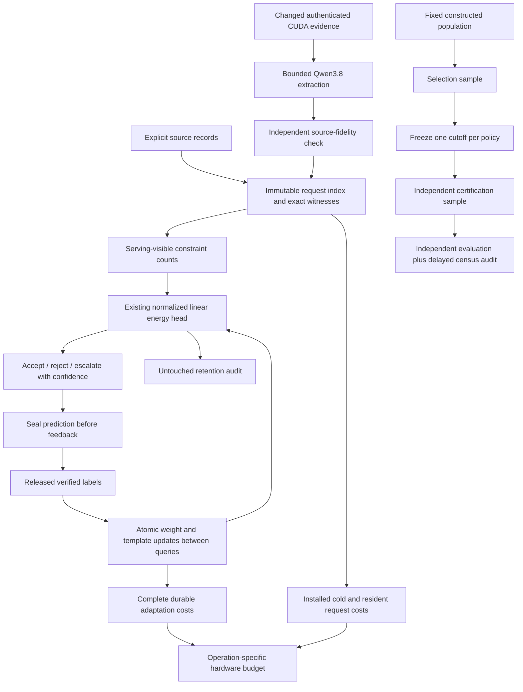
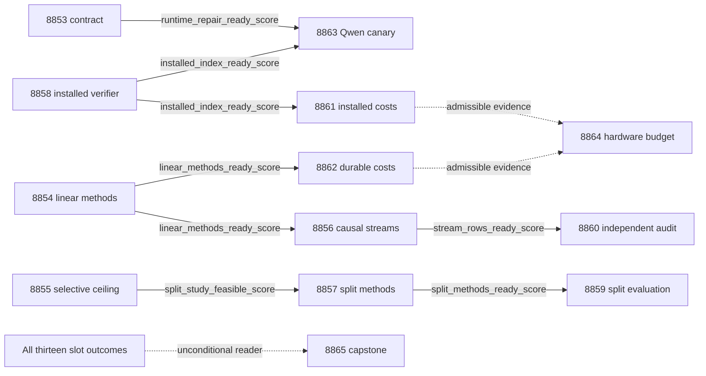

# Carnot Research Roadmap V758: Linear Learning and Attainable Verification

**Created:** 2026-11-05 (America/New_York)
**Milestone:** 2026.11.758
**Title:** Linear causal learning, attainable selective risk, and installed indexed verification
**Status:** Proposed; staged only
**Queue:** [research-roadmap-next.yaml](../../research-roadmap-next.yaml)
**Previous authority:** [Preserved V757](research-roadmap-v757-preserved-20261105.md)
**Contract:** Exactly 13 tasks, Exp8853 through Exp8865, in the execution order below, across four phases.

## What V757 proved

The conductor completed eleven task invocations and skipped two gated tasks.
The capstone admitted ten primaries and rejected the contract producer.
The completed archive currently ends at V756. This account uses V757 primaries,
the capstone and the conductor log. Invocation completion is not scientific success.

| Evidence | Result | Next decision |
|---|---|---|
| [Exp8840](../../results/experiment_8840_v757_branch_contract.json) | Disqualified. The design stops inside embedded task objects before the last task and closing marker. | Preserve its bytes. Check the entire V758 contract before staging ends. |
| [Exp8841](../../results/experiment_8841_v757_memory_execution.json) | Original categorical/linear numerical and causal execution qualified. | Reuse it. Do not spend another milestone requalifying the same missing statements. |
| [Exp8843](../../results/experiment_8843_v757_causal_streams.json) | Complete constructed causal streams admitted. | Isolate the linear head's additions, calibration and delay effects. |
| [Exp8846](../../results/experiment_8846_v757_future_benefit_audit.json) | Linear combined minus frozen future Brier: -0.13634. Categorical minus linear: +0.08973. Joint categorical benefit, retention and noninferiority scores are zero. | Prefer linear for the next preregistered study. These rows do not establish joint linear promotion without its missing controls. |
| [Exp8842](../../results/experiment_8842_v757_selective_population.json), [Exp8844](../../results/experiment_8844_v757_selective_availability.json) | Fixed-population sampling qualified; registered selective utility and learned benefit are zero. | Diagnose attainable coverage and sample requirements before another certificate study. |
| [Exp8845](../../results/experiment_8845_v757_indexed_witness.json), [Exp8847](../../results/experiment_8847_v757_indexed_cost.json) | Exact witness parity; paid operations fell 85.16%, interval [82.98%, 86.86%]. Complete research-request timing ratio 8.93x, interval [7.88x, 9.98x]. The 16-fact stress case has no operation benefit. | Qualify an installed entry point and charge startup/transport. Preserve small-case and adversarial limits. |
| [Exp8848](../../results/experiment_8848_v757_memory_size_cost.json) | Complete occupancy cost evidence qualified; component fractions remain unidentified. | Measure linear adaptation at equal causal work and durability. |
| Exp8849 / Exp8850 | No new authenticated CUDA repair / live supervisor outcomes; both skipped. | Keep only a changed-evidence Qwen canary. ARC scheduling is suspended. |
| [Exp8851](../../results/experiment_8851_v757_hardware_operation_budget.json), [Exp8852](../../results/experiment_8852_v757_capstone.json) | Hardware mapping and all-slot accounting qualified. No new natural generalization or physical acceleration. | Keep operation limits and terminal classes attached to conclusions. |

All numerical findings above retain their constructed-data, exact-oracle or CPU
scope. They are not headline natural-language accuracy gains.

## Three largest gaps to the PRD

1. **FR-11: causal improvement with retention.** The store and updates work, but
   the joint promotion claim failed. Linear outperformed categorical. Its own
   calibration-only, addition-only and shuffled controls are missing. V758 tests
   these controls on new streams, with unchanged optimizer and genuine delayed
   feedback. This also meets the calibrated typed-decision training floor.
2. **FR-12: useful verification at a stated risk.** Valid calibration has not
   produced useful selective coverage. V758 distinguishes score discrimination
   from sample/multiplicity cost. A new split protocol runs only if the exact
   feasibility diagnostic supports it. The optional Qwen study measures source
   fidelity separately from encoded satisfiability.
3. **FR-05/08 and NFR-01: complete deployment cost.** The indexed kernel has
   useful research evidence. Installed request cost and the linear learner's
   full durable cost remain unknown. V758 measures these boundaries before a
   Rust port or accelerator claim. The PRD native 10x target stays unproved.

The November 5 suspension in CLAUDE.md explicitly removes both ARC slot floors.
This roadmap contains no ARC task. It does not change the live agent.

## Research basis

The [V758 scan](../../research-references.md) was appended before this design.
It covers all requested topics and source channels, including failed retrievals.

| Source | Experimental use | Limit |
|---|---|---|
| [Adaptive learning with movement costs, October 2026](https://arxiv.org/abs/2610.32740) | Record interval loss and parameter motion in Exp8854/8856/8860/8862. | No transfer of convex guarantees to changing templates. |
| [Delayed-to-immediate reduction, February 2026](https://arxiv.org/abs/2602.02634) | Add a matched immediate-feedback diagnostic beside real delayed streams. | Immediate feedback cannot satisfy the delayed-learning gate. |
| [Chance-constrained inference, February 2026](https://arxiv.org/abs/2602.01637) | Separate population feasibility, certificate availability and served risk in Exp8855/8857/8859. | Independent split calibration is a local adaptation, not the paper's sequential method. |
| [FPGA-ASIC co-design, September 2026 revision](https://arxiv.org/abs/2602.15985) | Include orchestration, transport and unsupported operations in Exp8864. | Ising hardware does not implement arbitrary joins or durable storage. |
| [KACS, September 2026](https://arxiv.org/abs/2609.37958) | Retain dimension-wise compact rules as a future lead. | Defer a new architecture while the simpler linear control remains unqualified for joint benefit. |

EBT, ARM–EBM, PAL, KAN-CL, guided decoding and thermodynamic learning were also
rechecked. No external-text reranker, old KAN anchoring method or finite-ID
transport scope is reopened. Semantic Scholar citation discovery was inaccessible.
OpenReview's reasoning PDF challenged the browser. Vendor claims are not local
measurements. No new dependency, purchase or model upload is part of this plan.

## V758 architecture



Within-query state stays frozen. Only released verified feedback permits
between-query updates. No generator weights change. Exact witnesses can verify
encoded records; their success cannot certify extraction or natural-language truth.
The installed entry point remains opt-in, with the original default path intact.

## Phase 1: Bind and diagnose — Exp8853–Exp8855

**Exp8853** validates the complete task contract and reads only supplied changed
CUDA evidence. It preserves the truncated V757 design as historical evidence.
Contract work does not gate the independent CPU roots.

**Exp8854** qualifies six matched linear arms: frozen, calibration-only,
additions-only, combined, prefix-shuffled combined and immediate combined.
It fixes the existing objective, rate 0.1 and capacity 32. It seals 24 fresh
48-query streams, 48 untouched retention worlds per stream, and two delay
schedules. Expected data: 6912 online and 20736 retention rows, total 27648.

**Exp8855** reuses the existing 4096-world census to identify achievable risk and
coverage for every fixed policy/cutoff. It computes exact certificate sample
requirements. Census tuning is diagnostic and cannot select a deployment rule.
The split study opens only when projected availability reaches 0.8 at a feasible
risk <=0.05 and coverage >=0.30 under the fixed 720-label budget.

## Phase 2: Execute methods and qualify the installed path — Exp8856–Exp8858

**Exp8856** runs the sealed causal streams with real durable stores, midpoint
restart and feedback-tail drain. It records actual template use and parameter
movement. It publishes integrity readiness; the separate audit judges benefit.

**Exp8857**, gated on the feasibility diagnosis, seals a fresh disjoint population
and an independent selection/certification protocol. Each of 60 replicate draws
uses 720 calibration labels and 240 evaluation labels. Simultaneous calibration
uses 720 labels; split calibration uses 240 to choose and 480 to certify.
The total per-replicate risk allocation is 0.01 across two methods and seven
policies: alpha=0.01/(2*7*6) per simultaneous cutoff, alpha=0.01/(2*7) per
split rule. No recourse to a different cutoff is allowed after certification.

**Exp8858** exposes the qualified indexed evaluator in an opt-in installed
structured-record API. It preserves the entire semantic and operation-budget
contract. It tests public imports, request ownership and execution outside the
checkout without research artifacts. It introduces no persistent cross-request
cache and no new solver.

## Phase 3: Independent evidence and complete costs — Exp8859–Exp8863

**Exp8859** evaluates the two certificate protocols on all registered draws.
It reports certificate firing, unconditional and conditional certificate failure,
served risk and coverage. Its primary contrast averages paired coverage changes
over all seven policies. A lower 99-percent interval above 0.05 is required for
protocol benefit. This does not establish learned-head superiority.

**Exp8860** reconstructs the linear learning conclusions independently. Combined
must improve future Brier by 0.01 over frozen and 0.005 over calibration-only.
It must beat prefix-shuffled feedback. Both retention checkpoints must have
upper Brier/error increases <=0.01. All intervals use whole-stream pairs and
simultaneous 99-percent correction. A failed conjunction is a terminal null.

**Exp8861** measures installed cold and resident request costs across sizes
16/64/256/1024, using 30 worlds per size and four queries per world. Forty
additional wide-join worlds expose censoring. Claims include startup, validation,
serialization, index construction and disposal. Speed benefit needs a complete
mixture ratio lower bound >1.0 and <=5% upper latency regression at size 16.
Both arms remain Python; these results cannot meet the Rust 10x goal.

**Exp8862** measures 60 full linear adaptation windows: ten blocks, occupancies
0/32 and three modes. It charges actual preparation, startup, restart, fsync and
tail drain. It runs independently of learning benefit. Numerical microbenchmarks
cannot become inferred hardware fractions.

**Exp8863** runs only after changed authenticated CUDA evidence and installed
readiness. It uses `unsloth/Qwen3.8-27B-GGUF`, 12 source worlds, two prompts per
world and at most 256 generated tokens per call. It declares
`model_bounded_generation` (10-second floor). It records source fidelity before
exact verification. The 24 calls form a canary, not a headline benchmark.

## Phase 4: Hardware decision and reconciliation — Exp8864–Exp8865

**Exp8864** independently admits both cost branches. It maps supported operations
to KV260, PolarFire and GateMate without repeating physical availability probes.
One blocked branch cannot erase the other. Unknown component costs remain unknown.

**Exp8865** always accounts for all thirteen slots. It preserves primary versus
skip status and each verdict class. It computes stable G1–G4 without changing
the publication scope. It recommends exact-scope retirement without editing the
manifest. External incompleteness is blocked, never retryable partial.

## Dependency graph and producer fields



Each solid edge is a structured `gated_on` entry with `op: '=='`, `value: 1`.
Its exact field appears in its producer's REQUIRED ARTIFACT FIELDS. Dashed edges
are unconditional readers with explicit missing/rejected-input diagnostics.
There is no `requires:` dependency on a retired task and no global CPU gate.
Existing historical inputs are authenticated inside each independent root.

## Hardware requirements

| Resource | Tasks and requirement | Claim boundary |
|---|---|---|
| Existing Ryzen host, RAM and local durable storage | All CPU studies; resident JAX small-head fitting; private result trees with real file/directory fsync | `no_model_load` means no pretrained checkpoint load; numerical training calls remain explicit. |
| Two RTX 3090 cards, 24 GB each | Only Exp8863; one cached Q4_K_M Qwen3.8 model, exclusive lease, verified free memory and actual offload | Hardware presence does not replace the changed-runtime gate. No GPU purchase is needed. |
| KV260 | Exp8864 maps supported operations; preserve `ssh kria` and `k_max<=5` | No new RTL, flash, device sample or physical speed claim. |
| PolarFire | Exp8864 records current Linux CPU dispatch | Fabric support requires new authenticated device evidence. |
| GateMate | Exp8864 retains the `0xffffffff` physical/JTAG block | Require documented cable/port/power change before any future probe. |
| XDNA NPU / Extropic TSU | Literature and future operation mapping only | No local qualification or available runtime is assumed. |

The research-program 100x learning ambition remains a target. The smallest
complete learning path uses CPU counters and memory, small batchable energy
updates, and hardware matching only where operations support it. Full durable
cost and transfer must fit any claimed acceleration. Purchases await that evidence.

## Execution and scientific gates

- Every prompt includes numbered preconditions, flushed phase boundaries and
  before/after messages for long calls. Loops and child supervision emit progress
  at least every 60 seconds; every silence gap stays below 600 seconds.
- Every prompt requires splitting files over about 200 lines into bounded tool
  calls, with progress between calls. A heartbeat never extends a real deadline.
- Each task pilots complete execution plus validation against 4200 seconds,
  below the 4800-second hard cap. Missing units retain their scheduled denominator.
- All comparative tasks set `per_unit_rows: true`. Raw rows retain independent
  streams/worlds separately from repeated seeds, candidates and draws.
- Every prompt declares the closed verdict enum and exact `gate_check_summary`
  diagnostics. `partial` applies only to unfinished own work that another attempt
  may complete. Missing external evidence is terminal blocked.
- The Qwen canary is bounded generation. A load-only failure uses
  `model_load_no_generation` and the 2-second floor. No task requests full
  generation; its 60-second floor is not applicable. No duration is padded.
- Task prompts carry complete four-field failure lineage and narrow standing
  overrides where applicable. A changed method, newly qualified prerequisite or
  new complete cost boundary is stated explicitly. Repeated exact failures retire
  only that scope. Historical primaries and the exclusion manifest stay intact.
- Formulaic verifier and method scaffolding use Codex `gpt-6.1-sol`.
  Schema/preflight work uses Claude Opus with 100 turns. Routine evaluation and
  synthesis retain default Claude routing; readers use smaller turn budgets.
  No luna task or new parallel-agent execution is requested.

## Verification and reconciliation

Before staging completion, validate the full visible/JSON/YAML equality, all
thirteen IDs in order, schema, gate producers/fields, model routing, substrate
classes, failure lineage, prompt placeholders, progress steps and run commands.
Check the closing marker and parse the entire embedded JSON; a matching first
12 tasks is insufficient. Reject truncated or altered private copies.

Run existing roadmap schema, gate and exclusion checks and their relevant unit
tests. Run scoped spec coverage and applicable private E2E-018/021 authority and
replay tests. This planning change adds no experiment implementation, so no
model, board, Rust build or benchmark execution is required to validate it.
Record any pre-existing repository health failures separately from plan checks.

Each execution task must add specs before implementation and tests before code.
It must run scoped lint, strict types, unit/child coverage, applicable E2E and
fresh-process replay. The planned REQ/SCENARIO entries remain planned until
actual execution evidence arrives. Keep OpenSpec, BMAD traceability and ops docs
aligned without rewriting historical results.

The active `research-roadmap.yaml` and `scripts/research_conductor.py` are
outside this planning change. No push, activation or external publication occurs.

## Exact task contract

The table and complete embedded objects below are a single contract with the
staged YAML. There are exactly 13 tasks, Exp8853 through Exp8865, in this order.

| Order | Task ID | Title | Phase | Deliverable |
|---|---|---|---|---|
| 1 | exp8853-branch-contract | Bind the complete V758 contract and admit changed external evidence | 1 | `results/experiment_8853_v758_branch_contract.json` |
| 2 | exp8854-linear-ablation-methods | Qualify matched linear-energy ablations and freeze causal stream methods | 1 | `results/experiment_8854_v758_linear_ablation_methods.json` |
| 3 | exp8855-selective-ceiling | Separate finite-population discrimination from certificate sample requirements | 1 | `results/experiment_8855_v758_selective_ceiling.json` |
| 4 | exp8856-linear-causal-streams | Measure continuous linear-energy learning with isolated template and delay effects | 2 | `results/experiment_8856_v758_linear_causal_streams.json` |
| 5 | exp8857-split-certificate-methods | Freeze independent rule selection and certification at equal label cost | 2 | `results/experiment_8857_v758_split_certificate_methods.json` |
| 6 | exp8858-installed-indexed-verifier | Expose the qualified indexed witness evaluator through an opt-in installed path | 2 | `results/experiment_8858_v758_installed_indexed_verifier.json` |
| 7 | exp8859-split-certificate-evaluation | Measure certificate availability and served risk under split calibration | 3 | `results/experiment_8859_v758_split_certificate_evaluation.json` |
| 8 | exp8860-linear-benefit-audit | Audit linear future benefit and joint retention from sealed causal rows | 3 | `results/experiment_8860_v758_linear_benefit_audit.json` |
| 9 | exp8861-installed-index-cost | Measure complete installed verifier costs across evidence sizes | 3 | `results/experiment_8861_v758_installed_index_cost.json` |
| 10 | exp8862-linear-durable-cost | Measure complete linear adaptation cost with equal causal and durability work | 3 | `results/experiment_8862_v758_linear_durable_cost.json` |
| 11 | exp8863-qwen-source-canary | Measure source-faithful Qwen extraction through the installed witness path | 3 | `results/experiment_8863_v758_qwen_source_canary.json` |
| 12 | exp8864-hardware-budget | Map installed verification and linear learning costs to actual hardware operations | 4 | `results/experiment_8864_v758_hardware_budget.json` |
| 13 | exp8865-capstone | Reconcile thirteen outcomes and decide learning verification and hardware continuations | 4 | `results/experiment_8865_v758_capstone.json` |

<!-- V758_TASK_CONTRACT_START -->
```json
{
  "milestone": "2026.11.758",
  "milestone_title": "Linear causal learning, attainable selective risk, and installed indexed verification",
  "milestone_doc": "openspec/change-proposals/research-roadmap-vNEXT.md",
  "tasks": [
    {
      "id": "exp8853-branch-contract",
      "title": "Bind the complete V758 contract and admit changed external evidence",
      "phase": 1,
      "track": "research",
      "priority": "high",
      "requires_gpu": false,
      "max_turns": 100,
      "estimated_wall_time_min": 35,
      "per_unit_rows": true,
      "milestone": "2026.11.758",
      "deliverable": "results/experiment_8853_v758_branch_contract.json",
      "inference_substrate_class": "no_model_load",
      "MODEL_SPECS": [],
      "gated_on": [],
      "prior_failures": [
        {
          "experiment_id": "exp8840-branch-contract",
          "verdict": "complete_disqualified_v757_branch_contract",
          "addressed_by": "Complete the previously truncated design through the final task and closing marker; validate new full-object equality before execution.",
          "retire_if_same_verdict": true
        },
        {
          "experiment_id": "exp8827-branch-contract",
          "verdict": "complete_disqualified_v756_branch_contract",
          "addressed_by": "Complete the previously truncated design through the final task and closing marker; validate new full-object equality before execution. Prior lineage: Execute the measured28 missed V756 runner statements through private original-authority children, reuse that runner, and bind a new13-task contract.",
          "retire_if_same_verdict": true
        },
        {
          "experiment_id": "exp8814-branch-contract",
          "verdict": "complete_disqualified_v755_branch_contract",
          "addressed_by": "Complete the previously truncated design through the final task and closing marker; validate new full-object equality before execution. Prior lineage: Execute the measured28 missed V756 runner statements through private original-authority children, reuse that runner, and bind a new13-task contract. Earlier lineage: Cover the fourteen recorded original runner statements with real child execution and seal the new V756 authority; reuse the existing contract parser.",
          "retire_if_same_verdict": true
        }
      ],
      "operator_override": "2026-05-29 standing operator directive in CLAUDE.md: routine milestone transition; scope matches exp8840-branch-contract, exp8827-branch-contract, exp8814-branch-contract; Complete the previously truncated design through the final task and closing marker; validate new full-object equality before execution.",
      "agent_type": "claude",
      "model": "opus",
      "prompt": "CONTEXT:\nWork in {project_root} on {date}. Milestone 2026.11.758, exp8853-branch-contract. Exp8840 failed because V757 ended inside its embedded JSON task list. Preserve that historical failure. V758 supplies a complete thirteen-task authority. The November 5 operator suspension forbids new ARC tasks.\n\nEXISTING CODE TO READ FIRST:\n- python/carnot/reporting/roadmap_contract.py\n- python/carnot/reporting/v757_branch_contract.py\n- python/carnot/reporting/v757_branch_execution.py\n- scripts/roadmap_schema.py; scripts/audit_roadmap_gates.py; scripts/exclusion_manifest_lint.py\n- results/experiment_8840_v757_branch_contract.json; results/experiment_8852_v757_capstone.json\n- research-references.md; ops/exclusion_manifest.yaml\n- openspec/capabilities/research-reporting/spec.md (REQ-REPORT-8853; SCENARIO-REPORT-8853-CONTRACT)\n- scripts/experiment_template.py; python/carnot/reporting/current_work_receipt.py; python/carnot/reporting/primary_publication.py\n\nTASK:\nBind the complete V758 contract and admit changed external evidence. Deliver results/experiment_8853_v758_branch_contract.json with immutable operands under results/raw/experiment_8853_v758_branch_contract/. Implement scripts/experiments/experiment_8853_v758_branch_contract.py with --date and private-output/replay options. This task executes research; it does not activate a milestone.\n\nCONCRETE STEPS:\n0. PRECONDITIONS: Authenticate producer bytes, raw operands and original method authorities. Check dependencies, private writable storage, disk and time. Missing external inputs yield complete_blocked_<reason>. Failed owned controls disqualify readiness. Never invent missing evidence.\n1. Emit a flushed progress line at each phase boundary and before and after every model load, generation, benchmark or subprocess that can take minutes. Use python -u and print(..., flush=True). Emit completed/pending counts inside long loops and forward child output at least every 60 seconds. Keep every silence gap below 600 seconds, including reasoning between tool calls. Heartbeats do not extend deadlines.\n2. Keep each tool call bounded. Write files over about 200 lines in several tool calls of at most 150-200 lines. Send a progress message between calls. Put scripts in scripts/experiments/, tests in tests/python/, and scratch probes in /tmp. Never write root scratch scripts.\n3. Compare the visible table and complete embedded JSON with the staged queue. Require exactly 13 full task objects, Exp8853 through Exp8865 in order, unique deliverables and the V758 closing marker. Allow only documented literal-brace encoding after activation. Test missing-last-task, truncation, changed prompt, wrong gate and wrong model rejection with private copies.\n4. Reuse the existing contract parser and publication helpers through a small V758 entry point. Do not regenerate absent V757 authority or relabel its disqualified primary. Bind preserved V757 bytes and source scans. Qualify all newly owned checks and lines; do not turn historical replay into a new global science prerequisite.\n5. Read a supplied ops/cuda-runtime-repair-receipt.json only when present. runtime_repair_ready_score=1 requires a dated causal library/environment change, current validator custody, exact mandated GGUF revision/checksum, and authenticated actual context/copy/offload evidence. Missing or unchanged evidence gives zero and precise diagnostics. No availability probe or runtime repair runs here.\n6. Ingest the V758 paper-to-method map. Check all gate producers and exact required fields in this queue. Confirm zero ARC tasks and no generator training. The external admission field gates only the optional Qwen task. Independent CPU branches authenticate their own operands.\n7. Seal full_task_objects, canonical_tasks_sha256 and the visible table in the result. Final publication follows successful validation; never publish a bootstrap-only primary. The contract task records readiness, not activation or scientific improvement.\n8. Read CLAUDE.md and CODEX.md. Extend the named REQ/SCENARIO before implementation; write failing tests first. Preserve original assertions, historical primaries and quarantine decisions. Reuse experiment_template, current_work_receipt and primary_publication. Bind historical consumers to preserved authorities, never mutable vNEXT. Run scoped pytest with actual unit/child statement coverage at 100 percent and zero exclusions, Ruff check/format, strict mypy, and scripts/check_spec_coverage.py with positional test paths. Run applicable private E2E-018/021 tests and CLI replay from ops/e2e-test-plan.md. Replay outside the checkout without PYTHONPATH. Native changes also require E2E-003/004 and cargo test/fmt/clippy. Run adversarial_verify.py and verdict_row_consistency_lint.py --strict on prospective evidence. Bind logs and executed source hashes. Record global health separately. Reconcile openspec/, _bmad/traceability.md, ops/status.md and ops/changelog.md. Do not activate the roadmap, change shared validators or edit the exclusion manifest. Pilot execution plus validation against 4200 seconds; preserve all scheduled units when incomplete.\n\nREQUIRED ARTIFACT FIELDS:\nexperiment_id, task_id, milestone, run_date: principle: identify the producer and actual invocation.\nhonest_verdict: terminal complete_ prefix; principle: completion does not imply scientific benefit.\nverdict_class: positive | circular_positive | null | blocked | disqualified | partial; principle: partial means retryable unfinished OWN work. External absence is blocked. Oracle success is circular_positive.\ninference_substrate, inference_substrate_class, execution_venue, MODEL_SPECS, model_invocation_counts, numerical_training_calls: principle: declare actual compute. Fresh small CPU heads use no_model_load with numerical training recorded. Pretrained loads need a model class; external no-run blocks use blocked_no_run. Never pad duration.\nverifier_is_oracle, exposure_scope, independent_generalization_score: principle: constructed or exact-oracle evidence does not prove natural-language correctness.\nduration_s, phase_spans, preconditions_checked, random_seed, reproducibility_checksum: principle: retain measured work and fixed inputs.\nsource_artifact_hashes, code_config_hashes, raw_shard_hashes: principle: bind claims to immutable operands.\nrows: principle: retain each unit/arm/seed with unit_id, cluster_id, metric, denominator, status and missing_reason. All comparative headlines must reduce from these rows.\nintended_count, completed_count, failed_count, censored_count, excluded_count, independent_count: principle: preserve failures and independent units.\ngate_check_summary: principle: blocked verdicts name check, upstream, artifact_field, expected, observed, path and hash. Distinguish missing_file, missing_field, rejected_producer and observed_zero.\nacceptance_gates, required_checks_passed, validation_receipts, owned_statement_coverage: principle: frozen gates and actual checks distinguish readiness from benefit.\nfield_principles: principle: explain each extra field; hashes and self-reports alone are not scientific evidence.\ncontract_ready_score, runtime_repair_ready_score: integer 0/1; principle: full object equality and changed runtime custody are distinct conditions.\nfull_task_objects, canonical_tasks_sha256, visible_task_table, authority_mutation_rows, source_method_map, external_admission_rows: principle: preserve complete authority and reject truncated evidence.\n\nRun command: cd {project_root} && JAX_PLATFORMS=cpu .venv/bin/python -u scripts/experiments/experiment_8853_v758_branch_contract.py --date {date}\nDo NOT push. Do NOT modify scripts/research_conductor.py."
    },
    {
      "id": "exp8854-linear-ablation-methods",
      "title": "Qualify matched linear-energy ablations and freeze causal stream methods",
      "phase": 1,
      "track": "research",
      "priority": "high",
      "requires_gpu": false,
      "max_turns": 50,
      "estimated_wall_time_min": 45,
      "per_unit_rows": true,
      "milestone": "2026.11.758",
      "deliverable": "results/experiment_8854_v758_linear_ablation_methods.json",
      "inference_substrate_class": "no_model_load",
      "MODEL_SPECS": [],
      "gated_on": [],
      "prior_failures": [
        {
          "experiment_id": "exp8830-categorical-memory",
          "verdict": "complete_disqualified_categorical_memory",
          "addressed_by": "Use qualified Exp8841 execution and the simpler linear head; add missing linear-only causal ablations instead of retrying categorical superiority. Prior lineage: Exercise original runner statements81 and290 in real private children; retain the complete admitted numerical and causal protocol before issuing new readiness.",
          "retire_if_same_verdict": true
        },
        {
          "experiment_id": "exp8817-categorical-memory-prototype",
          "verdict": "blocked_gate_check_failed",
          "addressed_by": "Use qualified Exp8841 execution and the simpler linear head; add missing linear-only causal ablations instead of retrying categorical superiority. Prior lineage: Exercise original runner statements81 and290 in real private children; retain the complete admitted numerical and causal protocol before issuing new readiness. Earlier lineage: A new qualified Exp8828 replay replaces the rejected upstream; include the stronger linear-energy control and preserve exact causal update semantics.",
          "retire_if_same_verdict": true
        }
      ],
      "operator_override": "2026-05-29 standing operator directive in CLAUDE.md: versioned lineage continuation; scope matches exp8830-categorical-memory, exp8817-categorical-memory-prototype; Use qualified Exp8841 execution and the simpler linear head; add missing linear-only causal ablations instead of retrying categorical superiority.",
      "agent_type": "codex",
      "model": "gpt-6.1-sol",
      "prompt": "CONTEXT:\nWork in {project_root} on {date}. Milestone 2026.11.758, exp8854-linear-ablation-methods. Exp8841 qualified causal-store execution. Exp8846 found linear future Brier lower than categorical, but V757 lacked linear calibration-only, addition-only and shuffled controls. This task adds those controls without changing the optimizer.\n\nEXISTING CODE TO READ FIRST:\n- python/carnot/memory/categorical_memory_8830.py\n- python/carnot/memory/causal_memory_8802.py\n- python/carnot/reporting/causal_streams_8843.py\n- python/carnot/reporting/future_benefit_audit_8846.py\n- results/experiment_8841_v757_memory_execution.json; results/experiment_8846_v757_future_benefit_audit.json\n- tests/python/test_categorical_memory_8830.py\n- openspec/capabilities/research-reporting/spec.md (REQ-REPORT-8854; SCENARIO-REPORT-8854-CONTRACT)\n- scripts/experiment_template.py; python/carnot/reporting/current_work_receipt.py; python/carnot/reporting/primary_publication.py\n\nTASK:\nQualify matched linear-energy ablations and freeze causal stream methods. Deliver results/experiment_8854_v758_linear_ablation_methods.json with immutable operands under results/raw/experiment_8854_v758_linear_ablation_methods/. Implement scripts/experiments/experiment_8854_v758_linear_ablation_methods.py with --date and private-output/replay options. This task executes research; it does not activate a milestone.\n\nCONCRETE STEPS:\n0. PRECONDITIONS: Authenticate producer bytes, raw operands and original method authorities. Check dependencies, private writable storage, disk and time. Missing external inputs yield complete_blocked_<reason>. Failed owned controls disqualify readiness. Never invent missing evidence.\n1. Emit a flushed progress line at each phase boundary and before and after every model load, generation, benchmark or subprocess that can take minutes. Use python -u and print(..., flush=True). Emit completed/pending counts inside long loops and forward child output at least every 60 seconds. Keep every silence gap below 600 seconds, including reasoning between tool calls. Heartbeats do not extend deadlines.\n2. Keep each tool call bounded. Write files over about 200 lines in several tool calls of at most 150-200 lines. Send a progress message between calls. Put scripts in scripts/experiments/, tests in tests/python/, and scratch probes in /tmp. Never write root scratch scripts.\n3. Authenticate memory_execution_ready_score=1 from Exp8841 and its frozen source/config authority. Reuse objective=linear, six count features plus candidate bits, SGD rate 0.1, pending cap 32 and template cap 32. Preserve default behavior. Do not add a new head, optimizer, representation or retention regularizer.\n4. Qualify six explicit arms: linear_frozen, linear_calibration_only, linear_additions_only, linear_combined, linear_shuffled_combined and linear_immediate_combined. Frozen weights must remain byte-identical in additions-only; frozen templates must remain byte-identical in calibration-only. Combined must match the original linear control on identical events.\n5. Exercise finite differences at tolerance 1e-4, valid/rejected feedback, stale/duplicate events, atomic state/ack commit, write failure, restart, and prefix-only shuffle. Immediate feedback follows the current prediction seal and is diagnostic only. All real arms seal predictions before feedback. Train small heads in process; MODEL_SPECS=[] and no_model_load.\n6. Freeze 24 fresh streams with 48 online queries and 48 untouched retention worlds each. Assign seeds 11/23/37/47/59 cyclically. Use fixed delay 8 for 12 streams and a preregistered 4/8/12 jitter schedule for 12. Use matching streams across arms and independent state between streams. New graph invariants must be disjoint from exposed learning worlds; renaming entities alone is insufficient.\n7. Freeze primary future window 25-48 and retention checkpoints 0/24/48. Register 6912 online rows plus 20736 retention rows, total 27648. Labels from retention never train or select updates. Freeze six error strata and per-interval movement accounting. Keep all row identities and cohort generators in a hashed protocol.\n8. Pilot two separate development streams for full work and validation cost. Freeze future gain >=0.01 versus frozen, addition gain >=0.005 versus calibration-only, superiority over shuffled feedback, and retention/error upper increase <=0.01. Use simultaneous 99-percent stream-cluster intervals in the later audit. Readiness means numerical/causal integrity and feasible execution, never pilot benefit.\n9. Read CLAUDE.md and CODEX.md. Extend the named REQ/SCENARIO before implementation; write failing tests first. Preserve original assertions, historical primaries and quarantine decisions. Reuse experiment_template, current_work_receipt and primary_publication. Bind historical consumers to preserved authorities, never mutable vNEXT. Run scoped pytest with actual unit/child statement coverage at 100 percent and zero exclusions, Ruff check/format, strict mypy, and scripts/check_spec_coverage.py with positional test paths. Run applicable private E2E-018/021 tests and CLI replay from ops/e2e-test-plan.md. Replay outside the checkout without PYTHONPATH. Native changes also require E2E-003/004 and cargo test/fmt/clippy. Run adversarial_verify.py and verdict_row_consistency_lint.py --strict on prospective evidence. Bind logs and executed source hashes. Record global health separately. Reconcile openspec/, _bmad/traceability.md, ops/status.md and ops/changelog.md. Do not activate the roadmap, change shared validators or edit the exclusion manifest. Pilot execution plus validation against 4200 seconds; preserve all scheduled units when incomplete.\n\nREQUIRED ARTIFACT FIELDS:\nexperiment_id, task_id, milestone, run_date: principle: identify the producer and actual invocation.\nhonest_verdict: terminal complete_ prefix; principle: completion does not imply scientific benefit.\nverdict_class: positive | circular_positive | null | blocked | disqualified | partial; principle: partial means retryable unfinished OWN work. External absence is blocked. Oracle success is circular_positive.\ninference_substrate, inference_substrate_class, execution_venue, MODEL_SPECS, model_invocation_counts, numerical_training_calls: principle: declare actual compute. Fresh small CPU heads use no_model_load with numerical training recorded. Pretrained loads need a model class; external no-run blocks use blocked_no_run. Never pad duration.\nverifier_is_oracle, exposure_scope, independent_generalization_score: principle: constructed or exact-oracle evidence does not prove natural-language correctness.\nduration_s, phase_spans, preconditions_checked, random_seed, reproducibility_checksum: principle: retain measured work and fixed inputs.\nsource_artifact_hashes, code_config_hashes, raw_shard_hashes: principle: bind claims to immutable operands.\nrows: principle: retain each unit/arm/seed with unit_id, cluster_id, metric, denominator, status and missing_reason. All comparative headlines must reduce from these rows.\nintended_count, completed_count, failed_count, censored_count, excluded_count, independent_count: principle: preserve failures and independent units.\ngate_check_summary: principle: blocked verdicts name check, upstream, artifact_field, expected, observed, path and hash. Distinguish missing_file, missing_field, rejected_producer and observed_zero.\nacceptance_gates, required_checks_passed, validation_receipts, owned_statement_coverage: principle: frozen gates and actual checks distinguish readiness from benefit.\nfield_principles: principle: explain each extra field; hashes and self-reports alone are not scientific evidence.\nlinear_methods_ready_score: integer 0/1; principle: matched controls and complete causal validation release execution.\narm_definitions, configuration_hashes, cohort_manifest, causal_control_rows, gradient_rows, paired_delay_schedules, expected_row_counts, timing_projection: principle: isolate additions, calibration and delay without selecting on future outcomes.\n\nRun command: cd {project_root} && JAX_PLATFORMS=cpu .venv/bin/python -u scripts/experiments/experiment_8854_v758_linear_ablation_methods.py --date {date}\nDo NOT push. Do NOT modify scripts/research_conductor.py."
    },
    {
      "id": "exp8855-selective-ceiling",
      "title": "Separate finite-population discrimination from certificate sample requirements",
      "phase": 1,
      "track": "research",
      "priority": "high",
      "requires_gpu": false,
      "max_turns": 30,
      "estimated_wall_time_min": 30,
      "per_unit_rows": true,
      "milestone": "2026.11.758",
      "deliverable": "results/experiment_8855_v758_selective_ceiling.json",
      "inference_substrate_class": "no_model_load",
      "MODEL_SPECS": [],
      "gated_on": [],
      "prior_failures": [
        {
          "experiment_id": "exp8844-selective-availability",
          "verdict": "complete_null_selective_availability",
          "addressed_by": "Use an exhaustive existing-population diagnostic and exact sample-power calculation before any new calibration run.",
          "retire_if_same_verdict": true
        },
        {
          "experiment_id": "exp8832-selective-availability",
          "verdict": "complete_disqualified_selective_availability",
          "addressed_by": "Use an exhaustive existing-population diagnostic and exact sample-power calculation before any new calibration run. Prior lineage: Use the valid no_model_load enum with in-process head-training receipts and independently sampled finite-population draws; measure certificate firing and conditional failure, not another unsupported topology certificate.",
          "retire_if_same_verdict": true
        },
        {
          "experiment_id": "exp8819-consensus-selective-energy",
          "verdict": "complete_null_consensus_selective_energy",
          "addressed_by": "Use an exhaustive existing-population diagnostic and exact sample-power calculation before any new calibration run. Prior lineage: Use the valid no_model_load enum with in-process head-training receipts and independently sampled finite-population draws; measure certificate firing and conditional failure, not another unsupported topology certificate. Earlier lineage: Change the question from another selector sweep to a fixed independent-support budget study with exact finite-sample risk checks and the old bootstrap method as a descriptive control.",
          "retire_if_same_verdict": true
        }
      ],
      "operator_override": "2026-05-29 standing operator directive in CLAUDE.md: versioned lineage continuation; scope matches exp8844-selective-availability, exp8832-selective-availability, exp8819-consensus-selective-energy; Use an exhaustive existing-population diagnostic and exact sample-power calculation before any new calibration run.",
      "prompt": "CONTEXT:\nWork in {project_root} on {date}. Milestone 2026.11.758, exp8855-selective-ceiling. Exp8844 had valid fixed-population sampling but zero registered utility. Its wide replicate intervals cannot identify whether score discrimination or certificate multiplicity is binding. Use existing raw scores without new fitting.\n\nEXISTING CODE TO READ FIRST:\n- python/carnot/reporting/selective_availability_8844.py\n- python/carnot/reporting/selective_population_8842.py\n- results/experiment_8844_v757_selective_availability.json; results/experiment_8842_v757_selective_population.json\n- research-references.md\n- openspec/capabilities/research-reporting/spec.md (REQ-REPORT-8855; SCENARIO-REPORT-8855-CONTRACT)\n- scripts/experiment_template.py; python/carnot/reporting/current_work_receipt.py; python/carnot/reporting/primary_publication.py\n\nTASK:\nSeparate finite-population discrimination from certificate sample requirements. Deliver results/experiment_8855_v758_selective_ceiling.json with immutable operands under results/raw/experiment_8855_v758_selective_ceiling/. Implement scripts/experiments/experiment_8855_v758_selective_ceiling.py with --date and private-output/replay options. This task executes research; it does not activate a milestone.\n\nCONCRETE STEPS:\n0. PRECONDITIONS: Authenticate producer bytes, raw operands and original method authorities. Check dependencies, private writable storage, disk and time. Missing external inputs yield complete_blocked_<reason>. Failed owned controls disqualify readiness. Never invent missing evidence.\n1. Emit a flushed progress line at each phase boundary and before and after every model load, generation, benchmark or subprocess that can take minutes. Use python -u and print(..., flush=True). Emit completed/pending counts inside long loops and forward child output at least every 60 seconds. Keep every silence gap below 600 seconds, including reasoning between tool calls. Heartbeats do not extend deadlines.\n2. Keep each tool call bounded. Write files over about 200 lines in several tool calls of at most 150-200 lines. Send a progress message between calls. Put scripts in scripts/experiments/, tests in tests/python/, and scratch probes in /tmp. Never write root scratch scripts.\n3. Authenticate the 4096-world population, all seven policy scores, six-cutoff menu, calibration draws and original acceptance gates. Recompute certificate firing, served risk and decisive coverage from per-unit rows. Missing authority blocks; internal inconsistencies disqualify.\n4. For each policy and every registered cutoff, enumerate population accepted count, error count, risk and coverage. Report whether any fixed rule could achieve risk <=0.05 and coverage >=0.30. This census is an exposed diagnostic upper bound, never a selected deployment rule or a new generalization result.\n5. Compute exact zero-error and nonzero-error sample requirements using the original familywise allocation. Contrast the original simultaneous menu with an independent rule-selection/certification split at equal total labels. Use exact binomial sums for certificate firing probability under each population acceptance/error probability; retain reproducible numerical checks.\n6. Emit split_study_feasible_score=1 only if at least one registered non-oracle policy has a population-feasible cutoff and projected >=0.8 certificate availability at the fixed 720-label budget with 240 selection and 480 certification draws, alpha=0.01/(2*7) for split certification, and alpha=0.01/(2*7*6) for the matched simultaneous protocol. Charge selection draws. This field allows a new test; it proves neither superiority nor transfer.\n7. Preserve all five learned seeds and both deterministic controls, including empty accepted sets as null risk. State which limitation binds each arm: discrimination, calibration support, multiplicity or uncertainty. Do not tune the old population or soften risk/coverage thresholds.\n8. Read CLAUDE.md and CODEX.md. Extend the named REQ/SCENARIO before implementation; write failing tests first. Preserve original assertions, historical primaries and quarantine decisions. Reuse experiment_template, current_work_receipt and primary_publication. Bind historical consumers to preserved authorities, never mutable vNEXT. Run scoped pytest with actual unit/child statement coverage at 100 percent and zero exclusions, Ruff check/format, strict mypy, and scripts/check_spec_coverage.py with positional test paths. Run applicable private E2E-018/021 tests and CLI replay from ops/e2e-test-plan.md. Replay outside the checkout without PYTHONPATH. Native changes also require E2E-003/004 and cargo test/fmt/clippy. Run adversarial_verify.py and verdict_row_consistency_lint.py --strict on prospective evidence. Bind logs and executed source hashes. Record global health separately. Reconcile openspec/, _bmad/traceability.md, ops/status.md and ops/changelog.md. Do not activate the roadmap, change shared validators or edit the exclusion manifest. Pilot execution plus validation against 4200 seconds; preserve all scheduled units when incomplete.\n\nREQUIRED ARTIFACT FIELDS:\nexperiment_id, task_id, milestone, run_date: principle: identify the producer and actual invocation.\nhonest_verdict: terminal complete_ prefix; principle: completion does not imply scientific benefit.\nverdict_class: positive | circular_positive | null | blocked | disqualified | partial; principle: partial means retryable unfinished OWN work. External absence is blocked. Oracle success is circular_positive.\ninference_substrate, inference_substrate_class, execution_venue, MODEL_SPECS, model_invocation_counts, numerical_training_calls: principle: declare actual compute. Fresh small CPU heads use no_model_load with numerical training recorded. Pretrained loads need a model class; external no-run blocks use blocked_no_run. Never pad duration.\nverifier_is_oracle, exposure_scope, independent_generalization_score: principle: constructed or exact-oracle evidence does not prove natural-language correctness.\nduration_s, phase_spans, preconditions_checked, random_seed, reproducibility_checksum: principle: retain measured work and fixed inputs.\nsource_artifact_hashes, code_config_hashes, raw_shard_hashes: principle: bind claims to immutable operands.\nrows: principle: retain each unit/arm/seed with unit_id, cluster_id, metric, denominator, status and missing_reason. All comparative headlines must reduce from these rows.\nintended_count, completed_count, failed_count, censored_count, excluded_count, independent_count: principle: preserve failures and independent units.\ngate_check_summary: principle: blocked verdicts name check, upstream, artifact_field, expected, observed, path and hash. Distinguish missing_file, missing_field, rejected_producer and observed_zero.\nacceptance_gates, required_checks_passed, validation_receipts, owned_statement_coverage: principle: frozen gates and actual checks distinguish readiness from benefit.\nfield_principles: principle: explain each extra field; hashes and self-reports alone are not scientific evidence.\nceiling_rows_ready_score, split_study_feasible_score: integer 0/1; principle: faithful diagnostics differ from attainable new-study conditions.\npopulation_cutoff_rows, exact_sample_requirements, availability_power_rows, failure_decomposition, original_protocol_hash: principle: identify discrimination and support separately; census truth is exposed.\n\nRun command: cd {project_root} && JAX_PLATFORMS=cpu .venv/bin/python -u scripts/experiments/experiment_8855_v758_selective_ceiling.py --date {date}\nDo NOT push. Do NOT modify scripts/research_conductor.py."
    },
    {
      "id": "exp8856-linear-causal-streams",
      "title": "Measure continuous linear-energy learning with isolated template and delay effects",
      "phase": 2,
      "track": "research",
      "priority": "high",
      "requires_gpu": false,
      "max_turns": 50,
      "estimated_wall_time_min": 60,
      "per_unit_rows": true,
      "milestone": "2026.11.758",
      "deliverable": "results/experiment_8856_v758_linear_causal_streams.json",
      "inference_substrate_class": "no_model_load",
      "MODEL_SPECS": [],
      "gated_on": [
        {
          "upstream": "exp8854-linear-ablation-methods",
          "artifact_field": "linear_methods_ready_score",
          "op": "==",
          "value": 1
        }
      ],
      "prior_failures": [
        {
          "experiment_id": "exp8846-future-benefit-audit",
          "verdict": "complete_null_future_benefit_audit",
          "addressed_by": "Replace the failed categorical claim with preregistered matched linear calibration/addition/shuffle controls and new delay-stratified streams.",
          "retire_if_same_verdict": true
        },
        {
          "experiment_id": "exp8833-causal-objective-streams",
          "verdict": "blocked_gate_check_failed",
          "addressed_by": "Replace the failed categorical claim with preregistered matched linear calibration/addition/shuffle controls and new delay-stratified streams. Prior lineage: Use a newly qualified original store,24 independent streams with resident execution, and matched frozen/adaptive linear controls; the unavailable V756 stream is not an input.",
          "retire_if_same_verdict": true
        },
        {
          "experiment_id": "exp8820-causal-objective-streams",
          "verdict": "blocked_gate_check_failed",
          "addressed_by": "Replace the failed categorical claim with preregistered matched linear calibration/addition/shuffle controls and new delay-stratified streams. Prior lineage: Use a newly qualified original store,24 independent streams with resident execution, and matched frozen/adaptive linear controls; the unavailable V756 stream is not an input. Earlier lineage: Use the new Exp8830 prototype after original replay qualification and include the stronger linear control; no retired V755 producer is a dependency.",
          "retire_if_same_verdict": true
        },
        {
          "experiment_id": "exp8810-causal-learning-audit",
          "verdict": "complete_null_causal_learning_audit",
          "addressed_by": "Replace the failed categorical claim with preregistered matched linear calibration/addition/shuffle controls and new delay-stratified streams. Prior lineage: Use a newly qualified original store,24 independent streams with resident execution, and matched frozen/adaptive linear controls; the unavailable V756 stream is not an input. Earlier lineage: Replace the harmful mixed objective with a qualified normalized objective, then test future loss against frozen, calibration-only, shuffled and linear controls.",
          "retire_if_same_verdict": true
        }
      ],
      "operator_override": "2026-05-29 standing operator directive in CLAUDE.md: versioned lineage continuation; scope matches exp8846-future-benefit-audit, exp8833-causal-objective-streams, exp8820-causal-objective-streams, exp8810-causal-learning-audit; Replace the failed categorical claim with preregistered matched linear calibration/addition/shuffle controls and new delay-stratified streams.",
      "prompt": "CONTEXT:\nWork in {project_root} on {date}. Milestone 2026.11.758, exp8856-linear-causal-streams. The new protocol isolates the linear head that Exp8846 recommended. Continuous self-learning must improve future decisions after released verified feedback; update counts alone are insufficient.\n\nEXISTING CODE TO READ FIRST:\n- python/carnot/reporting/causal_streams_8843.py\n- python/carnot/memory/categorical_memory_8830.py\n- results/experiment_8854_v758_linear_ablation_methods.json\n- results/experiment_8843_v757_causal_streams.json\n- openspec/capabilities/research-reporting/spec.md (REQ-REPORT-8856; SCENARIO-REPORT-8856-CONTRACT)\n- scripts/experiment_template.py; python/carnot/reporting/current_work_receipt.py; python/carnot/reporting/primary_publication.py\n\nTASK:\nMeasure continuous linear-energy learning with isolated template and delay effects. Deliver results/experiment_8856_v758_linear_causal_streams.json with immutable operands under results/raw/experiment_8856_v758_linear_causal_streams/. Implement scripts/experiments/experiment_8856_v758_linear_causal_streams.py with --date and private-output/replay options. This task executes research; it does not activate a milestone.\n\nCONCRETE STEPS:\n0. PRECONDITIONS: Authenticate producer bytes, raw operands and original method authorities. Check dependencies, private writable storage, disk and time. Missing external inputs yield complete_blocked_<reason>. Failed owned controls disqualify readiness. Never invent missing evidence.\n1. Emit a flushed progress line at each phase boundary and before and after every model load, generation, benchmark or subprocess that can take minutes. Use python -u and print(..., flush=True). Emit completed/pending counts inside long loops and forward child output at least every 60 seconds. Keep every silence gap below 600 seconds, including reasoning between tool calls. Heartbeats do not extend deadlines.\n2. Keep each tool call bounded. Write files over about 200 lines in several tool calls of at most 150-200 lines. Send a progress message between calls. Put scripts in scripts/experiments/, tests in tests/python/, and scratch probes in /tmp. Never write root scratch scripts.\n3. Authenticate linear_methods_ready_score=1 and the complete frozen protocol. Reconstruct initial heads from the admitted fitting recipe in process. Do not load a pretrained generator or modify generator weights. Keep all six arms, 24 streams and the fixed 27648-row roster.\n4. Run resident CPU execution with independent durable stores per stream and arm. Preserve the paired delay schedules, sealed predictions and immutable within-query state. Only released independently verified labels enter training or template addition. Prefix-shuffled feedback uses only previously released labels.\n5. Restart each store after query 24, continue to query 48, and drain the pending feedback tail. Preserve pending cap 32, template cap 32, real file/directory fsync and atomic state/ack commits. Record applied and rejected feedback, addition witnesses, future template hits, gradient norms and parameter movement.\n6. Collect future Brier, NLL, typed decisions and decisive error without using future labels to select updates. Evaluate the 48 untouched retention worlds at 0/24/48 without updating any state. Include every failed or censored slot in the roster.\n7. Emit per-query, per-feedback and per-retention rows with hashes and wall clocks. Report delay-conditioned and interval-conditioned descriptives. Immediate feedback is an explanatory control only. stream_rows_ready_score depends on complete integrity and validation, not gain. Leave acceptance conclusions to Exp8860.\n8. Read CLAUDE.md and CODEX.md. Extend the named REQ/SCENARIO before implementation; write failing tests first. Preserve original assertions, historical primaries and quarantine decisions. Reuse experiment_template, current_work_receipt and primary_publication. Bind historical consumers to preserved authorities, never mutable vNEXT. Run scoped pytest with actual unit/child statement coverage at 100 percent and zero exclusions, Ruff check/format, strict mypy, and scripts/check_spec_coverage.py with positional test paths. Run applicable private E2E-018/021 tests and CLI replay from ops/e2e-test-plan.md. Replay outside the checkout without PYTHONPATH. Native changes also require E2E-003/004 and cargo test/fmt/clippy. Run adversarial_verify.py and verdict_row_consistency_lint.py --strict on prospective evidence. Bind logs and executed source hashes. Record global health separately. Reconcile openspec/, _bmad/traceability.md, ops/status.md and ops/changelog.md. Do not activate the roadmap, change shared validators or edit the exclusion manifest. Pilot execution plus validation against 4200 seconds; preserve all scheduled units when incomplete.\n\nREQUIRED ARTIFACT FIELDS:\nexperiment_id, task_id, milestone, run_date: principle: identify the producer and actual invocation.\nhonest_verdict: terminal complete_ prefix; principle: completion does not imply scientific benefit.\nverdict_class: positive | circular_positive | null | blocked | disqualified | partial; principle: partial means retryable unfinished OWN work. External absence is blocked. Oracle success is circular_positive.\ninference_substrate, inference_substrate_class, execution_venue, MODEL_SPECS, model_invocation_counts, numerical_training_calls: principle: declare actual compute. Fresh small CPU heads use no_model_load with numerical training recorded. Pretrained loads need a model class; external no-run blocks use blocked_no_run. Never pad duration.\nverifier_is_oracle, exposure_scope, independent_generalization_score: principle: constructed or exact-oracle evidence does not prove natural-language correctness.\nduration_s, phase_spans, preconditions_checked, random_seed, reproducibility_checksum: principle: retain measured work and fixed inputs.\nsource_artifact_hashes, code_config_hashes, raw_shard_hashes: principle: bind claims to immutable operands.\nrows: principle: retain each unit/arm/seed with unit_id, cluster_id, metric, denominator, status and missing_reason. All comparative headlines must reduce from these rows.\nintended_count, completed_count, failed_count, censored_count, excluded_count, independent_count: principle: preserve failures and independent units.\ngate_check_summary: principle: blocked verdicts name check, upstream, artifact_field, expected, observed, path and hash. Distinguish missing_file, missing_field, rejected_producer and observed_zero.\nacceptance_gates, required_checks_passed, validation_receipts, owned_statement_coverage: principle: frozen gates and actual checks distinguish readiness from benefit.\nfield_principles: principle: explain each extra field; hashes and self-reports alone are not scientific evidence.\nstream_rows_ready_score: integer 0/1; principle: complete causal evidence releases the independent audit.\nper_stream_results, prediction_seals, feedback_rows, template_reuse_rows, movement_rows, retention_rows, restart_rows, delay_rows: principle: later loss must follow genuine released updates and actual template use.\n\nRun command: cd {project_root} && JAX_PLATFORMS=cpu .venv/bin/python -u scripts/experiments/experiment_8856_v758_linear_causal_streams.py --date {date}\nDo NOT push. Do NOT modify scripts/research_conductor.py."
    },
    {
      "id": "exp8857-split-certificate-methods",
      "title": "Freeze independent rule selection and certification at equal label cost",
      "phase": 2,
      "track": "research",
      "priority": "high",
      "requires_gpu": false,
      "max_turns": 50,
      "estimated_wall_time_min": 45,
      "per_unit_rows": true,
      "milestone": "2026.11.758",
      "deliverable": "results/experiment_8857_v758_split_certificate_methods.json",
      "inference_substrate_class": "no_model_load",
      "MODEL_SPECS": [],
      "gated_on": [
        {
          "upstream": "exp8855-selective-ceiling",
          "artifact_field": "split_study_feasible_score",
          "op": "==",
          "value": 1
        }
      ],
      "prior_failures": [
        {
          "experiment_id": "exp8844-selective-availability",
          "verdict": "complete_null_selective_availability",
          "addressed_by": "Change the calibration design to independent selection and certification with equal total labels, gated by an exact power diagnosis.",
          "retire_if_same_verdict": true
        },
        {
          "experiment_id": "exp8832-selective-availability",
          "verdict": "complete_disqualified_selective_availability",
          "addressed_by": "Change the calibration design to independent selection and certification with equal total labels, gated by an exact power diagnosis. Prior lineage: Replace the unsupported substrate enum with actual in-process compute provenance, and replace topology-dependent certification with independent draws from a frozen finite population.",
          "retire_if_same_verdict": true
        },
        {
          "experiment_id": "exp8829-selective-methods",
          "verdict": "complete_null_selective_methods",
          "addressed_by": "Change the calibration design to independent selection and certification with equal total labels, gated by an exact power diagnosis. Prior lineage: Freeze the population before calibration and draw indices with replacement; preserve structural exclusions from training and keep population claims separate from transfer.",
          "retire_if_same_verdict": true
        },
        {
          "experiment_id": "exp8818-evidence-decisive-coverage",
          "verdict": "complete_blocked_evidence_decisive_coverage",
          "addressed_by": "Change the calibration design to independent selection and certification with equal total labels, gated by an exact power diagnosis. Prior lineage: Freeze the population before calibration and draw indices with replacement; preserve structural exclusions from training and keep population claims separate from transfer. Earlier lineage: Use the shipped calibration-invariant repair and qualify original controls before new cohorts; replace an accuracy-headroom assumption with a paid-check schedule question.",
          "retire_if_same_verdict": true
        },
        {
          "experiment_id": "exp8819-consensus-selective-energy",
          "verdict": "complete_null_consensus_selective_energy",
          "addressed_by": "Change the calibration design to independent selection and certification with equal total labels, gated by an exact power diagnosis. Prior lineage: Freeze the population before calibration and draw indices with replacement; preserve structural exclusions from training and keep population claims separate from transfer. Earlier lineage: Diagnose exact finite-support attainability at fixed risk before any new architecture or threshold search; independent world counts replace replicated candidate support.",
          "retire_if_same_verdict": true
        }
      ],
      "operator_override": "2026-05-29 standing operator directive in CLAUDE.md: versioned lineage continuation; scope matches exp8844-selective-availability, exp8832-selective-availability, exp8829-selective-methods, exp8818-evidence-decisive-coverage, exp8819-consensus-selective-energy; Change the calibration design to independent selection and certification with equal total labels, gated by an exact power diagnosis.",
      "agent_type": "codex",
      "model": "gpt-6.1-sol",
      "prompt": "CONTEXT:\nWork in {project_root} on {date}. Milestone 2026.11.758, exp8857-split-certificate-methods. Only a feasible ceiling from Exp8855 justifies another selective-risk study. Independent rule selection can reduce multiplicity cost while keeping the risk target and total labels fixed. This is a protocol comparison, not a new neural architecture.\n\nEXISTING CODE TO READ FIRST:\n- python/carnot/reporting/selective_population_8842.py\n- python/carnot/reporting/selective_availability_8844.py\n- results/experiment_8855_v758_selective_ceiling.json\n- research-references.md\n- openspec/capabilities/research-reporting/spec.md (REQ-REPORT-8857; SCENARIO-REPORT-8857-CONTRACT)\n- scripts/experiment_template.py; python/carnot/reporting/current_work_receipt.py; python/carnot/reporting/primary_publication.py\n\nTASK:\nFreeze independent rule selection and certification at equal label cost. Deliver results/experiment_8857_v758_split_certificate_methods.json with immutable operands under results/raw/experiment_8857_v758_split_certificate_methods/. Implement scripts/experiments/experiment_8857_v758_split_certificate_methods.py with --date and private-output/replay options. This task executes research; it does not activate a milestone.\n\nCONCRETE STEPS:\n0. PRECONDITIONS: Authenticate producer bytes, raw operands and original method authorities. Check dependencies, private writable storage, disk and time. Missing external inputs yield complete_blocked_<reason>. Failed owned controls disqualify readiness. Never invent missing evidence.\n1. Emit a flushed progress line at each phase boundary and before and after every model load, generation, benchmark or subprocess that can take minutes. Use python -u and print(..., flush=True). Emit completed/pending counts inside long loops and forward child output at least every 60 seconds. Keep every silence gap below 600 seconds, including reasoning between tool calls. Heartbeats do not extend deadlines.\n2. Keep each tool call bounded. Write files over about 200 lines in several tool calls of at most 150-200 lines. Send a progress message between calls. Put scripts in scripts/experiments/, tests in tests/python/, and scratch probes in /tmp. Never write root scratch scripts.\n3. Authenticate split_study_feasible_score=1. Freeze a new 4096-world constructed population, using graph invariants disjoint from the previous exposed population and fitting worlds. Keep the same seven policies, six cutoffs, fitting recipe and score semantics. Freeze population construction before drawing calibration samples.\n4. Use 60 independent replicate seeds. Each has 720 with-replacement calibration draws plus 240 independent evaluation draws. Keep duplicate draw IDs distinct from distinct population support. All policies share draws within a replicate; neither model seeds nor candidate variants add independent samples.\n5. Compare two frozen protocols at equal total label cost. Simultaneous uses all 720 calibration draws and a one-sided exact binomial upper bound with alpha=0.01/(2*7*6) per cutoff. Split uses the first 240 draws for cutoff selection and the remaining 480 for certification with alpha=0.01/(2*7). This allocates a total 0.01 error budget across both protocols and seven policies per replicate.\n6. For split selection, choose the highest-coverage registered cutoff with selection empirical error <=0.05; break ties by higher cutoff. Freeze that rule before certification. If no cutoff qualifies, abstain. Certification may accept or refuse that one cutoff; it may not choose a replacement or reuse certification labels for selection. Report selected rule and sample hashes.\n7. Keep target risk <=0.05 and useful coverage >=0.30. Freeze a single primary contrast: paired coverage difference averaged across all seven policies, split minus simultaneous, conditional on refused certificates serving zero. Require lower 99-percent paired replicate-bootstrap bound >0.05 for protocol benefit. Report every policy and seed separately; this contrast is not learned-head superiority.\n8. Qualify selection/certification independence, all-abstain behavior, empty denominators, binomial boundaries, duplicate draw handling and tamper rejection. Use exhaustive Bernoulli checks on small fixtures. Freeze the evaluation and population-census access order.\n9. Read CLAUDE.md and CODEX.md. Extend the named REQ/SCENARIO before implementation; write failing tests first. Preserve original assertions, historical primaries and quarantine decisions. Reuse experiment_template, current_work_receipt and primary_publication. Bind historical consumers to preserved authorities, never mutable vNEXT. Run scoped pytest with actual unit/child statement coverage at 100 percent and zero exclusions, Ruff check/format, strict mypy, and scripts/check_spec_coverage.py with positional test paths. Run applicable private E2E-018/021 tests and CLI replay from ops/e2e-test-plan.md. Replay outside the checkout without PYTHONPATH. Native changes also require E2E-003/004 and cargo test/fmt/clippy. Run adversarial_verify.py and verdict_row_consistency_lint.py --strict on prospective evidence. Bind logs and executed source hashes. Record global health separately. Reconcile openspec/, _bmad/traceability.md, ops/status.md and ops/changelog.md. Do not activate the roadmap, change shared validators or edit the exclusion manifest. Pilot execution plus validation against 4200 seconds; preserve all scheduled units when incomplete.\n\nREQUIRED ARTIFACT FIELDS:\nexperiment_id, task_id, milestone, run_date: principle: identify the producer and actual invocation.\nhonest_verdict: terminal complete_ prefix; principle: completion does not imply scientific benefit.\nverdict_class: positive | circular_positive | null | blocked | disqualified | partial; principle: partial means retryable unfinished OWN work. External absence is blocked. Oracle success is circular_positive.\ninference_substrate, inference_substrate_class, execution_venue, MODEL_SPECS, model_invocation_counts, numerical_training_calls: principle: declare actual compute. Fresh small CPU heads use no_model_load with numerical training recorded. Pretrained loads need a model class; external no-run blocks use blocked_no_run. Never pad duration.\nverifier_is_oracle, exposure_scope, independent_generalization_score: principle: constructed or exact-oracle evidence does not prove natural-language correctness.\nduration_s, phase_spans, preconditions_checked, random_seed, reproducibility_checksum: principle: retain measured work and fixed inputs.\nsource_artifact_hashes, code_config_hashes, raw_shard_hashes: principle: bind claims to immutable operands.\nrows: principle: retain each unit/arm/seed with unit_id, cluster_id, metric, denominator, status and missing_reason. All comparative headlines must reduce from these rows.\nintended_count, completed_count, failed_count, censored_count, excluded_count, independent_count: principle: preserve failures and independent units.\ngate_check_summary: principle: blocked verdicts name check, upstream, artifact_field, expected, observed, path and hash. Distinguish missing_file, missing_field, rejected_producer and observed_zero.\nacceptance_gates, required_checks_passed, validation_receipts, owned_statement_coverage: principle: frozen gates and actual checks distinguish readiness from benefit.\nfield_principles: principle: explain each extra field; hashes and self-reports alone are not scientific evidence.\nsplit_methods_ready_score: integer 0/1; principle: independent stages and immutable inputs qualify future execution.\nprotocol_hash, population_manifest, draw_manifest, policy_menu, cutoff_rule, familywise_allocation, expected_row_counts: principle: count all labels and prohibit threshold reuse after certification.\n\nRun command: cd {project_root} && JAX_PLATFORMS=cpu .venv/bin/python -u scripts/experiments/experiment_8857_v758_split_certificate_methods.py --date {date}\nDo NOT push. Do NOT modify scripts/research_conductor.py."
    },
    {
      "id": "exp8858-installed-indexed-verifier",
      "title": "Expose the qualified indexed witness evaluator through an opt-in installed path",
      "phase": 2,
      "track": "research",
      "priority": "high",
      "requires_gpu": false,
      "max_turns": 50,
      "estimated_wall_time_min": 50,
      "per_unit_rows": true,
      "milestone": "2026.11.758",
      "deliverable": "results/experiment_8858_v758_installed_indexed_verifier.json",
      "inference_substrate_class": "no_model_load",
      "MODEL_SPECS": [],
      "gated_on": [],
      "prior_failures": [
        {
          "experiment_id": "exp8831-ordered-evidence-cost",
          "verdict": "complete_null_ordered_evidence_cost",
          "addressed_by": "Carry the qualified request-local index into a real opt-in installed entry point; keep exact witnesses and budget semantics unchanged. Prior lineage: Replace sequential check scheduling with a request-local predicate index that removes repeated candidate scans; preserve always-joint semantics and meter index construction.",
          "retire_if_same_verdict": true
        },
        {
          "experiment_id": "exp8818-evidence-decisive-coverage",
          "verdict": "complete_blocked_evidence_decisive_coverage",
          "addressed_by": "Carry the qualified request-local index into a real opt-in installed entry point; keep exact witnesses and budget semantics unchanged. Prior lineage: Replace sequential check scheduling with a request-local predicate index that removes repeated candidate scans; preserve always-joint semantics and meter index construction. Earlier lineage: Fresh disjoint cohort is qualified by Exp8829; the changed hypothesis tests ordered-check cost against always-joint decisions, not an impossible accuracy gain over an identical oracle.",
          "retire_if_same_verdict": true
        }
      ],
      "operator_override": "2026-05-29 standing operator directive in CLAUDE.md: versioned lineage continuation; scope matches exp8831-ordered-evidence-cost, exp8818-evidence-decisive-coverage; Carry the qualified request-local index into a real opt-in installed entry point; keep exact witnesses and budget semantics unchanged.",
      "agent_type": "codex",
      "model": "gpt-6.1-sol",
      "prompt": "CONTEXT:\nWork in {project_root} on {date}. Milestone 2026.11.758, exp8858-installed-indexed-verifier. Exp8845 proved exact witness parity. Exp8847 measured request-local benefit on constructed worlds, but those research calls do not establish installed service costs. Expose the same algorithm without changing decision semantics.\n\nEXISTING CODE TO READ FIRST:\n- python/carnot/reporting/indexed_witness_8845.py\n- python/carnot/reporting/indexed_witness_runner_8845.py\n- python/carnot/reporting/indexed_cost_8847.py\n- python/carnot/verify/__init__.py; python/carnot/__init__.py; pyproject.toml\n- results/experiment_8845_v757_indexed_witness.json; results/experiment_8847_v757_indexed_cost.json\n- tests/python/test_indexed_witness_8845.py\n- openspec/capabilities/research-reporting/spec.md (REQ-REPORT-8858; SCENARIO-REPORT-8858-CONTRACT)\n- scripts/experiment_template.py; python/carnot/reporting/current_work_receipt.py; python/carnot/reporting/primary_publication.py\n\nTASK:\nExpose the qualified indexed witness evaluator through an opt-in installed path. Deliver results/experiment_8858_v758_installed_indexed_verifier.json with immutable operands under results/raw/experiment_8858_v758_installed_indexed_verifier/. Implement scripts/experiments/experiment_8858_v758_installed_indexed_verifier.py with --date and private-output/replay options. This task executes research; it does not activate a milestone.\n\nCONCRETE STEPS:\n0. PRECONDITIONS: Authenticate producer bytes, raw operands and original method authorities. Check dependencies, private writable storage, disk and time. Missing external inputs yield complete_blocked_<reason>. Failed owned controls disqualify readiness. Never invent missing evidence.\n1. Emit a flushed progress line at each phase boundary and before and after every model load, generation, benchmark or subprocess that can take minutes. Use python -u and print(..., flush=True). Emit completed/pending counts inside long loops and forward child output at least every 60 seconds. Keep every silence gap below 600 seconds, including reasoning between tool calls. Heartbeats do not extend deadlines.\n2. Keep each tool call bounded. Write files over about 200 lines in several tool calls of at most 150-200 lines. Send a progress message between calls. Put scripts in scripts/experiments/, tests in tests/python/, and scratch probes in /tmp. Never write root scratch scripts.\n3. Authenticate indexed_witness_ready_score=1 and indexed_cost_ready_score=1 under their preserved authorities. Trace every current evaluator caller before editing. Move or expose only the pure exact evaluator and its required meter/semantics dependency closure. Keep research artifact publication and historical input pins outside the installed request path.\n4. Add one opt-in structured-record entry point in python/carnot/verify/indexed_witness.py, using existing package export conventions. Reuse the qualified algorithm and immutable per-request index. Keep the existing default verifier unchanged. Do not introduce persistent cross-request caches, a new solver or a new dependency.\n5. Preserve duplicates, contradictory signs, repeated variables, missing evidence, valid alternatives, binding checks, budget exhaustion, disposal accounting and request ownership. Validate the complete schema at the entry boundary. Source records are explicit inputs; the entry point does not claim to extract natural-language truth.\n6. Before changing implementation, pin the old semantic fixtures. Require exact decisions/witnesses and paid-operation parity for the complete original roster. Test concurrent and nested requests, source mutation, stale ownership and all resource rejection paths. Private historical consumers must retain their original authority and assertions.\n7. Build and install into a private environment. Execute the public entry point from outside the checkout without PYTHONPATH. Prove importing and calling it does not require results/, roadmap files, test data or reporting-runner initialization. Qualify all affected public imports and exports. This task grants installed readiness only; timing belongs to Exp8861.\n8. Read CLAUDE.md and CODEX.md. Extend the named REQ/SCENARIO before implementation; write failing tests first. Preserve original assertions, historical primaries and quarantine decisions. Reuse experiment_template, current_work_receipt and primary_publication. Bind historical consumers to preserved authorities, never mutable vNEXT. Run scoped pytest with actual unit/child statement coverage at 100 percent and zero exclusions, Ruff check/format, strict mypy, and scripts/check_spec_coverage.py with positional test paths. Run applicable private E2E-018/021 tests and CLI replay from ops/e2e-test-plan.md. Replay outside the checkout without PYTHONPATH. Native changes also require E2E-003/004 and cargo test/fmt/clippy. Run adversarial_verify.py and verdict_row_consistency_lint.py --strict on prospective evidence. Bind logs and executed source hashes. Record global health separately. Reconcile openspec/, _bmad/traceability.md, ops/status.md and ops/changelog.md. Do not activate the roadmap, change shared validators or edit the exclusion manifest. Pilot execution plus validation against 4200 seconds; preserve all scheduled units when incomplete.\n\nREQUIRED ARTIFACT FIELDS:\nexperiment_id, task_id, milestone, run_date: principle: identify the producer and actual invocation.\nhonest_verdict: terminal complete_ prefix; principle: completion does not imply scientific benefit.\nverdict_class: positive | circular_positive | null | blocked | disqualified | partial; principle: partial means retryable unfinished OWN work. External absence is blocked. Oracle success is circular_positive.\ninference_substrate, inference_substrate_class, execution_venue, MODEL_SPECS, model_invocation_counts, numerical_training_calls: principle: declare actual compute. Fresh small CPU heads use no_model_load with numerical training recorded. Pretrained loads need a model class; external no-run blocks use blocked_no_run. Never pad duration.\nverifier_is_oracle, exposure_scope, independent_generalization_score: principle: constructed or exact-oracle evidence does not prove natural-language correctness.\nduration_s, phase_spans, preconditions_checked, random_seed, reproducibility_checksum: principle: retain measured work and fixed inputs.\nsource_artifact_hashes, code_config_hashes, raw_shard_hashes: principle: bind claims to immutable operands.\nrows: principle: retain each unit/arm/seed with unit_id, cluster_id, metric, denominator, status and missing_reason. All comparative headlines must reduce from these rows.\nintended_count, completed_count, failed_count, censored_count, excluded_count, independent_count: principle: preserve failures and independent units.\ngate_check_summary: principle: blocked verdicts name check, upstream, artifact_field, expected, observed, path and hash. Distinguish missing_file, missing_field, rejected_producer and observed_zero.\nacceptance_gates, required_checks_passed, validation_receipts, owned_statement_coverage: principle: frozen gates and actual checks distinguish readiness from benefit.\nfield_principles: principle: explain each extra field; hashes and self-reports alone are not scientific evidence.\ninstalled_index_ready_score: integer 0/1; principle: exact behavior and real installed execution precede service claims.\ncaller_inventory, dependency_closure, semantic_parity_rows, operation_parity_rows, installed_import_rows, ownership_rows, package_hash: principle: preserve semantics and remove research-only runtime coupling.\n\nRun command: cd {project_root} && JAX_PLATFORMS=cpu .venv/bin/python -u scripts/experiments/experiment_8858_v758_installed_indexed_verifier.py --date {date}\nDo NOT push. Do NOT modify scripts/research_conductor.py."
    },
    {
      "id": "exp8859-split-certificate-evaluation",
      "title": "Measure certificate availability and served risk under split calibration",
      "phase": 3,
      "track": "research",
      "priority": "high",
      "requires_gpu": false,
      "max_turns": 50,
      "estimated_wall_time_min": 55,
      "per_unit_rows": true,
      "milestone": "2026.11.758",
      "deliverable": "results/experiment_8859_v758_split_certificate_evaluation.json",
      "inference_substrate_class": "no_model_load",
      "MODEL_SPECS": [],
      "gated_on": [
        {
          "upstream": "exp8857-split-certificate-methods",
          "artifact_field": "split_methods_ready_score",
          "op": "==",
          "value": 1
        }
      ],
      "prior_failures": [
        {
          "experiment_id": "exp8844-selective-availability",
          "verdict": "complete_null_selective_availability",
          "addressed_by": "Test independent selection/certification at equal 720-label cost on a newly sealed population after an explicit feasibility gate.",
          "retire_if_same_verdict": true
        },
        {
          "experiment_id": "exp8832-selective-availability",
          "verdict": "complete_disqualified_selective_availability",
          "addressed_by": "Test independent selection/certification at equal 720-label cost on a newly sealed population after an explicit feasibility gate. Prior lineage: Use the valid no_model_load enum with in-process head-training receipts and independently sampled finite-population draws; measure certificate firing and conditional failure, not another unsupported topology certificate.",
          "retire_if_same_verdict": true
        },
        {
          "experiment_id": "exp8819-consensus-selective-energy",
          "verdict": "complete_null_consensus_selective_energy",
          "addressed_by": "Test independent selection/certification at equal 720-label cost on a newly sealed population after an explicit feasibility gate. Prior lineage: Use the valid no_model_load enum with in-process head-training receipts and independently sampled finite-population draws; measure certificate firing and conditional failure, not another unsupported topology certificate. Earlier lineage: Change the question from another selector sweep to a fixed independent-support budget study with exact finite-sample risk checks and the old bootstrap method as a descriptive control.",
          "retire_if_same_verdict": true
        }
      ],
      "operator_override": "2026-05-29 standing operator directive in CLAUDE.md: versioned lineage continuation; scope matches exp8844-selective-availability, exp8832-selective-availability, exp8819-consensus-selective-energy; Test independent selection/certification at equal 720-label cost on a newly sealed population after an explicit feasibility gate.",
      "prompt": "CONTEXT:\nWork in {project_root} on {date}. Milestone 2026.11.758, exp8859-split-certificate-evaluation. The new protocol separates cutoff choice from certification. The study tests a statistical procedure at fixed label cost, not a new verifier or natural-language guarantee.\n\nEXISTING CODE TO READ FIRST:\n- python/carnot/reporting/selective_availability_8844.py\n- results/experiment_8857_v758_split_certificate_methods.json\n- results/experiment_8855_v758_selective_ceiling.json\n- openspec/capabilities/research-reporting/spec.md (REQ-REPORT-8859; SCENARIO-REPORT-8859-CONTRACT)\n- scripts/experiment_template.py; python/carnot/reporting/current_work_receipt.py; python/carnot/reporting/primary_publication.py\n\nTASK:\nMeasure certificate availability and served risk under split calibration. Deliver results/experiment_8859_v758_split_certificate_evaluation.json with immutable operands under results/raw/experiment_8859_v758_split_certificate_evaluation/. Implement scripts/experiments/experiment_8859_v758_split_certificate_evaluation.py with --date and private-output/replay options. This task executes research; it does not activate a milestone.\n\nCONCRETE STEPS:\n0. PRECONDITIONS: Authenticate producer bytes, raw operands and original method authorities. Check dependencies, private writable storage, disk and time. Missing external inputs yield complete_blocked_<reason>. Failed owned controls disqualify readiness. Never invent missing evidence.\n1. Emit a flushed progress line at each phase boundary and before and after every model load, generation, benchmark or subprocess that can take minutes. Use python -u and print(..., flush=True). Emit completed/pending counts inside long loops and forward child output at least every 60 seconds. Keep every silence gap below 600 seconds, including reasoning between tool calls. Heartbeats do not extend deadlines.\n2. Keep each tool call bounded. Write files over about 200 lines in several tool calls of at most 150-200 lines. Send a progress message between calls. Put scripts in scripts/experiments/, tests in tests/python/, and scratch probes in /tmp. Never write root scratch scripts.\n3. Authenticate split_methods_ready_score=1 and the exact protocol hash. Fit all five small heads from scratch on fitting worlds only. Seal the seven policies and population scores before opening calibration labels. Record training operations under no_model_load; no pretrained checkpoint or LLM is used.\n4. Execute all 60 replicates and both protocols at 720 calibration draws each. Preserve the 240/480 split, frozen cutoff choice, all seven policies and exact alpha allocations. Refused certificates serve no answers. Keep every failed fit and repeated draw in its registered denominator.\n5. After selection and certification are sealed, open independent 240-draw evaluation labels and the complete population census. Emit decisions and errors for each draw and policy. Compute firing frequency, population false-certification events, conditional failure among issued certificates, served-answer risk and decisive coverage. Empty denominators remain null.\n6. Reduce the single registered protocol contrast with 10000 paired replicate bootstrap draws at 99 percent. Report per-policy and per-seed rows without selecting a winning seed. Require the frozen coverage-gain gate and population risk <=0.05 for every claimed useful issued rule. Keep certificate validity, empirical utility and method superiority separate.\n7. Report exact uncertainty for the observed certificate-failure frequency. Sixty replicates cannot empirically establish a universal one-percent failure guarantee. Readiness requires all rows and current validation; null is the correct terminal result when the registered utility gate fails. Do not tune thresholds, add replicates or reuse evaluation labels after seeing results.\n8. Read CLAUDE.md and CODEX.md. Extend the named REQ/SCENARIO before implementation; write failing tests first. Preserve original assertions, historical primaries and quarantine decisions. Reuse experiment_template, current_work_receipt and primary_publication. Bind historical consumers to preserved authorities, never mutable vNEXT. Run scoped pytest with actual unit/child statement coverage at 100 percent and zero exclusions, Ruff check/format, strict mypy, and scripts/check_spec_coverage.py with positional test paths. Run applicable private E2E-018/021 tests and CLI replay from ops/e2e-test-plan.md. Replay outside the checkout without PYTHONPATH. Native changes also require E2E-003/004 and cargo test/fmt/clippy. Run adversarial_verify.py and verdict_row_consistency_lint.py --strict on prospective evidence. Bind logs and executed source hashes. Record global health separately. Reconcile openspec/, _bmad/traceability.md, ops/status.md and ops/changelog.md. Do not activate the roadmap, change shared validators or edit the exclusion manifest. Pilot execution plus validation against 4200 seconds; preserve all scheduled units when incomplete.\n\nREQUIRED ARTIFACT FIELDS:\nexperiment_id, task_id, milestone, run_date: principle: identify the producer and actual invocation.\nhonest_verdict: terminal complete_ prefix; principle: completion does not imply scientific benefit.\nverdict_class: positive | circular_positive | null | blocked | disqualified | partial; principle: partial means retryable unfinished OWN work. External absence is blocked. Oracle success is circular_positive.\ninference_substrate, inference_substrate_class, execution_venue, MODEL_SPECS, model_invocation_counts, numerical_training_calls: principle: declare actual compute. Fresh small CPU heads use no_model_load with numerical training recorded. Pretrained loads need a model class; external no-run blocks use blocked_no_run. Never pad duration.\nverifier_is_oracle, exposure_scope, independent_generalization_score: principle: constructed or exact-oracle evidence does not prove natural-language correctness.\nduration_s, phase_spans, preconditions_checked, random_seed, reproducibility_checksum: principle: retain measured work and fixed inputs.\nsource_artifact_hashes, code_config_hashes, raw_shard_hashes: principle: bind claims to immutable operands.\nrows: principle: retain each unit/arm/seed with unit_id, cluster_id, metric, denominator, status and missing_reason. All comparative headlines must reduce from these rows.\nintended_count, completed_count, failed_count, censored_count, excluded_count, independent_count: principle: preserve failures and independent units.\ngate_check_summary: principle: blocked verdicts name check, upstream, artifact_field, expected, observed, path and hash. Distinguish missing_file, missing_field, rejected_producer and observed_zero.\nacceptance_gates, required_checks_passed, validation_receipts, owned_statement_coverage: principle: frozen gates and actual checks distinguish readiness from benefit.\nfield_principles: principle: explain each extra field; hashes and self-reports alone are not scientific evidence.\nselective_rows_ready_score, split_protocol_benefit_score: integer 0/1; principle: complete measurement differs from demonstrated protocol benefit.\nper_draw_results, selected_cutoff_rows, certificate_event_rows, served_risk_rows, paired_replicate_rows, census_risk_rows, firing_intervals, conditional_failure_intervals: principle: expose every acceptance, error and refusal.\n\nRun command: cd {project_root} && JAX_PLATFORMS=cpu .venv/bin/python -u scripts/experiments/experiment_8859_v758_split_certificate_evaluation.py --date {date}\nDo NOT push. Do NOT modify scripts/research_conductor.py."
    },
    {
      "id": "exp8860-linear-benefit-audit",
      "title": "Audit linear future benefit and joint retention from sealed causal rows",
      "phase": 3,
      "track": "research",
      "priority": "high",
      "requires_gpu": false,
      "max_turns": 30,
      "estimated_wall_time_min": 35,
      "per_unit_rows": true,
      "milestone": "2026.11.758",
      "deliverable": "results/experiment_8860_v758_linear_benefit_audit.json",
      "inference_substrate_class": "no_model_load",
      "MODEL_SPECS": [],
      "gated_on": [
        {
          "upstream": "exp8856-linear-causal-streams",
          "artifact_field": "stream_rows_ready_score",
          "op": "==",
          "value": 1
        }
      ],
      "prior_failures": [
        {
          "experiment_id": "exp8846-future-benefit-audit",
          "verdict": "complete_null_future_benefit_audit",
          "addressed_by": "Audit newly isolated linear-only arms and 48 untouched retention worlds per stream; keep the previous categorical failure closed.",
          "retire_if_same_verdict": true
        },
        {
          "experiment_id": "exp8834-future-benefit-audit",
          "verdict": "blocked_gate_check_failed",
          "addressed_by": "Audit newly isolated linear-only arms and 48 untouched retention worlds per stream; keep the previous categorical failure closed. Prior lineage: Audit new complete24-stream evidence with frozen/adaptive linear controls and untouched retention, rather than retrying an absent retired upstream.",
          "retire_if_same_verdict": true
        },
        {
          "experiment_id": "exp8821-future-benefit-audit",
          "verdict": "blocked_gate_check_failed",
          "addressed_by": "Audit newly isolated linear-only arms and 48 untouched retention worlds per stream; keep the previous categorical failure closed. Prior lineage: Audit new complete24-stream evidence with frozen/adaptive linear controls and untouched retention, rather than retrying an absent retired upstream. Earlier lineage: Audit the new Exp8833 stream rather than missing retired inputs and include a preregistered linear-comparator noninferiority endpoint.",
          "retire_if_same_verdict": true
        }
      ],
      "operator_override": "2026-05-29 standing operator directive in CLAUDE.md: versioned lineage continuation; scope matches exp8846-future-benefit-audit, exp8834-future-benefit-audit, exp8821-future-benefit-audit; Audit newly isolated linear-only arms and 48 untouched retention worlds per stream; keep the previous categorical failure closed.",
      "prompt": "CONTEXT:\nWork in {project_root} on {date}. Milestone 2026.11.758, exp8860-linear-benefit-audit. Exp8846 recommended linear but could not isolate its addition and calibration effects. V758 supplies these missing arms and stronger untouched retention sampling. This reader neither refits nor selects a method.\n\nEXISTING CODE TO READ FIRST:\n- python/carnot/reporting/future_benefit_audit_8846.py\n- python/carnot/reporting/future_benefit_runner_8846.py\n- results/experiment_8854_v758_linear_ablation_methods.json; results/experiment_8856_v758_linear_causal_streams.json\n- results/experiment_8846_v757_future_benefit_audit.json\n- openspec/capabilities/research-reporting/spec.md (REQ-REPORT-8860; SCENARIO-REPORT-8860-CONTRACT)\n- scripts/experiment_template.py; python/carnot/reporting/current_work_receipt.py; python/carnot/reporting/primary_publication.py\n\nTASK:\nAudit linear future benefit and joint retention from sealed causal rows. Deliver results/experiment_8860_v758_linear_benefit_audit.json with immutable operands under results/raw/experiment_8860_v758_linear_benefit_audit/. Implement scripts/experiments/experiment_8860_v758_linear_benefit_audit.py with --date and private-output/replay options. This task executes research; it does not activate a milestone.\n\nCONCRETE STEPS:\n0. PRECONDITIONS: Authenticate producer bytes, raw operands and original method authorities. Check dependencies, private writable storage, disk and time. Missing external inputs yield complete_blocked_<reason>. Failed owned controls disqualify readiness. Never invent missing evidence.\n1. Emit a flushed progress line at each phase boundary and before and after every model load, generation, benchmark or subprocess that can take minutes. Use python -u and print(..., flush=True). Emit completed/pending counts inside long loops and forward child output at least every 60 seconds. Keep every silence gap below 600 seconds, including reasoning between tool calls. Heartbeats do not extend deadlines.\n2. Keep each tool call bounded. Write files over about 200 lines in several tool calls of at most 150-200 lines. Send a progress message between calls. Put scripts in scripts/experiments/, tests in tests/python/, and scratch probes in /tmp. Never write root scratch scripts.\n3. Authenticate stream_rows_ready_score=1 and the frozen 27648-row roster. Rebuild prediction-before-feedback order, restart continuity, template witnesses and actual future uses from raw events. Never trust aggregate update counters or scores without row reconstruction.\n4. Recompute primary future Brier on queries 25-48. Use 10000 whole-stream paired bootstrap draws with simultaneous 99-percent correction over the complete preregistered comparison family. Test combined versus frozen by at least 0.01, combined versus calibration-only by at least 0.005, and combined versus prefix-shuffled by a strictly positive lower improvement bound.\n5. For combined versus its own baseline retention checkpoint, require simultaneous upper Brier and decisive-error increases <=0.01 at both checkpoints 24 and 48. Retention labels never enter training or model choice. A future gain that fails retention is a terminal null joint-benefit result.\n6. Report frozen, calibration-only, additions-only and combined effects separately. Immediate feedback diagnoses delay cost only. Report fixed-delay and jitter subgroups, parameter movement, actual template reuse, and any concentration in one stream. Model seeds are paired nuisance variables, not additional independent cases.\n7. Publish causal_benefit_score=1 only when integrity, future gain, true-label specificity and both retention endpoints pass. Keep addition_benefit_score and retention_pass_score separate. Constructed exact-label success is circular_positive. No natural-language or generator-training claim follows. A valid null audit remains ready for the capstone.\n8. Read CLAUDE.md and CODEX.md. Extend the named REQ/SCENARIO before implementation; write failing tests first. Preserve original assertions, historical primaries and quarantine decisions. Reuse experiment_template, current_work_receipt and primary_publication. Bind historical consumers to preserved authorities, never mutable vNEXT. Run scoped pytest with actual unit/child statement coverage at 100 percent and zero exclusions, Ruff check/format, strict mypy, and scripts/check_spec_coverage.py with positional test paths. Run applicable private E2E-018/021 tests and CLI replay from ops/e2e-test-plan.md. Replay outside the checkout without PYTHONPATH. Native changes also require E2E-003/004 and cargo test/fmt/clippy. Run adversarial_verify.py and verdict_row_consistency_lint.py --strict on prospective evidence. Bind logs and executed source hashes. Record global health separately. Reconcile openspec/, _bmad/traceability.md, ops/status.md and ops/changelog.md. Do not activate the roadmap, change shared validators or edit the exclusion manifest. Pilot execution plus validation against 4200 seconds; preserve all scheduled units when incomplete.\n\nREQUIRED ARTIFACT FIELDS:\nexperiment_id, task_id, milestone, run_date: principle: identify the producer and actual invocation.\nhonest_verdict: terminal complete_ prefix; principle: completion does not imply scientific benefit.\nverdict_class: positive | circular_positive | null | blocked | disqualified | partial; principle: partial means retryable unfinished OWN work. External absence is blocked. Oracle success is circular_positive.\ninference_substrate, inference_substrate_class, execution_venue, MODEL_SPECS, model_invocation_counts, numerical_training_calls: principle: declare actual compute. Fresh small CPU heads use no_model_load with numerical training recorded. Pretrained loads need a model class; external no-run blocks use blocked_no_run. Never pad duration.\nverifier_is_oracle, exposure_scope, independent_generalization_score: principle: constructed or exact-oracle evidence does not prove natural-language correctness.\nduration_s, phase_spans, preconditions_checked, random_seed, reproducibility_checksum: principle: retain measured work and fixed inputs.\nsource_artifact_hashes, code_config_hashes, raw_shard_hashes: principle: bind claims to immutable operands.\nrows: principle: retain each unit/arm/seed with unit_id, cluster_id, metric, denominator, status and missing_reason. All comparative headlines must reduce from these rows.\nintended_count, completed_count, failed_count, censored_count, excluded_count, independent_count: principle: preserve failures and independent units.\ngate_check_summary: principle: blocked verdicts name check, upstream, artifact_field, expected, observed, path and hash. Distinguish missing_file, missing_field, rejected_producer and observed_zero.\nacceptance_gates, required_checks_passed, validation_receipts, owned_statement_coverage: principle: frozen gates and actual checks distinguish readiness from benefit.\nfield_principles: principle: explain each extra field; hashes and self-reports alone are not scientific evidence.\nlearning_audit_ready_score, causal_benefit_score, addition_benefit_score, retention_pass_score: integer 0/1; principle: learning promotion is a conjunction of independent scientific conditions.\npaired_interval_rows, retention_interval_rows, template_reuse_rows, movement_intervals, delay_subgroups, causal_integrity_rows: principle: all conclusions reduce from sealed future and untouched retention rows.\n\nRun command: cd {project_root} && JAX_PLATFORMS=cpu .venv/bin/python -u scripts/experiments/experiment_8860_v758_linear_benefit_audit.py --date {date}\nDo NOT push. Do NOT modify scripts/research_conductor.py."
    },
    {
      "id": "exp8861-installed-index-cost",
      "title": "Measure complete installed verifier costs across evidence sizes",
      "phase": 3,
      "track": "research",
      "priority": "high",
      "requires_gpu": false,
      "max_turns": 50,
      "estimated_wall_time_min": 50,
      "per_unit_rows": true,
      "milestone": "2026.11.758",
      "deliverable": "results/experiment_8861_v758_installed_index_cost.json",
      "inference_substrate_class": "no_model_load",
      "MODEL_SPECS": [],
      "gated_on": [
        {
          "upstream": "exp8858-installed-indexed-verifier",
          "artifact_field": "installed_index_ready_score",
          "op": "==",
          "value": 1
        }
      ],
      "prior_failures": [
        {
          "experiment_id": "exp8831-ordered-evidence-cost",
          "verdict": "complete_null_ordered_evidence_cost",
          "addressed_by": "Measure real installed cold and resident boundaries plus small and adversarial cases instead of repeating research-function timing. Prior lineage: Benchmark qualified request-local indexing, including build/disposal costs, against always-joint verification instead of repeating the harmful check-order schedule.",
          "retire_if_same_verdict": true
        },
        {
          "experiment_id": "exp8818-evidence-decisive-coverage",
          "verdict": "complete_blocked_evidence_decisive_coverage",
          "addressed_by": "Measure real installed cold and resident boundaries plus small and adversarial cases instead of repeating research-function timing. Prior lineage: Benchmark qualified request-local indexing, including build/disposal costs, against always-joint verification instead of repeating the harmful check-order schedule. Earlier lineage: Fresh disjoint cohort is qualified by Exp8829; the changed hypothesis tests ordered-check cost against always-joint decisions, not an impossible accuracy gain over an identical oracle.",
          "retire_if_same_verdict": true
        }
      ],
      "operator_override": "2026-05-29 standing operator directive in CLAUDE.md: versioned lineage continuation; scope matches exp8831-ordered-evidence-cost, exp8818-evidence-decisive-coverage; Measure real installed cold and resident boundaries plus small and adversarial cases instead of repeating research-function timing.",
      "prompt": "CONTEXT:\nWork in {project_root} on {date}. Milestone 2026.11.758, exp8861-installed-index-cost. Exp8847 reported an 8.93x timing ratio on constructed research requests and no paid-operation gain in the 16-fact stress case. Installation, transport and construction must be paid before recommending a serving path.\n\nEXISTING CODE TO READ FIRST:\n- python/carnot/reporting/indexed_cost_8847.py\n- python/carnot/reporting/indexed_cost_runner_8847.py\n- results/experiment_8858_v758_installed_indexed_verifier.json\n- results/experiment_8847_v757_indexed_cost.json\n- python/carnot/verify/indexed_witness.py\n- openspec/capabilities/research-reporting/spec.md (REQ-REPORT-8861; SCENARIO-REPORT-8861-CONTRACT)\n- scripts/experiment_template.py; python/carnot/reporting/current_work_receipt.py; python/carnot/reporting/primary_publication.py\n\nTASK:\nMeasure complete installed verifier costs across evidence sizes. Deliver results/experiment_8861_v758_installed_index_cost.json with immutable operands under results/raw/experiment_8861_v758_installed_index_cost/. Implement scripts/experiments/experiment_8861_v758_installed_index_cost.py with --date and private-output/replay options. This task executes research; it does not activate a milestone.\n\nCONCRETE STEPS:\n0. PRECONDITIONS: Authenticate producer bytes, raw operands and original method authorities. Check dependencies, private writable storage, disk and time. Missing external inputs yield complete_blocked_<reason>. Failed owned controls disqualify readiness. Never invent missing evidence.\n1. Emit a flushed progress line at each phase boundary and before and after every model load, generation, benchmark or subprocess that can take minutes. Use python -u and print(..., flush=True). Emit completed/pending counts inside long loops and forward child output at least every 60 seconds. Keep every silence gap below 600 seconds, including reasoning between tool calls. Heartbeats do not extend deadlines.\n2. Keep each tool call bounded. Write files over about 200 lines in several tool calls of at most 150-200 lines. Send a progress message between calls. Put scripts in scripts/experiments/, tests in tests/python/, and scratch probes in /tmp. Never write root scratch scripts.\n3. Authenticate installed_index_ready_score=1 and the installed package hash. Freeze 30 independently constructed worlds at each evidence size 16/64/256/1024 and four queries per world. Use eight query predicates with matched positive, negative, missing, binding and conflict cases. Freeze independent semantic labels and world identities before timing.\n4. Compare always-joint and indexed evaluators on the exact same requests under the same operation budget. Include 40 adversarial wide-join worlds at size 1024 with explicit censoring. Randomize arm order within each world. Never exclude censored requests from the intended denominator.\n5. Measure a cold process per world including startup, input validation, serialization, index build, all four responses, disposal and process exit. Also record a resident worker completing the full corpus; label that separate boundary. Use the same installed wrapper for both algorithms. Report warmup and any index preparation without hidden amortization.\n6. Emit every request and parent-clock receipt. Separate operation counts from wall time. Require exact completed decision/witness parity, no loss of coverage from censoring and no semantic false-accept increase. Use whole-world simultaneous 99-percent intervals for each size and the frozen deployment mixture with equal weight per size.\n7. An installed speed benefit needs lower 99-percent ratio >1.0 for the complete mixture and no more than 5-percent upper latency regression at size 16. Report quality failures and small-case regressions explicitly. Do not claim the PRD native 10x target: both arms are Python. Installed_cost_ready_score requires complete validated evidence even when benefit is null.\n8. Read CLAUDE.md and CODEX.md. Extend the named REQ/SCENARIO before implementation; write failing tests first. Preserve original assertions, historical primaries and quarantine decisions. Reuse experiment_template, current_work_receipt and primary_publication. Bind historical consumers to preserved authorities, never mutable vNEXT. Run scoped pytest with actual unit/child statement coverage at 100 percent and zero exclusions, Ruff check/format, strict mypy, and scripts/check_spec_coverage.py with positional test paths. Run applicable private E2E-018/021 tests and CLI replay from ops/e2e-test-plan.md. Replay outside the checkout without PYTHONPATH. Native changes also require E2E-003/004 and cargo test/fmt/clippy. Run adversarial_verify.py and verdict_row_consistency_lint.py --strict on prospective evidence. Bind logs and executed source hashes. Record global health separately. Reconcile openspec/, _bmad/traceability.md, ops/status.md and ops/changelog.md. Do not activate the roadmap, change shared validators or edit the exclusion manifest. Pilot execution plus validation against 4200 seconds; preserve all scheduled units when incomplete.\n\nREQUIRED ARTIFACT FIELDS:\nexperiment_id, task_id, milestone, run_date: principle: identify the producer and actual invocation.\nhonest_verdict: terminal complete_ prefix; principle: completion does not imply scientific benefit.\nverdict_class: positive | circular_positive | null | blocked | disqualified | partial; principle: partial means retryable unfinished OWN work. External absence is blocked. Oracle success is circular_positive.\ninference_substrate, inference_substrate_class, execution_venue, MODEL_SPECS, model_invocation_counts, numerical_training_calls: principle: declare actual compute. Fresh small CPU heads use no_model_load with numerical training recorded. Pretrained loads need a model class; external no-run blocks use blocked_no_run. Never pad duration.\nverifier_is_oracle, exposure_scope, independent_generalization_score: principle: constructed or exact-oracle evidence does not prove natural-language correctness.\nduration_s, phase_spans, preconditions_checked, random_seed, reproducibility_checksum: principle: retain measured work and fixed inputs.\nsource_artifact_hashes, code_config_hashes, raw_shard_hashes: principle: bind claims to immutable operands.\nrows: principle: retain each unit/arm/seed with unit_id, cluster_id, metric, denominator, status and missing_reason. All comparative headlines must reduce from these rows.\nintended_count, completed_count, failed_count, censored_count, excluded_count, independent_count: principle: preserve failures and independent units.\ngate_check_summary: principle: blocked verdicts name check, upstream, artifact_field, expected, observed, path and hash. Distinguish missing_file, missing_field, rejected_producer and observed_zero.\nacceptance_gates, required_checks_passed, validation_receipts, owned_statement_coverage: principle: frozen gates and actual checks distinguish readiness from benefit.\nfield_principles: principle: explain each extra field; hashes and self-reports alone are not scientific evidence.\ninstalled_cost_ready_score, installed_cost_benefit_score: integer 0/1; principle: complete service measurements differ from speed claims.\ncomplete_request_rows, per_world_results, cold_process_rows, resident_rows, operation_rows, censoring_rows, package_hashes, paired_intervals: principle: include construction, startup and failures at matching work.\n\nRun command: cd {project_root} && JAX_PLATFORMS=cpu .venv/bin/python -u scripts/experiments/experiment_8861_v758_installed_index_cost.py --date {date}\nDo NOT push. Do NOT modify scripts/research_conductor.py."
    },
    {
      "id": "exp8862-linear-durable-cost",
      "title": "Measure complete linear adaptation cost with equal causal and durability work",
      "phase": 3,
      "track": "research",
      "priority": "high",
      "requires_gpu": false,
      "max_turns": 50,
      "estimated_wall_time_min": 50,
      "per_unit_rows": true,
      "milestone": "2026.11.758",
      "deliverable": "results/experiment_8862_v758_linear_durable_cost.json",
      "inference_substrate_class": "no_model_load",
      "MODEL_SPECS": [],
      "gated_on": [
        {
          "upstream": "exp8854-linear-ablation-methods",
          "artifact_field": "linear_methods_ready_score",
          "op": "==",
          "value": 1
        }
      ],
      "prior_failures": [
        {
          "experiment_id": "exp8835-complete-adaptation-cost",
          "verdict": "complete_null_complete_adaptation_cost",
          "addressed_by": "Measure the newly qualified linear ablations at matched causal work and real durability; do not repeat the old objective occupancy curve. Prior lineage: Change the estimand to template occupancy0/8/32 at fixed complete durable work, using the already qualified store and separately charged causal warmup.",
          "retire_if_same_verdict": true
        },
        {
          "experiment_id": "exp8822-parent-window-cost",
          "verdict": "blocked_gate_check_failed",
          "addressed_by": "Measure the newly qualified linear ablations at matched causal work and real durability; do not repeat the old objective occupancy curve. Prior lineage: Change the estimand to template occupancy0/8/32 at fixed complete durable work, using the already qualified store and separately charged causal warmup. Earlier lineage: Remove the unavailable-new-prototype dependency by measuring the already qualified V754 causal store; admit a new objective only as an optional presealed arm.",
          "retire_if_same_verdict": true
        },
        {
          "experiment_id": "exp8808-archived-observer-costs",
          "verdict": "complete_null_archived_observer_costs",
          "addressed_by": "Measure the newly qualified linear ablations at matched causal work and real durability; do not repeat the old objective occupancy curve. Prior lineage: Change the estimand to template occupancy0/8/32 at fixed complete durable work, using the already qualified store and separately charged causal warmup. Earlier lineage: Use parent-only complete-operation clocks and matched mode interventions rather than rejected component attribution.",
          "retire_if_same_verdict": true
        }
      ],
      "operator_override": "2026-05-29 standing operator directive in CLAUDE.md: versioned lineage continuation; scope matches exp8835-complete-adaptation-cost, exp8822-parent-window-cost, exp8808-archived-observer-costs; Measure the newly qualified linear ablations at matched causal work and real durability; do not repeat the old objective occupancy curve.",
      "prompt": "CONTEXT:\nWork in {project_root} on {date}. Milestone 2026.11.758, exp8862-linear-durable-cost. Exp8848 measured occupancy costs on the older store. The new linear controls need complete durable costs, independently of whether future learning helps. The movement-cost literature motivates recording parameter motion without mistaking it for timing attribution.\n\nEXISTING CODE TO READ FIRST:\n- python/carnot/reporting/memory_size_cost_8848.py\n- python/carnot/reporting/memory_size_runner_8848.py\n- python/carnot/memory/categorical_memory_8830.py\n- results/experiment_8848_v757_memory_size_cost.json; results/experiment_8854_v758_linear_ablation_methods.json\n- openspec/capabilities/research-reporting/spec.md (REQ-REPORT-8862; SCENARIO-REPORT-8862-CONTRACT)\n- scripts/experiment_template.py; python/carnot/reporting/current_work_receipt.py; python/carnot/reporting/primary_publication.py\n\nTASK:\nMeasure complete linear adaptation cost with equal causal and durability work. Deliver results/experiment_8862_v758_linear_durable_cost.json with immutable operands under results/raw/experiment_8862_v758_linear_durable_cost/. Implement scripts/experiments/experiment_8862_v758_linear_durable_cost.py with --date and private-output/replay options. This task executes research; it does not activate a milestone.\n\nCONCRETE STEPS:\n0. PRECONDITIONS: Authenticate producer bytes, raw operands and original method authorities. Check dependencies, private writable storage, disk and time. Missing external inputs yield complete_blocked_<reason>. Failed owned controls disqualify readiness. Never invent missing evidence.\n1. Emit a flushed progress line at each phase boundary and before and after every model load, generation, benchmark or subprocess that can take minutes. Use python -u and print(..., flush=True). Emit completed/pending counts inside long loops and forward child output at least every 60 seconds. Keep every silence gap below 600 seconds, including reasoning between tool calls. Heartbeats do not extend deadlines.\n2. Keep each tool call bounded. Write files over about 200 lines in several tool calls of at most 150-200 lines. Send a progress message between calls. Put scripts in scripts/experiments/, tests in tests/python/, and scratch probes in /tmp. Never write root scratch scripts.\n3. Authenticate linear_methods_ready_score=1. Freeze ten independent 48-query blocks, initial occupancy 0 and 32, and three arms: frozen, linear calibration-only and linear combined. This is 60 full windows. Keep paired queries, initial states, delays and seeds identical across arms.\n4. Prepare occupied memory through actual verified admissions and retain the complete preparation cost. Do not fabricate filled checkpoints. Preserve pending cap 32, template cap 32, delay 8, midpoint restart, exact file/directory fsync, state acknowledgments and feedback-tail drain.\n5. Measure parent wall time before startup through child exit. Randomize window order. Emit query counts, attempted/applied updates, parameter movement, template hits/additions, serialized bytes and fsync counts. Observe restart and state parity in real subprocesses.\n6. Report p50/p95 window costs, paired differences, and preparation amortization at 1/10/100 windows. Record a separately timed pure numerical batch only as a microbenchmark; it cannot be subtracted from whole-service time to assert component shares. No numerical-only native or FPGA result is implied.\n7. Project pilot plus validation under 4200 seconds. Keep all 60 windows and exact missing/censoring reasons. whole_cost_ready_score requires complete work and validation, independent of Exp8860 benefit. Produce a terminal null cost study if no speed improvement is demonstrated.\n8. Read CLAUDE.md and CODEX.md. Extend the named REQ/SCENARIO before implementation; write failing tests first. Preserve original assertions, historical primaries and quarantine decisions. Reuse experiment_template, current_work_receipt and primary_publication. Bind historical consumers to preserved authorities, never mutable vNEXT. Run scoped pytest with actual unit/child statement coverage at 100 percent and zero exclusions, Ruff check/format, strict mypy, and scripts/check_spec_coverage.py with positional test paths. Run applicable private E2E-018/021 tests and CLI replay from ops/e2e-test-plan.md. Replay outside the checkout without PYTHONPATH. Native changes also require E2E-003/004 and cargo test/fmt/clippy. Run adversarial_verify.py and verdict_row_consistency_lint.py --strict on prospective evidence. Bind logs and executed source hashes. Record global health separately. Reconcile openspec/, _bmad/traceability.md, ops/status.md and ops/changelog.md. Do not activate the roadmap, change shared validators or edit the exclusion manifest. Pilot execution plus validation against 4200 seconds; preserve all scheduled units when incomplete.\n\nREQUIRED ARTIFACT FIELDS:\nexperiment_id, task_id, milestone, run_date: principle: identify the producer and actual invocation.\nhonest_verdict: terminal complete_ prefix; principle: completion does not imply scientific benefit.\nverdict_class: positive | circular_positive | null | blocked | disqualified | partial; principle: partial means retryable unfinished OWN work. External absence is blocked. Oracle success is circular_positive.\ninference_substrate, inference_substrate_class, execution_venue, MODEL_SPECS, model_invocation_counts, numerical_training_calls: principle: declare actual compute. Fresh small CPU heads use no_model_load with numerical training recorded. Pretrained loads need a model class; external no-run blocks use blocked_no_run. Never pad duration.\nverifier_is_oracle, exposure_scope, independent_generalization_score: principle: constructed or exact-oracle evidence does not prove natural-language correctness.\nduration_s, phase_spans, preconditions_checked, random_seed, reproducibility_checksum: principle: retain measured work and fixed inputs.\nsource_artifact_hashes, code_config_hashes, raw_shard_hashes: principle: bind claims to immutable operands.\nrows: principle: retain each unit/arm/seed with unit_id, cluster_id, metric, denominator, status and missing_reason. All comparative headlines must reduce from these rows.\nintended_count, completed_count, failed_count, censored_count, excluded_count, independent_count: principle: preserve failures and independent units.\ngate_check_summary: principle: blocked verdicts name check, upstream, artifact_field, expected, observed, path and hash. Distinguish missing_file, missing_field, rejected_producer and observed_zero.\nacceptance_gates, required_checks_passed, validation_receipts, owned_statement_coverage: principle: frozen gates and actual checks distinguish readiness from benefit.\nfield_principles: principle: explain each extra field; hashes and self-reports alone are not scientific evidence.\nwhole_cost_ready_score: integer 0/1; principle: complete costs can qualify without learning benefit.\nwindow_rows, preparation_cost_rows, restart_rows, state_parity_rows, paired_cost_intervals, movement_rows, serialization_bytes, unsupported_attribution: principle: maintain exact durability and avoid invented hardware fractions.\n\nRun command: cd {project_root} && JAX_PLATFORMS=cpu .venv/bin/python -u scripts/experiments/experiment_8862_v758_linear_durable_cost.py --date {date}\nDo NOT push. Do NOT modify scripts/research_conductor.py."
    },
    {
      "id": "exp8863-qwen-source-canary",
      "title": "Measure source-faithful Qwen extraction through the installed witness path",
      "phase": 3,
      "track": "research",
      "priority": "high",
      "requires_gpu": true,
      "max_turns": 50,
      "estimated_wall_time_min": 40,
      "per_unit_rows": true,
      "milestone": "2026.11.758",
      "deliverable": "results/experiment_8863_v758_qwen_source_canary.json",
      "inference_substrate_class": "model_bounded_generation",
      "MODEL_SPECS": [
        {
          "hf_id": "unsloth/Qwen3.8-27B-GGUF",
          "format": "GGUF",
          "quantization": "Q4_K_M"
        }
      ],
      "gated_on": [
        {
          "upstream": "exp8853-branch-contract",
          "artifact_field": "runtime_repair_ready_score",
          "op": "==",
          "value": 1
        },
        {
          "upstream": "exp8858-installed-indexed-verifier",
          "artifact_field": "installed_index_ready_score",
          "op": "==",
          "value": 1
        }
      ],
      "prior_failures": [
        {
          "experiment_id": "exp8849-qwen-witness-canary",
          "verdict": "blocked_gate_check_failed",
          "addressed_by": "Require new authenticated CUDA repair and the newly qualified installed indexed path; compare source fidelity separately from exact evaluation.",
          "retire_if_same_verdict": true
        },
        {
          "experiment_id": "exp8836-qwen-witness-canary",
          "verdict": "blocked_gate_check_failed",
          "addressed_by": "Require new authenticated CUDA repair and the newly qualified installed indexed path; compare source fidelity separately from exact evaluation. Prior lineage: Only newly admitted causal CUDA evidence opens a new paired source-span versus syntax-only canary on the independently sealed V757 panel; unchanged absence skips before launch.",
          "retire_if_same_verdict": true
        },
        {
          "experiment_id": "exp8823-qwen-witness-canary",
          "verdict": "blocked_gate_check_failed",
          "addressed_by": "Require new authenticated CUDA repair and the newly qualified installed indexed path; compare source fidelity separately from exact evaluation. Prior lineage: Only newly admitted causal CUDA evidence opens a new paired source-span versus syntax-only canary on the independently sealed V757 panel; unchanged absence skips before launch. Earlier lineage: Require a new current runtime repair admission and a new disjoint source-span protocol; unchanged runtime absence pre-gates the task without another model probe.",
          "retire_if_same_verdict": true
        },
        {
          "experiment_id": "exp8382-runtime-evidence-delta",
          "verdict": "complete_blocked_cuda_environment_unchanged",
          "addressed_by": "Require new authenticated CUDA repair and the newly qualified installed indexed path; compare source fidelity separately from exact evaluation. Prior lineage: Only newly admitted causal CUDA evidence opens a new paired source-span versus syntax-only canary on the independently sealed V757 panel; unchanged absence skips before launch. Earlier lineage: Only a causal hash-bound library/environment change can admit generation; this task never repeats unchanged CUDA inspection.",
          "retire_if_same_verdict": true
        }
      ],
      "operator_override": "2026-05-29 standing operator directive in CLAUDE.md: versioned lineage continuation; scope matches exp8849-qwen-witness-canary, exp8836-qwen-witness-canary, exp8823-qwen-witness-canary, exp8382-runtime-evidence-delta; Require new authenticated CUDA repair and the newly qualified installed indexed path; compare source fidelity separately from exact evaluation.",
      "prompt": "CONTEXT:\nWork in {project_root} on {date}. Milestone 2026.11.758, exp8863-qwen-source-canary. Previous canaries skipped because authenticated CUDA repair evidence was absent. Only new causal repair evidence can release this bounded study. The new installed evaluator separates extracted-premise fidelity from exact query execution.\n\nEXISTING CODE TO READ FIRST:\n- python/carnot/inference/sota_models.py\n- scripts/experiment_template.py\n- python/carnot/reporting/selective_population_8842.py\n- python/carnot/verify/indexed_witness.py\n- results/experiment_8853_v758_branch_contract.json; results/experiment_8858_v758_installed_indexed_verifier.json\n- results/experiment_8842_v757_selective_population.json\n- openspec/capabilities/research-reporting/spec.md (REQ-REPORT-8863; SCENARIO-REPORT-8863-CONTRACT)\n- scripts/experiment_template.py; python/carnot/reporting/current_work_receipt.py; python/carnot/reporting/primary_publication.py\n\nTASK:\nMeasure source-faithful Qwen extraction through the installed witness path. Deliver results/experiment_8863_v758_qwen_source_canary.json with immutable operands under results/raw/experiment_8863_v758_qwen_source_canary/. Implement scripts/experiments/experiment_8863_v758_qwen_source_canary.py with --date and private-output/replay options. This task executes research; it does not activate a milestone.\n\nCONCRETE STEPS:\n0. PRECONDITIONS: Authenticate producer bytes, raw operands and original method authorities. Check dependencies, private writable storage, disk and time. Missing external inputs yield complete_blocked_<reason>. Failed owned controls disqualify readiness. Never invent missing evidence.\n1. Emit a flushed progress line at each phase boundary and before and after every model load, generation, benchmark or subprocess that can take minutes. Use python -u and print(..., flush=True). Emit completed/pending counts inside long loops and forward child output at least every 60 seconds. Keep every silence gap below 600 seconds, including reasoning between tool calls. Heartbeats do not extend deadlines.\n2. Keep each tool call bounded. Write files over about 200 lines in several tool calls of at most 150-200 lines. Send a progress message between calls. Put scripts in scripts/experiments/, tests in tests/python/, and scratch probes in /tmp. Never write root scratch scripts.\n3. Check both structured gates before any model load. Authenticate a newly supplied causal CUDA repair, current validator custody, exclusive GPU lease, and exact cached Qwen3.8 GGUF revision/checksum through cached_current_model. No unchanged GPU probe or CPU fallback. Missing or unchanged runtime evidence yields blocked_no_run.\n4. Set MODEL_SPECS to include unsloth/Qwen3.8-27B-GGUF. Load its actual cached Q4_K_M path through llama.cpp with its embedded tokenizer/chat template. Record actual CUDA context, device copy/offload, GPU identity, peak memory, model hash and load duration. Never use AutoTokenizer on the GGUF repository.\n5. Freeze twelve constructed source worlds and private source labels before inference, reusing the admitted source-world recipe from Exp8842 with new disjoint seeds. Register 24 calls: plain typed extraction and source-span-linked extraction per world, each at most 256 generated tokens. Keep context, seed and temperature matched. No retry or hidden repair call.\n6. Seal each raw completion before parsing. Measure exact source-record agreement, unsupported additions, missing claims, binding/sign errors, syntax and valid alternatives. Require subject/predicate/object/polarity spans for the linked arm. Compare to independent source labels, never to the model itself.\n7. Run the installed exact verifier only after extraction is sealed, using the same operation budget for both arms. Record cases where a perfectly satisfiable extracted query rests on false premises. Separate extraction error from verifier error and complete request cost. Failed parsing stays in denominators.\n8. Use inference_substrate_class=model_bounded_generation with its 10-second floor for real bounded runs; never pad time. A load-only attempt uses model_load_no_generation (2 seconds) and cannot qualify extraction. model_full_generation (60 seconds) is inapplicable. Twelve paired worlds provide a feasibility canary, not a powered headline or natural-text generalization claim. Legacy small models remain separate CPU smoke tests only.\n9. Read CLAUDE.md and CODEX.md. Extend the named REQ/SCENARIO before implementation; write failing tests first. Preserve original assertions, historical primaries and quarantine decisions. Reuse experiment_template, current_work_receipt and primary_publication. Bind historical consumers to preserved authorities, never mutable vNEXT. Run scoped pytest with actual unit/child statement coverage at 100 percent and zero exclusions, Ruff check/format, strict mypy, and scripts/check_spec_coverage.py with positional test paths. Run applicable private E2E-018/021 tests and CLI replay from ops/e2e-test-plan.md. Replay outside the checkout without PYTHONPATH. Native changes also require E2E-003/004 and cargo test/fmt/clippy. Run adversarial_verify.py and verdict_row_consistency_lint.py --strict on prospective evidence. Bind logs and executed source hashes. Record global health separately. Reconcile openspec/, _bmad/traceability.md, ops/status.md and ops/changelog.md. Do not activate the roadmap, change shared validators or edit the exclusion manifest. Pilot execution plus validation against 4200 seconds; preserve all scheduled units when incomplete.\n\nREQUIRED ARTIFACT FIELDS:\nexperiment_id, task_id, milestone, run_date: principle: identify the producer and actual invocation.\nhonest_verdict: terminal complete_ prefix; principle: completion does not imply scientific benefit.\nverdict_class: positive | circular_positive | null | blocked | disqualified | partial; principle: partial means retryable unfinished OWN work. External absence is blocked. Oracle success is circular_positive.\ninference_substrate, inference_substrate_class, execution_venue, MODEL_SPECS, model_invocation_counts, numerical_training_calls: principle: declare actual compute. Fresh small CPU heads use no_model_load with numerical training recorded. Pretrained loads need a model class; external no-run blocks use blocked_no_run. Never pad duration.\nverifier_is_oracle, exposure_scope, independent_generalization_score: principle: constructed or exact-oracle evidence does not prove natural-language correctness.\nduration_s, phase_spans, preconditions_checked, random_seed, reproducibility_checksum: principle: retain measured work and fixed inputs.\nsource_artifact_hashes, code_config_hashes, raw_shard_hashes: principle: bind claims to immutable operands.\nrows: principle: retain each unit/arm/seed with unit_id, cluster_id, metric, denominator, status and missing_reason. All comparative headlines must reduce from these rows.\nintended_count, completed_count, failed_count, censored_count, excluded_count, independent_count: principle: preserve failures and independent units.\ngate_check_summary: principle: blocked verdicts name check, upstream, artifact_field, expected, observed, path and hash. Distinguish missing_file, missing_field, rejected_producer and observed_zero.\nacceptance_gates, required_checks_passed, validation_receipts, owned_statement_coverage: principle: frozen gates and actual checks distinguish readiness from benefit.\nfield_principles: principle: explain each extra field; hashes and self-reports alone are not scientific evidence.\nextraction_rows_ready_score: integer 0/1; principle: real model provenance and complete extraction rows qualify a canary only.\nsource_fidelity_rows, source_span_rows, parse_rows, generation_rows, verifier_rows, gpu_receipt, model_revision, gguf_sha256, actual_token_counts: principle: distinguish source truth from encoded satisfiability and use the actual model.\n\nRun command: cd {project_root} && CARNOT_FORCE_LIVE=1 .venv/bin/python -u scripts/experiments/experiment_8863_v758_qwen_source_canary.py --date {date}\nDo NOT push. Do NOT modify scripts/research_conductor.py."
    },
    {
      "id": "exp8864-hardware-budget",
      "title": "Map installed verification and linear learning costs to actual hardware operations",
      "phase": 4,
      "track": "research",
      "priority": "high",
      "requires_gpu": false,
      "max_turns": 20,
      "estimated_wall_time_min": 30,
      "per_unit_rows": true,
      "milestone": "2026.11.758",
      "deliverable": "results/experiment_8864_v758_hardware_budget.json",
      "inference_substrate_class": "no_model_load",
      "MODEL_SPECS": [],
      "gated_on": [],
      "prior_failures": [
        {
          "experiment_id": "exp8851-hardware-operation-budget",
          "verdict": "complete_null_hardware_operation_budget",
          "addressed_by": "Use new installed cold/resident costs and linear durable costs to identify remaining operation limits, without unchanged hardware probes.",
          "retire_if_same_verdict": true
        },
        {
          "experiment_id": "exp8838-hardware-operation-budget",
          "verdict": "complete_null_hardware_operation_budget",
          "addressed_by": "Use new installed cold/resident costs and linear durable costs to identify remaining operation limits, without unchanged hardware probes. Prior lineage: Use new indexed-request and memory-occupancy costs plus the November4 Anechoic revision; retain operation-specific board limits without another physical probe.",
          "retire_if_same_verdict": true
        },
        {
          "experiment_id": "exp8825-hardware-operation-map",
          "verdict": "complete_blocked_hardware_operation_map",
          "addressed_by": "Use new installed cold/resident costs and linear durable costs to identify remaining operation limits, without unchanged hardware probes. Prior lineage: Use new indexed-request and memory-occupancy costs plus the November4 Anechoic revision; retain operation-specific board limits without another physical probe. Earlier lineage: Use a new independently runnable whole-cost producer and ordered-check operation counts, while retaining each board boundary and no physical-probe loop.",
          "retire_if_same_verdict": true
        }
      ],
      "operator_override": "2026-05-29 standing operator directive in CLAUDE.md: active hardware continuity; scope matches exp8851-hardware-operation-budget, exp8838-hardware-operation-budget, exp8825-hardware-operation-map; Use new installed cold/resident costs and linear durable costs to identify remaining operation limits, without unchanged hardware probes.",
      "prompt": "CONTEXT:\nWork in {project_root} on {date}. Milestone 2026.11.758, exp8864-hardware-budget. Exp8851 qualified an operation map without physical acceleration. V758 adds installed-request and linear durable boundaries. This reader runs even when one branch is blocked and performs no unchanged board probe.\n\nEXISTING CODE TO READ FIRST:\n- python/carnot/reporting/hardware_operation_budget_8851.py\n- python/carnot/reporting/hardware_budget_validation_8851.py\n- results/experiment_8851_v757_hardware_operation_budget.json\n- results/experiment_8861_v758_installed_index_cost.json; results/experiment_8862_v758_linear_durable_cost.json\n- research-hardware-wishlist.md; ops/hardware-bringup-prep.md; research-references.md\n- openspec/capabilities/research-reporting/spec.md (REQ-REPORT-8864; SCENARIO-REPORT-8864-CONTRACT)\n- scripts/experiment_template.py; python/carnot/reporting/current_work_receipt.py; python/carnot/reporting/primary_publication.py\n\nTASK:\nMap installed verification and linear learning costs to actual hardware operations. Deliver results/experiment_8864_v758_hardware_budget.json with immutable operands under results/raw/experiment_8864_v758_hardware_budget/. Implement scripts/experiments/experiment_8864_v758_hardware_budget.py with --date and private-output/replay options. This task executes research; it does not activate a milestone.\n\nCONCRETE STEPS:\n0. PRECONDITIONS: Authenticate producer bytes, raw operands and original method authorities. Check dependencies, private writable storage, disk and time. Missing external inputs yield complete_blocked_<reason>. Failed owned controls disqualify readiness. Never invent missing evidence.\n1. Emit a flushed progress line at each phase boundary and before and after every model load, generation, benchmark or subprocess that can take minutes. Use python -u and print(..., flush=True). Emit completed/pending counts inside long loops and forward child output at least every 60 seconds. Keep every silence gap below 600 seconds, including reasoning between tool calls. Heartbeats do not extend deadlines.\n2. Keep each tool call bounded. Write files over about 200 lines in several tool calls of at most 150-200 lines. Send a progress message between calls. Put scripts in scripts/experiments/, tests in tests/python/, and scratch probes in /tmp. Never write root scratch scripts.\n3. Independently admit installed_cost_ready_score from Exp8861 and whole_cost_ready_score from Exp8862 through original source/raw custody. Preserve a valid branch when the other is blocked. If both are absent, publish blocked with exact gate_check_summary. Do not substitute old costs for missing new measurements.\n4. Emit separate operation rows for index construction, lookup, binding joins, feature gathering, linear-energy evaluation, gradients, serialization and fsync. Counts are not timing fractions. State supported, new-kernel-required or host-only for each operation. Retain unmeasured transfer and component costs as unknown.\n5. Preserve KV260 ssh kria access and qualified fabric limit k_max<=5. PolarFire remains Linux CPU dispatch without new fabric evidence. GateMate remains blocked by 0xffffffff until a documented cable/port/power change. No SSH, JTAG or availability test runs here. NPU and TSU remain unqualified.\n6. Compare the FPGA-ASIC orchestration paper and Extropic Torx/Thermalizers assumptions with this operation list. Exact relational joins and normalized three-way scores are not binary Gibbs sampling. Do not infer board compatibility from an Ising energy representation.\n7. Report the FR-11 path for CPU counters, batched small-head fitting and accelerated template matching, while retaining durable state costs. Bound end-to-end gain only when a measured compatible fraction exists; otherwise report unknown. State the minimum new kernel/transfer evidence needed to test the 100x ambition and PRD 10x native goal. Recommend no purchase without a supported measured workload.\n8. Read CLAUDE.md and CODEX.md. Extend the named REQ/SCENARIO before implementation; write failing tests first. Preserve original assertions, historical primaries and quarantine decisions. Reuse experiment_template, current_work_receipt and primary_publication. Bind historical consumers to preserved authorities, never mutable vNEXT. Run scoped pytest with actual unit/child statement coverage at 100 percent and zero exclusions, Ruff check/format, strict mypy, and scripts/check_spec_coverage.py with positional test paths. Run applicable private E2E-018/021 tests and CLI replay from ops/e2e-test-plan.md. Replay outside the checkout without PYTHONPATH. Native changes also require E2E-003/004 and cargo test/fmt/clippy. Run adversarial_verify.py and verdict_row_consistency_lint.py --strict on prospective evidence. Bind logs and executed source hashes. Record global health separately. Reconcile openspec/, _bmad/traceability.md, ops/status.md and ops/changelog.md. Do not activate the roadmap, change shared validators or edit the exclusion manifest. Pilot execution plus validation against 4200 seconds; preserve all scheduled units when incomplete.\n\nREQUIRED ARTIFACT FIELDS:\nexperiment_id, task_id, milestone, run_date: principle: identify the producer and actual invocation.\nhonest_verdict: terminal complete_ prefix; principle: completion does not imply scientific benefit.\nverdict_class: positive | circular_positive | null | blocked | disqualified | partial; principle: partial means retryable unfinished OWN work. External absence is blocked. Oracle success is circular_positive.\ninference_substrate, inference_substrate_class, execution_venue, MODEL_SPECS, model_invocation_counts, numerical_training_calls: principle: declare actual compute. Fresh small CPU heads use no_model_load with numerical training recorded. Pretrained loads need a model class; external no-run blocks use blocked_no_run. Never pad duration.\nverifier_is_oracle, exposure_scope, independent_generalization_score: principle: constructed or exact-oracle evidence does not prove natural-language correctness.\nduration_s, phase_spans, preconditions_checked, random_seed, reproducibility_checksum: principle: retain measured work and fixed inputs.\nsource_artifact_hashes, code_config_hashes, raw_shard_hashes: principle: bind claims to immutable operands.\nrows: principle: retain each unit/arm/seed with unit_id, cluster_id, metric, denominator, status and missing_reason. All comparative headlines must reduce from these rows.\nintended_count, completed_count, failed_count, censored_count, excluded_count, independent_count: principle: preserve failures and independent units.\ngate_check_summary: principle: blocked verdicts name check, upstream, artifact_field, expected, observed, path and hash. Distinguish missing_file, missing_field, rejected_producer and observed_zero.\nacceptance_gates, required_checks_passed, validation_receipts, owned_statement_coverage: principle: frozen gates and actual checks distinguish readiness from benefit.\nfield_principles: principle: explain each extra field; hashes and self-reports alone are not scientific evidence.\nhardware_budget_ready_score: integer 0/1; principle: mapping readiness does not establish physical acceleration.\nboard_operation_rows, complete_cost_refs, unsupported_operations, unknown_costs, hardware_learning_path, acquisition_priority, physical_evidence_state: principle: retain actual board limits and complete workload boundaries.\n\nRun command: cd {project_root} && JAX_PLATFORMS=cpu .venv/bin/python -u scripts/experiments/experiment_8864_v758_hardware_budget.py --date {date}\nDo NOT push. Do NOT modify scripts/research_conductor.py."
    },
    {
      