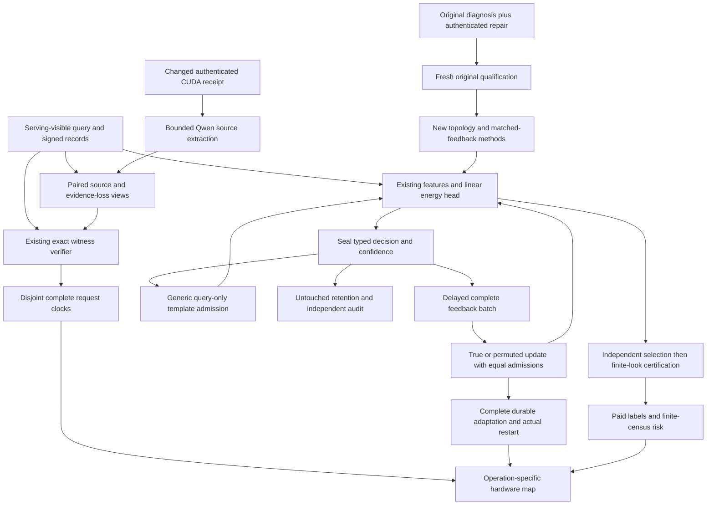
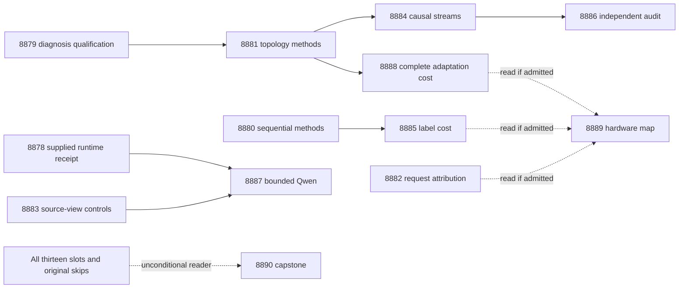

# Carnot Research Roadmap V760: Information, Sequential Risk, and Complete Cost

**Created:** 2026-11-06 (America/New_York)
**Milestone:** 2026.11.760
**Title:** Topology-specific learning, sequential risk certificates, and complete-cost attribution
**Status:** Proposed; staged only, not activated
**Queue:** [research-roadmap-next.yaml](../../research-roadmap-next.yaml)
**Previous authority:** [V759 original design](research-roadmap-v759-preserved-20261106.md) and [V759 original queue](research-roadmap-v759-queue-preserved-20261106.yaml)
**Contract:** Exactly 13 tasks, Exp8878 through Exp8890, in the order below, across four phases.

## What V759 proved

V759 has eight primary outcomes and four pre-gate/cascade skips. The completed
archive currently ends at V758; this account uses V759 primary artifacts,
its capstone and the conductor log. Completion is not a scientific positive.

| Evidence | Observed result | Consequence |
|---|---|---|
| [Exp8866](../../results/experiment_8866_v759_branch_contract.json) | Contract readiness0: the design is truncated and lacks full task objects and the closing marker. CUDA repair readiness0. | Preserve failed authority byte-for-byte; finish and check V760 before handoff. Keep CPU roots independent. |
| [Exp8867](../../results/experiment_8867_v759_feedback_information_diagnosis.json) | Primary is disqualified by terminal validation. Its unqualified diagnosis reports one normalized topology; this cannot establish generalization. | Qualify the concrete November6 retained-health/log-path repair before interpreting diagnosis. Do not rewrite the original primary. |
| [Exp8868](../../results/experiment_8868_v759_conditional_risk_methods.json), [Exp8870](../../results/experiment_8870_v759_conditional_risk_evaluation.json) | Methods/rows qualify; conditional utility1, robustness advantage0. Learned policies have pooled/grouped parity and observed worst served-group risk0 on the constructed census. | Retain useful certificates. Change the question to label cost under sequential certification. |
| [Exp8871](../../results/experiment_8871_v759_size_aware_verifier.json), [Exp8874](../../results/experiment_8874_v759_size_aware_complete_cost.json) | Exact size-aware qualification is circular-positive. Complete costs qualify but speed-benefit score0: mixture speed fails; cold size8 also fails its guard. | Diagnose disjoint complete-request costs and observer overhead before another optimization. |
| Exp8869/8872/8873 and [Exp8875 skip](../../results/experiment_8875_qwen_source_canary.json) | Matched methods, streams and audit did not run; Qwen was skipped on unchanged runtime readiness. | Replace the learning prerequisite with newly qualified repaired execution; retain external gating for Qwen. |
| [Exp8876](../../results/experiment_8876_v759_hardware_operation_budget.json), [Exp8877](../../results/experiment_8877_v759_capstone.json) | Hardware map lacks matched-learning inputs. Capstone accounts for all twelve slots but is terminal blocked. | Preserve available CPU evidence and explicit skips. No device speed, purchase, deployment or publication claim. |

The November6 repair summary at
`/var/tmp/carnot-8867-repair-ij2ttux5/repair-summary.json` reports 315/315
owned statements, original tests, private E2E and a valid private null with
28,800 units. It is a locator for authentication in Exp8879, not a replacement
for original evidence or an already published V760 result.

## Three largest gaps to the PRD

1. **FR-11 / FR-06: learn useful information from delayed feedback.** V758
   benefit was not specific to correct labels; V759's intended controls never
   ran. V760 holds label marginals and template admissions fixed, then measures
   true versus shuffled feedback on actual query-graph diversity. It advances
   Continuous Self-Learning Tiers1–2 and the calibrated typed-decision floor.
2. **FR-12: distinguish verification, source fidelity and economical risk
   control.** Constructed certificates do not establish faithful extraction or
   within-group drift robustness. V760 measures sequential label cost at retained
   risk/coverage and tests missing-hop/omitted-conflict source boundaries.
3. **FR-05 / FR-08 / NFR-01: find the complete deployment bottleneck.** Fewer
   lookup operations did not establish request speed. V760 measures disjoint
   costs and observer overhead, then complete query-only versus verified
   adaptation with equal durability. Hardware claims remain operation-specific.

The November5 suspension in CLAUDE.md forbids ARC slots. This plan contains no
ARC experiment. The generator is frozen; no foundation-model training occurs.

## Research basis and decisions

The dated [V760 scan](../../research-references.md) was saved before task design.
It checks all eight requested research areas and all secondary source channels.

| Primary source | Experimental use | Limit |
|---|---|---|
| [RW-EBR](https://arxiv.org/abs/2606.26476), June2026 | Exp8881/8884/8886 preserve marginals and mechanics while breaking label alignment. | Diagnostic principle only; no imported diffusion benefit. |
| [Chance-Constrained Inference](https://arxiv.org/html/2602.01637v1), February2026 | Exp8880/8885 use finite-look alpha spending to test paid-label savings. | Local exact-binomial construction; frozen policy and stationary independent draws required. |
| [Universal delayed OCO](https://arxiv.org/abs/2610.28058), October2026 | Exp8884/8888 record cumulative delay and maximum pending feedback separately. | No convex regret guarantee for template insertion. |
| [SURE-RAG](https://arxiv.org/abs/2605.03534), July2026 revision | Exp8883/8887 separate visible entailment, omitted source evidence and extraction. | Constructed sufficiency is not natural hallucination detection. |
| [Anechoic](https://arxiv.org/abs/2610.13368), October2026 | Exp8889 separates dense-spin sampling support from host and storage work. | Alveo V80 results are not KV260 or complete-service results. |

KAN-CL, AS2, neural LNS, Ising learning-to-sample, EBT, ARM–EBM and NFA-LM
remain logged leads. They do not warrant a new architecture while information
and cost controls are unresolved. OpenReview supplied a readable manuscript but
its EBT forum required browser verification. Semantic Scholar citation APIs
were inaccessible; citation coverage is incomplete. Hugging Face supplied leads
and SIRIN's author repository. GitHub trending did not establish a relevant new
trend. Extropic's software/simulator announcements and Kona's constraint-layer
page are context, not authenticated local hardware or reproducible new results.

## V760 architecture



The source/view challenge is prepared without Qwen. The optional Qwen branch
uses its qualified boundary protocol. No hidden full-source label reaches a
serving arm. Within-query state is immutable; updates occur after sealed
predictions. Independent branches retain their evidence when another gate fails.

## Phase 1: Qualify authority and certification methods — Exp8878–Exp8880

**Exp8878** binds all thirteen full objects, visible table, digest and closing
marker, with private truncation/prompt/gate/model mutations. It ingests the source
map and reads only a supplied changed CUDA receipt. Administrative readiness
never gates the independent CPU roots.

**Exp8879** authenticates the shipped diagnosis repair, preserves historical
failed health, and reruns the original negative/replay paths. All 315 original
owned statements and new adapter statements must execute. A valid null with all
28,800 original units releases new methods without changing Exp8867's primary.

**Exp8880** freezes sequential certification. There are four topology groups,
1,024 new worlds per group, seven policy arms and forty independent calibration
replicates. Both protocols use240 selection labels per group and at most960
certification candidate draws per group. Looks are120/240/480/960. Sequential
upper bounds receive alpha0.01/(2×7×4×4); fixed-final bounds receive
alpha0.01/(2×7×4). The total family allocation is0.01. No accepted sample means
refusal. The rule certifies only at upper risk<=0.05 and never reselects on
certification labels. Standalone and shared-label costs have separate ledgers.

## Phase 2: Prepare causal controls and locate boundaries — Exp8881–Exp8883

**Exp8881** qualifies four matched arms: frozen_verified, matched_true,
matched_permuted and frozen_query_only. It freezes24 streams,48 online queries,
48 untouched retention queries, and checkpoints0/24/48. Each stream contains
eight non-isomorphic connected query structures of3–7 terms. Entity renaming
and unused marker graphs cannot satisfy diversity. The existing linear head,
SGD rate0.1, features, threshold0.5 and capacity32 stay fixed. Development-only
pilots qualify causal releases, batch multisets, query-only traps and restarts.

**Exp8882** diagnoses the speed null on a deterministic exposed subset: ten
worlds per size8/16/17/64/256/1024, four variants, three evaluator arms, cold and
resident modes, three repeats. Disjoint clocks must close within5 percent of
parent elapsed time; instrumentation's paired99-percent overhead upper bound
must be<=5 percent. Failed observer qualification leaves component bounds
unknown. This task proposes no new optimization or changed dispatch threshold.

**Exp8883** freezes120 source worlds and five paired evidence views, including
necessary-hop removal, irrelevant removal and omitted conflicts. Frozen learned
policies, learned-plus-exact verification and exact-only controls are scored
against both visible entailment and private full-source truth. Independent
source/view truth prevents exact solver correctness from masquerading as source
fidelity. It grants no natural-language certificate.

## Phase 3: Measure learning and risk cost — Exp8884–Exp8887

**Exp8884** runs the frozen four-arm causal streams:18,432 prediction rows,
including all retention checkpoints. It logs actual gradients, admissions,
future template use, label release, cumulative delay, maximum pending count and
tail drain. Methods readiness releases execution; benefit is not assumed.

**Exp8885** runs all forty certificate replicates and evaluates census risk only
after selection/certification. Label-savings benefit requires a simultaneous
99-percent lower bound>0 for saved total labels, coverage-difference lower
bound>=-0.01 and no served group with census risk>0.05. Repeated draws and five
head seeds do not inflate independent n. Forty clean observations do not prove
a universal calibration guarantee; the stated finite-look construction supplies
the probability bound under its assumptions.

**Exp8886** independently audits the causal rows. Correct-label benefit requires
true-minus-permuted Brier upper<0, true-minus-frozen_verified upper<=-0.01,
and retention Brier/error upper increases<=0.01, jointly with simultaneous
99-percent paired-stream intervals. Query-only utility is reported separately.
An honest null is terminal. A successful exact-label result is circular-positive.

**Exp8887** is optional bounded Qwen generation after changed runtime evidence
and qualified source/view controls. It freezes16 paired source documents,
32 calls and128 new tokens per call, at most4,096 tokens. Raw completions,
source spans, missing relations and ideal-record controls are retained. It uses
`unsloth/Qwen3.8-27B-GGUF` Q4_K_M and `model_bounded_generation` (10s floor).
Absent external prerequisites skip once; no CPU smoke model supplies headline
results. Syntax success and exact execution do not establish extraction fidelity.

## Phase 4: Complete costs and reconcile — Exp8888–Exp8890

**Exp8888** measures twelve fresh cost streams using qualified methods, without
requiring learning benefit. All four arms pay their actual work: features,
labels, updates, admissions, serialization, file/directory fsync, restart at
query24 and final feedback drain. Exact restart parity is mandatory. Reduced
label work is explicit; a lower cost is not a speed claim at unverified quality.

**Exp8889** maps admitted cost components, label savings and adaptation operations
to actual hardware support. Missing branches remain visible. It derives Amdahl
bounds only from qualified disjoint elapsed fractions and leaves unknown transfer
cost unknown. The100x learning target is a requirement to test, not a forecast.

**Exp8890** accounts for all thirteen primary/skip outcomes, independently
reduces scientific rows, preserves circularity and publication gates, and states
one changed-evidence condition for each continuation. Unchanged external absence
is blocked, never partial. No activation, deployment or external publication.

## Dependency graph



Solid edges are structured `gated_on` conditions on earlier tasks. Exact field
names appear in the upstream prompt's REQUIRED ARTIFACT FIELDS. Dashed reads
are not conjunctive gates. No dependency references a retired task. Historical
failed artifacts are evidence operands, not scheduled prerequisites.

## Hardware requirements and feasibility

- **Required CPU:** existing Python/JAX environment, installed Carnot consumer,
  local RAM and private durable storage. Small numerical heads use
  `no_model_load`, explicit training-call counts and no pretrained LLM.
- **Optional CUDA:** available dual RTX3090,24GB each; Q4_K_M Qwen is roughly16GB
  but actual context, copy, offload and free memory must qualify. An inventory
  entry or `nvidia-smi` alone cannot release the canary. No dual-model load.
- **KV260:** preserve quadratic scope and `k_max<=5`; access is SSH via `kria`.
  Exact relational joins and durable storage have no demonstrated fabric path.
- **PolarFire:** Linux CPU dispatch is qualified scope, not FPGA acceleration.
  **GateMate:** unchanged `0xffffffff` remains blocked until physical change
  and correct GM1Ax identity. No repeated physical probe is scheduled.
- **NPU/TSU:** future qualified operations only. Extropic software/simulator
  access is not local TSU execution. No purchase, new bitstream or driver install.

Task estimates include validation and remain below the80-minute hard cap.
Each task pilots total execution+validation against70 minutes. Bounded units,
private checkpoints and60-second loop/child progress keep silence below600
seconds. A heartbeat cannot extend a deadline. Files above about200 lines must
be written in separate tool calls with intervening progress messages.

## Claim gates, deliverables and validation

All tasks emit per-unit rows, explicit substrate, hashes, principle-annotated
fields and the closed verdict enum. External blockers name the failed check,
field and observed value in `gate_check_summary`. Every prior failure entry has
all four required fields, including `retire_if_same_verdict: true`. No fabricated
historical verdict is assigned to a cascade skip without a primary artifact.

Before implementation, each task extends its planned REQ/SCENARIO and writes
failing tests. It must run scoped unit/child coverage, lint, formatting, strict
types, positional spec coverage, private E2E-018/021, standalone cold replay and
unchanged terminal artifact scanners. Rust changes additionally require native
and interoperability checks. Global pre-existing health remains separate.

Planner handoff checks schema, gates, exclusion lineage, full-object equality,
visible order, digest and final marker, plus existing planning unit tests and
private E2E tests. The preserved V759 design remains incomplete by history;
only the new V760 contract is expected to pass. Planned requirements and ops
records cannot be mistaken for executed results.

## Exact task contract

The table and embedded full objects below describe exactly the staged YAML.
All thirteen deliverables are new files; scripts derive from the same basenames
under `scripts/experiments/`, with immutable operands under `results/raw/`.

| Order | Task id | Title | Phase | Deliverable |
|---|---|---|---|---|
| 2 | exp8878-branch-contract | Bind the complete V760 contract and ingest new sequential-risk methods | 1 | `results/experiment_8878_v760_branch_contract.json` |
| 2 | exp8879-diagnosis-qualification | Qualify the repaired original feedback diagnosis under immutable V759 authority | 1 | `results/experiment_8879_v760_diagnosis_qualification.json` |
| 3 | exp8880-sequential-certificate-methods | Freeze finite-look risk certification with explicit label accounting | 1 | `results/experiment_8880_v760_sequential_certificate_methods.json` |
| 4 | exp8881-topology-memory-methods | Qualify matched-label learning on genuinely distinct query structures | 2 | `results/experiment_8881_v760_topology_memory_methods.json` |
| 5 | exp8882-request-cost-attribution | Locate complete-request cost after the size-aware speed null | 2 | `results/experiment_8882_v760_request_cost_attribution.json` |
| 6 | exp8883-evidence-loss-boundary | Separate source truth from record sufficiency under missing evidence | 2 | `results/experiment_8883_v760_evidence_loss_boundary.json` |
| 7 | exp8884-topology-causal-streams | Measure continuous energy learning with matched feedback and topology diversity | 3 | `results/experiment_8884_v760_topology_causal_streams.json` |
| 8 | exp8885-sequential-label-cost | Measure sequential certificate cost at matched coverage and risk | 3 | `results/experiment_8885_v760_sequential_label_cost.json` |
| 9 | exp8886-label-benefit-audit | Audit label-specific future benefit and untouched retention | 3 | `results/experiment_8886_v760_label_benefit_audit.json` |
| 10 | exp8887-qwen-source-canary | Measure bounded Qwen extraction against paired source-evidence controls | 3 | `results/experiment_8887_v760_qwen_source_canary.json` |
| 11 | exp8888-matched-adaptation-cost | Measure complete cost of query-only and verified delayed adaptation | 4 | `results/experiment_8888_v760_matched_adaptation_cost.json` |
| 12 | exp8889-hardware-operation-map | Map measured certificate and adaptation work to supported hardware | 4 | `results/experiment_8889_v760_hardware_operation_map.json` |
| 13 | exp8890-capstone | Reconcile thirteen outcomes and decide information risk and cost continuations | 4 | `results/experiment_8890_v760_capstone.json` |

Canonical task SHA-256: `e650b5b205ad20ac620d4e19adc655b53879c1637b21fc7e0a8dfc302ce97a1a`

<!-- V760_TASK_CONTRACT_START -->
```json
{
  "milestone": "2026.11.760",
  "tasks": [
    {
      "id": "exp8878-branch-contract",
      "title": "Bind the complete V760 contract and ingest new sequential-risk methods",
      "phase": 1,
      "track": "research",
      "priority": "high",
      "requires_gpu": false,
      "max_turns": 100,
      "estimated_wall_time_min": 30,
      "per_unit_rows": true,
      "milestone": "2026.11.760",
      "deliverable": "results/experiment_8878_v760_branch_contract.json",
      "inference_substrate_class": "no_model_load",
      "MODEL_SPECS": [],
      "gated_on": [],
      "prior_failures": [
        {
          "experiment_id": "exp8866-branch-contract",
          "verdict": "complete_blocked_v759_branch_contract",
          "addressed_by": "The V760 document is written fully and parser-checked before handoff; preserve the original truncated V759 bytes.",
          "retire_if_same_verdict": true
        },
        {
          "experiment_id": "exp8840-branch-contract",
          "verdict": "complete_disqualified_v757_branch_contract",
          "addressed_by": "Reuse the qualified V758 reader and execute all original mutation controls against complete new authority.",
          "retire_if_same_verdict": true
        }
      ],
      "agent_type": "claude",
      "model": "opus",
      "prompt": "CONTEXT:\nWork in {project_root} on {date}. Milestone 2026.11.760, exp8878-branch-contract. V759 ended with a truncated design, missing full_task_objects and closing marker. The next contract is complete before execution. Research ingestion covers the V760 scan, including RW-EBR, sequential feasibility and delayed-feedback bounds. ARC remains suspended.\n\nEXISTING CODE TO READ FIRST:\n- python/carnot/reporting/roadmap_contract.py; python/carnot/reporting/v758_branch_contract.py; python/carnot/reporting/v759_branch_contract.py\n- scripts/roadmap_schema.py; scripts/audit_roadmap_gates.py; scripts/exclusion_manifest_lint.py\n- research-references.md; ops/exclusion_manifest.yaml; results/experiment_8877_v759_capstone.json\n- openspec/change-proposals/research-roadmap-v759-preserved-20261106.md; openspec/change-proposals/research-roadmap-v759-queue-preserved-20261106.yaml\n- openspec/capabilities/research-reporting/spec.md (REQ-REPORT-8878; SCENARIO-REPORT-8878-CONTRACT)\n- scripts/experiment_template.py; python/carnot/reporting/current_work_receipt.py; python/carnot/reporting/primary_publication.py\n\nTASK:\nBind the complete V760 contract and ingest new sequential-risk methods. Deliver results/experiment_8878_v760_branch_contract.json with immutable raw evidence under results/raw/experiment_8878_v760_branch_contract/. Implement scripts/experiments/experiment_8878_v760_branch_contract.py with --date and private-output/replay options. This executes research, not milestone activation.\n\nCONCRETE STEPS:\n1. PRECONDITIONS: Read CLAUDE.md and CODEX.md; authenticate original inputs, source/config hashes, retained raw operands and execution authority. Check dependencies, private scratch, disk and runtime before expensive work. Missing external inputs are terminal blocked; failed owned controls are disqualified. Preserve original artifacts and assertions.\n2. Emit a flushed progress line at every phase boundary and before and after every potentially minute-long model load, generation, benchmark and subprocess. Use python -u and print(..., flush=True). Inside long loops and child supervision, emit completed/pending counts and forward output at least every 60 seconds. Keep EVERY silence gap below 600 seconds, including work between tool calls; heartbeats never extend the 4800-second cap.\n3. Keep every tool call bounded. Write any file over about 200 lines in several tool calls of at most 150-200 lines, with a progress message between calls. Put experiment scripts in scripts/experiments/, tests in tests/python/ and scratch in /tmp; never write scratch files in the repository root.\n4. Bind exactly thirteen full task objects, Exp8878 through Exp8890, including prompts, gates, model, failure lineage, deliverables and order. Check the visible table, JSON, canonical digest and V760 closing marker. Before activation compare staged authority; after activation compare the actual activated copy, normalizing only the conductor placeholder encoding. Never manufacture active V760 authority from a stale V759 queue.\n5. Run private negative controls for missing last task, truncated JSON, changed prompt/gate/model/table and missing closing marker. Missing independent authority blocks; do not reconstruct the missing V759 document or clear its failure. Independent CPU branches do not depend on contract_ready_score.\n6. Record a source-to-method map for all eight requested topics and all secondary channels. Separate read primary sources, blocked citation access and vendor announcements. Tie sequential-certification and matched-information methods to specific paper sections and local limits.\n7. Read ops/cuda-runtime-repair-receipt.json only if supplied. Set runtime_repair_ready_score=1 only for new causal library/environment hashes, exact mandated GGUF identity, current validation, successful context/copy and actual GPU offload. An absent or unchanged receipt gives zero; do not repeat a CUDA probe. Record optional runtime absence separately from contract readiness.\n8. Extend the named REQ/SCENARIO before implementation; write failing tests first. Reuse ExperimentTemplate, current_work_receipt and primary_publication. Keep checkpoints private until terminal validation. Run scoped pytest with measured unit/child statement coverage of 100 percent and zero exclusions, Ruff check/format, strict mypy and scripts/check_spec_coverage.py with positional test paths. Run private E2E-018/021 and the actual CLI with cold replay outside the checkout without PYTHONPATH. Native changes also require E2E-003/004 and cargo test/fmt/clippy. Run unchanged adversarial_verify.py and verdict_row_consistency_lint.py --strict on prospective artifacts; retain logs and executed-source hashes. Record unrelated repository health separately. Reconcile openspec/, _bmad/traceability.md, ops/status.md and ops/changelog.md. Preserve all scheduled failures and censored units. Pilot total work plus validation below 4200 seconds, leaving margin within the 4800-second hard cap. Do not activate milestones, modify shared validators, edit the exclusion manifest or publish externally.\n\nREQUIRED ARTIFACT FIELDS:\nexperiment_id, task_id, milestone, run_date: principle: identify the actual producer and invocation.\nhonest_verdict: terminal complete_ prefix; principle: completion is not scientific benefit; blocked_* must include gate_check_summary.\nverdict_class: positive | circular_positive | null | blocked | disqualified | partial; principle: partial retries unfinished OWN work only. Unchanged external absence is blocked. verifier_is_oracle=true forbids positive and requires circular_positive for a successful oracle claim.\ninference_substrate, inference_substrate_class, execution_venue, MODEL_SPECS, model_invocation_counts, numerical_training_calls: principle: declare actual compute; fresh numerical small-head training is no_model_load with explicit calls, not pretrained model loading. External skips use blocked_no_run. Never pad duration.\nverifier_is_oracle, exposure_scope, independent_generalization_score: principle: exact constructed truth is circular evidence, not natural-language generalization.\nduration_s, phase_spans, preconditions_checked, random_seed, reproducibility_checksum: principle: retain measured work and fixed methods.\nsource_artifact_hashes, code_config_hashes, raw_shard_hashes, cited_upstream_artifacts: principle: bind every imported claim to original bytes, fields and producer identity.\nrows: principle: each compared unit carries unit_id, cluster_id, arm, seed, metric, denominator, status and missing_reason. Headlines must reduce from per-unit rows.\nintended_count, completed_count, failed_count, censored_count, excluded_count, independent_count: principle: repeats, seeds and candidates cannot inflate independent n or hide scheduled failures.\ngate_check_summary: principle: a blocked verdict names check, upstream, artifact_field, expected, observed, path and hash; distinguish missing_file, missing_field, rejected_producer and observed_zero.\nacceptance_gates, required_checks_passed, validation_receipts, owned_statement_coverage: principle: administrative readiness and scientific benefit are different gates.\nfield_principles: principle: explain every additional field and preserve the scope of every claim.\ncontract_ready_score: integer 0/1; principle: complete independent authority and mutation checks only.\nruntime_repair_ready_score: integer 0/1; principle: supplied changed runtime evidence alone releases the bounded canary.\nfull_task_objects, visible_task_table, canonical_tasks_sha256, authority_mutation_rows, gate_edge_rows, source_method_map, external_admission_rows: principle: retain complete authority without turning custody into science.\n\nRun command: cd {project_root} && JAX_PLATFORMS=cpu .venv/bin/python -u scripts/experiments/experiment_8878_v760_branch_contract.py --date {date}\nDo NOT push. Do NOT modify scripts/research_conductor.py."
    },
    {
      "id": "exp8879-diagnosis-qualification",
      "title": "Qualify the repaired original feedback diagnosis under immutable V759 authority",
      "phase": 1,
      "track": "research",
      "priority": "high",
      "requires_gpu": false,
      "max_turns": 30,
      "estimated_wall_time_min": 40,
      "per_unit_rows": true,
      "milestone": "2026.11.760",
      "deliverable": "results/experiment_8879_v760_diagnosis_qualification.json",
      "inference_substrate_class": "no_model_load",
      "MODEL_SPECS": [],
      "gated_on": [],
      "prior_failures": [
        {
          "experiment_id": "exp8867-feedback-information-diagnosis",
          "verdict": "complete_disqualified_terminal_validation",
          "addressed_by": "Qualify the shipped November 6 retained-health/log-path repair, including real original negative paths and cold replay, under new custody.",
          "retire_if_same_verdict": true
        }
      ],
      "prompt": "CONTEXT:\nWork in {project_root} on {date}. Milestone 2026.11.760, exp8879-diagnosis-qualification. Exp8867 remains disqualified. The November 6 retained-health and relative-log-path repair is documented in ops/status.md; /var/tmp/carnot-8867-repair-ij2ttux5/repair-summary.json reports 315/315 statements and a valid private null. That summary is a locator, not sufficient evidence by itself.\n\nEXISTING CODE TO READ FIRST:\n- python/carnot/reporting/feedback_information_8867.py; python/carnot/reporting/feedback_information_runner_8867.py\n- scripts/experiments/experiment_8867_v759_feedback_information_diagnosis.py; tests/python/test_feedback_information_8867.py\n- results/experiment_8867_v759_feedback_information_diagnosis.json; ops/status.md\n- openspec/capabilities/research-reporting/spec.md (REQ-REPORT-8879; SCENARIO-REPORT-8879-CONTRACT)\n- scripts/experiment_template.py; python/carnot/reporting/current_work_receipt.py; python/carnot/reporting/primary_publication.py\n\nTASK:\nQualify the repaired original feedback diagnosis under immutable V759 authority. Deliver results/experiment_8879_v760_diagnosis_qualification.json with immutable raw evidence under results/raw/experiment_8879_v760_diagnosis_qualification/. Implement scripts/experiments/experiment_8879_v760_diagnosis_qualification.py with --date and private-output/replay options. This executes research, not milestone activation.\n\nCONCRETE STEPS:\n1. PRECONDITIONS: Read CLAUDE.md and CODEX.md; authenticate original inputs, source/config hashes, retained raw operands and execution authority. Check dependencies, private scratch, disk and runtime before expensive work. Missing external inputs are terminal blocked; failed owned controls are disqualified. Preserve original artifacts and assertions.\n2. Emit a flushed progress line at every phase boundary and before and after every potentially minute-long model load, generation, benchmark and subprocess. Use python -u and print(..., flush=True). Inside long loops and child supervision, emit completed/pending counts and forward output at least every 60 seconds. Keep EVERY silence gap below 600 seconds, including work between tool calls; heartbeats never extend the 4800-second cap.\n3. Keep every tool call bounded. Write any file over about 200 lines in several tool calls of at most 150-200 lines, with a progress message between calls. Put experiment scripts in scripts/experiments/, tests in tests/python/ and scratch in /tmp; never write scratch files in the repository root.\n4. Authenticate the actual repaired source, original tests, health log and private raw diagnosis behind the November 6 receipt. Copy all consumed evidence into invocation-owned storage. If temporary evidence is missing, use the repaired original CLI to reproduce privately against original retained execution inputs, never mutable vNEXT.\n5. Rerun the original 27 diagnosis tests and the original private E2E cases, including missing/changed retained logs and outside-directory replay. Preserve failed global health as historical evidence. Require real unit/child coverage of all 315 original owned statements without exclusion; new adapter statements must also be covered.\n6. Reduce all 28800 original units and six development streams without new fits or selection. Retain the separable and zero-signal controls, actual template cardinality and complete released-label multiset checks. A valid null qualifies the method; the one-topology diagnosis cannot establish generalization.\n7. Publish a NEW qualification receipt and copied diagnosis operands with diagnosis_ready_score=1 only if original controls, terminal scanners and cold replay pass. Leave Exp8867 primary bytes and verdict intact. Do not repair generic validators or broaden the diagnosis.\n8. Extend the named REQ/SCENARIO before implementation; write failing tests first. Reuse ExperimentTemplate, current_work_receipt and primary_publication. Keep checkpoints private until terminal validation. Run scoped pytest with measured unit/child statement coverage of 100 percent and zero exclusions, Ruff check/format, strict mypy and scripts/check_spec_coverage.py with positional test paths. Run private E2E-018/021 and the actual CLI with cold replay outside the checkout without PYTHONPATH. Native changes also require E2E-003/004 and cargo test/fmt/clippy. Run unchanged adversarial_verify.py and verdict_row_consistency_lint.py --strict on prospective artifacts; retain logs and executed-source hashes. Record unrelated repository health separately. Reconcile openspec/, _bmad/traceability.md, ops/status.md and ops/changelog.md. Preserve all scheduled failures and censored units. Pilot total work plus validation below 4200 seconds, leaving margin within the 4800-second hard cap. Do not activate milestones, modify shared validators, edit the exclusion manifest or publish externally.\n\nREQUIRED ARTIFACT FIELDS:\nexperiment_id, task_id, milestone, run_date: principle: identify the actual producer and invocation.\nhonest_verdict: terminal complete_ prefix; principle: completion is not scientific benefit; blocked_* must include gate_check_summary.\nverdict_class: positive | circular_positive | null | blocked | disqualified | partial; principle: partial retries unfinished OWN work only. Unchanged external absence is blocked. verifier_is_oracle=true forbids positive and requires circular_positive for a successful oracle claim.\ninference_substrate, inference_substrate_class, execution_venue, MODEL_SPECS, model_invocation_counts, numerical_training_calls: principle: declare actual compute; fresh numerical small-head training is no_model_load with explicit calls, not pretrained model loading. External skips use blocked_no_run. Never pad duration.\nverifier_is_oracle, exposure_scope, independent_generalization_score: principle: exact constructed truth is circular evidence, not natural-language generalization.\nduration_s, phase_spans, preconditions_checked, random_seed, reproducibility_checksum: principle: retain measured work and fixed methods.\nsource_artifact_hashes, code_config_hashes, raw_shard_hashes, cited_upstream_artifacts: principle: bind every imported claim to original bytes, fields and producer identity.\nrows: principle: each compared unit carries unit_id, cluster_id, arm, seed, metric, denominator, status and missing_reason. Headlines must reduce from per-unit rows.\nintended_count, completed_count, failed_count, censored_count, excluded_count, independent_count: principle: repeats, seeds and candidates cannot inflate independent n or hide scheduled failures.\ngate_check_summary: principle: a blocked verdict names check, upstream, artifact_field, expected, observed, path and hash; distinguish missing_file, missing_field, rejected_producer and observed_zero.\nacceptance_gates, required_checks_passed, validation_receipts, owned_statement_coverage: principle: administrative readiness and scientific benefit are different gates.\nfield_principles: principle: explain every additional field and preserve the scope of every claim.\ndiagnosis_ready_score: integer 0/1; principle: fresh original execution qualification releases new methods regardless of effect.\noriginal_primary_sha256, repair_evidence_refs, original_nodeids, original_statement_rows, retained_health_receipt, diagnosis_rows, control_sensitivity, topology_cardinality: principle: original failure and current qualified evidence remain separately attributable.\n\nRun command: cd {project_root} && JAX_PLATFORMS=cpu .venv/bin/python -u scripts/experiments/experiment_8879_v760_diagnosis_qualification.py --date {date}\nDo NOT push. Do NOT modify scripts/research_conductor.py."
    },
    {
      "id": "exp8880-sequential-certificate-methods",
      "title": "Freeze finite-look risk certification with explicit label accounting",
      "phase": 1,
      "track": "research",
      "priority": "high",
      "requires_gpu": false,
      "max_turns": 50,
      "estimated_wall_time_min": 50,
      "per_unit_rows": true,
      "milestone": "2026.11.760",
      "deliverable": "results/experiment_8880_v760_sequential_certificate_methods.json",
      "inference_substrate_class": "no_model_load",
      "MODEL_SPECS": [],
      "gated_on": [],
      "prior_failures": [
        {
          "experiment_id": "exp8870-conditional-risk-evaluation",
          "verdict": "complete_null_conditional_risk_evaluation",
          "addressed_by": "Replace a tied grouped-versus-pooled comparison with alpha-spending sequential label acquisition and a matched maximum-budget comparator.",
          "retire_if_same_verdict": true
        }
      ],
      "agent_type": "codex",
      "model": "gpt-6.1-sol",
      "prompt": "CONTEXT:\nWork in {project_root} on {date}. Milestone 2026.11.760, exp8880-sequential-certificate-methods. Exp8870 had useful fixed-group certificates but no grouped-versus-pooled advantage. Change the estimand to label cost at retained coverage and risk. Chance-Constrained Inference (2602.01637) motivates optional-stopping-safe bounds; this task uses a simple finite union-bound construction.\n\nEXISTING CODE TO READ FIRST:\n- python/carnot/reporting/conditional_risk_methods_8868.py; python/carnot/reporting/conditional_risk_evaluation_8870.py\n- results/experiment_8868_v759_conditional_risk_methods.json; results/experiment_8870_v759_conditional_risk_evaluation.json\n- python/carnot/reporting/selective_population_8842.py; research-references.md\n- openspec/capabilities/research-reporting/spec.md (REQ-REPORT-8880; SCENARIO-REPORT-8880-CONTRACT)\n- scripts/experiment_template.py; python/carnot/reporting/current_work_receipt.py; python/carnot/reporting/primary_publication.py\n\nTASK:\nFreeze finite-look risk certification with explicit label accounting. Deliver results/experiment_8880_v760_sequential_certificate_methods.json with immutable raw evidence under results/raw/experiment_8880_v760_sequential_certificate_methods/. Implement scripts/experiments/experiment_8880_v760_sequential_certificate_methods.py with --date and private-output/replay options. This executes research, not milestone activation.\n\nCONCRETE STEPS:\n1. PRECONDITIONS: Read CLAUDE.md and CODEX.md; authenticate original inputs, source/config hashes, retained raw operands and execution authority. Check dependencies, private scratch, disk and runtime before expensive work. Missing external inputs are terminal blocked; failed owned controls are disqualified. Preserve original artifacts and assertions.\n2. Emit a flushed progress line at every phase boundary and before and after every potentially minute-long model load, generation, benchmark and subprocess. Use python -u and print(..., flush=True). Inside long loops and child supervision, emit completed/pending counts and forward output at least every 60 seconds. Keep EVERY silence gap below 600 seconds, including work between tool calls; heartbeats never extend the 4800-second cap.\n3. Keep every tool call bounded. Write any file over about 200 lines in several tool calls of at most 150-200 lines, with a progress message between calls. Put experiment scripts in scripts/experiments/, tests in tests/python/ and scratch in /tmp; never write scratch files in the repository root.\n4. Freeze a new 4096-world population, 1024 per existing topology group, with query-relevant graph structure separated from fit and exposed cohorts. Keep seven fixed policy arms and existing learned-head fits. Fix 40 independent draw replicates with replacement. The finite population is the claim boundary.\n5. Use the same 240 selection draws per group for both protocols. Choose cutoffs only from these labels. Certification draws are fresh and independent; freeze cumulative candidate-draw looks 120,240,480,960 per group and a fixed-budget comparator at 960. Both arms have the same maximum label budget and frozen policy, and share candidate draw sequences.\n6. For each policy/group use exact one-sided binomial UPPER bounds on accepted errors at each look, with alpha=0.01/(2*7*4*4); use alpha=0.01/(2*7*4) for the fixed arm. Sum is <=0.01 across both protocols. Certify only at upper<=0.05. Zero accepted examples refuse. Stop a sequential cell at its first valid certificate; otherwise continue to its final look then refuse. Do not peek at census or reselect thresholds. Do not add a lower-bound early-rejection rule without allocating its error budget.\n7. Charge all labels actually acquired, including unaccepted candidate draws and selection. Report standalone per-policy costs; if labels are shared across policies, separately charge the union up to the last unfinished cell. Seeds and seven policies are not seven independent replicates. Keep conceptual counterfactual fixed-arm costs separate from actually generated research labels.\n8. Prove the finite-look union bound in the artifact and test edge cases n=0/errors=n, exact zero-error count, repeated-look rejection, selection leakage, identical-arm controls, and a deliberately unsafe constant policy. Pilot counts and runtime before freezing methods. Readiness requires valid controls, never a favorable cost projection.\n9. Extend the named REQ/SCENARIO before implementation; write failing tests first. Reuse ExperimentTemplate, current_work_receipt and primary_publication. Keep checkpoints private until terminal validation. Run scoped pytest with measured unit/child statement coverage of 100 percent and zero exclusions, Ruff check/format, strict mypy and scripts/check_spec_coverage.py with positional test paths. Run private E2E-018/021 and the actual CLI with cold replay outside the checkout without PYTHONPATH. Native changes also require E2E-003/004 and cargo test/fmt/clippy. Run unchanged adversarial_verify.py and verdict_row_consistency_lint.py --strict on prospective artifacts; retain logs and executed-source hashes. Record unrelated repository health separately. Reconcile openspec/, _bmad/traceability.md, ops/status.md and ops/changelog.md. Preserve all scheduled failures and censored units. Pilot total work plus validation below 4200 seconds, leaving margin within the 4800-second hard cap. Do not activate milestones, modify shared validators, edit the exclusion manifest or publish externally.\n\nREQUIRED ARTIFACT FIELDS:\nexperiment_id, task_id, milestone, run_date: principle: identify the actual producer and invocation.\nhonest_verdict: terminal complete_ prefix; principle: completion is not scientific benefit; blocked_* must include gate_check_summary.\nverdict_class: positive | circular_positive | null | blocked | disqualified | partial; principle: partial retries unfinished OWN work only. Unchanged external absence is blocked. verifier_is_oracle=true forbids positive and requires circular_positive for a successful oracle claim.\ninference_substrate, inference_substrate_class, execution_venue, MODEL_SPECS, model_invocation_counts, numerical_training_calls: principle: declare actual compute; fresh numerical small-head training is no_model_load with explicit calls, not pretrained model loading. External skips use blocked_no_run. Never pad duration.\nverifier_is_oracle, exposure_scope, independent_generalization_score: principle: exact constructed truth is circular evidence, not natural-language generalization.\nduration_s, phase_spans, preconditions_checked, random_seed, reproducibility_checksum: principle: retain measured work and fixed methods.\nsource_artifact_hashes, code_config_hashes, raw_shard_hashes, cited_upstream_artifacts: principle: bind every imported claim to original bytes, fields and producer identity.\nrows: principle: each compared unit carries unit_id, cluster_id, arm, seed, metric, denominator, status and missing_reason. Headlines must reduce from per-unit rows.\nintended_count, completed_count, failed_count, censored_count, excluded_count, independent_count: principle: repeats, seeds and candidates cannot inflate independent n or hide scheduled failures.\ngate_check_summary: principle: a blocked verdict names check, upstream, artifact_field, expected, observed, path and hash; distinguish missing_file, missing_field, rejected_producer and observed_zero.\nacceptance_gates, required_checks_passed, validation_receipts, owned_statement_coverage: principle: administrative readiness and scientific benefit are different gates.\nfield_principles: principle: explain every additional field and preserve the scope of every claim.\nsequential_methods_ready_score: integer 0/1; principle: valid frozen protocol and controls release evaluation.\nlook_schedule, alpha_allocation, bound_proof, draw_manifest, population_manifest, selection_manifest, label_cost_definition, exact_sample_requirements, positive_negative_controls: principle: optional stopping and shared-label accounting cannot hide risk or cost.\n\nRun command: cd {project_root} && JAX_PLATFORMS=cpu .venv/bin/python -u scripts/experiments/experiment_8880_v760_sequential_certificate_methods.py --date {date}\nDo NOT push. Do NOT modify scripts/research_conductor.py."
    },
    {
      "id": "exp8881-topology-memory-methods",
      "title": "Qualify matched-label learning on genuinely distinct query structures",
      "phase": 2,
      "track": "research",
      "priority": "high",
      "requires_gpu": false,
      "max_turns": 50,
      "estimated_wall_time_min": 55,
      "per_unit_rows": true,
      "milestone": "2026.11.760",
      "deliverable": "results/experiment_8881_v760_topology_memory_methods.json",
      "inference_substrate_class": "no_model_load",
      "MODEL_SPECS": [],
      "gated_on": [
        {
          "upstream": "exp8879-diagnosis-qualification",
          "artifact_field": "diagnosis_ready_score",
          "op": "==",
          "value": 1
        }
      ],
      "prior_failures": [
        {
          "experiment_id": "exp8869-matched-memory-methods",
          "verdict": "blocked_gate_check_failed",
          "addressed_by": "Use newly qualified repaired diagnosis rather than its disqualified primary and replace single-topology marker diversity with canonical query structures.",
          "retire_if_same_verdict": true
        },
        {
          "experiment_id": "exp8860-linear-benefit-audit",
          "verdict": "complete_null_linear_benefit_audit",
          "addressed_by": "Match released-label multisets and template exposure while varying alignment, with predeclared topology diversity and unchanged retention tolerances.",
          "retire_if_same_verdict": true
        }
      ],
      "agent_type": "codex",
      "model": "gpt-6.1-sol",
      "prompt": "CONTEXT:\nWork in {project_root} on {date}. Milestone 2026.11.760, exp8881-topology-memory-methods. V758 gains did not establish true-label specificity. The repaired diagnosis is a prerequisite because its controls must qualify first. RW-EBR (2606.26476) motivates preserving value distributions while breaking alignment; this is a small typed-energy-head experiment, not generator training.\n\nEXISTING CODE TO READ FIRST:\n- python/carnot/reporting/feedback_information_8867.py; python/carnot/reporting/linear_ablation_methods_8854.py\n- python/carnot/memory/causal_memory_8802.py; python/carnot/memory/categorical_memory_8830.py\n- python/carnot/reporting/conditional_risk_methods_8868.py; results/experiment_8879_v760_diagnosis_qualification.json\n- openspec/capabilities/research-reporting/spec.md (REQ-REPORT-8881; SCENARIO-REPORT-8881-CONTRACT)\n- scripts/experiment_template.py; python/carnot/reporting/current_work_receipt.py; python/carnot/reporting/primary_publication.py\n\nTASK:\nQualify matched-label learning on genuinely distinct query structures. Deliver results/experiment_8881_v760_topology_memory_methods.json with immutable raw evidence under results/raw/experiment_8881_v760_topology_memory_methods/. Implement scripts/experiments/experiment_8881_v760_topology_memory_methods.py with --date and private-output/replay options. This executes research, not milestone activation.\n\nCONCRETE STEPS:\n1. PRECONDITIONS: Read CLAUDE.md and CODEX.md; authenticate original inputs, source/config hashes, retained raw operands and execution authority. Check dependencies, private scratch, disk and runtime before expensive work. Missing external inputs are terminal blocked; failed owned controls are disqualified. Preserve original artifacts and assertions.\n2. Emit a flushed progress line at every phase boundary and before and after every potentially minute-long model load, generation, benchmark and subprocess. Use python -u and print(..., flush=True). Inside long loops and child supervision, emit completed/pending counts and forward output at least every 60 seconds. Keep EVERY silence gap below 600 seconds, including work between tool calls; heartbeats never extend the 4800-second cap.\n3. Keep every tool call bounded. Write any file over about 200 lines in several tool calls of at most 150-200 lines, with a progress message between calls. Put experiment scripts in scripts/experiments/, tests in tests/python/ and scratch in /tmp; never write scratch files in the repository root.\n4. Freeze four arms: frozen_verified, matched_true, matched_permuted and frozen_query_only. Reuse the qualified linear normalized energy head, SGD lr=0.1, seven existing features, threshold0.5 and pending/template caps32. Changes are query topology and matched release controls; no new optimizer, generator training or feature search.\n5. Build 24 fresh paired streams with 48 online and 48 untouched retention queries each. Each stream cycles eight actually non-isomorphic connected query templates of 3-7 terms, balanced support/refute/insufficient labels and existing error types. Separate development, online and retention query-graph identities where claimed; document recurring online templates explicitly. Canonical graph checks must reject mere entity renaming, term order changes and disconnected marker decoration as novelty.\n6. Fit initial heads only on development worlds; freeze seeds11/23/37/47/59 across the 24 streams before outcomes. Compare the SAME source world and release schedule across all arms. Half use delay8 and half4/8/12. Release complete batches only after pending predictions seal; permute the current released batch with its multiset, event count, optimizer steps and verified-template schedule fixed. Log unchanged labels under permutation instead of silently replacing them.\n7. Query-only admission may compile generic equality joins from query syntax after prediction, but cannot read labels, whole-query decisions, witnesses or source truth. Verified arms receive the same admissions; their shuffling only changes training targets. Keep immutable within-query state, atomic state-plus-ack commits, exact restarts and tail drains.\n8. Freeze future window25-48 and retention checkpoints0/24/48. Register simultaneous99-percent paired-stream intervals with10000 bootstrap draws. True-label benefit requires true-minus-permuted Brier upper<0, true-minus-frozen_verified upper<=-0.01 and retention Brier/error upper increases<=0.01. Report true-minus-query_only separately; query-only utility must not be called label learning.\n9. Qualify two development streams plus positive separable and zero-signal controls. Require predicted labels to remain unavailable until release, query-only sentinel traps, exact shuffled multisets, original causal-store restart tests and semantic/topology controls. No held-out outcome can select methods. Publish the complete finite roster and projected full run plus validation time.\n10. Extend the named REQ/SCENARIO before implementation; write failing tests first. Reuse ExperimentTemplate, current_work_receipt and primary_publication. Keep checkpoints private until terminal validation. Run scoped pytest with measured unit/child statement coverage of 100 percent and zero exclusions, Ruff check/format, strict mypy and scripts/check_spec_coverage.py with positional test paths. Run private E2E-018/021 and the actual CLI with cold replay outside the checkout without PYTHONPATH. Native changes also require E2E-003/004 and cargo test/fmt/clippy. Run unchanged adversarial_verify.py and verdict_row_consistency_lint.py --strict on prospective artifacts; retain logs and executed-source hashes. Record unrelated repository health separately. Reconcile openspec/, _bmad/traceability.md, ops/status.md and ops/changelog.md. Preserve all scheduled failures and censored units. Pilot total work plus validation below 4200 seconds, leaving margin within the 4800-second hard cap. Do not activate milestones, modify shared validators, edit the exclusion manifest or publish externally.\n\nREQUIRED ARTIFACT FIELDS:\nexperiment_id, task_id, milestone, run_date: principle: identify the actual producer and invocation.\nhonest_verdict: terminal complete_ prefix; principle: completion is not scientific benefit; blocked_* must include gate_check_summary.\nverdict_class: positive | circular_positive | null | blocked | disqualified | partial; principle: partial retries unfinished OWN work only. Unchanged external absence is blocked. verifier_is_oracle=true forbids positive and requires circular_positive for a successful oracle claim.\ninference_substrate, inference_substrate_class, execution_venue, MODEL_SPECS, model_invocation_counts, numerical_training_calls: principle: declare actual compute; fresh numerical small-head training is no_model_load with explicit calls, not pretrained model loading. External skips use blocked_no_run. Never pad duration.\nverifier_is_oracle, exposure_scope, independent_generalization_score: principle: exact constructed truth is circular evidence, not natural-language generalization.\nduration_s, phase_spans, preconditions_checked, random_seed, reproducibility_checksum: principle: retain measured work and fixed methods.\nsource_artifact_hashes, code_config_hashes, raw_shard_hashes, cited_upstream_artifacts: principle: bind every imported claim to original bytes, fields and producer identity.\nrows: principle: each compared unit carries unit_id, cluster_id, arm, seed, metric, denominator, status and missing_reason. Headlines must reduce from per-unit rows.\nintended_count, completed_count, failed_count, censored_count, excluded_count, independent_count: principle: repeats, seeds and candidates cannot inflate independent n or hide scheduled failures.\ngate_check_summary: principle: a blocked verdict names check, upstream, artifact_field, expected, observed, path and hash; distinguish missing_file, missing_field, rejected_producer and observed_zero.\nacceptance_gates, required_checks_passed, validation_receipts, owned_statement_coverage: principle: administrative readiness and scientific benefit are different gates.\nfield_principles: principle: explain every additional field and preserve the scope of every claim.\ntopology_methods_ready_score: integer 0/1; principle: valid matched causal controls and bounded execution release training.\narm_definitions, topology_manifest, fit_manifest, cohort_manifest, release_manifest, expected_row_counts, frozen_gates, control_rows, projected_runtime_s: principle: claimed information and independent structures must exist before outcome inspection.\n\nRun command: cd {project_root} && JAX_PLATFORMS=cpu .venv/bin/python -u scripts/experiments/experiment_8881_v760_topology_memory_methods.py --date {date}\nDo NOT push. Do NOT modify scripts/research_conductor.py."
    },
    {
      "id": "exp8882-request-cost-attribution",
      "title": "Locate complete-request cost after the size-aware speed null",
      "phase": 2,
      "track": "research",
      "priority": "high",
      "requires_gpu": false,
      "max_turns": 50,
      "estimated_wall_time_min": 50,
      "per_unit_rows": true,
      "milestone": "2026.11.760",
      "deliverable": "results/experiment_8882_v760_request_cost_attribution.json",
      "inference_substrate_class": "no_model_load",
      "MODEL_SPECS": [],
      "gated_on": [],
      "prior_failures": [
        {
          "experiment_id": "exp8874-size-aware-complete-cost",
          "verdict": "complete_null_size_aware_complete_cost",
          "addressed_by": "Measure disjoint complete-request time and observer overhead to diagnose the null; do not repeat the same speed-benefit experiment.",
          "retire_if_same_verdict": true
        }
      ],
      "prompt": "CONTEXT:\nWork in {project_root} on {date}. Milestone 2026.11.760, exp8882-request-cost-attribution. Exp8874 passed measurement qualification but failed complete speed benefit. Operation counts are not elapsed-time fractions. This task diagnoses the retained installed consumer before any new optimization.\n\nEXISTING CODE TO READ FIRST:\n- python/carnot/reporting/size_aware_complete_cost_8874.py; python/carnot/reporting/size_aware_complete_runner_8874.py\n- scripts/experiments/size_aware_cost_worker_8874.py; python/carnot/reporting/size_aware_verifier_8871.py\n- results/experiment_8874_v759_size_aware_complete_cost.json; results/experiment_8871_v759_size_aware_verifier.json\n- openspec/capabilities/research-reporting/spec.md (REQ-REPORT-8882; SCENARIO-REPORT-8882-CONTRACT)\n- scripts/experiment_template.py; python/carnot/reporting/current_work_receipt.py; python/carnot/reporting/primary_publication.py\n\nTASK:\nLocate complete-request cost after the size-aware speed null. Deliver results/experiment_8882_v760_request_cost_attribution.json with immutable raw evidence under results/raw/experiment_8882_v760_request_cost_attribution/. Implement scripts/experiments/experiment_8882_v760_request_cost_attribution.py with --date and private-output/replay options. This executes research, not milestone activation.\n\nCONCRETE STEPS:\n1. PRECONDITIONS: Read CLAUDE.md and CODEX.md; authenticate original inputs, source/config hashes, retained raw operands and execution authority. Check dependencies, private scratch, disk and runtime before expensive work. Missing external inputs are terminal blocked; failed owned controls are disqualified. Preserve original artifacts and assertions.\n2. Emit a flushed progress line at every phase boundary and before and after every potentially minute-long model load, generation, benchmark and subprocess. Use python -u and print(..., flush=True). Inside long loops and child supervision, emit completed/pending counts and forward output at least every 60 seconds. Keep EVERY silence gap below 600 seconds, including work between tool calls; heartbeats never extend the 4800-second cap.\n3. Keep every tool call bounded. Write any file over about 200 lines in several tool calls of at most 150-200 lines, with a progress message between calls. Put experiment scripts in scripts/experiments/, tests in tests/python/ and scratch in /tmp; never write scratch files in the repository root.\n4. Authenticate original package, requests and clocks. Select a deterministic diagnostic subset before profiling: ten worlds at each size8/16/17/64/256/1024, all four request variants, scan/indexed/size_aware and cold/resident modes, three repeats. Label this exposed cost diagnosis, not a fresh superiority test.\n5. Add opt-in research instrumentation around non-overlapping intervals: process/import startup, parse/validate, candidate index or scan preparation, exact joins, response encode and unaccounted residual. Preserve complete parent clocks, operation caps, rejection semantics and exact output witnesses. No interval may be counted twice; negative residual or missing clock blocks attribution.\n6. Pair instrumented and uninstrumented runs in frozen randomized order; include no-op clock controls. Accept attribution only if component sum closes within5 percent of complete elapsed and the paired99-percent instrumentation-overhead upper bound is<=5 percent. If instrumentation dominates tiny requests, report that null and keep full clocks; do not subtract estimated observer cost.\n7. Report per-request components and whole-world intervals by size/mode. Keep installation amortization, warmup and timeout costs visible, and distinguish process startup from steady service. Identify one measured dominant removable cost or explicitly report none. Do not change dispatch thresholds, introduce a new optimization, infer Rust10x, or benchmark unchanged hardware.\n8. Extend the named REQ/SCENARIO before implementation; write failing tests first. Reuse ExperimentTemplate, current_work_receipt and primary_publication. Keep checkpoints private until terminal validation. Run scoped pytest with measured unit/child statement coverage of 100 percent and zero exclusions, Ruff check/format, strict mypy and scripts/check_spec_coverage.py with positional test paths. Run private E2E-018/021 and the actual CLI with cold replay outside the checkout without PYTHONPATH. Native changes also require E2E-003/004 and cargo test/fmt/clippy. Run unchanged adversarial_verify.py and verdict_row_consistency_lint.py --strict on prospective artifacts; retain logs and executed-source hashes. Record unrelated repository health separately. Reconcile openspec/, _bmad/traceability.md, ops/status.md and ops/changelog.md. Preserve all scheduled failures and censored units. Pilot total work plus validation below 4200 seconds, leaving margin within the 4800-second hard cap. Do not activate milestones, modify shared validators, edit the exclusion manifest or publish externally.\n\nREQUIRED ARTIFACT FIELDS:\nexperiment_id, task_id, milestone, run_date: principle: identify the actual producer and invocation.\nhonest_verdict: terminal complete_ prefix; principle: completion is not scientific benefit; blocked_* must include gate_check_summary.\nverdict_class: positive | circular_positive | null | blocked | disqualified | partial; principle: partial retries unfinished OWN work only. Unchanged external absence is blocked. verifier_is_oracle=true forbids positive and requires circular_positive for a successful oracle claim.\ninference_substrate, inference_substrate_class, execution_venue, MODEL_SPECS, model_invocation_counts, numerical_training_calls: principle: declare actual compute; fresh numerical small-head training is no_model_load with explicit calls, not pretrained model loading. External skips use blocked_no_run. Never pad duration.\nverifier_is_oracle, exposure_scope, independent_generalization_score: principle: exact constructed truth is circular evidence, not natural-language generalization.\nduration_s, phase_spans, preconditions_checked, random_seed, reproducibility_checksum: principle: retain measured work and fixed methods.\nsource_artifact_hashes, code_config_hashes, raw_shard_hashes, cited_upstream_artifacts: principle: bind every imported claim to original bytes, fields and producer identity.\nrows: principle: each compared unit carries unit_id, cluster_id, arm, seed, metric, denominator, status and missing_reason. Headlines must reduce from per-unit rows.\nintended_count, completed_count, failed_count, censored_count, excluded_count, independent_count: principle: repeats, seeds and candidates cannot inflate independent n or hide scheduled failures.\ngate_check_summary: principle: a blocked verdict names check, upstream, artifact_field, expected, observed, path and hash; distinguish missing_file, missing_field, rejected_producer and observed_zero.\nacceptance_gates, required_checks_passed, validation_receipts, owned_statement_coverage: principle: administrative readiness and scientific benefit are different gates.\nfield_principles: principle: explain every additional field and preserve the scope of every claim.\ncost_attribution_ready_score: integer 0/1; principle: qualified non-overlapping clocks permit component bounds, not speed claims.\ncomponent_rows, uninstrumented_rows, observer_overhead_interval, closure_residuals, complete_parent_costs, installation_accounting, dominant_cost, next_mechanism: principle: expose the actual bottleneck and observer limitations.\n\nRun command: cd {project_root} && JAX_PLATFORMS=cpu .venv/bin/python -u scripts/experiments/experiment_8882_v760_request_cost_attribution.py --date {date}\nDo NOT push. Do NOT modify scripts/research_conductor.py."
    },
    {
      "id": "exp8883-evidence-loss-boundary",
      "title": "Separate source truth from record sufficiency under missing evidence",
      "phase": 2,
      "track": "research",
      "priority": "high",
      "requires_gpu": false,
      "max_turns": 50,
      "estimated_wall_time_min": 45,
      "per_unit_rows": true,
      "milestone": "2026.11.760",
      "deliverable": "results/experiment_8883_v760_evidence_loss_boundary.json",
      "inference_substrate_class": "no_model_load",
      "MODEL_SPECS": [],
      "gated_on": [],
      "prior_failures": [
        {
          "experiment_id": "exp8870-conditional-risk-evaluation",
          "verdict": "complete_null_conditional_risk_evaluation",
          "addressed_by": "Change prevalence-shift parity into a paired missing-hop/omitted-conflict source-versus-view challenge with frozen policies.",
          "retire_if_same_verdict": true
        }
      ],
      "agent_type": "codex",
      "model": "gpt-6.1-sol",
      "prompt": "CONTEXT:\nWork in {project_root} on {date}. Milestone 2026.11.760, exp8883-evidence-loss-boundary. Exp8870 tested prevalence changes and a conflict stress case, not faithful source extraction. SURE-RAG (2605.03534) motivates missing-hop and conflict tests with a separate source/view truth boundary. This is a CPU constructed challenge, independent of Qwen availability.\n\nEXISTING CODE TO READ FIRST:\n- python/carnot/reporting/conditional_risk_methods_8868.py; python/carnot/reporting/conditional_risk_evaluation_8870.py\n- python/carnot/reporting/size_aware_verifier_8871.py; python/carnot/reporting/selective_population_8842.py\n- results/experiment_8870_v759_conditional_risk_evaluation.json; results/experiment_8871_v759_size_aware_verifier.json\n- openspec/capabilities/research-reporting/spec.md (REQ-REPORT-8883; SCENARIO-REPORT-8883-CONTRACT)\n- scripts/experiment_template.py; python/carnot/reporting/current_work_receipt.py; python/carnot/reporting/primary_publication.py\n\nTASK:\nSeparate source truth from record sufficiency under missing evidence. Deliver results/experiment_8883_v760_evidence_loss_boundary.json with immutable raw evidence under results/raw/experiment_8883_v760_evidence_loss_boundary/. Implement scripts/experiments/experiment_8883_v760_evidence_loss_boundary.py with --date and private-output/replay options. This executes research, not milestone activation.\n\nCONCRETE STEPS:\n1. PRECONDITIONS: Read CLAUDE.md and CODEX.md; authenticate original inputs, source/config hashes, retained raw operands and execution authority. Check dependencies, private scratch, disk and runtime before expensive work. Missing external inputs are terminal blocked; failed owned controls are disqualified. Preserve original artifacts and assertions.\n2. Emit a flushed progress line at every phase boundary and before and after every potentially minute-long model load, generation, benchmark and subprocess. Use python -u and print(..., flush=True). Inside long loops and child supervision, emit completed/pending counts and forward output at least every 60 seconds. Keep EVERY silence gap below 600 seconds, including work between tool calls; heartbeats never extend the 4800-second cap.\n3. Keep every tool call bounded. Write any file over about 200 lines in several tool calls of at most 150-200 lines, with a progress message between calls. Put experiment scripts in scripts/experiments/, tests in tests/python/ and scratch in /tmp; never write scratch files in the repository root.\n4. Freeze120 new worlds,30 per existing query-topology group, before scoring. Retain complete source records and independent full-source labels privately. Create five paired views: complete; remove one necessary hop; remove an irrelevant fact; insert a contradictory signed fact; omit the contradictory fact from an originally conflicting source. Hash both source and view and retain the exact transformation.\n5. Use unchanged installed exact witness evaluation and frozen learned-energy policies/cutoffs from qualified V759 methods. Compare unguarded learned decisions, learned decisions followed by exact view verification, and exact view verification alone. No refit, cutoff selection or natural-language generator is part of the task.\n6. Compute two distinct references with the existing independent relational oracle: entailment from the visible record set, and consistency with complete source truth. Never give hidden source truth to a serving arm. A supported view may be unfaithful to an omitted source conflict; record this as an extraction boundary, not an exact-solver error.\n7. Report per-world wrong-source acceptance, view-semantic errors, decisive coverage and abstention for every arm/view. Include irrelevant-removal invariance and missing-hop abstention controls. Cluster uncertainty by the120 original worlds. Frozen population certificates do not transfer to these altered within-group distributions.\n8. Publish boundary_rows_ready_score only for complete paired rows and controls. Publish source_fidelity_established_score=0: even zero observed errors here cannot certify extraction or natural text. Record which omission types cannot be detected from the visible records alone. Preserve the gate distinction rather than inventing a universal fail-closed policy.\n9. Extend the named REQ/SCENARIO before implementation; write failing tests first. Reuse ExperimentTemplate, current_work_receipt and primary_publication. Keep checkpoints private until terminal validation. Run scoped pytest with measured unit/child statement coverage of 100 percent and zero exclusions, Ruff check/format, strict mypy and scripts/check_spec_coverage.py with positional test paths. Run private E2E-018/021 and the actual CLI with cold replay outside the checkout without PYTHONPATH. Native changes also require E2E-003/004 and cargo test/fmt/clippy. Run unchanged adversarial_verify.py and verdict_row_consistency_lint.py --strict on prospective artifacts; retain logs and executed-source hashes. Record unrelated repository health separately. Reconcile openspec/, _bmad/traceability.md, ops/status.md and ops/changelog.md. Preserve all scheduled failures and censored units. Pilot total work plus validation below 4200 seconds, leaving margin within the 4800-second hard cap. Do not activate milestones, modify shared validators, edit the exclusion manifest or publish externally.\n\nREQUIRED ARTIFACT FIELDS:\nexperiment_id, task_id, milestone, run_date: principle: identify the actual producer and invocation.\nhonest_verdict: terminal complete_ prefix; principle: completion is not scientific benefit; blocked_* must include gate_check_summary.\nverdict_class: positive | circular_positive | null | blocked | disqualified | partial; principle: partial retries unfinished OWN work only. Unchanged external absence is blocked. verifier_is_oracle=true forbids positive and requires circular_positive for a successful oracle claim.\ninference_substrate, inference_substrate_class, execution_venue, MODEL_SPECS, model_invocation_counts, numerical_training_calls: principle: declare actual compute; fresh numerical small-head training is no_model_load with explicit calls, not pretrained model loading. External skips use blocked_no_run. Never pad duration.\nverifier_is_oracle, exposure_scope, independent_generalization_score: principle: exact constructed truth is circular evidence, not natural-language generalization.\nduration_s, phase_spans, preconditions_checked, random_seed, reproducibility_checksum: principle: retain measured work and fixed methods.\nsource_artifact_hashes, code_config_hashes, raw_shard_hashes, cited_upstream_artifacts: principle: bind every imported claim to original bytes, fields and producer identity.\nrows: principle: each compared unit carries unit_id, cluster_id, arm, seed, metric, denominator, status and missing_reason. Headlines must reduce from per-unit rows.\nintended_count, completed_count, failed_count, censored_count, excluded_count, independent_count: principle: repeats, seeds and candidates cannot inflate independent n or hide scheduled failures.\ngate_check_summary: principle: a blocked verdict names check, upstream, artifact_field, expected, observed, path and hash; distinguish missing_file, missing_field, rejected_producer and observed_zero.\nacceptance_gates, required_checks_passed, validation_receipts, owned_statement_coverage: principle: administrative readiness and scientific benefit are different gates.\nfield_principles: principle: explain every additional field and preserve the scope of every claim.\nboundary_rows_ready_score: integer 0/1; principle: complete controlled evidence boundary measurement only.\nsource_fidelity_established_score: fixed0; principle: record execution cannot establish extraction fidelity.\nsource_view_pairs, transformation_rows, full_source_truth, visible_view_truth, omission_controls, paired_intervals: principle: do not conflate source truth, visible entailment and confidence.\n\nRun command: cd {project_root} && JAX_PLATFORMS=cpu .venv/bin/python -u scripts/experiments/experiment_8883_v760_evidence_loss_boundary.py --date {date}\nDo NOT push. Do NOT modify scripts/research_conductor.py."
    },
    {
      "id": "exp8884-topology-causal-streams",
      "title": "Measure continuous energy learning with matched feedback and topology diversity",
      "phase": 3,
      "track": "research",
      "priority": "high",
      "requires_gpu": false,
      "max_turns": 50,
      "estimated_wall_time_min": 55,
      "per_unit_rows": true,
      "milestone": "2026.11.760",
      "deliverable": "results/experiment_8884_v760_topology_causal_streams.json",
      "inference_substrate_class": "no_model_load",
      "MODEL_SPECS": [],
      "gated_on": [
        {
          "upstream": "exp8881-topology-memory-methods",
          "artifact_field": "topology_methods_ready_score",
          "op": "==",
          "value": 1
        }
      ],
      "prior_failures": [
        {
          "experiment_id": "exp8869-matched-memory-methods",
          "verdict": "blocked_gate_check_failed",
          "addressed_by": "Replace the blocked V759 methods chain with repaired original-diagnosis qualification and genuinely distinct topology controls; Exp8872 itself was a cascade skip without a primary verdict.",
          "retire_if_same_verdict": true
        },
        {
          "experiment_id": "exp8860-linear-benefit-audit",
          "verdict": "complete_null_linear_benefit_audit",
          "addressed_by": "Vary true versus permuted targets at equal admitted structure and label multiset; retain original future and retention tolerances.",
          "retire_if_same_verdict": true
        }
      ],
      "prompt": "CONTEXT:\nWork in {project_root} on {date}. Milestone 2026.11.760, exp8884-topology-causal-streams. This is the FR-11 continuous self-learning experiment and calibrated typed-decision training floor. It tests whether correct delayed feedback improves later decisions after structural activation and label marginals are controlled. All generator weights stay frozen.\n\nEXISTING CODE TO READ FIRST:\n- results/experiment_8881_v760_topology_memory_methods.json\n- python/carnot/reporting/linear_causal_streams_8856.py; python/carnot/reporting/linear_ablation_methods_8854.py\n- python/carnot/memory/causal_memory_8802.py; python/carnot/memory/categorical_memory_8830.py\n- openspec/capabilities/research-reporting/spec.md (REQ-REPORT-8884; SCENARIO-REPORT-8884-CONTRACT)\n- scripts/experiment_template.py; python/carnot/reporting/current_work_receipt.py; python/carnot/reporting/primary_publication.py\n\nTASK:\nMeasure continuous energy learning with matched feedback and topology diversity. Deliver results/experiment_8884_v760_topology_causal_streams.json with immutable raw evidence under results/raw/experiment_8884_v760_topology_causal_streams/. Implement scripts/experiments/experiment_8884_v760_topology_causal_streams.py with --date and private-output/replay options. This executes research, not milestone activation.\n\nCONCRETE STEPS:\n1. PRECONDITIONS: Read CLAUDE.md and CODEX.md; authenticate original inputs, source/config hashes, retained raw operands and execution authority. Check dependencies, private scratch, disk and runtime before expensive work. Missing external inputs are terminal blocked; failed owned controls are disqualified. Preserve original artifacts and assertions.\n2. Emit a flushed progress line at every phase boundary and before and after every potentially minute-long model load, generation, benchmark and subprocess. Use python -u and print(..., flush=True). Inside long loops and child supervision, emit completed/pending counts and forward output at least every 60 seconds. Keep EVERY silence gap below 600 seconds, including work between tool calls; heartbeats never extend the 4800-second cap.\n3. Keep every tool call bounded. Write any file over about 200 lines in several tool calls of at most 150-200 lines, with a progress message between calls. Put experiment scripts in scripts/experiments/, tests in tests/python/ and scratch in /tmp; never write scratch files in the repository root.\n4. Authenticate Exp8881 full protocol and run exactly its24 streams, four arms,48 online queries and three48-query retention checkpoints:18432 prediction rows. Resume only at authenticated exact state-plus-ack checkpoints. Keep all scheduled units and failures; no seed replacement or outcome-selected retry.\n5. Seal typed decision, confidence, probabilities, source/query digest and checkpoint before any delayed feedback. Execute the frozen true/permuted updates and verified/query-only admissions. Log real gradient norms, parameter changes, template insertions and subsequent uses. Only serving-visible features enter predictions.\n6. Record cumulative delay, maximum pending count, exact label calls and full tail drain, following the distinction in2610.28058. Record transaction/fsync costs without claiming a convex regret bound. Retention labels never enter updates; score all checkpoint windows even when online benefit is zero.\n7. Write authenticated per-query/per-arm rows and per-release transactions. Set causal_rows_ready_score=1 only for complete execution, control fidelity and original validation. Keep preliminary effect estimates descriptive; Exp8886 independently tests benefit. A true null is terminal and must not trigger a larger run.\n8. Extend the named REQ/SCENARIO before implementation; write failing tests first. Reuse ExperimentTemplate, current_work_receipt and primary_publication. Keep checkpoints private until terminal validation. Run scoped pytest with measured unit/child statement coverage of 100 percent and zero exclusions, Ruff check/format, strict mypy and scripts/check_spec_coverage.py with positional test paths. Run private E2E-018/021 and the actual CLI with cold replay outside the checkout without PYTHONPATH. Native changes also require E2E-003/004 and cargo test/fmt/clippy. Run unchanged adversarial_verify.py and verdict_row_consistency_lint.py --strict on prospective artifacts; retain logs and executed-source hashes. Record unrelated repository health separately. Reconcile openspec/, _bmad/traceability.md, ops/status.md and ops/changelog.md. Preserve all scheduled failures and censored units. Pilot total work plus validation below 4200 seconds, leaving margin within the 4800-second hard cap. Do not activate milestones, modify shared validators, edit the exclusion manifest or publish externally.\n\nREQUIRED ARTIFACT FIELDS:\nexperiment_id, task_id, milestone, run_date: principle: identify the actual producer and invocation.\nhonest_verdict: terminal complete_ prefix; principle: completion is not scientific benefit; blocked_* must include gate_check_summary.\nverdict_class: positive | circular_positive | null | blocked | disqualified | partial; principle: partial retries unfinished OWN work only. Unchanged external absence is blocked. verifier_is_oracle=true forbids positive and requires circular_positive for a successful oracle claim.\ninference_substrate, inference_substrate_class, execution_venue, MODEL_SPECS, model_invocation_counts, numerical_training_calls: principle: declare actual compute; fresh numerical small-head training is no_model_load with explicit calls, not pretrained model loading. External skips use blocked_no_run. Never pad duration.\nverifier_is_oracle, exposure_scope, independent_generalization_score: principle: exact constructed truth is circular evidence, not natural-language generalization.\nduration_s, phase_spans, preconditions_checked, random_seed, reproducibility_checksum: principle: retain measured work and fixed methods.\nsource_artifact_hashes, code_config_hashes, raw_shard_hashes, cited_upstream_artifacts: principle: bind every imported claim to original bytes, fields and producer identity.\nrows: principle: each compared unit carries unit_id, cluster_id, arm, seed, metric, denominator, status and missing_reason. Headlines must reduce from per-unit rows.\nintended_count, completed_count, failed_count, censored_count, excluded_count, independent_count: principle: repeats, seeds and candidates cannot inflate independent n or hide scheduled failures.\ngate_check_summary: principle: a blocked verdict names check, upstream, artifact_field, expected, observed, path and hash; distinguish missing_file, missing_field, rejected_producer and observed_zero.\nacceptance_gates, required_checks_passed, validation_receipts, owned_statement_coverage: principle: administrative readiness and scientific benefit are different gates.\nfield_principles: principle: explain every additional field and preserve the scope of every claim.\ncausal_rows_ready_score: integer 0/1; principle: complete causal rows release independent audit, not automatic benefit.\nprediction_rows, release_rows, admission_rows, state_hashes, gradient_rows, retention_rows, delay_totals, maximum_pending, tail_drain_rows, label_call_counts: principle: each future prediction must have a causal evidence history.\n\nRun command: cd {project_root} && JAX_PLATFORMS=cpu .venv/bin/python -u scripts/experiments/experiment_8884_v760_topology_causal_streams.py --date {date}\nDo NOT push. Do NOT modify scripts/research_conductor.py."
    },
    {
      "id": "exp8885-sequential-label-cost",
      "title": "Measure sequential certificate cost at matched coverage and risk",
      "phase": 3,
      "track": "research",
      "priority": "high",
      "requires_gpu": false,
      "max_turns": 50,
      "estimated_wall_time_min": 50,
      "per_unit_rows": true,
      "milestone": "2026.11.760",
      "deliverable": "results/experiment_8885_v760_sequential_label_cost.json",
      "inference_substrate_class": "no_model_load",
      "MODEL_SPECS": [],
      "gated_on": [
        {
          "upstream": "exp8880-sequential-certificate-methods",
          "artifact_field": "sequential_methods_ready_score",
          "op": "==",
          "value": 1
        }
      ],
      "prior_failures": [
        {
          "experiment_id": "exp8870-conditional-risk-evaluation",
          "verdict": "complete_null_conditional_risk_evaluation",
          "addressed_by": "Use independent new draws and a different sequential-label-cost estimand; do not claim grouped superiority after prior parity.",
          "retire_if_same_verdict": true
        }
      ],
      "prompt": "CONTEXT:\nWork in {project_root} on {date}. Milestone 2026.11.760, exp8885-sequential-label-cost. The question is paid certification-label cost, not another grouped-versus-pooled robustness claim. Exp8880 freezes the finite-look method before evaluation. Success is restricted to its constructed stationary population.\n\nEXISTING CODE TO READ FIRST:\n- results/experiment_8880_v760_sequential_certificate_methods.json\n- python/carnot/reporting/conditional_risk_evaluation_8870.py; python/carnot/reporting/conditional_risk_methods_8868.py\n- python/carnot/reporting/selective_availability_8844.py\n- openspec/capabilities/research-reporting/spec.md (REQ-REPORT-8885; SCENARIO-REPORT-8885-CONTRACT)\n- scripts/experiment_template.py; python/carnot/reporting/current_work_receipt.py; python/carnot/reporting/primary_publication.py\n\nTASK:\nMeasure sequential certificate cost at matched coverage and risk. Deliver results/experiment_8885_v760_sequential_label_cost.json with immutable raw evidence under results/raw/experiment_8885_v760_sequential_label_cost/. Implement scripts/experiments/experiment_8885_v760_sequential_label_cost.py with --date and private-output/replay options. This executes research, not milestone activation.\n\nCONCRETE STEPS:\n1. PRECONDITIONS: Read CLAUDE.md and CODEX.md; authenticate original inputs, source/config hashes, retained raw operands and execution authority. Check dependencies, private scratch, disk and runtime before expensive work. Missing external inputs are terminal blocked; failed owned controls are disqualified. Preserve original artifacts and assertions.\n2. Emit a flushed progress line at every phase boundary and before and after every potentially minute-long model load, generation, benchmark and subprocess. Use python -u and print(..., flush=True). Inside long loops and child supervision, emit completed/pending counts and forward output at least every 60 seconds. Keep EVERY silence gap below 600 seconds, including work between tool calls; heartbeats never extend the 4800-second cap.\n3. Keep every tool call bounded. Write any file over about 200 lines in several tool calls of at most 150-200 lines, with a progress message between calls. Put experiment scripts in scripts/experiments/, tests in tests/python/ and scratch in /tmp; never write scratch files in the repository root.\n4. Run the frozen40 independent replicates for both protocols, seven policies and four groups. Retain all candidate draws, selection outcomes, accepted counts, errors, bounds and stopping looks. Each sequential certificate is issued once; a refusal after960 draws is terminal.\n5. After every threshold and certificate is fixed, evaluate the complete frozen census and the five original prevalence mixtures. For each replicate test the full calibration family, including refused policies, for any population-risk bound violation. No within-group corruption or natural-text validity follows.\n6. Calculate certificate availability, served risk, coverage and label counts. Compare sequential-minus-fixed costs and coverage with simultaneous99-percent paired-replicate intervals. Five learned-head seeds remain a correlated policy family, not independent evidence. Report standalone-policy and shared-union costs separately.\n7. Set label_savings_score=1 only if the learned-policy family has total-label savings lower bound>0, coverage-difference lower bound>=-0.01, and no served group exceeds risk0.05 on the census. Report theoretical family error allocation and observed violation count separately;40 clean replicates do not prove a universal guarantee. Readiness is independent of utility; null savings ends the experiment.\n8. Extend the named REQ/SCENARIO before implementation; write failing tests first. Reuse ExperimentTemplate, current_work_receipt and primary_publication. Keep checkpoints private until terminal validation. Run scoped pytest with measured unit/child statement coverage of 100 percent and zero exclusions, Ruff check/format, strict mypy and scripts/check_spec_coverage.py with positional test paths. Run private E2E-018/021 and the actual CLI with cold replay outside the checkout without PYTHONPATH. Native changes also require E2E-003/004 and cargo test/fmt/clippy. Run unchanged adversarial_verify.py and verdict_row_consistency_lint.py --strict on prospective artifacts; retain logs and executed-source hashes. Record unrelated repository health separately. Reconcile openspec/, _bmad/traceability.md, ops/status.md and ops/changelog.md. Preserve all scheduled failures and censored units. Pilot total work plus validation below 4200 seconds, leaving margin within the 4800-second hard cap. Do not activate milestones, modify shared validators, edit the exclusion manifest or publish externally.\n\nREQUIRED ARTIFACT FIELDS:\nexperiment_id, task_id, milestone, run_date: principle: identify the actual producer and invocation.\nhonest_verdict: terminal complete_ prefix; principle: completion is not scientific benefit; blocked_* must include gate_check_summary.\nverdict_class: positive | circular_positive | null | blocked | disqualified | partial; principle: partial retries unfinished OWN work only. Unchanged external absence is blocked. verifier_is_oracle=true forbids positive and requires circular_positive for a successful oracle claim.\ninference_substrate, inference_substrate_class, execution_venue, MODEL_SPECS, model_invocation_counts, numerical_training_calls: principle: declare actual compute; fresh numerical small-head training is no_model_load with explicit calls, not pretrained model loading. External skips use blocked_no_run. Never pad duration.\nverifier_is_oracle, exposure_scope, independent_generalization_score: principle: exact constructed truth is circular evidence, not natural-language generalization.\nduration_s, phase_spans, preconditions_checked, random_seed, reproducibility_checksum: principle: retain measured work and fixed methods.\nsource_artifact_hashes, code_config_hashes, raw_shard_hashes, cited_upstream_artifacts: principle: bind every imported claim to original bytes, fields and producer identity.\nrows: principle: each compared unit carries unit_id, cluster_id, arm, seed, metric, denominator, status and missing_reason. Headlines must reduce from per-unit rows.\nintended_count, completed_count, failed_count, censored_count, excluded_count, independent_count: principle: repeats, seeds and candidates cannot inflate independent n or hide scheduled failures.\ngate_check_summary: principle: a blocked verdict names check, upstream, artifact_field, expected, observed, path and hash; distinguish missing_file, missing_field, rejected_producer and observed_zero.\nacceptance_gates, required_checks_passed, validation_receipts, owned_statement_coverage: principle: administrative readiness and scientific benefit are different gates.\nfield_principles: principle: explain every additional field and preserve the scope of every claim.\nsequential_rows_ready_score: integer 0/1; principle: complete authenticated frozen evaluation.\nlabel_savings_score: integer 0/1; principle: cost benefit requires retained risk and coverage.\nstopping_rows, per_replicate_results, actual_label_ledger, standalone_costs, shared_union_costs, certificate_availability, family_violation_rows, census_risk_rows, paired_intervals: principle: every saved or spent label and certificate refusal stays auditable.\n\nRun command: cd {project_root} && JAX_PLATFORMS=cpu .venv/bin/python -u scripts/experiments/experiment_8885_v760_sequential_label_cost.py --date {date}\nDo NOT push. Do NOT modify scripts/research_conductor.py."
    },
    {
      "id": "exp8886-label-benefit-audit",
      "title": "Audit label-specific future benefit and untouched retention",
      "phase": 3,
      "track": "research",
      "priority": "high",
      "requires_gpu": false,
      "max_turns": 30,
      "estimated_wall_time_min": 35,
      "per_unit_rows": true,
      "milestone": "2026.11.760",
      "deliverable": "results/experiment_8886_v760_label_benefit_audit.json",
      "inference_substrate_class": "no_model_load",
      "MODEL_SPECS": [],
      "gated_on": [
        {
          "upstream": "exp8884-topology-causal-streams",
          "artifact_field": "causal_rows_ready_score",
          "op": "==",
          "value": 1
        }
      ],
      "prior_failures": [
        {
          "experiment_id": "exp8860-linear-benefit-audit",
          "verdict": "complete_null_linear_benefit_audit",
          "addressed_by": "Audit new equal-multiset/equal-admission controls on genuinely distinct query structures, with unchanged retention limits.",
          "retire_if_same_verdict": true
        },
        {
          "experiment_id": "exp8869-matched-memory-methods",
          "verdict": "blocked_gate_check_failed",
          "addressed_by": "The upstream chain now begins with a new qualification of the shipped diagnosis repair; missing unchanged inputs still block once.",
          "retire_if_same_verdict": true
        }
      ],
      "prompt": "CONTEXT:\nWork in {project_root} on {date}. Milestone 2026.11.760, exp8886-label-benefit-audit. Correct-label benefit remains unproved. This independent reducer reads new causal rows and can finish with a valid null. It must distinguish generic query-template utility from learned information and preserve oracle boundaries.\n\nEXISTING CODE TO READ FIRST:\n- results/experiment_8881_v760_topology_memory_methods.json; results/experiment_8884_v760_topology_causal_streams.json\n- python/carnot/reporting/linear_benefit_audit_8860.py; python/carnot/reporting/causal_learning_audit_8810.py\n- python/carnot/reporting/feedback_information_8867.py\n- openspec/capabilities/research-reporting/spec.md (REQ-REPORT-8886; SCENARIO-REPORT-8886-CONTRACT)\n- scripts/experiment_template.py; python/carnot/reporting/current_work_receipt.py; python/carnot/reporting/primary_publication.py\n\nTASK:\nAudit label-specific future benefit and untouched retention. Deliver results/experiment_8886_v760_label_benefit_audit.json with immutable raw evidence under results/raw/experiment_8886_v760_label_benefit_audit/. Implement scripts/experiments/experiment_8886_v760_label_benefit_audit.py with --date and private-output/replay options. This executes research, not milestone activation.\n\nCONCRETE STEPS:\n1. PRECONDITIONS: Read CLAUDE.md and CODEX.md; authenticate original inputs, source/config hashes, retained raw operands and execution authority. Check dependencies, private scratch, disk and runtime before expensive work. Missing external inputs are terminal blocked; failed owned controls are disqualified. Preserve original artifacts and assertions.\n2. Emit a flushed progress line at every phase boundary and before and after every potentially minute-long model load, generation, benchmark and subprocess. Use python -u and print(..., flush=True). Inside long loops and child supervision, emit completed/pending counts and forward output at least every 60 seconds. Keep EVERY silence gap below 600 seconds, including work between tool calls; heartbeats never extend the 4800-second cap.\n3. Keep every tool call bounded. Write any file over about 200 lines in several tool calls of at most 150-200 lines, with a progress message between calls. Put experiment scripts in scripts/experiments/, tests in tests/python/ and scratch in /tmp; never write scratch files in the repository root.\n4. Recompute every probability/Brier/typed-error row from sealed outputs and independently join releases, template admissions and checkpoint identities. Reject future-label access, changed multiset, unmatched admissions and leaked retention labels. No training or model load occurs in this audit.\n5. Aggregate within each paired stream before resampling24 independent stream clusters; seeds and repeated topologies do not multiply n. Apply the frozen simultaneous99-percent intervals,10000 draws and all Exp8881 gates without changing endpoints or tolerances.\n6. Test true-minus-permuted upper<0, true-minus-frozen_verified upper<=-0.01, and retention Brier/error upper increases<=0.01 jointly. Report true-minus-query_only and template-use changes separately. Diagnose zero label headroom or identical-arm effects without promoting generic activation as label learning.\n7. Write label_benefit_score separately from audit_ready_score. Successful constructed exact-label evidence remains circular_positive with independent_generalization_score=0. Missing external inputs are blocked, invalid rows are disqualified, and complete negative evidence is null. State one falsifiable continuation or retire the unchanged matched-label mechanism if it fails again.\n8. Extend the named REQ/SCENARIO before implementation; write failing tests first. Reuse ExperimentTemplate, current_work_receipt and primary_publication. Keep checkpoints private until terminal validation. Run scoped pytest with measured unit/child statement coverage of 100 percent and zero exclusions, Ruff check/format, strict mypy and scripts/check_spec_coverage.py with positional test paths. Run private E2E-018/021 and the actual CLI with cold replay outside the checkout without PYTHONPATH. Native changes also require E2E-003/004 and cargo test/fmt/clippy. Run unchanged adversarial_verify.py and verdict_row_consistency_lint.py --strict on prospective artifacts; retain logs and executed-source hashes. Record unrelated repository health separately. Reconcile openspec/, _bmad/traceability.md, ops/status.md and ops/changelog.md. Preserve all scheduled failures and censored units. Pilot total work plus validation below 4200 seconds, leaving margin within the 4800-second hard cap. Do not activate milestones, modify shared validators, edit the exclusion manifest or publish externally.\n\nREQUIRED ARTIFACT FIELDS:\nexperiment_id, task_id, milestone, run_date: principle: identify the actual producer and invocation.\nhonest_verdict: terminal complete_ prefix; principle: completion is not scientific benefit; blocked_* must include gate_check_summary.\nverdict_class: positive | circular_positive | null | blocked | disqualified | partial; principle: partial retries unfinished OWN work only. Unchanged external absence is blocked. verifier_is_oracle=true forbids positive and requires circular_positive for a successful oracle claim.\ninference_substrate, inference_substrate_class, execution_venue, MODEL_SPECS, model_invocation_counts, numerical_training_calls: principle: declare actual compute; fresh numerical small-head training is no_model_load with explicit calls, not pretrained model loading. External skips use blocked_no_run. Never pad duration.\nverifier_is_oracle, exposure_scope, independent_generalization_score: principle: exact constructed truth is circular evidence, not natural-language generalization.\nduration_s, phase_spans, preconditions_checked, random_seed, reproducibility_checksum: principle: retain measured work and fixed methods.\nsource_artifact_hashes, code_config_hashes, raw_shard_hashes, cited_upstream_artifacts: principle: bind every imported claim to original bytes, fields and producer identity.\nrows: principle: each compared unit carries unit_id, cluster_id, arm, seed, metric, denominator, status and missing_reason. Headlines must reduce from per-unit rows.\nintended_count, completed_count, failed_count, censored_count, excluded_count, independent_count: principle: repeats, seeds and candidates cannot inflate independent n or hide scheduled failures.\ngate_check_summary: principle: a blocked verdict names check, upstream, artifact_field, expected, observed, path and hash; distinguish missing_file, missing_field, rejected_producer and observed_zero.\nacceptance_gates, required_checks_passed, validation_receipts, owned_statement_coverage: principle: administrative readiness and scientific benefit are different gates.\nfield_principles: principle: explain every additional field and preserve the scope of every claim.\naudit_ready_score: integer 0/1; principle: complete independent reduction, not positive science.\nlabel_benefit_score: integer 0/1; principle: all frozen information and retention gates must pass together.\npaired_stream_rows, simultaneous_intervals, leakage_checks, topology_support, joint_gate_rows, continuation_decision: principle: isolate correct-feedback value and retain the full conjunction.\n\nRun command: cd {project_root} && JAX_PLATFORMS=cpu .venv/bin/python -u scripts/experiments/experiment_8886_v760_label_benefit_audit.py --date {date}\nDo NOT push. Do NOT modify scripts/research_conductor.py."
    },
    {
      "id": "exp8887-qwen-source-canary",
      "title": "Measure bounded Qwen extraction against paired source-evidence controls",
      "phase": 3,
      "track": "research",
      "priority": "high",
      "requires_gpu": true,
      "max_turns": 50,
      "estimated_wall_time_min": 40,
      "per_unit_rows": true,
      "milestone": "2026.11.760",
      "deliverable": "results/experiment_8887_v760_qwen_source_canary.json",
      "inference_substrate_class": "model_bounded_generation",
      "MODEL_SPECS": [
        {
          "hf_id": "unsloth/Qwen3.8-27B-GGUF",
          "format": "GGUF",
          "quantization": "Q4_K_M"
        }
      ],
      "gated_on": [
        {
          "upstream": "exp8878-branch-contract",
          "artifact_field": "runtime_repair_ready_score",
          "op": "==",
          "value": 1
        },
        {
          "upstream": "exp8883-evidence-loss-boundary",
          "artifact_field": "boundary_rows_ready_score",
          "op": "==",
          "value": 1
        }
      ],
      "prior_failures": [
        {
          "experiment_id": "exp8875-qwen-source-canary",
          "verdict": "blocked_gate_check_failed",
          "addressed_by": "Only new authenticated CUDA repair permits execution; pair complete/omitted source views against ideal records instead of another unchanged runtime attempt.",
          "retire_if_same_verdict": true
        },
        {
          "experiment_id": "exp8863-qwen-source-canary",
          "verdict": "blocked_gate_check_failed",
          "addressed_by": "The structured runtime gate remains mandatory; new source-view challenge is the only scientific extension.",
          "retire_if_same_verdict": true
        },
        {
          "experiment_id": "exp8382-runtime-evidence-delta",
          "verdict": "complete_blocked_cuda_environment_unchanged",
          "addressed_by": "Read a supplied causal runtime-change receipt; never repeat unchanged environment inspection.",
          "retire_if_same_verdict": true
        }
      ],
      "prompt": "CONTEXT:\nWork in {project_root} on {date}. Milestone 2026.11.760, exp8887-qwen-source-canary. Only authenticated changed CUDA evidence can release this optional canary. Use unsloth/Qwen3.8-27B-GGUF. A fixed-token canary is model_bounded_generation, with a10-second floor; it is not full generation. No generator weights change.\n\nEXISTING CODE TO READ FIRST:\n- python/carnot/inference/sota_models.py; scripts/experiment_template.py\n- python/carnot/reporting/v725_contract_methods.py; python/carnot/verify/cuda_reader_8410.py\n- results/experiment_8878_v760_branch_contract.json; results/experiment_8883_v760_evidence_loss_boundary.json\n- python/carnot/reporting/size_aware_verifier_8871.py; research-roadmap.yaml\n- openspec/capabilities/research-reporting/spec.md (REQ-REPORT-8887; SCENARIO-REPORT-8887-CONTRACT)\n- scripts/experiment_template.py; python/carnot/reporting/current_work_receipt.py; python/carnot/reporting/primary_publication.py\n\nTASK:\nMeasure bounded Qwen extraction against paired source-evidence controls. Deliver results/experiment_8887_v760_qwen_source_canary.json with immutable raw evidence under results/raw/experiment_8887_v760_qwen_source_canary/. Implement scripts/experiments/experiment_8887_v760_qwen_source_canary.py with --date and private-output/replay options. This executes research, not milestone activation.\n\nCONCRETE STEPS:\n1. PRECONDITIONS: Read CLAUDE.md and CODEX.md; authenticate original inputs, source/config hashes, retained raw operands and execution authority. Check dependencies, private scratch, disk and runtime before expensive work. Missing external inputs are terminal blocked; failed owned controls are disqualified. Preserve original artifacts and assertions.\n2. Emit a flushed progress line at every phase boundary and before and after every potentially minute-long model load, generation, benchmark and subprocess. Use python -u and print(..., flush=True). Inside long loops and child supervision, emit completed/pending counts and forward output at least every 60 seconds. Keep EVERY silence gap below 600 seconds, including work between tool calls; heartbeats never extend the 4800-second cap.\n3. Keep every tool call bounded. Write any file over about 200 lines in several tool calls of at most 150-200 lines, with a progress message between calls. Put experiment scripts in scripts/experiments/, tests in tests/python/ and scratch in /tmp; never write scratch files in the repository root.\n4. Revalidate the supplied current runtime receipt and exact GGUF revision/hash. Use cached_current_model and llama.cpp with the embedded tokenizer/chat template. Require actual GPU offload, context/copy success, VRAM headroom and bounded load time. A cache/runtime failure is blocked_no_run, with no small-model fallback or repeated unchanged probes.\n5. Freeze16 source documents with32 paired complete/omission views derived from Exp8883 methods, independently annotated for every supplied relation, negation and source span. Freeze one extraction prompt and one seed; make exactly32 generation calls capped at128 new tokens each, total4096 tokens maximum. Preserve full supplied text and raw completions. No reprompt, grammar/stop sweep, parser retry or extra model is authorized.\n6. Measure source-span entailment, necessary-relation recall, unsupported-relation insertion, parse failures and truncation before exact record verification. Keep an independently authored ideal-record control and the actual generated record arm paired by source. A valid JSON object or exact solver success is not source fidelity.\n7. Run the qualified installed verifier on both record arms with identical budgets; report wrong-source acceptance and view entailment separately. Cluster uncertainty by16 source documents. Record model load/generation time, actual tokens, GPU layers and invocations; never add sleeps to meet a duration floor. This pilot establishes no natural-language population certificate.\n8. If no authenticated causal runtime change exists, let structured pre-gating skip this task and keep all CPU branches independent. If it runs, require all32 slots, failures included; canary_rows_ready_score requires faithful measurement, not high extraction accuracy.\n9. Extend the named REQ/SCENARIO before implementation; write failing tests first. Reuse ExperimentTemplate, current_work_receipt and primary_publication. Keep checkpoints private until terminal validation. Run scoped pytest with measured unit/child statement coverage of 100 percent and zero exclusions, Ruff check/format, strict mypy and scripts/check_spec_coverage.py with positional test paths. Run private E2E-018/021 and the actual CLI with cold replay outside the checkout without PYTHONPATH. Native changes also require E2E-003/004 and cargo test/fmt/clippy. Run unchanged adversarial_verify.py and verdict_row_consistency_lint.py --strict on prospective artifacts; retain logs and executed-source hashes. Record unrelated repository health separately. Reconcile openspec/, _bmad/traceability.md, ops/status.md and ops/changelog.md. Preserve all scheduled failures and censored units. Pilot total work plus validation below 4200 seconds, leaving margin within the 4800-second hard cap. Do not activate milestones, modify shared validators, edit the exclusion manifest or publish externally.\n\nREQUIRED ARTIFACT FIELDS:\nexperiment_id, task_id, milestone, run_date: principle: identify the actual producer and invocation.\nhonest_verdict: terminal complete_ prefix; principle: completion is not scientific benefit; blocked_* must include gate_check_summary.\nverdict_class: positive | circular_positive | null | blocked | disqualified | partial; principle: partial retries unfinished OWN work only. Unchanged external absence is blocked. verifier_is_oracle=true forbids positive and requires circular_positive for a successful oracle claim.\ninference_substrate, inference_substrate_class, execution_venue, MODEL_SPECS, model_invocation_counts, numerical_training_calls: principle: declare actual compute; fresh numerical small-head training is no_model_load with explicit calls, not pretrained model loading. External skips use blocked_no_run. Never pad duration.\nverifier_is_oracle, exposure_scope, independent_generalization_score: principle: exact constructed truth is circular evidence, not natural-language generalization.\nduration_s, phase_spans, preconditions_checked, random_seed, reproducibility_checksum: principle: retain measured work and fixed methods.\nsource_artifact_hashes, code_config_hashes, raw_shard_hashes, cited_upstream_artifacts: principle: bind every imported claim to original bytes, fields and producer identity.\nrows: principle: each compared unit carries unit_id, cluster_id, arm, seed, metric, denominator, status and missing_reason. Headlines must reduce from per-unit rows.\nintended_count, completed_count, failed_count, censored_count, excluded_count, independent_count: principle: repeats, seeds and candidates cannot inflate independent n or hide scheduled failures.\ngate_check_summary: principle: a blocked verdict names check, upstream, artifact_field, expected, observed, path and hash; distinguish missing_file, missing_field, rejected_producer and observed_zero.\nacceptance_gates, required_checks_passed, validation_receipts, owned_statement_coverage: principle: administrative readiness and scientific benefit are different gates.\nfield_principles: principle: explain every additional field and preserve the scope of every claim.\ncanary_rows_ready_score: integer 0/1; principle: complete authenticated live measurement.\nMODEL_SPECS: must include unsloth/Qwen3.8-27B-GGUF with GGUF path/revision/hash; principle: mandated headline model identity.\ninference_substrate_class: model_bounded_generation; principle: fixed32-call4096-token canary,10-second floor; a skip is blocked_no_run.\nsource_pair_rows, source_annotation_hashes, raw_completion_refs, parsed_relation_rows, fidelity_metrics, ideal_record_control, cuda_receipt, gpu_offload, actual_token_counts: principle: extraction, syntax and execution are distinct observations.\n\nRun command: cd {project_root} && CARNOT_FORCE_LIVE=1 .venv/bin/python -u scripts/experiments/experiment_8887_v760_qwen_source_canary.py --date {date}\nDo NOT push. Do NOT modify scripts/research_conductor.py."
    },
    {
      "id": "exp8888-matched-adaptation-cost",
      "title": "Measure complete cost of query-only and verified delayed adaptation",
      "phase": 4,
      "track": "research",
      "priority": "high",
      "requires_gpu": false,
      "max_turns": 50,
      "estimated_wall_time_min": 50,
      "per_unit_rows": true,
      "milestone": "2026.11.760",
      "deliverable": "results/experiment_8888_v760_matched_adaptation_cost.json",
      "inference_substrate_class": "no_model_load",
      "MODEL_SPECS": [],
      "gated_on": [
        {
          "upstream": "exp8881-topology-memory-methods",
          "artifact_field": "topology_methods_ready_score",
          "op": "==",
          "value": 1
        }
      ],
      "prior_failures": [
        {
          "experiment_id": "exp8862-linear-durable-cost",
          "verdict": "complete_null_linear_durable_cost",
          "addressed_by": "Measure new query-only versus release-matched verified work on distinct topologies with actual restart; keep the previous six-arm timing null intact.",
          "retire_if_same_verdict": true
        },
        {
          "experiment_id": "exp8876-hardware-operation-budget",
          "verdict": "complete_blocked_hardware_operation_budget",
          "addressed_by": "Produce the missing complete matched-learning operands independently of scientific benefit, rather than infer their costs from installed verification.",
          "retire_if_same_verdict": true
        }
      ],
      "prompt": "CONTEXT:\nWork in {project_root} on {date}. Milestone 2026.11.760, exp8888-matched-adaptation-cost. V758 measured durable linear costs but not the new matched query-only/verified mechanism. This task uses qualified methods independently of whether the scientific learning effect wins. Hardware paths require actual full work, not update-kernel timing alone.\n\nEXISTING CODE TO READ FIRST:\n- results/experiment_8881_v760_topology_memory_methods.json\n- python/carnot/reporting/linear_durable_cost_8862.py; python/carnot/reporting/linear_ablation_methods_8854.py\n- python/carnot/memory/causal_memory_8802.py; python/carnot/memory/categorical_memory_8830.py\n- results/experiment_8862_v758_linear_durable_cost.json\n- openspec/capabilities/research-reporting/spec.md (REQ-REPORT-8888; SCENARIO-REPORT-8888-CONTRACT)\n- scripts/experiment_template.py; python/carnot/reporting/current_work_receipt.py; python/carnot/reporting/primary_publication.py\n\nTASK:\nMeasure complete cost of query-only and verified delayed adaptation. Deliver results/experiment_8888_v760_matched_adaptation_cost.json with immutable raw evidence under results/raw/experiment_8888_v760_matched_adaptation_cost/. Implement scripts/experiments/experiment_8888_v760_matched_adaptation_cost.py with --date and private-output/replay options. This executes research, not milestone activation.\n\nCONCRETE STEPS:\n1. PRECONDITIONS: Read CLAUDE.md and CODEX.md; authenticate original inputs, source/config hashes, retained raw operands and execution authority. Check dependencies, private scratch, disk and runtime before expensive work. Missing external inputs are terminal blocked; failed owned controls are disqualified. Preserve original artifacts and assertions.\n2. Emit a flushed progress line at every phase boundary and before and after every potentially minute-long model load, generation, benchmark and subprocess. Use python -u and print(..., flush=True). Inside long loops and child supervision, emit completed/pending counts and forward output at least every 60 seconds. Keep EVERY silence gap below 600 seconds, including work between tool calls; heartbeats never extend the 4800-second cap.\n3. Keep every tool call bounded. Write any file over about 200 lines in several tool calls of at most 150-200 lines, with a progress message between calls. Put experiment scripts in scripts/experiments/, tests in tests/python/ and scratch in /tmp; never write scratch files in the repository root.\n4. Freeze12 separate cost streams using Exp8881 methods and all four arms with equal request roster/delays, private stores and randomized run order. Do not reuse science evaluation streams to choose any implementation setting. Require actual template occupancy and distinct topology counts, not prefilled fictitious historical events.\n5. Measure complete parent wall time including feature construction, prediction, pending records, verified-label acquisition, joins, gradient work, template admission, state/ack serialization, file and directory fsync, response and final feedback tail drain. Record setup separately and amortize it identically. Query-only genuinely uses no feedback labels; report its different work explicitly.\n6. Perform one actual close/reopen at query24 and verify exact semantic state and subsequent decisions against uninterrupted execution; process launch/restart time remains paid. Count all labels, applied/rejected updates, bytes and durable commits. Never trade durability or omit source-label checking to manufacture speed.\n7. Report whole-stream paired costs and99-percent intervals, with no speed claim unless cost upper difference<0 and the compared scientific quality gates are independently available. Without admitted quality evidence report cost only. adaptation_cost_ready_score requires complete costs and restart parity, not benefit. Keep CPU counter/memory and potential batch paths distinct from FPGA sampling.\n8. Extend the named REQ/SCENARIO before implementation; write failing tests first. Reuse ExperimentTemplate, current_work_receipt and primary_publication. Keep checkpoints private until terminal validation. Run scoped pytest with measured unit/child statement coverage of 100 percent and zero exclusions, Ruff check/format, strict mypy and scripts/check_spec_coverage.py with positional test paths. Run private E2E-018/021 and the actual CLI with cold replay outside the checkout without PYTHONPATH. Native changes also require E2E-003/004 and cargo test/fmt/clippy. Run unchanged adversarial_verify.py and verdict_row_consistency_lint.py --strict on prospective artifacts; retain logs and executed-source hashes. Record unrelated repository health separately. Reconcile openspec/, _bmad/traceability.md, ops/status.md and ops/changelog.md. Preserve all scheduled failures and censored units. Pilot total work plus validation below 4200 seconds, leaving margin within the 4800-second hard cap. Do not activate milestones, modify shared validators, edit the exclusion manifest or publish externally.\n\nREQUIRED ARTIFACT FIELDS:\nexperiment_id, task_id, milestone, run_date: principle: identify the actual producer and invocation.\nhonest_verdict: terminal complete_ prefix; principle: completion is not scientific benefit; blocked_* must include gate_check_summary.\nverdict_class: positive | circular_positive | null | blocked | disqualified | partial; principle: partial retries unfinished OWN work only. Unchanged external absence is blocked. verifier_is_oracle=true forbids positive and requires circular_positive for a successful oracle claim.\ninference_substrate, inference_substrate_class, execution_venue, MODEL_SPECS, model_invocation_counts, numerical_training_calls: principle: declare actual compute; fresh numerical small-head training is no_model_load with explicit calls, not pretrained model loading. External skips use blocked_no_run. Never pad duration.\nverifier_is_oracle, exposure_scope, independent_generalization_score: principle: exact constructed truth is circular evidence, not natural-language generalization.\nduration_s, phase_spans, preconditions_checked, random_seed, reproducibility_checksum: principle: retain measured work and fixed methods.\nsource_artifact_hashes, code_config_hashes, raw_shard_hashes, cited_upstream_artifacts: principle: bind every imported claim to original bytes, fields and producer identity.\nrows: principle: each compared unit carries unit_id, cluster_id, arm, seed, metric, denominator, status and missing_reason. Headlines must reduce from per-unit rows.\nintended_count, completed_count, failed_count, censored_count, excluded_count, independent_count: principle: repeats, seeds and candidates cannot inflate independent n or hide scheduled failures.\ngate_check_summary: principle: a blocked verdict names check, upstream, artifact_field, expected, observed, path and hash; distinguish missing_file, missing_field, rejected_producer and observed_zero.\nacceptance_gates, required_checks_passed, validation_receipts, owned_statement_coverage: principle: administrative readiness and scientific benefit are different gates.\nfield_principles: principle: explain every additional field and preserve the scope of every claim.\nadaptation_cost_ready_score: integer 0/1; principle: complete measured operation and durability boundary.\nper_stream_results, label_call_counts, template_occupancy, phase_costs, complete_parent_costs, restart_receipts, durable_commit_rows, tail_drain_rows, quality_evidence_refs: principle: reduced work or quality cannot be disguised as implementation speed.\n\nRun command: cd {project_root} && JAX_PLATFORMS=cpu .venv/bin/python -u scripts/experiments/experiment_8888_v760_matched_adaptation_cost.py --date {date}\nDo NOT push. Do NOT modify scripts/research_conductor.py."
    },
    {
      "id": "exp8889-hardware-operation-map",
      "title": "Map measured certificate and adaptation work to supported hardware",
      "phase": 4,
      "track": "research",
      "priority": "high",
      "requires_gpu": false,
      "max_turns": 20,
      "estimated_wall_time_min": 25,
      "per_unit_rows": true,
      "milestone": "2026.11.760",
      "deliverable": "results/experiment_8889_v760_hardware_operation_map.json",
      "inference_substrate_class": "no_model_load",
      "MODEL_SPECS": [],
      "gated_on": [],
      "prior_failures": [
        {
          "experiment_id": "exp8876-hardware-operation-budget",
          "verdict": "complete_blocked_hardware_operation_budget",
          "addressed_by": "Use new observer-qualified cost components and measured matched-adaptation operands, preserving available independent branches and missing-field diagnostics.",
          "retire_if_same_verdict": true
        },
        {
          "experiment_id": "exp8864-hardware-budget",
          "verdict": "complete_null_hardware_budget",
          "addressed_by": "Map sequential label acquisition and topology-specific adaptation as new operations; no unchanged device-availability rerun.",
          "retire_if_same_verdict": true
        }
      ],
      "prompt": "CONTEXT:\nWork in {project_root} on {date}. Milestone 2026.11.760, exp8889-hardware-operation-map. The hardware continuity obligation is operation-specific. V759 had no admitted matched-learning cost, and known total clocks did not identify accelerator-compatible fractions. Read new independent branches and retain unknowns.\n\nEXISTING CODE TO READ FIRST:\n- python/carnot/reporting/hardware_operation_budget_8876.py; research-hardware-wishlist.md\n- results/experiment_8876_v759_hardware_operation_budget.json; results/experiment_8882_v760_request_cost_attribution.json\n- results/experiment_8885_v760_sequential_label_cost.json; results/experiment_8888_v760_matched_adaptation_cost.json\n- research-references.md; ops/exclusion_manifest.yaml\n- openspec/capabilities/research-reporting/spec.md (REQ-REPORT-8889; SCENARIO-REPORT-8889-CONTRACT)\n- scripts/experiment_template.py; python/carnot/reporting/current_work_receipt.py; python/carnot/reporting/primary_publication.py\n\nTASK:\nMap measured certificate and adaptation work to supported hardware. Deliver results/experiment_8889_v760_hardware_operation_map.json with immutable raw evidence under results/raw/experiment_8889_v760_hardware_operation_map/. Implement scripts/experiments/experiment_8889_v760_hardware_operation_map.py with --date and private-output/replay options. This executes research, not milestone activation.\n\nCONCRETE STEPS:\n1. PRECONDITIONS: Read CLAUDE.md and CODEX.md; authenticate original inputs, source/config hashes, retained raw operands and execution authority. Check dependencies, private scratch, disk and runtime before expensive work. Missing external inputs are terminal blocked; failed owned controls are disqualified. Preserve original artifacts and assertions.\n2. Emit a flushed progress line at every phase boundary and before and after every potentially minute-long model load, generation, benchmark and subprocess. Use python -u and print(..., flush=True). Inside long loops and child supervision, emit completed/pending counts and forward output at least every 60 seconds. Keep EVERY silence gap below 600 seconds, including work between tool calls; heartbeats never extend the 4800-second cap.\n3. Keep every tool call bounded. Write any file over about 200 lines in several tool calls of at most 150-200 lines, with a progress message between calls. Put experiment scripts in scripts/experiments/, tests in tests/python/ and scratch in /tmp; never write scratch files in the repository root.\n4. Run unconditionally and authenticate each available producer separately, including original conductor skip receipts when deliverables are absent. Preserve qualified installed attribution even if learning is blocked, and label cost even if CUDA is blocked. Missing branches yield explicit per-branch blocked rows, not a discarded whole map.\n5. Map parsing, exact joins, label checking, small-head arithmetic, template lookup, serialization/fsync and sampling separately. Count actual sampler calls; zero calls cannot become an Ising speed claim. Keep labels saved separate from joules or wall time saved.\n6. For KV260 retain quadratic supported scope k_max<=5 and SSH via kria; for PolarFire retain Linux CPU dispatch only; for GateMate retain0xffffffff until dated physical change and valid GM1Ax IDCODE. NPU/TSU remain unqualified. No board probe or physical change occurs in this task.\n7. Compute Amdahl upper bounds only from qualified non-overlapping measured fractions, with unmeasured transfer/device cost marked unknown. Show the unaccelerated host/storage ceiling and required component speed for a100x learning target. If a fraction is missing, leave the bound null.\n8. Compare Anechoic Alveo V80 and Extropic Torx/Thermalizers/Z1 announcements to actual required operations. Vendor kernel claims do not prove local support. Recommend acquisition only as a ranked future hypothesis with explicit measured workload; this task authorizes no purchase or external contact.\n9. Extend the named REQ/SCENARIO before implementation; write failing tests first. Reuse ExperimentTemplate, current_work_receipt and primary_publication. Keep checkpoints private until terminal validation. Run scoped pytest with measured unit/child statement coverage of 100 percent and zero exclusions, Ruff check/format, strict mypy and scripts/check_spec_coverage.py with positional test paths. Run private E2E-018/021 and the actual CLI with cold replay outside the checkout without PYTHONPATH. Native changes also require E2E-003/004 and cargo test/fmt/clippy. Run unchanged adversarial_verify.py and verdict_row_consistency_lint.py --strict on prospective artifacts; retain logs and executed-source hashes. Record unrelated repository health separately. Reconcile openspec/, _bmad/traceability.md, ops/status.md and ops/changelog.md. Preserve all scheduled failures and censored units. Pilot total work plus validation below 4200 seconds, leaving margin within the 4800-second hard cap. Do not activate milestones, modify shared validators, edit the exclusion manifest or publish externally.\n\nREQUIRED ARTIFACT FIELDS:\nexperiment_id, task_id, milestone, run_date: principle: identify the actual producer and invocation.\nhonest_verdict: terminal complete_ prefix; principle: completion is not scientific benefit; blocked_* must include gate_check_summary.\nverdict_class: positive | circular_positive | null | blocked | disqualified | partial; principle: partial retries unfinished OWN work only. Unchanged external absence is blocked. verifier_is_oracle=true forbids positive and requires circular_positive for a successful oracle claim.\ninference_substrate, inference_substrate_class, execution_venue, MODEL_SPECS, model_invocation_counts, numerical_training_calls: principle: declare actual compute; fresh numerical small-head training is no_model_load with explicit calls, not pretrained model loading. External skips use blocked_no_run. Never pad duration.\nverifier_is_oracle, exposure_scope, independent_generalization_score: principle: exact constructed truth is circular evidence, not natural-language generalization.\nduration_s, phase_spans, preconditions_checked, random_seed, reproducibility_checksum: principle: retain measured work and fixed methods.\nsource_artifact_hashes, code_config_hashes, raw_shard_hashes, cited_upstream_artifacts: principle: bind every imported claim to original bytes, fields and producer identity.\nrows: principle: each compared unit carries unit_id, cluster_id, arm, seed, metric, denominator, status and missing_reason. Headlines must reduce from per-unit rows.\nintended_count, completed_count, failed_count, censored_count, excluded_count, independent_count: principle: repeats, seeds and candidates cannot inflate independent n or hide scheduled failures.\ngate_check_summary: principle: a blocked verdict names check, upstream, artifact_field, expected, observed, path and hash; distinguish missing_file, missing_field, rejected_producer and observed_zero.\nacceptance_gates, required_checks_passed, validation_receipts, owned_statement_coverage: principle: administrative readiness and scientific benefit are different gates.\nfield_principles: principle: explain every additional field and preserve the scope of every claim.\nhardware_map_ready_score: integer 0/1; principle: complete accounting of available and missing branches, not device readiness.\nboard_operation_rows, compatible_fraction_rows, unsupported_operations, amdahl_bounds, hardware_learning_path, sampling_call_count, unknown_costs, acquisition_priority: principle: operation compatibility and measured host costs precede hardware claims.\n\nRun command: cd {project_root} && JAX_PLATFORMS=cpu .venv/bin/python -u scripts/experiments/experiment_8889_v760_hardware_operation_map.py --date {date}\nDo NOT push. Do NOT modify scripts/research_conductor.py."
    },
    {
      "id": "exp8890-capstone",
      "title": "Reconcile thirteen outcomes and decide information risk and cost continuations",
      "phase": 4,
      "track": "research",
      "priority": "high",
      "requires_gpu": false,
      "max_turns": 20,
      "estimated_wall_time_min": 30,
      "per_unit_rows": true,
      "milestone": "2026.11.760",
      "deliverable": "results/experiment_8890_v760_capstone.json",
      "inference_substrate_class": "no_model_load",
      "MODEL_SPECS": [],
      "gated_on": [],
      "prior_failures": [
        {
          "experiment_id": "exp8877-capstone",
          "verdict": "complete_blocked_v759_capstone",
          "addressed_by": "Reconcile thirteen newly designed tasks with a complete prechecked document and changed methods; preserve original external blocks without retrying them.",
          "retire_if_same_verdict": true
        },
        {
          "experiment_id": "exp8865-capstone",
          "verdict": "complete_blocked_v758_capstone",
          "addressed_by": "Use explicit skip/cascade receipts and new independent branch evidence; do not invent missing primaries or relabel unchanged absence partial.",
          "retire_if_same_verdict": true
        }
      ],
      "prompt": "CONTEXT:\nWork in {project_root} on {date}. Milestone 2026.11.760, exp8890-capstone. Account for every V760 slot, including this capstone, without conflating task completion with science. Preserve V759 truncated authority, historical nulls and quarantines. Missing externally gated work is terminal blocked, never partial.\n\nEXISTING CODE TO READ FIRST:\n- python/carnot/reporting/v759_capstone.py; python/carnot/reporting/v758_capstone.py\n- results/experiment_8877_v759_capstone.json; research-roadmap-next.yaml; research-roadmap.yaml\n- openspec/change-proposals/research-roadmap-vNEXT.md; research-references.md; ops/conductor-log.md\n- openspec/capabilities/research-reporting/spec.md (REQ-REPORT-8890; SCENARIO-REPORT-8890-CONTRACT)\n- scripts/experiment_template.py; python/carnot/reporting/current_work_receipt.py; python/carnot/reporting/primary_publication.py\n\nTASK:\nReconcile thirteen outcomes and decide information risk and cost continuations. Deliver results/experiment_8890_v760_capstone.json with immutable raw evidence under results/raw/experiment_8890_v760_capstone/. Implement scripts/experiments/experiment_8890_v760_capstone.py with --date and private-output/replay options. This executes research, not milestone activation.\n\nCONCRETE STEPS:\n1. PRECONDITIONS: Read CLAUDE.md and CODEX.md; authenticate original inputs, source/config hashes, retained raw operands and execution authority. Check dependencies, private scratch, disk and runtime before expensive work. Missing external inputs are terminal blocked; failed owned controls are disqualified. Preserve original artifacts and assertions.\n2. Emit a flushed progress line at every phase boundary and before and after every potentially minute-long model load, generation, benchmark and subprocess. Use python -u and print(..., flush=True). Inside long loops and child supervision, emit completed/pending counts and forward output at least every 60 seconds. Keep EVERY silence gap below 600 seconds, including work between tool calls; heartbeats never extend the 4800-second cap.\n3. Keep every tool call bounded. Write any file over about 200 lines in several tool calls of at most 150-200 lines, with a progress message between calls. Put experiment scripts in scripts/experiments/, tests in tests/python/ and scratch in /tmp; never write scratch files in the repository root.\n4. Reconcile exactly thirteen ordered identities Exp8878 through Exp8890 against original snapshotted authority. Read admitted primary artifacts or authenticate conductor skip/cascade receipts by task identity, path, hash and sealed log lines; do not invent missing primary filenames or silently omit a slot.\n5. Independently recompute label-benefit conjunction, sequential label-cost/risk results, source/view boundary errors and full cost summaries from raw per-unit rows. Retain each producer verdict_class, verifier_is_oracle, exposure scope, lineage and independently sampled denominator. Do not add counts from different units.\n6. Separate contract completeness, causal-method qualification, correct-label benefit, constructed certification, source extraction and physical deployment. Preserve natural_generalization_score=0 unless independently supported; exact encoded truth remains circular. Preserve historical G1-G4 publication gates rather than reinterpret these constructed results as FoVer evidence.\n7. For each continuation state the failed or passed gate, observed value, one changed mechanism needed next and exact-scope retirement recommendation. A repeated unchanged mechanism with the same prior verdict retires; external missing evidence is blocked once. Do not edit exclusions, activate the next plan, publish externally or deploy.\n8. Write reconciliation_ready_score for complete accounting even when overall verdict_class is blocked. Include this artifact self-slot as capstone accounting, not an extra measured scientific unit. Update planned versus measured status in specs and ops only from admitted evidence.\n9. Extend the named REQ/SCENARIO before implementation; write failing tests first. Reuse ExperimentTemplate, current_work_receipt and primary_publication. Keep checkpoints private until terminal validation. Run scoped pytest with measured unit/child statement coverage of 100 percent and zero exclusions, Ruff check/format, strict mypy and scripts/check_spec_coverage.py with positional test paths. Run private E2E-018/021 and the actual CLI with cold replay outside the checkout without PYTHONPATH. Native changes also require E2E-003/004 and cargo test/fmt/clippy. Run unchanged adversarial_verify.py and verdict_row_consistency_lint.py --strict on prospective artifacts; retain logs and executed-source hashes. Record unrelated repository health separately. Reconcile openspec/, _bmad/traceability.md, ops/status.md and ops/changelog.md. Preserve all scheduled failures and censored units. Pilot total work plus validation below 4200 seconds, leaving margin within the 4800-second hard cap. Do not activate milestones, modify shared validators, edit the exclusion manifest or publish externally.\n\nREQUIRED ARTIFACT FIELDS:\nexperiment_id, task_id, milestone, run_date: principle: identify the actual producer and invocation.\nhonest_verdict: terminal complete_ prefix; principle: completion is not scientific benefit; blocked_* must include gate_check_summary.\nverdict_class: positive | circular_positive | null | blocked | disqualified | partial; principle: partial retries unfinished OWN work only. Unchanged external absence is blocked. verifier_is_oracle=true forbids positive and requires circular_positive for a successful oracle claim.\ninference_substrate, inference_substrate_class, execution_venue, MODEL_SPECS, model_invocation_counts, numerical_training_calls: principle: declare actual compute; fresh numerical small-head training is no_model_load with explicit calls, not pretrained model loading. External skips use blocked_no_run. Never pad duration.\nverifier_is_oracle, exposure_scope, independent_generalization_score: principle: exact constructed truth is circular evidence, not natural-language generalization.\nduration_s, phase_spans, preconditions_checked, random_seed, reproducibility_checksum: principle: retain measured work and fixed methods.\nsource_artifact_hashes, code_config_hashes, raw_shard_hashes, cited_upstream_artifacts: principle: bind every imported claim to original bytes, fields and producer identity.\nrows: principle: each compared unit carries unit_id, cluster_id, arm, seed, metric, denominator, status and missing_reason. Headlines must reduce from per-unit rows.\nintended_count, completed_count, failed_count, censored_count, excluded_count, independent_count: principle: repeats, seeds and candidates cannot inflate independent n or hide scheduled failures.\ngate_check_summary: principle: a blocked verdict names check, upstream, artifact_field, expected, observed, path and hash; distinguish missing_file, missing_field, rejected_producer and observed_zero.\nacceptance_gates, required_checks_passed, validation_receipts, owned_statement_coverage: principle: administrative readiness and scientific benefit are different gates.\nfield_principles: principle: explain every additional field and preserve the scope of every claim.\nreconciliation_ready_score: integer 0/1; principle: complete thirteen-slot accounting can coexist with blocked science.\ntask_outcome_rows, branch_conclusions, gate_edge_rows, independent_denominators, retirement_recommendations, next_decisions, natural_generalization_score, paper_ready, activation_authorized: principle: original evidence boundaries survive aggregation; activation_authorized is false.\n\nRun command: cd {project_root} && JAX_PLATFORMS=cpu .venv/bin/python -u scripts/experiments/experiment_8890_v760_capstone.py --date {date}\nDo NOT push. Do NOT modify scripts/research_conductor.py."
    }
  ]
}
```
<!-- V760_TASK_CONTRACT_END -->
