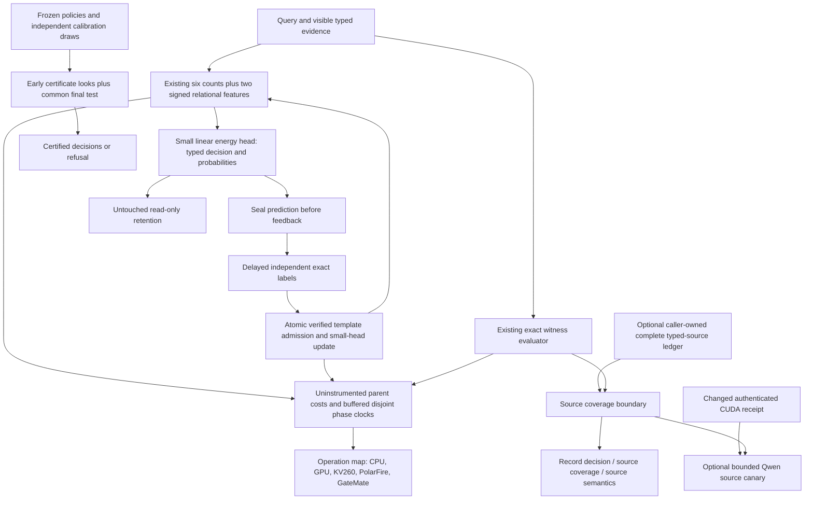
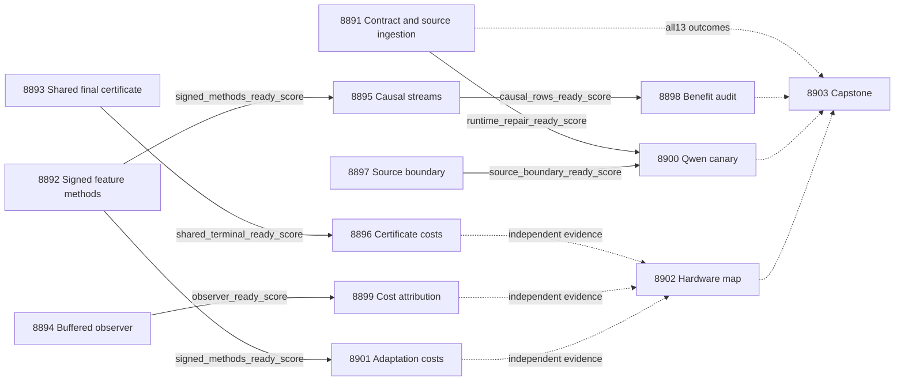

# Carnot Research Roadmap v761: Informative Features, Shared Risk Tests, and Measurable Service Costs

**Created:** 2026-11-06 America/New_York
**Milestone:** 2026.11.761
**Status:** Planned; staged only, not activated
**Supersedes:** Completed 2026.11.760, Exp8878–Exp8890
**Task contract:** Exactly 13 tasks, Exp8891 through Exp8903, in the order below.
**Execution file:** `research-roadmap-next.yaml`

The V760 design and active queue are preserved byte-for-byte in
`research-roadmap-v760-preserved-20261106.md` and
`research-roadmap-v760-queue-preserved-20261106.yaml`. The active roadmap,
conductor and exclusion manifest remain unchanged. The latest completed archive
ends at V759; V760 primaries and conductor receipts supply the current findings.

## What V760 proved

| Evidence | Qualified result | Limit that determines the next work |
|---|---|---|
| Exp8878/8879/8881 | Complete contract, original repaired diagnosis and matched topology methods qualify. | Administrative qualification is not learning benefit. |
| Exp8884/8886 | All 18,432 causal rows qualify. True-minus-permuted future Brier upper is -0.0031523. | True-minus-frozen upper is -0.0066648, short of -0.01. Checkpoint24 retention-error upper is0.0246918, above0.01. The joint result is null. |
| Exp8880/8885 | Finite-look certificate measurements qualify. Learned-policy standalone mean label saving is2,574; lower99-percent bound is1,483.05. Observed worst served-group risk is0. | Coverage-difference lower bound is-0.64938 against-0.01. Shared-union savings are0. No joint cost benefit is established. |
| Exp8883 | Constructed missing-hop/conflict controls qualify as circular-positive evidence. | Identical visible records can hide different source truth. Record execution does not establish source fidelity. |
| Exp8882 | Complete request measurements retain raw clocks. | Observer overhead and interval closure fail. Small resident cells show roughly33–47 percent overhead. No dominant removable component qualifies. |
| Exp8888/8889 | Complete durable adaptation costs and operation mapping qualify. | No physical acceleration or valid hardware-compatible cost fraction is established. |
| Exp8887/8890 | Twelve primary outcomes and one gate skip are accounted for. | Missing changed CUDA evidence blocks Qwen. The capstone is terminal blocked, with reconciliation_ready_score=1. |

These are constructed-query, CPU and administrative findings. They do not prove
natural-language generalization. Historical nulls and disqualifications remain
unchanged. V760's useful standalone label saving must not be described as zero.

## The three largest gaps to the PRD

1. **FR-11: useful continuous learning with retention.** The current head sees
   six aggregate counts. Some information is lost before training. Test two
   explicit relational features while holding labels, template exposure and
   optimizer work equal. Preserve the original effect and retention thresholds.
2. **FR-12: a decision with a clear evidential scope.** A valid formal record
   does not establish faithful extraction. Separate record decisions, source
   coverage and source semantics. Make sequential risk certification test the
   same final decision as its fixed-budget comparator.
3. **FR-05/08 and NFR-01: complete, attributable deployment costs.** The timing
   observer still changes the measured workload. Qualify buffered clocks before
   choosing an optimization or projecting hardware acceleration. Measure the
   extra feature and durability work in the same request boundary.

## Research incorporated before design

The dated V761 section in `research-references.md` was appended before this plan.
It covers all eight requested topics and all six secondary channels.

| Source | Method carried forward | Task |
|---|---|---|
| [SURE-RAG v2](https://arxiv.org/html/2605.03534v2) | Preserve signed evidence and binding information; distinguish evidence sufficiency from source fidelity. | Exp8892, Exp8895, Exp8897 |
| [Memoir](https://arxiv.org/html/2607.20792v1) | Keep read-before-write, matched work and read-only retention controls. | Exp8895, Exp8898 |
| [Sequential Certification](https://arxiv.org/html/2609.01968v1) | Account for repeated looks; prove a new local shared-final-test construction before measurement. | Exp8893, Exp8896 |
| [Specification-Guided Generation](https://arxiv.org/html/2610.41511v1) | Separate formal-input guarantees from source interpretation. No decoder integration is assumed. | Exp8897, optional Exp8900 |
| [Solver-Hard Is Not Model-Hard](https://arxiv.org/abs/2607.17047) | Match structural conditions and test surface invariance. | Exp8892, Exp8897 |
| [FPGA–ASIC co-design](https://arxiv.org/abs/2602.15985) | Treat host orchestration and transfer as part of the workload. | Exp8894, Exp8899, Exp8902 |

Semantic Scholar returned twenty EBT citation entries through its direct API;
the ARM–EBM endpoint returned429. Coverage remains partial. OpenReview supplied
an EBT manuscript labeled ICLR2026. GitHub trending supplied no verified new
relevant ranking. Extropic and Kona claims remain vendor descriptions. New KAN,
latent-memory and Ising architectures are recorded leads, not added dependencies.

## Architecture



The learner stays small. No mandated-generator training, foundation-model
pretraining or sampler replacement occurs. Research code reuses the existing
causal store and reporting runners. The source wrapper is opt-in; existing
installed behavior and checkpoint schemas remain compatible or fail explicitly.
No ARC task is scheduled: the November5 suspension remains in force.

## Phase 1: Freeze changed methods — Exp8891–Exp8894

**Exp8891** binds the complete thirteen-task authority and ingests the paper
methods. It reuses qualified contract machinery and mutation controls. CPU roots
are independent of this administrative gate. It only admits an optional supplied
CUDA repair receipt; it does not repeat runtime probes.

**Exp8892** diagnoses development-only feature collisions and qualifies two
predeclared features: explicitly refuted-atom fraction and minimum positive
candidate overlap for repeated-variable atom pairs. No full-query oracle result
or hidden-source label enters either feature. All arms pay identical observation
work in the science comparison. Old-feature arms mask the new coordinates.
Existing linear loss, optimizer, learning rate and template capacity remain fixed.
Schema changes are opt-in and incompatible checkpoints fail explicitly.

The fixed eight-arm roster crosses old/new features with frozen_verified,
matched_true, matched_permuted and frozen_query_only. Fresh evaluation contains
24 paired48-query streams,48 untouched retention queries and checkpoints0/24/48.
The existing eight online and eight retention topology families remain a finite
claim boundary. New world seeds do not establish new topology generalization.
Only development pilots run here. Valid null diagnostics can qualify methods.

**Exp8893** preserves seven policies, four groups and independent selection.
Both protocols use the same candidate prefix and final960-draw certificate.
Early looks are120/240/480. Each early cell gets alpha0.005/(7*4*3); each final
cell gets0.005/(7*4). The fixed arm uses that identical final test. Count the
shared final event once: total family allocation is0.01. Exact upper binomial
bounds certify only at risk<=0.05; zero accepted observations refuse.

If the fixed arm certifies, the sequential arm has already certified or passes
that same final test. Thus its served set includes the fixed served set for
every draw sequence. This proves coverage noninferiority for frozen policies;
it does not prove source truth or validity under within-group distribution shift.
A separate stronger fixed-alpha sensitivity result remains descriptive.

**Exp8894** qualifies an opt-in buffered observer. Non-overlapping child phases
and parent elapsed have separate boundaries. Installation, startup and unknown
parent/child gaps stay explicit. Development timings set a fixed repetition
count from resolution only. Repetitions improve precision, not independent n.
No production optimization is selected from unqualified component timing.

## Phase 2: Measure learning, risk and source boundaries — Exp8895–Exp8897

**Exp8895** performs continuous learning on the frozen eight-arm streams. Seal
predictions before delayed feedback. Match label multisets, template exposure
and optimizer attempts. Use actual small-head numerical updates, atomic writes,
a query24 restart and complete tail drains. Retention reads never update state.
The nominal roster is36,864 online-plus-retention rows. An honest null qualifies
causal measurement but does not pass the later benefit audit.

**Exp8896** executes40 fresh independent draw replicates over4,096 finite worlds.
It checks shared-final-test inclusion per cell, records every bound and label,
and evaluates census risk only after decisions. Benefit needs a99-percent lower
bound>0 on standalone learned-policy label savings, valid inclusion and every
served-group risk<=0.05. All-policy union costs remain separate. Methods must
pass before measurement; neither favorable savings nor zero observed errors
substitute for the probability argument.

**Exp8897** qualifies a typed-source claim boundary around the existing exact
witness evaluator. Outputs separate record_decision, source_coverage_status
and source_semantics_status. A caller-owned complete typed-source ledger can
establish coverage of those supplied records. Hashes and quoted spans alone
cannot establish complete natural-language interpretation. Missing or corrupted
ledgers remain unknown or rejected. Five paired views on120 new worlds test
omissions and conflicts. Default verification behavior remains unchanged.

## Phase 3: Audit benefit and qualify attribution — Exp8898–Exp8900

**Exp8898** independently reduces the causal rows. New-feature learning must
pass true-minus-permuted Brier upper<0, true-minus-frozen upper<=-0.01 and all
retention Brier/error upper increases<=0.01. Feature-specific benefit also needs
new-minus-old matched_true future Brier upper<0. Use simultaneous99-percent
paired-stream intervals across both feature arms and the feature contrast.
Five initialization seeds and recurring topologies do not inflate independent n.
A repeated null retires this exact changed-feature mechanism.

**Exp8899** runs the frozen complete-request attribution panel:24 independent
worlds, six sizes8/16/17/64/256/1024, three exact paths and cold/resident
boundaries. Each instrumented block is paired with an uninstrumented block.
Every registered cell needs overhead upper<=0.05 under simultaneous99-percent
intervals. Non-overlapping phase clocks must close within measured resolution.
Only qualified fractions can identify a removable component. A failed observer
still leaves separately qualified uninstrumented parent costs available.

**Exp8900** is optional. A supplied causal CUDA repair receipt and qualified
source boundary are both required. Use `unsloth/Qwen3.8-27B-GGUF`, Q4_K_M,
16 controlled source documents, two views each and at most128 new tokens per
call:32 calls and4,096 new tokens maximum. Compare wrapper decisions on the
same captured outputs. Preserve complete sentences, negation and qualifiers;
truncation or invalid structure remains a measured failure, not a retry trigger.

This is `model_bounded_generation`, with the10-second duration floor. A
real full-generation study would use60 seconds; a load-only/embedding probe
would use2 seconds. Neither is scheduled here. Small CPU smoke models cannot
supply headline results. Record actual load/generation counts, cache identity,
GPU offload and raw completions. Do not pad time or claim natural generalization
from a controlled sixteen-document canary.

## Phase 4: Measure deployment work and reconcile — Exp8901–Exp8903

**Exp8901** measures twelve fresh48-query cost streams across all eight arms.
Include features, predictions, feedback, updates, template admission,
serialization, file/directory fsync, query24 restart and final pending drain.
Cost arms pay deployed work; old features do not pay the science comparison's
dummy new-feature computation. Method readiness gates this task; favorable
learning results do not. Qualified quality evidence is required for any useful
speed-benefit claim.

**Exp8902** reads each new branch independently. Map actual work to supported
hardware operations. Unsupported or unqualified fractions remain null. Numerical
Amdahl bounds require qualified attribution, and include transfer plus host and
durability remainder. Zero sampling calls mean Ising kernel speed cannot be
claimed as a speedup for this learner. No unchanged board probe or purchase runs.

**Exp8903** accounts for all thirteen outcomes, including skips and itself.
Recompute conclusions from retained unit rows; keep scientific, circular,
blocked and administrative outcomes distinct. Compute stable publication gates
G1–G4 without treating this constructed corpus as independent FoVer evidence.
External absence is terminal blocked, never retryable partial. Emit continuation
and exact-scope retirement recommendations without editing the exclusion manifest.

## Dependency graph



Solid edges are the seven structured `gated_on` entries. Dashed edges are
independent evidence reads, never global gate chains. Exp8891, Exp8892,
Exp8893, Exp8894 and Exp8897 are roots. Exp8902 and Exp8903 always run.
Missing/zero/malformed producer fields have distinct `gate_check_summary` rows.
Every gate field is named in its producer's REQUIRED ARTIFACT FIELDS.

## Hardware requirements and execution budget

| Resource | Required work | Boundary |
|---|---|---|
| CPU, RAM, local durable disk | All method, learning, certificate, exact-witness and cost tasks | Fresh small-head numerical training uses `no_model_load`; count actual updates. |
| Two RTX3090 GPUs,48GB total | Optional cached Qwen Q4_K_M canary | Only after changed authenticated runtime/offload evidence. No full generator training. |
| KV260 | Operation map of qualified Ising fabric, k_max<=5 | No new firmware, physical latency or broad relational-kernel support is assumed. |
| PolarFire | Retain existing Linux CPU dispatch scope | CPU execution is not FPGA fabric evidence. |
| GateMate | Retain last physical/JTAG blocker | No unchanged0xffffffff probe. Reopen only after documented physical change. |
| NPU, TSU, larger FPGA | Future compatibility leads only | No acquisition is needed for this milestone. |

Every task pilots total work plus validation below4,200 seconds, leaving margin
under the4,800-second hard cap. Task estimates sum to610 minutes and are planning
budgets, not measurements. Flushed progress occurs at every phase boundary,
before/after minute-scale calls and at least every60 seconds inside long work.
Every silence gap stays below600 seconds, including between tool calls. Files
over about200 lines are written in chunks of150–200 lines with progress between.

Routine evaluation uses the default Claude/Sonnet route. The contract task uses
Opus/100 turns for schema coordination. Formulaic feature, certificate, clock
and wrapper code uses Codex/gpt-6.1-sol. Diagnostic audits use20 turns. No Luna
analysis, paid hardware, new external service or external publication is planned.

## Verification and stopping rules

Each task extends its REQ/SCENARIO before code and writes failing tests first.
The shared prompt requires scoped pytest, measured unit/child statement
coverage, Ruff check/format, strict mypy and scoped spec coverage. Applicable
private E2E-018/021 and actual CLI cold replay run before terminal publication.
Native changes additionally require E2E-003/004 and Cargo tests/fmt/clippy.
Adversarial verification and strict row-consistency validation remain unchanged.

Preserve original assertions, historical primaries and authority bytes. Keep
unrelated repository health separate. Use terminal null for a completed adverse
experiment, disqualified for failed owned controls, and blocked for missing
external inputs. Only incomplete owned work can be partial. Oracle-based gains
are circular_positive. Every comparative task emits per-unit rows and complete
failure/censor counts. Repeated unchanged failed scopes retire mechanically via
`retire_if_same_verdict: true`; no retired ID is reused or required upstream.

Planning checks and their results are recorded below the complete task contract.

## Exact task contract

The visible table and JSON contain exactly the thirteen full YAML task objects.

| Order | Task id | Title | Phase | Deliverable |
|---|---|---|---|---|
| 1 | exp8891-branch-contract | Bind thirteen tasks and ingest feature and sequential-certificate methods | 1 | `results/experiment_8891_v761_branch_contract.json` |
| 2 | exp8892-signed-feature-methods | Qualify signed evidence features for causal calibrated energy learning | 1 | `results/experiment_8892_v761_signed_feature_methods.json` |
| 3 | exp8893-shared-terminal-methods | Freeze sequential certification with a shared final test | 1 | `results/experiment_8893_v761_shared_terminal_methods.json` |
| 4 | exp8894-buffered-clock-methods | Qualify buffered phase clocks before attributing request costs | 1 | `results/experiment_8894_v761_buffered_clock_methods.json` |
| 5 | exp8895-signed-causal-streams | Measure continuous small-energy learning with signed relational features | 2 | `results/experiment_8895_v761_signed_causal_streams.json` |
| 6 | exp8896-shared-terminal-evaluation | Measure label savings under pathwise coverage inclusion | 2 | `results/experiment_8896_v761_shared_terminal_evaluation.json` |
| 7 | exp8897-source-bound-decisions | Qualify separate source coverage and exact record decisions | 2 | `results/experiment_8897_v761_source_bound_decisions.json` |
| 8 | exp8898-signed-benefit-audit | Audit feature-specific future benefit and untouched retention | 3 | `results/experiment_8898_v761_signed_benefit_audit.json` |
| 9 | exp8899-buffered-cost-attribution | Measure complete request attribution with qualified buffered clocks | 3 | `results/experiment_8899_v761_buffered_cost_attribution.json` |
| 10 | exp8900-qwen-source-boundary | Test bounded Qwen extraction with separate source and record claims | 3 | `results/experiment_8900_v761_qwen_source_boundary.json` |
| 11 | exp8901-signed-adaptation-cost | Measure complete durable cost of signed-feature online learning | 4 | `results/experiment_8901_v761_signed_adaptation_cost.json` |
| 12 | exp8902-hardware-operation-map | Map signed-feature and certificate work to actual hardware capabilities | 4 | `results/experiment_8902_v761_hardware_operation_map.json` |
| 13 | exp8903-capstone | Reconcile thirteen outcomes and decide feature risk and cost continuations | 4 | `results/experiment_8903_v761_capstone.json` |

Canonical task SHA-256: `ef4022864ab7407cc298160b1f69969d8ffba7df287c04fe339b40026b4a358f`

<!-- V761_TASK_CONTRACT_START -->
```json
{
  "milestone": "2026.11.761",
  "tasks": [
    {
      "id": "exp8891-branch-contract",
      "title": "Bind thirteen tasks and ingest feature and sequential-certificate methods",
      "phase": 1,
      "track": "research",
      "priority": "high",
      "requires_gpu": false,
      "max_turns": 100,
      "estimated_wall_time_min": 30,
      "per_unit_rows": true,
      "milestone": "2026.11.761",
      "deliverable": "results/experiment_8891_v761_branch_contract.json",
      "inference_substrate_class": "no_model_load",
      "MODEL_SPECS": [],
      "gated_on": [],
      "prior_failures": [
        {
          "experiment_id": "exp8866-branch-contract",
          "verdict": "complete_blocked_v759_branch_contract",
          "addressed_by": "Preserve the truncated predecessor; bind complete independently checked V761 authority using the qualified V760 reader.",
          "retire_if_same_verdict": true
        }
      ],
      "agent_type": "claude",
      "model": "opus",
      "prompt": "CONTEXT:\nWork in {project_root} on {date}. Milestone 2026.11.761, exp8891-branch-contract. V760 has a valid complete contract, twelve primaries and one runtime gate skip. Preserve its design and queue before using mutable vNEXT. This is administrative qualification, not a science gate for CPU roots.\n\nEXISTING CODE TO READ FIRST:\n- python/carnot/reporting/roadmap_contract.py; python/carnot/reporting/v760_branch_contract.py\n- scripts/roadmap_schema.py; scripts/audit_roadmap_gates.py; scripts/exclusion_manifest_lint.py; scripts/validate_prior_failures.py\n- results/experiment_8890_v760_capstone.json; ops/exclusion_manifest.yaml; research-references.md; research-studying.md\n- openspec/change-proposals/research-roadmap-v760-preserved-20261106.md; openspec/change-proposals/research-roadmap-v760-queue-preserved-20261106.yaml\n- openspec/capabilities/research-reporting/spec.md (REQ-REPORT-8891; SCENARIO-REPORT-8891-CONTRACT)\n- scripts/experiment_template.py; python/carnot/reporting/current_work_receipt.py; python/carnot/reporting/primary_publication.py\n\nTASK:\nBind thirteen tasks and ingest feature and sequential-certificate methods. Deliver results/experiment_8891_v761_branch_contract.json. Retain immutable raw operands under results/raw/experiment_8891_v761_branch_contract/. Implement scripts/experiments/experiment_8891_v761_branch_contract.py with --date and private-output/replay options. Reuse existing runners and keep new code scoped to this question.\n\nCONCRETE STEPS:\n1. PRECONDITIONS: Read CLAUDE.md and CODEX.md; authenticate original inputs, source/config hashes, retained raw operands and execution authority. Check dependencies, private scratch, disk and runtime before expensive work. Missing external inputs are terminal blocked; failed owned controls are disqualified. Preserve original artifacts and assertions.\n2. Emit a flushed progress line at every phase boundary and before and after every potentially minute-long model load, generation, benchmark and subprocess. Use python -u and print(..., flush=True). Inside long loops and child supervision, emit completed/pending counts and forward output at least every 60 seconds. Keep EVERY silence gap below 600 seconds, including work between tool calls; heartbeats never extend the 4800-second cap.\n3. Keep every tool call bounded. Write any file over about 200 lines in several tool calls of at most 150-200 lines, with a progress message between calls. Put experiment scripts in scripts/experiments/, tests in tests/python/ and scratch in /tmp; never write scratch files in the repository root.\n4. Bind exactly thirteen full task objects Exp8891 through Exp8903. Check the visible table, complete prompts, gate fields, failure lineage, model declarations, canonical digest and closing marker. Compare staged authority before activation and actual activated authority after activation. Normalize only conductor placeholder encoding. Never substitute this staged queue for the historical active queue.\n5. Reuse the qualified contract reader. Execute private mutations for truncation, missing final task or marker, changed prompt, gate, model and visible table. Keep original V760 authority independent. Do not make CPU roots depend on contract_ready_score.\n6. Ingest the dated V761 scan into a source-to-method map. Read SURE-RAG v2, Memoir, Sequential Certification and Specification-Guided Generation. Check all eight requested topics and six secondary channels. Record inaccessible sources honestly. Update research-studying.md with the selected methods. Use focused low-concurrency retrieval, never a large research-agent fan-out.\n7. Inspect ops/cuda-runtime-repair-receipt.json only if supplied. runtime_repair_ready_score=1 requires changed causal library/environment hashes, exact Qwen GGUF identity, current validator receipts, successful context/copy and actual GPU offload. Missing or unchanged evidence yields zero. Do not repeat a CUDA probe. This optional absence does not invalidate the contract.\n8. Extend the named REQ/SCENARIO before implementation; write failing tests first. Reuse ExperimentTemplate, current_work_receipt and primary_publication. Keep checkpoints private until terminal validation. Run scoped pytest with measured unit/child statement coverage of 100 percent and zero exclusions, Ruff check/format, strict mypy and scripts/check_spec_coverage.py with positional test paths. Run private E2E-018/021 and the actual CLI with cold replay outside the checkout without PYTHONPATH. Native changes also require E2E-003/004 and cargo test/fmt/clippy. Run unchanged adversarial_verify.py and verdict_row_consistency_lint.py --strict on prospective artifacts; retain logs and executed-source hashes. Record unrelated repository health separately. Reconcile openspec/, _bmad/traceability.md, ops/status.md and ops/changelog.md. Preserve all scheduled failures and censored units. Pilot total work plus validation below 4200 seconds, leaving margin within the 4800-second hard cap. Do not activate milestones, modify shared validators, edit the exclusion manifest or publish externally.\n\nREQUIRED ARTIFACT FIELDS:\nexperiment_id, task_id, milestone, run_date: principle: identify the actual producer and invocation.\nhonest_verdict: terminal complete_ prefix; principle: completion is not scientific benefit; blocked_* must include gate_check_summary.\nverdict_class: positive | circular_positive | null | blocked | disqualified | partial; principle: partial retries unfinished OWN work only. Unchanged external absence is blocked. verifier_is_oracle=true forbids positive and requires circular_positive for a successful oracle claim.\ninference_substrate, inference_substrate_class, execution_venue, MODEL_SPECS, model_invocation_counts, numerical_training_calls: principle: declare actual compute; fresh numerical small-head training is no_model_load with explicit calls, not pretrained model loading. External skips use blocked_no_run. Never pad duration.\nverifier_is_oracle, exposure_scope, independent_generalization_score: principle: exact constructed truth is circular evidence, not natural-language generalization.\nduration_s, phase_spans, preconditions_checked, random_seed, reproducibility_checksum: principle: retain measured work and fixed methods.\nsource_artifact_hashes, code_config_hashes, raw_shard_hashes, cited_upstream_artifacts: principle: bind every imported claim to original bytes, fields and producer identity.\nrows: principle: each compared unit carries unit_id, cluster_id, arm, seed, metric, denominator, status and missing_reason. Headlines must reduce from per-unit rows.\nintended_count, completed_count, failed_count, censored_count, excluded_count, independent_count: principle: repeats, seeds and candidates cannot inflate independent n or hide scheduled failures.\ngate_check_summary: principle: a blocked verdict names check, upstream, artifact_field, expected, observed, path and hash; distinguish missing_file, missing_field, rejected_producer and observed_zero.\nacceptance_gates, required_checks_passed, validation_receipts, owned_statement_coverage: principle: administrative readiness and scientific benefit are different gates.\nfield_principles: principle: explain every additional field and preserve the scope of every claim.\ncontract_ready_score: integer 0/1; principle: administrative authority and mutation controls only.\nruntime_repair_ready_score: integer 0/1; principle: new authenticated causal runtime evidence alone admits the optional canary.\nfull_task_objects, visible_task_table, canonical_tasks_sha256, authority_mutation_rows, gate_edge_rows, source_method_map, external_admission_rows: principle: retain exact task and literature custody without a science claim.\n\nRun command: cd {project_root} && JAX_PLATFORMS=cpu .venv/bin/python -u scripts/experiments/experiment_8891_v761_branch_contract.py --date {date}\nDo NOT push. Do NOT modify scripts/research_conductor.py."
    },
    {
      "id": "exp8892-signed-feature-methods",
      "title": "Qualify signed evidence features for causal calibrated energy learning",
      "phase": 1,
      "track": "research",
      "priority": "high",
      "requires_gpu": false,
      "max_turns": 50,
      "estimated_wall_time_min": 55,
      "per_unit_rows": true,
      "milestone": "2026.11.761",
      "deliverable": "results/experiment_8892_v761_signed_feature_methods.json",
      "inference_substrate_class": "no_model_load",
      "MODEL_SPECS": [],
      "gated_on": [],
      "prior_failures": [
        {
          "experiment_id": "exp8886-label-benefit-audit",
          "verdict": "complete_null_label_benefit_audit",
          "addressed_by": "Add predeclared refutation and pairwise binding features to the six-count head; retain original benefit and retention thresholds on fresh worlds.",
          "retire_if_same_verdict": true
        },
        {
          "experiment_id": "exp8884-topology-causal-streams",
          "verdict": "complete_null_topology_causal_streams",
          "addressed_by": "Change the observation schema while holding the objective, template exposure, labels and release schedule equal.",
          "retire_if_same_verdict": true
        }
      ],
      "agent_type": "codex",
      "model": "gpt-6.1-sol",
      "prompt": "CONTEXT:\nWork in {project_root} on {date}. Milestone 2026.11.761, exp8892-signed-feature-methods. Exp8886 found a true-label contrast but failed minimum benefit and interim retention. Its unchanged six-count feature mechanism is closed. SURE-RAG motivates preserving explicit refutation and relation agreement before aggregation. Keep the current linear energy objective.\n\nEXISTING CODE TO READ FIRST:\n- python/carnot/reporting/topology_memory_methods_8881.py; python/carnot/reporting/topology_memory_runner_8881.py\n- python/carnot/memory/causal_memory_8802.py; python/carnot/memory/categorical_memory_8830.py\n- python/carnot/reporting/learning_signal_diagnosis_8815.py; python/carnot/reporting/evidence_set_methods_8768.py\n- results/experiment_8881_v760_topology_memory_methods.json; results/experiment_8886_v760_label_benefit_audit.json\n- openspec/capabilities/research-reporting/spec.md (REQ-REPORT-8892; SCENARIO-REPORT-8892-CONTRACT)\n- scripts/experiment_template.py; python/carnot/reporting/current_work_receipt.py; python/carnot/reporting/primary_publication.py\n\nTASK:\nQualify signed evidence features for causal calibrated energy learning. Deliver results/experiment_8892_v761_signed_feature_methods.json. Retain immutable raw operands under results/raw/experiment_8892_v761_signed_feature_methods/. Implement scripts/experiments/experiment_8892_v761_signed_feature_methods.py with --date and private-output/replay options. Reuse existing runners and keep new code scoped to this question.\n\nCONCRETE STEPS:\n1. PRECONDITIONS: Read CLAUDE.md and CODEX.md; authenticate original inputs, source/config hashes, retained raw operands and execution authority. Check dependencies, private scratch, disk and runtime before expensive work. Missing external inputs are terminal blocked; failed owned controls are disqualified. Preserve original artifacts and assertions.\n2. Emit a flushed progress line at every phase boundary and before and after every potentially minute-long model load, generation, benchmark and subprocess. Use python -u and print(..., flush=True). Inside long loops and child supervision, emit completed/pending counts and forward output at least every 60 seconds. Keep EVERY silence gap below 600 seconds, including work between tool calls; heartbeats never extend the 4800-second cap.\n3. Keep every tool call bounded. Write any file over about 200 lines in several tool calls of at most 150-200 lines, with a progress message between calls. Put experiment scripts in scripts/experiments/, tests in tests/python/ and scratch in /tmp; never write scratch files in the repository root.\n4. Use development-only constructed worlds to tabulate equal-feature/different-label collisions in the existing six counts. Freeze two extra features before opening successor evaluation: fraction of query atoms explicitly refuted, and minimum positive candidate-set overlap across repeated-variable atom pairs. Define empty-pair overlap as one and missing candidates as zero. Canonicalize atom order; count all fact comparisons. No whole-query truth, source-hidden label or oracle decision enters a feature.\n5. Implement the two-feature extension as an opt-in small-head schema over the existing causal store. Preserve old checkpoints and defaults. Reject schema mismatch rather than silently change feature length. Scale only from development data. Keep the existing SGD objective, learning rate, threshold, fit schedule, delay schedule and template capacity.\n6. Freeze old-feature and new-feature arms, each with frozen_verified, matched_true, matched_permuted and frozen_query_only controls. Match template exposure and released-label multisets within each feature arm. All arms compute the same new observation payload; old arms mask the new coordinates so feature work is controlled. Count dummy masking separately from deployed costs.\n7. Freeze 24 fresh paired streams with 48 online and 48 untouched retention queries. Retain the eight online and eight retention topology families and their limited claim boundary; change world seeds, not topology labels. Freeze the original nine simultaneous 99-percent gates for each feature arm, with multiplicity across both arms and their feature contrast. Do not lower the -0.01 benefit or +0.01 retention limits.\n8. Test missing/refuted/conflicting atoms, binding mismatch, renaming/order invariance, old-checkpoint refusal, prediction-before-release and negative controls with deliberately leaked labels. Run two development pilots only. Measure collision change, work and fitting Brier; a null diagnostic can qualify execution. Set signed_methods_ready_score only after schema, causal and controls pass. Do not select additional features from evaluation results.\n9. Extend the named REQ/SCENARIO before implementation; write failing tests first. Reuse ExperimentTemplate, current_work_receipt and primary_publication. Keep checkpoints private until terminal validation. Run scoped pytest with measured unit/child statement coverage of 100 percent and zero exclusions, Ruff check/format, strict mypy and scripts/check_spec_coverage.py with positional test paths. Run private E2E-018/021 and the actual CLI with cold replay outside the checkout without PYTHONPATH. Native changes also require E2E-003/004 and cargo test/fmt/clippy. Run unchanged adversarial_verify.py and verdict_row_consistency_lint.py --strict on prospective artifacts; retain logs and executed-source hashes. Record unrelated repository health separately. Reconcile openspec/, _bmad/traceability.md, ops/status.md and ops/changelog.md. Preserve all scheduled failures and censored units. Pilot total work plus validation below 4200 seconds, leaving margin within the 4800-second hard cap. Do not activate milestones, modify shared validators, edit the exclusion manifest or publish externally.\n\nREQUIRED ARTIFACT FIELDS:\nexperiment_id, task_id, milestone, run_date: principle: identify the actual producer and invocation.\nhonest_verdict: terminal complete_ prefix; principle: completion is not scientific benefit; blocked_* must include gate_check_summary.\nverdict_class: positive | circular_positive | null | blocked | disqualified | partial; principle: partial retries unfinished OWN work only. Unchanged external absence is blocked. verifier_is_oracle=true forbids positive and requires circular_positive for a successful oracle claim.\ninference_substrate, inference_substrate_class, execution_venue, MODEL_SPECS, model_invocation_counts, numerical_training_calls: principle: declare actual compute; fresh numerical small-head training is no_model_load with explicit calls, not pretrained model loading. External skips use blocked_no_run. Never pad duration.\nverifier_is_oracle, exposure_scope, independent_generalization_score: principle: exact constructed truth is circular evidence, not natural-language generalization.\nduration_s, phase_spans, preconditions_checked, random_seed, reproducibility_checksum: principle: retain measured work and fixed methods.\nsource_artifact_hashes, code_config_hashes, raw_shard_hashes, cited_upstream_artifacts: principle: bind every imported claim to original bytes, fields and producer identity.\nrows: principle: each compared unit carries unit_id, cluster_id, arm, seed, metric, denominator, status and missing_reason. Headlines must reduce from per-unit rows.\nintended_count, completed_count, failed_count, censored_count, excluded_count, independent_count: principle: repeats, seeds and candidates cannot inflate independent n or hide scheduled failures.\ngate_check_summary: principle: a blocked verdict names check, upstream, artifact_field, expected, observed, path and hash; distinguish missing_file, missing_field, rejected_producer and observed_zero.\nacceptance_gates, required_checks_passed, validation_receipts, owned_statement_coverage: principle: administrative readiness and scientific benefit are different gates.\nfield_principles: principle: explain every additional field and preserve the scope of every claim.\nsigned_methods_ready_score: integer 0/1; principle: qualified frozen feature and causal methods, not favorable fit.\nfeature_schema, feature_collision_rows, feature_work_counts, development_manifest, frozen_protocol, matched_work_controls, original_acceptance_thresholds, schema_compatibility_rows: principle: feature information and execution cost stay observable.\n\nRun command: cd {project_root} && JAX_PLATFORMS=cpu .venv/bin/python -u scripts/experiments/experiment_8892_v761_signed_feature_methods.py --date {date}\nDo NOT push. Do NOT modify scripts/research_conductor.py."
    },
    {
      "id": "exp8893-shared-terminal-methods",
      "title": "Freeze sequential certification with a shared final test",
      "phase": 1,
      "track": "research",
      "priority": "high",
      "requires_gpu": false,
      "max_turns": 50,
      "estimated_wall_time_min": 45,
      "per_unit_rows": true,
      "milestone": "2026.11.761",
      "deliverable": "results/experiment_8893_v761_shared_terminal_methods.json",
      "inference_substrate_class": "no_model_load",
      "MODEL_SPECS": [],
      "gated_on": [],
      "prior_failures": [
        {
          "experiment_id": "exp8885-sequential-label-cost",
          "verdict": "complete_null_sequential_label_cost",
          "addressed_by": "Use one shared final test to establish pathwise coverage inclusion; preserve family risk and all paid-label accounting.",
          "retire_if_same_verdict": true
        }
      ],
      "agent_type": "codex",
      "model": "gpt-6.1-sol",
      "prompt": "CONTEXT:\nWork in {project_root} on {date}. Milestone 2026.11.761, exp8893-shared-terminal-methods. Exp8885 saved 2574 standalone labels on average, but its coverage interval failed the conjunction; shared-union savings were zero. Replace unequal final thresholds with a common final test so coverage inclusion is pathwise provable. This is a new local construction, not the cited paper theorem.\n\nEXISTING CODE TO READ FIRST:\n- python/carnot/reporting/sequential_certificate_methods_8880.py; python/carnot/reporting/sequential_label_cost_8885.py\n- python/carnot/reporting/conditional_risk_methods_8868.py; results/experiment_8885_v760_sequential_label_cost.json\n- openspec/capabilities/research-reporting/spec.md (REQ-REPORT-8893; SCENARIO-REPORT-8893-CONTRACT)\n- scripts/experiment_template.py; python/carnot/reporting/current_work_receipt.py; python/carnot/reporting/primary_publication.py\n\nTASK:\nFreeze sequential certification with a shared final test. Deliver results/experiment_8893_v761_shared_terminal_methods.json. Retain immutable raw operands under results/raw/experiment_8893_v761_shared_terminal_methods/. Implement scripts/experiments/experiment_8893_v761_shared_terminal_methods.py with --date and private-output/replay options. Reuse existing runners and keep new code scoped to this question.\n\nCONCRETE STEPS:\n1. PRECONDITIONS: Read CLAUDE.md and CODEX.md; authenticate original inputs, source/config hashes, retained raw operands and execution authority. Check dependencies, private scratch, disk and runtime before expensive work. Missing external inputs are terminal blocked; failed owned controls are disqualified. Preserve original artifacts and assertions.\n2. Emit a flushed progress line at every phase boundary and before and after every potentially minute-long model load, generation, benchmark and subprocess. Use python -u and print(..., flush=True). Inside long loops and child supervision, emit completed/pending counts and forward output at least every 60 seconds. Keep EVERY silence gap below 600 seconds, including work between tool calls; heartbeats never extend the 4800-second cap.\n3. Keep every tool call bounded. Write any file over about 200 lines in several tool calls of at most 150-200 lines, with a progress message between calls. Put experiment scripts in scripts/experiments/, tests in tests/python/ and scratch in /tmp; never write scratch files in the repository root.\n4. Keep seven frozen policies, four groups, 240 independent selection draws per group and candidate-draw looks 120,240,480,960. Freeze a new 4096-world finite population and 40 draw replicates. Fit and select without census labels. Shared candidate sequences pair the protocols. Do not use the new learning branch in this experiment.\n5. Allocate family error 0.01 once across both protocols: early-look alpha=0.005/(7*4*3), final alpha=0.005/(7*4). The fixed comparator uses that identical final test and identical 960-draw prefix. Use exact one-sided binomial upper bounds on accepted errors; certify at upper<=0.05, refuse when accepted n=0. The shared final event is counted once in the union bound.\n6. Prove for every possible draw sequence that fixed certification implies sequential certification by the final look. A frozen policy serves the same accepted set whenever certified, so coverage is pathwise noninferior. Distinguish this logical inclusion from a statistical risk guarantee. Prove the sum of distinct error allocations is <=0.01 under independent stationary within-group draws.\n7. Check integer sufficient-statistic transitions, n=0, all errors, zero errors, each look boundary and injected unsafe policies. Test altered final alpha or prefix as a failing control. Preserve a descriptive stronger fixed-alpha sensitivity arm separately; it must not replace the registered comparator after results.\n8. Charge selection and every candidate label. Freeze standalone learned-policy and all-policy union ledgers separately. Test that unfinished policies prevent a shared-union saving. Freeze bootstrap-free bounded paired label intervals and exact census coverage/risk, with primary confidence99 percent. Pilot runtime and publish methods even when savings are unknown.\n9. Extend the named REQ/SCENARIO before implementation; write failing tests first. Reuse ExperimentTemplate, current_work_receipt and primary_publication. Keep checkpoints private until terminal validation. Run scoped pytest with measured unit/child statement coverage of 100 percent and zero exclusions, Ruff check/format, strict mypy and scripts/check_spec_coverage.py with positional test paths. Run private E2E-018/021 and the actual CLI with cold replay outside the checkout without PYTHONPATH. Native changes also require E2E-003/004 and cargo test/fmt/clippy. Run unchanged adversarial_verify.py and verdict_row_consistency_lint.py --strict on prospective artifacts; retain logs and executed-source hashes. Record unrelated repository health separately. Reconcile openspec/, _bmad/traceability.md, ops/status.md and ops/changelog.md. Preserve all scheduled failures and censored units. Pilot total work plus validation below 4200 seconds, leaving margin within the 4800-second hard cap. Do not activate milestones, modify shared validators, edit the exclusion manifest or publish externally.\n\nREQUIRED ARTIFACT FIELDS:\nexperiment_id, task_id, milestone, run_date: principle: identify the actual producer and invocation.\nhonest_verdict: terminal complete_ prefix; principle: completion is not scientific benefit; blocked_* must include gate_check_summary.\nverdict_class: positive | circular_positive | null | blocked | disqualified | partial; principle: partial retries unfinished OWN work only. Unchanged external absence is blocked. verifier_is_oracle=true forbids positive and requires circular_positive for a successful oracle claim.\ninference_substrate, inference_substrate_class, execution_venue, MODEL_SPECS, model_invocation_counts, numerical_training_calls: principle: declare actual compute; fresh numerical small-head training is no_model_load with explicit calls, not pretrained model loading. External skips use blocked_no_run. Never pad duration.\nverifier_is_oracle, exposure_scope, independent_generalization_score: principle: exact constructed truth is circular evidence, not natural-language generalization.\nduration_s, phase_spans, preconditions_checked, random_seed, reproducibility_checksum: principle: retain measured work and fixed methods.\nsource_artifact_hashes, code_config_hashes, raw_shard_hashes, cited_upstream_artifacts: principle: bind every imported claim to original bytes, fields and producer identity.\nrows: principle: each compared unit carries unit_id, cluster_id, arm, seed, metric, denominator, status and missing_reason. Headlines must reduce from per-unit rows.\nintended_count, completed_count, failed_count, censored_count, excluded_count, independent_count: principle: repeats, seeds and candidates cannot inflate independent n or hide scheduled failures.\ngate_check_summary: principle: a blocked verdict names check, upstream, artifact_field, expected, observed, path and hash; distinguish missing_file, missing_field, rejected_producer and observed_zero.\nacceptance_gates, required_checks_passed, validation_receipts, owned_statement_coverage: principle: administrative readiness and scientific benefit are different gates.\nfield_principles: principle: explain every additional field and preserve the scope of every claim.\nshared_terminal_ready_score: integer 0/1; principle: proof and negative controls qualify measurement, not gain.\nalpha_allocation, coverage_inclusion_proof, sufficient_statistic_controls, fixed_final_test, candidate_draw_manifest, frozen_policies, label_cost_definition: principle: a common final test changes the protocol without relaxing the risk ceiling.\n\nRun command: cd {project_root} && JAX_PLATFORMS=cpu .venv/bin/python -u scripts/experiments/experiment_8893_v761_shared_terminal_methods.py --date {date}\nDo NOT push. Do NOT modify scripts/research_conductor.py."
    },
    {
      "id": "exp8894-buffered-clock-methods",
      "title": "Qualify buffered phase clocks before attributing request costs",
      "phase": 1,
      "track": "research",
      "priority": "high",
      "requires_gpu": false,
      "max_turns": 50,
      "estimated_wall_time_min": 45,
      "per_unit_rows": true,
      "milestone": "2026.11.761",
      "deliverable": "results/experiment_8894_v761_buffered_clock_methods.json",
      "inference_substrate_class": "no_model_load",
      "MODEL_SPECS": [],
      "gated_on": [],
      "prior_failures": [
        {
          "experiment_id": "exp8882-request-cost-attribution",
          "verdict": "complete_null_request_cost_attribution",
          "addressed_by": "Use preallocated buffered timestamps and disjoint phase partitions; test overhead separately before collecting fresh attribution.",
          "retire_if_same_verdict": true
        }
      ],
      "agent_type": "codex",
      "model": "gpt-6.1-sol",
      "prompt": "CONTEXT:\nWork in {project_root} on {date}. Milestone 2026.11.761, exp8894-buffered-clock-methods. Exp8882 failed observer-overhead and nonnegative-clock-closure checks. Its component estimates cannot select an optimization. Replace hot-path logging and nested intervals with buffered non-overlapping phase boundaries.\n\nEXISTING CODE TO READ FIRST:\n- python/carnot/reporting/request_cost_attribution_8882.py; python/carnot/reporting/request_cost_runner_8882.py\n- python/carnot/reporting/size_aware_complete_cost_8874.py; python/carnot/verify/size_aware_witness.py\n- results/experiment_8882_v760_request_cost_attribution.json; tests/python/test_request_cost_attribution_8882.py\n- openspec/capabilities/research-reporting/spec.md (REQ-REPORT-8894; SCENARIO-REPORT-8894-CONTRACT)\n- scripts/experiment_template.py; python/carnot/reporting/current_work_receipt.py; python/carnot/reporting/primary_publication.py\n\nTASK:\nQualify buffered phase clocks before attributing request costs. Deliver results/experiment_8894_v761_buffered_clock_methods.json. Retain immutable raw operands under results/raw/experiment_8894_v761_buffered_clock_methods/. Implement scripts/experiments/experiment_8894_v761_buffered_clock_methods.py with --date and private-output/replay options. Reuse existing runners and keep new code scoped to this question.\n\nCONCRETE STEPS:\n1. PRECONDITIONS: Read CLAUDE.md and CODEX.md; authenticate original inputs, source/config hashes, retained raw operands and execution authority. Check dependencies, private scratch, disk and runtime before expensive work. Missing external inputs are terminal blocked; failed owned controls are disqualified. Preserve original artifacts and assertions.\n2. Emit a flushed progress line at every phase boundary and before and after every potentially minute-long model load, generation, benchmark and subprocess. Use python -u and print(..., flush=True). Inside long loops and child supervision, emit completed/pending counts and forward output at least every 60 seconds. Keep EVERY silence gap below 600 seconds, including work between tool calls; heartbeats never extend the 4800-second cap.\n3. Keep every tool call bounded. Write any file over about 200 lines in several tool calls of at most 150-200 lines, with a progress message between calls. Put experiment scripts in scripts/experiments/, tests in tests/python/ and scratch in /tmp; never write scratch files in the repository root.\n4. Inspect the actual event nesting and logging in the original observer. Preserve its failed result. Add an opt-in observer with monotonic timestamps in a preallocated buffer. Partition child work into decode/validation, construction, lookup, serialization and explicit unclassified remainder. Record parent elapsed separately. Never add nested inclusive intervals or subtract unrelated clocks.\n5. Write failing controls for overlapped intervals, dropped endpoints, nonmonotone clocks and hidden serialization. Synthetic injected-clock controls test reduction only; acceptance must use real elapsed measurements. For material negative residuals fail closure, never clamp to zero.\n6. Pilot on separate development worlds. Use paired uninstrumented versus instrumented blocks with randomized ABBA order. Choose a fixed request repetition count from timing resolution only, bounded at1024 and below60 seconds per block. Buffer output until after timed blocks; flush progress between blocks. Keep installation and startup outside resident phase sums and inside full parent accounting.\n7. Freeze 24 independent future world clusters at sizes8,16,17,64,256,1024 and scan/indexed/size_aware arms. Use cold and resident boundaries. Repeated requests improve clock precision, not independent n. Require semantic identity, finite nonnegative closure and simultaneous99-percent overhead upper<=0.05 per arm/boundary/size cell.\n8. Qualify observer_ready_score using the development pilot controls and clock implementation only. Measurement acceptance belongs to Exp8899. Retain every raw interval and resolution. Do not choose a production optimization, benchmark boards or change the installed verifier behavior in this task.\n9. Extend the named REQ/SCENARIO before implementation; write failing tests first. Reuse ExperimentTemplate, current_work_receipt and primary_publication. Keep checkpoints private until terminal validation. Run scoped pytest with measured unit/child statement coverage of 100 percent and zero exclusions, Ruff check/format, strict mypy and scripts/check_spec_coverage.py with positional test paths. Run private E2E-018/021 and the actual CLI with cold replay outside the checkout without PYTHONPATH. Native changes also require E2E-003/004 and cargo test/fmt/clippy. Run unchanged adversarial_verify.py and verdict_row_consistency_lint.py --strict on prospective artifacts; retain logs and executed-source hashes. Record unrelated repository health separately. Reconcile openspec/, _bmad/traceability.md, ops/status.md and ops/changelog.md. Preserve all scheduled failures and censored units. Pilot total work plus validation below 4200 seconds, leaving margin within the 4800-second hard cap. Do not activate milestones, modify shared validators, edit the exclusion manifest or publish externally.\n\nREQUIRED ARTIFACT FIELDS:\nexperiment_id, task_id, milestone, run_date: principle: identify the actual producer and invocation.\nhonest_verdict: terminal complete_ prefix; principle: completion is not scientific benefit; blocked_* must include gate_check_summary.\nverdict_class: positive | circular_positive | null | blocked | disqualified | partial; principle: partial retries unfinished OWN work only. Unchanged external absence is blocked. verifier_is_oracle=true forbids positive and requires circular_positive for a successful oracle claim.\ninference_substrate, inference_substrate_class, execution_venue, MODEL_SPECS, model_invocation_counts, numerical_training_calls: principle: declare actual compute; fresh numerical small-head training is no_model_load with explicit calls, not pretrained model loading. External skips use blocked_no_run. Never pad duration.\nverifier_is_oracle, exposure_scope, independent_generalization_score: principle: exact constructed truth is circular evidence, not natural-language generalization.\nduration_s, phase_spans, preconditions_checked, random_seed, reproducibility_checksum: principle: retain measured work and fixed methods.\nsource_artifact_hashes, code_config_hashes, raw_shard_hashes, cited_upstream_artifacts: principle: bind every imported claim to original bytes, fields and producer identity.\nrows: principle: each compared unit carries unit_id, cluster_id, arm, seed, metric, denominator, status and missing_reason. Headlines must reduce from per-unit rows.\nintended_count, completed_count, failed_count, censored_count, excluded_count, independent_count: principle: repeats, seeds and candidates cannot inflate independent n or hide scheduled failures.\ngate_check_summary: principle: a blocked verdict names check, upstream, artifact_field, expected, observed, path and hash; distinguish missing_file, missing_field, rejected_producer and observed_zero.\nacceptance_gates, required_checks_passed, validation_receipts, owned_statement_coverage: principle: administrative readiness and scientific benefit are different gates.\nfield_principles: principle: explain every additional field and preserve the scope of every claim.\nobserver_ready_score: integer 0/1; principle: valid instrumentation and frozen measurement protocol only.\nobserver_schema, phase_partition, clock_controls, pilot_overhead_rows, repetition_count, future_world_manifest, closure_tolerance: principle: clock precision and independence are separate quantities.\n\nRun command: cd {project_root} && JAX_PLATFORMS=cpu .venv/bin/python -u scripts/experiments/experiment_8894_v761_buffered_clock_methods.py --date {date}\nDo NOT push. Do NOT modify scripts/research_conductor.py."
    },
    {
      "id": "exp8895-signed-causal-streams",
      "title": "Measure continuous small-energy learning with signed relational features",
      "phase": 2,
      "track": "research",
      "priority": "high",
      "requires_gpu": false,
      "max_turns": 50,
      "estimated_wall_time_min": 65,
      "per_unit_rows": true,
      "milestone": "2026.11.761",
      "deliverable": "results/experiment_8895_v761_signed_causal_streams.json",
      "inference_substrate_class": "no_model_load",
      "MODEL_SPECS": [],
      "gated_on": [
        {
          "upstream": "exp8892-signed-feature-methods",
          "artifact_field": "signed_methods_ready_score",
          "op": "==",
          "value": 1
        }
      ],
      "prior_failures": [
        {
          "experiment_id": "exp8884-topology-causal-streams",
          "verdict": "complete_null_topology_causal_streams",
          "addressed_by": "Replace the six-count observations with a development-frozen signed-feature extension and retain an old-feature comparator.",
          "retire_if_same_verdict": true
        },
        {
          "experiment_id": "exp8886-label-benefit-audit",
          "verdict": "complete_null_label_benefit_audit",
          "addressed_by": "Preserve both failed thresholds while testing new information on fresh paired streams.",
          "retire_if_same_verdict": true
        }
      ],
      "prompt": "CONTEXT:\nWork in {project_root} on {date}. Milestone 2026.11.761, exp8895-signed-causal-streams. This is the FR-11 continuous self-learning experiment. Correct-label learning must survive matched-label controls and untouched retention. New features distinguish explicit refutation and local binding overlap; generator weights remain frozen.\n\nEXISTING CODE TO READ FIRST:\n- python/carnot/reporting/topology_causal_streams_8884.py; python/carnot/reporting/topology_causal_runner_8884.py\n- python/carnot/reporting/topology_memory_methods_8881.py; python/carnot/memory/categorical_memory_8830.py\n- results/experiment_8892_v761_signed_feature_methods.json\n- openspec/capabilities/research-reporting/spec.md (REQ-REPORT-8895; SCENARIO-REPORT-8895-CONTRACT)\n- scripts/experiment_template.py; python/carnot/reporting/current_work_receipt.py; python/carnot/reporting/primary_publication.py\n\nTASK:\nMeasure continuous small-energy learning with signed relational features. Deliver results/experiment_8895_v761_signed_causal_streams.json. Retain immutable raw operands under results/raw/experiment_8895_v761_signed_causal_streams/. Implement scripts/experiments/experiment_8895_v761_signed_causal_streams.py with --date and private-output/replay options. Reuse existing runners and keep new code scoped to this question.\n\nCONCRETE STEPS:\n1. PRECONDITIONS: Read CLAUDE.md and CODEX.md; authenticate original inputs, source/config hashes, retained raw operands and execution authority. Check dependencies, private scratch, disk and runtime before expensive work. Missing external inputs are terminal blocked; failed owned controls are disqualified. Preserve original artifacts and assertions.\n2. Emit a flushed progress line at every phase boundary and before and after every potentially minute-long model load, generation, benchmark and subprocess. Use python -u and print(..., flush=True). Inside long loops and child supervision, emit completed/pending counts and forward output at least every 60 seconds. Keep EVERY silence gap below 600 seconds, including work between tool calls; heartbeats never extend the 4800-second cap.\n3. Keep every tool call bounded. Write any file over about 200 lines in several tool calls of at most 150-200 lines, with a progress message between calls. Put experiment scripts in scripts/experiments/, tests in tests/python/ and scratch in /tmp; never write scratch files in the repository root.\n4. Authenticate signed_methods_ready_score=1 and its exact feature schema, parameters and frozen manifests. Run exactly24 paired fresh streams, eight arms,48 online queries and48 retention queries at checkpoints0,24,48. The eight arms are old/new features crossed with frozen_verified, matched_true, matched_permuted and frozen_query_only.\n5. Seal predictions and full parameter/template hashes before labels become available. Release labels only at registered due times. Permute only within already-released batches and retain the complete label multiset. All matched learning arms use equal optimizer attempts, template admissions and observation work. Preserve constant and zero-signal negative controls.\n6. Apply actual numerical updates to the small linear energy model and add verified templates through the existing atomic store. Record accept/reject/escalate probabilities, Brier loss, decision error, admission and update events. Read retention without updates. Drain pending labels before final retention; retain pending counts and cumulative delay.\n7. Run a registered restart at query24 and verify exact uninterrupted/resumed state and event acknowledgments on a private paired pilot. Record all attempted/completed/failed/censored slots. Five head seeds and repeated query topologies do not increase the24 paired-stream denominator. Claim only this finite family of constructed queries.\n8. Publish causal_rows_ready_score after complete causal and row validation. Leave feature-benefit decisions to Exp8898. A valid adverse or null trajectory is terminal null, not partial. No refit, threshold search, seed replacement or additional topology selection follows measurement.\n9. Extend the named REQ/SCENARIO before implementation; write failing tests first. Reuse ExperimentTemplate, current_work_receipt and primary_publication. Keep checkpoints private until terminal validation. Run scoped pytest with measured unit/child statement coverage of 100 percent and zero exclusions, Ruff check/format, strict mypy and scripts/check_spec_coverage.py with positional test paths. Run private E2E-018/021 and the actual CLI with cold replay outside the checkout without PYTHONPATH. Native changes also require E2E-003/004 and cargo test/fmt/clippy. Run unchanged adversarial_verify.py and verdict_row_consistency_lint.py --strict on prospective artifacts; retain logs and executed-source hashes. Record unrelated repository health separately. Reconcile openspec/, _bmad/traceability.md, ops/status.md and ops/changelog.md. Preserve all scheduled failures and censored units. Pilot total work plus validation below 4200 seconds, leaving margin within the 4800-second hard cap. Do not activate milestones, modify shared validators, edit the exclusion manifest or publish externally.\n\nREQUIRED ARTIFACT FIELDS:\nexperiment_id, task_id, milestone, run_date: principle: identify the actual producer and invocation.\nhonest_verdict: terminal complete_ prefix; principle: completion is not scientific benefit; blocked_* must include gate_check_summary.\nverdict_class: positive | circular_positive | null | blocked | disqualified | partial; principle: partial retries unfinished OWN work only. Unchanged external absence is blocked. verifier_is_oracle=true forbids positive and requires circular_positive for a successful oracle claim.\ninference_substrate, inference_substrate_class, execution_venue, MODEL_SPECS, model_invocation_counts, numerical_training_calls: principle: declare actual compute; fresh numerical small-head training is no_model_load with explicit calls, not pretrained model loading. External skips use blocked_no_run. Never pad duration.\nverifier_is_oracle, exposure_scope, independent_generalization_score: principle: exact constructed truth is circular evidence, not natural-language generalization.\nduration_s, phase_spans, preconditions_checked, random_seed, reproducibility_checksum: principle: retain measured work and fixed methods.\nsource_artifact_hashes, code_config_hashes, raw_shard_hashes, cited_upstream_artifacts: principle: bind every imported claim to original bytes, fields and producer identity.\nrows: principle: each compared unit carries unit_id, cluster_id, arm, seed, metric, denominator, status and missing_reason. Headlines must reduce from per-unit rows.\nintended_count, completed_count, failed_count, censored_count, excluded_count, independent_count: principle: repeats, seeds and candidates cannot inflate independent n or hide scheduled failures.\ngate_check_summary: principle: a blocked verdict names check, upstream, artifact_field, expected, observed, path and hash; distinguish missing_file, missing_field, rejected_producer and observed_zero.\nacceptance_gates, required_checks_passed, validation_receipts, owned_statement_coverage: principle: administrative readiness and scientific benefit are different gates.\nfield_principles: principle: explain every additional field and preserve the scope of every claim.\ncausal_rows_ready_score: integer 0/1; principle: complete sealed trajectories release the audit regardless of effect.\nprediction_rows, release_rows, gradient_rows, admission_rows, retention_rows, state_hashes, restart_receipts, tail_drain_rows, feature_schema, delay_totals, numerical_training_calls: principle: every learning claim traces to information available at prediction time.\n\nRun command: cd {project_root} && JAX_PLATFORMS=cpu .venv/bin/python -u scripts/experiments/experiment_8895_v761_signed_causal_streams.py --date {date}\nDo NOT push. Do NOT modify scripts/research_conductor.py."
    },
    {
      "id": "exp8896-shared-terminal-evaluation",
      "title": "Measure label savings under pathwise coverage inclusion",
      "phase": 2,
      "track": "research",
      "priority": "high",
      "requires_gpu": false,
      "max_turns": 50,
      "estimated_wall_time_min": 50,
      "per_unit_rows": true,
      "milestone": "2026.11.761",
      "deliverable": "results/experiment_8896_v761_shared_terminal_evaluation.json",
      "inference_substrate_class": "no_model_load",
      "MODEL_SPECS": [],
      "gated_on": [
        {
          "upstream": "exp8893-shared-terminal-methods",
          "artifact_field": "shared_terminal_ready_score",
          "op": "==",
          "value": 1
        }
      ],
      "prior_failures": [
        {
          "experiment_id": "exp8885-sequential-label-cost",
          "verdict": "complete_null_sequential_label_cost",
          "addressed_by": "Evaluate the new shared-final-test protocol on fresh draws; replace an uninformative coverage interval with a proved and checked inclusion property.",
          "retire_if_same_verdict": true
        }
      ],
      "prompt": "CONTEXT:\nWork in {project_root} on {date}. Milestone 2026.11.761, exp8896-shared-terminal-evaluation. A common final certificate makes fixed-to-sequential coverage inclusion an executable property. V760 showed standalone learned-policy savings but no all-policy union savings. Preserve both estimands.\n\nEXISTING CODE TO READ FIRST:\n- python/carnot/reporting/sequential_label_cost_8885.py; python/carnot/reporting/sequential_label_cost_runner_8885.py\n- results/experiment_8893_v761_shared_terminal_methods.json; results/experiment_8885_v760_sequential_label_cost.json\n- openspec/capabilities/research-reporting/spec.md (REQ-REPORT-8896; SCENARIO-REPORT-8896-CONTRACT)\n- scripts/experiment_template.py; python/carnot/reporting/current_work_receipt.py; python/carnot/reporting/primary_publication.py\n\nTASK:\nMeasure label savings under pathwise coverage inclusion. Deliver results/experiment_8896_v761_shared_terminal_evaluation.json. Retain immutable raw operands under results/raw/experiment_8896_v761_shared_terminal_evaluation/. Implement scripts/experiments/experiment_8896_v761_shared_terminal_evaluation.py with --date and private-output/replay options. Reuse existing runners and keep new code scoped to this question.\n\nCONCRETE STEPS:\n1. PRECONDITIONS: Read CLAUDE.md and CODEX.md; authenticate original inputs, source/config hashes, retained raw operands and execution authority. Check dependencies, private scratch, disk and runtime before expensive work. Missing external inputs are terminal blocked; failed owned controls are disqualified. Preserve original artifacts and assertions.\n2. Emit a flushed progress line at every phase boundary and before and after every potentially minute-long model load, generation, benchmark and subprocess. Use python -u and print(..., flush=True). Inside long loops and child supervision, emit completed/pending counts and forward output at least every 60 seconds. Keep EVERY silence gap below 600 seconds, including work between tool calls; heartbeats never extend the 4800-second cap.\n3. Keep every tool call bounded. Write any file over about 200 lines in several tool calls of at most 150-200 lines, with a progress message between calls. Put experiment scripts in scripts/experiments/, tests in tests/python/ and scratch in /tmp; never write scratch files in the repository root.\n4. Authenticate shared_terminal_ready_score=1. Execute the frozen4096-world population and40 independent draw replicates with the seven fixed policies, four groups and paired candidate prefixes. Average five learned-head seeds inside each replicate. Keep selection, certification and post-decision census access separate.\n5. Apply only the registered exact upper-bound tests. Record each cumulative look, accepted n, errors, alpha, bound, stopping time and certificate. Verify fixed certification implies sequential certification in every cell. One violation disqualifies the method; do not replace this property with a noisy coverage test.\n6. Compute actual served coverage and census risk on the finite population under the five fixed mixtures. Require every served group risk<=0.05 for the empirical benefit claim. Retain theoretical family error<=0.01 separately; forty draws do not prove its guarantee. Unsafe controls must fail the designed certificate tests.\n7. Reduce standalone learned-policy paid-label differences with predeclared99-percent bounded paired intervals. Benefit requires saved-label lower>0, proved inclusion and the risk condition. Charge all240 selection labels and all scanned candidate labels. Produce all-policy union costs separately; do not transfer standalone savings to shared work.\n8. Publish certificate_rows_ready_score for valid complete measurement independently of standalone_label_benefit_score and shared_union_benefit_score. Do not change alpha, policies, maximum budget or confidence method after observing the rows. A measured null remains terminal.\n9. Extend the named REQ/SCENARIO before implementation; write failing tests first. Reuse ExperimentTemplate, current_work_receipt and primary_publication. Keep checkpoints private until terminal validation. Run scoped pytest with measured unit/child statement coverage of 100 percent and zero exclusions, Ruff check/format, strict mypy and scripts/check_spec_coverage.py with positional test paths. Run private E2E-018/021 and the actual CLI with cold replay outside the checkout without PYTHONPATH. Native changes also require E2E-003/004 and cargo test/fmt/clippy. Run unchanged adversarial_verify.py and verdict_row_consistency_lint.py --strict on prospective artifacts; retain logs and executed-source hashes. Record unrelated repository health separately. Reconcile openspec/, _bmad/traceability.md, ops/status.md and ops/changelog.md. Preserve all scheduled failures and censored units. Pilot total work plus validation below 4200 seconds, leaving margin within the 4800-second hard cap. Do not activate milestones, modify shared validators, edit the exclusion manifest or publish externally.\n\nREQUIRED ARTIFACT FIELDS:\nexperiment_id, task_id, milestone, run_date: principle: identify the actual producer and invocation.\nhonest_verdict: terminal complete_ prefix; principle: completion is not scientific benefit; blocked_* must include gate_check_summary.\nverdict_class: positive | circular_positive | null | blocked | disqualified | partial; principle: partial retries unfinished OWN work only. Unchanged external absence is blocked. verifier_is_oracle=true forbids positive and requires circular_positive for a successful oracle claim.\ninference_substrate, inference_substrate_class, execution_venue, MODEL_SPECS, model_invocation_counts, numerical_training_calls: principle: declare actual compute; fresh numerical small-head training is no_model_load with explicit calls, not pretrained model loading. External skips use blocked_no_run. Never pad duration.\nverifier_is_oracle, exposure_scope, independent_generalization_score: principle: exact constructed truth is circular evidence, not natural-language generalization.\nduration_s, phase_spans, preconditions_checked, random_seed, reproducibility_checksum: principle: retain measured work and fixed methods.\nsource_artifact_hashes, code_config_hashes, raw_shard_hashes, cited_upstream_artifacts: principle: bind every imported claim to original bytes, fields and producer identity.\nrows: principle: each compared unit carries unit_id, cluster_id, arm, seed, metric, denominator, status and missing_reason. Headlines must reduce from per-unit rows.\nintended_count, completed_count, failed_count, censored_count, excluded_count, independent_count: principle: repeats, seeds and candidates cannot inflate independent n or hide scheduled failures.\ngate_check_summary: principle: a blocked verdict names check, upstream, artifact_field, expected, observed, path and hash; distinguish missing_file, missing_field, rejected_producer and observed_zero.\nacceptance_gates, required_checks_passed, validation_receipts, owned_statement_coverage: principle: administrative readiness and scientific benefit are different gates.\nfield_principles: principle: explain every additional field and preserve the scope of every claim.\ncertificate_rows_ready_score: integer 0/1; principle: valid measurements remain useful if cost benefit fails.\nstandalone_label_benefit_score, shared_union_benefit_score: integer0/1; principle: standalone and shared-label savings are distinct claims.\nstopping_rows, bound_rows, inclusion_rows, census_risk_rows, coverage_rows, paid_label_ledger, paired_intervals, theoretical_family_error: principle: retain every comparison operand.\n\nRun command: cd {project_root} && JAX_PLATFORMS=cpu .venv/bin/python -u scripts/experiments/experiment_8896_v761_shared_terminal_evaluation.py --date {date}\nDo NOT push. Do NOT modify scripts/research_conductor.py."
    },
    {
      "id": "exp8897-source-bound-decisions",
      "title": "Qualify separate source coverage and exact record decisions",
      "phase": 2,
      "track": "research",
      "priority": "high",
      "requires_gpu": false,
      "max_turns": 50,
      "estimated_wall_time_min": 55,
      "per_unit_rows": true,
      "milestone": "2026.11.761",
      "deliverable": "results/experiment_8897_v761_source_bound_decisions.json",
      "inference_substrate_class": "no_model_load",
      "MODEL_SPECS": [],
      "gated_on": [],
      "prior_failures": [
        {
          "experiment_id": "exp8883-evidence-loss-boundary",
          "verdict": "complete_circular_positive_evidence_loss_boundary",
          "addressed_by": "Turn the measured identical-view ambiguity into an opt-in claim boundary with explicit caller-owned typed-source coverage; no claim to infer absent text.",
          "retire_if_same_verdict": true
        }
      ],
      "agent_type": "codex",
      "model": "gpt-6.1-sol",
      "prompt": "CONTEXT:\nWork in {project_root} on {date}. Milestone 2026.11.761, exp8897-source-bound-decisions. Exp8883 showed that identical visible records can come from sources with different truth. Exact execution cannot recover a missing contradiction. SURE-RAG and Specification-Guided Generation motivate distinct input, coverage and semantic claims.\n\nEXISTING CODE TO READ FIRST:\n- python/carnot/reporting/evidence_loss_boundary_8883.py; python/carnot/reporting/evidence_loss_runner_8883.py\n- python/carnot/verify/size_aware_witness.py; python/carnot/verify/indexed_witness.py\n- results/experiment_8883_v760_evidence_loss_boundary.json; python/carnot/pipeline/verify_repair.py\n- openspec/capabilities/research-reporting/spec.md (REQ-REPORT-8897; SCENARIO-REPORT-8897-CONTRACT)\n- scripts/experiment_template.py; python/carnot/reporting/current_work_receipt.py; python/carnot/reporting/primary_publication.py\n\nTASK:\nQualify separate source coverage and exact record decisions. Deliver results/experiment_8897_v761_source_bound_decisions.json. Retain immutable raw operands under results/raw/experiment_8897_v761_source_bound_decisions/. Implement scripts/experiments/experiment_8897_v761_source_bound_decisions.py with --date and private-output/replay options. Reuse existing runners and keep new code scoped to this question.\n\nCONCRETE STEPS:\n1. PRECONDITIONS: Read CLAUDE.md and CODEX.md; authenticate original inputs, source/config hashes, retained raw operands and execution authority. Check dependencies, private scratch, disk and runtime before expensive work. Missing external inputs are terminal blocked; failed owned controls are disqualified. Preserve original artifacts and assertions.\n2. Emit a flushed progress line at every phase boundary and before and after every potentially minute-long model load, generation, benchmark and subprocess. Use python -u and print(..., flush=True). Inside long loops and child supervision, emit completed/pending counts and forward output at least every 60 seconds. Keep EVERY silence gap below 600 seconds, including work between tool calls; heartbeats never extend the 4800-second cap.\n3. Keep every tool call bounded. Write any file over about 200 lines in several tool calls of at most 150-200 lines, with a progress message between calls. Put experiment scripts in scripts/experiments/, tests in tests/python/ and scratch in /tmp; never write scratch files in the repository root.\n4. Implement an opt-in typed-record wrapper around the existing exact witness path. Return record_decision, source_coverage_status and source_semantics_status separately. Default source coverage and semantics to unknown. Preserve existing public callers and defaults; enumerate all callers before editing shared code.\n5. Accept an optional caller-owned complete typed-source ledger with content hash and stable record IDs. Check duplicates, missing IDs, altered signs and mismatched source bytes. Complete ledger equality establishes coverage of that supplied typed source only. A matching hash or quoted span alone never establishes semantic completeness of natural text.\n6. Freeze120 new paired source worlds with complete, missing-hop, irrelevant-removal, inserted-conflict and omitted-conflict views. Compare the old view-only result and new wrapper on identical visible inputs, with valid, absent and corrupted source ledgers. Keep hidden full-source truth evaluator-only. The wrapper may report incomplete or unknown; it must not guess omitted contents.\n7. Require exact record-decision parity for valid views, zero unsupported source-completeness assertions, detection of all malformed ledger controls and invariance to record order and entity renaming. Keep source-side incomplete coverage distinct from an insufficient logical answer. Retain source/view/ledger hashes and per-world errors.\n8. Test the actual opt-in installed callable in a clean subprocess with private evidence. Set source_boundary_ready_score only when semantic parity and provenance rejection controls qualify. Successful constructed checks are circular_positive. Do not claim natural-language fidelity, change default verification decisions or publish a new API release.\n9. Extend the named REQ/SCENARIO before implementation; write failing tests first. Reuse ExperimentTemplate, current_work_receipt and primary_publication. Keep checkpoints private until terminal validation. Run scoped pytest with measured unit/child statement coverage of 100 percent and zero exclusions, Ruff check/format, strict mypy and scripts/check_spec_coverage.py with positional test paths. Run private E2E-018/021 and the actual CLI with cold replay outside the checkout without PYTHONPATH. Native changes also require E2E-003/004 and cargo test/fmt/clippy. Run unchanged adversarial_verify.py and verdict_row_consistency_lint.py --strict on prospective artifacts; retain logs and executed-source hashes. Record unrelated repository health separately. Reconcile openspec/, _bmad/traceability.md, ops/status.md and ops/changelog.md. Preserve all scheduled failures and censored units. Pilot total work plus validation below 4200 seconds, leaving margin within the 4800-second hard cap. Do not activate milestones, modify shared validators, edit the exclusion manifest or publish externally.\n\nREQUIRED ARTIFACT FIELDS:\nexperiment_id, task_id, milestone, run_date: principle: identify the actual producer and invocation.\nhonest_verdict: terminal complete_ prefix; principle: completion is not scientific benefit; blocked_* must include gate_check_summary.\nverdict_class: positive | circular_positive | null | blocked | disqualified | partial; principle: partial retries unfinished OWN work only. Unchanged external absence is blocked. verifier_is_oracle=true forbids positive and requires circular_positive for a successful oracle claim.\ninference_substrate, inference_substrate_class, execution_venue, MODEL_SPECS, model_invocation_counts, numerical_training_calls: principle: declare actual compute; fresh numerical small-head training is no_model_load with explicit calls, not pretrained model loading. External skips use blocked_no_run. Never pad duration.\nverifier_is_oracle, exposure_scope, independent_generalization_score: principle: exact constructed truth is circular evidence, not natural-language generalization.\nduration_s, phase_spans, preconditions_checked, random_seed, reproducibility_checksum: principle: retain measured work and fixed methods.\nsource_artifact_hashes, code_config_hashes, raw_shard_hashes, cited_upstream_artifacts: principle: bind every imported claim to original bytes, fields and producer identity.\nrows: principle: each compared unit carries unit_id, cluster_id, arm, seed, metric, denominator, status and missing_reason. Headlines must reduce from per-unit rows.\nintended_count, completed_count, failed_count, censored_count, excluded_count, independent_count: principle: repeats, seeds and candidates cannot inflate independent n or hide scheduled failures.\ngate_check_summary: principle: a blocked verdict names check, upstream, artifact_field, expected, observed, path and hash; distinguish missing_file, missing_field, rejected_producer and observed_zero.\nacceptance_gates, required_checks_passed, validation_receipts, owned_statement_coverage: principle: administrative readiness and scientific benefit are different gates.\nfield_principles: principle: explain every additional field and preserve the scope of every claim.\nsource_boundary_ready_score: integer0/1; principle: separated typed-source claims and unchanged record semantics only.\nrecord_decision, source_coverage_status, source_semantics_status, source_view_pairs, ledger_validation_rows, unsupported_claim_count, installed_callable_receipt: principle: provenance does not substitute for source interpretation.\n\nRun command: cd {project_root} && JAX_PLATFORMS=cpu .venv/bin/python -u scripts/experiments/experiment_8897_v761_source_bound_decisions.py --date {date}\nDo NOT push. Do NOT modify scripts/research_conductor.py."
    },
    {
      "id": "exp8898-signed-benefit-audit",
      "title": "Audit feature-specific future benefit and untouched retention",
      "phase": 3,
      "track": "research",
      "priority": "high",
      "requires_gpu": false,
      "max_turns": 20,
      "estimated_wall_time_min": 35,
      "per_unit_rows": true,
      "milestone": "2026.11.761",
      "deliverable": "results/experiment_8898_v761_signed_benefit_audit.json",
      "inference_substrate_class": "no_model_load",
      "MODEL_SPECS": [],
      "gated_on": [
        {
          "upstream": "exp8895-signed-causal-streams",
          "artifact_field": "causal_rows_ready_score",
          "op": "==",
          "value": 1
        }
      ],
      "prior_failures": [
        {
          "experiment_id": "exp8886-label-benefit-audit",
          "verdict": "complete_null_label_benefit_audit",
          "addressed_by": "Audit a preregistered changed feature mechanism with additional old/new attribution and unchanged original scientific thresholds.",
          "retire_if_same_verdict": true
        }
      ],
      "prompt": "CONTEXT:\nWork in {project_root} on {date}. Milestone 2026.11.761, exp8898-signed-benefit-audit. Exp8886 retired unchanged matched-label learning after a joint null. Audit the new signed-feature mechanism under equally strict thresholds and report old-feature controls separately.\n\nEXISTING CODE TO READ FIRST:\n- python/carnot/reporting/label_benefit_audit_8886.py; python/carnot/reporting/label_benefit_runner_8886.py\n- results/experiment_8892_v761_signed_feature_methods.json; results/experiment_8895_v761_signed_causal_streams.json\n- openspec/capabilities/research-reporting/spec.md (REQ-REPORT-8898; SCENARIO-REPORT-8898-CONTRACT)\n- scripts/experiment_template.py; python/carnot/reporting/current_work_receipt.py; python/carnot/reporting/primary_publication.py\n\nTASK:\nAudit feature-specific future benefit and untouched retention. Deliver results/experiment_8898_v761_signed_benefit_audit.json. Retain immutable raw operands under results/raw/experiment_8898_v761_signed_benefit_audit/. Implement scripts/experiments/experiment_8898_v761_signed_benefit_audit.py with --date and private-output/replay options. Reuse existing runners and keep new code scoped to this question.\n\nCONCRETE STEPS:\n1. PRECONDITIONS: Read CLAUDE.md and CODEX.md; authenticate original inputs, source/config hashes, retained raw operands and execution authority. Check dependencies, private scratch, disk and runtime before expensive work. Missing external inputs are terminal blocked; failed owned controls are disqualified. Preserve original artifacts and assertions.\n2. Emit a flushed progress line at every phase boundary and before and after every potentially minute-long model load, generation, benchmark and subprocess. Use python -u and print(..., flush=True). Inside long loops and child supervision, emit completed/pending counts and forward output at least every 60 seconds. Keep EVERY silence gap below 600 seconds, including work between tool calls; heartbeats never extend the 4800-second cap.\n3. Keep every tool call bounded. Write any file over about 200 lines in several tool calls of at most 150-200 lines, with a progress message between calls. Put experiment scripts in scripts/experiments/, tests in tests/python/ and scratch in /tmp; never write scratch files in the repository root.\n4. Authenticate causal_rows_ready_score=1 and the development-frozen protocol. Independently reduce raw prediction, release, admission and retention rows. Detect future labels, altered schema, different optimizer work, mismatched released-label multisets, missing rows and same-unit duplication. Do not retrain.\n5. Use24 paired stream trials as the resampling unit; report eight recurring online topology families separately. Reproduce future-window25-48 and checkpoints0,24,48. Use simultaneous99-percent paired-stream intervals with the multiplicity frozen in Exp8892, including the old/new-feature contrast.\n6. Require new-feature true-minus-permuted Brier upper<0, true-minus-frozen upper<=-0.01 and every retention Brier/error increase upper<=0.01. Attribute benefit to changed features only when new-minus-old matched_true future Brier upper<0 also holds. Report each conjunction operand, not just an overall score.\n7. Check constant/zero-signal controls and all censored outcomes. Preserve null and adverse strata. label_benefit_score can be one only for the registered conjunction; feature_specific_benefit_score also requires the new-versus-old contrast. Constructed oracle labels never establish natural generalization.\n8. Recommend one continuation tied to an observed failing gate. If this changed feature mechanism fails identically, retire its exact scope; do not schedule unchanged further streams or relax the effect size. Keep corpus size, source fidelity and alternative architectures as separately untested questions.\n9. Extend the named REQ/SCENARIO before implementation; write failing tests first. Reuse ExperimentTemplate, current_work_receipt and primary_publication. Keep checkpoints private until terminal validation. Run scoped pytest with measured unit/child statement coverage of 100 percent and zero exclusions, Ruff check/format, strict mypy and scripts/check_spec_coverage.py with positional test paths. Run private E2E-018/021 and the actual CLI with cold replay outside the checkout without PYTHONPATH. Native changes also require E2E-003/004 and cargo test/fmt/clippy. Run unchanged adversarial_verify.py and verdict_row_consistency_lint.py --strict on prospective artifacts; retain logs and executed-source hashes. Record unrelated repository health separately. Reconcile openspec/, _bmad/traceability.md, ops/status.md and ops/changelog.md. Preserve all scheduled failures and censored units. Pilot total work plus validation below 4200 seconds, leaving margin within the 4800-second hard cap. Do not activate milestones, modify shared validators, edit the exclusion manifest or publish externally.\n\nREQUIRED ARTIFACT FIELDS:\nexperiment_id, task_id, milestone, run_date: principle: identify the actual producer and invocation.\nhonest_verdict: terminal complete_ prefix; principle: completion is not scientific benefit; blocked_* must include gate_check_summary.\nverdict_class: positive | circular_positive | null | blocked | disqualified | partial; principle: partial retries unfinished OWN work only. Unchanged external absence is blocked. verifier_is_oracle=true forbids positive and requires circular_positive for a successful oracle claim.\ninference_substrate, inference_substrate_class, execution_venue, MODEL_SPECS, model_invocation_counts, numerical_training_calls: principle: declare actual compute; fresh numerical small-head training is no_model_load with explicit calls, not pretrained model loading. External skips use blocked_no_run. Never pad duration.\nverifier_is_oracle, exposure_scope, independent_generalization_score: principle: exact constructed truth is circular evidence, not natural-language generalization.\nduration_s, phase_spans, preconditions_checked, random_seed, reproducibility_checksum: principle: retain measured work and fixed methods.\nsource_artifact_hashes, code_config_hashes, raw_shard_hashes, cited_upstream_artifacts: principle: bind every imported claim to original bytes, fields and producer identity.\nrows: principle: each compared unit carries unit_id, cluster_id, arm, seed, metric, denominator, status and missing_reason. Headlines must reduce from per-unit rows.\nintended_count, completed_count, failed_count, censored_count, excluded_count, independent_count: principle: repeats, seeds and candidates cannot inflate independent n or hide scheduled failures.\ngate_check_summary: principle: a blocked verdict names check, upstream, artifact_field, expected, observed, path and hash; distinguish missing_file, missing_field, rejected_producer and observed_zero.\nacceptance_gates, required_checks_passed, validation_receipts, owned_statement_coverage: principle: administrative readiness and scientific benefit are different gates.\nfield_principles: principle: explain every additional field and preserve the scope of every claim.\naudit_ready_score: integer0/1; principle: complete independent reduction is distinct from gain.\nlabel_benefit_score, feature_specific_benefit_score: integer0/1; principle: useful learning and attribution to the feature change have separate conjunctions.\nsimultaneous_intervals, joint_gate_rows, paired_stream_rows, topology_support, leakage_checks, continuation_decision: principle: negative outcomes survive aggregation.\n\nRun command: cd {project_root} && JAX_PLATFORMS=cpu .venv/bin/python -u scripts/experiments/experiment_8898_v761_signed_benefit_audit.py --date {date}\nDo NOT push. Do NOT modify scripts/research_conductor.py."
    },
    {
      "id": "exp8899-buffered-cost-attribution",
      "title": "Measure complete request attribution with qualified buffered clocks",
      "phase": 3,
      "track": "research",
      "priority": "high",
      "requires_gpu": false,
      "max_turns": 50,
      "estimated_wall_time_min": 55,
      "per_unit_rows": true,
      "milestone": "2026.11.761",
      "deliverable": "results/experiment_8899_v761_buffered_cost_attribution.json",
      "inference_substrate_class": "no_model_load",
      "MODEL_SPECS": [],
      "gated_on": [
        {
          "upstream": "exp8894-buffered-clock-methods",
          "artifact_field": "observer_ready_score",
          "op": "==",
          "value": 1
        }
      ],
      "prior_failures": [
        {
          "experiment_id": "exp8882-request-cost-attribution",
          "verdict": "complete_null_request_cost_attribution",
          "addressed_by": "Measure buffered disjoint clocks with paired uninstrumented blocks and explicit parent/child gaps instead of nested hot-path logging.",
          "retire_if_same_verdict": true
        }
      ],
      "prompt": "CONTEXT:\nWork in {project_root} on {date}. Milestone 2026.11.761, exp8899-buffered-cost-attribution. The original instrumentation altered resident costs substantially. Only the newly qualified buffered observer may support component attribution. No speedup is implied by more precise clocks.\n\nEXISTING CODE TO READ FIRST:\n- python/carnot/reporting/request_cost_attribution_8882.py; python/carnot/reporting/request_cost_runner_8882.py\n- results/experiment_8894_v761_buffered_clock_methods.json; results/experiment_8882_v760_request_cost_attribution.json\n- openspec/capabilities/research-reporting/spec.md (REQ-REPORT-8899; SCENARIO-REPORT-8899-CONTRACT)\n- scripts/experiment_template.py; python/carnot/reporting/current_work_receipt.py; python/carnot/reporting/primary_publication.py\n\nTASK:\nMeasure complete request attribution with qualified buffered clocks. Deliver results/experiment_8899_v761_buffered_cost_attribution.json. Retain immutable raw operands under results/raw/experiment_8899_v761_buffered_cost_attribution/. Implement scripts/experiments/experiment_8899_v761_buffered_cost_attribution.py with --date and private-output/replay options. Reuse existing runners and keep new code scoped to this question.\n\nCONCRETE STEPS:\n1. PRECONDITIONS: Read CLAUDE.md and CODEX.md; authenticate original inputs, source/config hashes, retained raw operands and execution authority. Check dependencies, private scratch, disk and runtime before expensive work. Missing external inputs are terminal blocked; failed owned controls are disqualified. Preserve original artifacts and assertions.\n2. Emit a flushed progress line at every phase boundary and before and after every potentially minute-long model load, generation, benchmark and subprocess. Use python -u and print(..., flush=True). Inside long loops and child supervision, emit completed/pending counts and forward output at least every 60 seconds. Keep EVERY silence gap below 600 seconds, including work between tool calls; heartbeats never extend the 4800-second cap.\n3. Keep every tool call bounded. Write any file over about 200 lines in several tool calls of at most 150-200 lines, with a progress message between calls. Put experiment scripts in scripts/experiments/, tests in tests/python/ and scratch in /tmp; never write scratch files in the repository root.\n4. Authenticate observer_ready_score=1 and the frozen24-world manifest, repetition count, installed package hashes and all timing boundaries. Run sizes8,16,17,64,256,1024 with scan/indexed/size_aware arms and cold/resident boundaries. Randomize paired instrumented/uninstrumented blocks before results.\n5. Measure parent complete costs including startup, payload serialization and response. Retain child non-overlapping phases and explicit unclassified gaps. Do not force child totals to equal parent elapsed. Validate every request decision against the original exact implementation. Record package installation cost separately and its amortization assumptions.\n6. Require simultaneous99-percent instrumented-overhead upper<=0.05 in every registered cell, finite intervals and nonnegative clock closure within the predeclared resolution tolerance. Aggregate repeated requests within each world before uncertainty. Censor complete world/arm blocks when time expires and retain them; never replace them with faster cases.\n7. Only if all attribution checks pass identify the largest measured removable component, with its fraction and a concrete next change. Otherwise publish cost_attribution_ready_score=0 and the observed failed cell. Full uninstrumented parent costs remain usable within their own validation boundary.\n8. Do not patch the verifier or infer Rust10x, FPGA speed, microsecond updates or whole-system energy savings from this measurement. Retain unknown costs, observer effects and unclassified work so the hardware map cannot assign them to a supported kernel.\n9. Extend the named REQ/SCENARIO before implementation; write failing tests first. Reuse ExperimentTemplate, current_work_receipt and primary_publication. Keep checkpoints private until terminal validation. Run scoped pytest with measured unit/child statement coverage of 100 percent and zero exclusions, Ruff check/format, strict mypy and scripts/check_spec_coverage.py with positional test paths. Run private E2E-018/021 and the actual CLI with cold replay outside the checkout without PYTHONPATH. Native changes also require E2E-003/004 and cargo test/fmt/clippy. Run unchanged adversarial_verify.py and verdict_row_consistency_lint.py --strict on prospective artifacts; retain logs and executed-source hashes. Record unrelated repository health separately. Reconcile openspec/, _bmad/traceability.md, ops/status.md and ops/changelog.md. Preserve all scheduled failures and censored units. Pilot total work plus validation below 4200 seconds, leaving margin within the 4800-second hard cap. Do not activate milestones, modify shared validators, edit the exclusion manifest or publish externally.\n\nREQUIRED ARTIFACT FIELDS:\nexperiment_id, task_id, milestone, run_date: principle: identify the actual producer and invocation.\nhonest_verdict: terminal complete_ prefix; principle: completion is not scientific benefit; blocked_* must include gate_check_summary.\nverdict_class: positive | circular_positive | null | blocked | disqualified | partial; principle: partial retries unfinished OWN work only. Unchanged external absence is blocked. verifier_is_oracle=true forbids positive and requires circular_positive for a successful oracle claim.\ninference_substrate, inference_substrate_class, execution_venue, MODEL_SPECS, model_invocation_counts, numerical_training_calls: principle: declare actual compute; fresh numerical small-head training is no_model_load with explicit calls, not pretrained model loading. External skips use blocked_no_run. Never pad duration.\nverifier_is_oracle, exposure_scope, independent_generalization_score: principle: exact constructed truth is circular evidence, not natural-language generalization.\nduration_s, phase_spans, preconditions_checked, random_seed, reproducibility_checksum: principle: retain measured work and fixed methods.\nsource_artifact_hashes, code_config_hashes, raw_shard_hashes, cited_upstream_artifacts: principle: bind every imported claim to original bytes, fields and producer identity.\nrows: principle: each compared unit carries unit_id, cluster_id, arm, seed, metric, denominator, status and missing_reason. Headlines must reduce from per-unit rows.\nintended_count, completed_count, failed_count, censored_count, excluded_count, independent_count: principle: repeats, seeds and candidates cannot inflate independent n or hide scheduled failures.\ngate_check_summary: principle: a blocked verdict names check, upstream, artifact_field, expected, observed, path and hash; distinguish missing_file, missing_field, rejected_producer and observed_zero.\nacceptance_gates, required_checks_passed, validation_receipts, owned_statement_coverage: principle: administrative readiness and scientific benefit are different gates.\nfield_principles: principle: explain every additional field and preserve the scope of every claim.\ncost_attribution_ready_score: integer0/1; principle: only stable complete measurements admit component fractions.\ncomplete_cost_rows_ready_score: integer0/1; principle: uninstrumented parent costs can qualify even when attribution does not.\ncomponent_rows, uninstrumented_rows, closure_residuals, observer_overhead_intervals, complete_parent_costs, dominant_removable_component, unknown_costs: principle: attribution uncertainty limits optimization and hardware claims.\n\nRun command: cd {project_root} && JAX_PLATFORMS=cpu .venv/bin/python -u scripts/experiments/experiment_8899_v761_buffered_cost_attribution.py --date {date}\nDo NOT push. Do NOT modify scripts/research_conductor.py."
    },
    {
      "id": "exp8900-qwen-source-boundary",
      "title": "Test bounded Qwen extraction with separate source and record claims",
      "phase": 3,
      "track": "research",
      "priority": "high",
      "requires_gpu": true,
      "max_turns": 50,
      "estimated_wall_time_min": 45,
      "per_unit_rows": true,
      "milestone": "2026.11.761",
      "deliverable": "results/experiment_8900_v761_qwen_source_boundary.json",
      "inference_substrate_class": "model_bounded_generation",
      "MODEL_SPECS": [
        {
          "hf_id": "unsloth/Qwen3.8-27B-GGUF",
          "format": "GGUF",
          "quantization": "Q4_K_M"
        }
      ],
      "gated_on": [
        {
          "upstream": "exp8891-branch-contract",
          "artifact_field": "runtime_repair_ready_score",
          "op": "==",
          "value": 1
        },
        {
          "upstream": "exp8897-source-bound-decisions",
          "artifact_field": "source_boundary_ready_score",
          "op": "==",
          "value": 1
        }
      ],
      "prior_failures": [
        {
          "experiment_id": "exp8887-qwen-source-canary",
          "verdict": "blocked_gate_check_failed",
          "addressed_by": "Require a supplied changed causal CUDA receipt; then test the newly qualified source/record claim boundary on paired source views.",
          "retire_if_same_verdict": true
        },
        {
          "experiment_id": "exp8382-runtime-evidence-delta",
          "verdict": "complete_blocked_cuda_environment_unchanged",
          "addressed_by": "No unchanged runtime inspection or probe is scheduled; a new authenticated causal repair receipt is a pre-gate.",
          "retire_if_same_verdict": true
        }
      ],
      "prompt": "CONTEXT:\nWork in {project_root} on {date}. Milestone 2026.11.761, exp8900-qwen-source-boundary. Run only after new authenticated causal CUDA evidence and the source boundary qualify. V760 skipped generation because runtime_repair_ready_score was zero. This tests the new claim boundary; it does not repeat grammar retries or finite-ID transport.\n\nEXISTING CODE TO READ FIRST:\n- scripts/experiment_template.py; python/carnot/reporting/evidence_loss_boundary_8883.py\n- results/experiment_8891_v761_branch_contract.json; results/experiment_8897_v761_source_bound_decisions.json\n- research-roadmap.yaml; ops/cuda-runtime-repair-receipt.json (optional supplied input)\n- openspec/capabilities/research-reporting/spec.md (REQ-REPORT-8900; SCENARIO-REPORT-8900-CONTRACT)\n- scripts/experiment_template.py; python/carnot/reporting/current_work_receipt.py; python/carnot/reporting/primary_publication.py\n\nTASK:\nTest bounded Qwen extraction with separate source and record claims. Deliver results/experiment_8900_v761_qwen_source_boundary.json. Retain immutable raw operands under results/raw/experiment_8900_v761_qwen_source_boundary/. Implement scripts/experiments/experiment_8900_v761_qwen_source_boundary.py with --date and private-output/replay options. Reuse existing runners and keep new code scoped to this question.\n\nCONCRETE STEPS:\n1. PRECONDITIONS: Read CLAUDE.md and CODEX.md; authenticate original inputs, source/config hashes, retained raw operands and execution authority. Check dependencies, private scratch, disk and runtime before expensive work. Missing external inputs are terminal blocked; failed owned controls are disqualified. Preserve original artifacts and assertions.\n2. Emit a flushed progress line at every phase boundary and before and after every potentially minute-long model load, generation, benchmark and subprocess. Use python -u and print(..., flush=True). Inside long loops and child supervision, emit completed/pending counts and forward output at least every 60 seconds. Keep EVERY silence gap below 600 seconds, including work between tool calls; heartbeats never extend the 4800-second cap.\n3. Keep every tool call bounded. Write any file over about 200 lines in several tool calls of at most 150-200 lines, with a progress message between calls. Put experiment scripts in scripts/experiments/, tests in tests/python/ and scratch in /tmp; never write scratch files in the repository root.\n4. Require both structured gates and authenticate exact model/cache/runtime hashes before loading. Use MODEL_SPECS=[unsloth/Qwen3.8-27B-GGUF], GGUF Q4_K_M via the existing cache resolver. Record actual GPU layers, device memory and invocation evidence. No simulated fallback or small-model headline is permitted.\n5. Declare model_bounded_generation with the10-second floor for this fixed small token budget. Freeze16 controlled source documents, two source views per document,32 calls total and128 new tokens per call. Use complete short sentences and preserve negation, qualifiers and source offsets. No grammar retries, answer-ID menu, extra repair calls or post-hoc token increases.\n6. Generate once per frozen input. Preserve raw prompts and completions, invalid/truncated outputs, token counts and cancellation. The source-bound wrapper evaluates captured output; its comparison with the old exact view result reuses the same generation. A caller-owned typed-source ledger is a diagnostic comparator, never an LLM-provided assertion of completeness.\n7. Measure exact record decisions, source-coverage status and semantic fidelity separately against sealed evaluator labels. Report complete-source and hidden-omission views as paired per-document rows. Contradictory identical visible inputs must retain unknown source semantics. Missing support, dropped qualifiers and syntax failures count in the scheduled denominator.\n8. Publish terminal null for complete but unhelpful measurements; reserve blocked for absent external prerequisites before work. Do not infer natural-text generalization from16 controlled documents. Never pad runtime to a duration floor. Run actual inference calls with child heartbeats and the existing GPU lease.\n9. Extend the named REQ/SCENARIO before implementation; write failing tests first. Reuse ExperimentTemplate, current_work_receipt and primary_publication. Keep checkpoints private until terminal validation. Run scoped pytest with measured unit/child statement coverage of 100 percent and zero exclusions, Ruff check/format, strict mypy and scripts/check_spec_coverage.py with positional test paths. Run private E2E-018/021 and the actual CLI with cold replay outside the checkout without PYTHONPATH. Native changes also require E2E-003/004 and cargo test/fmt/clippy. Run unchanged adversarial_verify.py and verdict_row_consistency_lint.py --strict on prospective artifacts; retain logs and executed-source hashes. Record unrelated repository health separately. Reconcile openspec/, _bmad/traceability.md, ops/status.md and ops/changelog.md. Preserve all scheduled failures and censored units. Pilot total work plus validation below 4200 seconds, leaving margin within the 4800-second hard cap. Do not activate milestones, modify shared validators, edit the exclusion manifest or publish externally.\n\nREQUIRED ARTIFACT FIELDS:\nexperiment_id, task_id, milestone, run_date: principle: identify the actual producer and invocation.\nhonest_verdict: terminal complete_ prefix; principle: completion is not scientific benefit; blocked_* must include gate_check_summary.\nverdict_class: positive | circular_positive | null | blocked | disqualified | partial; principle: partial retries unfinished OWN work only. Unchanged external absence is blocked. verifier_is_oracle=true forbids positive and requires circular_positive for a successful oracle claim.\ninference_substrate, inference_substrate_class, execution_venue, MODEL_SPECS, model_invocation_counts, numerical_training_calls: principle: declare actual compute; fresh numerical small-head training is no_model_load with explicit calls, not pretrained model loading. External skips use blocked_no_run. Never pad duration.\nverifier_is_oracle, exposure_scope, independent_generalization_score: principle: exact constructed truth is circular evidence, not natural-language generalization.\nduration_s, phase_spans, preconditions_checked, random_seed, reproducibility_checksum: principle: retain measured work and fixed methods.\nsource_artifact_hashes, code_config_hashes, raw_shard_hashes, cited_upstream_artifacts: principle: bind every imported claim to original bytes, fields and producer identity.\nrows: principle: each compared unit carries unit_id, cluster_id, arm, seed, metric, denominator, status and missing_reason. Headlines must reduce from per-unit rows.\nintended_count, completed_count, failed_count, censored_count, excluded_count, independent_count: principle: repeats, seeds and candidates cannot inflate independent n or hide scheduled failures.\ngate_check_summary: principle: a blocked verdict names check, upstream, artifact_field, expected, observed, path and hash; distinguish missing_file, missing_field, rejected_producer and observed_zero.\nacceptance_gates, required_checks_passed, validation_receipts, owned_statement_coverage: principle: administrative readiness and scientific benefit are different gates.\nfield_principles: principle: explain every additional field and preserve the scope of every claim.\ncanary_rows_ready_score: integer0/1; principle: authenticated actual completions and complete failure accounting only.\nMODEL_SPECS: includes unsloth/Qwen3.8-27B-GGUF; principle: the operator-mandated local generator is the measured model.\ninference_substrate_class: model_bounded_generation; principle: fixed32-call,4096-token maximum uses the10-second floor.\nraw_completions, source_spans, qualifier_loss_rows, record_decision_rows, source_coverage_rows, source_semantics_rows, gpu_offload_receipt, token_budget: principle: record validity cannot certify faithful source extraction.\n\nRun command: cd {project_root} && CARNOT_FORCE_LIVE=1 .venv/bin/python -u scripts/experiments/experiment_8900_v761_qwen_source_boundary.py --date {date}\nDo NOT push. Do NOT modify scripts/research_conductor.py."
    },
    {
      "id": "exp8901-signed-adaptation-cost",
      "title": "Measure complete durable cost of signed-feature online learning",
      "phase": 4,
      "track": "research",
      "priority": "high",
      "requires_gpu": false,
      "max_turns": 50,
      "estimated_wall_time_min": 60,
      "per_unit_rows": true,
      "milestone": "2026.11.761",
      "deliverable": "results/experiment_8901_v761_signed_adaptation_cost.json",
      "inference_substrate_class": "no_model_load",
      "MODEL_SPECS": [],
      "gated_on": [
        {
          "upstream": "exp8892-signed-feature-methods",
          "artifact_field": "signed_methods_ready_score",
          "op": "==",
          "value": 1
        }
      ],
      "prior_failures": [
        {
          "experiment_id": "exp8888-matched-adaptation-cost",
          "verdict": "complete_null_matched_adaptation_cost",
          "addressed_by": "Measure the changed signed-feature schema and its old-feature comparator with actual deployed work, retaining the qualified durability boundary.",
          "retire_if_same_verdict": true
        }
      ],
      "prompt": "CONTEXT:\nWork in {project_root} on {date}. Milestone 2026.11.761, exp8901-signed-adaptation-cost. The feature extension adds work. Exp8888 provides the complete-cost boundary; qualification of that boundary does not imply beneficial learning or acceleration.\n\nEXISTING CODE TO READ FIRST:\n- python/carnot/reporting/matched_adaptation_cost_8888.py; python/carnot/reporting/matched_adaptation_runner_8888.py\n- results/experiment_8892_v761_signed_feature_methods.json; results/experiment_8888_v760_matched_adaptation_cost.json\n- results/experiment_8898_v761_signed_benefit_audit.json (optional quality evidence)\n- openspec/capabilities/research-reporting/spec.md (REQ-REPORT-8901; SCENARIO-REPORT-8901-CONTRACT)\n- scripts/experiment_template.py; python/carnot/reporting/current_work_receipt.py; python/carnot/reporting/primary_publication.py\n\nTASK:\nMeasure complete durable cost of signed-feature online learning. Deliver results/experiment_8901_v761_signed_adaptation_cost.json. Retain immutable raw operands under results/raw/experiment_8901_v761_signed_adaptation_cost/. Implement scripts/experiments/experiment_8901_v761_signed_adaptation_cost.py with --date and private-output/replay options. Reuse existing runners and keep new code scoped to this question.\n\nCONCRETE STEPS:\n1. PRECONDITIONS: Read CLAUDE.md and CODEX.md; authenticate original inputs, source/config hashes, retained raw operands and execution authority. Check dependencies, private scratch, disk and runtime before expensive work. Missing external inputs are terminal blocked; failed owned controls are disqualified. Preserve original artifacts and assertions.\n2. Emit a flushed progress line at every phase boundary and before and after every potentially minute-long model load, generation, benchmark and subprocess. Use python -u and print(..., flush=True). Inside long loops and child supervision, emit completed/pending counts and forward output at least every 60 seconds. Keep EVERY silence gap below 600 seconds, including work between tool calls; heartbeats never extend the 4800-second cap.\n3. Keep every tool call bounded. Write any file over about 200 lines in several tool calls of at most 150-200 lines, with a progress message between calls. Put experiment scripts in scripts/experiments/, tests in tests/python/ and scratch in /tmp; never write scratch files in the repository root.\n4. Authenticate signed_methods_ready_score=1; do not require label benefit or completed learning-audit evidence to measure costs. Freeze12 fresh48-query cost streams and old/new feature variants crossed with four causal arms. Use the same24-query restart and exact label release rules as the scientific protocol.\n5. Measure uninstrumented parent complete time for features, typed prediction, oracle feedback, coefficient updates, template admissions, serialization, file fsync, directory fsync, restart and final pending-label drain. Each arm pays its real deployed feature work; unlike the scientific information contrast, do not charge dummy extra features to the old path.\n6. Retain per-stream label calls, fact comparisons, update attempts/applied updates, bytes, durable commits, peak pending and template occupancy. Prove uninterrupted/restarted semantic and state equivalence. Never batch away required per-feedback acknowledgments to improve timing.\n7. Use paired-stream99-percent intervals for new/old complete costs. Interpret speed only alongside qualified quality evidence, when available; missing benefit prevents an efficiency-benefit headline, not measurement readiness. Do not import failed component fractions from Exp8882 or unqualified new attribution.\n8. Publish adaptation_cost_ready_score for complete valid costs. Count actual atomic update work separately from kernel arithmetic. Preserve unknown durability/network/device cost and no-sampler scope.\n9. Extend the named REQ/SCENARIO before implementation; write failing tests first. Reuse ExperimentTemplate, current_work_receipt and primary_publication. Keep checkpoints private until terminal validation. Run scoped pytest with measured unit/child statement coverage of 100 percent and zero exclusions, Ruff check/format, strict mypy and scripts/check_spec_coverage.py with positional test paths. Run private E2E-018/021 and the actual CLI with cold replay outside the checkout without PYTHONPATH. Native changes also require E2E-003/004 and cargo test/fmt/clippy. Run unchanged adversarial_verify.py and verdict_row_consistency_lint.py --strict on prospective artifacts; retain logs and executed-source hashes. Record unrelated repository health separately. Reconcile openspec/, _bmad/traceability.md, ops/status.md and ops/changelog.md. Preserve all scheduled failures and censored units. Pilot total work plus validation below 4200 seconds, leaving margin within the 4800-second hard cap. Do not activate milestones, modify shared validators, edit the exclusion manifest or publish externally.\n\nREQUIRED ARTIFACT FIELDS:\nexperiment_id, task_id, milestone, run_date: principle: identify the actual producer and invocation.\nhonest_verdict: terminal complete_ prefix; principle: completion is not scientific benefit; blocked_* must include gate_check_summary.\nverdict_class: positive | circular_positive | null | blocked | disqualified | partial; principle: partial retries unfinished OWN work only. Unchanged external absence is blocked. verifier_is_oracle=true forbids positive and requires circular_positive for a successful oracle claim.\ninference_substrate, inference_substrate_class, execution_venue, MODEL_SPECS, model_invocation_counts, numerical_training_calls: principle: declare actual compute; fresh numerical small-head training is no_model_load with explicit calls, not pretrained model loading. External skips use blocked_no_run. Never pad duration.\nverifier_is_oracle, exposure_scope, independent_generalization_score: principle: exact constructed truth is circular evidence, not natural-language generalization.\nduration_s, phase_spans, preconditions_checked, random_seed, reproducibility_checksum: principle: retain measured work and fixed methods.\nsource_artifact_hashes, code_config_hashes, raw_shard_hashes, cited_upstream_artifacts: principle: bind every imported claim to original bytes, fields and producer identity.\nrows: principle: each compared unit carries unit_id, cluster_id, arm, seed, metric, denominator, status and missing_reason. Headlines must reduce from per-unit rows.\nintended_count, completed_count, failed_count, censored_count, excluded_count, independent_count: principle: repeats, seeds and candidates cannot inflate independent n or hide scheduled failures.\ngate_check_summary: principle: a blocked verdict names check, upstream, artifact_field, expected, observed, path and hash; distinguish missing_file, missing_field, rejected_producer and observed_zero.\nacceptance_gates, required_checks_passed, validation_receipts, owned_statement_coverage: principle: administrative readiness and scientific benefit are different gates.\nfield_principles: principle: explain every additional field and preserve the scope of every claim.\nadaptation_cost_ready_score: integer0/1; principle: complete durable costs qualify independently of scientific benefit.\nper_stream_results, complete_parent_costs, operation_counts, label_call_counts, durable_commit_rows, restart_receipts, tail_drain_rows, quality_evidence_refs: principle: cost comparisons preserve causal and durability work.\n\nRun command: cd {project_root} && JAX_PLATFORMS=cpu .venv/bin/python -u scripts/experiments/experiment_8901_v761_signed_adaptation_cost.py --date {date}\nDo NOT push. Do NOT modify scripts/research_conductor.py."
    },
    {
      "id": "exp8902-hardware-operation-map",
      "title": "Map signed-feature and certificate work to actual hardware capabilities",
      "phase": 4,
      "track": "research",
      "priority": "high",
      "requires_gpu": false,
      "max_turns": 20,
      "estimated_wall_time_min": 30,
      "per_unit_rows": true,
      "milestone": "2026.11.761",
      "deliverable": "results/experiment_8902_v761_hardware_operation_map.json",
      "inference_substrate_class": "no_model_load",
      "MODEL_SPECS": [],
      "gated_on": [],
      "prior_failures": [
        {
          "experiment_id": "exp8889-hardware-operation-map",
          "verdict": "complete_null_hardware_operation_map",
          "addressed_by": "Map the new signed features and shared-final certificate work; use component fractions only after new buffered-observer qualification.",
          "retire_if_same_verdict": true
        }
      ],
      "prompt": "CONTEXT:\nWork in {project_root} on {date}. Milestone 2026.11.761, exp8902-hardware-operation-map. Continue operation-level hardware accounting without repeating unchanged probes. Extropic and FPGA co-design papers motivate measuring host work; vendor announcements provide no Carnot device timing.\n\nEXISTING CODE TO READ FIRST:\n- python/carnot/reporting/hardware_operation_map_8889.py; results/experiment_8889_v760_hardware_operation_map.json\n- research-hardware-wishlist.md; ops/exclusion_manifest.yaml\n- results/experiment_8896_v761_shared_terminal_evaluation.json; results/experiment_8899_v761_buffered_cost_attribution.json; results/experiment_8901_v761_signed_adaptation_cost.json\n- openspec/capabilities/research-reporting/spec.md (REQ-REPORT-8902; SCENARIO-REPORT-8902-CONTRACT)\n- scripts/experiment_template.py; python/carnot/reporting/current_work_receipt.py; python/carnot/reporting/primary_publication.py\n\nTASK:\nMap signed-feature and certificate work to actual hardware capabilities. Deliver results/experiment_8902_v761_hardware_operation_map.json. Retain immutable raw operands under results/raw/experiment_8902_v761_hardware_operation_map/. Implement scripts/experiments/experiment_8902_v761_hardware_operation_map.py with --date and private-output/replay options. Reuse existing runners and keep new code scoped to this question.\n\nCONCRETE STEPS:\n1. PRECONDITIONS: Read CLAUDE.md and CODEX.md; authenticate original inputs, source/config hashes, retained raw operands and execution authority. Check dependencies, private scratch, disk and runtime before expensive work. Missing external inputs are terminal blocked; failed owned controls are disqualified. Preserve original artifacts and assertions.\n2. Emit a flushed progress line at every phase boundary and before and after every potentially minute-long model load, generation, benchmark and subprocess. Use python -u and print(..., flush=True). Inside long loops and child supervision, emit completed/pending counts and forward output at least every 60 seconds. Keep EVERY silence gap below 600 seconds, including work between tool calls; heartbeats never extend the 4800-second cap.\n3. Keep every tool call bounded. Write any file over about 200 lines in several tool calls of at most 150-200 lines, with a progress message between calls. Put experiment scripts in scripts/experiments/, tests in tests/python/ and scratch in /tmp; never write scratch files in the repository root.\n4. Run unconditionally and admit each upstream independently. Map signed atom checks, local binding intersections, small linear head updates, exact certificate bounds, host parsing and durable storage to actual operations. Preserve missing or failed upstream fields as unknown with gate_check_summary.\n5. Keep KV260 qualified Ising fabric at k_max<=5, PolarFire Linux CPU dispatch separate from fabric, and GateMate at its last0xffffffff physical/JTAG block. Read hash-bound evidence only. No unchanged SSH/JTAG/CUDA/NPU probes, flashing or purchase is authorized by this task.\n6. Use component fractions only when Exp8899 cost_attribution_ready_score=1. Otherwise emit null compatible fractions and no numerical Amdahl ceiling. If admitted, include transfer and host/durability remainder in the upper bound. Label it an analytical best-case limit, never measured acceleration.\n7. Distinguish standalone certificate label savings from all-policy shared work. Retain actual sampling_call_count; zero sampling prevents claims that a faster Ising sampler accelerates this learner. Describe CPU-counter, SIMD/GPU small-head and future programmable-feature paths without assigning unsupported bitstream capability.\n8. Compare workload requirements with current KV260, PolarFire and GateMate evidence and the hardware wishlist. Record purchase priority as deferred unless a measured compatible bottleneck is established. TSU simulator or vendor gains cannot satisfy a physical-hardware gate.\n9. Extend the named REQ/SCENARIO before implementation; write failing tests first. Reuse ExperimentTemplate, current_work_receipt and primary_publication. Keep checkpoints private until terminal validation. Run scoped pytest with measured unit/child statement coverage of 100 percent and zero exclusions, Ruff check/format, strict mypy and scripts/check_spec_coverage.py with positional test paths. Run private E2E-018/021 and the actual CLI with cold replay outside the checkout without PYTHONPATH. Native changes also require E2E-003/004 and cargo test/fmt/clippy. Run unchanged adversarial_verify.py and verdict_row_consistency_lint.py --strict on prospective artifacts; retain logs and executed-source hashes. Record unrelated repository health separately. Reconcile openspec/, _bmad/traceability.md, ops/status.md and ops/changelog.md. Preserve all scheduled failures and censored units. Pilot total work plus validation below 4200 seconds, leaving margin within the 4800-second hard cap. Do not activate milestones, modify shared validators, edit the exclusion manifest or publish externally.\n\nREQUIRED ARTIFACT FIELDS:\nexperiment_id, task_id, milestone, run_date: principle: identify the actual producer and invocation.\nhonest_verdict: terminal complete_ prefix; principle: completion is not scientific benefit; blocked_* must include gate_check_summary.\nverdict_class: positive | circular_positive | null | blocked | disqualified | partial; principle: partial retries unfinished OWN work only. Unchanged external absence is blocked. verifier_is_oracle=true forbids positive and requires circular_positive for a successful oracle claim.\ninference_substrate, inference_substrate_class, execution_venue, MODEL_SPECS, model_invocation_counts, numerical_training_calls: principle: declare actual compute; fresh numerical small-head training is no_model_load with explicit calls, not pretrained model loading. External skips use blocked_no_run. Never pad duration.\nverifier_is_oracle, exposure_scope, independent_generalization_score: principle: exact constructed truth is circular evidence, not natural-language generalization.\nduration_s, phase_spans, preconditions_checked, random_seed, reproducibility_checksum: principle: retain measured work and fixed methods.\nsource_artifact_hashes, code_config_hashes, raw_shard_hashes, cited_upstream_artifacts: principle: bind every imported claim to original bytes, fields and producer identity.\nrows: principle: each compared unit carries unit_id, cluster_id, arm, seed, metric, denominator, status and missing_reason. Headlines must reduce from per-unit rows.\nintended_count, completed_count, failed_count, censored_count, excluded_count, independent_count: principle: repeats, seeds and candidates cannot inflate independent n or hide scheduled failures.\ngate_check_summary: principle: a blocked verdict names check, upstream, artifact_field, expected, observed, path and hash; distinguish missing_file, missing_field, rejected_producer and observed_zero.\nacceptance_gates, required_checks_passed, validation_receipts, owned_statement_coverage: principle: administrative readiness and scientific benefit are different gates.\nfield_principles: principle: explain every additional field and preserve the scope of every claim.\nhardware_map_ready_score: integer0/1; principle: complete honest operation accounting can qualify with no physical gain.\nboard_operation_rows, compatible_fraction_rows, unsupported_operations, unknown_costs, amdahl_bounds, sampling_call_count, hardware_learning_path, acquisition_priority: principle: acceleration applies only to measured supported work.\n\nRun command: cd {project_root} && JAX_PLATFORMS=cpu .venv/bin/python -u scripts/experiments/experiment_8902_v761_hardware_operation_map.py --date {date}\nDo NOT push. Do NOT modify scripts/research_conductor.py."
    },
    {
      "id": "exp8903-capstone",
      "title": "Reconcile thirteen outcomes and decide feature risk and cost continuations",
      "phase": 4,
      "track": "research",
      "priority": "high",
      "requires_gpu": false,
      "max_turns": 20,
      "estimated_wall_time_min": 40,
      "per_unit_rows": true,
      "milestone": "2026.11.761",
      "deliverable": "results/experiment_8903_v761_capstone.json",
      "inference_substrate_class": "no_model_load",
      "MODEL_SPECS": [],
      "gated_on": [],
      "prior_failures": [
        {
          "experiment_id": "exp8890-capstone",
          "verdict": "complete_blocked_v760_capstone",
          "addressed_by": "Reconcile new feature, shared-final certificate and buffered-observer evidence; preserve optional external blocks with complete accounting.",
          "retire_if_same_verdict": true
        }
      ],
      "prompt": "CONTEXT:\nWork in {project_root} on {date}. Milestone 2026.11.761, exp8903-capstone. All thirteen slots must be accounted for, including the optional generation skip. Completed administrative work can coexist with blocked science. No publication or activation follows from this capstone.\n\nEXISTING CODE TO READ FIRST:\n- python/carnot/reporting/v760_capstone.py; python/carnot/reporting/v760_capstone_reduction.py\n- openspec/change-proposals/research-roadmap-vNEXT.md; research-roadmap.yaml; research-roadmap-next.yaml\n- scripts/publication_gate.py; ops/north-star.md; ops/exclusion_manifest.yaml; results/experiment_8890_v760_capstone.json\n- openspec/capabilities/research-reporting/spec.md (REQ-REPORT-8903; SCENARIO-REPORT-8903-CONTRACT)\n- scripts/experiment_template.py; python/carnot/reporting/current_work_receipt.py; python/carnot/reporting/primary_publication.py\n\nTASK:\nReconcile thirteen outcomes and decide feature risk and cost continuations. Deliver results/experiment_8903_v761_capstone.json. Retain immutable raw operands under results/raw/experiment_8903_v761_capstone/. Implement scripts/experiments/experiment_8903_v761_capstone.py with --date and private-output/replay options. Reuse existing runners and keep new code scoped to this question.\n\nCONCRETE STEPS:\n1. PRECONDITIONS: Read CLAUDE.md and CODEX.md; authenticate original inputs, source/config hashes, retained raw operands and execution authority. Check dependencies, private scratch, disk and runtime before expensive work. Missing external inputs are terminal blocked; failed owned controls are disqualified. Preserve original artifacts and assertions.\n2. Emit a flushed progress line at every phase boundary and before and after every potentially minute-long model load, generation, benchmark and subprocess. Use python -u and print(..., flush=True). Inside long loops and child supervision, emit completed/pending counts and forward output at least every 60 seconds. Keep EVERY silence gap below 600 seconds, including work between tool calls; heartbeats never extend the 4800-second cap.\n3. Keep every tool call bounded. Write any file over about 200 lines in several tool calls of at most 150-200 lines, with a progress message between calls. Put experiment scripts in scripts/experiments/, tests in tests/python/ and scratch in /tmp; never write scratch files in the repository root.\n4. Run unconditionally. Reconcile exactly13 ordered task identities Exp8891 through Exp8903 under snapshotted authority. Authenticate each primary or conductor gate/cascade skip by producer, log lines and hashes. Include the capstone self-slot as accounting only. Missing external primaries are not fabricated or silently omitted.\n5. Independently reduce feature learning conjunctions, shared-terminal label costs, coverage inclusion, source/record boundaries and complete service costs. Preserve verdict_class, verifier_is_oracle, scope, paired-stream/topology denominators and missing or censored rows. Do not sum different unit types.\n6. Keep method qualification, feature-specific benefit, finite-population risk, optional Qwen source evidence and physical acceleration separate. Preserve natural_generalization_score=0 unless genuinely independent evidence supports it. Compute the stable G1-G4 publication gate using scripts/publication_gate.py --json; keep historical publication scope distinct.\n7. For each branch name the observed failed or passed gate and one materially changed next mechanism. Retire exact unchanged failed scopes according to prior_failures, but emit recommendations only; do not edit the manifest. A repeated external absence is terminal blocked, never partial.\n8. Set reconciliation_ready_score=1 only for complete13-slot accounting and replay. If a required scientific branch remains externally blocked, report verdict_class=blocked with explicit gate_check_summary. Never use partial for external absence. Reconcile planned-versus-measured specs and ops from admitted evidence only.\n9. Extend the named REQ/SCENARIO before implementation; write failing tests first. Reuse ExperimentTemplate, current_work_receipt and primary_publication. Keep checkpoints private until terminal validation. Run scoped pytest with measured unit/child statement coverage of 100 percent and zero exclusions, Ruff check/format, strict mypy and scripts/check_spec_coverage.py with positional test paths. Run private E2E-018/021 and the actual CLI with cold replay outside the checkout without PYTHONPATH. Native changes also require E2E-003/004 and cargo test/fmt/clippy. Run unchanged adversarial_verify.py and verdict_row_consistency_lint.py --strict on prospective artifacts; retain logs and executed-source hashes. Record unrelated repository health separately. Reconcile openspec/, _bmad/traceability.md, ops/status.md and ops/changelog.md. Preserve all scheduled failures and censored units. Pilot total work plus validation below 4200 seconds, leaving margin within the 4800-second hard cap. Do not activate milestones, modify shared validators, edit the exclusion manifest or publish externally.\n\nREQUIRED ARTIFACT FIELDS:\nexperiment_id, task_id, milestone, run_date: principle: identify the actual producer and invocation.\nhonest_verdict: terminal complete_ prefix; principle: completion is not scientific benefit; blocked_* must include gate_check_summary.\nverdict_class: positive | circular_positive | null | blocked | disqualified | partial; principle: partial retries unfinished OWN work only. Unchanged external absence is blocked. verifier_is_oracle=true forbids positive and requires circular_positive for a successful oracle claim.\ninference_substrate, inference_substrate_class, execution_venue, MODEL_SPECS, model_invocation_counts, numerical_training_calls: principle: declare actual compute; fresh numerical small-head training is no_model_load with explicit calls, not pretrained model loading. External skips use blocked_no_run. Never pad duration.\nverifier_is_oracle, exposure_scope, independent_generalization_score: principle: exact constructed truth is circular evidence, not natural-language generalization.\nduration_s, phase_spans, preconditions_checked, random_seed, reproducibility_checksum: principle: retain measured work and fixed methods.\nsource_artifact_hashes, code_config_hashes, raw_shard_hashes, cited_upstream_artifacts: principle: bind every imported claim to original bytes, fields and producer identity.\nrows: principle: each compared unit carries unit_id, cluster_id, arm, seed, metric, denominator, status and missing_reason. Headlines must reduce from per-unit rows.\nintended_count, completed_count, failed_count, censored_count, excluded_count, independent_count: principle: repeats, seeds and candidates cannot inflate independent n or hide scheduled failures.\ngate_check_summary: principle: a blocked verdict names check, upstream, artifact_field, expected, observed, path and hash; distinguish missing_file, missing_field, rejected_producer and observed_zero.\nacceptance_gates, required_checks_passed, validation_receipts, owned_statement_coverage: principle: administrative readiness and scientific benefit are different gates.\nfield_principles: principle: explain every additional field and preserve the scope of every claim.\nreconciliation_ready_score: integer0/1; principle: complete accounting does not promote absent science.\ntask_outcome_rows, branch_conclusions, gate_edge_rows, independent_denominators, retirement_recommendations, next_decisions, natural_generalization_score, g1, g2, g3, g4, paper_ready, unmet_gates, activation_authorized: principle: retain original claim boundaries; activation_authorized=false.\n\nRun command: cd {project_root} && JAX_PLATFORMS=cpu .venv/bin/python -u scripts/experiments/experiment_8903_v761_capstone.py --date {date}\nDo NOT push. Do NOT modify scripts/research_conductor.py."
    }
  ]
}
```

