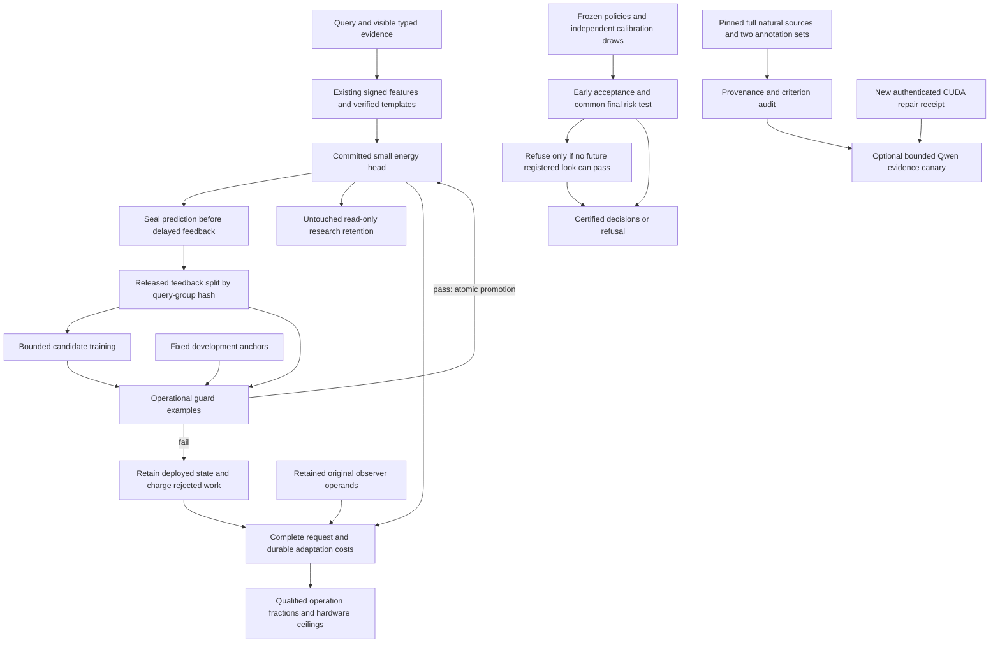
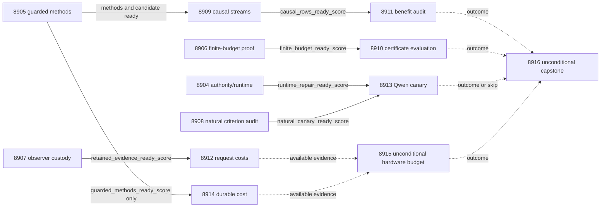

# Carnot Research Roadmap v762: Guarded Continuous Learning, Finite-Budget Refusal, and Natural Evidence

**Created:** 2026-11-07 America/New_York
**Milestone:** 2026.11.762
**Status:** Planned; staged only, not activated
**Supersedes:** Completed 2026.11.761, Exp8891–Exp8903
**Task contract:** Exactly 13 tasks, Exp8904 through Exp8916, in the order below.
**Execution file:** `research-roadmap-next.yaml`

The previous design and active queue are preserved byte-for-byte as
`research-roadmap-v761-preserved-20261107.md` and
`research-roadmap-v761-queue-preserved-20261107.yaml`. The completed archive
currently ends at V760; V761 primary artifacts and conductor receipts supply
its results. This proposal neither rewrites that archive nor activates a queue.

## What V761 proved

| Evidence | Qualified result | Limit that determines this milestone |
|---|---|---|
| Exp8891 | Contract and mutation controls passed. | Owned Ruff formatting of `v761_branch_contract.py` failed; the primary is disqualified. New CUDA repair evidence remains absent. |
| Exp8892/8895 | Signed refutation and repeated-variable overlap features qualify; 36,864 causal rows are retained. | Valid execution alone does not establish adaptive benefit. |
| Exp8898 | True labels beat permutation; signed features beat old features. All signed retention gates pass. | Signed true-minus-frozen future Brier mean is -0.0209269, but simultaneous upper bound +0.0062266 fails the required <=-0.01. The joint benefit result is null. |
| Exp8893/8896 | Shared-final certificate tests qualify; standalone label benefit is established. | `shared_union_benefit_score=0`: all-policy label cost has not improved. |
| Exp8894/8899 | Buffered observer methods qualify. | Cost attribution rejected historical spec-byte drift before valid clocks; this was not an observed overhead failure. |
| Exp8897 | Record decisions, source coverage and source semantics are separated. | Typed-source controls do not establish natural-language semantic fidelity. |
| Exp8901/8902 | Complete durable signed-adaptation costs qualify; hardware limits are explicit. | No speed-quality conjunction or physical acceleration is established. Inclusive component timers are not a disjoint cost partition. |
| Exp8900/8903 | The optional model slot was gate-skipped; all thirteen outcomes are accounted for. | No V761 Qwen inference or natural generalization occurred; the capstone is terminal blocked. |

The direct benefit audit recommends development-only update admission. This is
the changed mechanism here: retain informative signed features and test a
candidate before deployment. Do not describe V761 as an absence of label signal
or a retention failure. Historical failures remain immutable.

## The three largest gaps to the PRD

1. **FR-06/FR-11: useful continuous learning.** A small head can fit released
   labels but has not established future improvement over its frozen baseline
   under the full retention conjunction. Test an operational promotion rule,
   gate fresh evaluation on development feasibility, and measure rejected work.
2. **FR-12: evidence beyond formal-record correctness.** Natural annotations
   are imperfect criteria, and certification still spends the full shared label
   budget. Audit a reachable source corpus before a bounded model canary; add a
   provably safe refusal rule without changing the existing risk guarantee.
3. **FR-05/FR-08/NFR-01: measurable deployable cost.** Restore historical observer
   custody before collecting the frozen request benchmark. Charge complete
   durable adaptation and derive hardware budgets only from qualified fractions.

## Literature incorporated before experiment design

The V762 scan in `research-references.md` was appended before drafting tasks.
It covers all requested topic families and secondary channels, including
negative retrieval results. The following sources change this plan:

| Primary or author source | Transfer and explicit limitation | Tasks |
|---|---|---|
| [Experience-Driven Continual Learning of Terrain Traversability](https://arxiv.org/html/2609.39755v1), September 2026 | Candidate/deployed states, group-hashed held-out feedback and bounded replay. This is a new local small-head protocol, not a replication of robot performance. | 8905, 8909, 8911, 8914 |
| [Sequential Certification of Partially Identified Product Targets](https://arxiv.org/html/2611.07567v1), November 2026; [sequential threshold work](https://arxiv.org/abs/2609.01968), September 2026 | Feasibility and charged stopping decisions motivate a local exact-binomial impossibility proof. Product-target/asymptotic theorems do not certify this protocol. | 8906, 8910 |
| [RAGTruth++ author release](https://huggingface.co/datasets/blue-guardrails/ragtruth-plus-plus), November 2025; [annotation method](https://blueguardrails.com/en/blog/ragtruth-plus-plus-enhanced-hallucination-detection-benchmark) | Reachable408-case paired annotation audit. Revised labels were assisted by original labels and predictions; they are not independent blind ground truth. | 8908, 8913 |
| [SURE-RAG](https://arxiv.org/abs/2605.03534), 2026; [specification-guided decoding](https://arxiv.org/abs/2610.41511), 2026 | Separate source sufficiency, formal record execution and natural semantics; no new decoder integration is justified. | 8908, 8913 |
| [FPGA–ASIC orchestration](https://arxiv.org/abs/2602.15985), 2026 | Include host, transfer and persistence costs before extrapolating kernel acceleration. | 8912, 8914, 8915 |

The scan also checked EBT/ARM–EBM, constraint-learning tutorials, KAN continual
learning, neural probabilistic Ising machines and energy-based decoding. Their
new architectures do not remedy the measured immediate blockers. Exact
three-class normalization requires no sampler replacement. OpenReview supplied
ICLR-labeled manuscripts; Semantic Scholar supplied ten ARM–EBM citing entries
but returned429 for EBT, so citation coverage is partial. GitHub trending did
not establish a new relevant ranking. Extropic and Kona pages supplied vendor
claims, not new reproducible Carnot device access or architecture evidence.
No dependency is added merely because it is recent.

## Architecture



Generator weights stay frozen. The small head keeps the existing signed
representation, objective, optimizer and exact normalization. New deployment
state is opt-in and must persist atomically. No ARC work is scheduled under the
November5 suspension. There is no general external-text reranker, new foundation
model training, hardware bring-up or purchase in this milestone.

## Phase 1: Qualify changed methods — Exp8904–Exp8907

**8904** freezes the complete execution authority, addresses the known owned
formatting failure and reads only a supplied causal runtime-repair receipt.
`contract_ready_score` and `runtime_repair_ready_score` are separate. CPU roots
have no dependency on this optional model gate.

**8905** introduces four arms: `frozen_verified`, `ordinary_true`, `guarded_true`
and `guarded_permuted`. All get identical exact-verified template admissions and
pay matched candidate training and scoring work; the frozen arm keeps shadow
work private. Three label-independent hash buckets train, the fourth gates.
Candidate attempts at feedback counts16/24/32/40/48 use at most32 released
training groups. The guard uses the most recent eight released held-out groups,
minimum four, plus16 fixed development anchors. Promote only for recent Brier
improvement>=0.001, anchor Brier degradation<=0.005 and no anchor error increase.
The ordinary arm deploys the same eligible candidate without that decision.
The permuted arm permutes feedback used by training and recent guards; all
arms share the same immutable development anchors and true template admission.
Research retention examples never enter any of these operations.

These repeated operational guards are heuristics, not independent risk
certificates. Eight development streams must show a promotion, mean future
Brier improvement<=-0.01 against frozen and every retention mean increase<=0.01
before fresh science runs. Controls can qualify with a null pilot, but then
`candidate_ready_score=0` skips8909 and its downstream audit. No threshold tuning
or repeated pilot search is authorized.

**8906** retains seven policies, four groups, independent240-draw selection,
looks120/240/480/960 and risk<=0.05. Early tests spend0.005/(7*4*3), final tests
0.005/(7*4); the fixed comparator shares the same final test. Total family error
allocation remains0.01. At a failed look, evaluate every remaining look under
the optimistic continuation in which every remaining draw is accepted and no
new error occurs. Refuse only if even those bounds all fail. Prove monotonicity
and finite-path equivalence; an error lower bound alone is insufficient. This
preserves the early-acceptance protocol's terminal decisions on every path.
The group stops acquiring labels only after all policies resolve.

**8907** restores the original Exp8894 observer's retained execution operands at
the consumer boundary. A later unrelated checkout spec append must not invalidate
a genuine historical bundle; any alteration to the actual historical operand
must fail. Original hash checks and shared validators remain intact. The method,
one repetition and24-world future benchmark stay fixed. Missing original bytes
block rather than being reconstructed from present-day code.

## Phase 2: Measure causal updates, label work and natural criteria — Exp8908–Exp8910

**8908** independently reads RAGTruth++'s two CSV schemas at author revision
`afaec19e64122b4a58718dc31bcd555c97460233`, joins original RAGTruth by exact
text/provenance, and accounts for all408 intended cases. Local evaluation rights
and redistribution rights are recorded separately. Incorrect refusal is not a
false factual claim. Revised labels retain their assisted-annotation dependence.
An ID-hash ordered24-case cohort, stratified only by source task, is frozen
before model outcomes. Incomplete joins or fewer than24 eligible complete
sources block the optional canary while allowing a complete corpus audit.

**8909** uses24 paired streams of48 online queries,48 untouched retention
queries, checkpoints0/24/48 and four arms: **18,432 scheduled prediction rows**.
Whole query groups stay in one train/guard bucket. Each prediction precedes
feedback; retention is read-only. The eight online and eight retention topology
families remain the finite scope. Fresh worlds are not new topology evidence.

**8910** uses40 fresh paired calibration replicates and the4096-world census.
Compare fixed final, early acceptance only and early acceptance plus safe
refusal on identical draws. Track actual service label acquisition separately
from counterfactual evaluator labels. Primary benefit requires99-percent lower
bound>0 for union labels saved versus early acceptance, zero changed terminal
decisions/coverage loss and all observed served census risks<=0.05. Standalone
savings remain separate. The mathematical risk argument comes from unchanged
registered tests, not40 empirical trials of a rare failure event.

## Phase 3: Independent audit and complete request measurement — Exp8911–Exp8913

**8911** independently reduces nine simultaneous one-sided99-percent bounds
with Bonferroni0.01/9 upper tails over24 stream clusters:

- Future Brier: guarded true minus frozen<=-0.01.
- Future Brier: guarded true minus permuted<0, and minus ordinary true<0.
- Retention Brier/error: guarded true minus frozen<=0.01 at each checkpoint0/24/48.

All nine and the validity controls must pass for `guarded_benefit_score=1`.
A valid null can have `audit_ready_score=1`. The same failure retires this attempt;
no new learning rate, representation, topology claim or acceptance threshold is
selected from evaluation outcomes.

**8912** measures the original24-world request roster after retained custody
qualification. Uninstrumented parent elapsed and buffered nonoverlapping phases
retain startup, imports, memory reads, observation, normalization, exact search,
serialization and unknown work. Original overhead<=5 percent, precision and
closure tolerances must pass for attributable fractions. Valid rows can exist
without valid attribution. The experiment does not select a new optimization.

**8913** is an optional natural-evidence canary with
`MODEL_SPECS=[unsloth/Qwen3.8-27B-GGUF]`, GGUF Q4_K_M. It requires both the new
CUDA receipt and the audited24-case manifest. One call per case, at most256 new
tokens, caps total generation at6144 tokens. This is
`model_bounded_generation` (10-second floor), not full generation (60 seconds)
or load-only work (2 seconds). No padded timing, substitute headline model,
repair retries, context truncation or post-tokenization case replacement occurs.

Identical captured outputs are evaluated under original and revised annotation
criteria. Quotation presence is not entailment; source coverage is not semantic
truth. Invalid or truncated outputs remain in all24 scheduled outcomes.
`independent_generalization_score=0` preserves this small dependent-label scope.
The task provides actual-model evidence only when its external prerequisites
change; a skipped canary is recorded once as blocked.

## Phase 4: Durable service cost and reconciliation — Exp8914–Exp8916

**8914** requires method execution readiness, not learning benefit. Twelve fresh
48-feedback streams across four arms give48 service cells. Charge candidate
training, guard decisions, rejected work, state bytes,48 durable feedback commits
and a cold restart at24. Report full-wall costs and latency distributions; do
not add inclusive component timers. Real fsync and unchanged safety semantics
are mandatory. A speed-quality recommendation additionally needs8911's benefit.

**8915** runs unconditionally and maps only qualified service operations. Unknown
fractions stay unknown. Its hypothetical100x kernel ceiling is
`1 / ((1-f) + f/100)` only for measured compatible fraction f. This does not
establish PRD NFR-01's10x service target. Hardware absence is documented without
another unchanged probe.

**8916** runs unconditionally, accounts for all thirteen slots including
hash-bound conductor skips and itself, rechecks each scientific conjunction,
and runs the historical/current G1–G4 publication gate. Readiness is not science.
Externally blocked inputs are terminal `blocked`, never retryable `partial`.
The capstone neither activates a queue nor publishes externally.

## Dependency graph and conductor behavior



Solid edges are structured `gated_on` conditions. Dotted edges consume whatever
qualified evidence exists and do not create dispatch gates. Every gated producer
is earlier in this roadmap and declares the exact field in its own REQUIRED
ARTIFACT FIELDS. Data readiness is separate from benefit. Missing artifacts,
missing fields, rejected producers and observed zeros must have different
`gate_check_summary` reasons. No task depends on a retired upstream experiment.
All rerun entries have experiment_id, original verdict, addressed_by and
`retire_if_same_verdict: true`; prior successes with failed sub-endpoints retain
their original verdict instead of being relabeled as failures.

## Hardware, budgets and execution discipline

| Resource | Required work and boundary |
|---|---|
| Local CPU, RAM and existing storage | Twelve tasks; small-head fitting, exact bounds, corpus audit, clocks, replay and fsync. Use existing dependencies and bounded shards. No pretrained model loading. |
| Two local RTX3090 GPUs | Only optional8913 uses the existing GPU lease and authenticated actual offload. Cached mandated Q4_K_M model is required; new causal CUDA evidence gates admission. Physical ownership does not imply working runtime. |
| KV260 | Existing quadratic Ising support with k_max<=5; no new bring-up or mapping of relational joins to unsupported fabric operations. |
| PolarFire | Existing Linux CPU dispatch; no fabricated fabric acceleration. |
| GateMate | JTAG0xffffffff remains a physical block; no unchanged probe. |
| Extropic TSU / NPU | Vendor/simulator information or deferred access only; no local physical claim. |

Per-task estimates are25–45 minutes and remain below the80-minute hard cap;
they are ceilings for planning, not runtime targets. Pilot total work plus
validation below4200 seconds. Opus100 turns handles8904/8907 infrastructure;
Codex `gpt-6.1-sol` handles8906's formulaic exact-bound implementation. Other
experiments use default Claude; diagnostic8915 uses20 turns, independent8911
and capstone8916 use30. No Luna or Gemini task is scheduled.

Every prompt requires numbered steps for flushed phase and pre/post expensive
call messages; loops and child supervision emit completed/pending progress at
least every60 seconds. Every silence gap must remain below600 seconds, including
between tool calls. Write files over about200 lines in separate150–200-line tool
calls with progress between them. These rules address measured stall kills;
heartbeats do not extend the4800-second cap or justify padded measurements.

Each implementation starts with its REQ/SCENARIO and failing tests. Retain
per-unit rows, source/code/config hashes, measured substrate and closed
verdict_class. Run owned unit/child coverage, lint/format/types/spec tracing,
private E2E-018/021, cold CLI replay and unchanged adversarial/row-consistency
validators before publication. Native changes additionally need E2E-003/004 and
Cargo checks. Historical or unrelated repository failures remain separate from
owned qualification. No conductor, shared-validator or exclusion-manifest edits
are part of these experiments.

## Deliverables and milestone acceptance

The JSON deliverables in the exact table are mandatory, including honest null
or blocked records under the conductor's normal pre-gate behavior. Raw operands,
rows and receipts use each experiment's existing `results/raw/` convention.
Administrative milestone completion means all thirteen slots are accounted for.
Scientific success is assessed independently for guarded learning, shared label
work, source-criterion evidence and cost qualification; none is promised.
A failed pilot prevents spending on its dependent scientific stream, while
independent CPU roots continue. Durable-cost evidence may remain useful after a
learning null. Optional Qwen absence never blocks corpus or CPU evidence.

## Exact task contract

The following table and embedded full task objects describe exactly the staged
YAML, including prompts, routing, priors and gates. The canonical digest uses
UTF-8 JSON of `tasks`, sorted keys and separators `(',', ':')`, with default
ASCII escaping. This contract is a plan, not a fabricated execution snapshot.

| Order | ID | Title | Phase | Deliverable |
|---|---|---|---|---|
| 1 | exp8904-branch-contract | Qualify V762 authority and changed runtime admission | 1 | `results/experiment_8904_v762_branch_contract.json` |
| 2 | exp8905-guarded-update-methods | Freeze candidate promotion for the signed energy head | 1 | `results/experiment_8905_v762_guarded_update_methods.json` |
| 3 | exp8906-finite-budget-methods | Prove safe refusal before an impossible final certificate | 1 | `results/experiment_8906_v762_finite_budget_methods.json` |
| 4 | exp8907-observer-custody | Qualify retained observer bytes across later spec edits | 1 | `results/experiment_8907_v762_observer_custody.json` |
| 5 | exp8908-natural-criterion-audit | Audit paired natural-text annotation criteria and source custody | 2 | `results/experiment_8908_v762_natural_criterion_audit.json` |
| 6 | exp8909-guarded-causal-streams | Measure guarded updates on sealed paired causal streams | 2 | `results/experiment_8909_v762_guarded_causal_streams.json` |
| 7 | exp8910-finite-budget-evaluation | Measure all-policy label savings from impossible-future refusal | 2 | `results/experiment_8910_v762_finite_budget_evaluation.json` |
| 8 | exp8911-guarded-benefit-audit | Audit future Brier benefit and retention for guarded updates | 3 | `results/experiment_8911_v762_guarded_benefit_audit.json` |
| 9 | exp8912-complete-request-cost | Measure complete request costs with qualified retained clocks | 3 | `results/experiment_8912_v762_complete_request_cost.json` |
| 10 | exp8913-qwen-natural-canary | Measure bounded Qwen evidence decisions under paired annotation criteria | 3 | `results/experiment_8913_v762_qwen_natural_canary.json` |
| 11 | exp8914-guarded-durable-cost | Measure complete durable candidate and promotion costs | 4 | `results/experiment_8914_v762_guarded_durable_cost.json` |
| 12 | exp8915-hardware-operation-budget | Map qualified service work to existing hardware limits | 4 | `results/experiment_8915_v762_hardware_operation_budget.json` |
| 13 | exp8916-capstone | Reconcile thirteen outcomes and decide guarded-learning continuations | 4 | `results/experiment_8916_v762_capstone.json` |

<!-- V762_TASK_CONTRACT_START -->
```json
{
  "milestone": "2026.11.762",
  "canonical_tasks_sha256": "3df60fc61baa550aa33119ab1fe17962e991ce3100261312a0b44db21b009a0f",
  "tasks": [
    {
      "id": "exp8904-branch-contract",
      "title": "Qualify V762 authority and changed runtime admission",
      "phase": 1,
      "track": "research",
      "priority": "high",
      "requires_gpu": false,
      "max_turns": 100,
      "estimated_wall_time_min": 35,
      "per_unit_rows": true,
      "milestone": "2026.11.762",
      "deliverable": "results/experiment_8904_v762_branch_contract.json",
      "inference_substrate_class": "no_model_load",
      "MODEL_SPECS": [],
      "gated_on": [],
      "prior_failures": [
        {
          "experiment_id": "exp8891-branch-contract",
          "verdict": "complete_disqualified_v761_branch_contract",
          "addressed_by": "Repair the specific owned formatting failure and bind the new full thirteen-task authority before terminal publication.",
          "retire_if_same_verdict": true
        },
        {
          "experiment_id": "exp8382-runtime-evidence-delta",
          "verdict": "complete_blocked_cuda_environment_unchanged",
          "addressed_by": "Read a supplied changed causal receipt only; no repeated runtime probes.",
          "retire_if_same_verdict": true
        }
      ],
      "model": "opus",
      "prompt": "CONTEXT:\nV761 completed thirteen slots. Exp8891 was disqualified only at owned Ruff formatting of v761_branch_contract.py; Exp8900 was skipped for absent changed CUDA evidence. CPU science must remain independent of optional runtime admission. The V762 literature scan is in research-references.md.\n\nEXISTING CODE TO READ FIRST:\n- CLAUDE.md\n- CODEX.md\n- research-program.md\n- openspec/capabilities/research-reporting/spec.md\n- openspec/change-proposals/research-roadmap-vNEXT.md\n- scripts/experiment_template.py\n- python/carnot/reporting/current_work_receipt.py\n- python/carnot/reporting/primary_publication.py\n- ops/e2e-test-plan.md\n- python/carnot/reporting/v761_branch_contract.py\n- python/carnot/reporting/roadmap_contract.py\n- tests/python/test_v761_branch_contract_8891.py\n- python/carnot/verify/cuda_reader_8410.py\n- research-references.md\n- results/experiment_8891_v761_branch_contract.json\n\nTASK:\nFreeze the complete thirteen-task execution authority, correct the owned formatting qualification before publication and admit an optional externally supplied CUDA repair receipt without rerunning probes. Deliver results/experiment_8904_v762_branch_contract.json for 2026.11.762.\n\nCONCRETE STEPS:\n1. Read the listed sources and REQ-REPORT-8904 / SCENARIO-REPORT-8904-CONTRACT. Validate exact gates and original producer bytes before expensive work. Missing external inputs are terminal blocked; failed owned controls are disqualified. Preserve original artifacts and assertions.\n2. Emit a flushed progress line at every phase boundary and before and after every potentially minute-long model load, generation, benchmark and subprocess. Use python -u and print(..., flush=True). Inside long loops and child supervision, emit completed/pending counts and forward output at least every 60 seconds. Keep EVERY silence gap below 600 seconds, including work between tool calls; heartbeats never extend the 4800-second hard cap.\n3. Keep every tool call bounded. Write any file over about 200 lines in several tool calls of at most 150-200 lines, with a progress message between calls. Put experiment scripts in scripts/experiments/, tests in tests/python/ and scratch in /tmp; never write scratch files in the repository root.\n4. Compare visible table, embedded full JSON and staged-or-activated YAML for exactly Exp8904-Exp8916 in order, all prompt bytes, routes, gates, prior failures and deliverables. Retain immutable execution snapshots. Planning queue absence after activation is not a missing dependency when the matching active snapshot exists.\n5. Reuse existing contract machinery. Scope formatting repair to the originally named owned file and newly owned files; preserve prior failure receipts and source bytes. Test title, order, prompt, gate-field, prior-field and artifact-path mutations plus successful cold import; never weaken the validator to get a pass.\n6. Record how terrain-traversability candidate promotion, sequential feasibility and RAGTruth++ annotation dependence become falsifiable methods; identify paper assumptions that do not transfer. Keep literature ingestion administrative.\n7. Inspect only a supplied ops/cuda-runtime-repair-receipt.json with the existing authenticated reader and causal-change rules. Absent, stale, malformed or unrelated evidence yields runtime_repair_ready_score=0 with exact diagnostics, while a valid CPU contract can still have contract_ready_score=1. No nvidia-smi, CUDA load, GPU allocation or unchanged repair probe is authorized here.\n8. Extend the named REQ/SCENARIO before implementation and write failing tests first. Reuse ExperimentTemplate, current_work_receipt and primary_publication; keep checkpoints private until terminal validation. Run scoped pytest with measured owned unit/child statement coverage of 100 percent and zero exclusions, Ruff check/format, strict mypy and scripts/check_spec_coverage.py with positional test paths. Run private E2E-018/021 and the actual CLI with cold replay outside the checkout without PYTHONPATH. Native changes also require E2E-003/004 and cargo test/fmt/clippy. Run unchanged adversarial_verify.py and verdict_row_consistency_lint.py --strict on prospective artifacts. Retain logs and executed-source hashes. Record unrelated repository health separately. Reconcile openspec/, _bmad/traceability.md, ops/status.md and ops/changelog.md. Pilot total work plus validation below 4200 seconds, leaving margin within the 4800-second hard cap. Do not activate milestones, modify shared validators, edit the exclusion manifest or publish externally.\n\nREQUIRED ARTIFACT FIELDS:\nexperiment_id, task_id, milestone, run_date: principle: identify the actual producer and invocation.\nhonest_verdict: terminal complete_ prefix; principle: completion is not scientific benefit; blocked_* must include gate_check_summary.\nverdict_class: positive | circular_positive | null | blocked | disqualified | partial; principle: partial retries unfinished OWN work only. Unchanged external absence is blocked. verifier_is_oracle=true forbids positive; a successful oracle claim is circular_positive.\ninference_substrate, inference_substrate_class, execution_venue, MODEL_SPECS, model_invocation_counts, numerical_training_calls: principle: report actual compute. Fresh numerical small-head training uses no_model_load, not pretrained model loading. External skips use blocked_no_run; never pad duration.\nverifier_is_oracle, exposure_scope, independent_generalization_score: principle: exact constructed truth and assisted corpus annotations do not establish independent natural-language generalization.\nduration_s, phase_spans, preconditions_checked, random_seed, reproducibility_checksum: principle: preserve actual work and frozen methods.\nsource_artifact_hashes, code_config_hashes, raw_shard_hashes, cited_upstream_artifacts: principle: bind every import to original bytes, fields and producer identity.\nrows: principle: each compared unit includes unit_id, cluster_id, arm, seed, metric, denominator, status and missing_reason; every headline reduces from these rows.\nintended_count, completed_count, failed_count, censored_count, excluded_count, independent_count: principle: repeats, candidates and correlated queries cannot inflate independent n or hide scheduled failures.\ngate_check_summary: principle: blocked outcomes name check, upstream, artifact_field, expected, observed, path and hash; distinguish missing_file, missing_field, rejected_producer and observed_zero.\nacceptance_gates, required_checks_passed, validation_receipts, owned_statement_coverage: principle: readiness and scientific benefit have separate gates.\nfield_principles: principle: explain each additional field and its evidential scope.\ncontract_ready_score: integer0/1; principle: complete immutable authority and owned validation only.\nruntime_repair_ready_score: integer0/1; principle: newly supplied authenticated causal repair evidence only.\ncontract_rows, full_task_digest, execution_snapshot, literature_method_rows, runtime_receipt_checks: principle: administrative readiness is not inference or benefit.\n\nRun command: cd {project_root} && .venv/bin/python -u scripts/experiments/experiment_8904_v762_branch_contract.py --date {date}\nDo NOT push. Do NOT modify scripts/research_conductor.py."
    },
    {
      "id": "exp8905-guarded-update-methods",
      "title": "Freeze candidate promotion for the signed energy head",
      "phase": 1,
      "track": "research",
      "priority": "high",
      "requires_gpu": false,
      "max_turns": 50,
      "estimated_wall_time_min": 45,
      "per_unit_rows": true,
      "milestone": "2026.11.762",
      "deliverable": "results/experiment_8905_v762_guarded_update_methods.json",
      "inference_substrate_class": "no_model_load",
      "MODEL_SPECS": [],
      "gated_on": [],
      "prior_failures": [
        {
          "experiment_id": "exp8898-signed-benefit-audit",
          "verdict": "complete_null_signed_benefit_audit",
          "addressed_by": "Change update deployment to predeclared candidate promotion; preserve informative signed features and original evaluation thresholds, and require a successful development pilot.",
          "retire_if_same_verdict": true
        }
      ],
      "prompt": "CONTEXT:\nExp8898 found signed true labels better than permutation and old features, with all signed retention gates passing, but true-minus-frozen future Brier upper +0.0062266 failed <=-0.01. Its continuation calls for a development-only update-admission change. Terrain traversability arXiv:2609.39755 motivates testing candidate weights before deployment.\n\nEXISTING CODE TO READ FIRST:\n- CLAUDE.md\n- CODEX.md\n- research-program.md\n- openspec/capabilities/research-reporting/spec.md\n- openspec/change-proposals/research-roadmap-vNEXT.md\n- scripts/experiment_template.py\n- python/carnot/reporting/current_work_receipt.py\n- python/carnot/reporting/primary_publication.py\n- ops/e2e-test-plan.md\n- python/carnot/memory/signed_memory_8892.py\n- python/carnot/reporting/signed_feature_methods_8892.py\n- python/carnot/reporting/signed_causal_streams_8895.py\n- python/carnot/reporting/signed_benefit_audit_8898.py\n- python/carnot/memory/causal_memory_8802.py\n- tests/python/test_signed_feature_methods_8892.py\n\nTASK:\nQualify an opt-in candidate/committed small-head state and a development feasibility gate; retain the signed representation, optimizer, objective and exact three-class normalization. Deliver results/experiment_8905_v762_guarded_update_methods.json for 2026.11.762.\n\nCONCRETE STEPS:\n1. Read the listed sources and REQ-REPORT-8905 / SCENARIO-REPORT-8905-CONTRACT. Validate exact gates and original producer bytes before expensive work. Missing external inputs are terminal blocked; failed owned controls are disqualified. Preserve original artifacts and assertions.\n2. Emit a flushed progress line at every phase boundary and before and after every potentially minute-long model load, generation, benchmark and subprocess. Use python -u and print(..., flush=True). Inside long loops and child supervision, emit completed/pending counts and forward output at least every 60 seconds. Keep EVERY silence gap below 600 seconds, including work between tool calls; heartbeats never extend the 4800-second hard cap.\n3. Keep every tool call bounded. Write any file over about 200 lines in several tool calls of at most 150-200 lines, with a progress message between calls. Put experiment scripts in scripts/experiments/, tests in tests/python/ and scratch in /tmp; never write scratch files in the repository root.\n4. Freeze four paired arms: frozen_verified, ordinary_true, guarded_true, guarded_permuted. Every arm admits the same independently exact-verified templates and pays identical feature, candidate-fit and guard-scoring work. Frozen runs shadow work without deploying; ordinary deploys each eligible candidate unconditionally. Only guarded_permuted permutes update and guard labels within predeclared released-feedback blocks; exact template admission still uses true labels for every arm.\n5. Assign whole query groups by a fixed label-independent SHA256 bucket: three of four buckets train, one gates. Never train on guard examples. Use the most recent eight released guard groups, minimum four. At feedback counts16/24/32/40/48, fit from deployed weights on at most32 released training groups using unchanged per-example optimizer steps. Guarded promotion requires recent mean Brier improvement >=0.001 and anchor Brier degradation <=0.005 with no anchor error increase. Fix16 anchor groups from development data before evaluation. Repeated guard use is an operational heuristic, not an independent risk certificate.\n6. Implement atomic candidate-to-committed promotion and persist both state versions, split assignments, replay cursor and schema. Preserve predict-before-feedback, delayed label release, rejection without state change and restart equivalence. Keep evaluation retention data inaccessible to training, operational gates and template admission.\n7. Before implementation add failing controls for leakage, source order, group split consistency, no eligible guard, rejected update, permutation isolation, atomic promotion and durable restart. Do not add a sampler or train generator weights.\n8. Run eight development-only paired48-query streams with48 retention queries and checkpoints0/24/48, disjoint from future streams. Freeze thresholds before pilot. Set guarded_methods_ready_score=1 only for valid controls and execution. Set candidate_ready_score=1 only if at least one promotion occurs, development guarded-minus-frozen future Brier mean<=-0.01 and each retention Brier/error mean increase<=0.01. A valid failing pilot is null with candidate_ready_score=0; do not tune or launch the fresh science stream anyway. Freeze fresh24-stream seeds and 18432 expected rows (24*4*(48+3*48)).\n9. Extend the named REQ/SCENARIO before implementation and write failing tests first. Reuse ExperimentTemplate, current_work_receipt and primary_publication; keep checkpoints private until terminal validation. Run scoped pytest with measured owned unit/child statement coverage of 100 percent and zero exclusions, Ruff check/format, strict mypy and scripts/check_spec_coverage.py with positional test paths. Run private E2E-018/021 and the actual CLI with cold replay outside the checkout without PYTHONPATH. Native changes also require E2E-003/004 and cargo test/fmt/clippy. Run unchanged adversarial_verify.py and verdict_row_consistency_lint.py --strict on prospective artifacts. Retain logs and executed-source hashes. Record unrelated repository health separately. Reconcile openspec/, _bmad/traceability.md, ops/status.md and ops/changelog.md. Pilot total work plus validation below 4200 seconds, leaving margin within the 4800-second hard cap. Do not activate milestones, modify shared validators, edit the exclusion manifest or publish externally.\n\nREQUIRED ARTIFACT FIELDS:\nexperiment_id, task_id, milestone, run_date: principle: identify the actual producer and invocation.\nhonest_verdict: terminal complete_ prefix; principle: completion is not scientific benefit; blocked_* must include gate_check_summary.\nverdict_class: positive | circular_positive | null | blocked | disqualified | partial; principle: partial retries unfinished OWN work only. Unchanged external absence is blocked. verifier_is_oracle=true forbids positive; a successful oracle claim is circular_positive.\ninference_substrate, inference_substrate_class, execution_venue, MODEL_SPECS, model_invocation_counts, numerical_training_calls: principle: report actual compute. Fresh numerical small-head training uses no_model_load, not pretrained model loading. External skips use blocked_no_run; never pad duration.\nverifier_is_oracle, exposure_scope, independent_generalization_score: principle: exact constructed truth and assisted corpus annotations do not establish independent natural-language generalization.\nduration_s, phase_spans, preconditions_checked, random_seed, reproducibility_checksum: principle: preserve actual work and frozen methods.\nsource_artifact_hashes, code_config_hashes, raw_shard_hashes, cited_upstream_artifacts: principle: bind every import to original bytes, fields and producer identity.\nrows: principle: each compared unit includes unit_id, cluster_id, arm, seed, metric, denominator, status and missing_reason; every headline reduces from these rows.\nintended_count, completed_count, failed_count, censored_count, excluded_count, independent_count: principle: repeats, candidates and correlated queries cannot inflate independent n or hide scheduled failures.\ngate_check_summary: principle: blocked outcomes name check, upstream, artifact_field, expected, observed, path and hash; distinguish missing_file, missing_field, rejected_producer and observed_zero.\nacceptance_gates, required_checks_passed, validation_receipts, owned_statement_coverage: principle: readiness and scientific benefit have separate gates.\nfield_principles: principle: explain each additional field and its evidential scope.\nguarded_methods_ready_score: integer0/1; principle: causal execution and state controls qualify independently of effect.\ncandidate_ready_score: integer0/1; principle: fixed development feasibility conjunction before opening evaluation.\nprotocol, split_manifest, anchor_manifest, promotion_rows, development_rows, expected_row_counts, frozen_evaluation_manifest: principle: operational guard data remain distinct from untouched research retention.\n\nRun command: cd {project_root} && .venv/bin/python -u scripts/experiments/experiment_8905_v762_guarded_update_methods.py --date {date}\nDo NOT push. Do NOT modify scripts/research_conductor.py."
    },
    {
      "id": "exp8906-finite-budget-methods",
      "title": "Prove safe refusal before an impossible final certificate",
      "phase": 1,
      "track": "research",
      "priority": "high",
      "requires_gpu": false,
      "max_turns": 50,
      "estimated_wall_time_min": 45,
      "per_unit_rows": true,
      "milestone": "2026.11.762",
      "deliverable": "results/experiment_8906_v762_finite_budget_methods.json",
      "inference_substrate_class": "no_model_load",
      "MODEL_SPECS": [],
      "gated_on": [],
      "prior_failures": [
        {
          "experiment_id": "exp8896-shared-terminal-evaluation",
          "verdict": "complete_circular_positive_shared_terminal_evaluation",
          "addressed_by": "The qualified prior has shared_union_benefit_score=0; add safe terminal refusal of cells with no possible future pass, retaining its successful final-test construction.",
          "retire_if_same_verdict": true
        }
      ],
      "agent_type": "codex",
      "model": "gpt-6.1-sol",
      "prompt": "CONTEXT:\nExp8896 qualified the common-final certificate and standalone savings, but shared_union_benefit_score=0 because another unresolved policy can keep labels flowing. Sequential feasibility papers suggest checking whether remaining budget can possibly establish the target; their theorems are not imported into this different setting.\n\nEXISTING CODE TO READ FIRST:\n- CLAUDE.md\n- CODEX.md\n- research-program.md\n- openspec/capabilities/research-reporting/spec.md\n- openspec/change-proposals/research-roadmap-vNEXT.md\n- scripts/experiment_template.py\n- python/carnot/reporting/current_work_receipt.py\n- python/carnot/reporting/primary_publication.py\n- ops/e2e-test-plan.md\n- python/carnot/reporting/shared_terminal_methods_8893.py\n- python/carnot/reporting/shared_terminal_evaluation_8896.py\n- python/carnot/reporting/conditional_risk_methods_8868.py\n- tests/python/test_shared_terminal_methods_8893.py\n\nTASK:\nAdd a mathematically safe finite-budget refusal rule to the existing fixed family of certificate tests. Deliver results/experiment_8906_v762_finite_budget_methods.json for 2026.11.762.\n\nCONCRETE STEPS:\n1. Read the listed sources and REQ-REPORT-8906 / SCENARIO-REPORT-8906-CONTRACT. Validate exact gates and original producer bytes before expensive work. Missing external inputs are terminal blocked; failed owned controls are disqualified. Preserve original artifacts and assertions.\n2. Emit a flushed progress line at every phase boundary and before and after every potentially minute-long model load, generation, benchmark and subprocess. Use python -u and print(..., flush=True). Inside long loops and child supervision, emit completed/pending counts and forward output at least every 60 seconds. Keep EVERY silence gap below 600 seconds, including work between tool calls; heartbeats never extend the 4800-second hard cap.\n3. Keep every tool call bounded. Write any file over about 200 lines in several tool calls of at most 150-200 lines, with a progress message between calls. Put experiment scripts in scripts/experiments/, tests in tests/python/ and scratch in /tmp; never write scratch files in the repository root.\n4. Freeze seven policies, four groups, independent240-draw selection, candidate looks120/240/480/960, risk<=0.05 and existing exact binomial bounds. Keep early alpha=0.005/(7*4*3), final alpha=0.005/(7*4); fixed and sequential comparators share the identical final test. Total family allocation stays0.01.\n5. At each failed look enumerate all remaining registered looks. For each, give the current cell the most favorable attainable continuation: every remaining draw accepted and no additional errors. Refuse permanently only if even that optimistic sufficient statistic fails every remaining test. An error lower bound alone is insufficient. Prove exact-bound monotonicity or exhaustive finite-state equivalence, and test early pass, final-only pass, zero accepted, budget edge and numerical rounding.\n6. Use exhaustive small-budget binary paths and randomized full-size sufficient states to prove decisions unchanged relative to the common-final protocol; include a deliberate unsafe stopping rule as a failing control. No previous certificate can be revoked. Freeze a fail-closed numerical convention shared by all arms.\n7. Freeze three arms: fixed final, early acceptance only, early acceptance plus impossible-future refusal. A group stops fetching labels only when every policy has passed or safely refused. Pay selection and every unique candidate label once in shared-union costs, while retaining per-policy standalone counts. Freeze fresh40 calibration replicates and a4096-world census; methods qualification must not depend on observed savings.\n8. Extend the named REQ/SCENARIO before implementation and write failing tests first. Reuse ExperimentTemplate, current_work_receipt and primary_publication; keep checkpoints private until terminal validation. Run scoped pytest with measured owned unit/child statement coverage of 100 percent and zero exclusions, Ruff check/format, strict mypy and scripts/check_spec_coverage.py with positional test paths. Run private E2E-018/021 and the actual CLI with cold replay outside the checkout without PYTHONPATH. Native changes also require E2E-003/004 and cargo test/fmt/clippy. Run unchanged adversarial_verify.py and verdict_row_consistency_lint.py --strict on prospective artifacts. Retain logs and executed-source hashes. Record unrelated repository health separately. Reconcile openspec/, _bmad/traceability.md, ops/status.md and ops/changelog.md. Pilot total work plus validation below 4200 seconds, leaving margin within the 4800-second hard cap. Do not activate milestones, modify shared validators, edit the exclusion manifest or publish externally.\n\nREQUIRED ARTIFACT FIELDS:\nexperiment_id, task_id, milestone, run_date: principle: identify the actual producer and invocation.\nhonest_verdict: terminal complete_ prefix; principle: completion is not scientific benefit; blocked_* must include gate_check_summary.\nverdict_class: positive | circular_positive | null | blocked | disqualified | partial; principle: partial retries unfinished OWN work only. Unchanged external absence is blocked. verifier_is_oracle=true forbids positive; a successful oracle claim is circular_positive.\ninference_substrate, inference_substrate_class, execution_venue, MODEL_SPECS, model_invocation_counts, numerical_training_calls: principle: report actual compute. Fresh numerical small-head training uses no_model_load, not pretrained model loading. External skips use blocked_no_run; never pad duration.\nverifier_is_oracle, exposure_scope, independent_generalization_score: principle: exact constructed truth and assisted corpus annotations do not establish independent natural-language generalization.\nduration_s, phase_spans, preconditions_checked, random_seed, reproducibility_checksum: principle: preserve actual work and frozen methods.\nsource_artifact_hashes, code_config_hashes, raw_shard_hashes, cited_upstream_artifacts: principle: bind every import to original bytes, fields and producer identity.\nrows: principle: each compared unit includes unit_id, cluster_id, arm, seed, metric, denominator, status and missing_reason; every headline reduces from these rows.\nintended_count, completed_count, failed_count, censored_count, excluded_count, independent_count: principle: repeats, candidates and correlated queries cannot inflate independent n or hide scheduled failures.\ngate_check_summary: principle: blocked outcomes name check, upstream, artifact_field, expected, observed, path and hash; distinguish missing_file, missing_field, rejected_producer and observed_zero.\nacceptance_gates, required_checks_passed, validation_receipts, owned_statement_coverage: principle: readiness and scientific benefit have separate gates.\nfield_principles: principle: explain each additional field and its evidential scope.\nfinite_budget_ready_score: integer0/1; principle: proof obligations, exact-bound controls and immutable protocol qualify the evaluator.\nprotocol, proof_obligations, exhaustive_path_rows, bound_monotonicity_rows, family_alpha_ledger, cost_identity_rows: principle: impossibility refusal cannot remove a future pass or claim empirical cost benefit.\n\nRun command: cd {project_root} && .venv/bin/python -u scripts/experiments/experiment_8906_v762_finite_budget_methods.py --date {date}\nDo NOT push. Do NOT modify scripts/research_conductor.py."
    },
    {
      "id": "exp8907-observer-custody",
      "title": "Qualify retained observer bytes across later spec edits",
      "phase": 1,
      "track": "research",
      "priority": "high",
      "requires_gpu": false,
      "max_turns": 100,
      "estimated_wall_time_min": 45,
      "per_unit_rows": true,
      "milestone": "2026.11.762",
      "deliverable": "results/experiment_8907_v762_observer_custody.json",
      "inference_substrate_class": "no_model_load",
      "MODEL_SPECS": [],
      "gated_on": [],
      "prior_failures": [
        {
          "experiment_id": "exp8899-buffered-cost-attribution",
          "verdict": "complete_blocked_buffered_cost_attribution",
          "addressed_by": "Read exact original executed operands from retained evidence and test the consumer boundary; hold the observer and benchmark fixed.",
          "retire_if_same_verdict": true
        }
      ],
      "model": "opus",
      "prompt": "CONTEXT:\nExp8899 failed before valid clocks because the original Exp8894 spec operand changed from sha256:2624f7ff98f0abe7483156880fd627150cb30848c9c2b4bd13108637e2285426 to sha256:b745d05c583ccf9dd5ce7291d85bac2c80aa2d827ef1b0d68ab1c961041e2297. This is custody drift, not an overhead result.\n\nEXISTING CODE TO READ FIRST:\n- CLAUDE.md\n- CODEX.md\n- research-program.md\n- openspec/capabilities/research-reporting/spec.md\n- openspec/change-proposals/research-roadmap-vNEXT.md\n- scripts/experiment_template.py\n- python/carnot/reporting/current_work_receipt.py\n- python/carnot/reporting/primary_publication.py\n- ops/e2e-test-plan.md\n- python/carnot/reporting/buffered_clock_methods_8894.py\n- python/carnot/reporting/buffered_clock_runner_8894.py\n- python/carnot/reporting/buffered_cost_attribution_8899.py\n- python/carnot/reporting/v746_retained_evidence.py\n- python/carnot/reporting/v748_collection_contract.py\n- tests/python/test_buffered_cost_attribution_8899.py\n\nTASK:\nMake the original qualified buffered observer replayable from its immutable retained invocation without relaxing any source or semantic validation. Deliver results/experiment_8907_v762_observer_custody.json for 2026.11.762.\n\nCONCRETE STEPS:\n1. Read the listed sources and REQ-REPORT-8907 / SCENARIO-REPORT-8907-CONTRACT. Validate exact gates and original producer bytes before expensive work. Missing external inputs are terminal blocked; failed owned controls are disqualified. Preserve original artifacts and assertions.\n2. Emit a flushed progress line at every phase boundary and before and after every potentially minute-long model load, generation, benchmark and subprocess. Use python -u and print(..., flush=True). Inside long loops and child supervision, emit completed/pending counts and forward output at least every 60 seconds. Keep EVERY silence gap below 600 seconds, including work between tool calls; heartbeats never extend the 4800-second hard cap.\n3. Keep every tool call bounded. Write any file over about 200 lines in several tool calls of at most 150-200 lines, with a progress message between calls. Put experiment scripts in scripts/experiments/, tests in tests/python/ and scratch in /tmp; never write scratch files in the repository root.\n4. Locate original Exp8894 primary, execution snapshot, retained spec/code/config/test operands and validation receipts. Resolve authority from its content-addressed execution bundle, not a mutable checkout path. Missing original operands are blocked; do not synthesize old bytes or rewrite historical receipts.\n5. Reuse the existing retained-evidence and namespace mechanisms at the observer consumer boundary. Compare the retained implementation with the prospective current implementation and require algorithm-equivalence controls. Apply only the smallest consumer-side change; do not edit shared validators, normalize away hashes or grandfather unrelated sources.\n6. Test a pristine cold replay; later unrelated spec append; original retained spec mutation; observer-code mutation; rehashed semantically altered clocks; missing operand; and invalid producer. The unrelated current append may leave historical qualification intact, but all changes to the actual historical operand must fail.\n7. Preserve the original observer algorithm, one repetition and frozen future24-world roster. Qualify custody and replay only; do not claim overhead improvement or run the full cost benchmark here. Publish a retained_evidence_ready_score usable by the cost consumer.\n8. Extend the named REQ/SCENARIO before implementation and write failing tests first. Reuse ExperimentTemplate, current_work_receipt and primary_publication; keep checkpoints private until terminal validation. Run scoped pytest with measured owned unit/child statement coverage of 100 percent and zero exclusions, Ruff check/format, strict mypy and scripts/check_spec_coverage.py with positional test paths. Run private E2E-018/021 and the actual CLI with cold replay outside the checkout without PYTHONPATH. Native changes also require E2E-003/004 and cargo test/fmt/clippy. Run unchanged adversarial_verify.py and verdict_row_consistency_lint.py --strict on prospective artifacts. Retain logs and executed-source hashes. Record unrelated repository health separately. Reconcile openspec/, _bmad/traceability.md, ops/status.md and ops/changelog.md. Pilot total work plus validation below 4200 seconds, leaving margin within the 4800-second hard cap. Do not activate milestones, modify shared validators, edit the exclusion manifest or publish externally.\n\nREQUIRED ARTIFACT FIELDS:\nexperiment_id, task_id, milestone, run_date: principle: identify the actual producer and invocation.\nhonest_verdict: terminal complete_ prefix; principle: completion is not scientific benefit; blocked_* must include gate_check_summary.\nverdict_class: positive | circular_positive | null | blocked | disqualified | partial; principle: partial retries unfinished OWN work only. Unchanged external absence is blocked. verifier_is_oracle=true forbids positive; a successful oracle claim is circular_positive.\ninference_substrate, inference_substrate_class, execution_venue, MODEL_SPECS, model_invocation_counts, numerical_training_calls: principle: report actual compute. Fresh numerical small-head training uses no_model_load, not pretrained model loading. External skips use blocked_no_run; never pad duration.\nverifier_is_oracle, exposure_scope, independent_generalization_score: principle: exact constructed truth and assisted corpus annotations do not establish independent natural-language generalization.\nduration_s, phase_spans, preconditions_checked, random_seed, reproducibility_checksum: principle: preserve actual work and frozen methods.\nsource_artifact_hashes, code_config_hashes, raw_shard_hashes, cited_upstream_artifacts: principle: bind every import to original bytes, fields and producer identity.\nrows: principle: each compared unit includes unit_id, cluster_id, arm, seed, metric, denominator, status and missing_reason; every headline reduces from these rows.\nintended_count, completed_count, failed_count, censored_count, excluded_count, independent_count: principle: repeats, candidates and correlated queries cannot inflate independent n or hide scheduled failures.\ngate_check_summary: principle: blocked outcomes name check, upstream, artifact_field, expected, observed, path and hash; distinguish missing_file, missing_field, rejected_producer and observed_zero.\nacceptance_gates, required_checks_passed, validation_receipts, owned_statement_coverage: principle: readiness and scientific benefit have separate gates.\nfield_principles: principle: explain each additional field and its evidential scope.\nretained_evidence_ready_score: integer0/1; principle: original observer qualification survives a valid retained-bundle replay only.\nretained_operand_manifest, original_receipt_hashes, consumer_bridge_hashes, mutation_rows, cold_replay_receipt, observer_equivalence_rows: principle: current document edits cannot rewrite historical evidence.\n\nRun command: cd {project_root} && .venv/bin/python -u scripts/experiments/experiment_8907_v762_observer_custody.py --date {date}\nDo NOT push. Do NOT modify scripts/research_conductor.py."
    },
    {
      "id": "exp8908-natural-criterion-audit",
      "title": "Audit paired natural-text annotation criteria and source custody",
      "phase": 2,
      "track": "research",
      "priority": "high",
      "requires_gpu": false,
      "max_turns": 50,
      "estimated_wall_time_min": 35,
      "per_unit_rows": true,
      "milestone": "2026.11.762",
      "deliverable": "results/experiment_8908_v762_natural_criterion_audit.json",
      "inference_substrate_class": "no_model_load",
      "MODEL_SPECS": [],
      "gated_on": [],
      "prior_failures": [
        {
          "experiment_id": "exp8597-medexpert-evidence-audit",
          "verdict": "complete_blocked_medexpert_release_unavailable",
          "addressed_by": "Use a verified reachable different author release with separate CSV schemas; explicitly gate exact original joins and local evaluation authority instead of retrying the unavailable release.",
          "retire_if_same_verdict": true
        }
      ],
      "prompt": "CONTEXT:\nConstructed record truth does not establish natural source fidelity. RAGTruth++ publicly releases408 reannotated RAGTruth cases, but annotators saw original labels and automatic predictions. Exp8597 could not obtain its different requested release. The new reachable author release is a changed prerequisite, not proof of independent truth.\n\nEXISTING CODE TO READ FIRST:\n- CLAUDE.md\n- CODEX.md\n- research-program.md\n- openspec/capabilities/research-reporting/spec.md\n- openspec/change-proposals/research-roadmap-vNEXT.md\n- scripts/experiment_template.py\n- python/carnot/reporting/current_work_receipt.py\n- python/carnot/reporting/primary_publication.py\n- ops/e2e-test-plan.md\n- python/carnot/reporting/natural_source_cohort.py\n- python/carnot/reporting/real_factual_corpus_ragtruth_3669.py\n- python/carnot/reporting/medexpert_evidence_8597.py\n- python/carnot/reporting/source_bound_decisions_8897.py\n- research-references.md\n\nTASK:\nBuild a hash-bound, locally evaluable paired-criterion corpus manifest and expose whether a small Qwen evidence-classification canary is feasible. Deliver results/experiment_8908_v762_natural_criterion_audit.json for 2026.11.762.\n\nCONCRETE STEPS:\n1. Read the listed sources and REQ-REPORT-8908 / SCENARIO-REPORT-8908-CONTRACT. Validate exact gates and original producer bytes before expensive work. Missing external inputs are terminal blocked; failed owned controls are disqualified. Preserve original artifacts and assertions.\n2. Emit a flushed progress line at every phase boundary and before and after every potentially minute-long model load, generation, benchmark and subprocess. Use python -u and print(..., flush=True). Inside long loops and child supervision, emit completed/pending counts and forward output at least every 60 seconds. Keep EVERY silence gap below 600 seconds, including work between tool calls; heartbeats never extend the 4800-second hard cap.\n3. Keep every tool call bounded. Write any file over about 200 lines in several tool calls of at most 150-200 lines, with a progress message between calls. Put experiment scripts in scripts/experiments/, tests in tests/python/ and scratch in /tmp; never write scratch files in the repository root.\n4. Fetch author revision afaec19e64122b4a58718dc31bcd555c97460233 from blue-guardrails/ragtruth-plus-plus with bounded requests; read messages.csv and hallucination_spans.csv independently because the combined viewer has a schema error. Record retrieval receipts, source URLs, hashes, terms and evaluation permission separately from redistribution. No LLM or GPU work.\n5. Join the released cases to pinned original RAGTruth records using stable provenance and exact text checks. Reject ambiguous joins. Retain full source prompt, generated response, offsets, original spans and revised spans. Distinguish the408 sampled cases from the original test population; never call assisted revisions independent blind truth.\n6. Freeze an annotation crosswalk before metric reduction. Treat EvidentConflict/SubtleConflict and EvidentBaselessInfo/SubtleBaselessInfo as distinct evidence-failure labels; report IncorrectRefusal separately rather than treating refusal as a false factual statement. Test Unicode offsets, duplicated cases, changed text, missing contexts, schema separation and unsupported label mappings.\n7. Emit per-case span counts, paired label-disagreement rates and denominators over all valid joins. Keep missing and excluded cases in the intended408 ledger. Freeze an ID-hash ordered24-case canary from records with complete source/response, sound joins and explicit local-evaluation authority; stratify only by source task, not disagreement or model outcome. If fewer than24 are eligible, keep the audit result but set natural_canary_ready_score=0.\n8. Publish corpus_audit_ready_score=1 for a complete auditable coverage/rights decision even if the optional canary is unavailable. Keep source payloads local under existing dataset policy; the public manifest need only carry permitted identifiers and hashes. No generated-text reranking, model training or semantic-truth claim.\n9. Extend the named REQ/SCENARIO before implementation and write failing tests first. Reuse ExperimentTemplate, current_work_receipt and primary_publication; keep checkpoints private until terminal validation. Run scoped pytest with measured owned unit/child statement coverage of 100 percent and zero exclusions, Ruff check/format, strict mypy and scripts/check_spec_coverage.py with positional test paths. Run private E2E-018/021 and the actual CLI with cold replay outside the checkout without PYTHONPATH. Native changes also require E2E-003/004 and cargo test/fmt/clippy. Run unchanged adversarial_verify.py and verdict_row_consistency_lint.py --strict on prospective artifacts. Retain logs and executed-source hashes. Record unrelated repository health separately. Reconcile openspec/, _bmad/traceability.md, ops/status.md and ops/changelog.md. Pilot total work plus validation below 4200 seconds, leaving margin within the 4800-second hard cap. Do not activate milestones, modify shared validators, edit the exclusion manifest or publish externally.\n\nREQUIRED ARTIFACT FIELDS:\nexperiment_id, task_id, milestone, run_date: principle: identify the actual producer and invocation.\nhonest_verdict: terminal complete_ prefix; principle: completion is not scientific benefit; blocked_* must include gate_check_summary.\nverdict_class: positive | circular_positive | null | blocked | disqualified | partial; principle: partial retries unfinished OWN work only. Unchanged external absence is blocked. verifier_is_oracle=true forbids positive; a successful oracle claim is circular_positive.\ninference_substrate, inference_substrate_class, execution_venue, MODEL_SPECS, model_invocation_counts, numerical_training_calls: principle: report actual compute. Fresh numerical small-head training uses no_model_load, not pretrained model loading. External skips use blocked_no_run; never pad duration.\nverifier_is_oracle, exposure_scope, independent_generalization_score: principle: exact constructed truth and assisted corpus annotations do not establish independent natural-language generalization.\nduration_s, phase_spans, preconditions_checked, random_seed, reproducibility_checksum: principle: preserve actual work and frozen methods.\nsource_artifact_hashes, code_config_hashes, raw_shard_hashes, cited_upstream_artifacts: principle: bind every import to original bytes, fields and producer identity.\nrows: principle: each compared unit includes unit_id, cluster_id, arm, seed, metric, denominator, status and missing_reason; every headline reduces from these rows.\nintended_count, completed_count, failed_count, censored_count, excluded_count, independent_count: principle: repeats, candidates and correlated queries cannot inflate independent n or hide scheduled failures.\ngate_check_summary: principle: blocked outcomes name check, upstream, artifact_field, expected, observed, path and hash; distinguish missing_file, missing_field, rejected_producer and observed_zero.\nacceptance_gates, required_checks_passed, validation_receipts, owned_statement_coverage: principle: readiness and scientific benefit have separate gates.\nfield_principles: principle: explain each additional field and its evidential scope.\ncorpus_audit_ready_score: integer0/1; principle: complete provenance and annotation-limit audit, independent of canary availability.\nnatural_canary_ready_score: integer0/1; principle: exactly24 eligible complete joined cases with local evaluation authority.\nrelease_revision, source_urls, rights_ledger, annotation_crosswalk, join_rows, disagreement_rows, canary_manifest, canary_manifest_hash: principle: assisted labels are competing criteria with stated dependence.\n\nRun command: cd {project_root} && .venv/bin/python -u scripts/experiments/experiment_8908_v762_natural_criterion_audit.py --date {date}\nDo NOT push. Do NOT modify scripts/research_conductor.py."
    },
    {
      "id": "exp8909-guarded-causal-streams",
      "title": "Measure guarded updates on sealed paired causal streams",
      "phase": 2,
      "track": "research",
      "priority": "high",
      "requires_gpu": false,
      "max_turns": 50,
      "estimated_wall_time_min": 45,
      "per_unit_rows": true,
      "milestone": "2026.11.762",
      "deliverable": "results/experiment_8909_v762_guarded_causal_streams.json",
      "inference_substrate_class": "no_model_load",
      "MODEL_SPECS": [],
      "gated_on": [
        {
          "upstream": "exp8905-guarded-update-methods",
          "artifact_field": "guarded_methods_ready_score",
          "op": "==",
          "value": 1
        },
        {
          "upstream": "exp8905-guarded-update-methods",
          "artifact_field": "candidate_ready_score",
          "op": "==",
          "value": 1
        }
      ],
      "prior_failures": [
        {
          "experiment_id": "exp8895-signed-causal-streams",
          "verdict": "complete_null_signed_causal_streams",
          "addressed_by": "Run a newly gated deployment policy with fixed signed features and matched work only after development feasibility; no unchanged eight-arm repeat.",
          "retire_if_same_verdict": true
        }
      ],
      "prompt": "CONTEXT:\nThe signed representation already carries label information. Exp8895/8898 did not establish the required frozen-baseline benefit. Exp8905 introduces an operational update guard and must pass its fixed development gate before fresh evaluation is opened.\n\nEXISTING CODE TO READ FIRST:\n- CLAUDE.md\n- CODEX.md\n- research-program.md\n- openspec/capabilities/research-reporting/spec.md\n- openspec/change-proposals/research-roadmap-vNEXT.md\n- scripts/experiment_template.py\n- python/carnot/reporting/current_work_receipt.py\n- python/carnot/reporting/primary_publication.py\n- ops/e2e-test-plan.md\n- python/carnot/reporting/signed_causal_streams_8895.py\n- python/carnot/reporting/signed_causal_runner_8895.py\n- python/carnot/reporting/signed_feature_methods_8892.py\n- python/carnot/memory/signed_memory_8892.py\n- tests/python/test_signed_causal_streams_8895.py\n\nTASK:\nExecute the frozen four-arm continuous self-learning protocol and publish complete causal prediction/update/retention rows without selecting a favorable subset. Deliver results/experiment_8909_v762_guarded_causal_streams.json for 2026.11.762.\n\nCONCRETE STEPS:\n1. Read the listed sources and REQ-REPORT-8909 / SCENARIO-REPORT-8909-CONTRACT. Validate exact gates and original producer bytes before expensive work. Missing external inputs are terminal blocked; failed owned controls are disqualified. Preserve original artifacts and assertions.\n2. Emit a flushed progress line at every phase boundary and before and after every potentially minute-long model load, generation, benchmark and subprocess. Use python -u and print(..., flush=True). Inside long loops and child supervision, emit completed/pending counts and forward output at least every 60 seconds. Keep EVERY silence gap below 600 seconds, including work between tool calls; heartbeats never extend the 4800-second hard cap.\n3. Keep every tool call bounded. Write any file over about 200 lines in several tool calls of at most 150-200 lines, with a progress message between calls. Put experiment scripts in scripts/experiments/, tests in tests/python/ and scratch in /tmp; never write scratch files in the repository root.\n4. Require Exp8905 guarded_methods_ready_score=1 and candidate_ready_score=1 from authentic primary bytes. Import that task's future manifest and implementation, created earlier in this roadmap. Assert zero overlap with its pilots and anchors before unsealing24 paired48-query streams.\n5. Run frozen_verified, ordinary_true, guarded_true and guarded_permuted on exactly matched feature/template exposure, train/guard assignments, numerical optimizer work and delayed label timing. Seal each prediction before labels are released. Shared exact template admission is intentionally identical; the comparison isolates neural update deployment.\n6. Evaluate48 untouched retention queries read-only at checkpoints0/24/48. Never use them for training, guard admission, template writes or candidate selection. Store18432 scheduled rows plus candidate and promotion decisions, state hashes and feedback cursors. Eight online/eight retention topology families remain the finite scope; fresh seeds are not unseen-topology evidence.\n7. Validate schedule alignment, whole-group permutations, atomic commits, zero future-label access and restart replay. Preserve no-promotion outcomes and all failures/censoring. Readiness is complete trustworthy measurement, not benefit. Leave independent intervals and the conjunction to Exp8911.\n8. Extend the named REQ/SCENARIO before implementation and write failing tests first. Reuse ExperimentTemplate, current_work_receipt and primary_publication; keep checkpoints private until terminal validation. Run scoped pytest with measured owned unit/child statement coverage of 100 percent and zero exclusions, Ruff check/format, strict mypy and scripts/check_spec_coverage.py with positional test paths. Run private E2E-018/021 and the actual CLI with cold replay outside the checkout without PYTHONPATH. Native changes also require E2E-003/004 and cargo test/fmt/clippy. Run unchanged adversarial_verify.py and verdict_row_consistency_lint.py --strict on prospective artifacts. Retain logs and executed-source hashes. Record unrelated repository health separately. Reconcile openspec/, _bmad/traceability.md, ops/status.md and ops/changelog.md. Pilot total work plus validation below 4200 seconds, leaving margin within the 4800-second hard cap. Do not activate milestones, modify shared validators, edit the exclusion manifest or publish externally.\n\nREQUIRED ARTIFACT FIELDS:\nexperiment_id, task_id, milestone, run_date: principle: identify the actual producer and invocation.\nhonest_verdict: terminal complete_ prefix; principle: completion is not scientific benefit; blocked_* must include gate_check_summary.\nverdict_class: positive | circular_positive | null | blocked | disqualified | partial; principle: partial retries unfinished OWN work only. Unchanged external absence is blocked. verifier_is_oracle=true forbids positive; a successful oracle claim is circular_positive.\ninference_substrate, inference_substrate_class, execution_venue, MODEL_SPECS, model_invocation_counts, numerical_training_calls: principle: report actual compute. Fresh numerical small-head training uses no_model_load, not pretrained model loading. External skips use blocked_no_run; never pad duration.\nverifier_is_oracle, exposure_scope, independent_generalization_score: principle: exact constructed truth and assisted corpus annotations do not establish independent natural-language generalization.\nduration_s, phase_spans, preconditions_checked, random_seed, reproducibility_checksum: principle: preserve actual work and frozen methods.\nsource_artifact_hashes, code_config_hashes, raw_shard_hashes, cited_upstream_artifacts: principle: bind every import to original bytes, fields and producer identity.\nrows: principle: each compared unit includes unit_id, cluster_id, arm, seed, metric, denominator, status and missing_reason; every headline reduces from these rows.\nintended_count, completed_count, failed_count, censored_count, excluded_count, independent_count: principle: repeats, candidates and correlated queries cannot inflate independent n or hide scheduled failures.\ngate_check_summary: principle: blocked outcomes name check, upstream, artifact_field, expected, observed, path and hash; distinguish missing_file, missing_field, rejected_producer and observed_zero.\nacceptance_gates, required_checks_passed, validation_receipts, owned_statement_coverage: principle: readiness and scientific benefit have separate gates.\nfield_principles: principle: explain each additional field and its evidential scope.\ncausal_rows_ready_score: integer0/1; principle: all18432 scheduled unit outcomes and causal controls are accounted for.\nprediction_rows, promotion_rows, retention_rows, feedback_rows, arm_work_ledger, cluster_manifest, protocol_hash: principle: delayed read-before-write learning and operational gating remain reconstructible.\n\nRun command: cd {project_root} && .venv/bin/python -u scripts/experiments/experiment_8909_v762_guarded_causal_streams.py --date {date}\nDo NOT push. Do NOT modify scripts/research_conductor.py."
    },
    {
      "id": "exp8910-finite-budget-evaluation",
      "title": "Measure all-policy label savings from impossible-future refusal",
      "phase": 2,
      "track": "research",
      "priority": "high",
      "requires_gpu": false,
      "max_turns": 50,
      "estimated_wall_time_min": 45,
      "per_unit_rows": true,
      "milestone": "2026.11.762",
      "deliverable": "results/experiment_8910_v762_finite_budget_evaluation.json",
      "inference_substrate_class": "no_model_load",
      "MODEL_SPECS": [],
      "gated_on": [
        {
          "upstream": "exp8906-finite-budget-methods",
          "artifact_field": "finite_budget_ready_score",
          "op": "==",
          "value": 1
        }
      ],
      "prior_failures": [
        {
          "experiment_id": "exp8896-shared-terminal-evaluation",
          "verdict": "complete_circular_positive_shared_terminal_evaluation",
          "addressed_by": "Target its failed shared-union endpoint with safe impossible-future refusal; preserve the earlier standalone success and common-final protocol.",
          "retire_if_same_verdict": true
        }
      ],
      "prompt": "CONTEXT:\nExp8896 had successful standalone savings and shared_union_benefit_score=0. The new method can reduce union labels only by ending unresolved impossible cells without changing any terminal certificate.\n\nEXISTING CODE TO READ FIRST:\n- CLAUDE.md\n- CODEX.md\n- research-program.md\n- openspec/capabilities/research-reporting/spec.md\n- openspec/change-proposals/research-roadmap-vNEXT.md\n- scripts/experiment_template.py\n- python/carnot/reporting/current_work_receipt.py\n- python/carnot/reporting/primary_publication.py\n- ops/e2e-test-plan.md\n- python/carnot/reporting/shared_terminal_evaluation_8896.py\n- python/carnot/reporting/shared_terminal_evaluation_runner_8896.py\n- python/carnot/reporting/shared_terminal_methods_8893.py\n- tests/python/test_shared_terminal_evaluation_8896.py\n\nTASK:\nMeasure whether finite-budget impossibility refusal saves actual all-policy label work while retaining every reference certificate. Deliver results/experiment_8910_v762_finite_budget_evaluation.json for 2026.11.762.\n\nCONCRETE STEPS:\n1. Read the listed sources and REQ-REPORT-8910 / SCENARIO-REPORT-8910-CONTRACT. Validate exact gates and original producer bytes before expensive work. Missing external inputs are terminal blocked; failed owned controls are disqualified. Preserve original artifacts and assertions.\n2. Emit a flushed progress line at every phase boundary and before and after every potentially minute-long model load, generation, benchmark and subprocess. Use python -u and print(..., flush=True). Inside long loops and child supervision, emit completed/pending counts and forward output at least every 60 seconds. Keep EVERY silence gap below 600 seconds, including work between tool calls; heartbeats never extend the 4800-second hard cap.\n3. Keep every tool call bounded. Write any file over about 200 lines in several tool calls of at most 150-200 lines, with a progress message between calls. Put experiment scripts in scripts/experiments/, tests in tests/python/ and scratch in /tmp; never write scratch files in the repository root.\n4. Require Exp8906 finite_budget_ready_score=1 and import its frozen protocol and proof receipt. Use fresh40 paired calibration replicates over the frozen4096-world population, the same seven policies/four groups and independent selection240 plus looks120/240/480/960. Retain with-replacement draws and seeds; keep the full population census evaluator-only.\n5. Run fixed-final, early-acceptance and early-acceptance-plus-refusal on identical draw streams. The deployed refusal arm must stop fetching group labels when every policy is resolved; benchmark/evaluator counterfactual labels go in a separate ledger and never count as service savings. Charge selection, unique labels and all policy evaluations, not just accepted decisions.\n6. Publish per-replicate/per-group/per-policy stopping reasons, accepted/error sufficient stats, bounds, label unions, policy costs, census served risk and exact decision comparisons. Require zero pathwise inclusion or decision-equality violations between the two sequential arms. Family error<=0.01 is justified by unchanged registered tests;40 replicates cannot prove a rare-event probability bound empirically.\n7. Predeclare one primary paired contrast: all-policy union labels saved by refusal versus early acceptance only. Benefit requires its99-percent lower confidence bound>0, no coverage loss, valid controls and all observed served census risks<=0.05. Use existing paired-replicate interval machinery. Retain standalone gains separately and report full-wall costs descriptively. A valid zero saving is null; do not change policies, looks or risk after seeing results.\n8. Extend the named REQ/SCENARIO before implementation and write failing tests first. Reuse ExperimentTemplate, current_work_receipt and primary_publication; keep checkpoints private until terminal validation. Run scoped pytest with measured owned unit/child statement coverage of 100 percent and zero exclusions, Ruff check/format, strict mypy and scripts/check_spec_coverage.py with positional test paths. Run private E2E-018/021 and the actual CLI with cold replay outside the checkout without PYTHONPATH. Native changes also require E2E-003/004 and cargo test/fmt/clippy. Run unchanged adversarial_verify.py and verdict_row_consistency_lint.py --strict on prospective artifacts. Retain logs and executed-source hashes. Record unrelated repository health separately. Reconcile openspec/, _bmad/traceability.md, ops/status.md and ops/changelog.md. Pilot total work plus validation below 4200 seconds, leaving margin within the 4800-second hard cap. Do not activate milestones, modify shared validators, edit the exclusion manifest or publish externally.\n\nREQUIRED ARTIFACT FIELDS:\nexperiment_id, task_id, milestone, run_date: principle: identify the actual producer and invocation.\nhonest_verdict: terminal complete_ prefix; principle: completion is not scientific benefit; blocked_* must include gate_check_summary.\nverdict_class: positive | circular_positive | null | blocked | disqualified | partial; principle: partial retries unfinished OWN work only. Unchanged external absence is blocked. verifier_is_oracle=true forbids positive; a successful oracle claim is circular_positive.\ninference_substrate, inference_substrate_class, execution_venue, MODEL_SPECS, model_invocation_counts, numerical_training_calls: principle: report actual compute. Fresh numerical small-head training uses no_model_load, not pretrained model loading. External skips use blocked_no_run; never pad duration.\nverifier_is_oracle, exposure_scope, independent_generalization_score: principle: exact constructed truth and assisted corpus annotations do not establish independent natural-language generalization.\nduration_s, phase_spans, preconditions_checked, random_seed, reproducibility_checksum: principle: preserve actual work and frozen methods.\nsource_artifact_hashes, code_config_hashes, raw_shard_hashes, cited_upstream_artifacts: principle: bind every import to original bytes, fields and producer identity.\nrows: principle: each compared unit includes unit_id, cluster_id, arm, seed, metric, denominator, status and missing_reason; every headline reduces from these rows.\nintended_count, completed_count, failed_count, censored_count, excluded_count, independent_count: principle: repeats, candidates and correlated queries cannot inflate independent n or hide scheduled failures.\ngate_check_summary: principle: blocked outcomes name check, upstream, artifact_field, expected, observed, path and hash; distinguish missing_file, missing_field, rejected_producer and observed_zero.\nacceptance_gates, required_checks_passed, validation_receipts, owned_statement_coverage: principle: readiness and scientific benefit have separate gates.\nfield_principles: principle: explain each additional field and its evidential scope.\ncertificate_rows_ready_score: integer0/1; principle: authentic complete measurements independent of cost benefit.\nshared_union_benefit_score: integer0/1; principle: prespecified union-cost conjunction, not standalone savings.\nstandalone_label_benefit_score, stopping_rows, shared_union_costs, paid_label_ledger, evaluator_label_ledger, paired_intervals, pathwise_inclusion_violations, census_risk_rows: principle: real service labels and evaluator work have distinct ledgers.\n\nRun command: cd {project_root} && .venv/bin/python -u scripts/experiments/experiment_8910_v762_finite_budget_evaluation.py --date {date}\nDo NOT push. Do NOT modify scripts/research_conductor.py."
    },
    {
      "id": "exp8911-guarded-benefit-audit",
      "title": "Audit future Brier benefit and retention for guarded updates",
      "phase": 3,
      "track": "research",
      "priority": "high",
      "requires_gpu": false,
      "max_turns": 30,
      "estimated_wall_time_min": 35,
      "per_unit_rows": true,
      "milestone": "2026.11.762",
      "deliverable": "results/experiment_8911_v762_guarded_benefit_audit.json",
      "inference_substrate_class": "no_model_load",
      "MODEL_SPECS": [],
      "gated_on": [
        {
          "upstream": "exp8909-guarded-causal-streams",
          "artifact_field": "causal_rows_ready_score",
          "op": "==",
          "value": 1
        }
      ],
      "prior_failures": [
        {
          "experiment_id": "exp8898-signed-benefit-audit",
          "verdict": "complete_null_signed_benefit_audit",
          "addressed_by": "Audit a changed, development-qualified candidate deployment policy while preserving frozen-baseline and retention thresholds.",
          "retire_if_same_verdict": true
        }
      ],
      "prompt": "CONTEXT:\nExp8898 qualified data but its joint benefit gate failed. A successful operational promotion is not a scientific benefit result, and neither the operational guard set nor pilot streams are independent evaluation data.\n\nEXISTING CODE TO READ FIRST:\n- CLAUDE.md\n- CODEX.md\n- research-program.md\n- openspec/capabilities/research-reporting/spec.md\n- openspec/change-proposals/research-roadmap-vNEXT.md\n- scripts/experiment_template.py\n- python/carnot/reporting/current_work_receipt.py\n- python/carnot/reporting/primary_publication.py\n- ops/e2e-test-plan.md\n- python/carnot/reporting/signed_benefit_audit_8898.py\n- python/carnot/reporting/signed_benefit_runner_8898.py\n- tests/python/test_signed_benefit_audit_8898.py\n\nTASK:\nIndependently reduce the sealed V762 stream rows under a preregistered simultaneous uncertainty budget. Deliver results/experiment_8911_v762_guarded_benefit_audit.json for 2026.11.762.\n\nCONCRETE STEPS:\n1. Read the listed sources and REQ-REPORT-8911 / SCENARIO-REPORT-8911-CONTRACT. Validate exact gates and original producer bytes before expensive work. Missing external inputs are terminal blocked; failed owned controls are disqualified. Preserve original artifacts and assertions.\n2. Emit a flushed progress line at every phase boundary and before and after every potentially minute-long model load, generation, benchmark and subprocess. Use python -u and print(..., flush=True). Inside long loops and child supervision, emit completed/pending counts and forward output at least every 60 seconds. Keep EVERY silence gap below 600 seconds, including work between tool calls; heartbeats never extend the 4800-second hard cap.\n3. Keep every tool call bounded. Write any file over about 200 lines in several tool calls of at most 150-200 lines, with a progress message between calls. Put experiment scripts in scripts/experiments/, tests in tests/python/ and scratch in /tmp; never write scratch files in the repository root.\n4. Require Exp8909 causal_rows_ready_score=1; independently verify imported row hashes,18432 schedule, paired24 stream clusters and frozen protocol from Exp8905. Do not refit heads or access unrecorded oracle state.\n5. Use nine prespecified one-sided simultaneous99-percent bounds: future guarded_true minus frozen_verified Brier<=-0.01; guarded_true minus guarded_permuted Brier<0; guarded_true minus ordinary_true Brier<0; and retention Brier/error guarded_true minus frozen_verified<=0.01 at each of0/24/48. Reuse existing paired stream bootstrap with fixed seeds and Bonferroni0.01/9 upper tails. Report paired means and all bounds, not selected significant contrasts.\n6. Declare guarded_benefit_score=1 only if every bound and validity control passes. Audit readiness may be1 for an honest null. Report promotion/rejection frequencies, calibration and error as diagnostics without adding unadjusted success criteria. Do not claim new topology generalization or count query rows as independent streams.\n7. Test swapped arms, dropped failures, duplicated clusters, leaked retention, all-null rows, forged denominators and an unchanged frozen control. Keep all actual negative and zero results. Recommend retirement on the same failed scientific conjunction without weakening thresholds.\n8. Extend the named REQ/SCENARIO before implementation and write failing tests first. Reuse ExperimentTemplate, current_work_receipt and primary_publication; keep checkpoints private until terminal validation. Run scoped pytest with measured owned unit/child statement coverage of 100 percent and zero exclusions, Ruff check/format, strict mypy and scripts/check_spec_coverage.py with positional test paths. Run private E2E-018/021 and the actual CLI with cold replay outside the checkout without PYTHONPATH. Native changes also require E2E-003/004 and cargo test/fmt/clippy. Run unchanged adversarial_verify.py and verdict_row_consistency_lint.py --strict on prospective artifacts. Retain logs and executed-source hashes. Record unrelated repository health separately. Reconcile openspec/, _bmad/traceability.md, ops/status.md and ops/changelog.md. Pilot total work plus validation below 4200 seconds, leaving margin within the 4800-second hard cap. Do not activate milestones, modify shared validators, edit the exclusion manifest or publish externally.\n\nREQUIRED ARTIFACT FIELDS:\nexperiment_id, task_id, milestone, run_date: principle: identify the actual producer and invocation.\nhonest_verdict: terminal complete_ prefix; principle: completion is not scientific benefit; blocked_* must include gate_check_summary.\nverdict_class: positive | circular_positive | null | blocked | disqualified | partial; principle: partial retries unfinished OWN work only. Unchanged external absence is blocked. verifier_is_oracle=true forbids positive; a successful oracle claim is circular_positive.\ninference_substrate, inference_substrate_class, execution_venue, MODEL_SPECS, model_invocation_counts, numerical_training_calls: principle: report actual compute. Fresh numerical small-head training uses no_model_load, not pretrained model loading. External skips use blocked_no_run; never pad duration.\nverifier_is_oracle, exposure_scope, independent_generalization_score: principle: exact constructed truth and assisted corpus annotations do not establish independent natural-language generalization.\nduration_s, phase_spans, preconditions_checked, random_seed, reproducibility_checksum: principle: preserve actual work and frozen methods.\nsource_artifact_hashes, code_config_hashes, raw_shard_hashes, cited_upstream_artifacts: principle: bind every import to original bytes, fields and producer identity.\nrows: principle: each compared unit includes unit_id, cluster_id, arm, seed, metric, denominator, status and missing_reason; every headline reduces from these rows.\nintended_count, completed_count, failed_count, censored_count, excluded_count, independent_count: principle: repeats, candidates and correlated queries cannot inflate independent n or hide scheduled failures.\ngate_check_summary: principle: blocked outcomes name check, upstream, artifact_field, expected, observed, path and hash; distinguish missing_file, missing_field, rejected_producer and observed_zero.\nacceptance_gates, required_checks_passed, validation_receipts, owned_statement_coverage: principle: readiness and scientific benefit have separate gates.\nfield_principles: principle: explain each additional field and its evidential scope.\naudit_ready_score: integer0/1; principle: independently reproducible reduction even for null outcomes.\nguarded_benefit_score: integer0/1; principle: all nine simultaneous gates and controls must pass.\npaired_intervals, acceptance_gate_rows, promotion_summary, retention_summary, multiplicity_ledger: principle: deployment guards do not replace held-out scientific evaluation.\n\nRun command: cd {project_root} && .venv/bin/python -u scripts/experiments/experiment_8911_v762_guarded_benefit_audit.py --date {date}\nDo NOT push. Do NOT modify scripts/research_conductor.py."
    },
    {
      "id": "exp8912-complete-request-cost",
      "title": "Measure complete request costs with qualified retained clocks",
      "phase": 3,
      "track": "research",
      "priority": "high",
      "requires_gpu": false,
      "max_turns": 50,
      "estimated_wall_time_min": 45,
      "per_unit_rows": true,
      "milestone": "2026.11.762",
      "deliverable": "results/experiment_8912_v762_complete_request_cost.json",
      "inference_substrate_class": "no_model_load",
      "MODEL_SPECS": [],
      "gated_on": [
        {
          "upstream": "exp8907-observer-custody",
          "artifact_field": "retained_evidence_ready_score",
          "op": "==",
          "value": 1
        }
      ],
      "prior_failures": [
        {
          "experiment_id": "exp8899-buffered-cost-attribution",
          "verdict": "complete_blocked_buffered_cost_attribution",
          "addressed_by": "Run the unchanged future benchmark only after immutable observer custody qualifies; do not claim the old failure was timing overhead.",
          "retire_if_same_verdict": true
        }
      ],
      "prompt": "CONTEXT:\nExp8899 failed observer custody before measuring the planned future roster. Exp8907 repairs only that consumer boundary; neither result licenses an overhead or speedup claim.\n\nEXISTING CODE TO READ FIRST:\n- CLAUDE.md\n- CODEX.md\n- research-program.md\n- openspec/capabilities/research-reporting/spec.md\n- openspec/change-proposals/research-roadmap-vNEXT.md\n- scripts/experiment_template.py\n- python/carnot/reporting/current_work_receipt.py\n- python/carnot/reporting/primary_publication.py\n- ops/e2e-test-plan.md\n- python/carnot/reporting/buffered_cost_attribution_8899.py\n- python/carnot/reporting/request_cost_attribution_8882.py\n- python/carnot/reporting/size_aware_complete_cost_8874.py\n- python/carnot/reporting/buffered_clock_methods_8894.py\n- tests/python/test_buffered_cost_attribution_8899.py\n\nTASK:\nExecute the original frozen full request benchmark with an authenticated observer and disjoint operation clocks. Deliver results/experiment_8912_v762_complete_request_cost.json for 2026.11.762.\n\nCONCRETE STEPS:\n1. Read the listed sources and REQ-REPORT-8912 / SCENARIO-REPORT-8912-CONTRACT. Validate exact gates and original producer bytes before expensive work. Missing external inputs are terminal blocked; failed owned controls are disqualified. Preserve original artifacts and assertions.\n2. Emit a flushed progress line at every phase boundary and before and after every potentially minute-long model load, generation, benchmark and subprocess. Use python -u and print(..., flush=True). Inside long loops and child supervision, emit completed/pending counts and forward output at least every 60 seconds. Keep EVERY silence gap below 600 seconds, including work between tool calls; heartbeats never extend the 4800-second hard cap.\n3. Keep every tool call bounded. Write any file over about 200 lines in several tool calls of at most 150-200 lines, with a progress message between calls. Put experiment scripts in scripts/experiments/, tests in tests/python/ and scratch in /tmp; never write scratch files in the repository root.\n4. Require Exp8907 retained_evidence_ready_score=1 and import the original qualified observer through its validated retained bundle. Preserve original24-world future roster, one repetition, memory sizes, seeds, request forms and schedule from Exp8894/8899. Do not use a new easier benchmark to clear an overhead gate.\n5. Pair uninstrumented and instrumented end-to-end requests in balanced frozen order. Include process/startup, imports, precision checks, memory reads, observation, energy normalization, exact witness evaluation, serialization and residual parent work. Measure nonoverlapping child spans and explicit unknown gaps with monotonic clocks.\n6. Preserve raw parent/child clocks for every cell and both comparator arms. Require the registered overhead<=5 percent criterion, nonnegative residuals and interval closure with the original tolerances. Repetitions are not independent worlds. A custody pass followed by failed overhead is an honest null measurement, not permission to subtract the observer artificially.\n7. Set complete_cost_rows_ready_score=1 for complete authentic measured rows, and cost_attribution_ready_score=1 only when overhead, resolution and partition controls qualify. Hardware fractions must consume the latter. Do not optimize an implementation selected from unqualified clocks.\n8. Extend the named REQ/SCENARIO before implementation and write failing tests first. Reuse ExperimentTemplate, current_work_receipt and primary_publication; keep checkpoints private until terminal validation. Run scoped pytest with measured owned unit/child statement coverage of 100 percent and zero exclusions, Ruff check/format, strict mypy and scripts/check_spec_coverage.py with positional test paths. Run private E2E-018/021 and the actual CLI with cold replay outside the checkout without PYTHONPATH. Native changes also require E2E-003/004 and cargo test/fmt/clippy. Run unchanged adversarial_verify.py and verdict_row_consistency_lint.py --strict on prospective artifacts. Retain logs and executed-source hashes. Record unrelated repository health separately. Reconcile openspec/, _bmad/traceability.md, ops/status.md and ops/changelog.md. Pilot total work plus validation below 4200 seconds, leaving margin within the 4800-second hard cap. Do not activate milestones, modify shared validators, edit the exclusion manifest or publish externally.\n\nREQUIRED ARTIFACT FIELDS:\nexperiment_id, task_id, milestone, run_date: principle: identify the actual producer and invocation.\nhonest_verdict: terminal complete_ prefix; principle: completion is not scientific benefit; blocked_* must include gate_check_summary.\nverdict_class: positive | circular_positive | null | blocked | disqualified | partial; principle: partial retries unfinished OWN work only. Unchanged external absence is blocked. verifier_is_oracle=true forbids positive; a successful oracle claim is circular_positive.\ninference_substrate, inference_substrate_class, execution_venue, MODEL_SPECS, model_invocation_counts, numerical_training_calls: principle: report actual compute. Fresh numerical small-head training uses no_model_load, not pretrained model loading. External skips use blocked_no_run; never pad duration.\nverifier_is_oracle, exposure_scope, independent_generalization_score: principle: exact constructed truth and assisted corpus annotations do not establish independent natural-language generalization.\nduration_s, phase_spans, preconditions_checked, random_seed, reproducibility_checksum: principle: preserve actual work and frozen methods.\nsource_artifact_hashes, code_config_hashes, raw_shard_hashes, cited_upstream_artifacts: principle: bind every import to original bytes, fields and producer identity.\nrows: principle: each compared unit includes unit_id, cluster_id, arm, seed, metric, denominator, status and missing_reason; every headline reduces from these rows.\nintended_count, completed_count, failed_count, censored_count, excluded_count, independent_count: principle: repeats, candidates and correlated queries cannot inflate independent n or hide scheduled failures.\ngate_check_summary: principle: blocked outcomes name check, upstream, artifact_field, expected, observed, path and hash; distinguish missing_file, missing_field, rejected_producer and observed_zero.\nacceptance_gates, required_checks_passed, validation_receipts, owned_statement_coverage: principle: readiness and scientific benefit have separate gates.\nfield_principles: principle: explain each additional field and its evidential scope.\ncomplete_cost_rows_ready_score: integer0/1; principle: raw parent/child costs can be valid even when attribution fails.\ncost_attribution_ready_score: integer0/1; principle: overhead, precision and disjoint closure must all qualify.\nrequest_cost_rows, observer_overhead_rows, phase_partition_rows, unknown_cost_rows, original_roster_hash: principle: all service work remains in the denominator.\n\nRun command: cd {project_root} && .venv/bin/python -u scripts/experiments/experiment_8912_v762_complete_request_cost.py --date {date}\nDo NOT push. Do NOT modify scripts/research_conductor.py."
    },
    {
      "id": "exp8913-qwen-natural-canary",
      "title": "Measure bounded Qwen evidence decisions under paired annotation criteria",
      "phase": 3,
      "track": "research",
      "priority": "high",
      "requires_gpu": true,
      "max_turns": 50,
      "estimated_wall_time_min": 45,
      "per_unit_rows": true,
      "milestone": "2026.11.762",
      "deliverable": "results/experiment_8913_v762_qwen_natural_canary.json",
      "inference_substrate_class": "model_bounded_generation",
      "MODEL_SPECS": [
        {
          "hf_id": "unsloth/Qwen3.8-27B-GGUF",
          "format": "GGUF",
          "quantization": "Q4_K_M"
        }
      ],
      "gated_on": [
        {
          "upstream": "exp8904-branch-contract",
          "artifact_field": "runtime_repair_ready_score",
          "op": "==",
          "value": 1
        },
        {
          "upstream": "exp8908-natural-criterion-audit",
          "artifact_field": "natural_canary_ready_score",
          "op": "==",
          "value": 1
        }
      ],
      "prior_failures": [
        {
          "experiment_id": "exp8900-qwen-source-boundary",
          "verdict": "blocked_gate_check_failed",
          "addressed_by": "Require a newly supplied authenticated CUDA repair receipt and a separately audited natural corpus before any load; measure paired annotation criteria rather than repeat constructed source views.",
          "retire_if_same_verdict": true
        },
        {
          "experiment_id": "exp8382-runtime-evidence-delta",
          "verdict": "complete_blocked_cuda_environment_unchanged",
          "addressed_by": "No unchanged runtime probe; the exact changed-receipt gate is mandatory.",
          "retire_if_same_verdict": true
        }
      ],
      "prompt": "CONTEXT:\nQwen is mandated, but V761 performed no inference because changed CUDA evidence was absent. Exp8908 will expose24 eligible natural-source cases with paired dependent annotations. This canary tests criterion sensitivity and source fidelity, not a retired external-text reranker or a new risk certificate.\n\nEXISTING CODE TO READ FIRST:\n- CLAUDE.md\n- CODEX.md\n- research-program.md\n- openspec/capabilities/research-reporting/spec.md\n- openspec/change-proposals/research-roadmap-vNEXT.md\n- scripts/experiment_template.py\n- python/carnot/reporting/current_work_receipt.py\n- python/carnot/reporting/primary_publication.py\n- ops/e2e-test-plan.md\n- python/carnot/reporting/source_bound_decisions_8897.py\n- python/carnot/reporting/source_bound_runner_8897.py\n- python/carnot/reporting/real_factual_corpus_ragtruth_3669.py\n- python/carnot/verify/cuda_reader_8410.py\n- scripts/experiment_template.py\n\nTASK:\nRun one fixed-budget evidence-classification generation per frozen complete natural-source case and evaluate identical captured outputs against both annotation criteria. Deliver results/experiment_8913_v762_qwen_natural_canary.json for 2026.11.762.\n\nCONCRETE STEPS:\n1. Read the listed sources and REQ-REPORT-8913 / SCENARIO-REPORT-8913-CONTRACT. Validate exact gates and original producer bytes before expensive work. Missing external inputs are terminal blocked; failed owned controls are disqualified. Preserve original artifacts and assertions.\n2. Emit a flushed progress line at every phase boundary and before and after every potentially minute-long model load, generation, benchmark and subprocess. Use python -u and print(..., flush=True). Inside long loops and child supervision, emit completed/pending counts and forward output at least every 60 seconds. Keep EVERY silence gap below 600 seconds, including work between tool calls; heartbeats never extend the 4800-second hard cap.\n3. Keep every tool call bounded. Write any file over about 200 lines in several tool calls of at most 150-200 lines, with a progress message between calls. Put experiment scripts in scripts/experiments/, tests in tests/python/ and scratch in /tmp; never write scratch files in the repository root.\n4. Require Exp8904 runtime_repair_ready_score=1 and Exp8908 natural_canary_ready_score=1. Authenticate receipt, manifest and actual GGUF file hashes before load. MODEL_SPECS must include unsloth/Qwen3.8-27B-GGUF Q4_K_M. Use the existing cache resolver and actual GGUF path, existing GPU lease and verified GPU offload. No AutoTokenizer lookup on a GGUF-only repo, simulated fallback or small-model headline.\n5. Declare model_bounded_generation with the10-second floor. Freeze24 inputs, one call each, at most256 new tokens each (6144 maximum total). Require the complete source and response to fit actual context; no truncation or replacement after tokenization. Failures remain scheduled rows. Use one fixed prompt requesting supported/unsupported/abstain plus source/response quotations; no repair retries, grammar experiments or answer reranking.\n6. Capture raw prompts/completions, input/output token counts, stop reasons, invalid JSON, missing quotations, latency and GPU receipts. Exact quotation lookup checks cited evidence presence only, not entailment. Keep record syntax, source coverage and semantic-criterion agreement separate; the model cannot certify its own source completeness.\n7. Apply the frozen Exp8908 annotation crosswalk to the same captured outputs twice. Report per-case original-criterion versus revised-criterion confusion/abstention, score disagreement and invalid-output coverage. IncorrectRefusal remains a separate category. All24 cases remain in denominators; cluster uncertainty by case, never token or span. No broad accuracy, risk guarantee or independent natural-truth headline follows from this small assisted-label canary.\n8. Use flushed child supervision throughout load/generation and never pad runtime. A complete unhelpful run is null; external prerequisite absence is blocked with exact fields. Keep independent_generalization_score=0 and explicitly label any successful criterion-specific result with its annotation dependence.\n9. Extend the named REQ/SCENARIO before implementation and write failing tests first. Reuse ExperimentTemplate, current_work_receipt and primary_publication; keep checkpoints private until terminal validation. Run scoped pytest with measured owned unit/child statement coverage of 100 percent and zero exclusions, Ruff check/format, strict mypy and scripts/check_spec_coverage.py with positional test paths. Run private E2E-018/021 and the actual CLI with cold replay outside the checkout without PYTHONPATH. Native changes also require E2E-003/004 and cargo test/fmt/clippy. Run unchanged adversarial_verify.py and verdict_row_consistency_lint.py --strict on prospective artifacts. Retain logs and executed-source hashes. Record unrelated repository health separately. Reconcile openspec/, _bmad/traceability.md, ops/status.md and ops/changelog.md. Pilot total work plus validation below 4200 seconds, leaving margin within the 4800-second hard cap. Do not activate milestones, modify shared validators, edit the exclusion manifest or publish externally.\n\nREQUIRED ARTIFACT FIELDS:\nexperiment_id, task_id, milestone, run_date: principle: identify the actual producer and invocation.\nhonest_verdict: terminal complete_ prefix; principle: completion is not scientific benefit; blocked_* must include gate_check_summary.\nverdict_class: positive | circular_positive | null | blocked | disqualified | partial; principle: partial retries unfinished OWN work only. Unchanged external absence is blocked. verifier_is_oracle=true forbids positive; a successful oracle claim is circular_positive.\ninference_substrate, inference_substrate_class, execution_venue, MODEL_SPECS, model_invocation_counts, numerical_training_calls: principle: report actual compute. Fresh numerical small-head training uses no_model_load, not pretrained model loading. External skips use blocked_no_run; never pad duration.\nverifier_is_oracle, exposure_scope, independent_generalization_score: principle: exact constructed truth and assisted corpus annotations do not establish independent natural-language generalization.\nduration_s, phase_spans, preconditions_checked, random_seed, reproducibility_checksum: principle: preserve actual work and frozen methods.\nsource_artifact_hashes, code_config_hashes, raw_shard_hashes, cited_upstream_artifacts: principle: bind every import to original bytes, fields and producer identity.\nrows: principle: each compared unit includes unit_id, cluster_id, arm, seed, metric, denominator, status and missing_reason; every headline reduces from these rows.\nintended_count, completed_count, failed_count, censored_count, excluded_count, independent_count: principle: repeats, candidates and correlated queries cannot inflate independent n or hide scheduled failures.\ngate_check_summary: principle: blocked outcomes name check, upstream, artifact_field, expected, observed, path and hash; distinguish missing_file, missing_field, rejected_producer and observed_zero.\nacceptance_gates, required_checks_passed, validation_receipts, owned_statement_coverage: principle: readiness and scientific benefit have separate gates.\nfield_principles: principle: explain each additional field and its evidential scope.\ncanary_rows_ready_score: integer0/1; principle: authenticated actual completions and all24 scheduled outcomes only.\nMODEL_SPECS: includes unsloth/Qwen3.8-27B-GGUF; principle: the mandated generator is the measured model.\ninference_substrate_class: model_bounded_generation; principle:24 calls and6144 maximum generated tokens use the10-second floor.\nraw_completions, source_spans, criterion_rows, invalid_output_rows, quote_presence_rows, gpu_offload_receipt, token_budget: principle: quotation presence and dependent labels cannot certify natural semantic truth.\n\nRun command: cd {project_root} && CARNOT_FORCE_LIVE=1 .venv/bin/python -u scripts/experiments/experiment_8913_v762_qwen_natural_canary.py --date {date}\nDo NOT push. Do NOT modify scripts/research_conductor.py."
    },
    {
      "id": "exp8914-guarded-durable-cost",
      "title": "Measure complete durable candidate and promotion costs",
      "phase": 4,
      "track": "research",
      "priority": "high",
      "requires_gpu": false,
      "max_turns": 50,
      "estimated_wall_time_min": 45,
      "per_unit_rows": true,
      "milestone": "2026.11.762",
      "deliverable": "results/experiment_8914_v762_guarded_durable_cost.json",
      "inference_substrate_class": "no_model_load",
      "MODEL_SPECS": [],
      "gated_on": [
        {
          "upstream": "exp8905-guarded-update-methods",
          "artifact_field": "guarded_methods_ready_score",
          "op": "==",
          "value": 1
        }
      ],
      "prior_failures": [
        {
          "experiment_id": "exp8901-signed-adaptation-cost",
          "verdict": "complete_null_signed_adaptation_cost",
          "addressed_by": "Measure the newly introduced candidate/guard/promotion service and rejected work, preserving durable commits and separating measured costs from quality benefit.",
          "retire_if_same_verdict": true
        }
      ],
      "prompt": "CONTEXT:\nExp8901 qualified complete signed-adaptation measurements without a speed-quality claim. Candidate fitting, guard scoring, rejected work and atomic promotion add real cost even when no candidate is deployed.\n\nEXISTING CODE TO READ FIRST:\n- CLAUDE.md\n- CODEX.md\n- research-program.md\n- openspec/capabilities/research-reporting/spec.md\n- openspec/change-proposals/research-roadmap-vNEXT.md\n- scripts/experiment_template.py\n- python/carnot/reporting/current_work_receipt.py\n- python/carnot/reporting/primary_publication.py\n- ops/e2e-test-plan.md\n- python/carnot/reporting/signed_adaptation_cost_8901.py\n- python/carnot/reporting/signed_adaptation_runner_8901.py\n- python/carnot/memory/causal_memory_8802.py\n- tests/python/test_signed_adaptation_cost_8901.py\n\nTASK:\nMeasure durable candidate deployment as complete service work independently of whether its scientific benefit gate passes. Deliver results/experiment_8914_v762_guarded_durable_cost.json for 2026.11.762.\n\nCONCRETE STEPS:\n1. Read the listed sources and REQ-REPORT-8914 / SCENARIO-REPORT-8914-CONTRACT. Validate exact gates and original producer bytes before expensive work. Missing external inputs are terminal blocked; failed owned controls are disqualified. Preserve original artifacts and assertions.\n2. Emit a flushed progress line at every phase boundary and before and after every potentially minute-long model load, generation, benchmark and subprocess. Use python -u and print(..., flush=True). Inside long loops and child supervision, emit completed/pending counts and forward output at least every 60 seconds. Keep EVERY silence gap below 600 seconds, including work between tool calls; heartbeats never extend the 4800-second hard cap.\n3. Keep every tool call bounded. Write any file over about 200 lines in several tool calls of at most 150-200 lines, with a progress message between calls. Put experiment scripts in scripts/experiments/, tests in tests/python/ and scratch in /tmp; never write scratch files in the repository root.\n4. Require only Exp8905 guarded_methods_ready_score=1, not candidate_ready_score or guarded_benefit_score. Freeze12 fresh paired48-feedback streams across its four arms,48 service cells. Charge identical template admissions, observations, training examples and numerical steps, while allowing measured promotion and durable-state differences.\n5. Measure full wall time, p50/p95 per-request and per-feedback latency, bytes written, peak resident memory, guard-scoring and rejected-candidate work. Preserve48 individual durable feedback commits and a forced cold process restart at24. Persist candidate, committed head, split assignments, cursor and rejection decisions; verify post-restart predictions against an uninterrupted control.\n6. Use real fsync and original safety semantics; no mocked timing or relaxed durability for the fast arm. Report all scheduled failures and cost rows including cells with zero promotions. Keep inclusive timers labeled inclusive; do not sum them into a fictitious partition.\n7. Publish adaptation_cost_ready_score for complete correct durable service. Any speed-quality recommendation must separately require Exp8911 guarded_benefit_score=1 and matched total-service intervals; absence of scientific benefit does not erase valid cost data. Test torn writes, missing candidate state, stale cursor and replayed feedback.\n8. Extend the named REQ/SCENARIO before implementation and write failing tests first. Reuse ExperimentTemplate, current_work_receipt and primary_publication; keep checkpoints private until terminal validation. Run scoped pytest with measured owned unit/child statement coverage of 100 percent and zero exclusions, Ruff check/format, strict mypy and scripts/check_spec_coverage.py with positional test paths. Run private E2E-018/021 and the actual CLI with cold replay outside the checkout without PYTHONPATH. Native changes also require E2E-003/004 and cargo test/fmt/clippy. Run unchanged adversarial_verify.py and verdict_row_consistency_lint.py --strict on prospective artifacts. Retain logs and executed-source hashes. Record unrelated repository health separately. Reconcile openspec/, _bmad/traceability.md, ops/status.md and ops/changelog.md. Pilot total work plus validation below 4200 seconds, leaving margin within the 4800-second hard cap. Do not activate milestones, modify shared validators, edit the exclusion manifest or publish externally.\n\nREQUIRED ARTIFACT FIELDS:\nexperiment_id, task_id, milestone, run_date: principle: identify the actual producer and invocation.\nhonest_verdict: terminal complete_ prefix; principle: completion is not scientific benefit; blocked_* must include gate_check_summary.\nverdict_class: positive | circular_positive | null | blocked | disqualified | partial; principle: partial retries unfinished OWN work only. Unchanged external absence is blocked. verifier_is_oracle=true forbids positive; a successful oracle claim is circular_positive.\ninference_substrate, inference_substrate_class, execution_venue, MODEL_SPECS, model_invocation_counts, numerical_training_calls: principle: report actual compute. Fresh numerical small-head training uses no_model_load, not pretrained model loading. External skips use blocked_no_run; never pad duration.\nverifier_is_oracle, exposure_scope, independent_generalization_score: principle: exact constructed truth and assisted corpus annotations do not establish independent natural-language generalization.\nduration_s, phase_spans, preconditions_checked, random_seed, reproducibility_checksum: principle: preserve actual work and frozen methods.\nsource_artifact_hashes, code_config_hashes, raw_shard_hashes, cited_upstream_artifacts: principle: bind every import to original bytes, fields and producer identity.\nrows: principle: each compared unit includes unit_id, cluster_id, arm, seed, metric, denominator, status and missing_reason; every headline reduces from these rows.\nintended_count, completed_count, failed_count, censored_count, excluded_count, independent_count: principle: repeats, candidates and correlated queries cannot inflate independent n or hide scheduled failures.\ngate_check_summary: principle: blocked outcomes name check, upstream, artifact_field, expected, observed, path and hash; distinguish missing_file, missing_field, rejected_producer and observed_zero.\nacceptance_gates, required_checks_passed, validation_receipts, owned_statement_coverage: principle: readiness and scientific benefit have separate gates.\nfield_principles: principle: explain each additional field and its evidential scope.\nadaptation_cost_ready_score: integer0/1; principle: correct complete durable measurements independent of benefit.\nservice_cost_rows, feedback_cost_rows, durability_rows, restart_rows, promotion_cost_rows, inclusive_timer_rows: principle: rejected work and durable state remain charged; overlapping timers are not component fractions.\n\nRun command: cd {project_root} && .venv/bin/python -u scripts/experiments/experiment_8914_v762_guarded_durable_cost.py --date {date}\nDo NOT push. Do NOT modify scripts/research_conductor.py."
    },
    {
      "id": "exp8915-hardware-operation-budget",
      "title": "Map qualified service work to existing hardware limits",
      "phase": 4,
      "track": "research",
      "priority": "high",
      "requires_gpu": false,
      "max_turns": 20,
      "estimated_wall_time_min": 25,
      "per_unit_rows": true,
      "milestone": "2026.11.762",
      "deliverable": "results/experiment_8915_v762_hardware_operation_budget.json",
      "inference_substrate_class": "no_model_load",
      "MODEL_SPECS": [],
      "gated_on": [],
      "prior_failures": [
        {
          "experiment_id": "exp8902-hardware-operation-map",
          "verdict": "complete_blocked_hardware_operation_map",
          "addressed_by": "Consume newly qualified complete costs and candidate-service operations when present; otherwise preserve exact missing evidence without repeating hardware probes.",
          "retire_if_same_verdict": true
        }
      ],
      "prompt": "CONTEXT:\nExp8902 could not establish physical acceleration. Local exact three-class heads and relational joins are not equivalent to hardware Ising kernels. New clock and guarded-service evidence can inform a budget only when their measurement gates qualify.\n\nEXISTING CODE TO READ FIRST:\n- CLAUDE.md\n- CODEX.md\n- research-program.md\n- openspec/capabilities/research-reporting/spec.md\n- openspec/change-proposals/research-roadmap-vNEXT.md\n- scripts/experiment_template.py\n- python/carnot/reporting/current_work_receipt.py\n- python/carnot/reporting/primary_publication.py\n- ops/e2e-test-plan.md\n- python/carnot/reporting/hardware_operation_map_8902.py\n- tests/python/test_hardware_operation_map_8902.py\n- research-hardware-wishlist.md\n- research-program.md\n\nTASK:\nProduce an unconditional operation/cost map with explicit unknown fractions and changed-evidence requirements for any later hardware experiment. Deliver results/experiment_8915_v762_hardware_operation_budget.json for 2026.11.762.\n\nCONCRETE STEPS:\n1. Read the listed sources and REQ-REPORT-8915 / SCENARIO-REPORT-8915-CONTRACT. Validate exact gates and original producer bytes before expensive work. Missing external inputs are terminal blocked; failed owned controls are disqualified. Preserve original artifacts and assertions.\n2. Emit a flushed progress line at every phase boundary and before and after every potentially minute-long model load, generation, benchmark and subprocess. Use python -u and print(..., flush=True). Inside long loops and child supervision, emit completed/pending counts and forward output at least every 60 seconds. Keep EVERY silence gap below 600 seconds, including work between tool calls; heartbeats never extend the 4800-second hard cap.\n3. Keep every tool call bounded. Write any file over about 200 lines in several tool calls of at most 150-200 lines, with a progress message between calls. Put experiment scripts in scripts/experiments/, tests in tests/python/ and scratch in /tmp; never write scratch files in the repository root.\n4. Read available Exp8912 and Exp8914 original artifacts, and Exp8911 benefit if present. Account for missing, rejected, skipped and observed-zero prerequisites by exact path/field. Do not gate this audit on positive science; a valid map of unavailable evidence is useful and may have a terminal blocked class.\n5. Separate typed-source parsing, relational joins/witness search, memory lookup, signed features, three-class normalization, candidate gradients, guard scoring, atomic persistence and sampling. Only use Exp8912 component fractions when cost_attribution_ready_score=1. Keep Exp8914 inclusive timers nonadditive and keep whole-service costs as the denominator.\n6. Map only supported operations: KV260 quadratic Ising with k_max<=5; PolarFire Linux dispatch is CPU, not fabric; GateMate remains physically blocked at JTAG0xffffffff. GPUs need the external changed receipt and actual workload; Extropic hardware access remains unavailable. No new device probe, flashing, purchase or vendor-performance substitution.\n7. Report Amdahl ceilings for a hypothetical100x compatible-kernel speedup only when compatible fraction f is measured: 1/((1-f)+f/100). Otherwise report unknown, not zero or100x service benefit. Include transfer, host and durability costs. Preserve PRD NFR-01 whole-service10x as an unproved target; explain the next external or measured condition needed to test it.\n8. Extend the named REQ/SCENARIO before implementation and write failing tests first. Reuse ExperimentTemplate, current_work_receipt and primary_publication; keep checkpoints private until terminal validation. Run scoped pytest with measured owned unit/child statement coverage of 100 percent and zero exclusions, Ruff check/format, strict mypy and scripts/check_spec_coverage.py with positional test paths. Run private E2E-018/021 and the actual CLI with cold replay outside the checkout without PYTHONPATH. Native changes also require E2E-003/004 and cargo test/fmt/clippy. Run unchanged adversarial_verify.py and verdict_row_consistency_lint.py --strict on prospective artifacts. Retain logs and executed-source hashes. Record unrelated repository health separately. Reconcile openspec/, _bmad/traceability.md, ops/status.md and ops/changelog.md. Pilot total work plus validation below 4200 seconds, leaving margin within the 4800-second hard cap. Do not activate milestones, modify shared validators, edit the exclusion manifest or publish externally.\n\nREQUIRED ARTIFACT FIELDS:\nexperiment_id, task_id, milestone, run_date: principle: identify the actual producer and invocation.\nhonest_verdict: terminal complete_ prefix; principle: completion is not scientific benefit; blocked_* must include gate_check_summary.\nverdict_class: positive | circular_positive | null | blocked | disqualified | partial; principle: partial retries unfinished OWN work only. Unchanged external absence is blocked. verifier_is_oracle=true forbids positive; a successful oracle claim is circular_positive.\ninference_substrate, inference_substrate_class, execution_venue, MODEL_SPECS, model_invocation_counts, numerical_training_calls: principle: report actual compute. Fresh numerical small-head training uses no_model_load, not pretrained model loading. External skips use blocked_no_run; never pad duration.\nverifier_is_oracle, exposure_scope, independent_generalization_score: principle: exact constructed truth and assisted corpus annotations do not establish independent natural-language generalization.\nduration_s, phase_spans, preconditions_checked, random_seed, reproducibility_checksum: principle: preserve actual work and frozen methods.\nsource_artifact_hashes, code_config_hashes, raw_shard_hashes, cited_upstream_artifacts: principle: bind every import to original bytes, fields and producer identity.\nrows: principle: each compared unit includes unit_id, cluster_id, arm, seed, metric, denominator, status and missing_reason; every headline reduces from these rows.\nintended_count, completed_count, failed_count, censored_count, excluded_count, independent_count: principle: repeats, candidates and correlated queries cannot inflate independent n or hide scheduled failures.\ngate_check_summary: principle: blocked outcomes name check, upstream, artifact_field, expected, observed, path and hash; distinguish missing_file, missing_field, rejected_producer and observed_zero.\nacceptance_gates, required_checks_passed, validation_receipts, owned_statement_coverage: principle: readiness and scientific benefit have separate gates.\nfield_principles: principle: explain each additional field and its evidential scope.\nhardware_map_ready_score: integer0/1; principle: complete operation/evidence accounting even if acceleration is blocked.\noperation_rows, compatibility_rows, measured_fraction_rows, unknown_fraction_rows, amdahl_rows, physical_acceleration_demonstrated: principle: analytical ceilings are not measured device speed.\n\nRun command: cd {project_root} && .venv/bin/python -u scripts/experiments/experiment_8915_v762_hardware_operation_budget.py --date {date}\nDo NOT push. Do NOT modify scripts/research_conductor.py."
    },
    {
      "id": "exp8916-capstone",
      "title": "Reconcile thirteen outcomes and decide guarded-learning continuations",
      "phase": 4,
      "track": "research",
      "priority": "high",
      "requires_gpu": false,
      "max_turns": 30,
      "estimated_wall_time_min": 35,
      "per_unit_rows": true,
      "milestone": "2026.11.762",
      "deliverable": "results/experiment_8916_v762_capstone.json",
      "inference_substrate_class": "no_model_load",
      "MODEL_SPECS": [],
      "gated_on": [],
      "prior_failures": [
        {
          "experiment_id": "exp8903-capstone",
          "verdict": "complete_blocked_v761_capstone",
          "addressed_by": "Reconcile new changed-method branches and preserve unconditional accounting; do not repeat the previous blocked result as partial retries.",
          "retire_if_same_verdict": true
        }
      ],
      "prompt": "CONTEXT:\nV761 ended with qualified signed features, a null frozen-baseline benefit, standalone-only certificate savings and observer custody failure. V762 changes deployment, safe stopping and natural annotation evidence. The capstone must run even if optional branches are skipped.\n\nEXISTING CODE TO READ FIRST:\n- CLAUDE.md\n- CODEX.md\n- research-program.md\n- openspec/capabilities/research-reporting/spec.md\n- openspec/change-proposals/research-roadmap-vNEXT.md\n- scripts/experiment_template.py\n- python/carnot/reporting/current_work_receipt.py\n- python/carnot/reporting/primary_publication.py\n- ops/e2e-test-plan.md\n- python/carnot/reporting/v761_capstone.py\n- python/carnot/reporting/v761_capstone_reduction.py\n- python/carnot/reporting/roadmap_contract.py\n- scripts/publication_gate.py\n- ops/conductor-log.md\n- research-complete.yaml\n\nTASK:\nAccount for exactly thirteen V762 slots, independently reduce scientific conjunctions and preserve terminal blocked results without retrying immutable external absence. Deliver results/experiment_8916_v762_capstone.json for 2026.11.762.\n\nCONCRETE STEPS:\n1. Read the listed sources and REQ-REPORT-8916 / SCENARIO-REPORT-8916-CONTRACT. Validate exact gates and original producer bytes before expensive work. Missing external inputs are terminal blocked; failed owned controls are disqualified. Preserve original artifacts and assertions.\n2. Emit a flushed progress line at every phase boundary and before and after every potentially minute-long model load, generation, benchmark and subprocess. Use python -u and print(..., flush=True). Inside long loops and child supervision, emit completed/pending counts and forward output at least every 60 seconds. Keep EVERY silence gap below 600 seconds, including work between tool calls; heartbeats never extend the 4800-second hard cap.\n3. Keep every tool call bounded. Write any file over about 200 lines in several tool calls of at most 150-200 lines, with a progress message between calls. Put experiment scripts in scripts/experiments/, tests in tests/python/ and scratch in /tmp; never write scratch files in the repository root.\n4. Bind the original Exp8904 execution snapshot and exact Exp8904-Exp8916 contract. Account for every primary, disqualified producer, authenticated conductor pre-gate skip and this capstone self-slot. Missing scientific primaries are not success; retain exact producer field checks and raw custody.\n5. Independently recheck guarded future/retention bounds, operational-versus-research data separation, all-policy label union costs and terminal decision equality, corpus annotation dependence, Qwen actual invocation evidence, complete request/durable costs and hardware-compatible fractions. Never pool streams, calibration replicates, corpus cases and cost cells into one independent n.\n6. Keep readiness separate from science. reconciliation_ready_score=1 requires complete13-slot accounting, validation and cold replay; external skipped science is blocked, not partial. A complete valid scientific null remains null. Preserve original prior verdicts and the required retire_if_same_verdict mechanics; do not edit the exclusion manifest or activate the next queue.\n7. Run scripts/publication_gate.py --json and report G1-G4 with exact historical/current scope. Do not publish externally or convert constructed oracle positives into independent generalization. Emit an unconditional continuation table: changed mechanism needed after a failed pilot or benefit conjunction, certificate result including shared and standalone costs, natural-source remaining limits, and measured hardware prerequisites. Reconcile planned versus implemented documentation without inventing archive entries.\n8. Extend the named REQ/SCENARIO before implementation and write failing tests first. Reuse ExperimentTemplate, current_work_receipt and primary_publication; keep checkpoints private until terminal validation. Run scoped pytest with measured owned unit/child statement coverage of 100 percent and zero exclusions, Ruff check/format, strict mypy and scripts/check_spec_coverage.py with positional test paths. Run private E2E-018/021 and the actual CLI with cold replay outside the checkout without PYTHONPATH. Native changes also require E2E-003/004 and cargo test/fmt/clippy. Run unchanged adversarial_verify.py and verdict_row_consistency_lint.py --strict on prospective artifacts. Retain logs and executed-source hashes. Record unrelated repository health separately. Reconcile openspec/, _bmad/traceability.md, ops/status.md and ops/changelog.md. Pilot total work plus validation below 4200 seconds, leaving margin within the 4800-second hard cap. Do not activate milestones, modify shared validators, edit the exclusion manifest or publish externally.\n\nREQUIRED ARTIFACT FIELDS:\nexperiment_id, task_id, milestone, run_date: principle: identify the actual producer and invocation.\nhonest_verdict: terminal complete_ prefix; principle: completion is not scientific benefit; blocked_* must include gate_check_summary.\nverdict_class: positive | circular_positive | null | blocked | disqualified | partial; principle: partial retries unfinished OWN work only. Unchanged external absence is blocked. verifier_is_oracle=true forbids positive; a successful oracle claim is circular_positive.\ninference_substrate, inference_substrate_class, execution_venue, MODEL_SPECS, model_invocation_counts, numerical_training_calls: principle: report actual compute. Fresh numerical small-head training uses no_model_load, not pretrained model loading. External skips use blocked_no_run; never pad duration.\nverifier_is_oracle, exposure_scope, independent_generalization_score: principle: exact constructed truth and assisted corpus annotations do not establish independent natural-language generalization.\nduration_s, phase_spans, preconditions_checked, random_seed, reproducibility_checksum: principle: preserve actual work and frozen methods.\nsource_artifact_hashes, code_config_hashes, raw_shard_hashes, cited_upstream_artifacts: principle: bind every import to original bytes, fields and producer identity.\nrows: principle: each compared unit includes unit_id, cluster_id, arm, seed, metric, denominator, status and missing_reason; every headline reduces from these rows.\nintended_count, completed_count, failed_count, censored_count, excluded_count, independent_count: principle: repeats, candidates and correlated queries cannot inflate independent n or hide scheduled failures.\ngate_check_summary: principle: blocked outcomes name check, upstream, artifact_field, expected, observed, path and hash; distinguish missing_file, missing_field, rejected_producer and observed_zero.\nacceptance_gates, required_checks_passed, validation_receipts, owned_statement_coverage: principle: readiness and scientific benefit have separate gates.\nfield_principles: principle: explain each additional field and its evidential scope.\nreconciliation_ready_score: integer0/1; principle: all13 slots, validation and replay, not scientific success.\ncontract_ready_score: integer0/1; principle: executed full contract remains identical to its frozen authority.\noutcome_rows, branch_conclusions, continuation_rows, publication_gate_rows, independent_denominator_rows: principle: preserve each branch verdict and claim scope; unchanged external absence is terminal blocked.\n\nRun command: cd {project_root} && .venv/bin/python -u scripts/experiments/experiment_8916_v762_capstone.py --date {date}\nDo NOT push. Do NOT modify scripts/research_conductor.py."
    }
  ]
}
```

