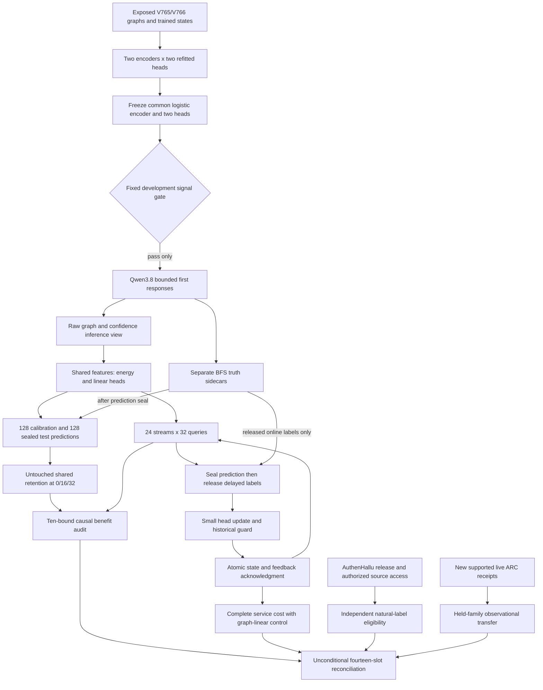

# Carnot Research Roadmap v767: Shared Representations and Feature-Level Learning

**Created:** 2026-11-10 America/New_York
**Milestone:** 2026.11.767
**Status:** Planned; staged only
**Supersedes:** Completed scheduling milestone 2026.11.766, Exp8957–Exp8970
**Task contract:** Exactly 14 tasks, Exp8971 through Exp8984, in the order below.
**Execution file:** `research-roadmap-next.yaml`

The complete V766 design and queue are preserved byte for byte in
`research-roadmap-v766-preserved-20261110.md` and
`research-roadmap-v766-queue-preserved-20261110.yaml`. The active queue and
conductor are unchanged. This plan does not activate or execute experiments.

## What V766 proved

| Evidence | Observed result | Consequence |
|---|---|---|
| Exp8957 | Contract readiness is 1; ARC support is 0. The combined verdict is blocked. | Separate administrative readiness from optional ARC support. |
| Exp8958/8959 | Historical roles and a trainable graph encoder qualified. Energy and logistic arms trained separate encoders. | Shared architecture did not mean shared learned features. Isolate that confound. |
| Exp8961/8962/8963 | 1024 real Qwen answers; 719 errors: 714 semantic and five out-of-graph. No format errors. | Retain the qualified source. All previous labels are now development evidence. |
| Exp8964 | Graph logistic AUROC 0.807988 and Brier 0.190294; graph energy AUROC 0.434409 and Brier 0.199813. | Graph information helped one trained model. It did not establish energy value. |
| Exp8964/8965 | All five energy bounds failed; integrity controls passed. Brier improvement over graph logistic was -0.0095194, lower bound -0.0186907. | Do not blame missing graph information or rerun unchanged end-to-end training. |
| Exp8966/8967 | All 168 adaptive block proposals were promoted. Future Brier upper bounds were +0.0008873 versus frozen, +0.0004792 versus bias-only and +0.0000947 versus permuted. All failed. Retention passed. | Scalar adaptation was active but ineffective. Close the exact protocol. |
| Exp8968 | Complete cached-service costs qualified; deployment recommendation is false. Adaptive service was slower than confidence logistic. No sampling calls. | Compare the changed service with the informative graph-linear baseline and charge full representation work. |
| Exp8969/8970 | The conductor logged Exp8969's ARC gate skip. Neither primary was present during planning. | Scheduling completion does not establish a capstone result. Record missing authority explicitly. |

The completion archive ends at V765 in this checkout. Primary artifacts and
conductor receipts support the V766 statements above. Later authenticated
receipts may extend this record. No result is inferred from file modification time.

## The three largest gaps to the PRD

1. **FR-06/FR-12: energy value under a fair learned-input comparison.** The
   ordinary graph classifier is informative, but the energy arm is not. Freeze
   the same learned representation for both heads. Require development signal
   before spending another GPU collection budget. Keep all five confirmation bounds.
2. **FR-11: continuous learning that changes future error decisions.** The
   scalar adapter cannot recover information discarded by its frozen score.
   Test conditional head updates on graph features, with delayed feedback and
   an online linear control. Preserve the earlier benefit and retention margins.
3. **FR-12 and the north star: credible natural-language evaluation without a
   cheap executable oracle.** Graph BFS labels are useful but cannot establish
   this claim. Independently audit AuthenHallu's human annotation criteria and
   authorized dialogue access. A label release without source text is not a corpus.

FR-05/FR-08/NFR-01 remain relevant to deployment. Complete service measurement
precedes another Rust port or hardware investment. No Qwen weights are trained.
A shared-feature neural classifier result must not be marketed as a special
energy theorem. Even a positive graph result stays below the natural-language
north-star claim.

## Research incorporated before design

The dated V767 scan in `research-references.md` was written before task design.
It covers all eight requested topics and six secondary channels.

| Primary source | Experiment and limit |
|---|---|
| [Message Passing Complexity](https://arxiv.org/html/2509.01254v2), September/October 2025 | Exp8972 isolates encoder information and head optimization. We do not implement its complexity metric or assume graph depth caused the null. |
| [EnerGNN](https://arxiv.org/abs/2610.33930), October 2026 | Exp8973 compares a nonlinear energy head on identical graph features. No MIP solver or feasibility claim is imported. |
| [Continual Calibration](https://arxiv.org/abs/2604.23987), April 2026 | Exp8974/8980/8981 keep proper loss, causality and retention separate. Feature learning is a local hypothesis, not this paper's conformal theorem. |
| [AuthenHallu](https://arxiv.org/abs/2510.10539), March 2026 revision; [release](https://github.com/TAI-HAMBURG/AuthenHallu) | Exp8975 checks dialogue access, annotation evidence and grouped evaluation eligibility. The release lacks original dialogue text. |
| [Energy-Based Reasoners](https://arxiv.org/abs/2611.08977) and [LEF-JEPA](https://arxiv.org/abs/2611.08989), November 6, 2026 | Exp8972 ingests changed training methods and reproduction needs. External positives challenge universal impossibility claims, not Carnot's exact negative protocols. No retired generator or JEPA run is reopened. |
| [FPGA–ASIC co-design](https://arxiv.org/abs/2602.15985), September 2026 revision | Exp8982 includes encoding, orchestration, feedback and durable storage in cost. Published hardware speed is not a local result. |

KAN calibration, thermodynamic training and visual energy-guided decoding remain
research leads. They add unnecessary variables to this controlled head test.
Semantic Scholar supplied 20 EBT citations with a next-page marker; ARM–EBM
requests were rate-limited. OpenReview supplied indexed verifier leads but
challenged direct EBT/VFScale access. GitHub trending produced no relevant
ranking. Extropic still advertises 2027 Z1 early access. Kona supplies no
executable protocol or public weights in the checked page.

## Architecture



The natural-evidence branch runs if graph collection stops. Administrative
readiness does not gate science. All runtime gate producers are in this queue;
historical tasks are hash-bound inputs, never retired runtime dependencies.
Methods readiness, complete rows and scientific benefit have distinct fields.

## Phase 1 — diagnose, qualify and freeze (Exp8971–Exp8975)

Exp8971 binds the exact fourteen-task contract. It reports optional ARC support
separately, correcting V766's mixed administrative verdict. New ARC evidence
needs 30 uncensored episodes, three families and both arms per held family.

Exp8972 performs a two-by-two diagnostic. For each original seed 71/72/73,
freeze the previous energy encoder and logistic encoder. Refit a linear head
and an eight-unit Gibbs head on each encoder's coordinates. Use the original
256 fit graphs, 200 steps and learning rate 0.01. Compare on the original
64 guard graphs and exposed V766 data. Never swap a fitted head across different
coordinate systems. Record gradients, prediction variance and loss. Zero output
initialization explains the first encoder gradient, not necessarily later failure.
The same task ingests the new primary-source methods and their adoption limits.

Exp8973 freezes the logistic encoder candidate in advance. Both new heads use
its identical 27 features. The development gate at temperature 1 requires energy
AUROC >=0.65, Brier improvement over prevalence >=0.005, and Brier at most 0.01
worse than the shared linear control. Private integrity checks must also pass.
Failure sets `shared_methods_ready_score=0` and prevents new collection. These
are feasibility thresholds; no significance or scientific positive is claimed.

The normalized binary definition is `E(correct)=0`, `E(error)=-z`, hence
`p(error)=sigmoid(z)`. The Gibbs scalar is a discriminatively trained nonlinear
logit. Five evaluation arms are shared Gibbs, shared logistic, original frozen
relational logistic, confidence logistic and fit prevalence. The original
relational arm remains visible as a descriptive continuity control.

Freeze 1024 new graphs before model responses, excluding historical graph
identities and isomorphic relabelings. Each shard has 64 calibration, 64 final-test
and 384 online graphs. The two shards provide 24 independent 32-query streams.
Retain the V765 matched-cardinality k2 population and generation settings.
Construction has 2000 proposals per graph and 600 seconds total; no population
change after exhaustion. Freeze all states, roles and statistical rules.

Exp8974 freezes feature-level online learning. Five arms are frozen energy,
adaptive energy, bias-only energy, adaptive logistic and permuted-feedback energy.
Each head starts from its own frozen offline state. One SGD step per released
label uses learning rate 0.01, binary log loss, L2 anchor coefficient 0.01 and
whole-gradient norm clipping at 1. Encoder, scaling, temperature and Qwen stay fixed.

Keep the earlier delay schedule: labels 1–4 follow prediction 8, with four-label
blocks thereafter. Each stream releases 28 labels and leaves four pending.
Permute only released blocks. Atomically persist head state and acknowledgments.
Promotion uses the original 64 historical guard graphs: Brier increase <=0.005
and no classification-error increase relative to that arm's initialization.
Research retention never enters the guard. Private fixtures verify causal
feature-dependent updates and real crash recovery before methods qualify.

Exp8975 independently audits AuthenHallu. Its 400 dialogue IDs identify 800 paired
turns; both turns must remain in the same group. The author release omits source
text. Check existing authorized LMSYS-Chat-1M access, licenses, joins, annotation
criteria, evidence and excluded metadata. Bound network work to 600 seconds.
No new agreement, unbounded corpus download, model-reconstructed dialogue or
newly generated response may inherit these labels. Missing access is terminal
blocked. A qualified source is still annotation-relative, not infallible truth.
This task produces a concrete future eligibility/split plan, not a text scorer.

## Phase 2 — new bounded evidence (Exp8976–Exp8978)

Exp8976 and Exp8977 are independent collection siblings. Both require the fixed
shared-feature development gate. Each collects 512 first answers with
`unsloth/Qwen3.8-27B-GGUF`, Q4_K_M, GPU 0 only, reasoning off, temperature 0 and
16 output tokens. Authenticate cache, embedded tokenizer, lease and actual CUDA
offload. GPU 1 remains detached. No response retries, repair or small-model fallback.

Preflight and load each have 240-second limits. Requests have 30-second limits;
generation has 2700 seconds per shard. Save first responses every 16 units.
Supervision must print while a slow model call runs. Partial data stays visible.
Tasks declare `model_bounded_generation`, with the real 10-second floor.
A load-only failure declares `model_load_no_generation`, 2 seconds, zero generation.
No task here performs full generation; its 60-second floor is inapplicable.
CPU tasks declare `no_model_load`, empty `MODEL_SPECS` and their real substrate.

Exp8978 authenticates all 1024 rows and the 128/128/768 role split. Require at
least 200 wrong answers overall and five examples of each class per pooled role.
These are feasibility minima, not a power claim. Separate semantic, out-of-graph,
format and transport errors. BFS is the evaluator only. Detector records contain
raw graph, source/proposed-answer markers and genuine confidence features.
IDs, shortest distances, answer membership and labels cannot enter scoring.
Successful source admission is circular evidence, not a learned detector win.

## Phase 3 — confirmation and causal learning (Exp8979–Exp8980)

Exp8979 calibrates only on the fresh 128 calibration graphs. Seal all 128 test
predictions before labels open. Preserve the five original simultaneous bounds,
with 10000 paired graph-bootstrap draws and family alpha 0.05. Brier improvement
lower bounds must exceed zero against prevalence, confidence logistic and shared
logistic. At exactly 50% coverage, accepted-error delta upper bounds must be <=0
against both logistic controls. All five must pass. Typed error thresholds stay
0.1 and 0.9; fixed-coverage ranking is not a risk certificate.

Integrity controls verify identical feature bytes, denied oracle access and four
node/edge permutations per graph within 1e-6. Removed-adjacency/marker ablations
are descriptive. Null benefit permits causal/cost work when numerical evidence
is intact; an integrity failure disqualifies it. No test-panel refitting.

Exp8980 runs five arms over 24 independent streams. It emits 3840 online rows and
46080 retention rows, 49920 total. Shared retention uses the same 128 test graphs
at 0/16/32, outside promotion. An actual child kill/restart at query 16 must
preserve pending labels, coefficients and predictions. Dependency checks and
multiple seeds do not multiply independent units. No new LLM call occurs here.

## Phase 4 — benefit, cost, opportunistic transfer and closure (Exp8981–Exp8984)

Exp8981 independently reduces ten bounds using 10000 whole-stream bootstrap draws
and family alpha 0.01/10. Queries 17–32 require adaptive-minus-frozen Brier upper
<=-0.01; versus bias-only, online logistic and permuted controls, upper <0.
All six retention Brier/error uppers at 0/16/32 must be <=0.01. This preserves
V766's nine bounds and adds the online linear comparator. For shared retention,
resample graph IDs once per draw and reuse that sample across histories/arms.
Also report conditional-panel intervals. Mechanism activity is not causal benefit.
A null closes this exact feature-head protocol without changing historical margins.

Exp8982 measures 24 paired fresh-process units, randomized by arm order. Compare
frozen/adaptive energy with frozen/adaptive shared logistic on 32 raw-graph
requests. Include cold start, encoding, prediction, feedback, guards, fsync,
restart and pending-label drain. Scientific scoring ends before the drain.
Report request p50/p95, process costs, intervals, memory and operations.
Quality nulls do not block cost measurement. Recommend deployment only if both
scientific gates pass and the adaptive energy/logistic cost-ratio upper is <=1.
The old confidence-baseline null remains intact. No unsupported removable
fraction or 100x hardware projection is allowed.

Exp8983 reserves the opportunistic ARC/AVO slot. The structured new-outcomes gate
prevents an unchanged empty-ledger analysis. Use held-family supervisor outcomes
and censoring sensitivity, without new game execution or policy changes. Limited
observational support cannot establish causal or hidden-game improvement. Any
incidental level credit needs original `live_agent_self_discovery` provenance
and a registry precheck. No duplicate solves or offline answer construction.

Exp8984 runs unconditionally. It accounts for all fourteen slots, including
scientific nulls, scheduler skips and absent primaries. Missing external science
is terminal `blocked`; only unfinished owned work is `partial`. Recompute the
existing G1–G4 publication gate, keeping its historical scope. No new result
inherits publication readiness, and no queue is activated or pushed.

## Dependency graph

Every solid edge is a structured equality gate on a top-level producer field.

```mermaid
flowchart LR
    E8971["8971: branch-contract"]
    E8972["8972: encoder-head-diagnosis"]
    E8973["8973: shared-feature-methods"]
    E8974["8974: feature-online-methods"]
    E8975["8975: natural-label-eligibility"]
    E8976["8976: graph-corpus-a"]
    E8977["8977: graph-corpus-b"]
    E8978["8978: corpus-admission"]
    E8979["8979: shared-feature-decisions"]
    E8980["8980: feature-online-streams"]
    E8981["8981: feature-online-benefit"]
    E8982["8982: matched-service-cost"]
    E8983["8983: arc-transfer-evidence"]
    E8984["8984: capstone"]
    E8972 -->|diagnosis_ready_score=1| E8973
    E8973 -->|shared_methods_ready_score=1| E8974
    E8973 -->|shared_methods_ready_score=1| E8976
    E8973 -->|shared_methods_ready_score=1| E8977
    E8976 -->|shard_ready_score=1| E8978
    E8977 -->|shard_ready_score=1| E8978
    E8973 -->|shared_methods_ready_score=1| E8978
    E8978 -->|corpus_ready_score=1| E8979
    E8974 -->|online_methods_ready_score=1| E8980
    E8979 -->|detector_rows_ready_score=1| E8980
    E8980 -->|online_rows_ready_score=1| E8981
    E8974 -->|online_methods_ready_score=1| E8982
    E8979 -->|detector_rows_ready_score=1| E8982
    E8971 -->|arc_new_outcomes_ready_score=1| E8983
    E8975 -. outcome or terminal skip .-> E8984
    E8979 -. outcome or terminal skip .-> E8984
    E8981 -. outcome or terminal skip .-> E8984
    E8982 -. outcome or terminal skip .-> E8984
    E8983 -. outcome or terminal skip .-> E8984
```



Exp8975 and Exp8984 have no success gate. Exp8982 reads quality outcomes but does
not wait for positive quality. Gate fields are declared in each producer prompt.

## Hardware requirements and execution budget

| Work | Hardware and memory | Per-task wall estimate |
|---|---|---|
| Contract, diagnosis, methods and source eligibility | CPU; 4–8 GB working RAM; authorized network reads only for source audit | 30–45 minutes |
| Two Qwen collection shards | Existing GPU 0 RTX 3090, 24 GB VRAM; cached Q4_K_M about 16 GB; host RAM and disk checked at launch | 65 minutes each, generation capped at 2700 seconds |
| Cached decisions, causal updates and benefit audit | CPU/JAX; small heads; 4–8 GB RAM; disk-backed immutable rows | 45–60 minutes |
| Complete service cost | CPU and existing durable filesystem; identical graph work per arm | 60 minutes |
| ARC evidence and capstone | CPU; existing authenticated receipts; no games or LLM calls | 25–30 minutes |

GPU 1 is not assumed available. KV260 remains the existing quadratic-Ising
scope with k_max<=5. PolarFire evidence is Linux CPU-only. GateMate needs a
changed physical/JTAG condition. NPU/TSU paths remain unqualified. No hardware
purchase or new bitstream is required. The wishlist informs future deployment;
no advertised speedup substitutes for a measured service. If sampling calls are
zero, a faster sampler cannot speed this workload. Unknown removable fractions
remain unknown. The 100x learning aspiration is a target, not a result.

## Execution and validation discipline

All prompts require numbered flushed progress at phase boundaries and before
and after minute-scale operations. Long loops and child supervision print at
least every 60 seconds. Every gap remains below 600 seconds. Measurements stop
by 3600 seconds with 900 seconds reserved for checks inside the 4800-second cap.
Files over about 200 lines use multiple bounded tool calls with progress between.
Every comparison emits per-unit metrics, status and denominator evidence.

Every task names complete rerun metadata where related prior work exists.
Changed inputs for necessary fresh confirmation do not establish scientific
novelty. No retired ID or retired runtime prerequisite is reused. No override
is invented. The EBR ingestion preserves local generator retirements.

Routing follows the current request: Opus/100 turns for authority preflight;
Codex gpt-6.1-sol/30 for collection and admission pipelines; ordinary synthesis
uses the default Claude route. Simple audits use20 turns. No Luna or Gemini task
is planned. This execution-agent choice is separate from the Qwen subject model.

Specs and tests precede implementation. Each experiment must run scoped unit,
actual private CLI, lint, strict type and spec-coverage checks. Newly owned unit
and child statements need100-percent coverage with no exclusions. Private
E2E-018/021 publication and replay checks apply where custody is touched.
Historical tests, rejected artifacts and thresholds remain intact. Unrelated
repository debt is reported separately. No operator-curated page is edited.

Planning checks schema, complete design/YAML object equality, visible order,
exact producer fields, exclusion/rerun lint, relevant unit tests and private CLI
checks. It does not execute these proposed experiments or claim their benefits.

## Exact task contract

Exactly 14 tasks, Exp8971–Exp8984, follow in conductor execution order.
The embedded full objects equal the YAML tasks, including every prompt and gate.

| Order | Task ID | Title | Phase | Deliverable |
|---|---|---|---|---|
| 1 | exp8971-branch-contract | Bind fourteen tasks and separate administrative readiness from optional ARC evidence changed | 1 | `results/experiment_8971_v767_branch_contract.json` |
| 2 | exp8972-encoder-head-diagnosis | Separate encoder information from head optimization on exposed graph evidence | 1 | `results/experiment_8972_v767_encoder_head_diagnosis.json` |
| 3 | exp8973-shared-feature-methods | Freeze identical graph features and a development admission gate before new collection | 1 | `results/experiment_8973_v767_shared_feature_methods.json` |
| 4 | exp8974-feature-online-methods | Freeze delayed feature-level head learning with matched online controls | 1 | `results/experiment_8974_v767_feature_online_methods.json` |
| 5 | exp8975-natural-label-eligibility | Audit AuthenHallu dialogue access and independent annotation eligibility | 1 | `results/experiment_8975_v767_natural_label_eligibility.json` |
| 6 | exp8976-graph-corpus-a | Collect fresh Qwen answers for the shared-feature test in shard A | 2 | `results/experiment_8976_v767_graph_corpus_a.json` |
| 7 | exp8977-graph-corpus-b | Collect fresh Qwen answers for the shared-feature test in shard B | 2 | `results/experiment_8977_v767_graph_corpus_b.json` |
| 8 | exp8978-corpus-admission | Authenticate fresh shared-feature graph roles and independent truth sidecars | 2 | `results/experiment_8978_v767_corpus_admission.json` |
| 9 | exp8979-shared-feature-decisions | Test calibrated energy value with identical representations and integrity controls | 3 | `results/experiment_8979_v767_shared_feature_decisions.json` |
| 10 | exp8980-feature-online-streams | Measure causal head learning on real Qwen errors with delayed feedback | 3 | `results/experiment_8980_v767_feature_online_streams.json` |
| 11 | exp8981-feature-online-benefit | Audit future feature-learning benefit and shared-panel retention | 4 | `results/experiment_8981_v767_feature_online_benefit.json` |
| 12 | exp8982-matched-service-cost | Measure complete shared-feature service costs against the strong linear baseline | 4 | `results/experiment_8982_v767_matched_service_cost.json` |
| 13 | exp8983-arc-transfer-evidence | Assess held-family supervisor transfer only from new supported live outcomes | 4 | `results/experiment_8983_v767_arc_transfer_evidence.json` |
| 14 | exp8984-capstone | Reconcile fourteen outcomes and decide graph and natural-evidence continuations | 4 | `results/experiment_8984_v767_capstone.json` |
<!-- V767_TASK_CONTRACT_START -->
```json
{
  "milestone": "2026.11.767",
  "tasks": [
    {
      "id": "exp8971-branch-contract",
      "title": "Bind fourteen tasks and separate administrative readiness from optional ARC evidence changed",
      "phase": 1,
      "track": "research",
      "priority": "high",
      "requires_gpu": false,
      "max_turns": 100,
      "estimated_wall_time_min": 45,
      "per_unit_rows": true,
      "milestone": "2026.11.767",
      "deliverable": "results/experiment_8971_v767_branch_contract.json",
      "inference_substrate_class": "no_model_load",
      "MODEL_SPECS": [],
      "gated_on": [],
      "prior_failures": [
        {
          "experiment_id": "exp8957-branch-contract",
          "verdict": "complete_blocked_v766_branch_contract",
          "addressed_by": "The contract passed but the combined verdict blocked on zero optional ARC outcomes. Separate administrative readiness from ARC support and bind the new full fourteen-task authority.",
          "retire_if_same_verdict": true
        }
      ],
      "prompt": "CONTEXT:\nV766 collected 1024 authentic Qwen answers with 719 errors. Its relational logistic AUROC was 0.807988; relational energy was 0.434409. All five energy benefit bounds failed. Scalar online adaptation failed all three future-benefit bounds while retention passed. Encoder learning differed between arms. A shared frozen representation tests this confound; it does not assume an energy gain. Historical graph labels are exposed development evidence. The cheap BFS evaluator prevents a graph result from closing the no-cheap-oracle north star. Generator weights remain frozen.\n\nEXISTING CODE TO READ FIRST:\n- CLAUDE.md\n- CODEX.md\n- research-program.md\n- ops/north-star.md\n- openspec/capabilities/research-reporting/spec.md\n- openspec/change-proposals/research-roadmap-vNEXT.md\n- scripts/experiment_template.py\n- python/carnot/reporting/current_work_receipt.py\n- python/carnot/reporting/primary_publication.py\n- ops/e2e-test-plan.md\n- python/carnot/reporting/v766_branch_contract.py\n- python/carnot/reporting/v766_branch_evidence.py\n- python/carnot/reporting/arc_supervisor_frontier_8720.py\n- ops/exclusion_manifest.yaml\n- research-complete.yaml\n- ops/conductor-log.md\n\nTASK:\nBind fourteen tasks and separate administrative readiness from optional ARC evidence changed. Deliver results/experiment_8971_v767_branch_contract.json. Add a thin runner scripts/experiments/experiment_8971_v767_branch_contract.py with --date support. Store primitives under results/raw/experiment_8971_v767_branch_contract/. Same-roadmap outputs are future dependencies, not files claimed to exist now.\n\nCONCRETE STEPS:\n1. PRECONDITIONS: Emit a flushed start line. Work in {project_root} on {date}. Read REQ-REPORT-8971 / SCENARIO-REPORT-8971-V767. Authenticate required inputs and declared gate fields before costly work. Check Python dependencies, writable disk and memory. Missing resources produce complete_blocked_<reason>, verdict_class=blocked and exact gate_check_summary. Optional hardware cannot block CPU branches. Historical inputs never become runtime requires on retired IDs.\n2. Emit a flushed progress line at each phase boundary and before and after every model load, generation, benchmark or subprocess that can take minutes. Use python -u and print(..., flush=True); forward child output. Emit completed/pending counts inside long loops and a parent heartbeat every 60 seconds. Keep every silence gap below 600 seconds, including between tool calls. Finish measurements by 3600 seconds; reserve 900 seconds for checks within the 4800-second hard cap. Never pad duration.\n3. Bound every tool call and poll running commands within 60 seconds. Write any file over about 200 lines in several tool calls of at most 150-200 lines. Emit a progress message between calls. Put runners in scripts/experiments/, tests in tests/python/, and scratch in /tmp or /var/tmp. Never write scratch scripts to the repository root.\n4. Declare inference_substrate=aggregation_from_upstream_artifacts, inference_substrate_class=no_model_load, MODEL_SPECS=[] and zero current LLM calls. Retain historical Qwen provenance only under cited input references. Numerical head work has separate counters.\n5. Bind exactly fourteen full task objects Exp8971-Exp8984 in order. Compare the visible design table and embedded JSON with the staged or activated queue. Preserve the V766 design/queue snapshots and original producer bytes. Do not activate a queue.\n6. Read every V766 slot through original artifact identities and conductor receipts. At planning time Exp8957-Exp8968 had primaries; Exp8969 and Exp8970 did not. Completion of scheduling is not evidence of a successful capstone. Record their actual terminal scheduler outcomes or missing status; never invent a primary or make them global science prerequisites.\n7. Reconcile the exact contract and required gate fields independently of optional branches. Set contract_ready_score=1 only after all authority checks pass. Missing new ARC outcomes set only arc_new_outcomes_ready_score=0; they must not make an otherwise qualified administrative contract blocked.\n8. Inspect the existing ARC receipt frontier without launching games or models. Require 30 newly authenticated uncensored episodes, three game families and both compared arms in each held family for arc_new_outcomes_ready_score=1. Preserve prior frontier and all censoring. No changed evidence means one cheap recorded skip, not an unchanged panel rerun.\n9. Check exclusion scopes across all proposed tasks and complete four-field prior_failures entries. Keep historical scientific nulls and quarantines intact. Negative controls must reject changed titles, order, prompts, gates, deliverables and self-consistently rehashed authority.\n10. Before implementation, extend the named REQ/SCENARIO and write failing tests. Reuse existing helpers. Run scoped pytest with 100-percent newly owned unit and actual child statement coverage, with zero exclusions. Run Ruff check, Ruff format --check, strict mypy on owned modules, and scripts/check_spec_coverage.py with positional owned test paths. Run applicable private E2E-018/021 CLI publication, cold replay and rehashed-tamper refusal. Preserve original test assertions. Record unrelated global debt separately; it cannot waive a failed owned check.\n11. Recompute from immutable primitive rows in a fresh process. Run unchanged primary_publication, adversarial_verify.py and verdict_row_consistency_lint.py --strict against private candidate bytes. Preserve actual findings. Validate before atomic publication. Reconcile openspec/, _bmad/traceability.md, ops/status.md and ops/changelog.md from actual outcomes. Do not edit historical primaries, shared validators, active research-roadmap.yaml or the exclusion manifest.\n\nREQUIRED ARTIFACT FIELDS:\nexperiment_id, task_id, milestone, run_date: principle: Bind results to this task and invocation.\nhonest_verdict, verdict_class: principle: Use complete_ terminal verdicts. verdict_class is positive | circular_positive | null | blocked | disqualified | partial. Only unfinished owned work that another attempt can finish is partial. Unchanged missing, rejected or blocked external inputs are blocked.\ngate_check_summary: principle: Every blocked_* or complete_blocked_* names upstream, check, path/hash, field, operator, expected and observed. Distinguish missing file, missing field, zero and changed bytes.\ninference_substrate, inference_substrate_class, MODEL_SPECS, model_invocation_counts, numerical_training_calls: principle: Declare current work. Small-head fitting and historical generator provenance are separate from current LLM calls.\nrows, intended_count, completed_count, failed_count, censored_count, excluded_count, independent_count: principle: Keep a metric and status row for every intended unit and arm. Seeds, views and repeated timings are not independent questions. Counts must reconcile.\nverifier_is_oracle, exposure_scope, independent_generalization_score: principle: Oracle-backed positives are circular_positive. Exposed development results and graph truth cannot establish the no-cheap-oracle claim.\nacceptance_gates, field_principles, required_checks_passed, flagged_adversarial, owned_statement_coverage, validation_receipts: principle: Explain each field and acceptance gate. Failed scientific gates forbid positive classes; readiness is separate from benefit. Owned failures disqualify.\npreconditions_checked, duration_s, phase_spans, random_seed, reproducibility_checksum: principle: Use actual clocks and reproducible inputs, never mtime estimates or invented work.\nsource_artifact_hashes, code_config_hashes, raw_shard_hashes, cited_upstream_artifacts: principle: Retain original bytes with experiment_id, fields_imported and sha256 for each imported result. Do not inherit mutable current authority.\ncontract_ready_score, arc_new_outcomes_ready_score, full_task_objects, full_task_digest, visible_task_table, gate_edge_rows, prior_scope_rows, history, arc_frontier, arc_support_rows: principle: Administrative qualification and optional science support are independent top-level fields.\n\nRun command: cd {project_root} && JAX_PLATFORMS=cpu PYTHONPATH=python:. PYTHONUNBUFFERED=1 .venv/bin/python -u scripts/experiments/experiment_8971_v767_branch_contract.py --date {date}\n\nDo NOT push. Do NOT modify scripts/research_conductor.py.",
      "model": "opus"
    },
    {
      "id": "exp8972-encoder-head-diagnosis",
      "title": "Separate encoder information from head optimization on exposed graph evidence",
      "phase": 1,
      "track": "research",
      "priority": "high",
      "requires_gpu": false,
      "max_turns": 50,
      "estimated_wall_time_min": 45,
      "per_unit_rows": true,
      "milestone": "2026.11.767",
      "deliverable": "results/experiment_8972_v767_encoder_head_diagnosis.json",
      "inference_substrate_class": "no_model_load",
      "MODEL_SPECS": [],
      "gated_on": [],
      "prior_failures": [
        {
          "experiment_id": "exp8958-confidence-diagnosis",
          "verdict": "complete_null_development_only_confidence_diagnosis",
          "addressed_by": "Confidence-only diagnosis cannot distinguish the observed graph-arm divergence. The new fixed-encoder two-by-two comparison isolates head training on identical features.",
          "retire_if_same_verdict": true
        }
      ],
      "prompt": "CONTEXT:\nV766 collected 1024 authentic Qwen answers with 719 errors. Its relational logistic AUROC was 0.807988; relational energy was 0.434409. All five energy benefit bounds failed. Scalar online adaptation failed all three future-benefit bounds while retention passed. Encoder learning differed between arms. A shared frozen representation tests this confound; it does not assume an energy gain. Historical graph labels are exposed development evidence. The cheap BFS evaluator prevents a graph result from closing the no-cheap-oracle north star. Generator weights remain frozen.\n\nEXISTING CODE TO READ FIRST:\n- CLAUDE.md\n- CODEX.md\n- research-program.md\n- ops/north-star.md\n- openspec/capabilities/research-reporting/spec.md\n- openspec/change-proposals/research-roadmap-vNEXT.md\n- scripts/experiment_template.py\n- python/carnot/reporting/current_work_receipt.py\n- python/carnot/reporting/primary_publication.py\n- ops/e2e-test-plan.md\n- python/carnot/autoresearch/relational_graph_encoder.py\n- python/carnot/autoresearch/graph_calibration_benchmark.py\n- python/carnot/models/gibbs/__init__.py\n- python/carnot/reporting/relational_methods_8959.py\n- python/carnot/reporting/relational_decisions_8964.py\n- research-references.md\n- research-studying.md\n\nTASK:\nSeparate encoder information from head optimization on exposed graph evidence. Deliver results/experiment_8972_v767_encoder_head_diagnosis.json. Add a thin runner scripts/experiments/experiment_8972_v767_encoder_head_diagnosis.py with --date support. Store primitives under results/raw/experiment_8972_v767_encoder_head_diagnosis/. Same-roadmap outputs are future dependencies, not files claimed to exist now.\n\nCONCRETE STEPS:\n1. PRECONDITIONS: Emit a flushed start line. Work in {project_root} on {date}. Read REQ-REPORT-8972 / SCENARIO-REPORT-8972-V767. Authenticate required inputs and declared gate fields before costly work. Check Python dependencies, writable disk and memory. Missing resources produce complete_blocked_<reason>, verdict_class=blocked and exact gate_check_summary. Optional hardware cannot block CPU branches. Historical inputs never become runtime requires on retired IDs.\n2. Emit a flushed progress line at each phase boundary and before and after every model load, generation, benchmark or subprocess that can take minutes. Use python -u and print(..., flush=True); forward child output. Emit completed/pending counts inside long loops and a parent heartbeat every 60 seconds. Keep every silence gap below 600 seconds, including between tool calls. Finish measurements by 3600 seconds; reserve 900 seconds for checks within the 4800-second hard cap. Never pad duration.\n3. Bound every tool call and poll running commands within 60 seconds. Write any file over about 200 lines in several tool calls of at most 150-200 lines. Emit a progress message between calls. Put runners in scripts/experiments/, tests in tests/python/, and scratch in /tmp or /var/tmp. Never write scratch scripts to the repository root.\n4. Declare inference_substrate=verifier_ensemble_against_cached_candidates, inference_substrate_class=no_model_load, MODEL_SPECS=[] and zero current LLM calls. Retain historical Qwen provenance only under cited input references. Numerical head work has separate counters.\n5. Authenticate Exp8958/8959/8963/8964/8965. Recompute the original metrics and five failed bounds without changing their interpretation. All V765/V766 graph labels are now exposed development evidence. Preserve the original 256 fit and 64 guard roles; no historical test can become new confirmation.\n6. Read the current SOTA scan and ingest three to five methods, including Message Passing Complexity, EnerGNN and the November6 EBR/LEF-JEPA papers. Record equations, implementation requirements and failure modes in docs/research-notes/v767-method-ingestion.md. Update research-studying.md with ingestion status. Use bounded primary-source reads; no agent fan-out. Do not reopen energy-as-generator or JEPA scopes.\n7. Freeze each existing seed71/72/73 logistic encoder and energy encoder. Extract the same 27 inference-only features from each. Fit a new linear head and the existing eight-unit Gibbs head on each frozen encoder using the original256 fit labels,200 full-batch steps, learning rate0.01 and original initialization. This two-by-two diagnostic holds encoder bytes fixed within each comparison. Do not swap an already-trained head into a different coordinate basis.\n8. Record initial and final head/encoder gradient norms, prediction variance, fit loss, guard proper loss and exposed V766 metrics. The Gibbs output starts at zero, so first-step encoder gradients vanish by construction. Measure subsequent gradients before asserting this caused the failure. A zero first gradient alone is not a diagnosed persistent defect.\n9. Save all four trained head/encoder combinations and per-graph predictions. Set diagnosis_ready_score=1 for complete reproducible reduction and functioning private controls, even when the hypothesis is null. Freeze the logistic-encoder candidate for the next task in advance; do not select an encoder by exposed-test gains. Separate leakage, optimization and information hypotheses without claiming a causal root cause from a correlation.\n10. Before implementation, extend the named REQ/SCENARIO and write failing tests. Reuse existing helpers. Run scoped pytest with 100-percent newly owned unit and actual child statement coverage, with zero exclusions. Run Ruff check, Ruff format --check, strict mypy on owned modules, and scripts/check_spec_coverage.py with positional owned test paths. Run applicable private E2E-018/021 CLI publication, cold replay and rehashed-tamper refusal. Preserve original test assertions. Record unrelated global debt separately; it cannot waive a failed owned check.\n11. Recompute from immutable primitive rows in a fresh process. Run unchanged primary_publication, adversarial_verify.py and verdict_row_consistency_lint.py --strict against private candidate bytes. Preserve actual findings. Validate before atomic publication. Reconcile openspec/, _bmad/traceability.md, ops/status.md and ops/changelog.md from actual outcomes. Do not edit historical primaries, shared validators, active research-roadmap.yaml or the exclusion manifest.\n\nREQUIRED ARTIFACT FIELDS:\nexperiment_id, task_id, milestone, run_date: principle: Bind results to this task and invocation.\nhonest_verdict, verdict_class: principle: Use complete_ terminal verdicts. verdict_class is positive | circular_positive | null | blocked | disqualified | partial. Only unfinished owned work that another attempt can finish is partial. Unchanged missing, rejected or blocked external inputs are blocked.\ngate_check_summary: principle: Every blocked_* or complete_blocked_* names upstream, check, path/hash, field, operator, expected and observed. Distinguish missing file, missing field, zero and changed bytes.\ninference_substrate, inference_substrate_class, MODEL_SPECS, model_invocation_counts, numerical_training_calls: principle: Declare current work. Small-head fitting and historical generator provenance are separate from current LLM calls.\nrows, intended_count, completed_count, failed_count, censored_count, excluded_count, independent_count: principle: Keep a metric and status row for every intended unit and arm. Seeds, views and repeated timings are not independent questions. Counts must reconcile.\nverifier_is_oracle, exposure_scope, independent_generalization_score: principle: Oracle-backed positives are circular_positive. Exposed development results and graph truth cannot establish the no-cheap-oracle claim.\nacceptance_gates, field_principles, required_checks_passed, flagged_adversarial, owned_statement_coverage, validation_receipts: principle: Explain each field and acceptance gate. Failed scientific gates forbid positive classes; readiness is separate from benefit. Owned failures disqualify.\npreconditions_checked, duration_s, phase_spans, random_seed, reproducibility_checksum: principle: Use actual clocks and reproducible inputs, never mtime estimates or invented work.\nsource_artifact_hashes, code_config_hashes, raw_shard_hashes, cited_upstream_artifacts: principle: Retain original bytes with experiment_id, fields_imported and sha256 for each imported result. Do not inherit mutable current authority.\ndiagnosis_ready_score, original_metric_rows, original_bound_rows, encoder_hashes, feature_hashes, head_state_references, gradient_rows, diagnostic_prediction_rows, method_source_rows, diagnosis_limits: principle: Exposed controls locate a possible training bottleneck; they establish no held-out benefit.\n\nRun command: cd {project_root} && JAX_PLATFORMS=cpu PYTHONPATH=python:. PYTHONUNBUFFERED=1 .venv/bin/python -u scripts/experiments/experiment_8972_v767_encoder_head_diagnosis.py --date {date}\n\nDo NOT push. Do NOT modify scripts/research_conductor.py."
    },
    {
      "id": "exp8973-shared-feature-methods",
      "title": "Freeze identical graph features and a development admission gate before new collection",
      "phase": 1,
      "track": "research",
      "priority": "high",
      "requires_gpu": false,
      "max_turns": 50,
      "estimated_wall_time_min": 45,
      "per_unit_rows": true,
      "milestone": "2026.11.767",
      "deliverable": "results/experiment_8973_v767_shared_feature_methods.json",
      "inference_substrate_class": "no_model_load",
      "MODEL_SPECS": [],
      "gated_on": [
        {
          "upstream": "exp8972-encoder-head-diagnosis",
          "artifact_field": "diagnosis_ready_score",
          "op": "==",
          "value": 1
        }
      ],
      "prior_failures": [
        {
          "experiment_id": "exp8959-relational-methods",
          "verdict": "complete_null_relational_methods_frozen",
          "addressed_by": "Independently trained encoders confounded the head comparison. Freeze a common classifier-trained encoder and admit new collection only after the fixed development signal gate passes.",
          "retire_if_same_verdict": true
        },
        {
          "experiment_id": "exp8964-relational-decisions",
          "verdict": "complete_null_fresh_matched_graph_final_answers",
          "addressed_by": "All five fresh relational energy bounds failed. The new head comparison holds encoder information fixed and preserves all original scientific margins.",
          "retire_if_same_verdict": true
        }
      ],
      "prompt": "CONTEXT:\nV766 collected 1024 authentic Qwen answers with 719 errors. Its relational logistic AUROC was 0.807988; relational energy was 0.434409. All five energy benefit bounds failed. Scalar online adaptation failed all three future-benefit bounds while retention passed. Encoder learning differed between arms. A shared frozen representation tests this confound; it does not assume an energy gain. Historical graph labels are exposed development evidence. The cheap BFS evaluator prevents a graph result from closing the no-cheap-oracle north star. Generator weights remain frozen.\n\nEXISTING CODE TO READ FIRST:\n- CLAUDE.md\n- CODEX.md\n- research-program.md\n- ops/north-star.md\n- openspec/capabilities/research-reporting/spec.md\n- openspec/change-proposals/research-roadmap-vNEXT.md\n- scripts/experiment_template.py\n- python/carnot/reporting/current_work_receipt.py\n- python/carnot/reporting/primary_publication.py\n- ops/e2e-test-plan.md\n- python/carnot/autoresearch/relational_graph_encoder.py\n- python/carnot/autoresearch/graph_calibration_benchmark.py\n- python/carnot/reporting/relational_methods_8959.py\n- python/carnot/reporting/matched_source_methods_8946.py\n\nTASK:\nFreeze identical graph features and a development admission gate before new collection. Deliver results/experiment_8973_v767_shared_feature_methods.json. Add a thin runner scripts/experiments/experiment_8973_v767_shared_feature_methods.py with --date support. Store primitives under results/raw/experiment_8973_v767_shared_feature_methods/. Same-roadmap outputs are future dependencies, not files claimed to exist now.\n\nCONCRETE STEPS:\n1. PRECONDITIONS: Emit a flushed start line. Work in {project_root} on {date}. Read REQ-REPORT-8973 / SCENARIO-REPORT-8973-V767. Authenticate required inputs and declared gate fields before costly work. Check Python dependencies, writable disk and memory. Missing resources produce complete_blocked_<reason>, verdict_class=blocked and exact gate_check_summary. Optional hardware cannot block CPU branches. Historical inputs never become runtime requires on retired IDs.\n2. Emit a flushed progress line at each phase boundary and before and after every model load, generation, benchmark or subprocess that can take minutes. Use python -u and print(..., flush=True); forward child output. Emit completed/pending counts inside long loops and a parent heartbeat every 60 seconds. Keep every silence gap below 600 seconds, including between tool calls. Finish measurements by 3600 seconds; reserve 900 seconds for checks within the 4800-second hard cap. Never pad duration.\n3. Bound every tool call and poll running commands within 60 seconds. Write any file over about 200 lines in several tool calls of at most 150-200 lines. Emit a progress message between calls. Put runners in scripts/experiments/, tests in tests/python/, and scratch in /tmp or /var/tmp. Never write scratch scripts to the repository root.\n4. Declare inference_substrate=verifier_ensemble_against_cached_candidates, inference_substrate_class=no_model_load, MODEL_SPECS=[] and zero current LLM calls. Retain historical Qwen provenance only under cited input references. Numerical head work has separate counters.\n5. Use Exp8972 saved logistic encoders and the two newly fitted heads, one per seed71/72/73. Freeze all encoders and feature scaling. Compare shared-feature Gibbs and shared-feature logistic with exactly the same 27 inputs. Retain frozen original relational logistic, confidence logistic and fit prevalence as additional controls. Average seed probabilities; seeds are not independent examples.\n6. Use normalized binary energies E(correct)=0 and E(error)=-z, so p(error)=sigmoid(z). z is the Gibbs scalar or linear logit. Record that this is a discriminatively trained nonlinear classifier; an energy name is not a special probabilistic guarantee. Keep the existing Gibbs initialization and training schedule. Add no optimizer sweep, residual wrapper, sampler or new dependency.\n7. Run the fixed development admission gate on the original64 guard graphs at temperature1. Require shared-feature energy AUROC>=0.65, Brier improvement over fit prevalence>=0.005, and Brier no more than0.01 worse than shared-feature logistic. These are operational feasibility thresholds, not significance or confirmation. Save every value. A failure closes fresh collection under this protocol without tuning thresholds.\n8. Qualify feature equivalence, finite gradients, encoder immutability, node/edge permutation invariance within1e-6, forbidden-label denial and a label-permutation negative control. Set shared_methods_ready_score=1 only when mechanics and the development gate pass. Publish complete states and actual diagnostic failure on a null.\n9. Before responses exist, freeze1024 fresh matched-cardinality k2 graphs using the V765 source protocol. Each512-graph shard has64 calibration,64 final-test and384 online graphs. The online population has24 independent32-query streams. Exclude all historical construction identities and isomorphic relabelings. Use no response-based selection. Keep2000 proposals per graph and600 seconds total construction; exhaustion is a feasibility null.\n10. Freeze the original five detector comparisons, thresholds and10000 bootstrap draws with family alpha0.05. Shared energy must improve Brier over prevalence, confidence logistic and shared logistic, with each lower bound>0. Accepted-error delta at50-percent coverage must have upper<=0 versus both logistic controls. Keep typed error thresholds0.1/0.9. Save source, states, statistical protocol, population and roles before fresh collection.\n11. Before implementation, extend the named REQ/SCENARIO and write failing tests. Reuse existing helpers. Run scoped pytest with 100-percent newly owned unit and actual child statement coverage, with zero exclusions. Run Ruff check, Ruff format --check, strict mypy on owned modules, and scripts/check_spec_coverage.py with positional owned test paths. Run applicable private E2E-018/021 CLI publication, cold replay and rehashed-tamper refusal. Preserve original test assertions. Record unrelated global debt separately; it cannot waive a failed owned check.\n12. Recompute from immutable primitive rows in a fresh process. Run unchanged primary_publication, adversarial_verify.py and verdict_row_consistency_lint.py --strict against private candidate bytes. Preserve actual findings. Validate before atomic publication. Reconcile openspec/, _bmad/traceability.md, ops/status.md and ops/changelog.md from actual outcomes. Do not edit historical primaries, shared validators, active research-roadmap.yaml or the exclusion manifest.\n\nREQUIRED ARTIFACT FIELDS:\nexperiment_id, task_id, milestone, run_date: principle: Bind results to this task and invocation.\nhonest_verdict, verdict_class: principle: Use complete_ terminal verdicts. verdict_class is positive | circular_positive | null | blocked | disqualified | partial. Only unfinished owned work that another attempt can finish is partial. Unchanged missing, rejected or blocked external inputs are blocked.\ngate_check_summary: principle: Every blocked_* or complete_blocked_* names upstream, check, path/hash, field, operator, expected and observed. Distinguish missing file, missing field, zero and changed bytes.\ninference_substrate, inference_substrate_class, MODEL_SPECS, model_invocation_counts, numerical_training_calls: principle: Declare current work. Small-head fitting and historical generator provenance are separate from current LLM calls.\nrows, intended_count, completed_count, failed_count, censored_count, excluded_count, independent_count: principle: Keep a metric and status row for every intended unit and arm. Seeds, views and repeated timings are not independent questions. Counts must reconcile.\nverifier_is_oracle, exposure_scope, independent_generalization_score: principle: Oracle-backed positives are circular_positive. Exposed development results and graph truth cannot establish the no-cheap-oracle claim.\nacceptance_gates, field_principles, required_checks_passed, flagged_adversarial, owned_statement_coverage, validation_receipts: principle: Explain each field and acceptance gate. Failed scientific gates forbid positive classes; readiness is separate from benefit. Owned failures disqualify.\npreconditions_checked, duration_s, phase_spans, random_seed, reproducibility_checksum: principle: Use actual clocks and reproducible inputs, never mtime estimates or invented work.\nsource_artifact_hashes, code_config_hashes, raw_shard_hashes, cited_upstream_artifacts: principle: Retain original bytes with experiment_id, fields_imported and sha256 for each imported result. Do not inherit mutable current authority.\nshared_methods_ready_score, development_admission_rows, frozen_protocol, trained_state_reference, encoder_hashes, feature_schema, graph_manifest, role_manifest, source_manifest, invariant_control_rows: principle: Collection requires actual development signal and fixed future methods; development gain is not a research positive.\n\nRun command: cd {project_root} && JAX_PLATFORMS=cpu PYTHONPATH=python:. PYTHONUNBUFFERED=1 .venv/bin/python -u scripts/experiments/experiment_8973_v767_shared_feature_methods.py --date {date}\n\nDo NOT push. Do NOT modify scripts/research_conductor.py."
    },
    {
      "id": "exp8974-feature-online-methods",
      "title": "Freeze delayed feature-level head learning with matched online controls",
      "phase": 1,
      "track": "research",
      "priority": "high",
      "requires_gpu": false,
      "max_turns": 50,
      "estimated_wall_time_min": 45,
      "per_unit_rows": true,
      "milestone": "2026.11.767",
      "deliverable": "results/experiment_8974_v767_feature_online_methods.json",
      "inference_substrate_class": "no_model_load",
      "MODEL_SPECS": [],
      "gated_on": [
        {
          "upstream": "exp8973-shared-feature-methods",
          "artifact_field": "shared_methods_ready_score",
          "op": "==",
          "value": 1
        }
      ],
      "prior_failures": [
        {
          "experiment_id": "exp8960-online-calibration-methods",
          "verdict": "complete_null_online_calibration_methods",
          "addressed_by": "The frozen near-chance score limited scalar adaptation. Train the small conditional head on the admitted common graph features, with the original causal guards.",
          "retire_if_same_verdict": true
        },
        {
          "experiment_id": "exp8967-online-benefit-audit",
          "verdict": "complete_null_real_response_online_benefit_audit",
          "addressed_by": "The two-scalar protocol failed all three future bounds. Feature-level head updates add information and an online linear comparator; retain every previous margin and add a tenth bound.",
          "retire_if_same_verdict": true
        }
      ],
      "prompt": "CONTEXT:\nV766 collected 1024 authentic Qwen answers with 719 errors. Its relational logistic AUROC was 0.807988; relational energy was 0.434409. All five energy benefit bounds failed. Scalar online adaptation failed all three future-benefit bounds while retention passed. Encoder learning differed between arms. A shared frozen representation tests this confound; it does not assume an energy gain. Historical graph labels are exposed development evidence. The cheap BFS evaluator prevents a graph result from closing the no-cheap-oracle north star. Generator weights remain frozen.\n\nEXISTING CODE TO READ FIRST:\n- CLAUDE.md\n- CODEX.md\n- research-program.md\n- ops/north-star.md\n- openspec/capabilities/research-reporting/spec.md\n- openspec/change-proposals/research-roadmap-vNEXT.md\n- scripts/experiment_template.py\n- python/carnot/reporting/current_work_receipt.py\n- python/carnot/reporting/primary_publication.py\n- ops/e2e-test-plan.md\n- python/carnot/autoresearch/relational_graph_encoder.py\n- python/carnot/reporting/online_calibration_methods_8960.py\n- python/carnot/reporting/online_response_streams_8966.py\n- python/carnot/reporting/online_benefit_audit_8967.py\n\nTASK:\nFreeze delayed feature-level head learning with matched online controls. Deliver results/experiment_8974_v767_feature_online_methods.json. Add a thin runner scripts/experiments/experiment_8974_v767_feature_online_methods.py with --date support. Store primitives under results/raw/experiment_8974_v767_feature_online_methods/. Same-roadmap outputs are future dependencies, not files claimed to exist now.\n\nCONCRETE STEPS:\n1. PRECONDITIONS: Emit a flushed start line. Work in {project_root} on {date}. Read REQ-REPORT-8974 / SCENARIO-REPORT-8974-V767. Authenticate required inputs and declared gate fields before costly work. Check Python dependencies, writable disk and memory. Missing resources produce complete_blocked_<reason>, verdict_class=blocked and exact gate_check_summary. Optional hardware cannot block CPU branches. Historical inputs never become runtime requires on retired IDs.\n2. Emit a flushed progress line at each phase boundary and before and after every model load, generation, benchmark or subprocess that can take minutes. Use python -u and print(..., flush=True); forward child output. Emit completed/pending counts inside long loops and a parent heartbeat every 60 seconds. Keep every silence gap below 600 seconds, including between tool calls. Finish measurements by 3600 seconds; reserve 900 seconds for checks within the 4800-second hard cap. Never pad duration.\n3. Bound every tool call and poll running commands within 60 seconds. Write any file over about 200 lines in several tool calls of at most 150-200 lines. Emit a progress message between calls. Put runners in scripts/experiments/, tests in tests/python/, and scratch in /tmp or /var/tmp. Never write scratch scripts to the repository root.\n4. Declare inference_substrate=verifier_ensemble_against_cached_candidates, inference_substrate_class=no_model_load, MODEL_SPECS=[] and zero current LLM calls. Retain historical Qwen provenance only under cited input references. Numerical head work has separate counters.\n5. Reuse the existing durable online calibration service and delayed-label broker. Change the learnable surface from two scalar calibration parameters to the small Gibbs head on the common frozen27-feature representation. Encoder, feature scaling, offline temperature and Qwen weights remain immutable. No synthetic error replacement or confidence-only replay.\n6. Freeze five arms: frozen shared energy, adaptive shared energy, bias-only energy, adaptive shared logistic and permuted-feedback adaptive energy. Begin every head at its admitted offline state; online logistic starts from its own matched offline state. Each released label gives one SGD step with learning rate0.01 on binary log loss plus0.01 times squared distance from initialization. Clip total gradient norm to1. Keep all finite validation and rollback behavior.\n7. Retain the prior release schedule: labels1-4 after prediction8, then four-label blocks every four queries through32. Thus24 streams have28 feedback labels each and four pending labels. Permute only within already released blocks using seed767074; preserve exact label/feature correspondence in the genuine arm. Seal prediction and model-state hash before release. Store feedback acknowledgment and head state atomically.\n8. Use the same64 historical guard graphs. Promote a completed block only if guard Brier increase<=0.005 and classification error does not increase relative to that arm initialization. Guard checks see no final-test or unreleased labels. Log proposed, promoted and rejected gradients. Scientific retention uses the same128 fresh test graphs at0/16/32, outside operational guards.\n9. Register ten one-sided bounds with family alpha0.01: future adaptive-minus-frozen Brier upper<=-0.01; versus bias-only, adaptive logistic and permuted uppers<0; six retention Brier/error uppers<=0.01 at0/16/32. Keep V766 nine bounds and add the matched online logistic comparison. Use whole-stream pairing and crossed shared-panel resampling. No adaptive threshold, margin or data expansion after evaluation.\n10. Exercise informative private feature-dependent errors, feedback permutation, denied future labels, duplicate feedback, failed fsync and actual process kill/restart. Methods readiness means causal mechanics work, not benefit. Set online_methods_ready_score independently of future scientific success. Explain the CPU/JAX small-head path and a future batched GPU/NPU path without claiming100x speed or qualified hardware.\n11. Before implementation, extend the named REQ/SCENARIO and write failing tests. Reuse existing helpers. Run scoped pytest with 100-percent newly owned unit and actual child statement coverage, with zero exclusions. Run Ruff check, Ruff format --check, strict mypy on owned modules, and scripts/check_spec_coverage.py with positional owned test paths. Run applicable private E2E-018/021 CLI publication, cold replay and rehashed-tamper refusal. Preserve original test assertions. Record unrelated global debt separately; it cannot waive a failed owned check.\n12. Recompute from immutable primitive rows in a fresh process. Run unchanged primary_publication, adversarial_verify.py and verdict_row_consistency_lint.py --strict against private candidate bytes. Preserve actual findings. Validate before atomic publication. Reconcile openspec/, _bmad/traceability.md, ops/status.md and ops/changelog.md from actual outcomes. Do not edit historical primaries, shared validators, active research-roadmap.yaml or the exclusion manifest.\n\nREQUIRED ARTIFACT FIELDS:\nexperiment_id, task_id, milestone, run_date: principle: Bind results to this task and invocation.\nhonest_verdict, verdict_class: principle: Use complete_ terminal verdicts. verdict_class is positive | circular_positive | null | blocked | disqualified | partial. Only unfinished owned work that another attempt can finish is partial. Unchanged missing, rejected or blocked external inputs are blocked.\ngate_check_summary: principle: Every blocked_* or complete_blocked_* names upstream, check, path/hash, field, operator, expected and observed. Distinguish missing file, missing field, zero and changed bytes.\ninference_substrate, inference_substrate_class, MODEL_SPECS, model_invocation_counts, numerical_training_calls: principle: Declare current work. Small-head fitting and historical generator provenance are separate from current LLM calls.\nrows, intended_count, completed_count, failed_count, censored_count, excluded_count, independent_count: principle: Keep a metric and status row for every intended unit and arm. Seeds, views and repeated timings are not independent questions. Counts must reconcile.\nverifier_is_oracle, exposure_scope, independent_generalization_score: principle: Oracle-backed positives are circular_positive. Exposed development results and graph truth cannot establish the no-cheap-oracle claim.\nacceptance_gates, field_principles, required_checks_passed, flagged_adversarial, owned_statement_coverage, validation_receipts: principle: Explain each field and acceptance gate. Failed scientific gates forbid positive classes; readiness is separate from benefit. Owned failures disqualify.\npreconditions_checked, duration_s, phase_spans, random_seed, reproducibility_checksum: principle: Use actual clocks and reproducible inputs, never mtime estimates or invented work.\nsource_artifact_hashes, code_config_hashes, raw_shard_hashes, cited_upstream_artifacts: principle: Retain original bytes with experiment_id, fields_imported and sha256 for each imported result. Do not inherit mutable current authority.\nonline_methods_ready_score, continuous_self_learning_task, update_equations, arm_table, protocol, protocol_hash, delay_protocol, guard_manifest, multiplicity_ledger, control_rows, hardware_path, generator_weights_frozen: principle: Feature-level conditional updates test a changed causal mechanism with no generator training.\n\nRun command: cd {project_root} && JAX_PLATFORMS=cpu PYTHONPATH=python:. PYTHONUNBUFFERED=1 .venv/bin/python -u scripts/experiments/experiment_8974_v767_feature_online_methods.py --date {date}\n\nDo NOT push. Do NOT modify scripts/research_conductor.py."
    },
    {
      "id": "exp8975-natural-label-eligibility",
      "title": "Audit AuthenHallu dialogue access and independent annotation eligibility",
      "phase": 1,
      "track": "research",
      "priority": "high",
      "requires_gpu": false,
      "max_turns": 20,
      "estimated_wall_time_min": 30,
      "per_unit_rows": true,
      "milestone": "2026.11.767",
      "deliverable": "results/experiment_8975_v767_natural_label_eligibility.json",
      "inference_substrate_class": "no_model_load",
      "MODEL_SPECS": [],
      "gated_on": [],
      "prior_failures": [
        {
          "experiment_id": "exp8908-natural-criterion-audit",
          "verdict": "complete_null_natural_criterion_audit",
          "addressed_by": "Audit a different authentic-dialogue release and its explicit source-text access boundary. Do not repeat paired RAG annotation comparisons or assume annotations supply executable truth.",
          "retire_if_same_verdict": true
        }
      ],
      "prompt": "CONTEXT:\nV766 collected 1024 authentic Qwen answers with 719 errors. Its relational logistic AUROC was 0.807988; relational energy was 0.434409. All five energy benefit bounds failed. Scalar online adaptation failed all three future-benefit bounds while retention passed. Encoder learning differed between arms. A shared frozen representation tests this confound; it does not assume an energy gain. Historical graph labels are exposed development evidence. The cheap BFS evaluator prevents a graph result from closing the no-cheap-oracle north star. Generator weights remain frozen.\n\nEXISTING CODE TO READ FIRST:\n- CLAUDE.md\n- CODEX.md\n- research-program.md\n- ops/north-star.md\n- openspec/capabilities/research-reporting/spec.md\n- openspec/change-proposals/research-roadmap-vNEXT.md\n- scripts/experiment_template.py\n- python/carnot/reporting/current_work_receipt.py\n- python/carnot/reporting/primary_publication.py\n- ops/e2e-test-plan.md\n- research-references.md\n- python/carnot/reporting/natural_criterion_audit_8908.py\n- results/experiment_8908_v762_natural_criterion_audit.json\n\nTASK:\nAudit AuthenHallu dialogue access and independent annotation eligibility. Deliver results/experiment_8975_v767_natural_label_eligibility.json. Add a thin runner scripts/experiments/experiment_8975_v767_natural_label_eligibility.py with --date support. Store primitives under results/raw/experiment_8975_v767_natural_label_eligibility/. Same-roadmap outputs are future dependencies, not files claimed to exist now.\n\nCONCRETE STEPS:\n1. PRECONDITIONS: Emit a flushed start line. Work in {project_root} on {date}. Read REQ-REPORT-8975 / SCENARIO-REPORT-8975-V767. Authenticate required inputs and declared gate fields before costly work. Check Python dependencies, writable disk and memory. Missing resources produce complete_blocked_<reason>, verdict_class=blocked and exact gate_check_summary. Optional hardware cannot block CPU branches. Historical inputs never become runtime requires on retired IDs.\n2. Emit a flushed progress line at each phase boundary and before and after every model load, generation, benchmark or subprocess that can take minutes. Use python -u and print(..., flush=True); forward child output. Emit completed/pending counts inside long loops and a parent heartbeat every 60 seconds. Keep every silence gap below 600 seconds, including between tool calls. Finish measurements by 3600 seconds; reserve 900 seconds for checks within the 4800-second hard cap. Never pad duration.\n3. Bound every tool call and poll running commands within 60 seconds. Write any file over about 200 lines in several tool calls of at most 150-200 lines. Emit a progress message between calls. Put runners in scripts/experiments/, tests in tests/python/, and scratch in /tmp or /var/tmp. Never write scratch scripts to the repository root.\n4. Declare inference_substrate=aggregation_from_upstream_artifacts, inference_substrate_class=no_model_load, MODEL_SPECS=[] and zero current LLM calls. Retain historical Qwen provenance only under cited input references. Numerical head work has separate counters.\n5. Read the March2026 AuthenHallu paper and pin the author release https://github.com/TAI-HAMBURG/AuthenHallu. The repository has400 dialogue IDs and800 pair labels but does not redistribute dialogue text. Read its license and LMSYS-Chat-1M terms. Check only already-authorized local cache or access. Do not accept new agreements, send private data, or synthesize missing text.\n6. Bound network access to30 seconds per request, one retry and600 seconds total. Cache permitted release metadata outside git. Attempt a bounded ID join to authorized source text only; stop an unindexed full-dataset download beyond the task budget. Missing authorized text is a terminal blocked source-access result with exact missing fields, not repeated partial work.\n7. Audit all400 dialogue identities and800 expected pairs. Record paired-turn grouping, label categories, ambiguity/adjudication rules, duplicates, source offsets, source model and exact license provenance. Preserve both turns in a single evaluation group. Exclude annotation explanations, occurrence/category labels and detector outputs from any future inference view.\n8. Separate input/context contradictions from open-world factuality. Determine whether annotations include independent cited evidence or merely expert judgments. Human labels support an annotation-relative benchmark, not infallible truth. Do not transfer historical labels to newly generated Qwen responses.\n9. Output an eligibility matrix and an implementable future split plan only if source joins and criteria qualify. Set natural_evidence_ready_score=1 only when all intended text/label pairs join, the protocol permits local use, and no unresolved annotation criterion invalidates the intended task. No model fitting, generated-text ranking or natural-detector benefit is claimed here. This task remains independent if the graph branch stops.\n10. Before implementation, extend the named REQ/SCENARIO and write failing tests. Reuse existing helpers. Run scoped pytest with 100-percent newly owned unit and actual child statement coverage, with zero exclusions. Run Ruff check, Ruff format --check, strict mypy on owned modules, and scripts/check_spec_coverage.py with positional owned test paths. Run applicable private E2E-018/021 CLI publication, cold replay and rehashed-tamper refusal. Preserve original test assertions. Record unrelated global debt separately; it cannot waive a failed owned check.\n11. Recompute from immutable primitive rows in a fresh process. Run unchanged primary_publication, adversarial_verify.py and verdict_row_consistency_lint.py --strict against private candidate bytes. Preserve actual findings. Validate before atomic publication. Reconcile openspec/, _bmad/traceability.md, ops/status.md and ops/changelog.md from actual outcomes. Do not edit historical primaries, shared validators, active research-roadmap.yaml or the exclusion manifest.\n\nREQUIRED ARTIFACT FIELDS:\nexperiment_id, task_id, milestone, run_date: principle: Bind results to this task and invocation.\nhonest_verdict, verdict_class: principle: Use complete_ terminal verdicts. verdict_class is positive | circular_positive | null | blocked | disqualified | partial. Only unfinished owned work that another attempt can finish is partial. Unchanged missing, rejected or blocked external inputs are blocked.\ngate_check_summary: principle: Every blocked_* or complete_blocked_* names upstream, check, path/hash, field, operator, expected and observed. Distinguish missing file, missing field, zero and changed bytes.\ninference_substrate, inference_substrate_class, MODEL_SPECS, model_invocation_counts, numerical_training_calls: principle: Declare current work. Small-head fitting and historical generator provenance are separate from current LLM calls.\nrows, intended_count, completed_count, failed_count, censored_count, excluded_count, independent_count: principle: Keep a metric and status row for every intended unit and arm. Seeds, views and repeated timings are not independent questions. Counts must reconcile.\nverifier_is_oracle, exposure_scope, independent_generalization_score: principle: Oracle-backed positives are circular_positive. Exposed development results and graph truth cannot establish the no-cheap-oracle claim.\nacceptance_gates, field_principles, required_checks_passed, flagged_adversarial, owned_statement_coverage, validation_receipts: principle: Explain each field and acceptance gate. Failed scientific gates forbid positive classes; readiness is separate from benefit. Owned failures disqualify.\npreconditions_checked, duration_s, phase_spans, random_seed, reproducibility_checksum: principle: Use actual clocks and reproducible inputs, never mtime estimates or invented work.\nsource_artifact_hashes, code_config_hashes, raw_shard_hashes, cited_upstream_artifacts: principle: Retain original bytes with experiment_id, fields_imported and sha256 for each imported result. Do not inherit mutable current authority.\nnatural_evidence_ready_score, release_revision, license_reference, dialogue_join_rows, annotation_criterion_rows, source_access_status, proposed_group_splits, excluded_feature_keys, evidence_limitations: principle: An accessible label list is not an accessible independent evaluation corpus.\n\nRun command: cd {project_root} && JAX_PLATFORMS=cpu PYTHONPATH=python:. PYTHONUNBUFFERED=1 .venv/bin/python -u scripts/experiments/experiment_8975_v767_natural_label_eligibility.py --date {date}\n\nDo NOT push. Do NOT modify scripts/research_conductor.py."
    },
    {
      "id": "exp8976-graph-corpus-a",
      "title": "Collect fresh Qwen answers for the shared-feature test in shard A",
      "phase": 2,
      "track": "research",
      "priority": "high",
      "requires_gpu": true,
      "max_turns": 30,
      "estimated_wall_time_min": 65,
      "per_unit_rows": true,
      "milestone": "2026.11.767",
      "deliverable": "results/experiment_8976_v767_graph_corpus_a.json",
      "inference_substrate_class": "model_bounded_generation",
      "MODEL_SPECS": [
        "unsloth/Qwen3.8-27B-GGUF"
      ],
      "gated_on": [
        {
          "upstream": "exp8973-shared-feature-methods",
          "artifact_field": "shared_methods_ready_score",
          "op": "==",
          "value": 1
        }
      ],
      "prior_failures": [
        {
          "experiment_id": "exp8961-graph-corpus-a",
          "verdict": "complete_circular_positive_graph_corpus_a",
          "addressed_by": "Previous source collection succeeded. Fresh graph identities are necessary because all previous evaluation labels are exposed; collection now waits for an informative common-feature prototype.",
          "retire_if_same_verdict": true
        }
      ],
      "prompt": "CONTEXT:\nV766 collected 1024 authentic Qwen answers with 719 errors. Its relational logistic AUROC was 0.807988; relational energy was 0.434409. All five energy benefit bounds failed. Scalar online adaptation failed all three future-benefit bounds while retention passed. Encoder learning differed between arms. A shared frozen representation tests this confound; it does not assume an energy gain. Historical graph labels are exposed development evidence. The cheap BFS evaluator prevents a graph result from closing the no-cheap-oracle north star. Generator weights remain frozen.\n\nEXISTING CODE TO READ FIRST:\n- CLAUDE.md\n- CODEX.md\n- research-program.md\n- ops/north-star.md\n- openspec/capabilities/research-reporting/spec.md\n- openspec/change-proposals/research-roadmap-vNEXT.md\n- scripts/experiment_template.py\n- python/carnot/reporting/current_work_receipt.py\n- python/carnot/reporting/primary_publication.py\n- ops/e2e-test-plan.md\n- python/carnot/reporting/graph_corpus_runner_8961.py\n- python/carnot/reporting/graph_corpus_a_8961.py\n- python/carnot/reporting/graph_corpus_b_8962.py\n- python/carnot/reporting/matched_corpus_runner_8949.py\n- python/carnot/inference/sota_models.py\n\nTASK:\nCollect fresh Qwen answers for the shared-feature test in shard A. Deliver results/experiment_8976_v767_graph_corpus_a.json. Add a thin runner scripts/experiments/experiment_8976_v767_graph_corpus_a.py with --date support. Store primitives under results/raw/experiment_8976_v767_graph_corpus_a/. Same-roadmap outputs are future dependencies, not files claimed to exist now.\n\nCONCRETE STEPS:\n1. PRECONDITIONS: Emit a flushed start line. Work in {project_root} on {date}. Read REQ-REPORT-8976 / SCENARIO-REPORT-8976-V767. Authenticate required inputs and declared gate fields before costly work. Check Python dependencies, writable disk and memory. Missing resources produce complete_blocked_<reason>, verdict_class=blocked and exact gate_check_summary. Optional hardware cannot block CPU branches. Historical inputs never become runtime requires on retired IDs.\n2. Emit a flushed progress line at each phase boundary and before and after every model load, generation, benchmark or subprocess that can take minutes. Use python -u and print(..., flush=True); forward child output. Emit completed/pending counts inside long loops and a parent heartbeat every 60 seconds. Keep every silence gap below 600 seconds, including between tool calls. Finish measurements by 3600 seconds; reserve 900 seconds for checks within the 4800-second hard cap. Never pad duration.\n3. Bound every tool call and poll running commands within 60 seconds. Write any file over about 200 lines in several tool calls of at most 150-200 lines. Emit a progress message between calls. Put runners in scripts/experiments/, tests in tests/python/, and scratch in /tmp or /var/tmp. Never write scratch scripts to the repository root.\n4. Declare inference_substrate=live_llm_inference, inference_substrate_class=model_bounded_generation and MODEL_SPECS=[unsloth/Qwen3.8-27B-GGUF]. Use the real 10-second bounded-generation floor. A failed load-only attempt declares model_load_no_generation, 2-second floor and zero generation calls. Never pad time or fabricate GPU evidence.\n5. Before any model call authenticate the cached unsloth/Qwen3.8-27B-GGUF Q4_K_M file and embedded tokenizer. Acquire the existing GPU0 lease. Check actual CUDA offload support and device-memory evidence through the qualified runner. GPU1 remains detached. Use no CPU or small-model fallback. Cap preflight and load at240 seconds each; missing resources terminate blocked.\n6. Authenticate Exp8973 shared_methods_ready_score and immutable512-graph shard A. Preserve k2 matched-cardinality prompts, seed policy, reasoning off, temperature0 and16 output tokens. These are bounded answers, not full generation. No answer repair, retries, best-of-N, or response-based replacement.\n7. Extend the existing512-response producer by supplying the new frozen manifest and output paths. Cap each request at30 seconds and all generation at2700 seconds. Stream supervision output every60 seconds during a slow call; save first-response checkpoints every16 units. Preserve partial rows and transport errors without filling them from fixtures.\n8. Record actual model hash, settings, GPU receipt, prompt/response bytes, first-response log probabilities and separate exact BFS label sidecars. Keep raw graph and confidence inputs separate from truth. Do no detector training. Preserve all64 calibration,64 test and384 online roles.\n9. Set shard_ready_score=1 only for all512 authentic first responses, complete manifests, usable finite features, independently recomputed labels and passing owned checks. Completed generation with unusable data is a measured null, not a missing-resource block. Correct oracle label collection is circular_positive; it never claims learned detection. Release the lease in a finally path.\n10. Before implementation, extend the named REQ/SCENARIO and write failing tests. Reuse existing helpers. Run scoped pytest with 100-percent newly owned unit and actual child statement coverage, with zero exclusions. Run Ruff check, Ruff format --check, strict mypy on owned modules, and scripts/check_spec_coverage.py with positional owned test paths. Run applicable private E2E-018/021 CLI publication, cold replay and rehashed-tamper refusal. Preserve original test assertions. Record unrelated global debt separately; it cannot waive a failed owned check.\n11. Recompute from immutable primitive rows in a fresh process. Run unchanged primary_publication, adversarial_verify.py and verdict_row_consistency_lint.py --strict against private candidate bytes. Preserve actual findings. Validate before atomic publication. Reconcile openspec/, _bmad/traceability.md, ops/status.md and ops/changelog.md from actual outcomes. Do not edit historical primaries, shared validators, active research-roadmap.yaml or the exclusion manifest.\n\nREQUIRED ARTIFACT FIELDS:\nexperiment_id, task_id, milestone, run_date: principle: Bind results to this task and invocation.\nhonest_verdict, verdict_class: principle: Use complete_ terminal verdicts. verdict_class is positive | circular_positive | null | blocked | disqualified | partial. Only unfinished owned work that another attempt can finish is partial. Unchanged missing, rejected or blocked external inputs are blocked.\ngate_check_summary: principle: Every blocked_* or complete_blocked_* names upstream, check, path/hash, field, operator, expected and observed. Distinguish missing file, missing field, zero and changed bytes.\ninference_substrate, inference_substrate_class, MODEL_SPECS, model_invocation_counts, numerical_training_calls: principle: Declare current work. Small-head fitting and historical generator provenance are separate from current LLM calls.\nrows, intended_count, completed_count, failed_count, censored_count, excluded_count, independent_count: principle: Keep a metric and status row for every intended unit and arm. Seeds, views and repeated timings are not independent questions. Counts must reconcile.\nverifier_is_oracle, exposure_scope, independent_generalization_score: principle: Oracle-backed positives are circular_positive. Exposed development results and graph truth cannot establish the no-cheap-oracle claim.\nacceptance_gates, field_principles, required_checks_passed, flagged_adversarial, owned_statement_coverage, validation_receipts: principle: Explain each field and acceptance gate. Failed scientific gates forbid positive classes; readiness is separate from benefit. Owned failures disqualify.\npreconditions_checked, duration_s, phase_spans, random_seed, reproducibility_checksum: principle: Use actual clocks and reproducible inputs, never mtime estimates or invented work.\nsource_artifact_hashes, code_config_hashes, raw_shard_hashes, cited_upstream_artifacts: principle: Retain original bytes with experiment_id, fields_imported and sha256 for each imported result. Do not inherit mutable current authority.\nshard_ready_score, response_rows, role_counts, graph_identity_rows, detector_view_hash, label_sidecar_hash, model_receipt, resource_lease, generator_settings, inference_mode, model_invoked: principle: Every generation claim must trace to a real first response and actual GPU offload; inference_mode=live_gpu only with those receipts.\n\nRun command: cd {project_root} && JAX_PLATFORMS=cpu PYTHONPATH=python:. PYTHONUNBUFFERED=1 CUDA_VISIBLE_DEVICES=0 CARNOT_FORCE_LIVE=1 .venv/bin/python -u scripts/experiments/experiment_8976_v767_graph_corpus_a.py --date {date}\n\nDo NOT push. Do NOT modify scripts/research_conductor.py.",
      "agent_type": "codex",
      "model": "gpt-6.1-sol"
    },
    {
      "id": "exp8977-graph-corpus-b",
      "title": "Collect fresh Qwen answers for the shared-feature test in shard B",
      "phase": 2,
      "track": "research",
      "priority": "high",
      "requires_gpu": true,
      "max_turns": 30,
      "estimated_wall_time_min": 65,
      "per_unit_rows": true,
      "milestone": "2026.11.767",
      "deliverable": "results/experiment_8977_v767_graph_corpus_b.json",
      "inference_substrate_class": "model_bounded_generation",
      "MODEL_SPECS": [
        "unsloth/Qwen3.8-27B-GGUF"
      ],
      "gated_on": [
        {
          "upstream": "exp8973-shared-feature-methods",
          "artifact_field": "shared_methods_ready_score",
          "op": "==",
          "value": 1
        }
      ],
      "prior_failures": [
        {
          "experiment_id": "exp8962-graph-corpus-b",
          "verdict": "complete_circular_positive_graph_corpus_b",
          "addressed_by": "Previous source collection succeeded. Fresh graph identities are necessary because all previous evaluation labels are exposed; collection now waits for an informative common-feature prototype.",
          "retire_if_same_verdict": true
        }
      ],
      "prompt": "CONTEXT:\nV766 collected 1024 authentic Qwen answers with 719 errors. Its relational logistic AUROC was 0.807988; relational energy was 0.434409. All five energy benefit bounds failed. Scalar online adaptation failed all three future-benefit bounds while retention passed. Encoder learning differed between arms. A shared frozen representation tests this confound; it does not assume an energy gain. Historical graph labels are exposed development evidence. The cheap BFS evaluator prevents a graph result from closing the no-cheap-oracle north star. Generator weights remain frozen.\n\nEXISTING CODE TO READ FIRST:\n- CLAUDE.md\n- CODEX.md\n- research-program.md\n- ops/north-star.md\n- openspec/capabilities/research-reporting/spec.md\n- openspec/change-proposals/research-roadmap-vNEXT.md\n- scripts/experiment_template.py\n- python/carnot/reporting/current_work_receipt.py\n- python/carnot/reporting/primary_publication.py\n- ops/e2e-test-plan.md\n- python/carnot/reporting/graph_corpus_runner_8961.py\n- python/carnot/reporting/graph_corpus_a_8961.py\n- python/carnot/reporting/graph_corpus_b_8962.py\n- python/carnot/reporting/matched_corpus_runner_8949.py\n- python/carnot/inference/sota_models.py\n\nTASK:\nCollect fresh Qwen answers for the shared-feature test in shard B. Deliver results/experiment_8977_v767_graph_corpus_b.json. Add a thin runner scripts/experiments/experiment_8977_v767_graph_corpus_b.py with --date support. Store primitives under results/raw/experiment_8977_v767_graph_corpus_b/. Same-roadmap outputs are future dependencies, not files claimed to exist now.\n\nCONCRETE STEPS:\n1. PRECONDITIONS: Emit a flushed start line. Work in {project_root} on {date}. Read REQ-REPORT-8977 / SCENARIO-REPORT-8977-V767. Authenticate required inputs and declared gate fields before costly work. Check Python dependencies, writable disk and memory. Missing resources produce complete_blocked_<reason>, verdict_class=blocked and exact gate_check_summary. Optional hardware cannot block CPU branches. Historical inputs never become runtime requires on retired IDs.\n2. Emit a flushed progress line at each phase boundary and before and after every model load, generation, benchmark or subprocess that can take minutes. Use python -u and print(..., flush=True); forward child output. Emit completed/pending counts inside long loops and a parent heartbeat every 60 seconds. Keep every silence gap below 600 seconds, including between tool calls. Finish measurements by 3600 seconds; reserve 900 seconds for checks within the 4800-second hard cap. Never pad duration.\n3. Bound every tool call and poll running commands within 60 seconds. Write any file over about 200 lines in several tool calls of at most 150-200 lines. Emit a progress message between calls. Put runners in scripts/experiments/, tests in tests/python/, and scratch in /tmp or /var/tmp. Never write scratch scripts to the repository root.\n4. Declare inference_substrate=live_llm_inference, inference_substrate_class=model_bounded_generation and MODEL_SPECS=[unsloth/Qwen3.8-27B-GGUF]. Use the real 10-second bounded-generation floor. A failed load-only attempt declares model_load_no_generation, 2-second floor and zero generation calls. Never pad time or fabricate GPU evidence.\n5. Before any model call authenticate the cached unsloth/Qwen3.8-27B-GGUF Q4_K_M file and embedded tokenizer. Acquire the existing GPU0 lease. Check actual CUDA offload support and device-memory evidence through the qualified runner. GPU1 remains detached. Use no CPU or small-model fallback. Cap preflight and load at240 seconds each; missing resources terminate blocked.\n6. Authenticate Exp8973 shared_methods_ready_score and immutable512-graph shard B. Preserve k2 matched-cardinality prompts, seed policy, reasoning off, temperature0 and16 output tokens. These are bounded answers, not full generation. No answer repair, retries, best-of-N, or response-based replacement.\n7. Extend the existing512-response producer by supplying the new frozen manifest and output paths. Cap each request at30 seconds and all generation at2700 seconds. Stream supervision output every60 seconds during a slow call; save first-response checkpoints every16 units. Preserve partial rows and transport errors without filling them from fixtures.\n8. Record actual model hash, settings, GPU receipt, prompt/response bytes, first-response log probabilities and separate exact BFS label sidecars. Keep raw graph and confidence inputs separate from truth. Do no detector training. Preserve all64 calibration,64 test and384 online roles.\n9. Set shard_ready_score=1 only for all512 authentic first responses, complete manifests, usable finite features, independently recomputed labels and passing owned checks. Completed generation with unusable data is a measured null, not a missing-resource block. Correct oracle label collection is circular_positive; it never claims learned detection. Release the lease in a finally path.\n10. Before implementation, extend the named REQ/SCENARIO and write failing tests. Reuse existing helpers. Run scoped pytest with 100-percent newly owned unit and actual child statement coverage, with zero exclusions. Run Ruff check, Ruff format --check, strict mypy on owned modules, and scripts/check_spec_coverage.py with positional owned test paths. Run applicable private E2E-018/021 CLI publication, cold replay and rehashed-tamper refusal. Preserve original test assertions. Record unrelated global debt separately; it cannot waive a failed owned check.\n11. Recompute from immutable primitive rows in a fresh process. Run unchanged primary_publication, adversarial_verify.py and verdict_row_consistency_lint.py --strict against private candidate bytes. Preserve actual findings. Validate before atomic publication. Reconcile openspec/, _bmad/traceability.md, ops/status.md and ops/changelog.md from actual outcomes. Do not edit historical primaries, shared validators, active research-roadmap.yaml or the exclusion manifest.\n\nREQUIRED ARTIFACT FIELDS:\nexperiment_id, task_id, milestone, run_date: principle: Bind results to this task and invocation.\nhonest_verdict, verdict_class: principle: Use complete_ terminal verdicts. verdict_class is positive | circular_positive | null | blocked | disqualified | partial. Only unfinished owned work that another attempt can finish is partial. Unchanged missing, rejected or blocked external inputs are blocked.\ngate_check_summary: principle: Every blocked_* or complete_blocked_* names upstream, check, path/hash, field, operator, expected and observed. Distinguish missing file, missing field, zero and changed bytes.\ninference_substrate, inference_substrate_class, MODEL_SPECS, model_invocation_counts, numerical_training_calls: principle: Declare current work. Small-head fitting and historical generator provenance are separate from current LLM calls.\nrows, intended_count, completed_count, failed_count, censored_count, excluded_count, independent_count: principle: Keep a metric and status row for every intended unit and arm. Seeds, views and repeated timings are not independent questions. Counts must reconcile.\nverifier_is_oracle, exposure_scope, independent_generalization_score: principle: Oracle-backed positives are circular_positive. Exposed development results and graph truth cannot establish the no-cheap-oracle claim.\nacceptance_gates, field_principles, required_checks_passed, flagged_adversarial, owned_statement_coverage, validation_receipts: principle: Explain each field and acceptance gate. Failed scientific gates forbid positive classes; readiness is separate from benefit. Owned failures disqualify.\npreconditions_checked, duration_s, phase_spans, random_seed, reproducibility_checksum: principle: Use actual clocks and reproducible inputs, never mtime estimates or invented work.\nsource_artifact_hashes, code_config_hashes, raw_shard_hashes, cited_upstream_artifacts: principle: Retain original bytes with experiment_id, fields_imported and sha256 for each imported result. Do not inherit mutable current authority.\nshard_ready_score, response_rows, role_counts, graph_identity_rows, detector_view_hash, label_sidecar_hash, model_receipt, resource_lease, generator_settings, inference_mode, model_invoked: principle: Every generation claim must trace to a real first response and actual GPU offload; inference_mode=live_gpu only with those receipts.\n\nRun command: cd {project_root} && JAX_PLATFORMS=cpu PYTHONPATH=python:. PYTHONUNBUFFERED=1 CUDA_VISIBLE_DEVICES=0 CARNOT_FORCE_LIVE=1 .venv/bin/python -u scripts/experiments/experiment_8977_v767_graph_corpus_b.py --date {date}\n\nDo NOT push. Do NOT modify scripts/research_conductor.py.",
      "agent_type": "codex",
      "model": "gpt-6.1-sol"
    },
    {
      "id": "exp8978-corpus-admission",
      "title": "Authenticate fresh shared-feature graph roles and independent truth sidecars",
      "phase": 2,
      "track": "research",
      "priority": "high",
      "requires_gpu": false,
      "max_turns": 30,
      "estimated_wall_time_min": 45,
      "per_unit_rows": true,
      "milestone": "2026.11.767",
      "deliverable": "results/experiment_8978_v767_corpus_admission.json",
      "inference_substrate_class": "no_model_load",
      "MODEL_SPECS": [],
      "gated_on": [
        {
          "upstream": "exp8976-graph-corpus-a",
          "artifact_field": "shard_ready_score",
          "op": "==",
          "value": 1
        },
        {
          "upstream": "exp8977-graph-corpus-b",
          "artifact_field": "shard_ready_score",
          "op": "==",
          "value": 1
        },
        {
          "upstream": "exp8973-shared-feature-methods",
          "artifact_field": "shared_methods_ready_score",
          "op": "==",
          "value": 1
        }
      ],
      "prior_failures": [
        {
          "experiment_id": "exp8963-corpus-admission",
          "verdict": "complete_circular_positive_v766_corpus_admission",
          "addressed_by": "Authenticate a new graph-disjoint population under frozen common-feature states; retain the successful oracle-separation mechanics and all original admission minima.",
          "retire_if_same_verdict": true
        }
      ],
      "prompt": "CONTEXT:\nV766 collected 1024 authentic Qwen answers with 719 errors. Its relational logistic AUROC was 0.807988; relational energy was 0.434409. All five energy benefit bounds failed. Scalar online adaptation failed all three future-benefit bounds while retention passed. Encoder learning differed between arms. A shared frozen representation tests this confound; it does not assume an energy gain. Historical graph labels are exposed development evidence. The cheap BFS evaluator prevents a graph result from closing the no-cheap-oracle north star. Generator weights remain frozen.\n\nEXISTING CODE TO READ FIRST:\n- CLAUDE.md\n- CODEX.md\n- research-program.md\n- ops/north-star.md\n- openspec/capabilities/research-reporting/spec.md\n- openspec/change-proposals/research-roadmap-vNEXT.md\n- scripts/experiment_template.py\n- python/carnot/reporting/current_work_receipt.py\n- python/carnot/reporting/primary_publication.py\n- ops/e2e-test-plan.md\n- python/carnot/reporting/corpus_admission_8963.py\n- python/carnot/reporting/matched_corpus_admission_8951.py\n\nTASK:\nAuthenticate fresh shared-feature graph roles and independent truth sidecars. Deliver results/experiment_8978_v767_corpus_admission.json. Add a thin runner scripts/experiments/experiment_8978_v767_corpus_admission.py with --date support. Store primitives under results/raw/experiment_8978_v767_corpus_admission/. Same-roadmap outputs are future dependencies, not files claimed to exist now.\n\nCONCRETE STEPS:\n1. PRECONDITIONS: Emit a flushed start line. Work in {project_root} on {date}. Read REQ-REPORT-8978 / SCENARIO-REPORT-8978-V767. Authenticate required inputs and declared gate fields before costly work. Check Python dependencies, writable disk and memory. Missing resources produce complete_blocked_<reason>, verdict_class=blocked and exact gate_check_summary. Optional hardware cannot block CPU branches. Historical inputs never become runtime requires on retired IDs.\n2. Emit a flushed progress line at each phase boundary and before and after every model load, generation, benchmark or subprocess that can take minutes. Use python -u and print(..., flush=True); forward child output. Emit completed/pending counts inside long loops and a parent heartbeat every 60 seconds. Keep every silence gap below 600 seconds, including between tool calls. Finish measurements by 3600 seconds; reserve 900 seconds for checks within the 4800-second hard cap. Never pad duration.\n3. Bound every tool call and poll running commands within 60 seconds. Write any file over about 200 lines in several tool calls of at most 150-200 lines. Emit a progress message between calls. Put runners in scripts/experiments/, tests in tests/python/, and scratch in /tmp or /var/tmp. Never write scratch scripts to the repository root.\n4. Declare inference_substrate=aggregation_from_upstream_artifacts, inference_substrate_class=no_model_load, MODEL_SPECS=[] and zero current LLM calls. Retain historical Qwen provenance only under cited input references. Numerical head work has separate counters.\n5. Authenticate the two original shard primaries and Exp8973 protocol/state hashes. Recompute every independent BFS label from graph and first response using the separate evaluator. Do not regenerate an answer or alter an upstream label to satisfy a gate.\n6. Require exactly1024 distinct graph groups with128 calibration,128 final-test and768 online rows. Require24 streams of32 queries. Check prior-graph exclusion, role identity and unchanged matched population. Keep graph isomorphism/construction identity checks; no duplicated relabeling as a new unit.\n7. Require at least200 wrong answers overall and at least five examples of each class in every pooled role. Retain semantic, out-of-graph, format, transport, failed and censored counts separately. These are feasibility minima, not power claims. Completed shortfall is null; missing/rejected producers are blocked.\n8. Create strict inference-only records with raw graph, source/answer markers and genuine confidence signals. No shortest distances, answer-set membership, split IDs, graph IDs, truth flags or label-sidecar paths enter scoring. Retain separate evaluator manifests with delayed access controls. Test mutated labels, swapped roles and self-consistently rehashed substitutions.\n9. Set corpus_ready_score=1 only after complete source custody and oracle separation pass. Publish immutable role references. No feature fitting or test-label exposure to downstream scoring occurs here; evaluation truth remains in a separate reader.\n10. Before implementation, extend the named REQ/SCENARIO and write failing tests. Reuse existing helpers. Run scoped pytest with 100-percent newly owned unit and actual child statement coverage, with zero exclusions. Run Ruff check, Ruff format --check, strict mypy on owned modules, and scripts/check_spec_coverage.py with positional owned test paths. Run applicable private E2E-018/021 CLI publication, cold replay and rehashed-tamper refusal. Preserve original test assertions. Record unrelated global debt separately; it cannot waive a failed owned check.\n11. Recompute from immutable primitive rows in a fresh process. Run unchanged primary_publication, adversarial_verify.py and verdict_row_consistency_lint.py --strict against private candidate bytes. Preserve actual findings. Validate before atomic publication. Reconcile openspec/, _bmad/traceability.md, ops/status.md and ops/changelog.md from actual outcomes. Do not edit historical primaries, shared validators, active research-roadmap.yaml or the exclusion manifest.\n\nREQUIRED ARTIFACT FIELDS:\nexperiment_id, task_id, milestone, run_date: principle: Bind results to this task and invocation.\nhonest_verdict, verdict_class: principle: Use complete_ terminal verdicts. verdict_class is positive | circular_positive | null | blocked | disqualified | partial. Only unfinished owned work that another attempt can finish is partial. Unchanged missing, rejected or blocked external inputs are blocked.\ngate_check_summary: principle: Every blocked_* or complete_blocked_* names upstream, check, path/hash, field, operator, expected and observed. Distinguish missing file, missing field, zero and changed bytes.\ninference_substrate, inference_substrate_class, MODEL_SPECS, model_invocation_counts, numerical_training_calls: principle: Declare current work. Small-head fitting and historical generator provenance are separate from current LLM calls.\nrows, intended_count, completed_count, failed_count, censored_count, excluded_count, independent_count: principle: Keep a metric and status row for every intended unit and arm. Seeds, views and repeated timings are not independent questions. Counts must reconcile.\nverifier_is_oracle, exposure_scope, independent_generalization_score: principle: Oracle-backed positives are circular_positive. Exposed development results and graph truth cannot establish the no-cheap-oracle claim.\nacceptance_gates, field_principles, required_checks_passed, flagged_adversarial, owned_statement_coverage, validation_receipts: principle: Explain each field and acceptance gate. Failed scientific gates forbid positive classes; readiness is separate from benefit. Owned failures disqualify.\npreconditions_checked, duration_s, phase_spans, random_seed, reproducibility_checksum: principle: Use actual clocks and reproducible inputs, never mtime estimates or invented work.\nsource_artifact_hashes, code_config_hashes, raw_shard_hashes, cited_upstream_artifacts: principle: Retain original bytes with experiment_id, fields_imported and sha256 for each imported result. Do not inherit mutable current authority.\ncorpus_ready_score, corpus_manifest, inference_views, role_counts, stream_counts, independent_error_count, error_type_counts, class_balance, oracle_separation_rows: principle: Authenticated labels and roles qualify a corpus, not learned value.\n\nRun command: cd {project_root} && JAX_PLATFORMS=cpu PYTHONPATH=python:. PYTHONUNBUFFERED=1 .venv/bin/python -u scripts/experiments/experiment_8978_v767_corpus_admission.py --date {date}\n\nDo NOT push. Do NOT modify scripts/research_conductor.py.",
      "agent_type": "codex",
      "model": "gpt-6.1-sol"
    },
    {
      "id": "exp8979-shared-feature-decisions",
      "title": "Test calibrated energy value with identical representations and integrity controls",
      "phase": 3,
      "track": "research",
      "priority": "high",
      "requires_gpu": false,
      "max_turns": 50,
      "estimated_wall_time_min": 45,
      "per_unit_rows": true,
      "milestone": "2026.11.767",
      "deliverable": "results/experiment_8979_v767_shared_feature_decisions.json",
      "inference_substrate_class": "no_model_load",
      "MODEL_SPECS": [],
      "gated_on": [
        {
          "upstream": "exp8978-corpus-admission",
          "artifact_field": "corpus_ready_score",
          "op": "==",
          "value": 1
        }
      ],
      "prior_failures": [
        {
          "experiment_id": "exp8964-relational-decisions",
          "verdict": "complete_null_fresh_matched_graph_final_answers",
          "addressed_by": "Hold frozen encoder information identical for energy and linear heads, use fresh graph labels, and retain all five benefit conditions.",
          "retire_if_same_verdict": true
        },
        {
          "experiment_id": "exp8965-relational-controls",
          "verdict": "complete_null_relational_integrity_controls",
          "addressed_by": "Test shared-feature identity in addition to the previously passing invariance and oracle isolation controls; this is required by the changed inference service.",
          "retire_if_same_verdict": true
        }
      ],
      "prompt": "CONTEXT:\nV766 collected 1024 authentic Qwen answers with 719 errors. Its relational logistic AUROC was 0.807988; relational energy was 0.434409. All five energy benefit bounds failed. Scalar online adaptation failed all three future-benefit bounds while retention passed. Encoder learning differed between arms. A shared frozen representation tests this confound; it does not assume an energy gain. Historical graph labels are exposed development evidence. The cheap BFS evaluator prevents a graph result from closing the no-cheap-oracle north star. Generator weights remain frozen.\n\nEXISTING CODE TO READ FIRST:\n- CLAUDE.md\n- CODEX.md\n- research-program.md\n- ops/north-star.md\n- openspec/capabilities/research-reporting/spec.md\n- openspec/change-proposals/research-roadmap-vNEXT.md\n- scripts/experiment_template.py\n- python/carnot/reporting/current_work_receipt.py\n- python/carnot/reporting/primary_publication.py\n- ops/e2e-test-plan.md\n- python/carnot/reporting/relational_decisions_8964.py\n- python/carnot/reporting/relational_controls_8965.py\n- python/carnot/autoresearch/graph_calibration_benchmark.py\n\nTASK:\nTest calibrated energy value with identical representations and integrity controls. Deliver results/experiment_8979_v767_shared_feature_decisions.json. Add a thin runner scripts/experiments/experiment_8979_v767_shared_feature_decisions.py with --date support. Store primitives under results/raw/experiment_8979_v767_shared_feature_decisions/. Same-roadmap outputs are future dependencies, not files claimed to exist now.\n\nCONCRETE STEPS:\n1. PRECONDITIONS: Emit a flushed start line. Work in {project_root} on {date}. Read REQ-REPORT-8979 / SCENARIO-REPORT-8979-V767. Authenticate required inputs and declared gate fields before costly work. Check Python dependencies, writable disk and memory. Missing resources produce complete_blocked_<reason>, verdict_class=blocked and exact gate_check_summary. Optional hardware cannot block CPU branches. Historical inputs never become runtime requires on retired IDs.\n2. Emit a flushed progress line at each phase boundary and before and after every model load, generation, benchmark or subprocess that can take minutes. Use python -u and print(..., flush=True); forward child output. Emit completed/pending counts inside long loops and a parent heartbeat every 60 seconds. Keep every silence gap below 600 seconds, including between tool calls. Finish measurements by 3600 seconds; reserve 900 seconds for checks within the 4800-second hard cap. Never pad duration.\n3. Bound every tool call and poll running commands within 60 seconds. Write any file over about 200 lines in several tool calls of at most 150-200 lines. Emit a progress message between calls. Put runners in scripts/experiments/, tests in tests/python/, and scratch in /tmp or /var/tmp. Never write scratch scripts to the repository root.\n4. Declare inference_substrate=verifier_ensemble_against_cached_candidates, inference_substrate_class=no_model_load, MODEL_SPECS=[] and zero current LLM calls. Retain historical Qwen provenance only under cited input references. Numerical head work has separate counters.\n5. Read only frozen state and calibration views initially. Choose each arm temperature from the existing grid using128 calibration labels. Freeze state hashes. Seal predictions and typed decisions for all128 test graphs before opening test labels. Reuse original128 test units for every arm; never refit on them.\n6. Compute Brier, log loss, AUROC, AUPRC, risk/coverage and typed accept/reject/escalate rows for all five frozen arms. Evaluate exactly the five preregistered bounds from Exp8973 with10000 paired graph draws, family alpha0.05. Report each contrast, bound and threshold even when null. Require all five for detector_benefit_score=1.\n7. Run four fixed node/edge permutations per test graph, removed-adjacency and removed-marker diagnostics, label-sidecar mutation and forbidden-import denial. Require predictions invariant within1e-6 and identical shared feature bytes across the two compared heads. Ablations are descriptive shifts; permutation siblings do not increase independent n.\n8. Set detector_rows_ready_score=1 for complete predictions, integrity and owned checks regardless of scientific benefit. An informative matched classifier with a null energy result is still useful evidence. Integrity failure disqualifies the affected service. Preserve the failure and do not repair it by fitting on this test panel.\n9. Publish frozen calibrated services for prospective online streams. Retain the test panel as shared research retention only; operational guards cannot read it. The graph result is model-error detection on a cheap-oracle domain, not the general natural-language moat.\n10. Before implementation, extend the named REQ/SCENARIO and write failing tests. Reuse existing helpers. Run scoped pytest with 100-percent newly owned unit and actual child statement coverage, with zero exclusions. Run Ruff check, Ruff format --check, strict mypy on owned modules, and scripts/check_spec_coverage.py with positional owned test paths. Run applicable private E2E-018/021 CLI publication, cold replay and rehashed-tamper refusal. Preserve original test assertions. Record unrelated global debt separately; it cannot waive a failed owned check.\n11. Recompute from immutable primitive rows in a fresh process. Run unchanged primary_publication, adversarial_verify.py and verdict_row_consistency_lint.py --strict against private candidate bytes. Preserve actual findings. Validate before atomic publication. Reconcile openspec/, _bmad/traceability.md, ops/status.md and ops/changelog.md from actual outcomes. Do not edit historical primaries, shared validators, active research-roadmap.yaml or the exclusion manifest.\n\nREQUIRED ARTIFACT FIELDS:\nexperiment_id, task_id, milestone, run_date: principle: Bind results to this task and invocation.\nhonest_verdict, verdict_class: principle: Use complete_ terminal verdicts. verdict_class is positive | circular_positive | null | blocked | disqualified | partial. Only unfinished owned work that another attempt can finish is partial. Unchanged missing, rejected or blocked external inputs are blocked.\ngate_check_summary: principle: Every blocked_* or complete_blocked_* names upstream, check, path/hash, field, operator, expected and observed. Distinguish missing file, missing field, zero and changed bytes.\ninference_substrate, inference_substrate_class, MODEL_SPECS, model_invocation_counts, numerical_training_calls: principle: Declare current work. Small-head fitting and historical generator provenance are separate from current LLM calls.\nrows, intended_count, completed_count, failed_count, censored_count, excluded_count, independent_count: principle: Keep a metric and status row for every intended unit and arm. Seeds, views and repeated timings are not independent questions. Counts must reconcile.\nverifier_is_oracle, exposure_scope, independent_generalization_score: principle: Oracle-backed positives are circular_positive. Exposed development results and graph truth cannot establish the no-cheap-oracle claim.\nacceptance_gates, field_principles, required_checks_passed, flagged_adversarial, owned_statement_coverage, validation_receipts: principle: Explain each field and acceptance gate. Failed scientific gates forbid positive classes; readiness is separate from benefit. Owned failures disqualify.\npreconditions_checked, duration_s, phase_spans, random_seed, reproducibility_checksum: principle: Use actual clocks and reproducible inputs, never mtime estimates or invented work.\nsource_artifact_hashes, code_config_hashes, raw_shard_hashes, cited_upstream_artifacts: principle: Retain original bytes with experiment_id, fields_imported and sha256 for each imported result. Do not inherit mutable current authority.\ndetector_rows_ready_score, detector_benefit_score, paired_intervals, test_prediction_rows, typed_decision_rows, coverage_rows, model_state_hashes, calibrated_state_reference, inference_test_reference, shared_feature_parity, integrity_rows: principle: Benefit and intact numerical evidence are separate; final labels cannot change prediction bytes.\n\nRun command: cd {project_root} && JAX_PLATFORMS=cpu PYTHONPATH=python:. PYTHONUNBUFFERED=1 .venv/bin/python -u scripts/experiments/experiment_8979_v767_shared_feature_decisions.py --date {date}\n\nDo NOT push. Do NOT modify scripts/research_conductor.py."
    },
    {
      "id": "exp8980-feature-online-streams",
      "title": "Measure causal head learning on real Qwen errors with delayed feedback",
      "phase": 3,
      "track": "research",
      "priority": "high",
      "requires_gpu": false,
      "max_turns": 50,
      "estimated_wall_time_min": 60,
      "per_unit_rows": true,
      "milestone": "2026.11.767",
      "deliverable": "results/experiment_8980_v767_feature_online_streams.json",
      "inference_substrate_class": "no_model_load",
      "MODEL_SPECS": [],
      "gated_on": [
        {
          "upstream": "exp8974-feature-online-methods",
          "artifact_field": "online_methods_ready_score",
          "op": "==",
          "value": 1
        },
        {
          "upstream": "exp8979-shared-feature-decisions",
          "artifact_field": "detector_rows_ready_score",
          "op": "==",
          "value": 1
        }
      ],
      "prior_failures": [
        {
          "experiment_id": "exp8966-online-response-streams",
          "verdict": "complete_null_sealed_real_error_online_calibration",
          "addressed_by": "Replace scalar adaptation of an uninformative score with feature-level head updates on qualified frozen representations and add the matched online logistic arm.",
          "retire_if_same_verdict": true
        }
      ],
      "prompt": "CONTEXT:\nV766 collected 1024 authentic Qwen answers with 719 errors. Its relational logistic AUROC was 0.807988; relational energy was 0.434409. All five energy benefit bounds failed. Scalar online adaptation failed all three future-benefit bounds while retention passed. Encoder learning differed between arms. A shared frozen representation tests this confound; it does not assume an energy gain. Historical graph labels are exposed development evidence. The cheap BFS evaluator prevents a graph result from closing the no-cheap-oracle north star. Generator weights remain frozen.\n\nEXISTING CODE TO READ FIRST:\n- CLAUDE.md\n- CODEX.md\n- research-program.md\n- ops/north-star.md\n- openspec/capabilities/research-reporting/spec.md\n- openspec/change-proposals/research-roadmap-vNEXT.md\n- scripts/experiment_template.py\n- python/carnot/reporting/current_work_receipt.py\n- python/carnot/reporting/primary_publication.py\n- ops/e2e-test-plan.md\n- python/carnot/reporting/online_response_streams_8966.py\n- python/carnot/reporting/online_calibration_methods_8960.py\n- python/carnot/autoresearch/relational_graph_encoder.py\n\nTASK:\nMeasure causal head learning on real Qwen errors with delayed feedback. Deliver results/experiment_8980_v767_feature_online_streams.json. Add a thin runner scripts/experiments/experiment_8980_v767_feature_online_streams.py with --date support. Store primitives under results/raw/experiment_8980_v767_feature_online_streams/. Same-roadmap outputs are future dependencies, not files claimed to exist now.\n\nCONCRETE STEPS:\n1. PRECONDITIONS: Emit a flushed start line. Work in {project_root} on {date}. Read REQ-REPORT-8980 / SCENARIO-REPORT-8980-V767. Authenticate required inputs and declared gate fields before costly work. Check Python dependencies, writable disk and memory. Missing resources produce complete_blocked_<reason>, verdict_class=blocked and exact gate_check_summary. Optional hardware cannot block CPU branches. Historical inputs never become runtime requires on retired IDs.\n2. Emit a flushed progress line at each phase boundary and before and after every model load, generation, benchmark or subprocess that can take minutes. Use python -u and print(..., flush=True); forward child output. Emit completed/pending counts inside long loops and a parent heartbeat every 60 seconds. Keep every silence gap below 600 seconds, including between tool calls. Finish measurements by 3600 seconds; reserve 900 seconds for checks within the 4800-second hard cap. Never pad duration.\n3. Bound every tool call and poll running commands within 60 seconds. Write any file over about 200 lines in several tool calls of at most 150-200 lines. Emit a progress message between calls. Put runners in scripts/experiments/, tests in tests/python/, and scratch in /tmp or /var/tmp. Never write scratch scripts to the repository root.\n4. Declare inference_substrate=verifier_ensemble_against_cached_candidates, inference_substrate_class=no_model_load, MODEL_SPECS=[] and zero current LLM calls. Retain historical Qwen provenance only under cited input references. Numerical head work has separate counters.\n5. Load the frozen services and exact protocol from Exp8974/8979. Run five arms over24 independent32-query streams with identical inputs and release timing. Compute common encoder features once per input and bind their hash; every head receives the same bytes. Preserve the frozen encoder and generator.\n6. Seal prediction, state hash and sequence number before every feedback release. Apply only the registered one-step-per-label updates and per-block promotion guard. Preserve all pending feedback and all rejected proposals. The final four labels per stream stay pending during scientific scoring.\n7. Emit3840 online rows and46080 shared-retention rows: five arms times24 histories times128 graphs at three checkpoints. Thus49920 rows are scheduled, not49920 independent examples. Record numerical gradients, proposals, promotions and loss outcomes. Score fresh research retention at0/16/32 without feeding it to the updater.\n8. In separate dependent controls, terminate the actual service child at query16 and restart from durable state. Match uninterrupted next predictions, coefficients, pending labels and acknowledgments. Test duplicate release and label mutation at positions17-32; seals1-24 must remain unchanged before eligible feedback arrives. No new Qwen generation.\n9. Set online_rows_ready_score=1 only for complete causal evidence and passing owned checks. Do not decide benefit from pooled means here. Save the raw paired histories and feature/state references for an independent audit.\n10. Before implementation, extend the named REQ/SCENARIO and write failing tests. Reuse existing helpers. Run scoped pytest with 100-percent newly owned unit and actual child statement coverage, with zero exclusions. Run Ruff check, Ruff format --check, strict mypy on owned modules, and scripts/check_spec_coverage.py with positional owned test paths. Run applicable private E2E-018/021 CLI publication, cold replay and rehashed-tamper refusal. Preserve original test assertions. Record unrelated global debt separately; it cannot waive a failed owned check.\n11. Recompute from immutable primitive rows in a fresh process. Run unchanged primary_publication, adversarial_verify.py and verdict_row_consistency_lint.py --strict against private candidate bytes. Preserve actual findings. Validate before atomic publication. Reconcile openspec/, _bmad/traceability.md, ops/status.md and ops/changelog.md from actual outcomes. Do not edit historical primaries, shared validators, active research-roadmap.yaml or the exclusion manifest.\n\nREQUIRED ARTIFACT FIELDS:\nexperiment_id, task_id, milestone, run_date: principle: Bind results to this task and invocation.\nhonest_verdict, verdict_class: principle: Use complete_ terminal verdicts. verdict_class is positive | circular_positive | null | blocked | disqualified | partial. Only unfinished owned work that another attempt can finish is partial. Unchanged missing, rejected or blocked external inputs are blocked.\ngate_check_summary: principle: Every blocked_* or complete_blocked_* names upstream, check, path/hash, field, operator, expected and observed. Distinguish missing file, missing field, zero and changed bytes.\ninference_substrate, inference_substrate_class, MODEL_SPECS, model_invocation_counts, numerical_training_calls: principle: Declare current work. Small-head fitting and historical generator provenance are separate from current LLM calls.\nrows, intended_count, completed_count, failed_count, censored_count, excluded_count, independent_count: principle: Keep a metric and status row for every intended unit and arm. Seeds, views and repeated timings are not independent questions. Counts must reconcile.\nverifier_is_oracle, exposure_scope, independent_generalization_score: principle: Oracle-backed positives are circular_positive. Exposed development results and graph truth cannot establish the no-cheap-oracle claim.\nacceptance_gates, field_principles, required_checks_passed, flagged_adversarial, owned_statement_coverage, validation_receipts: principle: Explain each field and acceptance gate. Failed scientific gates forbid positive classes; readiness is separate from benefit. Owned failures disqualify.\npreconditions_checked, duration_s, phase_spans, random_seed, reproducibility_checksum: principle: Use actual clocks and reproducible inputs, never mtime estimates or invented work.\nsource_artifact_hashes, code_config_hashes, raw_shard_hashes, cited_upstream_artifacts: principle: Retain original bytes with experiment_id, fields_imported and sha256 for each imported result. Do not inherit mutable current authority.\nonline_rows_ready_score, continuous_self_learning_task, prediction_rows, feedback_rows, promotion_rows, retention_rows, restart_rows, adapter_state_hashes, frozen_encoder_hashes, numerical_training_call_scope: principle: Causal future predictions and durable updates must be independently replayable.\n\nRun command: cd {project_root} && JAX_PLATFORMS=cpu PYTHONPATH=python:. PYTHONUNBUFFERED=1 .venv/bin/python -u scripts/experiments/experiment_8980_v767_feature_online_streams.py --date {date}\n\nDo NOT push. Do NOT modify scripts/research_conductor.py."
    },
    {
      "id": "exp8981-feature-online-benefit",
      "title": "Audit future feature-learning benefit and shared-panel retention",
      "phase": 4,
      "track": "research",
      "priority": "high",
      "requires_gpu": false,
      "max_turns": 30,
      "estimated_wall_time_min": 45,
      "per_unit_rows": true,
      "milestone": "2026.11.767",
      "deliverable": "results/experiment_8981_v767_feature_online_benefit.json",
      "inference_substrate_class": "no_model_load",
      "MODEL_SPECS": [],
      "gated_on": [
        {
          "upstream": "exp8980-feature-online-streams",
          "artifact_field": "online_rows_ready_score",
          "op": "==",
          "value": 1
        }
      ],
      "prior_failures": [
        {
          "experiment_id": "exp8967-online-benefit-audit",
          "verdict": "complete_null_real_response_online_benefit_audit",
          "addressed_by": "Audit the changed feature-level mechanism with an additional online linear comparator; preserve the previous improvement and retention margins.",
          "retire_if_same_verdict": true
        }
      ],
      "prompt": "CONTEXT:\nV766 collected 1024 authentic Qwen answers with 719 errors. Its relational logistic AUROC was 0.807988; relational energy was 0.434409. All five energy benefit bounds failed. Scalar online adaptation failed all three future-benefit bounds while retention passed. Encoder learning differed between arms. A shared frozen representation tests this confound; it does not assume an energy gain. Historical graph labels are exposed development evidence. The cheap BFS evaluator prevents a graph result from closing the no-cheap-oracle north star. Generator weights remain frozen.\n\nEXISTING CODE TO READ FIRST:\n- CLAUDE.md\n- CODEX.md\n- research-program.md\n- ops/north-star.md\n- openspec/capabilities/research-reporting/spec.md\n- openspec/change-proposals/research-roadmap-vNEXT.md\n- scripts/experiment_template.py\n- python/carnot/reporting/current_work_receipt.py\n- python/carnot/reporting/primary_publication.py\n- ops/e2e-test-plan.md\n- python/carnot/reporting/online_benefit_audit_8967.py\n\nTASK:\nAudit future feature-learning benefit and shared-panel retention. Deliver results/experiment_8981_v767_feature_online_benefit.json. Add a thin runner scripts/experiments/experiment_8981_v767_feature_online_benefit.py with --date support. Store primitives under results/raw/experiment_8981_v767_feature_online_benefit/. Same-roadmap outputs are future dependencies, not files claimed to exist now.\n\nCONCRETE STEPS:\n1. PRECONDITIONS: Emit a flushed start line. Work in {project_root} on {date}. Read REQ-REPORT-8981 / SCENARIO-REPORT-8981-V767. Authenticate required inputs and declared gate fields before costly work. Check Python dependencies, writable disk and memory. Missing resources produce complete_blocked_<reason>, verdict_class=blocked and exact gate_check_summary. Optional hardware cannot block CPU branches. Historical inputs never become runtime requires on retired IDs.\n2. Emit a flushed progress line at each phase boundary and before and after every model load, generation, benchmark or subprocess that can take minutes. Use python -u and print(..., flush=True); forward child output. Emit completed/pending counts inside long loops and a parent heartbeat every 60 seconds. Keep every silence gap below 600 seconds, including between tool calls. Finish measurements by 3600 seconds; reserve 900 seconds for checks within the 4800-second hard cap. Never pad duration.\n3. Bound every tool call and poll running commands within 60 seconds. Write any file over about 200 lines in several tool calls of at most 150-200 lines. Emit a progress message between calls. Put runners in scripts/experiments/, tests in tests/python/, and scratch in /tmp or /var/tmp. Never write scratch scripts to the repository root.\n4. Declare inference_substrate=aggregation_from_upstream_artifacts, inference_substrate_class=no_model_load, MODEL_SPECS=[] and zero current LLM calls. Retain historical Qwen provenance only under cited input references. Numerical head work has separate counters.\n5. Authenticate and cold-reduce all49920 expected rows from Exp8980. Recompute model-state sequences, released-label eligibility, all unit metrics and ten exact registered comparisons. Refuse missing arms or silently omitted failed units.\n6. Use10000 paired whole-stream bootstrap draws and one-sided alpha0.01/10 for all ten bounds. Future comparisons use queries17-32. Retention draws independently resample the128 graph IDs once per draw and reuse that sample across all arms/histories; also report conditional-panel intervals. Never count shared retention as3072 independent graphs.\n7. Require future Brier upper<=-0.01 against frozen and upper<0 against bias-only, online logistic and permuted controls. Require all six retention Brier/error uppers<=0.01. Report every failed bound. No new training, seeds, thresholds or post-test data. This preserves V766 margins and adds a stronger control.\n8. Report gradient activity, promotion rate, predictive changes, feedback-permutation differences and baseline headroom. If released-label permutation has no meaningful effect, do not claim causal learning from mere state changes. Set online_audit_ready_score from complete evidence and online_benefit_score only when all ten bounds and causal controls pass.\n9. A null retires this exact fixed-encoder, feature-head, optimizer, guard and delay protocol. Do not declare all self-learning impossible. Keep the earlier scalar and synthetic replay nulls unchanged. State what measured new information would justify any later continuation.\n10. Before implementation, extend the named REQ/SCENARIO and write failing tests. Reuse existing helpers. Run scoped pytest with 100-percent newly owned unit and actual child statement coverage, with zero exclusions. Run Ruff check, Ruff format --check, strict mypy on owned modules, and scripts/check_spec_coverage.py with positional owned test paths. Run applicable private E2E-018/021 CLI publication, cold replay and rehashed-tamper refusal. Preserve original test assertions. Record unrelated global debt separately; it cannot waive a failed owned check.\n11. Recompute from immutable primitive rows in a fresh process. Run unchanged primary_publication, adversarial_verify.py and verdict_row_consistency_lint.py --strict against private candidate bytes. Preserve actual findings. Validate before atomic publication. Reconcile openspec/, _bmad/traceability.md, ops/status.md and ops/changelog.md from actual outcomes. Do not edit historical primaries, shared validators, active research-roadmap.yaml or the exclusion manifest.\n\nREQUIRED ARTIFACT FIELDS:\nexperiment_id, task_id, milestone, run_date: principle: Bind results to this task and invocation.\nhonest_verdict, verdict_class: principle: Use complete_ terminal verdicts. verdict_class is positive | circular_positive | null | blocked | disqualified | partial. Only unfinished owned work that another attempt can finish is partial. Unchanged missing, rejected or blocked external inputs are blocked.\ngate_check_summary: principle: Every blocked_* or complete_blocked_* names upstream, check, path/hash, field, operator, expected and observed. Distinguish missing file, missing field, zero and changed bytes.\ninference_substrate, inference_substrate_class, MODEL_SPECS, model_invocation_counts, numerical_training_calls: principle: Declare current work. Small-head fitting and historical generator provenance are separate from current LLM calls.\nrows, intended_count, completed_count, failed_count, censored_count, excluded_count, independent_count: principle: Keep a metric and status row for every intended unit and arm. Seeds, views and repeated timings are not independent questions. Counts must reconcile.\nverifier_is_oracle, exposure_scope, independent_generalization_score: principle: Oracle-backed positives are circular_positive. Exposed development results and graph truth cannot establish the no-cheap-oracle claim.\nacceptance_gates, field_principles, required_checks_passed, flagged_adversarial, owned_statement_coverage, validation_receipts: principle: Explain each field and acceptance gate. Failed scientific gates forbid positive classes; readiness is separate from benefit. Owned failures disqualify.\npreconditions_checked, duration_s, phase_spans, random_seed, reproducibility_checksum: principle: Use actual clocks and reproducible inputs, never mtime estimates or invented work.\nsource_artifact_hashes, code_config_hashes, raw_shard_hashes, cited_upstream_artifacts: principle: Retain original bytes with experiment_id, fields_imported and sha256 for each imported result. Do not inherit mutable current authority.\nonline_audit_ready_score, online_benefit_score, paired_stream_rows, shared_panel_rows, acceptance_gate_rows, multiplicity_ledger, mechanism_diagnostics, continuation_decision: principle: Independent reduction preserves all bounds and distinguishes future benefit from safe but ineffective updates.\n\nRun command: cd {project_root} && JAX_PLATFORMS=cpu PYTHONPATH=python:. PYTHONUNBUFFERED=1 .venv/bin/python -u scripts/experiments/experiment_8981_v767_feature_online_benefit.py --date {date}\n\nDo NOT push. Do NOT modify scripts/research_conductor.py."
    },
    {
      "id": "exp8982-matched-service-cost",
      "title": "Measure complete shared-feature service costs against the strong linear baseline",
      "phase": 4,
      "track": "research",
      "priority": "high",
      "requires_gpu": false,
      "max_turns": 50,
      "estimated_wall_time_min": 60,
      "per_unit_rows": true,
      "milestone": "2026.11.767",
      "deliverable": "results/experiment_8982_v767_matched_service_cost.json",
      "inference_substrate_class": "no_model_load",
      "MODEL_SPECS": [],
      "gated_on": [
        {
          "upstream": "exp8974-feature-online-methods",
          "artifact_field": "online_methods_ready_score",
          "op": "==",
          "value": 1
        },
        {
          "upstream": "exp8979-shared-feature-decisions",
          "artifact_field": "detector_rows_ready_score",
          "op": "==",
          "value": 1
        }
      ],
      "prior_failures": [
        {
          "experiment_id": "exp8968-complete-service-cost",
          "verdict": "complete_null_cached_relational_complete_service_cost",
          "addressed_by": "The previous complete-service comparison used confidence logistic and failed deployment. Compare the changed feature-updating service with the informative graph logistic baseline while charging the same representation and durability work.",
          "retire_if_same_verdict": true
        }
      ],
      "prompt": "CONTEXT:\nV766 collected 1024 authentic Qwen answers with 719 errors. Its relational logistic AUROC was 0.807988; relational energy was 0.434409. All five energy benefit bounds failed. Scalar online adaptation failed all three future-benefit bounds while retention passed. Encoder learning differed between arms. A shared frozen representation tests this confound; it does not assume an energy gain. Historical graph labels are exposed development evidence. The cheap BFS evaluator prevents a graph result from closing the no-cheap-oracle north star. Generator weights remain frozen.\n\nEXISTING CODE TO READ FIRST:\n- CLAUDE.md\n- CODEX.md\n- research-program.md\n- ops/north-star.md\n- openspec/capabilities/research-reporting/spec.md\n- openspec/change-proposals/research-roadmap-vNEXT.md\n- scripts/experiment_template.py\n- python/carnot/reporting/current_work_receipt.py\n- python/carnot/reporting/primary_publication.py\n- ops/e2e-test-plan.md\n- python/carnot/reporting/complete_service_cost_8968.py\n- python/carnot/reporting/online_response_streams_8966.py\n- research-hardware-wishlist.md\n\nTASK:\nMeasure complete shared-feature service costs against the strong linear baseline. Deliver results/experiment_8982_v767_matched_service_cost.json. Add a thin runner scripts/experiments/experiment_8982_v767_matched_service_cost.py with --date support. Store primitives under results/raw/experiment_8982_v767_matched_service_cost/. Same-roadmap outputs are future dependencies, not files claimed to exist now.\n\nCONCRETE STEPS:\n1. PRECONDITIONS: Emit a flushed start line. Work in {project_root} on {date}. Read REQ-REPORT-8982 / SCENARIO-REPORT-8982-V767. Authenticate required inputs and declared gate fields before costly work. Check Python dependencies, writable disk and memory. Missing resources produce complete_blocked_<reason>, verdict_class=blocked and exact gate_check_summary. Optional hardware cannot block CPU branches. Historical inputs never become runtime requires on retired IDs.\n2. Emit a flushed progress line at each phase boundary and before and after every model load, generation, benchmark or subprocess that can take minutes. Use python -u and print(..., flush=True); forward child output. Emit completed/pending counts inside long loops and a parent heartbeat every 60 seconds. Keep every silence gap below 600 seconds, including between tool calls. Finish measurements by 3600 seconds; reserve 900 seconds for checks within the 4800-second hard cap. Never pad duration.\n3. Bound every tool call and poll running commands within 60 seconds. Write any file over about 200 lines in several tool calls of at most 150-200 lines. Emit a progress message between calls. Put runners in scripts/experiments/, tests in tests/python/, and scratch in /tmp or /var/tmp. Never write scratch scripts to the repository root.\n4. Declare inference_substrate=verifier_ensemble_against_cached_candidates, inference_substrate_class=no_model_load, MODEL_SPECS=[] and zero current LLM calls. Retain historical Qwen provenance only under cited input references. Numerical head work has separate counters.\n5. Reuse the qualified outer process clock and durable service harness. Compare frozen shared energy, adaptive shared energy, frozen shared logistic and adaptive shared logistic. Both model families must pay their own identical encoder and feature construction costs. Do not reuse offline feature caches in a claimed complete raw-graph request.\n6. Measure24 paired fresh-process units with randomized arm order and32 complete cached-response requests per process. Include cold start, graph parsing/encoding, head prediction, feedback, guards, serialization, file and directory fsync, query16 restart and pending-label tail drain. A latency repeat does not create another scientific stream.\n7. Keep original science scoring before the final pending-label drain; drain exists only for complete service accounting. Report p50/p95 request latency, total process time, paired95-percent simultaneous intervals, peak memory, gradient counts and honest failed/censored process rows. Ordinary baselines do only their own required work.\n8. Authenticate quality from Exp8979/8981 when available, without making a scientific-null verdict block cost measurement. Recommend adaptive deployment only when detector_benefit_score=1, online_benefit_score=1 and the paired adaptive-energy/adaptive-logistic process-cost ratio upper<=1. Report the previous confidence-baseline cost null separately; this different comparator does not overturn it.\n9. Map measured operations to actual hardware support. CPU/JAX handles graph/head updates; future batched CUDA/NPU GEMM needs qualified kernels. KV260 stays quadratic-Ising k_max<=5, PolarFire Linux CPU-only, GateMate retains its unchanged physical/JTAG block, TSU/NPU remain unqualified. Record sampling_call_count, which may be zero. No purchases, bitstream redesign, board probe or vendor-speedup substitution.\n10. Set cost_rows_ready_score=1 only for complete authenticated process rows and owned validation. Derive a100x projection only from an actually measured removable fraction; otherwise state unknown. Upstream Qwen generation cost remains attributed separately, never relabeled as current inference.\n11. Before implementation, extend the named REQ/SCENARIO and write failing tests. Reuse existing helpers. Run scoped pytest with 100-percent newly owned unit and actual child statement coverage, with zero exclusions. Run Ruff check, Ruff format --check, strict mypy on owned modules, and scripts/check_spec_coverage.py with positional owned test paths. Run applicable private E2E-018/021 CLI publication, cold replay and rehashed-tamper refusal. Preserve original test assertions. Record unrelated global debt separately; it cannot waive a failed owned check.\n12. Recompute from immutable primitive rows in a fresh process. Run unchanged primary_publication, adversarial_verify.py and verdict_row_consistency_lint.py --strict against private candidate bytes. Preserve actual findings. Validate before atomic publication. Reconcile openspec/, _bmad/traceability.md, ops/status.md and ops/changelog.md from actual outcomes. Do not edit historical primaries, shared validators, active research-roadmap.yaml or the exclusion manifest.\n\nREQUIRED ARTIFACT FIELDS:\nexperiment_id, task_id, milestone, run_date: principle: Bind results to this task and invocation.\nhonest_verdict, verdict_class: principle: Use complete_ terminal verdicts. verdict_class is positive | circular_positive | null | blocked | disqualified | partial. Only unfinished owned work that another attempt can finish is partial. Unchanged missing, rejected or blocked external inputs are blocked.\ngate_check_summary: principle: Every blocked_* or complete_blocked_* names upstream, check, path/hash, field, operator, expected and observed. Distinguish missing file, missing field, zero and changed bytes.\ninference_substrate, inference_substrate_class, MODEL_SPECS, model_invocation_counts, numerical_training_calls: principle: Declare current work. Small-head fitting and historical generator provenance are separate from current LLM calls.\nrows, intended_count, completed_count, failed_count, censored_count, excluded_count, independent_count: principle: Keep a metric and status row for every intended unit and arm. Seeds, views and repeated timings are not independent questions. Counts must reconcile.\nverifier_is_oracle, exposure_scope, independent_generalization_score: principle: Oracle-backed positives are circular_positive. Exposed development results and graph truth cannot establish the no-cheap-oracle claim.\nacceptance_gates, field_principles, required_checks_passed, flagged_adversarial, owned_statement_coverage, validation_receipts: principle: Explain each field and acceptance gate. Failed scientific gates forbid positive classes; readiness is separate from benefit. Owned failures disqualify.\npreconditions_checked, duration_s, phase_spans, random_seed, reproducibility_checksum: principle: Use actual clocks and reproducible inputs, never mtime estimates or invented work.\nsource_artifact_hashes, code_config_hashes, raw_shard_hashes, cited_upstream_artifacts: principle: Retain original bytes with experiment_id, fields_imported and sha256 for each imported result. Do not inherit mutable current authority.\ncost_rows_ready_score, service_cost_rows, paired_cost_intervals, clock_contract, operation_counts, hardware_compatibility_rows, sampling_call_count, upstream_generation_cost, deployment_recommendation, service_100x_projection: principle: Complete cost and quality must refer to the same declared service boundary.\n\nRun command: cd {project_root} && JAX_PLATFORMS=cpu PYTHONPATH=python:. PYTHONUNBUFFERED=1 .venv/bin/python -u scripts/experiments/experiment_8982_v767_matched_service_cost.py --date {date}\n\nDo NOT push. Do NOT modify scripts/research_conductor.py."
    },
    {
      "id": "exp8983-arc-transfer-evidence",
      "title": "Assess held-family supervisor transfer only from new supported live outcomes",
      "phase": 4,
      "track": "research",
      "priority": "high",
      "requires_gpu": false,
      "max_turns": 20,
      "estimated_wall_time_min": 25,
      "per_unit_rows": true,
      "milestone": "2026.11.767",
      "deliverable": "results/experiment_8983_v767_arc_transfer_evidence.json",
      "inference_substrate_class": "no_model_load",
      "MODEL_SPECS": [],
      "gated_on": [
        {
          "upstream": "exp8971-branch-contract",
          "artifact_field": "arc_new_outcomes_ready_score",
          "op": "==",
          "value": 1
        }
      ],
      "prior_failures": [
        {
          "experiment_id": "exp8720-arc-supervisor-frontier",
          "verdict": "complete_null_no_new_supervisor_outcomes",
          "addressed_by": "Analyze only a new authenticated frontier with actual supported outcomes. The upstream gate prevents another unchanged empty-ledger or censored-panel run.",
          "retire_if_same_verdict": true
        }
      ],
      "prompt": "CONTEXT:\nV766 collected 1024 authentic Qwen answers with 719 errors. Its relational logistic AUROC was 0.807988; relational energy was 0.434409. All five energy benefit bounds failed. Scalar online adaptation failed all three future-benefit bounds while retention passed. Encoder learning differed between arms. A shared frozen representation tests this confound; it does not assume an energy gain. Historical graph labels are exposed development evidence. The cheap BFS evaluator prevents a graph result from closing the no-cheap-oracle north star. Generator weights remain frozen.\n\nEXISTING CODE TO READ FIRST:\n- CLAUDE.md\n- CODEX.md\n- research-program.md\n- ops/north-star.md\n- openspec/capabilities/research-reporting/spec.md\n- openspec/change-proposals/research-roadmap-vNEXT.md\n- scripts/experiment_template.py\n- python/carnot/reporting/current_work_receipt.py\n- python/carnot/reporting/primary_publication.py\n- ops/e2e-test-plan.md\n- python/carnot/reporting/arc_supervisor_frontier_8720.py\n- python/carnot/reporting/arc_censoring_decision_8691.py\n- python/carnot/agentic/arc_supervisor_refinement.py\n- ops/arc_solve_registry.yaml\n\nTASK:\nAssess held-family supervisor transfer only from new supported live outcomes. Deliver results/experiment_8983_v767_arc_transfer_evidence.json. Add a thin runner scripts/experiments/experiment_8983_v767_arc_transfer_evidence.py with --date support. Store primitives under results/raw/experiment_8983_v767_arc_transfer_evidence/. Same-roadmap outputs are future dependencies, not files claimed to exist now.\n\nCONCRETE STEPS:\n1. PRECONDITIONS: Emit a flushed start line. Work in {project_root} on {date}. Read REQ-REPORT-8983 / SCENARIO-REPORT-8983-V767. Authenticate required inputs and declared gate fields before costly work. Check Python dependencies, writable disk and memory. Missing resources produce complete_blocked_<reason>, verdict_class=blocked and exact gate_check_summary. Optional hardware cannot block CPU branches. Historical inputs never become runtime requires on retired IDs.\n2. Emit a flushed progress line at each phase boundary and before and after every model load, generation, benchmark or subprocess that can take minutes. Use python -u and print(..., flush=True); forward child output. Emit completed/pending counts inside long loops and a parent heartbeat every 60 seconds. Keep every silence gap below 600 seconds, including between tool calls. Finish measurements by 3600 seconds; reserve 900 seconds for checks within the 4800-second hard cap. Never pad duration.\n3. Bound every tool call and poll running commands within 60 seconds. Write any file over about 200 lines in several tool calls of at most 150-200 lines. Emit a progress message between calls. Put runners in scripts/experiments/, tests in tests/python/, and scratch in /tmp or /var/tmp. Never write scratch scripts to the repository root.\n4. Declare inference_substrate=aggregation_from_upstream_artifacts, inference_substrate_class=no_model_load, MODEL_SPECS=[] and zero current LLM calls. Retain historical Qwen provenance only under cited input references. Numerical head work has separate counters.\n5. Authenticate Exp8971 arc_new_outcomes_ready_score before analysis. Preserve the November7 suspension lift and the independent north-star branches. The structured gate skips this task when the outcome frontier is unchanged; do not run a game, load a model or repeat the empty-ledger investigation.\n6. Use only newly supported live selected/applied supervisor outcomes with at least30 uncensored episodes, three families and both arms per held family. Hold one family out at a time and report actions-to-progress, resolved stagnation and censoring sensitivity. Cluster repeated episodes within game family; three families provide limited transfer evidence.\n7. Distinguish observational association from randomized causal improvement. An imbalance, missing counterfactual arm or weak support forbids a deployment claim. Emit every episode/arm denominator and the exact failure operand. Do not infer hidden-game success from public development observations.\n8. Precheck ops/arc_solve_registry.yaml before any incidental solve claim. No already-reproduced level receives new credit. Any reported game LEVEL solve must include solve_provenance=live_agent_self_discovery and original live attempt receipts. development_proxy and outer_loop_re cannot be headline solves. No per-game adapters, source reading or offline ground-truth BFS.\n9. Keep recommendations as an evidence report. Do not change the live arm table, generator, score registry or submission. If support is inadequate, return a terminal null or blocked verdict, never partial. Preserve the last qualified frontier for later changed evidence.\n10. Before implementation, extend the named REQ/SCENARIO and write failing tests. Reuse existing helpers. Run scoped pytest with 100-percent newly owned unit and actual child statement coverage, with zero exclusions. Run Ruff check, Ruff format --check, strict mypy on owned modules, and scripts/check_spec_coverage.py with positional owned test paths. Run applicable private E2E-018/021 CLI publication, cold replay and rehashed-tamper refusal. Preserve original test assertions. Record unrelated global debt separately; it cannot waive a failed owned check.\n11. Recompute from immutable primitive rows in a fresh process. Run unchanged primary_publication, adversarial_verify.py and verdict_row_consistency_lint.py --strict against private candidate bytes. Preserve actual findings. Validate before atomic publication. Reconcile openspec/, _bmad/traceability.md, ops/status.md and ops/changelog.md from actual outcomes. Do not edit historical primaries, shared validators, active research-roadmap.yaml or the exclusion manifest.\n\nREQUIRED ARTIFACT FIELDS:\nexperiment_id, task_id, milestone, run_date: principle: Bind results to this task and invocation.\nhonest_verdict, verdict_class: principle: Use complete_ terminal verdicts. verdict_class is positive | circular_positive | null | blocked | disqualified | partial. Only unfinished owned work that another attempt can finish is partial. Unchanged missing, rejected or blocked external inputs are blocked.\ngate_check_summary: principle: Every blocked_* or complete_blocked_* names upstream, check, path/hash, field, operator, expected and observed. Distinguish missing file, missing field, zero and changed bytes.\ninference_substrate, inference_substrate_class, MODEL_SPECS, model_invocation_counts, numerical_training_calls: principle: Declare current work. Small-head fitting and historical generator provenance are separate from current LLM calls.\nrows, intended_count, completed_count, failed_count, censored_count, excluded_count, independent_count: principle: Keep a metric and status row for every intended unit and arm. Seeds, views and repeated timings are not independent questions. Counts must reconcile.\nverifier_is_oracle, exposure_scope, independent_generalization_score: principle: Oracle-backed positives are circular_positive. Exposed development results and graph truth cannot establish the no-cheap-oracle claim.\nacceptance_gates, field_principles, required_checks_passed, flagged_adversarial, owned_statement_coverage, validation_receipts: principle: Explain each field and acceptance gate. Failed scientific gates forbid positive classes; readiness is separate from benefit. Owned failures disqualify.\npreconditions_checked, duration_s, phase_spans, random_seed, reproducibility_checksum: principle: Use actual clocks and reproducible inputs, never mtime estimates or invented work.\nsource_artifact_hashes, code_config_hashes, raw_shard_hashes, cited_upstream_artifacts: principle: Retain original bytes with experiment_id, fields_imported and sha256 for each imported result. Do not inherit mutable current authority.\narc_transfer_evidence_ready_score, per_game_results, family_rows, censoring_rows, intervention_support, frontier_reference, solve_provenance: principle: Only original live self-discovery can support level credit; observational transfer is not a causal policy win.\n\nRun command: cd {project_root} && JAX_PLATFORMS=cpu PYTHONPATH=python:. PYTHONUNBUFFERED=1 .venv/bin/python -u scripts/experiments/experiment_8983_v767_arc_transfer_evidence.py --date {date}\n\nDo NOT push. Do NOT modify scripts/research_conductor.py."
    },
    {
      "id": "exp8984-capstone",
      "title": "Reconcile fourteen outcomes and decide graph and natural-evidence continuations",
      "phase": 4,
      "track": "research",
      "priority": "high",
      "requires_gpu": false,
      "max_turns": 20,
      "estimated_wall_time_min": 30,
      "per_unit_rows": true,
      "milestone": "2026.11.767",
      "deliverable": "results/experiment_8984_v767_capstone.json",
      "inference_substrate_class": "no_model_load",
      "MODEL_SPECS": [],
      "gated_on": [],
      "prior_failures": [
        {
          "experiment_id": "exp8956-capstone",
          "verdict": "complete_blocked_v765_capstone",
          "addressed_by": "Account for qualified branches and explicit scheduler skips separately; a rejected diagnostic or missing optional branch cannot erase unrelated evidence. The new task records fourteen actual outcomes, not an assumed successful historical capstone.",
          "retire_if_same_verdict": true
        }
      ],
      "prompt": "CONTEXT:\nV766 collected 1024 authentic Qwen answers with 719 errors. Its relational logistic AUROC was 0.807988; relational energy was 0.434409. All five energy benefit bounds failed. Scalar online adaptation failed all three future-benefit bounds while retention passed. Encoder learning differed between arms. A shared frozen representation tests this confound; it does not assume an energy gain. Historical graph labels are exposed development evidence. The cheap BFS evaluator prevents a graph result from closing the no-cheap-oracle north star. Generator weights remain frozen.\n\nEXISTING CODE TO READ FIRST:\n- CLAUDE.md\n- CODEX.md\n- research-program.md\n- ops/north-star.md\n- openspec/capabilities/research-reporting/spec.md\n- openspec/change-proposals/research-roadmap-vNEXT.md\n- scripts/experiment_template.py\n- python/carnot/reporting/current_work_receipt.py\n- python/carnot/reporting/primary_publication.py\n- ops/e2e-test-plan.md\n- python/carnot/reporting/v765_capstone.py\n- python/carnot/reporting/v765_capstone_sources.py\n- scripts/publication_gate.py\n- ops/conductor-log.md\n- research-complete.yaml\n\nTASK:\nReconcile fourteen outcomes and decide graph and natural-evidence continuations. Deliver results/experiment_8984_v767_capstone.json. Add a thin runner scripts/experiments/experiment_8984_v767_capstone.py with --date support. Store primitives under results/raw/experiment_8984_v767_capstone/. Same-roadmap outputs are future dependencies, not files claimed to exist now.\n\nCONCRETE STEPS:\n1. PRECONDITIONS: Emit a flushed start line. Work in {project_root} on {date}. Read REQ-REPORT-8984 / SCENARIO-REPORT-8984-V767. Authenticate required inputs and declared gate fields before costly work. Check Python dependencies, writable disk and memory. Missing resources produce complete_blocked_<reason>, verdict_class=blocked and exact gate_check_summary. Optional hardware cannot block CPU branches. Historical inputs never become runtime requires on retired IDs.\n2. Emit a flushed progress line at each phase boundary and before and after every model load, generation, benchmark or subprocess that can take minutes. Use python -u and print(..., flush=True); forward child output. Emit completed/pending counts inside long loops and a parent heartbeat every 60 seconds. Keep every silence gap below 600 seconds, including between tool calls. Finish measurements by 3600 seconds; reserve 900 seconds for checks within the 4800-second hard cap. Never pad duration.\n3. Bound every tool call and poll running commands within 60 seconds. Write any file over about 200 lines in several tool calls of at most 150-200 lines. Emit a progress message between calls. Put runners in scripts/experiments/, tests in tests/python/, and scratch in /tmp or /var/tmp. Never write scratch scripts to the repository root.\n4. Declare inference_substrate=aggregation_from_upstream_artifacts, inference_substrate_class=no_model_load, MODEL_SPECS=[] and zero current LLM calls. Retain historical Qwen provenance only under cited input references. Numerical head work has separate counters.\n5. Run unconditionally. Account for all fourteen task slots in the exact design/YAML order, including scheduler gate skips, absent primaries, quarantines and scientific nulls. Use exact producer identities, retained references and conductor gate_check_summary. Do not guess filenames or require a positive upstream verdict to record a terminal outcome.\n6. Recompute each reported detector, learning, cost and label-eligibility conclusion from qualified rows. Separate methods readiness, development admission, fresh scientific benefit, operational costs and natural-evidence access. Do not turn a development gate into a confirmatory result.\n7. Preserve V766:1024 answers/719 errors; all five energy bounds failed; scalar updates failed all three future bounds and passed retention. Archive lag, Exp8969 scheduler skip and absent Exp8970 primary are different states. Add any later authenticated receipt without inventing completion evidence.\n8. If the common-feature prototype fails, close collection and explain which fixed method failed. If fresh energy or online gates fail, close only their exact registered scopes. A natural-label access block requires changed authorized source access; it is not a reason to retry unchanged. Do not edit the exclusion manifest from this task.\n9. Run scripts/publication_gate.py --json and retain G1-G4, paper_ready and unmet_gates with scope. The historic publication gate does not certify this milestone. Check the fresh literature mapping and list the strongest next experiment only where evidence changes prior odds. No publication, activation, purchase or push.\n10. Set reconciliation_ready_score from complete truthful accounting. Missing external science yields complete_blocked_<reason>, verdict_class=blocked, once; only unfinished owned accounting can be partial. Preserve usable independent branch findings even when another branch blocks.\n11. Before implementation, extend the named REQ/SCENARIO and write failing tests. Reuse existing helpers. Run scoped pytest with 100-percent newly owned unit and actual child statement coverage, with zero exclusions. Run Ruff check, Ruff format --check, strict mypy on owned modules, and scripts/check_spec_coverage.py with positional owned test paths. Run applicable private E2E-018/021 CLI publication, cold replay and rehashed-tamper refusal. Preserve original test assertions. Record unrelated global debt separately; it cannot waive a failed owned check.\n12. Recompute from immutable primitive rows in a fresh process. Run unchanged primary_publication, adversarial_verify.py and verdict_row_consistency_lint.py --strict against private candidate bytes. Preserve actual findings. Validate before atomic publication. Reconcile openspec/, _bmad/traceability.md, ops/status.md and ops/changelog.md from actual outcomes. Do not edit historical primaries, shared validators, active research-roadmap.yaml or the exclusion manifest.\n\nREQUIRED ARTIFACT FIELDS:\nexperiment_id, task_id, milestone, run_date: principle: Bind results to this task and invocation.\nhonest_verdict, verdict_class: principle: Use complete_ terminal verdicts. verdict_class is positive | circular_positive | null | blocked | disqualified | partial. Only unfinished owned work that another attempt can finish is partial. Unchanged missing, rejected or blocked external inputs are blocked.\ngate_check_summary: principle: Every blocked_* or complete_blocked_* names upstream, check, path/hash, field, operator, expected and observed. Distinguish missing file, missing field, zero and changed bytes.\ninference_substrate, inference_substrate_class, MODEL_SPECS, model_invocation_counts, numerical_training_calls: principle: Declare current work. Small-head fitting and historical generator provenance are separate from current LLM calls.\nrows, intended_count, completed_count, failed_count, censored_count, excluded_count, independent_count: principle: Keep a metric and status row for every intended unit and arm. Seeds, views and repeated timings are not independent questions. Counts must reconcile.\nverifier_is_oracle, exposure_scope, independent_generalization_score: principle: Oracle-backed positives are circular_positive. Exposed development results and graph truth cannot establish the no-cheap-oracle claim.\nacceptance_gates, field_principles, required_checks_passed, flagged_adversarial, owned_statement_coverage, validation_receipts: principle: Explain each field and acceptance gate. Failed scientific gates forbid positive classes; readiness is separate from benefit. Owned failures disqualify.\npreconditions_checked, duration_s, phase_spans, random_seed, reproducibility_checksum: principle: Use actual clocks and reproducible inputs, never mtime estimates or invented work.\nsource_artifact_hashes, code_config_hashes, raw_shard_hashes, cited_upstream_artifacts: principle: Retain original bytes with experiment_id, fields_imported and sha256 for each imported result. Do not inherit mutable current authority.\nreconciliation_ready_score, slot_rows, actual_task_order, gate_edge_rows, branch_outcomes, retirement_scope_rows, continuation_evidence, publication_gate, G1, G2, G3, G4, paper_ready, unmet_gates: principle: Scheduling completion, historical publication readiness and new scientific success are different claims.\n\nRun command: cd {project_root} && JAX_PLATFORMS=cpu PYTHONPATH=python:. PYTHONUNBUFFERED=1 .venv/bin/python -u scripts/experiments/experiment_8984_v767_capstone.py --date {date}\n\nDo NOT push. Do NOT modify scripts/research_conductor.py."
    }
  ]
}
```
<!-- V767_TASK_CONTRACT_END -->
