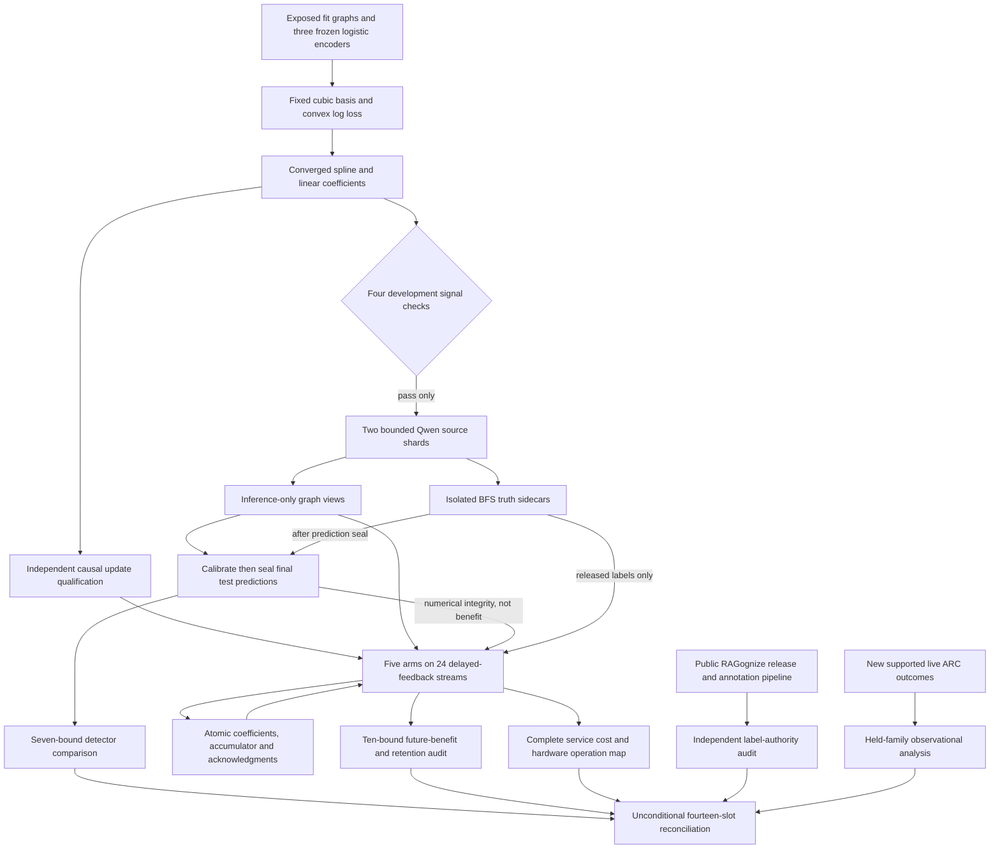
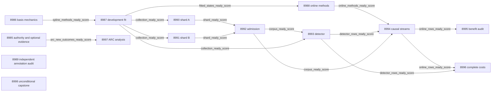

# Carnot Research Roadmap v768: Convex Spline Energy and Causal Learning

**Created:** 2026-11-10 America/New_York
**Milestone:** 2026.11.768
**Status:** Planned; staged only
**Supersedes:** Completed scheduling milestone 2026.11.767, Exp8971–Exp8984
**Task contract:** Exactly 14 tasks, Exp8985 through Exp8998, in the order below.
**Execution file:** `research-roadmap-next.yaml`

The complete V767 design and active queue are preserved byte for byte in
`research-roadmap-v767-preserved-20261110.md` and
`research-roadmap-v767-queue-preserved-20261110.yaml`.
This proposal does not activate the queue or run an experiment.

## What V767 proved

| Evidence | Observed result | Consequence |
|---|---|---|
| Exp8971 | Exact fourteen-task authority qualified. New ARC support was zero. | Keep administrative readiness separate from optional evidence. |
| Exp8972 | The same logistic encoder supported linear-head guard AUROC 0.805990 and Gibbs-head AUROC 0.350260. | Common features alone did not rescue this energy head. |
| Exp8972 | Gibbs encoder derivatives were zero initially but became nonzero. Final fit gradients remained nonzero. | Do not call this a persistent zero-gradient bug. Isolate optimization through a convex coefficient objective. |
| Exp8973 | Energy guard Brier 0.2009431; shared linear 0.1802202; prevalence 0.1882477. All three admission checks failed. | Preserve this exact negative and stop unchanged collection. |
| Exp8974/8976–8983 | The capstone records gate skips and absent primaries. No new source, detector, online-learning or cost benefit was measured. | Skipped experiments are untested, not scientific nulls. Do not manufacture their declared files. |
| Exp8975 | All 800 annotation records were audited, but zero original text/label pairs joined. Existing source-use authorization was absent. | Do not repeat the unchanged AuthenHallu access attempt. |
| Exp8984 | Fourteen slots were accounted for; scientific verdict was terminal blocked. Historical FoVer G1–G4 remained true. | Complete accounting grants no new graph or natural-language result. |

Primary references are `results/experiment_8972_v767_encoder_head_diagnosis.json`,
`results/experiment_8973_v767_shared_feature_methods.json`,
`results/experiment_8975_v767_natural_label_eligibility.json` and
`results/experiment_8984_v767_capstone.json`. V766 is now in the completion
archive; V767's terminal primaries and scheduler receipts supply current closure.
Archive lag does not erase those observations or establish missing science.

## The three largest gaps to the PRD

1. **FR-06/FR-12: an energy decision that earns its place against simple models.**
   Informative graph features exist. The tested hidden energy head underperformed.
   Fix the basis, fit a convex coefficient objective, and give the linear control
   the same convergence standard. Preserve all old benefit margins.
2. **FR-11: continuous learning that helps future queries.** Scalar calibration
   failed despite active updates and acceptable retention. Test conditional spline
   coefficients with delayed feedback and a matched online linear control. Freeze
   the existing ten-bound benefit/retention contract before measuring outcomes.
3. **FR-12 and the current north star: independent natural-language label authority.**
   BFS graphs remain a domain with a cheap exact evaluator. AuthenHallu text is
   unavailable under existing authorization. Audit a public alternative's actual
   annotation pipeline before spending compute on a misleading verification test.

FR-05/FR-08/NFR-01 enter through complete service costs and a hardware operation
map. There is no justified Rust port, new sampler or accelerator purchase yet.
A binary spline energy is mathematically a logistic additive spline classifier.
Any gain establishes this model's value on the declared population; its energy
notation provides neither a theorem of truth nor a special generative mechanism.
The natural audit may rule out another source. This milestone does not promise
closure of the independent-verifier north star.

## Research incorporated before design

The dated V768 entry in `research-references.md` precedes the task design.

| Source | Adopted experiment and boundary |
|---|---|
| [Online KAN, 2602.02056v4](https://arxiv.org/abs/2602.02056) | Exp8986/8988 test fixed spline coefficients and update locality. Published FPGA speed is not a local service result. |
| [KAC, 2503.21076](https://arxiv.org/abs/2503.21076) | Motivates nonlinear classifier bases. This cubic fixed-basis experiment does not reproduce KAC's RBF method. |
| [Continual Calibration, 2604.23987](https://arxiv.org/abs/2604.23987) | Exp8994/8995 keep future proper loss and shared retention separate. No conformal guarantee is imported. |
| [CCHD, 2606.08158](https://arxiv.org/abs/2606.08158) | Exp8993 checks exact graph relabeling invariance. It does not create unverified natural paraphrase labels. |
| [RAGognizer, 2604.15945](https://arxiv.org/abs/2604.15945) and [author release](https://huggingface.co/datasets/F4biian/RAGognize) | Exp8989 audits accessible original contexts and annotations. The golden answer is model-generated; independent human truth is not assumed. |
| [FPGA–ASIC co-design, 2602.15985v2](https://arxiv.org/abs/2602.15985) | Exp8996 includes orchestration, encoding and storage before considering acceleration. |

The scan also checked EBR, constrained generation, Ising applications and
KAN-CL. New EBR results do not reopen unchanged local generator nulls. Guided
syntax enforcement does not provide semantic labels. Importance anchoring stays
closed under its prior protocol. Trajel remains a release lead, not a dependency.
OpenReview challenged direct access; Semantic Scholar returned ten ARM–EBM
citations but rate-limited EBT. GitHub trending was stale. Hugging Face linked
RAGognize's author release. Extropic's Z1T estimates and Kona's product description
supply no new reproducible Carnot hardware or architecture result.

## Architecture



The model parameters here are small heads. Qwen weights, graph encoders and
spline geometry remain frozen. Original graph truth is isolated from inference.
Methods readiness, collection admission, numerical row readiness and benefit
are separate fields. The public annotation audit has no graph dependency.

## Phase 1 — fix the question and qualify methods (Exp8985–Exp8989)

**Exp8985** preserves the complete V767 record and binds the exact new contract.
It reads the optional ARC evidence delta once. Thirty new uncensored episodes,
three families and both arms per held family are required before ARC analysis.
Zero ARC support does not block administrative readiness or graph science.

**Exp8986** freezes one small, explicit changed mechanism. It reuses the three
logistic encoders, seeds 71/72/73, original 256 fit graphs and 64 guard graphs.
Each encoder gives 27 coordinates. Fit-only min/max scales each to [-1,1].
Constant coordinates map to zero; future values clip with counts retained.
Seven cubic B-spline columns use clamped knots
`[-1,-1,-1,-1,-0.5,0,0.5,1,1,1,1]` per coordinate. An intercept, 27 linear
columns and 189 spline columns give 217 coefficients. The linear control has28.

For both arms, minimize mean binary log loss plus `0.01*||beta_nonintercept||²/2`.
Use zero initialization and L-BFGS-B: 500 iterations maximum, `gtol=1e-6`,
`ftol=1e-12`. Require actual gradient infinity norm <=1e-6 and finite outputs.
No model-specific optimizer search occurs. Duplicate basis information remains
well-defined under ridge regularization. The binary energy is `E(correct)=0`,
`E(error)=-z`; its error probability is `sigmoid(z)`. Numerical fixtures qualify
mechanics, not independent scientific benefit. This changes the nonconvex hidden
head used in V767 and the fixed-step sentence-spline study in Exp8334.

**Exp8987** fits the registered models and makes one development decision.
At temperature1, retain AUROC >=0.65, prevalence Brier improvement >=0.005 and
Brier excess over old shared linear <=0.01. Add excess over converged linear
<=0.01. All four checks and mechanics must pass before new collection.
A converged fit can qualify for online method work even when this gate fails.
No sign inversion, knot change or threshold revision follows the scores.

Freeze 1024 graph identities before inference. Keep the V765 matched-cardinality
population and historical/isomorphic exclusions. Construction permits 2000
proposals per graph and 600 seconds total. Two shards each contain 64 calibration,
64 final-test and 384 online graphs. Previous ungenerated manifests may be used
only with authenticated non-exposure and exact protocol compatibility.
These support minima do not establish power at 128 final-test graphs.

**Exp8988** qualifies five causal arms: frozen spline, adaptive spline, bias-only
spline, adaptive linear and permuted-feedback spline. Update each head using
binary log loss with a 0.01 anchor to its initial coefficients, excluding the
intercept. Clip gradient norm at1. AdaGrad uses `A += g*g` and
`theta -= 0.05*g/sqrt(A+1e-8)`. Preserve all three encoders as one ensemble.
There is no knot growth, model training beyond the heads or importance replay.

After prediction8, release labels1–4. Release four more after predictions
12/16/20/24/28/32. Four labels remain pending. Permute within released blocks
only. The historical 64-graph guard permits Brier increase <=0.005 and no
classification-error increase from initialization. On rejection, restore both
coefficients and accumulator to committed state; acknowledge the consumed labels.
An actual process kill at query16 must resume identically. Retention never enters
the guard. Dense anchoring and guard scans prevent a blanket sparse-cost claim.

**Exp8989** independently audits the public RAGognize release. Pin author code,
corpus bytes, labels, source groups and licenses. Trace machine-generated golden
answers and each annotation stage. Check token alignment, duplicate questions,
article overlap and actual human review evidence. Bound downloads to256 MB and
600 seconds. No scraping, labeling pipeline, new agreement or generator training.
A completed machine-only finding is a useful terminal null, not an access block.
Independent eligibility requires documented human decisions, authorized original
text and at least200 independent question groups with both labels supported.
There is no downstream natural-model task in this milestone. Missing independent
labels remain an explicit north-star gap.

## Phase 2 — bounded source collection (Exp8990–Exp8992)

**Exp8990/8991** each collect512 first responses after the new development gate.
They use only `unsloth/Qwen3.8-27B-GGUF`, Q4_K_M, GPU0, reasoning disabled,
temperature0 and16 output tokens. GPU1 remains detached. Retain the existing
supervised runtime, authentic cache/tokenizer/offload evidence and model lease.
There are no response retries, repair passes or smaller headline models.
Preflight/load limits are240 seconds each, request timeout30 seconds, and
collection budget2700 seconds per shard. Checkpoint every16 requests and print
from the supervisor while a child waits. Partial rows retain their real status.

Both declare `model_bounded_generation`: the floor is10 seconds even for a large
batch of fixed16-token requests. A load-only failure declares
`model_load_no_generation` with its2-second floor and zero generated tokens.
No full-generation run is planned. Its60-second floor does not apply.

**Exp8992** authenticates1024 records and the128/128/768 role split. Require200
errors overall and5 examples per class per pooled role. Separate semantic,
out-of-graph, format and transport failures. Recompute BFS labels independently.
Raw graph and response-confidence features enter inference; identity, labels,
answer membership and distances do not. Corpus admission is circular source
qualification, never learned verification benefit.

## Phase 3 — confirmation and continuous learning (Exp8993–Exp8994)

**Exp8993** compares spline, converged linear, old shared linear, confidence
linear and prevalence. Fit no new coefficients. Calibrate each trained arm's
temperature on the128 calibration graphs, from `[0.5,1,2,4]`, with ascending ties.
Seal all128 final-test predictions before opening labels. At10000 paired
graph-bootstrap draws, retain the original five one-sided conditions and add two:

- Brier improvement lower bound >0 versus prevalence, confidence linear,
  old shared linear and converged linear: four bounds.
- Accepted-error delta upper bound <=0 at exactly50% coverage versus each of
  the three linear controls: three bounds.

Use family alpha0.05, tail0.05/7 per bound. All seven must pass. Fixed-coverage
selection is not a risk certificate. Typed decisions still use error probability
<=0.1 for accept and >=0.9 for reject. Exact graph permutations must preserve
probabilities within1e-6. Removed-context ablations are descriptive. A numerical
null may proceed to online/cost work; an integrity failure cannot.

**Exp8994** runs the five registered arms on24 independent32-query streams.
It emits3840 online rows and46080 shared-retention rows,49920 total. The same128
test graphs are evaluated at0/16/32 for every stream and arm, outside all guards.
Prediction seal precedes feedback. Each transaction retains coefficient changes,
accumulator, pending records and acknowledgments. Real kill/restart must match
uninterrupted behavior. All four final labels stay pending until scientific
scoring ends. No new LLM inference occurs.

## Phase 4 — benefit, complete cost and closure (Exp8995–Exp8998)

**Exp8995** independently reduces the unchanged ten-bound learning contract.
On queries17–32, adaptive-minus-frozen Brier upper must be <=-0.01. Upper bounds
versus bias-only, adaptive linear and permuted controls must each be <0.
The six shared-retention Brier/error uppers at0/16/32 must each be <=0.01.
Use10000 whole-stream bootstrap draws and family alpha0.01 with tail0.001.
For retention, resample graph IDs once per draw and reuse them across arms and
histories. Report conditional-panel sensitivity separately. Repeated queries,
encoder seeds and retention rows do not increase independent stream counts.

**Exp8996** measures24 paired fresh-process units, randomizing arm order.
Compare frozen/adaptive spline with frozen/adaptive converged linear. Include
raw graph reads, startup/JIT, encoding, basis work, prediction, updates, guards,
fsync, restart, final feedback drain and shutdown. An ordinary linear service
must not perform artificial spline work. Keep cold and resident times separate.
Null quality permits measurement; deployment needs both scientific gates and
upper95 adaptive spline/linear complete-cost ratio <=1.

Map actual operation counts and the nonaccelerable fraction to hardware limits.
No sampling operation is introduced. Sparse spline arithmetic does not make the
existing KV260 sampler a trainer. Report an infeasible100x whole-service target
honestly when serial/storage work rules it out.

**Exp8997** reserves the restored opportunistic ARC slot. Structured gating
requires new supported live outcomes. Analyze held-family supervisor associations
with censoring sensitivity, without executing games or changing policy. Any
incidental level credit requires a registry precheck and original
`live_agent_self_discovery` provenance. No duplicate or offline solve is credited.
Observational associations do not establish causal or hidden-game improvement.

**Exp8998** runs unconditionally. Account for every slot and missing/alternate
scheduler artifact explicitly. External missing science is terminal blocked;
only incomplete owned accounting uses partial. Recompute the unchanged FoVer
G1–G4 publication gate under its historical scope. No new graph result inherits
that readiness. Preserve exact failed scopes and state concrete reopening evidence.

## Dependency graph

All solid edges below are structured equality gates on top-level artifact fields.
The administrative contract is not a scientific prerequisite. Natural annotation
work and the capstone are unconditional. The ARC task has its own optional gate.



Every producer declares the exact gate field in its own REQUIRED ARTIFACT FIELDS.
Historical tasks are retained scientific inputs, not retired `requires:` chains.
If admission fails, source and confirmation slots skip cheaply. Basis methods,
completed-fit online qualification, source auditing and accounting still produce
useful bounded outcomes. No absence is recast as an empirical null.

## Hardware requirements and execution budget

| Work | Hardware and memory | Wall estimate | Boundary |
|---|---|---|---|
| Contract, source audit and capstone | CPU; bounded local files/network | 25–45 min per task | No model or device probe. |
| Spline fit and causal studies | CPU/JAX/SciPy, approximately 4 GB working memory | 30–60 min | Numerical small-head training; zero current LLM calls. |
| Each 512-response source shard | RTX3090 GPU0, 24 GB; pinned Q4_K_M model, bounded context | 60 min | Actual lease, cache and CUDA offload required; GPU1 detached. |
| Complete service comparison | CPU; private fresh processes and durable disk | 60 min | No hardware speed claim from operation counts. |
| ARC observational analysis | CPU and existing authenticated receipts | 25 min | No new game, model or board execution. |

Total scheduled estimates are625 minutes if every gate passes. Each task stays
within its own4800-second cap: measurement stops by3600 seconds and reserves900
seconds for checks. These are planning budgets, not measured durations.

The hardware wishlist's old installation blockers are historical. Preserve the
qualified KV260 fabric scope at `k_max<=5`, PolarFire Linux CPU-only dispatch,
GateMate's unchanged `0xffffffff` physical block, and unqualified NPU/TSU paths.
A future spline accelerator would require new capability and actual service
measurement. The plan requests no purchases, board flashing or toolchain changes.

## Execution, failure and validation discipline

Every prompt contains numbered requirements for flushed phase progress and
before/after reporting around slow calls. Supervisors and loops print actual
counts at least every60 seconds. No silence gap may reach600 seconds. Files over
about200 lines are written through multiple tool calls with progress between.

Every task carries full prior-failure metadata, including `retire_if_same_verdict`.
Successful predecessor entries identify continuity rather than inventing failures.
New collection may run only after the changed mechanism qualifies. The old Gibbs
head, sentence-spline protocol, scalar-adaptation null and denied source access
remain unchanged. ARC requires new evidence under its explicit reopening condition.
No retired ID is reused and no retirement override is fabricated.

All comparisons emit per-unit metrics and denominators. Artifacts declare the
closed `verdict_class` enum, explicit substrate and failed gate operands. Metadata
and reported duration must match actual work. CPU aggregation never borrows a
historical Qwen call as current inference. The mandated model is the only new
headline source model; legacy small models are limited to private CPU smoke tests.

Specs and tests precede implementation. Each task runs scoped unit/actual CLI,
100-percent newly owned statement coverage, lint, strict types, spec coverage,
and applicable private E2E checks. Original tests and thresholds remain intact.
Owned check failures disqualify; unrelated repository debt is reported separately.

Routing follows the current request: Exp8985 uses Opus/100 for authority preflight.
Formulaic basis, online-update and dataset work uses Codex `gpt-6.1-sol`.
Routine studies use default Claude; small audits use20 or30 turns. No Luna or
Gemini task is planned. Agent routing is separate from the Qwen subject model.

Planning validation checks the schema, visible task order, full embedded-object
equality, exact gate fields, source paths, rerun metadata and exclusion lint.
It also runs the relevant existing unit/private-CLI tests, including E2E-018/021,
and scoped spec coverage. It does not run the proposed experiments or claim
scientific benefit. Planning receipts are recorded in the status and changelog.

## Exact task contract

Exactly14 tasks, Exp8985–Exp8998, follow in conductor execution order.
The embedded full objects equal the YAML tasks, including every prompt and gate.

| Order | Task ID | Title | Phase | Deliverable |
|---|---|---|---|---|
| 1 | exp8985-branch-contract | Bind fourteen tasks and preserve the completed V767 evidence changed | 1 | `results/experiment_8985_v768_branch_contract.json` |
| 2 | exp8986-spline-basis-methods | Freeze a convex spline energy head and an equally optimized linear control | 1 | `results/experiment_8986_v768_spline_basis_methods.json` |
| 3 | exp8987-spline-development-admission | Measure the fixed spline development gate before any new Qwen collection | 1 | `results/experiment_8987_v768_spline_development_admission.json` |
| 4 | exp8988-online-spline-methods | Qualify delayed continuous coefficient learning without waiting for collection admission | 1 | `results/experiment_8988_v768_online_spline_methods.json` |
| 5 | exp8989-natural-annotation-authority | Audit public RAGognize labels without mistaking generated annotations for independent truth | 1 | `results/experiment_8989_v768_natural_annotation_authority.json` |
| 6 | exp8990-graph-corpus-a | Collect bounded Qwen graph evidence for the convex test in shard A | 2 | `results/experiment_8990_v768_graph_corpus_a.json` |
| 7 | exp8991-graph-corpus-b | Collect bounded Qwen graph evidence for the convex test in shard B | 2 | `results/experiment_8991_v768_graph_corpus_b.json` |
| 8 | exp8992-corpus-admission | Authenticate fresh graph roles and truth isolation for convex evaluation | 2 | `results/experiment_8992_v768_corpus_admission.json` |
| 9 | exp8993-spline-calibrated-decisions | Test convex spline energy value against old and converged linear baselines | 3 | `results/experiment_8993_v768_spline_calibrated_decisions.json` |
| 10 | exp8994-online-spline-streams | Measure delayed continuous spline learning on sealed real Qwen response streams | 3 | `results/experiment_8994_v768_online_spline_streams.json` |
| 11 | exp8995-online-spline-benefit | Independently audit future spline benefit and shared-panel retention | 4 | `results/experiment_8995_v768_online_spline_benefit.json` |
| 12 | exp8996-complete-spline-cost | Measure complete spline decision costs and supported hardware operations | 4 | `results/experiment_8996_v768_complete_spline_cost.json` |
| 13 | exp8997-arc-transfer-evidence | Assess held-family supervisor transfer only after new live outcomes qualify | 4 | `results/experiment_8997_v768_arc_transfer_evidence.json` |
| 14 | exp8998-capstone | Reconcile fourteen outcomes and decide exact spline and evidence continuations | 4 | `results/experiment_8998_v768_capstone.json` |

<!-- V768_TASK_CONTRACT_START -->
```json
{
  "milestone": "2026.11.768",
  "tasks": [
    {
      "id": "exp8985-branch-contract",
      "title": "Bind fourteen tasks and preserve the completed V767 evidence changed",
      "phase": 1,
      "track": "research",
      "priority": "high",
      "requires_gpu": false,
      "max_turns": 100,
      "estimated_wall_time_min": 45,
      "per_unit_rows": true,
      "milestone": "2026.11.768",
      "deliverable": "results/experiment_8985_v768_branch_contract.json",
      "inference_substrate_class": "no_model_load",
      "MODEL_SPECS": [],
      "gated_on": [],
      "prior_failures": [
        {
          "experiment_id": "exp8984-capstone",
          "verdict": "complete_blocked_external_science_and_source_access",
          "addressed_by": "Bind a new convex-basis protocol while preserving V767 scientific and access failures; administrative readiness no longer implies available science.",
          "retire_if_same_verdict": true
        }
      ],
      "prompt": "CONTEXT:\nWork in {project_root} on {date}. V767 completed scheduling, but the common-feature Gibbs head failed all three development checks. No fresh graph science ran. AuthenHallu joined zero of 800 text/label pairs. The capstone accounts for fourteen slots with terminal external blocks. Administrative readiness remains separate from optional science.\nEXISTING CODE TO READ FIRST:\nCLAUDE.md; CODEX.md; research-program.md; ops/north-star.md; ops/e2e-test-plan.md; openspec/capabilities/research-reporting/spec.md; openspec/capabilities/verification/spec.md; openspec/capabilities/kan/spec.md; scripts/experiment_template.py; python/carnot/reporting/primary_publication.py; ops/exclusion_manifest.yaml; openspec/change-proposals/research-roadmap-vNEXT.md; research-references.md; python/carnot/reporting/roadmap_contract.py; python/carnot/reporting/v767_branch_contract.py; python/carnot/reporting/v767_capstone.py; results/experiment_8984_v767_capstone.json; ops/arc_supervisor_refinement_ledger.json\nTASK:\nBind fourteen tasks and preserve the completed V767 evidence changed. Deliver results/experiment_8985_v768_branch_contract.json, primitive evidence under results/raw/experiment_8985_v768_branch_contract/, and runnable scripts/experiments/experiment_8985_v768_branch_contract.py.\nCONCRETE STEPS:\n1. Emit a flushed progress line at every phase boundary and before and after every model load, generation, benchmark and subprocess. Use PYTHONUNBUFFERED=1 and print(..., flush=True). Inside long loops and child waits, print actual completed/pending counts at least every 60 seconds. Keep every silence gap below 600 seconds. Poll with tool calls of at most 60 seconds. Write any file over about 200 lines in several tool calls, each writing at most about 150 lines. Send a progress message between writes. Never pad elapsed time.\n2. PRECONDITIONS: Before compute, check exact inputs, hashes, declared gate operands, repository virtualenv, dependencies, free memory and writable disk. Check required network access with bounded requests. Preserve rejected and historical evidence. An absent, retired or gate-blocked external input yields honest_verdict=complete_blocked_<check>, verdict_class=blocked and gate_check_summary with the actual operand. Only incomplete owned work may use partial. Do not substitute fixtures for missing observations.\n3. Extend the matching REQ-* and SCENARIO-* before implementation. Write failing private tests first. Reuse existing numerical, custody and CLI helpers. Keep fixtures and probes in private temporary directories. Read immutable prior authority, not mutable vNEXT headings. Preserve existing tests and numerical thresholds.\n4. Load no LLM. Set MODEL_SPECS=[], inference_substrate_class=no_model_load. Use aggregation_from_upstream_artifacts for reductions; use verifier_ensemble_against_cached_candidates for numerical head fitting or evaluation. Declare trained_head_specs separately. Keep current model calls zero.\n5. Authenticate preserved V767 design and active-queue bytes, its five terminal primaries and exact scheduler skip receipts. Keep archive lag, absent primaries and alternate conductor gate-artifact names explicit. Do not create missing historical results.\n6. Bind exactly fourteen V768 tasks, Exp8985 through Exp8998. Compare the visible table, full embedded objects and staged YAML. At runtime accept activated authority only when it matches those retained bytes. Check every gate producer exists earlier in this queue and declares the identical top-level field.\n7. Check all retired IDs, scopes and runtime chains. Record complete prior_failures entries and the concrete changed mechanisms. Run private missing-task, changed-title, changed-prompt, changed-gate and changed-deliverable mutations. Do not edit the manifest or conductor.\n8. Read the ARC ledger delta once against the authenticated Exp8720 and V767 frontier. arc_new_outcomes_ready_score=1 requires at least 30 new uncensored episodes, three families and both compared arms within every held family. Zero new evidence produces one cheap-skip diagnostic, not an administrative blocked verdict. No game or GPU probe.\n9. Set contract_ready_score=1 only after exact authority and owned controls pass. This is a null administrative result. It does not gate the independent scientific roots or natural annotation audit.\n10. Freeze owned validation argv. Run scoped pytest with 100-percent newly owned unit and child statement coverage, Ruff check and format, strict mypy and explicit-path spec coverage. Run applicable private E2E success, missing-input, tamper and cold-replay checks, including E2E-018/021 for authority or artifact custody. Execute the real CLI from outside the checkout without PYTHONPATH. Give pytest selectors only to pytest. Record argv, normal exit, duration and log hashes. Report unrelated repository health separately. Stop measurement by 3600 seconds and reserve 900 seconds for checks inside the 4800-second hard cap.\n11. Retain primitive per-unit rows plus source/code/config hashes. Recompute summaries independently. Run unmodified adversarial_verify.py and strict verdict_row_consistency_lint.py with progress while waiting. Publish through primary_publication only after required owned checks pass. Failed owned validation disqualifies and zeros readiness. Reconcile openspec/, _bmad/traceability.md, ops/status.md and ops/changelog.md. Preserve operator-curated pages and protected runtime files. Do not activate a queue or publish externally.\nREQUIRED ARTIFACT FIELDS:\n- honest_verdict: complete_*; verdict_class: positive | circular_positive | null | blocked | disqualified | partial. Principle: external incompleteness is terminal blocked; only owned unfinished work retries.\n- verifier_is_oracle, claim_scope, exposure_scope, independent_generalization_score. Principle: fixtures, development graphs and BFS source admission cannot establish a no-cheap-oracle verifier win; oracle positives are circular_positive.\n- required_checks_passed, flagged_adversarial, validation_receipts, owned_statement_coverage, preconditions_checked. Principle: readiness requires real normal-exit owned checks.\n- gate_check_summary: check/upstream/path/sha256/artifact_field/op/expected/observed/passed. Principle: every blocked result names the failed check and actual value, including missing_file or missing_field.\n- inference_substrate, inference_substrate_class, MODEL_SPECS, model_specs, trained_head_specs, model_invocation_counts, cited_upstream_artifacts: experiment_id/fields_imported/sha256. Principle: current calls differ from imported historical model provenance.\n- rows: unit_id/group_id/arm/condition/metric/value/numerator/denominator/status/exclusion_reason. Principle: every comparison retains each independent unit and its metric; row references resolve to immutable retained bytes.\n- intended_count, independent_count, completed_count, excluded_count, censored_count, failed_count. Principle: repeated seeds or responses do not create independent source groups.\n- run_date, duration_s, random_seed, reproducibility_checksum, source_artifact_hashes, raw_shard_hashes, code_config_hashes, phase_spans, acceptance_gates, field_principles. Principle: actual work and frozen thresholds determine each claim.\n- contract_ready_score: 0|1, arc_new_outcomes_ready_score: 0|1, full_task_objects, full_task_digest, gate_edge_rows, exclusion_scope_rows, historical_slot_rows, arc_frontier, arc_support_rows. Principle: optional support cannot block exact administrative accounting.\nRun command: cd {project_root} && PYTHONUNBUFFERED=1 .venv/bin/python -u scripts/experiments/experiment_8985_v768_branch_contract.py --date {date}\nDo NOT push. Do NOT modify scripts/research_conductor.py.",
      "model": "opus"
    },
    {
      "id": "exp8986-spline-basis-methods",
      "title": "Freeze a convex spline energy head and an equally optimized linear control",
      "phase": 1,
      "track": "research",
      "priority": "high",
      "requires_gpu": false,
      "max_turns": 50,
      "estimated_wall_time_min": 45,
      "per_unit_rows": true,
      "milestone": "2026.11.768",
      "deliverable": "results/experiment_8986_v768_spline_basis_methods.json",
      "inference_substrate_class": "no_model_load",
      "MODEL_SPECS": [],
      "gated_on": [],
      "prior_failures": [
        {
          "experiment_id": "exp8973-shared-feature-methods",
          "verdict": "complete_null_development_admission_failed",
          "addressed_by": "Replace jointly fitted hidden Gibbs layers with fixed cubic basis and converged convex coefficients; equally converge the linear comparator and preserve prior benefit margins.",
          "retire_if_same_verdict": true
        },
        {
          "experiment_id": "exp8334-sentence-spline-fit",
          "verdict": "complete_null_sentence_spline_fit",
          "addressed_by": "The old sentence study used six local inputs and 400 projected steps. Use 27 frozen graph coordinates, an unconstrained ridge objective, certified numerical convergence and fresh graph confirmation; no old sentence result is reopened.",
          "retire_if_same_verdict": true
        }
      ],
      "prompt": "CONTEXT:\nWork in {project_root} on {date}. The fixed eight-unit Gibbs head had guard AUROC 0.3502604 and Brier 0.2009431 versus shared linear Brier 0.1802202. Its final fit gradients were nonzero. This does not identify a causal optimizer bug. A fixed basis makes the next coefficient objective convex and removes hidden-layer optimization as a variable.\nEXISTING CODE TO READ FIRST:\nCLAUDE.md; CODEX.md; research-program.md; ops/north-star.md; ops/e2e-test-plan.md; openspec/capabilities/research-reporting/spec.md; openspec/capabilities/verification/spec.md; openspec/capabilities/kan/spec.md; scripts/experiment_template.py; python/carnot/reporting/primary_publication.py; ops/exclusion_manifest.yaml; openspec/change-proposals/research-roadmap-vNEXT.md; research-references.md; python/carnot/autoresearch/encoder_head_8972.py; python/carnot/reporting/shared_feature_methods_8973.py; python/carnot/verify/sentence_spline_fit_8334.py; python/carnot/models/kan/__init__.py; results/experiment_8972_v767_encoder_head_diagnosis.json; results/experiment_8973_v767_shared_feature_methods.json\nTASK:\nFreeze a convex spline energy head and an equally optimized linear control. Deliver results/experiment_8986_v768_spline_basis_methods.json, primitive evidence under results/raw/experiment_8986_v768_spline_basis_methods/, and runnable scripts/experiments/experiment_8986_v768_spline_basis_methods.py.\nCONCRETE STEPS:\n1. Emit a flushed progress line at every phase boundary and before and after every model load, generation, benchmark and subprocess. Use PYTHONUNBUFFERED=1 and print(..., flush=True). Inside long loops and child waits, print actual completed/pending counts at least every 60 seconds. Keep every silence gap below 600 seconds. Poll with tool calls of at most 60 seconds. Write any file over about 200 lines in several tool calls, each writing at most about 150 lines. Send a progress message between writes. Never pad elapsed time.\n2. PRECONDITIONS: Before compute, check exact inputs, hashes, declared gate operands, repository virtualenv, dependencies, free memory and writable disk. Check required network access with bounded requests. Preserve rejected and historical evidence. An absent, retired or gate-blocked external input yields honest_verdict=complete_blocked_<check>, verdict_class=blocked and gate_check_summary with the actual operand. Only incomplete owned work may use partial. Do not substitute fixtures for missing observations.\n3. Extend the matching REQ-* and SCENARIO-* before implementation. Write failing private tests first. Reuse existing numerical, custody and CLI helpers. Keep fixtures and probes in private temporary directories. Read immutable prior authority, not mutable vNEXT headings. Preserve existing tests and numerical thresholds.\n4. Load no LLM. Set MODEL_SPECS=[], inference_substrate_class=no_model_load. Use aggregation_from_upstream_artifacts for reductions; use verifier_ensemble_against_cached_candidates for numerical head fitting or evaluation. Declare trained_head_specs separately. Keep current model calls zero.\n5. Ingest online KAN 2602.02056v4, KAC 2503.21076, Continual Calibration 2604.23987 and CCHD 2606.08158. Record equations, source hashes, conditions and non-adopted components in a focused method map. Mark actual readings in research-studying.md. This is not a reproduction of KAC RBF training or a conformal guarantee.\n6. Reuse all three historical logistic encoders with seeds 71/72/73 and their 27-dimensional features. Freeze original 256 fit graphs and 64 guard graphs. All V765/V766 labels are exposed development. Freeze encoder bytes; never use BFS outputs, labels, graph IDs, distance, answer membership or source metadata as features.\n7. For each encoder, fit per-coordinate min/max on the 256 fit graphs only. Map to [-1,1], clip future out-of-range coordinates and record clipping. Constant coordinates map to zero. Freeze cubic clamped knots [-1,-1,-1,-1,-0.5,0,0.5,1,1,1,1], seven basis columns per coordinate. Use the existing SciPy BSpline path. The 217-column design contains intercept, 27 scaled linear columns and 189 spline columns. Keep constant columns with ridge regularization; no data-dependent dimension search.\n8. Define z=beta0+beta_linear dot x+sum(beta_jk*B_k(x_j)); E(correct)=0; E(error)=-z; p_error=sigmoid(z). Fit population binary log loss plus 0.01*sum(non-intercept coefficients squared)/2. Fit a 28-column linear control with the same loss, scaling and optimizer. Both use zero initialization, L-BFGS-B without parameter bounds, maxiter=500, gtol=1e-6, ftol=1e-12. Accept convergence only if the actual infinity norm of the gradient is <=1e-6 and values are finite. No optimizer search or sign flipping.\n9. Freeze the temperature grid [0.5,1,2,4], selected later only on fresh calibration by minimum Brier with ascending ties. Keep old shared-linear, confidence-linear and prevalence states as controls. Retain the old five scientific bounds and add Brier superiority and 50-percent-coverage non-inferiority against the converged linear control: seven simultaneous one-sided bounds, family alpha 0.05, 10000 paired graph-bootstrap draws.\n10. Write openspec/change-proposals/v768-spline-protocol.json before natural fitting. Private tests cover basis endpoints, partition of unity, constant coordinates, duplicate columns, finite-difference gradients, convex Hessian PSD, label orientation, denied oracle fields, nonconvergence refusal and exact node-permutation invariance. Fixtures cannot grant scientific credit. spline_methods_ready_score covers numerical mechanics only, independent of the later development signal gate.\n11. Freeze owned validation argv. Run scoped pytest with 100-percent newly owned unit and child statement coverage, Ruff check and format, strict mypy and explicit-path spec coverage. Run applicable private E2E success, missing-input, tamper and cold-replay checks, including E2E-018/021 for authority or artifact custody. Execute the real CLI from outside the checkout without PYTHONPATH. Give pytest selectors only to pytest. Record argv, normal exit, duration and log hashes. Report unrelated repository health separately. Stop measurement by 3600 seconds and reserve 900 seconds for checks inside the 4800-second hard cap.\n12. Retain primitive per-unit rows plus source/code/config hashes. Recompute summaries independently. Run unmodified adversarial_verify.py and strict verdict_row_consistency_lint.py with progress while waiting. Publish through primary_publication only after required owned checks pass. Failed owned validation disqualifies and zeros readiness. Reconcile openspec/, _bmad/traceability.md, ops/status.md and ops/changelog.md. Preserve operator-curated pages and protected runtime files. Do not activate a queue or publish externally.\nREQUIRED ARTIFACT FIELDS:\n- honest_verdict: complete_*; verdict_class: positive | circular_positive | null | blocked | disqualified | partial. Principle: external incompleteness is terminal blocked; only owned unfinished work retries.\n- verifier_is_oracle, claim_scope, exposure_scope, independent_generalization_score. Principle: fixtures, development graphs and BFS source admission cannot establish a no-cheap-oracle verifier win; oracle positives are circular_positive.\n- required_checks_passed, flagged_adversarial, validation_receipts, owned_statement_coverage, preconditions_checked. Principle: readiness requires real normal-exit owned checks.\n- gate_check_summary: check/upstream/path/sha256/artifact_field/op/expected/observed/passed. Principle: every blocked result names the failed check and actual value, including missing_file or missing_field.\n- inference_substrate, inference_substrate_class, MODEL_SPECS, model_specs, trained_head_specs, model_invocation_counts, cited_upstream_artifacts: experiment_id/fields_imported/sha256. Principle: current calls differ from imported historical model provenance.\n- rows: unit_id/group_id/arm/condition/metric/value/numerator/denominator/status/exclusion_reason. Principle: every comparison retains each independent unit and its metric; row references resolve to immutable retained bytes.\n- intended_count, independent_count, completed_count, excluded_count, censored_count, failed_count. Principle: repeated seeds or responses do not create independent source groups.\n- run_date, duration_s, random_seed, reproducibility_checksum, source_artifact_hashes, raw_shard_hashes, code_config_hashes, phase_spans, acceptance_gates, field_principles. Principle: actual work and frozen thresholds determine each claim.\n- spline_methods_ready_score: 0|1, protocol_path, protocol_sha256, method_source_rows, basis_fixture_rows, optimizer_fixture_rows, encoder_hashes, feature_schema, parameter_counts, convergence_rule, seven_bound_contract. Principle: fixed features and a convex objective remove a training confound without guaranteeing benefit.\nRun command: cd {project_root} && PYTHONUNBUFFERED=1 .venv/bin/python -u scripts/experiments/experiment_8986_v768_spline_basis_methods.py --date {date}\nDo NOT push. Do NOT modify scripts/research_conductor.py.",
      "agent_type": "codex",
      "model": "gpt-6.1-sol"
    },
    {
      "id": "exp8987-spline-development-admission",
      "title": "Measure the fixed spline development gate before any new Qwen collection",
      "phase": 1,
      "track": "research",
      "priority": "high",
      "requires_gpu": false,
      "max_turns": 50,
      "estimated_wall_time_min": 45,
      "per_unit_rows": true,
      "milestone": "2026.11.768",
      "deliverable": "results/experiment_8987_v768_spline_development_admission.json",
      "inference_substrate_class": "no_model_load",
      "MODEL_SPECS": [],
      "gated_on": [
        {
          "upstream": "exp8986-spline-basis-methods",
          "artifact_field": "spline_methods_ready_score",
          "op": "==",
          "value": 1
        }
      ],
      "prior_failures": [
        {
          "experiment_id": "exp8973-shared-feature-methods",
          "verdict": "complete_null_development_admission_failed",
          "addressed_by": "A fixed spline basis and convergence-tested ridge fit replace the failed neural-head training. Keep its three admission thresholds and add a stronger optimized-linear comparison.",
          "retire_if_same_verdict": true
        }
      ],
      "prompt": "CONTEXT:\nWork in {project_root} on {date}. V767 correctly stopped collection after a failed fixed development gate. A changed convex basis now has a matched converged linear comparator. Exposed development metrics are feasibility evidence only.\nEXISTING CODE TO READ FIRST:\nCLAUDE.md; CODEX.md; research-program.md; ops/north-star.md; ops/e2e-test-plan.md; openspec/capabilities/research-reporting/spec.md; openspec/capabilities/verification/spec.md; openspec/capabilities/kan/spec.md; scripts/experiment_template.py; python/carnot/reporting/primary_publication.py; ops/exclusion_manifest.yaml; openspec/change-proposals/research-roadmap-vNEXT.md; research-references.md; python/carnot/reporting/shared_feature_methods_8973.py; python/carnot/autoresearch/encoder_head_8972.py; results/experiment_8973_v767_shared_feature_methods.json; openspec/change-proposals/v768-spline-protocol.json\nTASK:\nMeasure the fixed spline development gate before any new Qwen collection. Deliver results/experiment_8987_v768_spline_development_admission.json, primitive evidence under results/raw/experiment_8987_v768_spline_development_admission/, and runnable scripts/experiments/experiment_8987_v768_spline_development_admission.py.\nCONCRETE STEPS:\n1. Emit a flushed progress line at every phase boundary and before and after every model load, generation, benchmark and subprocess. Use PYTHONUNBUFFERED=1 and print(..., flush=True). Inside long loops and child waits, print actual completed/pending counts at least every 60 seconds. Keep every silence gap below 600 seconds. Poll with tool calls of at most 60 seconds. Write any file over about 200 lines in several tool calls, each writing at most about 150 lines. Send a progress message between writes. Never pad elapsed time.\n2. PRECONDITIONS: Before compute, check exact inputs, hashes, declared gate operands, repository virtualenv, dependencies, free memory and writable disk. Check required network access with bounded requests. Preserve rejected and historical evidence. An absent, retired or gate-blocked external input yields honest_verdict=complete_blocked_<check>, verdict_class=blocked and gate_check_summary with the actual operand. Only incomplete owned work may use partial. Do not substitute fixtures for missing observations.\n3. Extend the matching REQ-* and SCENARIO-* before implementation. Write failing private tests first. Reuse existing numerical, custody and CLI helpers. Keep fixtures and probes in private temporary directories. Read immutable prior authority, not mutable vNEXT headings. Preserve existing tests and numerical thresholds.\n4. Load no LLM. Set MODEL_SPECS=[], inference_substrate_class=no_model_load. Use aggregation_from_upstream_artifacts for reductions; use verifier_ensemble_against_cached_candidates for numerical head fitting or evaluation. Declare trained_head_specs separately. Keep current model calls zero.\n5. Fit exactly the registered spline and linear coefficients on the original 256 fit graphs. Use all three frozen encoders and average probabilities within an arm. Save every optimizer trace, iteration count, loss and gradient norm. Record the original head metrics as historical observations, without rerunning the unchanged neural fit.\n6. Evaluate once on the original 64 guard graphs at temperature 1. Preserve all three V767 criteria: spline AUROC>=0.65, Brier improvement over fit prevalence>=0.005 and Brier excess over old shared linear<=0.01. Add Brier excess over converged linear<=0.01. All four plus convergence and integrity must pass for collection_ready_score=1. Do not change lambda, knots, clipping or the gate after seeing scores.\n7. Emit fitted_states_ready_score=1 when both registered fits converge and integrity passes, even if the development signal gate is zero. Online methods may study these actual states independently. Failed convergence zeros both fields and records the residual. A completed signal failure is null, not partial; it retires this exact spline/fit protocol from unchanged collection attempts.\n8. Freeze 1024 new V765-population graphs and roles before generation: n uniform 50..60, edges independently sampled with p=3/(n-1), uniform query node, equal nonzero k2/k3 answer-set cardinalities. Exclude all historically generated graph identities and isomorphic relabelings. Each shard has 64 calibration,64 final-test,384 online graphs. Limit construction to 2000 proposals per graph and 600 seconds total. Exhaustion cannot change population or sample count.\n9. Bind each graph, shard, role, stream and query to immutable manifests and state hashes. Use 24 independent streams of 32 queries overall. Do not use V767 ungenerated manifests unless their lack of prior responses and exact compatible construction are authenticated; otherwise use fresh deterministic seeds. Report support planning and limited precision at 128 final-test graphs without claiming statistical power.\n10. Freeze owned validation argv. Run scoped pytest with 100-percent newly owned unit and child statement coverage, Ruff check and format, strict mypy and explicit-path spec coverage. Run applicable private E2E success, missing-input, tamper and cold-replay checks, including E2E-018/021 for authority or artifact custody. Execute the real CLI from outside the checkout without PYTHONPATH. Give pytest selectors only to pytest. Record argv, normal exit, duration and log hashes. Report unrelated repository health separately. Stop measurement by 3600 seconds and reserve 900 seconds for checks inside the 4800-second hard cap.\n11. Retain primitive per-unit rows plus source/code/config hashes. Recompute summaries independently. Run unmodified adversarial_verify.py and strict verdict_row_consistency_lint.py with progress while waiting. Publish through primary_publication only after required owned checks pass. Failed owned validation disqualifies and zeros readiness. Reconcile openspec/, _bmad/traceability.md, ops/status.md and ops/changelog.md. Preserve operator-curated pages and protected runtime files. Do not activate a queue or publish externally.\nREQUIRED ARTIFACT FIELDS:\n- honest_verdict: complete_*; verdict_class: positive | circular_positive | null | blocked | disqualified | partial. Principle: external incompleteness is terminal blocked; only owned unfinished work retries.\n- verifier_is_oracle, claim_scope, exposure_scope, independent_generalization_score. Principle: fixtures, development graphs and BFS source admission cannot establish a no-cheap-oracle verifier win; oracle positives are circular_positive.\n- required_checks_passed, flagged_adversarial, validation_receipts, owned_statement_coverage, preconditions_checked. Principle: readiness requires real normal-exit owned checks.\n- gate_check_summary: check/upstream/path/sha256/artifact_field/op/expected/observed/passed. Principle: every blocked result names the failed check and actual value, including missing_file or missing_field.\n- inference_substrate, inference_substrate_class, MODEL_SPECS, model_specs, trained_head_specs, model_invocation_counts, cited_upstream_artifacts: experiment_id/fields_imported/sha256. Principle: current calls differ from imported historical model provenance.\n- rows: unit_id/group_id/arm/condition/metric/value/numerator/denominator/status/exclusion_reason. Principle: every comparison retains each independent unit and its metric; row references resolve to immutable retained bytes.\n- intended_count, independent_count, completed_count, excluded_count, censored_count, failed_count. Principle: repeated seeds or responses do not create independent source groups.\n- run_date, duration_s, random_seed, reproducibility_checksum, source_artifact_hashes, raw_shard_hashes, code_config_hashes, phase_spans, acceptance_gates, field_principles. Principle: actual work and frozen thresholds determine each claim.\n- fitted_states_ready_score: 0|1, collection_ready_score: 0|1, optimizer_rows, development_metric_rows, development_admission_rows, trained_state_reference, graph_manifest, role_manifest, source_manifest, construction, original_thresholds. Principle: numerical readiness differs from signal admission; only admitted frozen methods can spend a fresh source budget.\nRun command: cd {project_root} && PYTHONUNBUFFERED=1 .venv/bin/python -u scripts/experiments/experiment_8987_v768_spline_development_admission.py --date {date}\nDo NOT push. Do NOT modify scripts/research_conductor.py."
    },
    {
      "id": "exp8988-online-spline-methods",
      "title": "Qualify delayed continuous coefficient learning without waiting for collection admission",
      "phase": 1,
      "track": "research",
      "priority": "high",
      "requires_gpu": false,
      "max_turns": 50,
      "estimated_wall_time_min": 45,
      "per_unit_rows": true,
      "milestone": "2026.11.768",
      "deliverable": "results/experiment_8988_v768_online_spline_methods.json",
      "inference_substrate_class": "no_model_load",
      "MODEL_SPECS": [],
      "gated_on": [
        {
          "upstream": "exp8987-spline-development-admission",
          "artifact_field": "fitted_states_ready_score",
          "op": "==",
          "value": 1
        }
      ],
      "prior_failures": [
        {
          "experiment_id": "exp8974-feature-online-methods",
          "verdict": "blocked_gate_check_failed",
          "addressed_by": "Qualify a convex coefficient update after numerical fit readiness, independent of collection signal admission; replace the unexecuted nonlinear SGD plan with fixed-basis AdaGrad.",
          "retire_if_same_verdict": true
        },
        {
          "experiment_id": "exp8967-online-benefit-audit",
          "verdict": "complete_null_real_response_online_benefit_audit",
          "addressed_by": "Scalar scores lacked conditional correction. Train fixed graph-basis coefficients from delayed real errors and compare equally updated linear, bias and permuted controls; preserve all ten bounds.",
          "retire_if_same_verdict": true
        }
      ],
      "prompt": "CONTEXT:\nWork in {project_root} on {date}. V766 scalar calibration changed predictions but failed all three future-benefit bounds. V767 feature learning never ran because its offline signal gate failed. Fixed spline coefficients permit a different conditional update. This method qualification depends only on completed fits, not offline scientific benefit.\nEXISTING CODE TO READ FIRST:\nCLAUDE.md; CODEX.md; research-program.md; ops/north-star.md; ops/e2e-test-plan.md; openspec/capabilities/research-reporting/spec.md; openspec/capabilities/verification/spec.md; openspec/capabilities/kan/spec.md; scripts/experiment_template.py; python/carnot/reporting/primary_publication.py; ops/exclusion_manifest.yaml; openspec/change-proposals/research-roadmap-vNEXT.md; research-references.md; python/carnot/memory/online_calibration_8960.py; python/carnot/memory/online_response_worker_8966.py; python/carnot/verify/sentence_spline_fit_8334.py; results/experiment_8967_v766_online_benefit_audit.json; openspec/change-proposals/v768-spline-protocol.json\nTASK:\nQualify delayed continuous coefficient learning without waiting for collection admission. Deliver results/experiment_8988_v768_online_spline_methods.json, primitive evidence under results/raw/experiment_8988_v768_online_spline_methods/, and runnable scripts/experiments/experiment_8988_v768_online_spline_methods.py.\nCONCRETE STEPS:\n1. Emit a flushed progress line at every phase boundary and before and after every model load, generation, benchmark and subprocess. Use PYTHONUNBUFFERED=1 and print(..., flush=True). Inside long loops and child waits, print actual completed/pending counts at least every 60 seconds. Keep every silence gap below 600 seconds. Poll with tool calls of at most 60 seconds. Write any file over about 200 lines in several tool calls, each writing at most about 150 lines. Send a progress message between writes. Never pad elapsed time.\n2. PRECONDITIONS: Before compute, check exact inputs, hashes, declared gate operands, repository virtualenv, dependencies, free memory and writable disk. Check required network access with bounded requests. Preserve rejected and historical evidence. An absent, retired or gate-blocked external input yields honest_verdict=complete_blocked_<check>, verdict_class=blocked and gate_check_summary with the actual operand. Only incomplete owned work may use partial. Do not substitute fixtures for missing observations.\n3. Extend the matching REQ-* and SCENARIO-* before implementation. Write failing private tests first. Reuse existing numerical, custody and CLI helpers. Keep fixtures and probes in private temporary directories. Read immutable prior authority, not mutable vNEXT headings. Preserve existing tests and numerical thresholds.\n4. Load no LLM. Set MODEL_SPECS=[], inference_substrate_class=no_model_load. Use aggregation_from_upstream_artifacts for reductions; use verifier_ensemble_against_cached_candidates for numerical head fitting or evaluation. Declare trained_head_specs separately. Keep current model calls zero.\n5. Freeze five arms: frozen_spline, adaptive_spline, bias_only_spline, adaptive_linear and permuted_spline. Each begins from its own Exp8987 offline state. Use the three encoder states as one probability ensemble, not three independent samples. Keep encoders, basis, scaling, temperature and generator fixed.\n6. For each released label, calculate binary log-loss gradient plus 0.01*(theta-theta_initial), excluding intercept from anchoring. Clip whole-gradient norm to1. Update AdaGrad accumulator A+=g*g and candidate theta-=0.05*g/sqrt(A+1e-8), starting A=0. The linear and bias arms use the identical update and causal budget on their allowed coefficients. This is fixed-basis coefficient learning, not structural knot adaptation or importance-weighted replay.\n7. Preserve labels1..4 arriving after sealed prediction8, then four-label blocks after predictions12,16,20,24,28,32. Thus28 labels are released and4 stay pending per32-query stream. Permute labels within each released block only with a frozen seed. Never use future blocks or retention labels. Predictions and pending records must commit before feedback reads.\n8. After each block, evaluate the candidate on the original64 historical guard graphs. Promote only if Brier increase<=0.005 and classification error does not increase relative to that arm initial state. If rejected, roll back candidate parameters and accumulator to the last committed state, but durably acknowledge the consumed labels. Atomic checkpoints include coefficients, accumulator, pending predictions, guard decision and acknowledgments.\n9. Keep all ten V767 scientific bounds: later queries17..32 adaptive-minus-frozen Brier upper<=-0.01; versus bias_only, adaptive_linear and permuted upper<0; all six shared-retention Brier/error deltas at0/16/32 upper<=0.01. Use10000 whole-stream bootstrap draws, family alpha0.01, ten bounds. These remain criteria even if methods readiness succeeds.\n10. Run private informative/no-signal, causal sentinel, duplicate-feedback, clipping, rejected-state and real child kill/restart fixtures. Demonstrate bit-exact state and prediction resume at query16. Emit online_methods_ready_score only after these checks. State explicitly that the dense anchor and guard scan cost work beyond the local spline gradient. No inference-speed or FPGA gain follows from a fixture.\n11. Freeze owned validation argv. Run scoped pytest with 100-percent newly owned unit and child statement coverage, Ruff check and format, strict mypy and explicit-path spec coverage. Run applicable private E2E success, missing-input, tamper and cold-replay checks, including E2E-018/021 for authority or artifact custody. Execute the real CLI from outside the checkout without PYTHONPATH. Give pytest selectors only to pytest. Record argv, normal exit, duration and log hashes. Report unrelated repository health separately. Stop measurement by 3600 seconds and reserve 900 seconds for checks inside the 4800-second hard cap.\n12. Retain primitive per-unit rows plus source/code/config hashes. Recompute summaries independently. Run unmodified adversarial_verify.py and strict verdict_row_consistency_lint.py with progress while waiting. Publish through primary_publication only after required owned checks pass. Failed owned validation disqualifies and zeros readiness. Reconcile openspec/, _bmad/traceability.md, ops/status.md and ops/changelog.md. Preserve operator-curated pages and protected runtime files. Do not activate a queue or publish externally.\nREQUIRED ARTIFACT FIELDS:\n- honest_verdict: complete_*; verdict_class: positive | circular_positive | null | blocked | disqualified | partial. Principle: external incompleteness is terminal blocked; only owned unfinished work retries.\n- verifier_is_oracle, claim_scope, exposure_scope, independent_generalization_score. Principle: fixtures, development graphs and BFS source admission cannot establish a no-cheap-oracle verifier win; oracle positives are circular_positive.\n- required_checks_passed, flagged_adversarial, validation_receipts, owned_statement_coverage, preconditions_checked. Principle: readiness requires real normal-exit owned checks.\n- gate_check_summary: check/upstream/path/sha256/artifact_field/op/expected/observed/passed. Principle: every blocked result names the failed check and actual value, including missing_file or missing_field.\n- inference_substrate, inference_substrate_class, MODEL_SPECS, model_specs, trained_head_specs, model_invocation_counts, cited_upstream_artifacts: experiment_id/fields_imported/sha256. Principle: current calls differ from imported historical model provenance.\n- rows: unit_id/group_id/arm/condition/metric/value/numerator/denominator/status/exclusion_reason. Principle: every comparison retains each independent unit and its metric; row references resolve to immutable retained bytes.\n- intended_count, independent_count, completed_count, excluded_count, censored_count, failed_count. Principle: repeated seeds or responses do not create independent source groups.\n- run_date, duration_s, random_seed, reproducibility_checksum, source_artifact_hashes, raw_shard_hashes, code_config_hashes, phase_spans, acceptance_gates, field_principles. Principle: actual work and frozen thresholds determine each claim.\n- online_methods_ready_score: 0|1, online_protocol_path, online_protocol_sha256, arm_definitions, update_equations, causal_fixture_rows, crash_restart_rows, promotion_guard_rows, ten_bound_contract, state_schema, operation_counts. Principle: predictive updates need causal release, real recovery and unchanged benefit/retention margins.\nRun command: cd {project_root} && PYTHONUNBUFFERED=1 .venv/bin/python -u scripts/experiments/experiment_8988_v768_online_spline_methods.py --date {date}\nDo NOT push. Do NOT modify scripts/research_conductor.py.",
      "agent_type": "codex",
      "model": "gpt-6.1-sol"
    },
    {
      "id": "exp8989-natural-annotation-authority",
      "title": "Audit public RAGognize labels without mistaking generated annotations for independent truth",
      "phase": 1,
      "track": "research",
      "priority": "high",
      "requires_gpu": false,
      "max_turns": 30,
      "estimated_wall_time_min": 30,
      "per_unit_rows": true,
      "milestone": "2026.11.768",
      "deliverable": "results/experiment_8989_v768_natural_annotation_authority.json",
      "inference_substrate_class": "no_model_load",
      "MODEL_SPECS": [],
      "gated_on": [],
      "prior_failures": [
        {
          "experiment_id": "exp8975-natural-label-eligibility",
          "verdict": "complete_blocked_source_access",
          "addressed_by": "Inspect a different publicly reachable context/answer release and its annotation pipeline. Do not retry unchanged LMSYS access or presume a human-label gate can pass.",
          "retire_if_same_verdict": true
        }
      ],
      "prompt": "CONTEXT:\nWork in {project_root} on {date}. AuthenHallu remains blocked on unchanged source access; do not retry that join. RAGognize has public original contexts and naturally generated answers. Its card declares Gemini-generated golden answers. Natural errors and independent labels are separate properties. This is a new release/pipeline audit, not a promised human-labeled benchmark.\nEXISTING CODE TO READ FIRST:\nCLAUDE.md; CODEX.md; research-program.md; ops/north-star.md; ops/e2e-test-plan.md; openspec/capabilities/research-reporting/spec.md; openspec/capabilities/verification/spec.md; openspec/capabilities/kan/spec.md; scripts/experiment_template.py; python/carnot/reporting/primary_publication.py; ops/exclusion_manifest.yaml; openspec/change-proposals/research-roadmap-vNEXT.md; research-references.md; python/carnot/reporting/natural_label_eligibility_8975.py; results/experiment_8975_v767_natural_label_eligibility.json; research-references.md; docs/research-notes/label-provenance-audit-step1-2026-11-07.md\nTASK:\nAudit public RAGognize labels without mistaking generated annotations for independent truth. Deliver results/experiment_8989_v768_natural_annotation_authority.json, primitive evidence under results/raw/experiment_8989_v768_natural_annotation_authority/, and runnable scripts/experiments/experiment_8989_v768_natural_annotation_authority.py.\nCONCRETE STEPS:\n1. Emit a flushed progress line at every phase boundary and before and after every model load, generation, benchmark and subprocess. Use PYTHONUNBUFFERED=1 and print(..., flush=True). Inside long loops and child waits, print actual completed/pending counts at least every 60 seconds. Keep every silence gap below 600 seconds. Poll with tool calls of at most 60 seconds. Write any file over about 200 lines in several tool calls, each writing at most about 150 lines. Send a progress message between writes. Never pad elapsed time.\n2. PRECONDITIONS: Before compute, check exact inputs, hashes, declared gate operands, repository virtualenv, dependencies, free memory and writable disk. Check required network access with bounded requests. Preserve rejected and historical evidence. An absent, retired or gate-blocked external input yields honest_verdict=complete_blocked_<check>, verdict_class=blocked and gate_check_summary with the actual operand. Only incomplete owned work may use partial. Do not substitute fixtures for missing observations.\n3. Extend the matching REQ-* and SCENARIO-* before implementation. Write failing private tests first. Reuse existing numerical, custody and CLI helpers. Keep fixtures and probes in private temporary directories. Read immutable prior authority, not mutable vNEXT headings. Preserve existing tests and numerical thresholds.\n4. Load no LLM. Set MODEL_SPECS=[], inference_substrate_class=no_model_load. Use aggregation_from_upstream_artifacts for reductions; use verifier_ensemble_against_cached_candidates for numerical head fitting or evaluation. Declare trained_head_specs separately. Keep current model calls zero.\n5. Pin author repository https://github.com/F4biian/RAGognizer and dataset https://huggingface.co/datasets/F4biian/RAGognize revisions, metadata and separate licenses. Bound total network work to600 seconds and256MB. Inspect only read-only files; never run the author generation/scraping/annotation pipeline or accept new agreements.\n6. Trace each released annotation field to the author pipeline: golden-answer generator, annotation model, explicit human-review evidence, adjudication and token-offset semantics. Distinguish absent evidence from evidence of absence. Machine-produced truth cannot be renamed human truth. No agent-generated replacement labels or answer reconstruction.\n7. Produce per-source rows for the released split, grouping all answer variants by original article and question. Check token spans against exact response bytes, duplicate/source overlap, source/reference dependence and label-bearing metadata. If full release is within the stated bound, audit all rows; otherwise retain a fixed hash-selected100-question sample and mark scope partial-audit with verdict_class=null, not incomplete owned work.\n8. Emit separate source_access_ready_score, annotation_audit_ready_score and independent_label_ready_score. The latter requires documented independent human decisions, usable original text, authorized local use, and at least200 independent question groups with both labels supported. If annotations are machine-only, finish the audit as complete_null_machine_annotation_only, independent_label_ready_score=0. Do not declare an external block merely because an ineligible source was successfully characterized.\n9. Write docs/research-notes/experiment_8989_ragognize_label_authority.md with explicit eligible uses, forbidden headline uses, grouped future split criteria and the missing evidence needed for independent evaluation. Keep LPHB, HalluTruthQA and AuthenHallu prior limits intact. This milestone has no downstream natural-model task, so an audit rejection cannot cascade-block graph science.\n10. Freeze owned validation argv. Run scoped pytest with 100-percent newly owned unit and child statement coverage, Ruff check and format, strict mypy and explicit-path spec coverage. Run applicable private E2E success, missing-input, tamper and cold-replay checks, including E2E-018/021 for authority or artifact custody. Execute the real CLI from outside the checkout without PYTHONPATH. Give pytest selectors only to pytest. Record argv, normal exit, duration and log hashes. Report unrelated repository health separately. Stop measurement by 3600 seconds and reserve 900 seconds for checks inside the 4800-second hard cap.\n11. Retain primitive per-unit rows plus source/code/config hashes. Recompute summaries independently. Run unmodified adversarial_verify.py and strict verdict_row_consistency_lint.py with progress while waiting. Publish through primary_publication only after required owned checks pass. Failed owned validation disqualifies and zeros readiness. Reconcile openspec/, _bmad/traceability.md, ops/status.md and ops/changelog.md. Preserve operator-curated pages and protected runtime files. Do not activate a queue or publish externally.\nREQUIRED ARTIFACT FIELDS:\n- honest_verdict: complete_*; verdict_class: positive | circular_positive | null | blocked | disqualified | partial. Principle: external incompleteness is terminal blocked; only owned unfinished work retries.\n- verifier_is_oracle, claim_scope, exposure_scope, independent_generalization_score. Principle: fixtures, development graphs and BFS source admission cannot establish a no-cheap-oracle verifier win; oracle positives are circular_positive.\n- required_checks_passed, flagged_adversarial, validation_receipts, owned_statement_coverage, preconditions_checked. Principle: readiness requires real normal-exit owned checks.\n- gate_check_summary: check/upstream/path/sha256/artifact_field/op/expected/observed/passed. Principle: every blocked result names the failed check and actual value, including missing_file or missing_field.\n- inference_substrate, inference_substrate_class, MODEL_SPECS, model_specs, trained_head_specs, model_invocation_counts, cited_upstream_artifacts: experiment_id/fields_imported/sha256. Principle: current calls differ from imported historical model provenance.\n- rows: unit_id/group_id/arm/condition/metric/value/numerator/denominator/status/exclusion_reason. Principle: every comparison retains each independent unit and its metric; row references resolve to immutable retained bytes.\n- intended_count, independent_count, completed_count, excluded_count, censored_count, failed_count. Principle: repeated seeds or responses do not create independent source groups.\n- run_date, duration_s, random_seed, reproducibility_checksum, source_artifact_hashes, raw_shard_hashes, code_config_hashes, phase_spans, acceptance_gates, field_principles. Principle: actual work and frozen thresholds determine each claim.\n- source_access_ready_score: 0|1, annotation_audit_ready_score: 0|1, independent_label_ready_score: 0|1, annotation_origin_rows, token_alignment_rows, group_overlap_rows, release_revision, license_references, source_urls, audited_population, eligible_use_matrix, missing_evidence. Principle: public naturally generated answers can still have machine-dependent labels.\nRun command: cd {project_root} && PYTHONUNBUFFERED=1 .venv/bin/python -u scripts/experiments/experiment_8989_v768_natural_annotation_authority.py --date {date}\nDo NOT push. Do NOT modify scripts/research_conductor.py."
    },
    {
      "id": "exp8990-graph-corpus-a",
      "title": "Collect bounded Qwen graph evidence for the convex test in shard A",
      "phase": 2,
      "track": "research",
      "priority": "high",
      "requires_gpu": true,
      "max_turns": 30,
      "estimated_wall_time_min": 60,
      "per_unit_rows": true,
      "milestone": "2026.11.768",
      "deliverable": "results/experiment_8990_v768_graph_corpus_a.json",
      "inference_substrate_class": "model_bounded_generation",
      "MODEL_SPECS": [
        "unsloth/Qwen3.8-27B-GGUF"
      ],
      "gated_on": [
        {
          "upstream": "exp8987-spline-development-admission",
          "artifact_field": "collection_ready_score",
          "op": "==",
          "value": 1
        }
      ],
      "prior_failures": [
        {
          "experiment_id": "exp8976-graph-corpus-a",
          "verdict": "blocked_gate_check_failed",
          "addressed_by": "The previous source was skipped after the failed neural-head gate. Run only after the new fixed-basis convex development gate passes; keep source population, first-response budget and provenance rules.",
          "retire_if_same_verdict": true
        }
      ],
      "prompt": "CONTEXT:\nWork in {project_root} on {date}. V767 collected no new responses because development admission failed. This run is permitted only after the changed convex spline gate passes. Historical successful Qwen shards establish a reusable runtime, not new observations.\nEXISTING CODE TO READ FIRST:\nCLAUDE.md; CODEX.md; research-program.md; ops/north-star.md; ops/e2e-test-plan.md; openspec/capabilities/research-reporting/spec.md; openspec/capabilities/verification/spec.md; openspec/capabilities/kan/spec.md; scripts/experiment_template.py; python/carnot/reporting/primary_publication.py; ops/exclusion_manifest.yaml; openspec/change-proposals/research-roadmap-vNEXT.md; research-references.md; python/carnot/inference/graph_corpus_runtime_8961.py; python/carnot/reporting/graph_corpus_a_8961.py; python/carnot/reporting/graph_corpus_b_8962.py; scripts/experiment_template.py; openspec/change-proposals/v768-spline-protocol.json\nTASK:\nCollect bounded Qwen graph evidence for the convex test in shard A. Deliver results/experiment_8990_v768_graph_corpus_a.json, primitive evidence under results/raw/experiment_8990_v768_graph_corpus_a/, and runnable scripts/experiments/experiment_8990_v768_graph_corpus_a.py.\nCONCRETE STEPS:\n1. Emit a flushed progress line at every phase boundary and before and after every model load, generation, benchmark and subprocess. Use PYTHONUNBUFFERED=1 and print(..., flush=True). Inside long loops and child waits, print actual completed/pending counts at least every 60 seconds. Keep every silence gap below 600 seconds. Poll with tool calls of at most 60 seconds. Write any file over about 200 lines in several tool calls, each writing at most about 150 lines. Send a progress message between writes. Never pad elapsed time.\n2. PRECONDITIONS: Before compute, check exact inputs, hashes, declared gate operands, repository virtualenv, dependencies, free memory and writable disk. Check required network access with bounded requests. Preserve rejected and historical evidence. An absent, retired or gate-blocked external input yields honest_verdict=complete_blocked_<check>, verdict_class=blocked and gate_check_summary with the actual operand. Only incomplete owned work may use partial. Do not substitute fixtures for missing observations.\n3. Extend the matching REQ-* and SCENARIO-* before implementation. Write failing private tests first. Reuse existing numerical, custody and CLI helpers. Keep fixtures and probes in private temporary directories. Read immutable prior authority, not mutable vNEXT headings. Preserve existing tests and numerical thresholds.\n4. Before model load, authenticate collection_ready_score=1 from Exp8987 and the exact shard manifest. Verify the local unsloth/Qwen3.8-27B-GGUF Q4_K_M cache, shard hashes, embedded tokenizer, chat template, CUDA runtime and GPU0 lease. Use GPU0 only; GPU1 remains detached. Missing cache, lease or actual offload gives terminal blocked. Do not download a substitute or share an occupied device.\n5. Collect exactly512 first responses for shard A:64 calibration,64 final-test,384 online. Preserve frozen question and graph bytes. Use temperature0, reasoning off, max16 output tokens and original V765 runtime settings. No repair, response retry, filtering by correctness or smaller-model fallback. Checkpoint every16 requests and preserve transport/format/out-of-graph failures.\n6. Use the established supervised runner. Preflight and load deadlines are240 seconds each; each generation request has a30-second deadline; generation wall budget is2700 seconds per shard. Print counters from the supervising process at least every60 seconds even while a child is blocked. Cancel the owned process group on deadline and retain partial rows and real invocation counts.\n7. Declare MODEL_SPECS=[unsloth/Qwen3.8-27B-GGUF], inference_substrate=live_llm_inference, inference_substrate_class=model_bounded_generation and inference_mode=live_gpu for actual generation. Its duration floor is10 seconds, despite512 requests. If loading is the only completed model action, declare model_load_no_generation with its2-second floor and zero generation. If no model action occurs, declare no_model_load. Never sleep to meet a floor or report model_full_generation for these fixed16-token requests.\n8. Retain prompt/response bytes, tokens, elapsed spans, device/offload evidence, model and runtime hashes, graph IDs and exact role joins. Put independent BFS labels in a separate sidecar after response capture. Detectors receive no truth fields. Set shard_ready_score=1 only for512 authenticated completed first-response records and their declared failures accounted for; truncated collection is partial only if the task own remaining work is recoverable. Resource failure is blocked. Collection success is circular_positive source evidence, not detector benefit.\n9. Freeze owned validation argv. Run scoped pytest with 100-percent newly owned unit and child statement coverage, Ruff check and format, strict mypy and explicit-path spec coverage. Run applicable private E2E success, missing-input, tamper and cold-replay checks, including E2E-018/021 for authority or artifact custody. Execute the real CLI from outside the checkout without PYTHONPATH. Give pytest selectors only to pytest. Record argv, normal exit, duration and log hashes. Report unrelated repository health separately. Stop measurement by 3600 seconds and reserve 900 seconds for checks inside the 4800-second hard cap.\n10. Retain primitive per-unit rows plus source/code/config hashes. Recompute summaries independently. Run unmodified adversarial_verify.py and strict verdict_row_consistency_lint.py with progress while waiting. Publish through primary_publication only after required owned checks pass. Failed owned validation disqualifies and zeros readiness. Reconcile openspec/, _bmad/traceability.md, ops/status.md and ops/changelog.md. Preserve operator-curated pages and protected runtime files. Do not activate a queue or publish externally.\nREQUIRED ARTIFACT FIELDS:\n- honest_verdict: complete_*; verdict_class: positive | circular_positive | null | blocked | disqualified | partial. Principle: external incompleteness is terminal blocked; only owned unfinished work retries.\n- verifier_is_oracle, claim_scope, exposure_scope, independent_generalization_score. Principle: fixtures, development graphs and BFS source admission cannot establish a no-cheap-oracle verifier win; oracle positives are circular_positive.\n- required_checks_passed, flagged_adversarial, validation_receipts, owned_statement_coverage, preconditions_checked. Principle: readiness requires real normal-exit owned checks.\n- gate_check_summary: check/upstream/path/sha256/artifact_field/op/expected/observed/passed. Principle: every blocked result names the failed check and actual value, including missing_file or missing_field.\n- inference_substrate, inference_substrate_class, MODEL_SPECS, model_specs, trained_head_specs, model_invocation_counts, cited_upstream_artifacts: experiment_id/fields_imported/sha256. Principle: current calls differ from imported historical model provenance.\n- rows: unit_id/group_id/arm/condition/metric/value/numerator/denominator/status/exclusion_reason. Principle: every comparison retains each independent unit and its metric; row references resolve to immutable retained bytes.\n- intended_count, independent_count, completed_count, excluded_count, censored_count, failed_count. Principle: repeated seeds or responses do not create independent source groups.\n- run_date, duration_s, random_seed, reproducibility_checksum, source_artifact_hashes, raw_shard_hashes, code_config_hashes, phase_spans, acceptance_gates, field_principles. Principle: actual work and frozen thresholds determine each claim.\n- shard_ready_score: 0|1, shard_id, role_counts, per_game_results, inference_mode, model_sha256, tokenizer_sha256, cuda_offload_evidence, invocation_ledger, prompt_hashes, first_response_rows, truth_sidecar, failure_taxonomy, budget_receipts. Principle: first-response evidence and honest bounded substrate precede all scientific scoring.\nRun command: cd {project_root} && PYTHONUNBUFFERED=1 CARNOT_FORCE_LIVE=1 CUDA_VISIBLE_DEVICES=0 .venv/bin/python -u scripts/experiments/experiment_8990_v768_graph_corpus_a.py --date {date}\nDo NOT push. Do NOT modify scripts/research_conductor.py.",
      "agent_type": "codex",
      "model": "gpt-6.1-sol"
    },
    {
      "id": "exp8991-graph-corpus-b",
      "title": "Collect bounded Qwen graph evidence for the convex test in shard B",
      "phase": 2,
      "track": "research",
      "priority": "high",
      "requires_gpu": true,
      "max_turns": 30,
      "estimated_wall_time_min": 60,
      "per_unit_rows": true,
      "milestone": "2026.11.768",
      "deliverable": "results/experiment_8991_v768_graph_corpus_b.json",
      "inference_substrate_class": "model_bounded_generation",
      "MODEL_SPECS": [
        "unsloth/Qwen3.8-27B-GGUF"
      ],
      "gated_on": [
        {
          "upstream": "exp8987-spline-development-admission",
          "artifact_field": "collection_ready_score",
          "op": "==",
          "value": 1
        }
      ],
      "prior_failures": [
        {
          "experiment_id": "exp8977-graph-corpus-b",
          "verdict": "blocked_gate_check_failed",
          "addressed_by": "The previous source was skipped after the failed neural-head gate. Run only after the new fixed-basis convex development gate passes; keep source population, first-response budget and provenance rules.",
          "retire_if_same_verdict": true
        }
      ],
      "prompt": "CONTEXT:\nWork in {project_root} on {date}. V767 collected no new responses because development admission failed. This run is permitted only after the changed convex spline gate passes. Historical successful Qwen shards establish a reusable runtime, not new observations.\nEXISTING CODE TO READ FIRST:\nCLAUDE.md; CODEX.md; research-program.md; ops/north-star.md; ops/e2e-test-plan.md; openspec/capabilities/research-reporting/spec.md; openspec/capabilities/verification/spec.md; openspec/capabilities/kan/spec.md; scripts/experiment_template.py; python/carnot/reporting/primary_publication.py; ops/exclusion_manifest.yaml; openspec/change-proposals/research-roadmap-vNEXT.md; research-references.md; python/carnot/inference/graph_corpus_runtime_8961.py; python/carnot/reporting/graph_corpus_a_8961.py; python/carnot/reporting/graph_corpus_b_8962.py; scripts/experiment_template.py; openspec/change-proposals/v768-spline-protocol.json\nTASK:\nCollect bounded Qwen graph evidence for the convex test in shard B. Deliver results/experiment_8991_v768_graph_corpus_b.json, primitive evidence under results/raw/experiment_8991_v768_graph_corpus_b/, and runnable scripts/experiments/experiment_8991_v768_graph_corpus_b.py.\nCONCRETE STEPS:\n1. Emit a flushed progress line at every phase boundary and before and after every model load, generation, benchmark and subprocess. Use PYTHONUNBUFFERED=1 and print(..., flush=True). Inside long loops and child waits, print actual completed/pending counts at least every 60 seconds. Keep every silence gap below 600 seconds. Poll with tool calls of at most 60 seconds. Write any file over about 200 lines in several tool calls, each writing at most about 150 lines. Send a progress message between writes. Never pad elapsed time.\n2. PRECONDITIONS: Before compute, check exact inputs, hashes, declared gate operands, repository virtualenv, dependencies, free memory and writable disk. Check required network access with bounded requests. Preserve rejected and historical evidence. An absent, retired or gate-blocked external input yields honest_verdict=complete_blocked_<check>, verdict_class=blocked and gate_check_summary with the actual operand. Only incomplete owned work may use partial. Do not substitute fixtures for missing observations.\n3. Extend the matching REQ-* and SCENARIO-* before implementation. Write failing private tests first. Reuse existing numerical, custody and CLI helpers. Keep fixtures and probes in private temporary directories. Read immutable prior authority, not mutable vNEXT headings. Preserve existing tests and numerical thresholds.\n4. Before model load, authenticate collection_ready_score=1 from Exp8987 and the exact shard manifest. Verify the local unsloth/Qwen3.8-27B-GGUF Q4_K_M cache, shard hashes, embedded tokenizer, chat template, CUDA runtime and GPU0 lease. Use GPU0 only; GPU1 remains detached. Missing cache, lease or actual offload gives terminal blocked. Do not download a substitute or share an occupied device.\n5. Collect exactly512 first responses for shard B:64 calibration,64 final-test,384 online. Preserve frozen question and graph bytes. Use temperature0, reasoning off, max16 output tokens and original V765 runtime settings. No repair, response retry, filtering by correctness or smaller-model fallback. Checkpoint every16 requests and preserve transport/format/out-of-graph failures.\n6. Use the established supervised runner. Preflight and load deadlines are240 seconds each; each generation request has a30-second deadline; generation wall budget is2700 seconds per shard. Print counters from the supervising process at least every60 seconds even while a child is blocked. Cancel the owned process group on deadline and retain partial rows and real invocation counts.\n7. Declare MODEL_SPECS=[unsloth/Qwen3.8-27B-GGUF], inference_substrate=live_llm_inference, inference_substrate_class=model_bounded_generation and inference_mode=live_gpu for actual generation. Its duration floor is10 seconds, despite512 requests. If loading is the only completed model action, declare model_load_no_generation with its2-second floor and zero generation. If no model action occurs, declare no_model_load. Never sleep to meet a floor or report model_full_generation for these fixed16-token requests.\n8. Retain prompt/response bytes, tokens, elapsed spans, device/offload evidence, model and runtime hashes, graph IDs and exact role joins. Put independent BFS labels in a separate sidecar after response capture. Detectors receive no truth fields. Set shard_ready_score=1 only for512 authenticated completed first-response records and their declared failures accounted for; truncated collection is partial only if the task own remaining work is recoverable. Resource failure is blocked. Collection success is circular_positive source evidence, not detector benefit.\n9. Freeze owned validation argv. Run scoped pytest with 100-percent newly owned unit and child statement coverage, Ruff check and format, strict mypy and explicit-path spec coverage. Run applicable private E2E success, missing-input, tamper and cold-replay checks, including E2E-018/021 for authority or artifact custody. Execute the real CLI from outside the checkout without PYTHONPATH. Give pytest selectors only to pytest. Record argv, normal exit, duration and log hashes. Report unrelated repository health separately. Stop measurement by 3600 seconds and reserve 900 seconds for checks inside the 4800-second hard cap.\n10. Retain primitive per-unit rows plus source/code/config hashes. Recompute summaries independently. Run unmodified adversarial_verify.py and strict verdict_row_consistency_lint.py with progress while waiting. Publish through primary_publication only after required owned checks pass. Failed owned validation disqualifies and zeros readiness. Reconcile openspec/, _bmad/traceability.md, ops/status.md and ops/changelog.md. Preserve operator-curated pages and protected runtime files. Do not activate a queue or publish externally.\nREQUIRED ARTIFACT FIELDS:\n- honest_verdict: complete_*; verdict_class: positive | circular_positive | null | blocked | disqualified | partial. Principle: external incompleteness is terminal blocked; only owned unfinished work retries.\n- verifier_is_oracle, claim_scope, exposure_scope, independent_generalization_score. Principle: fixtures, development graphs and BFS source admission cannot establish a no-cheap-oracle verifier win; oracle positives are circular_positive.\n- required_checks_passed, flagged_adversarial, validation_receipts, owned_statement_coverage, preconditions_checked. Principle: readiness requires real normal-exit owned checks.\n- gate_check_summary: check/upstream/path/sha256/artifact_field/op/expected/observed/passed. Principle: every blocked result names the failed check and actual value, including missing_file or missing_field.\n- inference_substrate, inference_substrate_class, MODEL_SPECS, model_specs, trained_head_specs, model_invocation_counts, cited_upstream_artifacts: experiment_id/fields_imported/sha256. Principle: current calls differ from imported historical model provenance.\n- rows: unit_id/group_id/arm/condition/metric/value/numerator/denominator/status/exclusion_reason. Principle: every comparison retains each independent unit and its metric; row references resolve to immutable retained bytes.\n- intended_count, independent_count, completed_count, excluded_count, censored_count, failed_count. Principle: repeated seeds or responses do not create independent source groups.\n- run_date, duration_s, random_seed, reproducibility_checksum, source_artifact_hashes, raw_shard_hashes, code_config_hashes, phase_spans, acceptance_gates, field_principles. Principle: actual work and frozen thresholds determine each claim.\n- shard_ready_score: 0|1, shard_id, role_counts, per_game_results, inference_mode, model_sha256, tokenizer_sha256, cuda_offload_evidence, invocation_ledger, prompt_hashes, first_response_rows, truth_sidecar, failure_taxonomy, budget_receipts. Principle: first-response evidence and honest bounded substrate precede all scientific scoring.\nRun command: cd {project_root} && PYTHONUNBUFFERED=1 CARNOT_FORCE_LIVE=1 CUDA_VISIBLE_DEVICES=0 .venv/bin/python -u scripts/experiments/experiment_8991_v768_graph_corpus_b.py --date {date}\nDo NOT push. Do NOT modify scripts/research_conductor.py.",
      "agent_type": "codex",
      "model": "gpt-6.1-sol"
    },
    {
      "id": "exp8992-corpus-admission",
      "title": "Authenticate fresh graph roles and truth isolation for convex evaluation",
      "phase": 2,
      "track": "research",
      "priority": "high",
      "requires_gpu": false,
      "max_turns": 30,
      "estimated_wall_time_min": 45,
      "per_unit_rows": true,
      "milestone": "2026.11.768",
      "deliverable": "results/experiment_8992_v768_corpus_admission.json",
      "inference_substrate_class": "no_model_load",
      "MODEL_SPECS": [],
      "gated_on": [
        {
          "upstream": "exp8990-graph-corpus-a",
          "artifact_field": "shard_ready_score",
          "op": "==",
          "value": 1
        },
        {
          "upstream": "exp8991-graph-corpus-b",
          "artifact_field": "shard_ready_score",
          "op": "==",
          "value": 1
        }
      ],
      "prior_failures": [
        {
          "experiment_id": "exp8963-corpus-admission",
          "verdict": "complete_circular_positive_v766_corpus_admission",
          "addressed_by": "Reuse successful custody checks for fresh convex-method shards; include exact fitted basis/state hashes and the new frozen role manifest. The prior positive is continuity metadata, not a failed science claim.",
          "retire_if_same_verdict": true
        }
      ],
      "prompt": "CONTEXT:\nWork in {project_root} on {date}. Two independently collected shards are needed for the registered128/128/768 role split. A scheduler skip is not a missing-label scientific observation. BFS truth is an evaluator, never an input feature.\nEXISTING CODE TO READ FIRST:\nCLAUDE.md; CODEX.md; research-program.md; ops/north-star.md; ops/e2e-test-plan.md; openspec/capabilities/research-reporting/spec.md; openspec/capabilities/verification/spec.md; openspec/capabilities/kan/spec.md; scripts/experiment_template.py; python/carnot/reporting/primary_publication.py; ops/exclusion_manifest.yaml; openspec/change-proposals/research-roadmap-vNEXT.md; research-references.md; python/carnot/reporting/corpus_admission_8963.py; python/carnot/reporting/shared_feature_methods_8973.py; python/carnot/autoresearch/relational_graph_encoder.py; results/experiment_8963_v766_corpus_admission.json\nTASK:\nAuthenticate fresh graph roles and truth isolation for convex evaluation. Deliver results/experiment_8992_v768_corpus_admission.json, primitive evidence under results/raw/experiment_8992_v768_corpus_admission/, and runnable scripts/experiments/experiment_8992_v768_corpus_admission.py.\nCONCRETE STEPS:\n1. Emit a flushed progress line at every phase boundary and before and after every model load, generation, benchmark and subprocess. Use PYTHONUNBUFFERED=1 and print(..., flush=True). Inside long loops and child waits, print actual completed/pending counts at least every 60 seconds. Keep every silence gap below 600 seconds. Poll with tool calls of at most 60 seconds. Write any file over about 200 lines in several tool calls, each writing at most about 150 lines. Send a progress message between writes. Never pad elapsed time.\n2. PRECONDITIONS: Before compute, check exact inputs, hashes, declared gate operands, repository virtualenv, dependencies, free memory and writable disk. Check required network access with bounded requests. Preserve rejected and historical evidence. An absent, retired or gate-blocked external input yields honest_verdict=complete_blocked_<check>, verdict_class=blocked and gate_check_summary with the actual operand. Only incomplete owned work may use partial. Do not substitute fixtures for missing observations.\n3. Extend the matching REQ-* and SCENARIO-* before implementation. Write failing private tests first. Reuse existing numerical, custody and CLI helpers. Keep fixtures and probes in private temporary directories. Read immutable prior authority, not mutable vNEXT headings. Preserve existing tests and numerical thresholds.\n4. Load no LLM. Set MODEL_SPECS=[], inference_substrate_class=no_model_load. Use aggregation_from_upstream_artifacts for reductions; use verifier_ensemble_against_cached_candidates for numerical head fitting or evaluation. Declare trained_head_specs separately. Keep current model calls zero.\n5. Authenticate both current shard primaries, raw records, exact model/runtime hashes, first-response custody and frozen Exp8987 manifests. Refuse missing fields, foreign versions, duplicate IDs, cross-shard overlap, prior-response reuse and any observed historical graph isomorphism.\n6. Require1024 records with128 calibration,128 final-test and24 independent32-query streams. Require at least200 wrong answers overall and at least5 examples of each class in each pooled role. These are feasibility minima, not power. Recompute BFS labels independently and separate semantic, out-of-graph, format and transport errors. Transport failures do not become semantic wrong answers.\n7. Build separate inference-only views from raw graph, source marker, proposed-answer marker and genuine confidence fields. Apply the strict existing input schema. Label, BFS distance, answer membership, graph ID and annotation/source fields remain in isolated evaluator sidecars. Seal their hashes and access order.\n8. Run private missing-shard, role-swap, duplicate, forged-label, historical-overlap and oracle-sentinel cases. Emit corpus_ready_score=1 only after all controls and support pass. Record each rejection denominator. Successful admission is circular_positive and does not establish a learned verification advantage.\n9. Freeze owned validation argv. Run scoped pytest with 100-percent newly owned unit and child statement coverage, Ruff check and format, strict mypy and explicit-path spec coverage. Run applicable private E2E success, missing-input, tamper and cold-replay checks, including E2E-018/021 for authority or artifact custody. Execute the real CLI from outside the checkout without PYTHONPATH. Give pytest selectors only to pytest. Record argv, normal exit, duration and log hashes. Report unrelated repository health separately. Stop measurement by 3600 seconds and reserve 900 seconds for checks inside the 4800-second hard cap.\n10. Retain primitive per-unit rows plus source/code/config hashes. Recompute summaries independently. Run unmodified adversarial_verify.py and strict verdict_row_consistency_lint.py with progress while waiting. Publish through primary_publication only after required owned checks pass. Failed owned validation disqualifies and zeros readiness. Reconcile openspec/, _bmad/traceability.md, ops/status.md and ops/changelog.md. Preserve operator-curated pages and protected runtime files. Do not activate a queue or publish externally.\nREQUIRED ARTIFACT FIELDS:\n- honest_verdict: complete_*; verdict_class: positive | circular_positive | null | blocked | disqualified | partial. Principle: external incompleteness is terminal blocked; only owned unfinished work retries.\n- verifier_is_oracle, claim_scope, exposure_scope, independent_generalization_score. Principle: fixtures, development graphs and BFS source admission cannot establish a no-cheap-oracle verifier win; oracle positives are circular_positive.\n- required_checks_passed, flagged_adversarial, validation_receipts, owned_statement_coverage, preconditions_checked. Principle: readiness requires real normal-exit owned checks.\n- gate_check_summary: check/upstream/path/sha256/artifact_field/op/expected/observed/passed. Principle: every blocked result names the failed check and actual value, including missing_file or missing_field.\n- inference_substrate, inference_substrate_class, MODEL_SPECS, model_specs, trained_head_specs, model_invocation_counts, cited_upstream_artifacts: experiment_id/fields_imported/sha256. Principle: current calls differ from imported historical model provenance.\n- rows: unit_id/group_id/arm/condition/metric/value/numerator/denominator/status/exclusion_reason. Principle: every comparison retains each independent unit and its metric; row references resolve to immutable retained bytes.\n- intended_count, independent_count, completed_count, excluded_count, censored_count, failed_count. Principle: repeated seeds or responses do not create independent source groups.\n- run_date, duration_s, random_seed, reproducibility_checksum, source_artifact_hashes, raw_shard_hashes, code_config_hashes, phase_spans, acceptance_gates, field_principles. Principle: actual work and frozen thresholds determine each claim.\n- corpus_ready_score: 0|1, role_counts, support_rows, overlap_rows, source_hash_rows, label_recomputation_rows, inference_view_manifest, evaluator_sidecar_manifest, leakage_controls, frozen_state_hashes. Principle: real source labels and isolated inference views are prerequisites, not benefit.\nRun command: cd {project_root} && PYTHONUNBUFFERED=1 .venv/bin/python -u scripts/experiments/experiment_8992_v768_corpus_admission.py --date {date}\nDo NOT push. Do NOT modify scripts/research_conductor.py.",
      "agent_type": "codex",
      "model": "gpt-6.1-sol"
    },
    {
      "id": "exp8993-spline-calibrated-decisions",
      "title": "Test convex spline energy value against old and converged linear baselines",
      "phase": 3,
      "track": "research",
      "priority": "high",
      "requires_gpu": false,
      "max_turns": 50,
      "estimated_wall_time_min": 45,
      "per_unit_rows": true,
      "milestone": "2026.11.768",
      "deliverable": "results/experiment_8993_v768_spline_calibrated_decisions.json",
      "inference_substrate_class": "no_model_load",
      "MODEL_SPECS": [],
      "gated_on": [
        {
          "upstream": "exp8992-corpus-admission",
          "artifact_field": "corpus_ready_score",
          "op": "==",
          "value": 1
        },
        {
          "upstream": "exp8987-spline-development-admission",
          "artifact_field": "collection_ready_score",
          "op": "==",
          "value": 1
        }
      ],
      "prior_failures": [
        {
          "experiment_id": "exp8964-relational-decisions",
          "verdict": "complete_null_fresh_matched_graph_final_answers",
          "addressed_by": "Use fixed informative encoders and convex spline coefficients, fresh graphs and a converged linear control. Preserve original five scientific conditions and add two optimized-control conditions.",
          "retire_if_same_verdict": true
        },
        {
          "experiment_id": "exp8973-shared-feature-methods",
          "verdict": "complete_null_development_admission_failed",
          "addressed_by": "Only the new fixed-basis method may qualify; the failed common-feature Gibbs head remains closed.",
          "retire_if_same_verdict": true
        }
      ],
      "prompt": "CONTEXT:\nWork in {project_root} on {date}. A development pass authorizes confirmation, not a positive claim. The new convex spline head must improve on simple models using the same informative graph representation. A binary energy normalization is exactly a probabilistic classifier.\nEXISTING CODE TO READ FIRST:\nCLAUDE.md; CODEX.md; research-program.md; ops/north-star.md; ops/e2e-test-plan.md; openspec/capabilities/research-reporting/spec.md; openspec/capabilities/verification/spec.md; openspec/capabilities/kan/spec.md; scripts/experiment_template.py; python/carnot/reporting/primary_publication.py; ops/exclusion_manifest.yaml; openspec/change-proposals/research-roadmap-vNEXT.md; research-references.md; python/carnot/reporting/relational_decisions_8964.py; python/carnot/reporting/relational_controls_8965.py; python/carnot/autoresearch/encoder_head_8972.py; openspec/change-proposals/v768-spline-protocol.json; results/experiment_8964_v766_relational_decisions.json\nTASK:\nTest convex spline energy value against old and converged linear baselines. Deliver results/experiment_8993_v768_spline_calibrated_decisions.json, primitive evidence under results/raw/experiment_8993_v768_spline_calibrated_decisions/, and runnable scripts/experiments/experiment_8993_v768_spline_calibrated_decisions.py.\nCONCRETE STEPS:\n1. Emit a flushed progress line at every phase boundary and before and after every model load, generation, benchmark and subprocess. Use PYTHONUNBUFFERED=1 and print(..., flush=True). Inside long loops and child waits, print actual completed/pending counts at least every 60 seconds. Keep every silence gap below 600 seconds. Poll with tool calls of at most 60 seconds. Write any file over about 200 lines in several tool calls, each writing at most about 150 lines. Send a progress message between writes. Never pad elapsed time.\n2. PRECONDITIONS: Before compute, check exact inputs, hashes, declared gate operands, repository virtualenv, dependencies, free memory and writable disk. Check required network access with bounded requests. Preserve rejected and historical evidence. An absent, retired or gate-blocked external input yields honest_verdict=complete_blocked_<check>, verdict_class=blocked and gate_check_summary with the actual operand. Only incomplete owned work may use partial. Do not substitute fixtures for missing observations.\n3. Extend the matching REQ-* and SCENARIO-* before implementation. Write failing private tests first. Reuse existing numerical, custody and CLI helpers. Keep fixtures and probes in private temporary directories. Read immutable prior authority, not mutable vNEXT headings. Preserve existing tests and numerical thresholds.\n4. Load no LLM. Set MODEL_SPECS=[], inference_substrate_class=no_model_load. Use aggregation_from_upstream_artifacts for reductions; use verifier_ensemble_against_cached_candidates for numerical head fitting or evaluation. Declare trained_head_specs separately. Keep current model calls zero.\n5. Load the pinned spline and converged linear states without refitting. Evaluate five arms: spline, converged_linear, old_shared_linear, confidence_linear and prevalence. Average the three encoder-seed probabilities within an arm. Select each trained arm temperature from[0.5,1,2,4] by minimum fresh-calibration Brier; prevalence remains its fit estimate.\n6. Use only128 calibration labels for temperature selection. Seal all128 final-test predictions before opening test labels. Emit per-graph probability, truth, Brier, log loss, typed decision and each fixed-coverage acceptance flag. Typed thresholds are accept p_error<=0.1, reject>=0.9, escalate otherwise. Their confidence is not a certified risk bound.\n7. Preserve original five bounds: Brier improvement lower>0 versus prevalence,confidence_linear,old_shared_linear; accepted-error delta upper<=0 at exactly50-percent coverage versus both old linear controls. Add Brier lower>0 and accepted-error upper<=0 versus converged_linear. Use10000 paired graph-bootstrap draws, one-sided tail0.05/7. Rerank within each draw, deterministic ID ties only for ranking, not features. Require all seven for detector_benefit_score=1.\n8. Run four exact node/edge relabelings per graph with probability invariance tolerance1e-6. Verify identical frozen graph features before each head transform, denied evaluator-sidecar reads and model-identity exclusion. Compare removed-adjacency and removed-marker ablations descriptively. These are CCHD-inspired invariance checks, not semantic paraphrase labels.\n9. Set detector_rows_ready_score=1 whenever complete numerical rows and integrity qualify, even if all benefit bounds fail. Any integrity failure disqualifies and zeros both fields. Report intervals and support; an inconclusive small test is null. Do not retune, weaken thresholds, swap the endpoint or infer a no-cheap-oracle win from graph BFS labels.\n10. Freeze owned validation argv. Run scoped pytest with 100-percent newly owned unit and child statement coverage, Ruff check and format, strict mypy and explicit-path spec coverage. Run applicable private E2E success, missing-input, tamper and cold-replay checks, including E2E-018/021 for authority or artifact custody. Execute the real CLI from outside the checkout without PYTHONPATH. Give pytest selectors only to pytest. Record argv, normal exit, duration and log hashes. Report unrelated repository health separately. Stop measurement by 3600 seconds and reserve 900 seconds for checks inside the 4800-second hard cap.\n11. Retain primitive per-unit rows plus source/code/config hashes. Recompute summaries independently. Run unmodified adversarial_verify.py and strict verdict_row_consistency_lint.py with progress while waiting. Publish through primary_publication only after required owned checks pass. Failed owned validation disqualifies and zeros readiness. Reconcile openspec/, _bmad/traceability.md, ops/status.md and ops/changelog.md. Preserve operator-curated pages and protected runtime files. Do not activate a queue or publish externally.\nREQUIRED ARTIFACT FIELDS:\n- honest_verdict: complete_*; verdict_class: positive | circular_positive | null | blocked | disqualified | partial. Principle: external incompleteness is terminal blocked; only owned unfinished work retries.\n- verifier_is_oracle, claim_scope, exposure_scope, independent_generalization_score. Principle: fixtures, development graphs and BFS source admission cannot establish a no-cheap-oracle verifier win; oracle positives are circular_positive.\n- required_checks_passed, flagged_adversarial, validation_receipts, owned_statement_coverage, preconditions_checked. Principle: readiness requires real normal-exit owned checks.\n- gate_check_summary: check/upstream/path/sha256/artifact_field/op/expected/observed/passed. Principle: every blocked result names the failed check and actual value, including missing_file or missing_field.\n- inference_substrate, inference_substrate_class, MODEL_SPECS, model_specs, trained_head_specs, model_invocation_counts, cited_upstream_artifacts: experiment_id/fields_imported/sha256. Principle: current calls differ from imported historical model provenance.\n- rows: unit_id/group_id/arm/condition/metric/value/numerator/denominator/status/exclusion_reason. Principle: every comparison retains each independent unit and its metric; row references resolve to immutable retained bytes.\n- intended_count, independent_count, completed_count, excluded_count, censored_count, failed_count. Principle: repeated seeds or responses do not create independent source groups.\n- run_date, duration_s, random_seed, reproducibility_checksum, source_artifact_hashes, raw_shard_hashes, code_config_hashes, phase_spans, acceptance_gates, field_principles. Principle: actual work and frozen thresholds determine each claim.\n- detector_rows_ready_score: 0|1, detector_benefit_score: 0|1, per_graph_results, calibration_rows, seven_bound_rows, temperature_choices, prediction_seal, permutation_rows, denied_oracle_rows, ablation_rows, optimizer_convergence_rows. Principle: confirmation keeps every old bound and adds the stronger optimized baseline; numerical readiness differs from success.\nRun command: cd {project_root} && PYTHONUNBUFFERED=1 .venv/bin/python -u scripts/experiments/experiment_8993_v768_spline_calibrated_decisions.py --date {date}\nDo NOT push. Do NOT modify scripts/research_conductor.py."
    },
    {
      "id": "exp8994-online-spline-streams",
      "title": "Measure delayed continuous spline learning on sealed real Qwen response streams",
      "phase": 3,
      "track": "research",
      "priority": "high",
      "requires_gpu": false,
      "max_turns": 50,
      "estimated_wall_time_min": 60,
      "per_unit_rows": true,
      "milestone": "2026.11.768",
      "deliverable": "results/experiment_8994_v768_online_spline_streams.json",
      "inference_substrate_class": "no_model_load",
      "MODEL_SPECS": [],
      "gated_on": [
        {
          "upstream": "exp8988-online-spline-methods",
          "artifact_field": "online_methods_ready_score",
          "op": "==",
          "value": 1
        },
        {
          "upstream": "exp8993-spline-calibrated-decisions",
          "artifact_field": "detector_rows_ready_score",
          "op": "==",
          "value": 1
        },
        {
          "upstream": "exp8992-corpus-admission",
          "artifact_field": "corpus_ready_score",
          "op": "==",
          "value": 1
        }
      ],
      "prior_failures": [
        {
          "experiment_id": "exp8966-online-response-streams",
          "verdict": "complete_null_sealed_real_error_online_calibration",
          "addressed_by": "Replace ineffective two-scalar adaptation with fixed spline coefficient updates and matched online linear AdaGrad. Preserve release schedule, durable guards, all retention margins and independent stream units.",
          "retire_if_same_verdict": true
        }
      ],
      "prompt": "CONTEXT:\nWork in {project_root} on {date}. The new study changes coefficient geometry and adaptive step sizing while preserving delayed feedback and the prior scientific margins. Offline benefit is not a prerequisite; complete authentic rows and qualified numerical methods are.\nEXISTING CODE TO READ FIRST:\nCLAUDE.md; CODEX.md; research-program.md; ops/north-star.md; ops/e2e-test-plan.md; openspec/capabilities/research-reporting/spec.md; openspec/capabilities/verification/spec.md; openspec/capabilities/kan/spec.md; scripts/experiment_template.py; python/carnot/reporting/primary_publication.py; ops/exclusion_manifest.yaml; openspec/change-proposals/research-roadmap-vNEXT.md; research-references.md; python/carnot/reporting/online_response_streams_8966.py; python/carnot/memory/online_response_worker_8966.py; openspec/change-proposals/v768-spline-protocol.json; results/experiment_8966_v766_online_response_streams.json\nTASK:\nMeasure delayed continuous spline learning on sealed real Qwen response streams. Deliver results/experiment_8994_v768_online_spline_streams.json, primitive evidence under results/raw/experiment_8994_v768_online_spline_streams/, and runnable scripts/experiments/experiment_8994_v768_online_spline_streams.py.\nCONCRETE STEPS:\n1. Emit a flushed progress line at every phase boundary and before and after every model load, generation, benchmark and subprocess. Use PYTHONUNBUFFERED=1 and print(..., flush=True). Inside long loops and child waits, print actual completed/pending counts at least every 60 seconds. Keep every silence gap below 600 seconds. Poll with tool calls of at most 60 seconds. Write any file over about 200 lines in several tool calls, each writing at most about 150 lines. Send a progress message between writes. Never pad elapsed time.\n2. PRECONDITIONS: Before compute, check exact inputs, hashes, declared gate operands, repository virtualenv, dependencies, free memory and writable disk. Check required network access with bounded requests. Preserve rejected and historical evidence. An absent, retired or gate-blocked external input yields honest_verdict=complete_blocked_<check>, verdict_class=blocked and gate_check_summary with the actual operand. Only incomplete owned work may use partial. Do not substitute fixtures for missing observations.\n3. Extend the matching REQ-* and SCENARIO-* before implementation. Write failing private tests first. Reuse existing numerical, custody and CLI helpers. Keep fixtures and probes in private temporary directories. Read immutable prior authority, not mutable vNEXT headings. Preserve existing tests and numerical thresholds.\n4. Load no LLM. Set MODEL_SPECS=[], inference_substrate_class=no_model_load. Use aggregation_from_upstream_artifacts for reductions; use verifier_ensemble_against_cached_candidates for numerical head fitting or evaluation. Declare trained_head_specs separately. Keep current model calls zero.\n5. Run all five Exp8988 arms across24 independent32-query streams from Exp8992. Every stream starts from each arm own frozen fitted state. Use the final calibrated temperatures from Exp8993. No additional model load, generation or data selection is permitted.\n6. Seal each prediction and checkpoint its pending record before label release. Execute the registered seven four-label feedback blocks, AdaGrad updates, historical guard decisions and atomic state/acknowledgment protocol. Record gradient norm, active basis coordinates, accumulator, promoted/rejected changes and parameters for each transaction.\n7. Evaluate shared untouched retention on the same128 final-test graphs at positions0,16,32 for every stream/arm. It must never influence updates, promotion, clipping, thresholds or method selection. Emit3840 online rows and46080 retention rows,49920 total. Retention repeats are correlated, not new graph evidence.\n8. Execute an actual owned child kill/restart at query16, then compare full state and remaining predictions with the uninterrupted twin. Keep four final labels pending through scientific scoring. A later drain belongs only to cost accounting. Retain failed and censored work in denominators.\n9. Set online_rows_ready_score=1 only when all expected rows, causal sentinels and recovery checks pass. Report descriptive activity without causal-benefit credit; Exp8995 performs the registered independent reduction. A scientific null cannot be turned into a blocked result.\n10. Freeze owned validation argv. Run scoped pytest with 100-percent newly owned unit and child statement coverage, Ruff check and format, strict mypy and explicit-path spec coverage. Run applicable private E2E success, missing-input, tamper and cold-replay checks, including E2E-018/021 for authority or artifact custody. Execute the real CLI from outside the checkout without PYTHONPATH. Give pytest selectors only to pytest. Record argv, normal exit, duration and log hashes. Report unrelated repository health separately. Stop measurement by 3600 seconds and reserve 900 seconds for checks inside the 4800-second hard cap.\n11. Retain primitive per-unit rows plus source/code/config hashes. Recompute summaries independently. Run unmodified adversarial_verify.py and strict verdict_row_consistency_lint.py with progress while waiting. Publish through primary_publication only after required owned checks pass. Failed owned validation disqualifies and zeros readiness. Reconcile openspec/, _bmad/traceability.md, ops/status.md and ops/changelog.md. Preserve operator-curated pages and protected runtime files. Do not activate a queue or publish externally.\nREQUIRED ARTIFACT FIELDS:\n- honest_verdict: complete_*; verdict_class: positive | circular_positive | null | blocked | disqualified | partial. Principle: external incompleteness is terminal blocked; only owned unfinished work retries.\n- verifier_is_oracle, claim_scope, exposure_scope, independent_generalization_score. Principle: fixtures, development graphs and BFS source admission cannot establish a no-cheap-oracle verifier win; oracle positives are circular_positive.\n- required_checks_passed, flagged_adversarial, validation_receipts, owned_statement_coverage, preconditions_checked. Principle: readiness requires real normal-exit owned checks.\n- gate_check_summary: check/upstream/path/sha256/artifact_field/op/expected/observed/passed. Principle: every blocked result names the failed check and actual value, including missing_file or missing_field.\n- inference_substrate, inference_substrate_class, MODEL_SPECS, model_specs, trained_head_specs, model_invocation_counts, cited_upstream_artifacts: experiment_id/fields_imported/sha256. Principle: current calls differ from imported historical model provenance.\n- rows: unit_id/group_id/arm/condition/metric/value/numerator/denominator/status/exclusion_reason. Principle: every comparison retains each independent unit and its metric; row references resolve to immutable retained bytes.\n- intended_count, independent_count, completed_count, excluded_count, censored_count, failed_count. Principle: repeated seeds or responses do not create independent source groups.\n- run_date, duration_s, random_seed, reproducibility_checksum, source_artifact_hashes, raw_shard_hashes, code_config_hashes, phase_spans, acceptance_gates, field_principles. Principle: actual work and frozen thresholds determine each claim.\n- online_rows_ready_score: 0|1, prediction_rows, retention_rows, feedback_events, checkpoint_hashes, coefficient_rows, accumulator_rows, promotion_rows, crash_restart_rows, pending_counts, leakage_controls. Principle: changed parameters alone do not prove future benefit.\nRun command: cd {project_root} && PYTHONUNBUFFERED=1 .venv/bin/python -u scripts/experiments/experiment_8994_v768_online_spline_streams.py --date {date}\nDo NOT push. Do NOT modify scripts/research_conductor.py."
    },
    {
      "id": "exp8995-online-spline-benefit",
      "title": "Independently audit future spline benefit and shared-panel retention",
      "phase": 4,
      "track": "research",
      "priority": "high",
      "requires_gpu": false,
      "max_turns": 30,
      "estimated_wall_time_min": 30,
      "per_unit_rows": true,
      "milestone": "2026.11.768",
      "deliverable": "results/experiment_8995_v768_online_spline_benefit.json",
      "inference_substrate_class": "no_model_load",
      "MODEL_SPECS": [],
      "gated_on": [
        {
          "upstream": "exp8994-online-spline-streams",
          "artifact_field": "online_rows_ready_score",
          "op": "==",
          "value": 1
        }
      ],
      "prior_failures": [
        {
          "experiment_id": "exp8967-online-benefit-audit",
          "verdict": "complete_null_real_response_online_benefit_audit",
          "addressed_by": "Evaluate conditional spline updates rather than scalar calibration; preserve the effect size and every retention condition, with the already planned online-linear contrast.",
          "retire_if_same_verdict": true
        }
      ],
      "prompt": "CONTEXT:\nWork in {project_root} on {date}. Earlier online calibration passed retention while failing future benefit. The new coefficient learner needs the same benefit standard plus the V767 online linear comparison. More updates or lower training loss is insufficient.\nEXISTING CODE TO READ FIRST:\nCLAUDE.md; CODEX.md; research-program.md; ops/north-star.md; ops/e2e-test-plan.md; openspec/capabilities/research-reporting/spec.md; openspec/capabilities/verification/spec.md; openspec/capabilities/kan/spec.md; scripts/experiment_template.py; python/carnot/reporting/primary_publication.py; ops/exclusion_manifest.yaml; openspec/change-proposals/research-roadmap-vNEXT.md; research-references.md; python/carnot/reporting/online_benefit_audit_8967.py; results/experiment_8967_v766_online_benefit_audit.json; openspec/change-proposals/v768-spline-protocol.json; python/carnot/reporting/primary_publication.py\nTASK:\nIndependently audit future spline benefit and shared-panel retention. Deliver results/experiment_8995_v768_online_spline_benefit.json, primitive evidence under results/raw/experiment_8995_v768_online_spline_benefit/, and runnable scripts/experiments/experiment_8995_v768_online_spline_benefit.py.\nCONCRETE STEPS:\n1. Emit a flushed progress line at every phase boundary and before and after every model load, generation, benchmark and subprocess. Use PYTHONUNBUFFERED=1 and print(..., flush=True). Inside long loops and child waits, print actual completed/pending counts at least every 60 seconds. Keep every silence gap below 600 seconds. Poll with tool calls of at most 60 seconds. Write any file over about 200 lines in several tool calls, each writing at most about 150 lines. Send a progress message between writes. Never pad elapsed time.\n2. PRECONDITIONS: Before compute, check exact inputs, hashes, declared gate operands, repository virtualenv, dependencies, free memory and writable disk. Check required network access with bounded requests. Preserve rejected and historical evidence. An absent, retired or gate-blocked external input yields honest_verdict=complete_blocked_<check>, verdict_class=blocked and gate_check_summary with the actual operand. Only incomplete owned work may use partial. Do not substitute fixtures for missing observations.\n3. Extend the matching REQ-* and SCENARIO-* before implementation. Write failing private tests first. Reuse existing numerical, custody and CLI helpers. Keep fixtures and probes in private temporary directories. Read immutable prior authority, not mutable vNEXT headings. Preserve existing tests and numerical thresholds.\n4. Load no LLM. Set MODEL_SPECS=[], inference_substrate_class=no_model_load. Use aggregation_from_upstream_artifacts for reductions; use verifier_ensemble_against_cached_candidates for numerical head fitting or evaluation. Declare trained_head_specs separately. Keep current model calls zero.\n5. Authenticate all49920 Exp8994 rows, arm/stream joins, source/state hashes, feedback order and pending-label boundary. Independently recompute per-query Brier and classification error from probabilities and labels. Denied or premature labels disqualify the study.\n6. Use queries17..32 for four future comparisons. Require adaptive-minus-frozen Brier upper<=-0.01; versus bias_only,adaptive_linear,permuted upper<0. Require six retention Brier/error delta upper bounds<=0.01 at0/16/32 relative to frozen_spline. These ten conditions exactly retain the V767 future-benefit and retention contract.\n7. Draw10000 paired whole-stream bootstrap samples. For retention, also resample graph IDs once per draw and reuse that same sample across all histories and arms. Use family alpha0.01 and one-sided tail0.001 per bound. Report conditional-panel sensitivity separately. Never bootstrap individual repeated retention rows as independent.\n8. Emit learning_benefit_score=1 only when every bound and causal integrity check passes. Preserve all failed bounds and raw counts. A null retires this exact fixed-basis AdaGrad protocol from unchanged reruns; it does not refute all continual learning. Keep a separate benefit_audit_ready_score for qualified reductions.\n9. Freeze owned validation argv. Run scoped pytest with 100-percent newly owned unit and child statement coverage, Ruff check and format, strict mypy and explicit-path spec coverage. Run applicable private E2E success, missing-input, tamper and cold-replay checks, including E2E-018/021 for authority or artifact custody. Execute the real CLI from outside the checkout without PYTHONPATH. Give pytest selectors only to pytest. Record argv, normal exit, duration and log hashes. Report unrelated repository health separately. Stop measurement by 3600 seconds and reserve 900 seconds for checks inside the 4800-second hard cap.\n10. Retain primitive per-unit rows plus source/code/config hashes. Recompute summaries independently. Run unmodified adversarial_verify.py and strict verdict_row_consistency_lint.py with progress while waiting. Publish through primary_publication only after required owned checks pass. Failed owned validation disqualifies and zeros readiness. Reconcile openspec/, _bmad/traceability.md, ops/status.md and ops/changelog.md. Preserve operator-curated pages and protected runtime files. Do not activate a queue or publish externally.\nREQUIRED ARTIFACT FIELDS:\n- honest_verdict: complete_*; verdict_class: positive | circular_positive | null | blocked | disqualified | partial. Principle: external incompleteness is terminal blocked; only owned unfinished work retries.\n- verifier_is_oracle, claim_scope, exposure_scope, independent_generalization_score. Principle: fixtures, development graphs and BFS source admission cannot establish a no-cheap-oracle verifier win; oracle positives are circular_positive.\n- required_checks_passed, flagged_adversarial, validation_receipts, owned_statement_coverage, preconditions_checked. Principle: readiness requires real normal-exit owned checks.\n- gate_check_summary: check/upstream/path/sha256/artifact_field/op/expected/observed/passed. Principle: every blocked result names the failed check and actual value, including missing_file or missing_field.\n- inference_substrate, inference_substrate_class, MODEL_SPECS, model_specs, trained_head_specs, model_invocation_counts, cited_upstream_artifacts: experiment_id/fields_imported/sha256. Principle: current calls differ from imported historical model provenance.\n- rows: unit_id/group_id/arm/condition/metric/value/numerator/denominator/status/exclusion_reason. Principle: every comparison retains each independent unit and its metric; row references resolve to immutable retained bytes.\n- intended_count, independent_count, completed_count, excluded_count, censored_count, failed_count. Principle: repeated seeds or responses do not create independent source groups.\n- run_date, duration_s, random_seed, reproducibility_checksum, source_artifact_hashes, raw_shard_hashes, code_config_hashes, phase_spans, acceptance_gates, field_principles. Principle: actual work and frozen thresholds determine each claim.\n- benefit_audit_ready_score: 0|1, learning_benefit_score: 0|1, ten_bound_rows, per_stream_metrics, paired_bootstrap_config, shared_graph_resampling, conditional_panel_intervals, causal_audit_rows, retirement_scope_rows. Principle: future loss and retained behavior jointly determine learning value.\nRun command: cd {project_root} && PYTHONUNBUFFERED=1 .venv/bin/python -u scripts/experiments/experiment_8995_v768_online_spline_benefit.py --date {date}\nDo NOT push. Do NOT modify scripts/research_conductor.py."
    },
    {
      "id": "exp8996-complete-spline-cost",
      "title": "Measure complete spline decision costs and supported hardware operations",
      "phase": 4,
      "track": "research",
      "priority": "high",
      "requires_gpu": false,
      "max_turns": 50,
      "estimated_wall_time_min": 60,
      "per_unit_rows": true,
      "milestone": "2026.11.768",
      "deliverable": "results/experiment_8996_v768_complete_spline_cost.json",
      "inference_substrate_class": "no_model_load",
      "MODEL_SPECS": [],
      "gated_on": [
        {
          "upstream": "exp8994-online-spline-streams",
          "artifact_field": "online_rows_ready_score",
          "op": "==",
          "value": 1
        },
        {
          "upstream": "exp8993-spline-calibrated-decisions",
          "artifact_field": "detector_rows_ready_score",
          "op": "==",
          "value": 1
        }
      ],
      "prior_failures": [
        {
          "experiment_id": "exp8968-complete-service-cost",
          "verdict": "complete_null_cached_relational_complete_service_cost",
          "addressed_by": "Measure a changed fixed-basis service against the converged graph-linear control, including sparse basis work, dense anchoring and full durable costs. This is not the old confidence-baseline timing replay.",
          "retire_if_same_verdict": true
        }
      ],
      "prompt": "CONTEXT:\nWork in {project_root} on {date}. The old complete service measurement gave no deployment recommendation. Spline locality can reduce arithmetic but dense anchoring, encoding, guard evaluation and durable storage still cost work. Quality nulls do not block a complete cost study.\nEXISTING CODE TO READ FIRST:\nCLAUDE.md; CODEX.md; research-program.md; ops/north-star.md; ops/e2e-test-plan.md; openspec/capabilities/research-reporting/spec.md; openspec/capabilities/verification/spec.md; openspec/capabilities/kan/spec.md; scripts/experiment_template.py; python/carnot/reporting/primary_publication.py; ops/exclusion_manifest.yaml; openspec/change-proposals/research-roadmap-vNEXT.md; research-references.md; python/carnot/reporting/complete_service_cost_8968.py; python/carnot/memory/complete_service_worker_8968.py; results/experiment_8968_v766_complete_service_cost.json; research-hardware-wishlist.md; python/carnot/reporting/online_response_streams_8966.py\nTASK:\nMeasure complete spline decision costs and supported hardware operations. Deliver results/experiment_8996_v768_complete_spline_cost.json, primitive evidence under results/raw/experiment_8996_v768_complete_spline_cost/, and runnable scripts/experiments/experiment_8996_v768_complete_spline_cost.py.\nCONCRETE STEPS:\n1. Emit a flushed progress line at every phase boundary and before and after every model load, generation, benchmark and subprocess. Use PYTHONUNBUFFERED=1 and print(..., flush=True). Inside long loops and child waits, print actual completed/pending counts at least every 60 seconds. Keep every silence gap below 600 seconds. Poll with tool calls of at most 60 seconds. Write any file over about 200 lines in several tool calls, each writing at most about 150 lines. Send a progress message between writes. Never pad elapsed time.\n2. PRECONDITIONS: Before compute, check exact inputs, hashes, declared gate operands, repository virtualenv, dependencies, free memory and writable disk. Check required network access with bounded requests. Preserve rejected and historical evidence. An absent, retired or gate-blocked external input yields honest_verdict=complete_blocked_<check>, verdict_class=blocked and gate_check_summary with the actual operand. Only incomplete owned work may use partial. Do not substitute fixtures for missing observations.\n3. Extend the matching REQ-* and SCENARIO-* before implementation. Write failing private tests first. Reuse existing numerical, custody and CLI helpers. Keep fixtures and probes in private temporary directories. Read immutable prior authority, not mutable vNEXT headings. Preserve existing tests and numerical thresholds.\n4. Load no LLM. Set MODEL_SPECS=[], inference_substrate_class=no_model_load. Use aggregation_from_upstream_artifacts for reductions; use verifier_ensemble_against_cached_candidates for numerical head fitting or evaluation. Declare trained_head_specs separately. Keep current model calls zero.\n5. Measure24 paired independent fresh-process units on the same32 raw-graph requests for frozen_spline,adaptive_spline,frozen_converged_linear,adaptive_linear. Randomize arm order with frozen seeds. Start timing before raw-graph read and end after shutdown. Retained-generation costs are historical; no new LLM load occurs.\n6. Include cold imports/JIT, graph encoding, basis evaluation, predictions, released-label updates, dense anchor work, guard scans, fsync, restart and final pending-label drain. Use matched scientific workloads and also an ordinary linear service with no artificial spline transforms or matched useless work. Report cold and resident costs separately.\n7. Retain per-unit complete times and per-request p50/p95, memory, update/lookup counts, sparse and dense writes, disk bytes and interruption status. Bootstrap whole paired process units for cost ratios. Observer qualification and exact output parity are prerequisites; an intrusive observer must not silently establish a speed claim.\n8. Set cost_rows_ready_score for complete valid measurements regardless of quality. Deployment recommendation requires detector_benefit_score=1, learning_benefit_score=1 and upper95 complete adaptive_spline/adaptive_linear cost ratio<=1. An absent or blocked benefit audit yields deployment_recommended=false with explicit reason; cost measurement itself remains useful.\n9. Map observed operations to CPU, CUDA batch training, potential NPU inference and possible FPGA spline arithmetic. KV260 existing sampler fabric is not a spline trainer; preserve k_max<=5. PolarFire is Linux CPU-only, GateMate retains0xffffffff physical block, NPU/TSU remain unqualified. Do not probe devices, install toolchains or propose purchases. State which measured service fraction would need acceleration for100x; if non-accelerable time rules it out, report infeasible rather than a projection.\n10. Freeze owned validation argv. Run scoped pytest with 100-percent newly owned unit and child statement coverage, Ruff check and format, strict mypy and explicit-path spec coverage. Run applicable private E2E success, missing-input, tamper and cold-replay checks, including E2E-018/021 for authority or artifact custody. Execute the real CLI from outside the checkout without PYTHONPATH. Give pytest selectors only to pytest. Record argv, normal exit, duration and log hashes. Report unrelated repository health separately. Stop measurement by 3600 seconds and reserve 900 seconds for checks inside the 4800-second hard cap.\n11. Retain primitive per-unit rows plus source/code/config hashes. Recompute summaries independently. Run unmodified adversarial_verify.py and strict verdict_row_consistency_lint.py with progress while waiting. Publish through primary_publication only after required owned checks pass. Failed owned validation disqualifies and zeros readiness. Reconcile openspec/, _bmad/traceability.md, ops/status.md and ops/changelog.md. Preserve operator-curated pages and protected runtime files. Do not activate a queue or publish externally.\nREQUIRED ARTIFACT FIELDS:\n- honest_verdict: complete_*; verdict_class: positive | circular_positive | null | blocked | disqualified | partial. Principle: external incompleteness is terminal blocked; only owned unfinished work retries.\n- verifier_is_oracle, claim_scope, exposure_scope, independent_generalization_score. Principle: fixtures, development graphs and BFS source admission cannot establish a no-cheap-oracle verifier win; oracle positives are circular_positive.\n- required_checks_passed, flagged_adversarial, validation_receipts, owned_statement_coverage, preconditions_checked. Principle: readiness requires real normal-exit owned checks.\n- gate_check_summary: check/upstream/path/sha256/artifact_field/op/expected/observed/passed. Principle: every blocked result names the failed check and actual value, including missing_file or missing_field.\n- inference_substrate, inference_substrate_class, MODEL_SPECS, model_specs, trained_head_specs, model_invocation_counts, cited_upstream_artifacts: experiment_id/fields_imported/sha256. Principle: current calls differ from imported historical model provenance.\n- rows: unit_id/group_id/arm/condition/metric/value/numerator/denominator/status/exclusion_reason. Principle: every comparison retains each independent unit and its metric; row references resolve to immutable retained bytes.\n- intended_count, independent_count, completed_count, excluded_count, censored_count, failed_count. Principle: repeated seeds or responses do not create independent source groups.\n- run_date, duration_s, random_seed, reproducibility_checksum, source_artifact_hashes, raw_shard_hashes, code_config_hashes, phase_spans, acceptance_gates, field_principles. Principle: actual work and frozen thresholds determine each claim.\n- cost_rows_ready_score: 0|1, deployment_recommended: bool, per_process_results, per_request_results, complete_cost_intervals, observer_qualification, quality_gate_operands, operation_hardware_map, nonaccelerable_fraction, target_100x_feasibility. Principle: full service work and actual hardware support bound any acceleration claim.\nRun command: cd {project_root} && PYTHONUNBUFFERED=1 .venv/bin/python -u scripts/experiments/experiment_8996_v768_complete_spline_cost.py --date {date}\nDo NOT push. Do NOT modify scripts/research_conductor.py."
    },
    {
      "id": "exp8997-arc-transfer-evidence",
      "title": "Assess held-family supervisor transfer only after new live outcomes qualify",
      "phase": 4,
      "track": "research",
      "priority": "high",
      "requires_gpu": false,
      "max_turns": 20,
      "estimated_wall_time_min": 25,
      "per_unit_rows": true,
      "milestone": "2026.11.768",
      "deliverable": "results/experiment_8997_v768_arc_transfer_evidence.json",
      "inference_substrate_class": "no_model_load",
      "MODEL_SPECS": [],
      "gated_on": [
        {
          "upstream": "exp8985-branch-contract",
          "artifact_field": "arc_new_outcomes_ready_score",
          "op": "==",
          "value": 1
        }
      ],
      "prior_failures": [
        {
          "experiment_id": "exp8983-arc-transfer-evidence",
          "verdict": "blocked_gate_check_failed",
          "addressed_by": "The new branch gate must demonstrate a changed supported live frontier before analysis; unchanged zero-evidence work is skipped by the conductor.",
          "retire_if_same_verdict": true
        },
        {
          "experiment_id": "exp8370-arc-outcome-delta",
          "verdict": "complete_null_no_supervisor_outcomes",
          "addressed_by": "The exact unchanged inventory remains retired. Only newly authenticated held-family outcome support satisfying its reopening condition is analyzed.",
          "retire_if_same_verdict": true
        }
      ],
      "prompt": "CONTEXT:\nWork in {project_root} on {date}. The November7 operator directive restores an opportunistic ARC slot. V767 had zero new supported outcomes. This task runs only after Exp8985 authenticates a new frontier; it cannot consume another agent session for an unchanged empty ledger.\nEXISTING CODE TO READ FIRST:\nCLAUDE.md; CODEX.md; research-program.md; ops/north-star.md; ops/e2e-test-plan.md; openspec/capabilities/research-reporting/spec.md; openspec/capabilities/verification/spec.md; openspec/capabilities/kan/spec.md; scripts/experiment_template.py; python/carnot/reporting/primary_publication.py; ops/exclusion_manifest.yaml; openspec/change-proposals/research-roadmap-vNEXT.md; research-references.md; ops/arc_solve_registry.yaml; ops/arc_supervisor_refinement_ledger.json; python/carnot/reporting/arc_supervisor_frontier_8720.py; results/experiment_8720_v747_arc_supervisor_frontier.json; python/carnot/agentic/arc_competition_agent.py\nTASK:\nAssess held-family supervisor transfer only after new live outcomes qualify. Deliver results/experiment_8997_v768_arc_transfer_evidence.json, primitive evidence under results/raw/experiment_8997_v768_arc_transfer_evidence/, and runnable scripts/experiments/experiment_8997_v768_arc_transfer_evidence.py.\nCONCRETE STEPS:\n1. Emit a flushed progress line at every phase boundary and before and after every model load, generation, benchmark and subprocess. Use PYTHONUNBUFFERED=1 and print(..., flush=True). Inside long loops and child waits, print actual completed/pending counts at least every 60 seconds. Keep every silence gap below 600 seconds. Poll with tool calls of at most 60 seconds. Write any file over about 200 lines in several tool calls, each writing at most about 150 lines. Send a progress message between writes. Never pad elapsed time.\n2. PRECONDITIONS: Before compute, check exact inputs, hashes, declared gate operands, repository virtualenv, dependencies, free memory and writable disk. Check required network access with bounded requests. Preserve rejected and historical evidence. An absent, retired or gate-blocked external input yields honest_verdict=complete_blocked_<check>, verdict_class=blocked and gate_check_summary with the actual operand. Only incomplete owned work may use partial. Do not substitute fixtures for missing observations.\n3. Extend the matching REQ-* and SCENARIO-* before implementation. Write failing private tests first. Reuse existing numerical, custody and CLI helpers. Keep fixtures and probes in private temporary directories. Read immutable prior authority, not mutable vNEXT headings. Preserve existing tests and numerical thresholds.\n4. Load no LLM. Set MODEL_SPECS=[], inference_substrate_class=no_model_load. Use aggregation_from_upstream_artifacts for reductions; use verifier_ensemble_against_cached_candidates for numerical head fitting or evaluation. Declare trained_head_specs separately. Keep current model calls zero.\n5. Require arc_new_outcomes_ready_score=1 and authenticate its exact new receipt set. Freeze held-family folds before outcome reduction. Require30 uncensored new episodes across at least3 families, both compared arms in every held family and explicit censoring/missing-outcome counts.\n6. Measure supervisor arm association with resolved_by_levelup and actions_to_levelup per family, preserving matched episode identities and exposure differences. Bootstrap independent episodes within family and report leave-one-family-out sensitivity. Observational associations are not causal policy improvements or hidden-game generalization.\n7. Do not run games, alter the live policy, read hidden game source, construct per-game adapters or perform offline ground-truth search. If reporting any incidental game-level solve, registry-precheck levels_reproduced and require the original solve_provenance=live_agent_self_discovery receipt. Duplicate solves gain no credit. Development proxies and outer_loop_re can only be excluded evidence, never headline.\n8. Emit support and uncertainty even when no association survives. A new-data null is terminal null; stale or unsupported receipts are terminal blocked. Preserve the exact prior retirement scope.\n9. Freeze owned validation argv. Run scoped pytest with 100-percent newly owned unit and child statement coverage, Ruff check and format, strict mypy and explicit-path spec coverage. Run applicable private E2E success, missing-input, tamper and cold-replay checks, including E2E-018/021 for authority or artifact custody. Execute the real CLI from outside the checkout without PYTHONPATH. Give pytest selectors only to pytest. Record argv, normal exit, duration and log hashes. Report unrelated repository health separately. Stop measurement by 3600 seconds and reserve 900 seconds for checks inside the 4800-second hard cap.\n10. Retain primitive per-unit rows plus source/code/config hashes. Recompute summaries independently. Run unmodified adversarial_verify.py and strict verdict_row_consistency_lint.py with progress while waiting. Publish through primary_publication only after required owned checks pass. Failed owned validation disqualifies and zeros readiness. Reconcile openspec/, _bmad/traceability.md, ops/status.md and ops/changelog.md. Preserve operator-curated pages and protected runtime files. Do not activate a queue or publish externally.\nREQUIRED ARTIFACT FIELDS:\n- honest_verdict: complete_*; verdict_class: positive | circular_positive | null | blocked | disqualified | partial. Principle: external incompleteness is terminal blocked; only owned unfinished work retries.\n- verifier_is_oracle, claim_scope, exposure_scope, independent_generalization_score. Principle: fixtures, development graphs and BFS source admission cannot establish a no-cheap-oracle verifier win; oracle positives are circular_positive.\n- required_checks_passed, flagged_adversarial, validation_receipts, owned_statement_coverage, preconditions_checked. Principle: readiness requires real normal-exit owned checks.\n- gate_check_summary: check/upstream/path/sha256/artifact_field/op/expected/observed/passed. Principle: every blocked result names the failed check and actual value, including missing_file or missing_field.\n- inference_substrate, inference_substrate_class, MODEL_SPECS, model_specs, trained_head_specs, model_invocation_counts, cited_upstream_artifacts: experiment_id/fields_imported/sha256. Principle: current calls differ from imported historical model provenance.\n- rows: unit_id/group_id/arm/condition/metric/value/numerator/denominator/status/exclusion_reason. Principle: every comparison retains each independent unit and its metric; row references resolve to immutable retained bytes.\n- intended_count, independent_count, completed_count, excluded_count, censored_count, failed_count. Principle: repeated seeds or responses do not create independent source groups.\n- run_date, duration_s, random_seed, reproducibility_checksum, source_artifact_hashes, raw_shard_hashes, code_config_hashes, phase_spans, acceptance_gates, field_principles. Principle: actual work and frozen thresholds determine each claim.\n- arc_analysis_ready_score: 0|1, per_game_results, held_family_rows, censoring_rows, new_receipt_hashes, registry_precheck, solve_provenance: live_agent_self_discovery | development_proxy | outer_loop_re, claim_is_observational: true. Principle: only original reachable live evidence can receive level credit; no solve is claimed by an empty analysis.\nRun command: cd {project_root} && PYTHONUNBUFFERED=1 .venv/bin/python -u scripts/experiments/experiment_8997_v768_arc_transfer_evidence.py --date {date}\nDo NOT push. Do NOT modify scripts/research_conductor.py."
    },
    {
      "id": "exp8998-capstone",
      "title": "Reconcile fourteen outcomes and decide exact spline and evidence continuations",
      "phase": 4,
      "track": "research",
      "priority": "high",
      "requires_gpu": false,
      "max_turns": 20,
      "estimated_wall_time_min": 30,
      "per_unit_rows": true,
      "milestone": "2026.11.768",
      "deliverable": "results/experiment_8998_v768_capstone.json",
      "inference_substrate_class": "no_model_load",
      "MODEL_SPECS": [],
      "gated_on": [],
      "prior_failures": [
        {
          "experiment_id": "exp8984-capstone",
          "verdict": "complete_blocked_external_science_and_source_access",
          "addressed_by": "Reconcile the new convex-fit, conditional-learning and public annotation branches; preserve completed blocked science as terminal and separate administrative accounting from benefit.",
          "retire_if_same_verdict": true
        }
      ],
      "prompt": "CONTEXT:\nWork in {project_root} on {date}. This milestone tests changed convex fitting and conditional online adaptation, while a public-release audit runs independently. A complete schedule may contain nulls and skips. Historical FoVer publication readiness cannot certify this new graph or natural-evidence claim.\nEXISTING CODE TO READ FIRST:\nCLAUDE.md; CODEX.md; research-program.md; ops/north-star.md; ops/e2e-test-plan.md; openspec/capabilities/research-reporting/spec.md; openspec/capabilities/verification/spec.md; openspec/capabilities/kan/spec.md; scripts/experiment_template.py; python/carnot/reporting/primary_publication.py; ops/exclusion_manifest.yaml; openspec/change-proposals/research-roadmap-vNEXT.md; research-references.md; python/carnot/reporting/v767_capstone.py; python/carnot/reporting/roadmap_contract.py; scripts/publication_gate.py; results/experiment_8984_v767_capstone.json; ops/conductor-log.md; research-complete.yaml\nTASK:\nReconcile fourteen outcomes and decide exact spline and evidence continuations. Deliver results/experiment_8998_v768_capstone.json, primitive evidence under results/raw/experiment_8998_v768_capstone/, and runnable scripts/experiments/experiment_8998_v768_capstone.py.\nCONCRETE STEPS:\n1. Emit a flushed progress line at every phase boundary and before and after every model load, generation, benchmark and subprocess. Use PYTHONUNBUFFERED=1 and print(..., flush=True). Inside long loops and child waits, print actual completed/pending counts at least every 60 seconds. Keep every silence gap below 600 seconds. Poll with tool calls of at most 60 seconds. Write any file over about 200 lines in several tool calls, each writing at most about 150 lines. Send a progress message between writes. Never pad elapsed time.\n2. PRECONDITIONS: Before compute, check exact inputs, hashes, declared gate operands, repository virtualenv, dependencies, free memory and writable disk. Check required network access with bounded requests. Preserve rejected and historical evidence. An absent, retired or gate-blocked external input yields honest_verdict=complete_blocked_<check>, verdict_class=blocked and gate_check_summary with the actual operand. Only incomplete owned work may use partial. Do not substitute fixtures for missing observations.\n3. Extend the matching REQ-* and SCENARIO-* before implementation. Write failing private tests first. Reuse existing numerical, custody and CLI helpers. Keep fixtures and probes in private temporary directories. Read immutable prior authority, not mutable vNEXT headings. Preserve existing tests and numerical thresholds.\n4. Load no LLM. Set MODEL_SPECS=[], inference_substrate_class=no_model_load. Use aggregation_from_upstream_artifacts for reductions; use verifier_ensemble_against_cached_candidates for numerical head fitting or evaluation. Declare trained_head_specs separately. Keep current model calls zero.\n5. Run unconditionally after every scheduled slot. Account for exactly14 tasks Exp8985..Exp8998, including this accounting row. Authenticate current primary artifacts or exact scheduler receipts and alternate conductor skip paths. Never manufacture the declared deliverable of a skipped producer. Distinguish missing_file, missing_field, observed_zero and valid scientific null.\n6. Reduce all seven detector bounds, ten learning bounds, complete service costs, natural annotation authority and optional ARC evidence from raw referenced rows. Keep administrative readiness, method readiness, observational support and scientific benefit separate. Preserve V767 and older exposed results unchanged.\n7. Evaluate changed-scope retirement only against byte-authenticated prior verdicts. State the precise next evidence needed after each failure. Do not rewrite the exclusion manifest or relax gates. If no qualified new science exists, report terminal blocked with the upstream and failed field; partial is reserved for unfinished owned accounting.\n8. Run scripts/publication_gate.py --json with supervised progress. Emit G1,G2,G3,G4,paper_ready,unmet_gates under its unchanged historical FoVer scope. Add a separate v768_science_summary and independent_generalization_score=0 unless genuinely independent no-cheap-oracle evidence exists; a graph score cannot supply it.\n9. Update planned-versus-implemented status for each delivered task. Record global test debt and source limitations separately. Emit reconciliation_ready_score=1 for complete owned accounting even if the scientific verdict is blocked. Stage no successor activation and perform no push or external publication.\n10. Freeze owned validation argv. Run scoped pytest with 100-percent newly owned unit and child statement coverage, Ruff check and format, strict mypy and explicit-path spec coverage. Run applicable private E2E success, missing-input, tamper and cold-replay checks, including E2E-018/021 for authority or artifact custody. Execute the real CLI from outside the checkout without PYTHONPATH. Give pytest selectors only to pytest. Record argv, normal exit, duration and log hashes. Report unrelated repository health separately. Stop measurement by 3600 seconds and reserve 900 seconds for checks inside the 4800-second hard cap.\n11. Retain primitive per-unit rows plus source/code/config hashes. Recompute summaries independently. Run unmodified adversarial_verify.py and strict verdict_row_consistency_lint.py with progress while waiting. Publish through primary_publication only after required owned checks pass. Failed owned validation disqualifies and zeros readiness. Reconcile openspec/, _bmad/traceability.md, ops/status.md and ops/changelog.md. Preserve operator-curated pages and protected runtime files. Do not activate a queue or publish externally.\nREQUIRED ARTIFACT FIELDS:\n- honest_verdict: complete_*; verdict_class: positive | circular_positive | null | blocked | disqualified | partial. Principle: external incompleteness is terminal blocked; only owned unfinished work retries.\n- verifier_is_oracle, claim_scope, exposure_scope, independent_generalization_score. Principle: fixtures, development graphs and BFS source admission cannot establish a no-cheap-oracle verifier win; oracle positives are circular_positive.\n- required_checks_passed, flagged_adversarial, validation_receipts, owned_statement_coverage, preconditions_checked. Principle: readiness requires real normal-exit owned checks.\n- gate_check_summary: check/upstream/path/sha256/artifact_field/op/expected/observed/passed. Principle: every blocked result names the failed check and actual value, including missing_file or missing_field.\n- inference_substrate, inference_substrate_class, MODEL_SPECS, model_specs, trained_head_specs, model_invocation_counts, cited_upstream_artifacts: experiment_id/fields_imported/sha256. Principle: current calls differ from imported historical model provenance.\n- rows: unit_id/group_id/arm/condition/metric/value/numerator/denominator/status/exclusion_reason. Principle: every comparison retains each independent unit and its metric; row references resolve to immutable retained bytes.\n- intended_count, independent_count, completed_count, excluded_count, censored_count, failed_count. Principle: repeated seeds or responses do not create independent source groups.\n- run_date, duration_s, random_seed, reproducibility_checksum, source_artifact_hashes, raw_shard_hashes, code_config_hashes, phase_spans, acceptance_gates, field_principles. Principle: actual work and frozen thresholds determine each claim.\n- reconciliation_ready_score: 0|1, slot_rows, gate_edge_rows, v768_science_summary, retirement_scope_rows, continuation_evidence, G1, G2, G3, G4, paper_ready, unmet_gates, publication_scope, repository_health. Principle: complete accounting preserves null and missing evidence without retrying external failures.\nRun command: cd {project_root} && PYTHONUNBUFFERED=1 .venv/bin/python -u scripts/experiments/experiment_8998_v768_capstone.py --date {date}\nDo NOT push. Do NOT modify scripts/research_conductor.py."
    }
  ]
}
```
<!-- V768_TASK_CONTRACT_END -->
